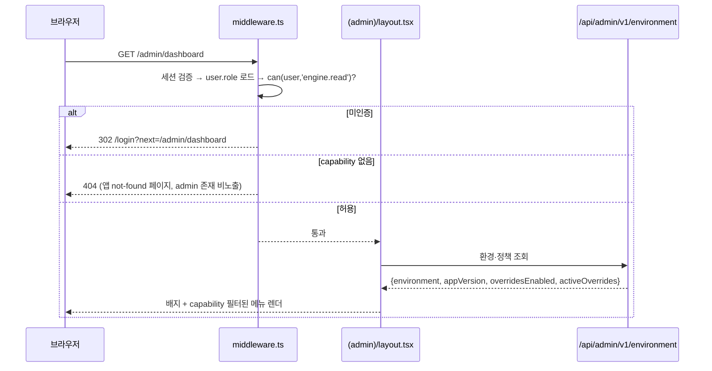

# 01. Console 정보구조(IA) — `(admin)` 라우트 그룹

> 원문 §79·§80·§81·§95·§114~§117·§123·§124. 정본: `../role-permission.md`(capability) · `../api-contract.md`(Admin API) · `../module-dependency.md`(`src/modules/admin`). 화면 상세는 `../speech-platform/14-admin-speech-settings-ui.md`·`15-voice-management-admin-ui.md` 와 겹치지 않도록 여기서는 **구조·내비게이션·가시성 규칙**만 다룬다.

## 1. 목적

일반 사용자 설정(`/settings`)과 완전히 분리된 AI Engine Console 의 메뉴 트리, 라우트, 환경 배지, 역할별 가시성, 모바일/데스크톱 레이아웃을 확정한다. 앱 내부에 두되 **추후 독립 Admin Web 으로 분리 가능한 경계**를 처음부터 지킨다.

## 2. 범위

- 포함: 메뉴 트리 ↔ 라우트 ↔ 화면 ↔ 필요 capability ↔ Phase, 진입 경로, 환경 배지, 404/403 정책의 화면 측, 레이아웃 원칙, 분리 경계.
- 제외: 각 화면의 필드·버튼 상세(해당 번호 문서), API 계약.

## 3. 메뉴 트리와 라우트 (§80·§123 병합)

| 메뉴 | 라우트 `src/app/(admin)/admin/…` | 주요 내용 | 최소 capability | Phase |
|---|---|---|---|---|
| Dashboard | `dashboard` | §81 Overview: 역할별 활성 Engine·Connection·모델·상태, Active Voice, 설치 모델, 최근 Health, 현재 Config Version, Environment | `engine.read` | 1 |
| Speech › Realtime STT | `speech/realtime` | 역할 `REALTIME_STT` 의 Engine/Connection 선택·Effective Config·Health/Test | `engine.read` (편집 `config.edit`) | 1 / 2 |
| Speech › Analysis STT | `speech/analysis` | 역할 `ANALYSIS_STT` 동일 | 동일 | 1 / 2 |
| Speech › TTS | `speech/tts` | 역할 `TTS` 동일 + Voice 요약 | 동일 | 1 / 2 |
| LLM | `llm` | 역할 `LLM`: Provider·Connection·모델·temperature 등 Schema 동적 폼(§117) | `engine.read` | 1 / 2 |
| Voices | `voices`, `voices/[id]` | §114~§116 관리·상세·Preview Playground | `voices.read` / `voices.manage` | 1(목록) / 2(기본값·표시명·정렬 편집 #84·activate/disable #85·#86 — **task-012c-2**, D-C14: `VoiceProfile` 은 환경 칸 없는 전역 행이라 LOCAL 편집이 운영에 즉시 적용 — 환경 분리·PRODUCTION 보호를 012c-2 에서 함께 설계) / 4(Import·상세 Preview) |
| Voices › Versions (5차 §152~§154) | `voices/[id]/versions` | `VoiceModelVersion` 목록·TRAINED→VALIDATED→STAGING→CANARY(%)→PRODUCTION→DEPRECATED 전이·Golden 회귀 결과 링크 | `voices.manage` (Promote/Canary PRODUCTION 은 SUPER_ADMIN) | **사용자 결정 대기**(task-012c U-C1 — Phase 4 이관 권고: 새 버전을 들여올 Import 가 Phase 4) |
| Speech › TTS › Pronunciation Dictionary (5차 §130~§132) | `speech/tts/lexicon`, `speech/tts/lexicon/versions` | 발음 사전 검색·추가·수정·비활성·Import/Export·범위(GLOBAL/COURSE/LESSON/VOICE/USER)·적용 전/후 미리듣기·버전 목록·Rollback | `voices.read` / `voices.manage` (PRODUCTION 변경 확인은 SUPER_ADMIN) | **1(P0)** |
| Speech › TTS › TTS Quality (5차 §147~§151) | `speech/tts/quality` (탭: Golden · Regression Runs · A/B Compare) | Golden Dataset 관리·회귀 실행·결과표(실패율·지연·TTFA·RTF·길이 편차·수동 점수)·Blind A/B 세션 | `voices.manage` | 2(P1) — **task-012c-3**(DB 추가·U-C1·U-C2 뒤) |
| Plugins | `plugins`, `plugins/[id]` | §97~§99 Descriptor·Schema·Capabilities·Loaded·initError | `plugins.read` | 1 |
| Connections | `connections`, `connections/[id]` | Connection Profile CRUD·Health·Functional Test·Log level | `engine.read` / `engine.connections.manage` | 1(읽기·테스트) / 2(편집·enable·credentialRef 연결 — **task-012c**) / 4(생성·삭제 — D-C10) / 3(Log level — 015c) |
| Configuration | `configuration` (탭: Form · Raw JSON · Diff · Presets · Export/Import · Overrides) | §86~§92·§102~§107 | `config.effective.read` (Raw `config.raw.read`, 편집 `config.edit`) | 1(Effective 읽기) / 2 / 4 |
| Prompts | `prompts`, `prompts/[key]` | §118~§120 버전 목록·편집·Test·Activate | `prompts.read` / `prompts.edit` / `prompts.activate` | 2 — **task-012c-2**, A안(런타임 Activate 는 강사 페르소나만, `14` 머리) |
| Diagnostics | `diagnostics`, `diagnostics/[connectionId]` | §111~§113 Health·Metrics·Log level·Debug session · **TTS Observability 대시보드** `diagnostics/tts`(5차 §143: req/min·avg·p50·p95·p99·TTFA·error rate·cache hit·voice/engine 별·model load·폴백 건수) | `engine.read` / `trace.read` / `debug_session.create` | 1(Health) / 2(TTS 대시보드, P1 — **task-012c-3**, 012b-3 지표 뒤) / 3 |
| (보조) 루트·Trace 상세 | `/admin` → `dashboard` redirect · `diagnostics/traces/[traceId]` | 진입 기본 경로 · Trace 1건 상세(#129) | `console.access` / `trace.read` | 1 (task-005b H6) |
| Playground | `playground` (탭: STT · TTS · LLM · E2E) | §108·§109 | `playground.use` / `e2e.run` | 2(**task-012c-2**) / 3(E2E) |
| History | `history` (탭: Config versions · Audit · Rollback) | §93·§94 | `audit.read` / `config.rollback` | 2 — **task-012c**(D-C8: 설정 버전 목록·상세 `compare=previous\|active`·Rollback + 감사 조회 #137 한 화면, 발음 사전 감사는 옛 `scope=null` 행 포함·사전 버전 되돌리기는 사전 화면으로 링크) |

메뉴 항목은 사용자의 capability 로 **필터링**한다(없는 메뉴는 렌더링하지 않음). 탭 단위도 같다(예: `config.raw.read` 없으면 Raw JSON 탭 없음).

## 4. 진입 경로 (§79)

```text
/settings (상단 아바타)
 ├─ 기본정보·목표 / AI 선생님 / 음성 인식 / 학습          ← USER
 └─ 관리자 › AI Engine Console  → /admin/dashboard        ← engine.read 보유자에게만 행 노출
```

- 개발 빌드 "Developer Mode" 진입은 별도 두지 않는다. 역할이 곧 진입 조건이며 `APP_ENV=LOCAL` 에서도 capability 검사는 동일하다.
- 딥링크 `thekaiwa://admin/...` 은 지원하지 않는다(Phase 4 Admin Web 분리 시 재검토).

## 5. 환경 배지 (§95)

- `(admin)/layout.tsx` 상단 고정 바에 `GET /api/admin/v1/environment` 결과를 표시: `PRODUCTION` = 빨간 배경 + "운영 환경 — 변경은 확인 절차를 거칩니다", `LOCAL` = 회색, 슬롯 값(`DEVELOPMENT`·`STAGING`)은 파랑.
- 배지에는 `APP_ENV`, `appVersion`, `overridesEnabled`(§106 정책), 활성 Override 개수를 함께 표시한다.
- 배지는 모든 admin 화면에서 숨길 수 없다.

## 6. 역할별 가시성 (§124 대응, 정본 매트릭스는 `../role-permission.md`)

| 역할 | 보이는 메뉴 |
|---|---|
| USER | 없음 — `/admin/**` 전부 404 |
| ADMIN | Dashboard · Speech · LLM · Voices · Connections · Configuration(Form·Presets·Export) · Diagnostics(Health) · History(Audit·Rollback) |
| ADMIN 추가(5차) | Pronunciation Dictionary · Voices › Versions · TTS Quality · Diagnostics › TTS 대시보드 |
| DEVELOPER | ADMIN + Plugins · Configuration(Raw JSON·Diff·Overrides·Import) · Prompts(편집·Activate) · Diagnostics(Metrics·Log level·Debug) · Playground · Trace 뷰 |
| SUPER_ADMIN | 전부 + Credential ref 연결 UI · Production 확인 다이얼로그 · Environment 정책 편집 · Production Import |

화면 내 개별 버튼(적용·Rollback·Activate·Import)은 capability 없으면 **비활성 + 툴팁**이 아니라 **렌더링하지 않는다**. 존재를 노출하지 않는 것이 원칙이다(§79).

## 7. 레이아웃과 분리 경계

- `src/app/(admin)/layout.tsx` 는 `(app)` 의 하단 5탭 셸을 쓰지 않는 **별도 셸**이다. 데스크톱(≥1024px)은 좌측 사이드바 + 본문, 모바일(412px 기준)은 상단 바 + 햄버거 드로어. 표(Effective Config·Diff·Audit)는 모바일에서 카드형으로 접히고 가로 스크롤을 두지 않는다.
- Console 컴포넌트는 `src/components/admin/{console,configEditor,jsonEditor,diff,trace,playground}` 에만 두고 `(app)` 컴포넌트를 import 하지 않는다(공통은 `components/common`).
- 데이터 접근은 오직 `/api/admin/v1/*` fetch. 서버 컴포넌트가 `modules/admin` 을 직접 호출하는 것은 허용하되, 그 경우에도 다른 층을 직접 import 하지 않는다.
- 위 세 규칙을 지키면 Phase 4 에 `(admin)` 그룹을 별도 Next.js 앱(`admin.kaiwa.…`)으로 옮길 때 API·쿠키(`thekaiwa_session`, 도메인 확장)·CORS 만 조정하면 된다.
- Console 은 PWA/APK 셸에서도 열리지만 모바일에서는 읽기·Health·간단 Apply 까지만 권장하고 Raw JSON 편집·Import 는 데스크톱 경고를 띄운다(막지는 않음).

## 8. 시퀀스 — Console 진입



## 9. 검증/오류

- 라우트 가드는 `middleware.ts` 와 각 페이지 서버 컴포넌트 양쪽에서 검사한다(미들웨어 우회 대비). 상세 404/403 규칙은 `02` §5.
- 메뉴 정의는 코드 상수 `src/modules/admin/console/menu.ts`(`{path, label, capability, phase}`) 한 곳에 두고, 사이드바·드로어·breadcrumb 이 같은 상수를 읽는다.
- QA 체크: USER 로 `/admin/dashboard` → 404, ADMIN 으로 `/admin/playground` → 404 아님 403 페이지(콘솔 내부), DEVELOPER 로 Raw JSON 탭 표시, PRODUCTION 배지 색.

## 10. Phase

1: 셸·배지·Dashboard·Speech/LLM 읽기·Plugins·Connections 읽기·Diagnostics Health·**Pronunciation Dictionary(P0)** · 2: Configuration 편집 탭·Prompts·Playground·History·**Voices › Versions·TTS Quality·TTS 대시보드(P1, 사용자 결정)** · 3: E2E·Diagnostics 전체 · 4: Presets/Export/Import/Overrides 탭·Voices Import·Admin Web 분리 검토.

> **2026-09-29 task-012c 분할**: Phase 2 = 012c(Configuration Form·Raw JSON·Diff 탭, 연결 편집, Fallback 편집, History) → 012c-2(Prompts·Playground) → 012c-3(TTS Quality·TTS 대시보드). Voices › Versions 는 사용자 결정 대기(U-C1, Phase 4 이관 권고). 연결 생성·삭제는 4, Log level·Diagnostics 전체는 3(015c).

## 11. 미결

- Dashboard 갱신 주기(폴링 30s vs SSE)는 Phase 1 실측 후 결정.
- 모바일에서 Playground 오디오 업로드 UX(파일 선택 vs 녹음)는 designer 목업에서 결정.
