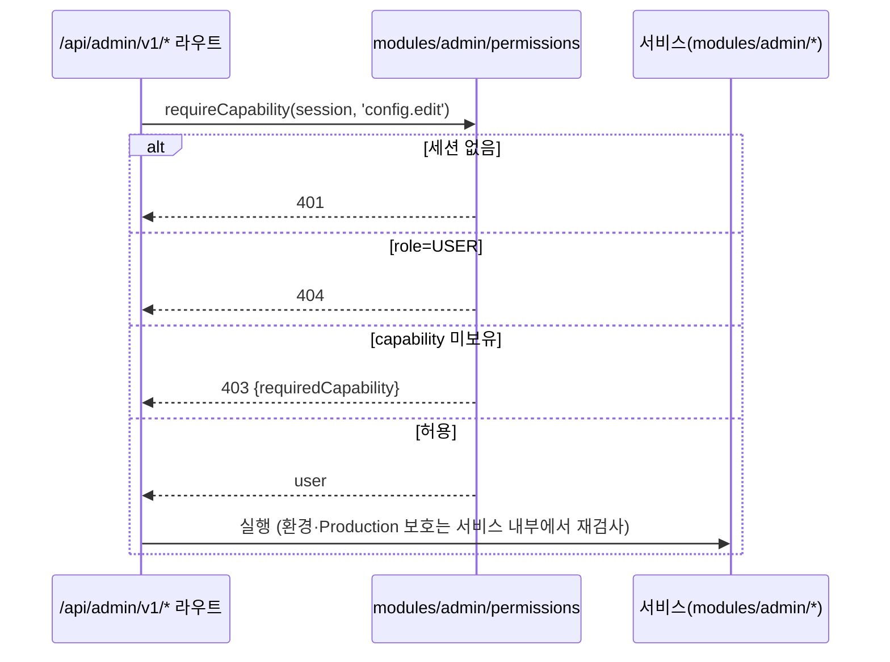

# 02. Role / Permission 모델 — Console 관점

> 정본: `../role-permission.md`(Role × capability 매트릭스·라우트/API 매핑·시드 계정). 이 문서는 매트릭스를 **인용**하고 Console 화면→capability 대응과 404/403 동작만 추가한다. 원문 §79·§124.

## 1. 목적

Console 의 모든 화면·탭·버튼·Admin API 가 어떤 capability 로 보호되는지 한 표로 고정해 developer(구현)·reviewer(감사)·qa(검증)가 같은 기준을 쓰게 한다.

## 2. 범위

- 포함: 역할 4단계 요약, capability 목록 인용, 화면→capability 표, API→capability 요약, 404/403 규칙, Production 보호와의 관계.
- 제외: 매트릭스 자체의 정의(정본), 인증(세션 쿠키·OAuth, `design-spec` §5).

## 3. 역할과 capability (정본 요약)

`Role {USER, ADMIN, DEVELOPER, SUPER_ADMIN}` 은 상위가 하위를 **포함**한다. 검사는 항상 `can(user, capability)` 로 하고 `user.role === 'ADMIN'` 같은 비교는 금지한다(`src/modules/admin/permissions`).

| 역할 | 정본 기본 capability |
|---|---|
| USER | `settings.read`, `settings.write` |
| ADMIN | + `voices.read`, `voices.manage`, `engine.read`, `engine.connections.manage`, `health.run`, `functional_test.run`, `config.effective.read`, `config.edit`, `config.rollback`, `prompts.read`, `audit.read`, `presets.manage`, `config.export` |
| DEVELOPER | ADMIN + `config.raw.read`, `plugins.read`, `playground.use`, `e2e.run`, `trace.read`, `debug_session.create`, `override.create`, `prompts.edit`, `prompts.activate`, `config.import` |
| SUPER_ADMIN | 전부 + `credentials.manage`, `secrets.read_ref`, `config.apply.production`, `override.production`, `config.import.production`, `environment.policy` |

시드: `OWNER_EMAIL` 계정은 `SUPER_ADMIN`, 그 외 가입자는 `USER`. 1인 앱이지만 매트릭스는 데이터(코드 상수 + 정본 문서)로 고정한다.

## 4. 화면 → capability

| 화면/탭/버튼 | 표시 조건 | 실행 조건(API) |
|---|---|---|
| `/admin/**` 진입 | `engine.read` | — |
| Dashboard | `engine.read` | `GET overview` |
| Speech·LLM 읽기 | `engine.read`, `config.effective.read` | `GET config/effective`, `GET config/schema/:engineId` |
| Speech·LLM 편집 폼 [검증]·[테스트]·[적용] | `config.edit` | `POST config/validate` · `config/test`(`functional_test.run`) · `config/apply` |
| [적용] in PRODUCTION (민감 키) | `config.edit` | `config.apply.production` 보유자의 확인 토큰 필요(`16` §6) |
| Connections 목록·상세·[Health]·[Functional Test] | `engine.read` | `health.run`, `functional_test.run` |
| Connections 생성·수정·삭제 | `engine.connections.manage` | 동일 |
| Connection 의 `credentialRef` 연결/변경 | `credentials.manage` | 동일 |
| Secret ref 이름·존재 여부 조회 | `secrets.read_ref` | `GET secrets`(speech-platform `08`) |
| Voices 목록·상세 | `voices.read` | `GET voices` |
| Voices Import·Activate·Disable·Sync | `voices.manage` | 해당 admin voices API |
| Plugins | `plugins.read` | `GET plugins`, `plugins/:id` |
| Configuration › Form | `config.effective.read` (편집 `config.edit`) | 위와 동일 |
| Configuration › Raw JSON (View) | `config.raw.read` | `GET config/raw/:scope/:targetId` |
| Configuration › Raw JSON (Edit) | `config.raw.read` + `config.edit` | `PUT config/raw/:scope/:targetId` |
| Configuration › Diff | `config.effective.read` | `POST config/diff` |
| Configuration › Presets | `presets.manage` | `GET/POST/DELETE presets` |
| Configuration › Export | `config.export` | `GET config/export` |
| Configuration › Import | `config.import` (PRODUCTION 대상: `config.import.production`) | `POST config/import` |
| Configuration › Overrides | `override.create` (PRODUCTION: `override.production` + 정책 허용) | `POST/DELETE overrides` |
| Prompts 목록·버전 보기 | `prompts.read` | `GET prompts`, `prompts/:key/versions` |
| Prompts 편집·저장(DRAFT)·Test | `prompts.edit` | `POST prompts/:key/versions`, `prompts/:key/test` |
| Prompts Activate/Rollback | `prompts.activate` | `POST prompts/:key/versions/:v/activate` |
| Diagnostics › Health | `engine.read` | `GET diagnostics/:connectionId`(health 부분) |
| Diagnostics › Metrics·Trace 목록 | `trace.read` | `GET traces`, `traces/:traceId`, diagnostics metrics |
| Diagnostics › Log level 변경 | `engine.connections.manage` + (PRODUCTION DEBUG 이상: `environment.policy`) | `PUT engine-connections/:id/log-level` |
| Diagnostics › Debug session | `debug_session.create` | `POST debug-sessions` |
| Playground STT/TTS/LLM | `playground.use` | `POST playground/stt|tts|llm` |
| Playground E2E | `e2e.run` | `POST playground/e2e` |
| History › Versions | `config.effective.read` | `GET config/versions` |
| History › Audit | `audit.read` | `GET audit` |
| History › [Rollback] | `config.rollback` (PRODUCTION 민감 키: + 확인 토큰) | `POST config/versions/:id/rollback` |
| Environment 정책 편집 | `environment.policy` | `PUT` 계열은 `AppSetting` 경유(`16` §4) |

## 5. 404 / 403 동작

| 상황 | 페이지 라우트 | Admin API |
|---|---|---|
| 미인증 | `302 /login?next=` | `401 UNAUTHENTICATED` |
| 인증됐으나 admin 계열 capability 전무(USER) | **404** (콘솔 존재 비노출) | **404 NOT_FOUND** (사용자 API 의 "타인 리소스 404" 와 같은 원칙) |
| `engine.read` 는 있으나 해당 화면 capability 없음 | 콘솔 내부 **403 페이지**("권한이 없습니다", 메뉴는 유지) — 다만 메뉴에서 이미 숨겨져 직접 URL 진입 시에만 발생 | `403 FORBIDDEN` `{code:'FORBIDDEN', requiredCapability:'config.raw.read'}` |
| Production 보호(확인 토큰 없음·정책 비활성) | — | `403 FORBIDDEN` `{code:'PRODUCTION_CONFIRMATION_REQUIRED' \| 'OVERRIDE_DISABLED_IN_PRODUCTION'}` |
| 캐퍼빌리티는 있으나 리소스 없음 | 404 | `404 NOT_FOUND` |

응답 형식은 사용자 API 와 같은 `{success:false, message, data:{code, requiredCapability?}}`. 403 응답에는 필요한 capability 를 명시해 UI 가 안내할 수 있게 하되, 404 응답은 아무 힌트도 주지 않는다.

## 6. 시퀀스 — API capability 검사

## 7. 검증/오류

- 모든 `/api/admin/v1/*` 라우트는 첫 줄이 `requireCapability` 여야 한다(reviewer 체크리스트). capability 문자열은 `src/modules/admin/permissions/capabilities.ts` 상수만 사용, 문자열 리터럴 산재 금지.
- 정본 매트릭스와 `../api-contract.md` 의 엔드포인트별 capability 표기는 자동 대조(스크립트 `npm run permissions:check`, Phase 2).
- QA: 역할별 계정 4개로 §4 표 전 행을 실행해 표시/실행 조건이 일치하는지 확인.

## 8. Phase

1: `Role` 4단계·`can()`·라우트/API 가드·404/403 · 2: 편집 계열 capability 활성 · 3: trace/debug/e2e · 4: override/import/production 계열.

## 9. 미결

- 역할 변경 API(`PUT users/:id/role`)는 admin API 목록에 없다. 현재는 시드·DB 직접 변경으로 두고, 2인 이상 사용 시 `SUPER_ADMIN` 전용 엔드포인트를 `../api-contract.md` 에 추가 제안.
- 정본 매트릭스에 없는 세부 capability(예: `voices.import` 를 `voices.manage` 에서 분리)는 필요 시 정본에서 먼저 추가한다.
