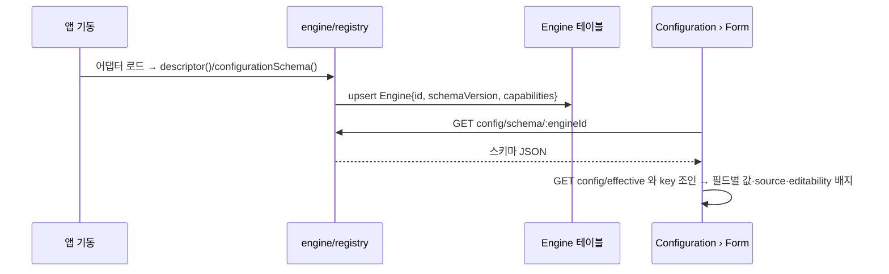

# 03. Engine Configuration Schema 정의

> 원문 §86·§87·§100·§101·§56·§57. 정본: `../speech-platform/07-engine-configuration-schemas.md`(엔진별 실제 스키마 JSON) · `../configuration-resolution.md`(editability 규칙) · `../module-dependency.md`(Provider 인터페이스). 여기서는 **메타데이터 필드·Provider 노출 방식·UI 자동 생성·문서 자동 생성**을 정의한다.

## 1. 목적

Engine 마다 다른 설정 UI 를 하드코딩하지 않기 위해(§125-6) 모든 EngineProvider 가 같은 형태의 `ConfigurationSchema` 를 제공하고, Console 이 이를 읽어 Form·JSON 편집기·문서를 생성한다.

## 2. 범위

- 포함: 스키마 필드 정의, 타입, editability, Provider 노출 계약(TS/Python), `GET config/schema/:engineId` 응답, Form/JSON 생성 규칙, 문서 자동 생성.
- 제외: 엔진별 키 목록(정본 speech-platform `07`), 해석 우선순위(`04`·`05`).

## 3. 스키마 메타데이터 (§86 확장)

```json
{
  "engineId": "faster-whisper",
  "schemaVersion": 3,
  "groups": ["connection", "runtime", "logging"],
  "properties": [
    {
      "key": "runtime.cpuThreads",
      "group": "runtime",
      "type": "INTEGER",
      "default": 4,
      "min": 1,
      "max": 32,
      "description": "faster-whisper inference 에 사용할 CPU thread 수",
      "impact": "높을수록 CPU 사용량 증가, 우분투 가용 코어 초과 시 지연 악화",
      "editability": "RUNTIME_EDITABLE",
      "restartRequired": false,
      "productionSensitive": false,
      "dependsOn": [{ "key": "runtime.device", "equals": "cpu" }],
      "uiHint": { "widget": "number", "step": 1 }
    },
    {
      "key": "runtime.model",
      "group": "runtime",
      "type": "ENUM",
      "enum": ["small", "medium", "large-v3"],
      "default": "medium",
      "description": "Whisper 모델 크기",
      "impact": "메모리·지연·정확도 트레이드오프",
      "editability": "RESTART_REQUIRED",
      "restartRequired": true,
      "productionSensitive": true
    },
    {
      "key": "connection.credentialRef",
      "group": "connection",
      "type": "SECRET_REF",
      "editability": "SECRET",
      "description": "SecretResolver 참조 이름(env:NAME | file:<name>)",
      "productionSensitive": true
    }
  ]
}
```

| 필드 | 필수 | 의미 |
|---|---|---|
| `key` | ✓ | 점 표기 경로. `connection.*`·`runtime.*`·`logging.*` 그룹 접두 고정 |
| `type` | ✓ | `STRING · INTEGER · NUMBER · BOOLEAN · ENUM · PATH · URL · DURATION_MS · SECRET_REF · JSON` |
| `default` | ✓(SECRET 제외) | `DEFAULT` 층 값 |
| `min`/`max`/`enum`/`pattern`/`maxLength` | 타입별 | 검증 규칙 |
| `description` | ✓ | 한 줄 설명(문서·툴팁) |
| `impact` | 권장 | 변경 영향(§100 "변경 영향") |
| `editability` | ✓ | `READ_ONLY · RUNTIME_EDITABLE · RESTART_REQUIRED · REDEPLOY_REQUIRED · SECRET` |
| `restartRequired` | ✓ | `editability ∈ {RESTART_REQUIRED, REDEPLOY_REQUIRED}` 와 동치(§86 호환용 중복 필드, 검증 시 일치 확인) |
| `productionSensitive` | ✓ | PRODUCTION 에서 SUPER_ADMIN 확인 대상(§96: Engine·Model·Connection·Credential·Fallback 계열은 `true`) |
| `dependsOn` | 선택 | 조건부 표시·의존성 검증(`10` §4) |
| `uiHint` | 선택 | 위젯·단계·placeholder |
| `deprecated` | 선택 | 표시하되 편집 불가, 문서에 표기 |
| `allowedRefs` | SECRET_REF 필수 | 이 키에 넣을 수 있는 ref 의 **정확한 목록**(`env:NAME`·`file:name`, 정확 일치). 목록 밖은 거부(`422 E_REF_NOT_ALLOWED`) — task-012c Codex C1 CX-1(2026-09-29). 전역 거부 분류(부팅·내부 시크릿)는 이 목록보다 먼저 검사하므로 여기 적어도 통과하지 못한다(`../configuration-resolution.md` §10) |

`READ_ONLY` 예: `runtime.modelPath`(manifest 가 정함) · `REDEPLOY_REQUIRED` 예: `connection.serviceVersion`(pm2 배포로만 변경) · `SECRET` 키는 값 대신 ref 이름만 화면에 나온다(§103·§125-12).

## 4. Provider 노출 계약

- TS 어댑터(`src/modules/engine/adapters/{stt,tts,llm}/*`)는 `descriptor()`·`configurationSchema()`·`capabilities()`·`healthCheck(profile)`·`functionalTest(profile)` 를 구현한다(§98). Registry(`engine/registry`)가 기동 시 전 어댑터를 로드해 `Engine` 테이블에 `schemaVersion` 과 함께 스냅샷을 upsert 한다.
- Python 서비스(`speech/common/engine/schema`)도 같은 JSON 을 내보낸다. 앱은 기동·Health 시 Python `GET /health` 의 `schemaHash` 를 TS 스키마 해시와 비교하고 불일치면 Connection 상태를 `DEGRADED` + `detail.schemaDrift=true` 로 표시한다. **TS 스키마가 정본**이며 Python 은 검증만 반복한다.
- 스키마는 코드에서만 온다. DB·yaml 에 스키마를 두지 않는다(§101 "소스코드 설정 → Configuration Schema → Console").
- 온디바이스 엔진(`connectionType=ONDEVICE`, sherpa-onnx)은 TS 어댑터가 스키마를 갖고, 앱은 `GET /api/v1/speech/config` 로 해석된 값만 받는다.

`GET /api/admin/v1/config/schema/:engineId` 응답 = 위 JSON + `{engine:{id,displayName,type,connectionTypes,capabilities}, loadedAt}`.

## 5. Form UI 자동 생성 규칙 (§86·§88·§101)

| `type` | 위젯 | 비고 |
|---|---|---|
| STRING / PATH / URL | text input | `pattern`·`maxLength` 클라이언트 검증, 서버 재검증 |
| INTEGER / NUMBER / DURATION_MS | number input (`min`·`max`·`step`) | DURATION_MS 는 "ms" 접미 표기 |
| BOOLEAN | toggle | |
| ENUM | select | `enum` 순서 유지 |
| SECRET_REF | ref 선택 드롭다운(**`allowedRefs` ∩ `GET secrets` 의 존재 ref** — task-012c CX-1) | `credentials.manage` 없으면 읽기 전용 표시 |
| JSON | 코드 블록(접힘) | Raw JSON 탭으로 유도 |

- 각 필드 옆에 `editability` 배지(READ_ONLY 회색 · RUNTIME 초록 · RESTART 주황 · REDEPLOY 빨강 · SECRET 자물쇠)와 현재 `source`(`04`) 를 표시한다.
- `dependsOn` 미충족 필드는 비활성(값은 보존). `deprecated` 는 경고색.
- `READ_ONLY`·`REDEPLOY_REQUIRED` 는 폼에서 편집 불가, Raw JSON 에서도 PUT 시 400.
- 폼과 JSON 편집기는 하나의 draft 를 공유한다(`08` §6).

## 6. 문서 자동 생성 (§100)

- `npm run config:docs` 가 전 어댑터 스키마를 읽어 `docs/generated/engine-config/<engineId>.md` 를 생성한다(표: 키·타입·기본값·범위·설명·변경 영향·editability·restart·productionSensitive). 생성물은 커밋하되 손으로 고치지 않는다.
- Console 의 필드 툴팁·`Plugins/[id]` 의 "Configuration Schema › View" 는 같은 스키마에서 렌더링하므로 문서·화면·검증이 항상 한 소스다.

## 7. 시퀀스 — 스키마 로드와 폼 생성



## 8. 검증/오류

- 스키마 자체 검증(기동 시): `key` 유일·그룹 접두 일치·`default` 가 자기 제약을 만족·`restartRequired` 와 `editability` 일치·`enum` 비어 있지 않음. 실패 시 해당 Engine 을 `Plugins` 에 `initError` 로 표시하고 라우터에서 제외한다(§99).
- `schemaVersion` 상승 시 기존 `ConfigurationVersion.snapshot` 에 없는 새 키는 `DEFAULT` 로 해석되고, 사라진 키는 Effective 화면에 "스키마 외 키" 경고로 남는다(`09` §5).

## 9. Phase

1: 스키마 정의·Registry 스냅샷·`GET config/schema`·Plugins 화면 표시 · 2: Form/JSON 생성·검증 · 3: Python 드리프트 검사 · 4: `config:docs` 생성 파이프라인(문서화 자동화는 2 에서 앞당길 수 있음).

## 10. 미결

- `impact` 를 자유 텍스트로 둘지 `{cpu,memory,latency,accuracy}` 등급으로 구조화할지 — Phase 2 UI 목업 후 결정.
- LLM 어댑터(`claude-cli`)의 모델 목록(`haiku·sonnet·opus`)을 `enum` 으로 고정할지 Provider 가 런타임에 조회하게 할지.
