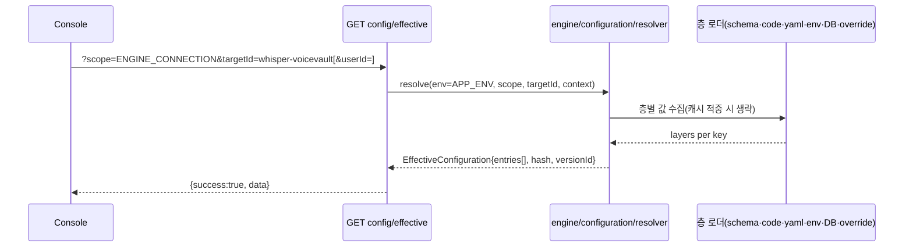

# 04. Effective Configuration Resolver 설계

> 원문 §82·§83·§84·§126. 정본: `../configuration-resolution.md` §3(해석 알고리즘·키별 편집성·Override TTL). 이 문서는 정본을 인용하고 **출력 형태·캐시/무효화·Console 표시**를 보탠다. 층별 우선순위 예시는 `05`.

## 1. 목적

DB 값이 아니라 **지금 프로세스가 실제로 쓰는 최종 값**과 그 출처를 키 단위로 산출해 Console(관리자·개발자)과 Engine Runtime 이 같은 결과를 보게 한다(§125-2·3·4).

## 2. 범위

- 포함: 입력·출력 계약, 층 소스 정의, 캐시·무효화, Python 서비스와의 정합, 화면 예시(`threads` env 오버라이드).
- 제외: 층 순서의 근거(정본), 편집·Apply(`08`~`10`).

## 3. 입력과 층 소스

`resolve({environment, scope, targetId, context?}) → EffectiveConfiguration` (모듈 `src/modules/engine/configuration/resolver`).

| 층(낮음→높음) | 소스 데이터 | `sourceRef` 형식 |
|---|---|---|
| `DEFAULT` | 스키마 `default` | `schema:<engineId>@<schemaVersion>#<key>` |
| `SOURCE_CODE` | 어댑터 코드 상수(`defaults()`), 프롬프트 파일 v0 | `code:<모듈 경로>#<심볼>` |
| `APPLICATION_CONFIG` | `speech/speech.config.yml`, `app.config.yml` | `file:speech.config.yml#connections[whisper-voicevault].runtime.cpuThreads` |
| `ENVIRONMENT` | 프로세스 env(`SPEECH_*`, `TTS_*`, `LLM_*` 접두, 키 매핑 표는 정본) | `env:SPEECH_THREADS` |
| `DATABASE` | Console Apply 로 물화된 DB 행 중 **연결 프로필이 아닌 것**: `EngineFallbackPolicy`·`AppSetting`·`VoiceProfile.defaults`·`PromptVersion(ACTIVE)` | `db:AppSetting/<key>` · `db:EngineFallbackPolicy/<role>` · `db:ConfigurationVersion/<id>` |
| `CONNECTION_PROFILE` | `EngineConnection.connection`·`runtime`·`logLevel` Json(Apply 로 물화) | `db:EngineConnection/<id>#runtime.cpuThreads` (+ `version:<ConfigurationVersion.id>`) |
| `USER_SETTING` | `UserVoiceSetting`·`UserSpeechSetting`·`Profile` — **`context.userId` 가 있을 때만** | `db:UserVoiceSetting/<userId>#speed` |
| `RUNTIME_OVERRIDE` | 만료·철회되지 않은 `RuntimeOverride`(TEMPORARY 전역 / SESSION 은 `context.sessionId` 일치) | `override:<id>` |

값이 없는 층은 건너뛰고, 가장 높은 층의 값이 `value`, 그 층이 `source` 가 된다. 하위 층 값들은 `layers[]` 에 그대로 남겨 화면이 "Default 1.0 / Voice Profile 0.9 / User 0.8" 처럼 펼칠 수 있게 한다(§85).

## 4. 출력 형태

```json
{
  "environment": "PRODUCTION",
  "scope": "ENGINE_CONNECTION",
  "targetId": "whisper-voicevault",
  "resolvedAt": "2026-09-26T10:32:11+09:00",
  "versionId": "cfgv_01J...",
  "hash": "sha256:…",
  "entries": [
    {
      "key": "runtime.cpuThreads",
      "value": 4,
      "source": "ENVIRONMENT",
      "sourceRef": "env:SPEECH_THREADS",
      "editability": "RUNTIME_EDITABLE",
      "layers": [
        { "source": "DEFAULT", "value": 4, "sourceRef": "schema:faster-whisper@3#runtime.cpuThreads" },
        { "source": "APPLICATION_CONFIG", "value": 8, "sourceRef": "file:speech.config.yml#connections[whisper-voicevault].runtime.cpuThreads" },
        { "source": "ENVIRONMENT", "value": 4, "sourceRef": "env:SPEECH_THREADS" }
      ],
      "shadowed": true,
      "warnings": ["APPLICATION_CONFIG 값 8 이 ENVIRONMENT 에 의해 가려짐"]
    }
  ]
}
```

- `entries` 는 스키마 키 전체를 포함한다(값이 DEFAULT 뿐이어도 포함). `SECRET` 키는 `value` 대신 `{credentialRef, exists:boolean, lastUsedAt?}` 만 넣는다.
- `shadowed=true` 는 더 낮은 층에 다른 값이 있어 개발자가 "왜 8 이 아니라 4 인가"를 물을 상황(§83)을 표시한다.
- `hash` 는 `entries[].{key,value}` 정규화 JSON 의 해시. Diff·Apply 의 낙관적 잠금(`08`·`10`)과 Python 정합 검사에 쓴다.

## 5. 캐시와 무효화

- 프로세스 메모리 캐시 키 = `(environment, scope, targetId, sessionId?)`. `USER_SETTING` 층은 캐시하지 않고 요청 시 병합한다(`05` §5).
- 무효화 트리거: `config/apply`·`rollback`·`overrides` 생성/철회·Override 만료 스윕·`AppSetting` 변경·`prompts/.../activate`·`engine-connections` CRUD. 트리거는 `engine/configuration/versions` 가 발행하는 in-process 이벤트 `config.changed{scope,targetId}` 하나로 통일한다.
- `ENVIRONMENT`·`APPLICATION_CONFIG` 는 기동 시 1회 로드. 변경은 재기동이 필요하며 Console 은 파일 mtime 과 로드 시각을 비교해 "yaml 이 로드 이후 변경됨" 배너를 띄운다(자동 반영 없음).
- pm2 다중 인스턴스 대비: `ConfigurationVersion` 최신 `id` 를 30초 주기로 폴링해 다른 인스턴스의 Apply 를 감지한다(Phase 2, 인스턴스 1개면 무해).

## 6. Python 서비스와의 정합

- 앱 resolver 가 정본이다. Apply 시 RUNTIME_EDITABLE 키를 `POST /admin/config/apply` 로 밀어넣고, Diagnostics 는 `GET /admin/config/effective` 를 받아 앱 측 `entries` 와 키별 비교해 `drift[]` 를 표시한다(`15` §4).
- Python 은 자기 프로세스 env·yaml 도 읽으므로 같은 8층 중 `DEFAULT·APPLICATION_CONFIG·ENVIRONMENT·CONNECTION_PROFILE(push 받은 값)·RUNTIME_OVERRIDE(push 받은 값)` 만 갖는다. 드리프트는 오류가 아니라 경고이며 재기동 안내로 해소한다.

## 7. 화면 예시 (§83 `threads`)

```text
Analysis STT · whisper-voicevault            Environment: PRODUCTION   Version: cfgv_01J…

Setting               Effective   Source               Ref                              Editability
runtime.model         medium      CONNECTION_PROFILE   db:EngineConnection/whisper-…    RESTART_REQUIRED
runtime.cpuThreads    4  ⚠        ENVIRONMENT          env:SPEECH_THREADS               RUNTIME_EDITABLE
  └ 가려진 값: APPLICATION_CONFIG = 8 (speech.config.yml)
runtime.device        cpu         DEFAULT              schema:faster-whisper@3          RESTART_REQUIRED
connection.timeoutMs  10000       APPLICATION_CONFIG   file:speech.config.yml#…         RUNTIME_EDITABLE
connection.baseUrl    http://127.0.0.1:8090  CONNECTION_PROFILE  db:EngineConnection/…  RESTART_REQUIRED
logging.level         INFO        DATABASE             db:AppSetting/log.production.maxLevel  RUNTIME_EDITABLE
```

⚠ 행을 펼치면 `layers[]` 가 순서대로 보인다. `ENVIRONMENT` 가 이긴 키는 Console 에서 편집해도 효과가 없으므로 편집 폼은 그 키를 **잠그고** "env `SPEECH_THREADS` 를 제거하거나 값을 바꾸세요"를 안내한다(`08` §5 `blocked`).

## 8. 시퀀스



## 9. 검증/오류

- `targetId` 가 환경에 없으면 404. `userId` 지정은 `config.effective.read` + `trace.read`(타인 설정 열람) 필요, 없으면 403.
- resolver 단위 테스트 픽스처: 8층 전부 값이 있는 키, DEFAULT 만 있는 키, SECRET 키, 만료된 Override, SESSION Override 불일치 — 기대 `source` 를 고정한다.
- `hash` 가 Apply 요청의 `baseHash` 와 다르면 `409 CONFLICT`(다른 변경이 먼저 적용됨).

## 10. Phase

1: resolver·`GET config/effective`·Source/layers 표시 · 2: 무효화 이벤트·낙관적 잠금·Python push · 3: 드리프트 비교 · 4: Override 층 활성.

## 11. 미결

- `DATABASE` 와 `CONNECTION_PROFILE` 의 경계(§3 표)는 `../configuration-resolution.md` 와 대조 후 한쪽으로 통일한다.
- env 키 매핑 표(`SPEECH_THREADS` → `runtime.cpuThreads`)를 어댑터 스키마의 `envKey` 필드로 둘지 정본 별표로 둘지.
