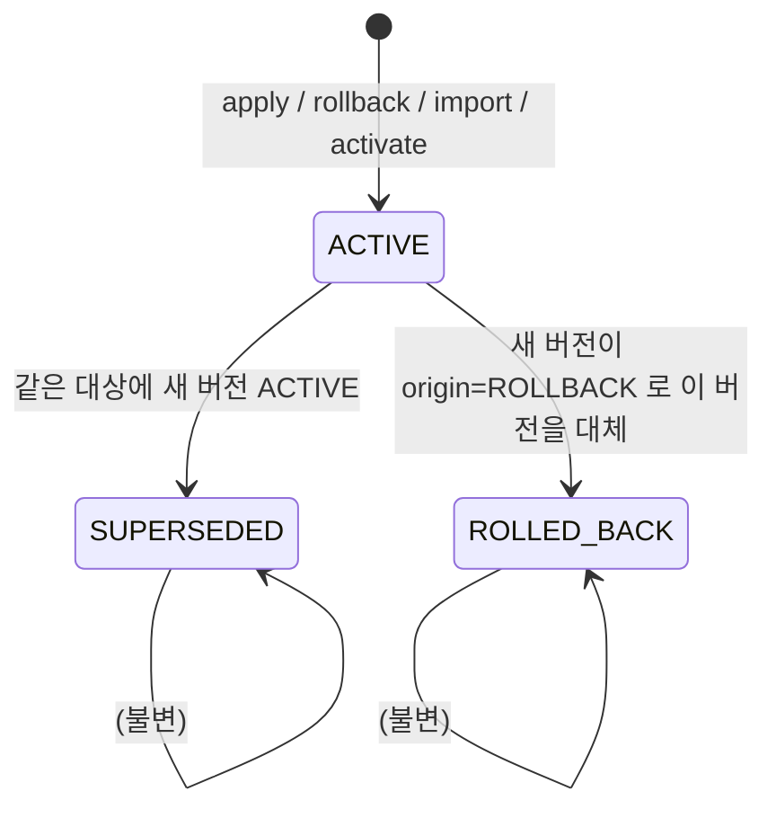

# 06. ConfigurationVersion 엔티티 설계

> 원문 §93·§94·§126. 정본: `../domain-model.md`(Prisma 정본, L5 engine 소유). 여기서는 필드 의미·유일성·상태 전이·snapshot/diff 구분·AuditLog/RuntimeOverride/Preset 과의 관계를 정한다.

## 1. 목적

모든 관리자 설정 변경(Apply·Rollback·Import·Prompt Activate·Voice 기본값 변경)을 **불변 버전**으로 남겨 History·Diff·Rollback 의 단일 근거로 삼는다(§125-10·11).

## 2. 범위

- 포함: 필드·인덱스·상태·snapshot vs diff·생성 규칙·다른 엔티티와의 관계·보존.
- 제외: Diff 계산(`08`), Rollback 절차(`09`), 감사 행위 목록(`07`).

## 3. 정의 (정본 발췌)

```prisma
enum ConfigScope { ENGINE_CONNECTION FALLBACK_POLICY PROMPT APP_SETTING VOICE_PROFILE PRESET }
enum ConfigVersionStatus { ACTIVE SUPERSEDED ROLLED_BACK }

model ConfigurationVersion {
  id            String   @id @default(cuid())
  environment   Environment
  scope         ConfigScope
  targetId      String   @db.VarChar(120)   // connectionId | role | promptKey | appSettingKey | voiceProfileId | presetId
  version       Int                          // 대상별 1부터 증가
  snapshot      Json                         // 관리 층(DATABASE/CONNECTION_PROFILE)에 저장된 전체 값
  diff          Json                         // 직전 ACTIVE 대비 변경 키 [{key,before,after,beforeSource,afterSource}]
  effectiveHash String?  @db.VarChar(80)     // Apply 시점 Effective hash(`04`)
  schemaVersion Int?                         // ENGINE_CONNECTION 일 때 스키마 버전
  actorUserId   String
  reason        String?  @db.VarChar(500)
  origin        ConfigVersionOrigin          // APPLY | RAW_JSON | ROLLBACK | IMPORT | PROMPT_ACTIVATE | SYSTEM
  rollbackOfId  String?                      // origin=ROLLBACK 일 때 복원 대상 버전
  importId      String?  @db.VarChar(40)     // origin=IMPORT 일 때 묶음 id
  status        ConfigVersionStatus @default(ACTIVE)
  createdAt     DateTime @default(now())
  @@unique([environment, scope, targetId, version])
  @@index([environment, scope, targetId, status])
  @@index([actorUserId, createdAt])
}
```

`origin`·`rollbackOfId`·`importId`·`effectiveHash`·`schemaVersion` 은 계획 §9-C 초안에 없던 보조 필드다(정본 반영 요청, §10 미결).

> **결정(task-012c D-C2, 2026-09-29) — 보조 컬럼은 추가하지 않는다(스키마 0).** 실제 스키마(`prisma/schema.prisma`)는 `restoredFromVersion Int?`·`testResult Json?`·`supersededAt` 을 갖고 위 보조 필드는 없다. 대응: `origin` → `snapshot._meta.origin`(`BASELINE|APPLY|RAW_JSON|ROLLBACK`, 물화·Diff 에서 제외하는 예약 키) + `AuditLog.action`(`config.baseline|config.apply|config.raw_apply|config.rollback`) · `rollbackOfId` → `restoredFromVersion`(번호) · `schemaVersion` → `snapshot._meta.schemaVersion` · `effectiveHash` → 불필요(`baseVersion` 낙관 잠금 + 무상태 `summaryHash`, configuration-resolution §8-1) · `importId` → Phase 4 에서 다시 판단. `diff` 칸은 배열 대신 봉투 `{entries[], summary, candidateHash}`. 정본 = `configuration-resolution.md` §6-2 "task-012c 확정" 단락.

## 4. 유일성·불변성

- `(environment, scope, targetId, version)` 유일. `version` 은 대상별 직렬 증가이며 트랜잭션 안에서 `MAX(version)+1` 로 채번한다(동시 Apply 는 낙관적 잠금 `baseVersionId`/`baseHash` 불일치로 409).
- 행은 생성 후 `status` 외 어떤 컬럼도 UPDATE 하지 않는다. 삭제하지 않는다(§94 "기존 기록을 삭제하지 않는다").
- 대상당 `status=ACTIVE` 는 정확히 1행(부분 유일성은 앱 레벨 트랜잭션으로 보장; MariaDB 는 partial unique 미지원).

## 5. 상태 전이



- `ROLLED_BACK` 은 "이 버전이 문제라서 되돌려졌다"는 표식이며, 복원 **대상**(과거 버전)은 상태가 바뀌지 않는다. 복원 결과는 항상 새 `ACTIVE` 행이다.
- History 화면은 `version` 내림차순으로 표시하고 `ROLLED_BACK` 행에 배지를 단다.

## 6. snapshot 과 diff

| 항목 | `snapshot` | `diff` |
|---|---|---|
| 내용 | 그 대상의 관리 층 값 전체(예: `ENGINE_CONNECTION` = `{connection:{…}, runtime:{…}, logging:{…}}`) | 직전 ACTIVE 대비 변경 키만 |
| 용도 | Rollback 복원·Export·Preset 저장·물화 | History 표시·Audit `before/after`·알림 |
| SECRET | `credentialRef` 문자열만(값 없음) | ref 이름 변경만 기록 |
| 크기 | 스키마 키 수 × 값 (수십 KB 이내) | 작음 |

snapshot 은 **Effective 가 아니다.** env·yaml 층은 포함하지 않으며, 복원 시 그 시점의 env 가 다르면 Effective 도 달라진다(→ `09` §5 에서 rollback 응답에 현재 Effective 미리보기를 포함).

## 7. 생성 규칙 (어떤 행위가 버전을 만드는가)

| 행위 | scope | targetId | origin |
|---|---|---|---|
| Form/JSON Apply(`config/apply`, `PUT config/raw`) | ENGINE_CONNECTION · FALLBACK_POLICY · APP_SETTING · VOICE_PROFILE | 대상 id | APPLY / RAW_JSON |
| Rollback | 동일 | 동일 | ROLLBACK (+`rollbackOfId`) |
| Import | 파일에 포함된 각 대상마다 1행 | 대상 id | IMPORT (+공통 `importId`) |
| Prompt Activate | PROMPT | promptKey | PROMPT_ACTIVATE (snapshot = `{activeVersionId, promptVersion}`) |
| Preset 저장 | PRESET | presetId | APPLY (Preset 자체의 이력; 적용은 각 대상 버전으로) |
| 기동 시 최초 물화(yaml → 연결 identity 생성) | ENGINE_CONNECTION | connectionId | SYSTEM (`version=1`, actor = 시스템 계정) — **task-012c D-C5 로 대체**: 기동 시 일괄 생성 대신 **대상의 첫 적용 때 같은 트랜잭션에서 v1 = 지금 행 값(`_meta.origin=BASELINE`, actor 없음, 감사 `config.baseline`) → 적용 v2**. 012c scope(ENGINE_CONNECTION·FALLBACK_POLICY·APP_SETTING) 공통 — VOICE_PROFILE 은 012c-2(D-C14), 행이 없던 AppSetting 키의 기준선은 `{value, exists:false}`(되돌리면 행 삭제) |

만들지 **않는** 것: `RuntimeOverride` 생성/철회(임시), Health/Functional Test, Playground, Log level 임시 상향(PRODUCTION TTL 부여 시 — `15` §5), 사용자 설정 변경(7층).

## 8. 다른 엔티티와의 관계

- **AuditLog**: 버전 1행마다 `AuditLog` 1행(`action=config.apply|config.rollback|config.import|prompt.activate`, `targetId` 동일, `after.versionId`). 감사는 "누가·왜", 버전은 "무엇을". 버전이 없는 감사(Override·Test)는 있지만 감사가 없는 버전은 없다(같은 트랜잭션).
- **RuntimeOverride**: 버전을 만들지 않고 `RuntimeOverride.baseVersionId` 로 "어느 버전 위에 얹혔는지"만 기록한다. Rollback 은 활성 Override 를 건드리지 않되 응답 `warnings` 로 알린다.
- **ConfigurationPreset**: `snapshot` 을 복사해 저장하는 별도 테이블. Preset 적용은 편집기로 불러와 일반 Apply 경로를 타므로 결과 버전의 `reason` 에 `preset:<id>` 를 남긴다.
- **EngineConnection / EngineFallbackPolicy / AppSetting / VoiceProfile**: ACTIVE 버전의 `snapshot` 을 물화한 "현재 행". 물화와 버전 생성은 같은 트랜잭션.
- **PromptVersion**: 프롬프트 본문은 `PromptVersion` 이 갖고, `ConfigurationVersion(scope=PROMPT)` 은 "어느 PromptVersion 이 ACTIVE 인가"의 이력만 갖는다(`14` §6).

## 9. 조회 API (계약 정본 `../api-contract.md`)

`GET /api/admin/v1/config/versions?scope=&targetId=&status=&cursor=&limit=` → `{items:[{id, version, status, origin, actor{id,name}, reason, createdAt, diffSummary:{changed, keys[≤5]}}], nextCursor}`. 상세는 `GET config/versions/:id` 로 `snapshot`·`diff` 포함(정본에 추가 제안). `config.effective.read` 필요.

## 10. 검증/오류

- Apply 트랜잭션 순서: 채번 → 새 행 INSERT(ACTIVE) → 직전 ACTIVE UPDATE(SUPERSEDED|ROLLED_BACK) → 현재 행 물화 → AuditLog INSERT → 커밋 → `config.changed` 이벤트 → Python push(트랜잭션 밖, 실패 시 `applyResult` 로 보고).
- 보존: 영구. 대상당 행 수가 500 을 넘으면 History 화면은 페이지네이션만 하고 삭제·압축은 하지 않는다.
- QA: 같은 대상에 연속 Apply 3회 → version 1·2·3, ACTIVE 1행, Rollback to 1 → version 4 ACTIVE·3 ROLLED_BACK.

## 11. Phase

1: 기동 시 SYSTEM 버전 1 생성·`GET config/versions` · 2: Apply/Rollback/Prompt Activate 버전 · 4: Import·Preset 버전.

> 실제(2026-09-29): Phase 1(005b)에서는 버전 조회·SYSTEM 버전을 만들지 않았다 → **task-012c** 가 `GET config/versions`(#108·#108a)·첫 적용 기준선·Apply·Rollback 을 한꺼번에 구현, Prompt Activate(`scope=PROMPT`)는 012c-2.

## 12. 미결

- 보조 필드(`origin`·`rollbackOfId`·`importId`·`effectiveHash`·`schemaVersion`)의 정본 `../domain-model.md` 반영 여부.
- `GET config/versions/:id` 상세 엔드포인트가 정본 API 목록에 없음 — 추가 제안.
