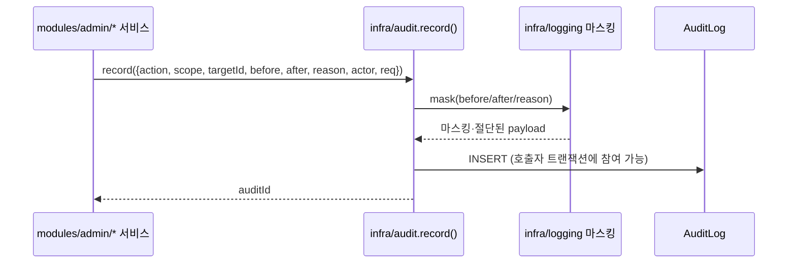

# 07. AuditLog 엔티티와 감사 대상 행위

> 원문 §93·§119·§125-10. 정본: `../domain-model.md`(L6 infra 소유). 기록 진입점은 `src/modules/infra/audit` 하나, 조회는 `src/modules/admin/audit`.

## 1. 목적

설정 변경뿐 아니라 Voice Import·Override·Export/Import·Prompt Activate·Debug Session·Log level 등 **모든 관리자 행위**를 누가·언제·무엇을·왜·어디서(환경·IP) 했는지 남긴다. `ConfigurationVersion` 이 "값의 이력"이라면 `AuditLog` 는 "행위의 이력"이다.

## 2. 범위

- 포함: 필드, 행위 카탈로그, `before/after` 규칙, 민감정보 규칙, 보존, 조회 API, 화면.
- 제외: 사용자(USER) 행위 감사(범위 밖 — 학습 데이터는 StudyLog), 접근 로그(nginx).

## 3. 정의 (정본 발췌)

```prisma
model AuditLog {
  id          String   @id @default(cuid())
  actorUserId String?                        // null = 시스템(기동·스케줄러)
  actorRole   Role?                          // 행위 시점 역할 스냅샷
  action      String   @db.VarChar(60)       // 아래 카탈로그
  scope       String?  @db.VarChar(40)       // ConfigScope 또는 VOICE|OVERRIDE|DEBUG|LOG_LEVEL|EXPORT|IMPORT|PROMPT
  targetId    String?  @db.VarChar(120)
  environment Environment
  before      Json?
  after       Json?
  reason      String?  @db.VarChar(500)
  result      AuditResult                    // OK | DENIED | FAILED
  ip          String?  @db.VarChar(64)
  userAgent   String?  @db.VarChar(200)
  traceId     String?  @db.VarChar(40)       // Playground/E2E/Test 와 연결
  createdAt   DateTime @default(now())
  @@index([environment, createdAt])
  @@index([scope, targetId, createdAt])
  @@index([actorUserId, createdAt])
  @@index([action, createdAt])
}
```

`actorRole`·`result`·`userAgent`·`traceId` 는 계획 초안 대비 추가 필드(정본 반영 제안).

## 4. 감사 대상 행위 카탈로그

| `action` | scope | before / after | 비고 |
|---|---|---|---|
| `config.apply` | ENGINE_CONNECTION·FALLBACK_POLICY·APP_SETTING·VOICE_PROFILE | diff 요약 / `{versionId, version}` | Form·Raw JSON 공통 |
| `config.rollback` | 동일 | `{fromVersionId}` / `{toVersionId(new), restoredFromVersionId}` | |
| `config.validate` · `config.test` | 동일 | — / `{ok, errors[≤10]}` | 결과가 FAILED 여도 기록(누가 무엇을 시도했는지) |
| `config.export` | EXPORT | — / `{scopes[], targetCount, secretsRedacted:true}` | 파일 내용은 기록하지 않음 |
| `config.import` | IMPORT | `{targetCount}` / `{importId, versionIds[]}` | Production 이면 `after.confirmedBy` |
| `preset.create` · `preset.delete` | PRESET | — / `{presetId, name}` | |
| `override.create` · `override.revoke` · `override.expire` | OVERRIDE | — / `{overrideId, kind, patchKeys[], expiresAt}` | `expire` 는 시스템 actor |
| `connection.create` · `connection.update` · `connection.delete` | ENGINE_CONNECTION | 변경 필드 | `credentialRef` 변경은 `credentials.set`·`credentials.clear` 로 별도 |
| `credentials.set` · `credentials.clear` | ENGINE_CONNECTION | `{credentialRef}` / `{credentialRef}` | ref 이름만, 값 절대 금지 |
| `health.run` · `functional_test.run` | ENGINE_CONNECTION | — / `{ok, latencyMs}` | Console 수동 실행만(스케줄 Health 는 `EngineHealth` 로 충분) |
| `loglevel.set` | LOG_LEVEL | `{level}` / `{level, ttlMinutes?}` | PRODUCTION DEBUG 이상은 `reason` 필수 |
| `voice.import` · `voice.activate` · `voice.disable` · `voice.archive` · `voice.sync` · `voice.update` | VOICE | 상태·defaults 변경 | Import 는 `after.importJobId` |
| `prompt.version.create` · `prompt.activate` · `prompt.test` · `prompt.sync` | PROMPT | `{activeVersion}` / `{version, source}` | `prompt.sync` 는 CLI actor(`npm run prompts:sync`, 시스템 계정 + 실행자 이메일 `reason`) |
| `playground.run` · `e2e.run` | PLAYGROUND | — / `{traceId, kind, connectionIds}` | 입력 텍스트·오디오는 기록하지 않음 |
| `debug_session.create` · `debug_session.end` | DEBUG | — / `{sessionId, captureAudio, captureText, expiresAt}` | |
| `environment.policy.set` | APP_SETTING | `{key,value}` / `{key,value}` | `override.production.enabled` 등 |
| `permission.denied` | (해당) | — / `{requiredCapability, path}` | 403 발생 시 자동 기록(404 는 기록하지 않음 — 존재 비노출) |

## 5. `before/after`·민감정보 규칙 (§103·§113)

- `SECRET` 키는 `credentialRef` 문자열만. 값·토큰·API 키는 어떤 필드에도 넣지 않는다. 기록 직전 `infra/logging` 의 마스킹 필터를 `before/after/reason` 에 동일 적용한다.
- 프롬프트 본문·Playground 입력·오디오·대화 텍스트는 넣지 않는다. 필요하면 `traceId`·`versionId` 로 참조만.
- `before/after` 는 각 8KB 를 넘지 않게 diff 요약으로 줄인다(초과 시 `truncated:true`).
- **`reason` 입력 검사(task-012c Codex C1 CX-3, 2026-09-29)**: 기록 전에 줄바꿈·제어문자 제거, 1~200자(PRODUCTION 10~200자), 비밀 유사 문자열이면 저장하지 않고 `422 E_REASON_SECRET_LIKE` 로 거절, 통과한 값은 AuditLog(와 ConfigurationVersion)에만 — 프로세스 로그에는 싣지 않는다. 판정 규칙 정본은 `../role-permission.md` §7.
- **action 이름(2026-09-29 정리)**: 정본은 `../role-permission.md` §7 — credentialRef 연결·해제는 `credentials.set`·`credentials.clear`(옛 표기 `credential.link`·`credential.unlink` 는 쓰지 않는다), 설정 적용은 `config.baseline`·`config.apply`·`config.raw_apply`·`config.rollback`.
- `ip` 는 nginx `X-Forwarded-For` 첫 값, 저장 30일 후 마스킹(스케줄, 개인정보 최소화).

## 6. 보존

- 행 삭제 없음. 기본 보존 무기한(1인 앱, 월 수백 행 수준). 10만 행 초과 시 연 단위 아카이브 테이블로 이동하는 관리 작업을 Phase 4 이후 검토.
- `ConfigurationVersion` 과 같은 트랜잭션에 기록되는 행위(§4 의 `config.*`, `prompt.activate`, `config.import`)는 버전 없이 감사만 남는 일이 없어야 한다(무결성 체크 스크립트).

## 7. 조회 API·화면

`GET /api/admin/v1/audit?from=&to=&scope=&targetId=&actorUserId=&action=&result=&cursor=&limit=50` → `{items:[{id, createdAt, actor{id,name,role}, action, scope, targetId, environment, result, reason, summary}], nextCursor}`. `summary` 는 `after` 에서 화면용으로 뽑은 한 줄(예: `model medium → large-v3`). 상세 `before/after` 는 행 펼침 시 같은 응답에 포함(별도 엔드포인트 없음). `audit.read` 필요.

History › Audit 탭: 시간 내림차순, 필터(환경·scope·actor·action·result), 행 클릭 → `before/after` JSON 뷰 + 연결된 `versionId`/`traceId` 링크.

## 8. 시퀀스 — 기록 진입점



`record()` 는 예외를 던지지 않고 실패 시 프로세스 로그에 남긴다 — 단, `config.*`·`prompt.activate`·`config.import` 처럼 트랜잭션에 참여하는 경우는 실패 시 전체 롤백.

## 9. 검증/오류

- reviewer 체크: 카탈로그의 모든 `action` 이 코드 상수(`infra/audit/actions.ts`)에 있고, 각 admin 서비스가 대응 행위에서 `record()` 를 호출한다.
- 마스킹 테스트: `after` 에 `sk-…`·`Bearer …`·`password` 패턴을 넣어 저장 결과가 `***` 인지.
- QA: 403 발생 시 `permission.denied` 1행, 404 시 0행.

## 10. Phase

1: 테이블·`record()`·`permission.denied`·`health/functional_test` 기록·`GET audit` · 2: `config.*`·`prompt.*`·`playground.run` · 3: `loglevel.*`·`debug_session.*`·`e2e.run` · 4: `override.*`·`config.export/import`·`preset.*`·`voice.import`.

## 11. 미결

- 추가 필드(`actorRole`·`result`·`userAgent`·`traceId`)의 정본 반영.
- `ip` 마스킹 기간(30일)은 개인정보 정책(design-spec §18)과 맞춰 확정.
