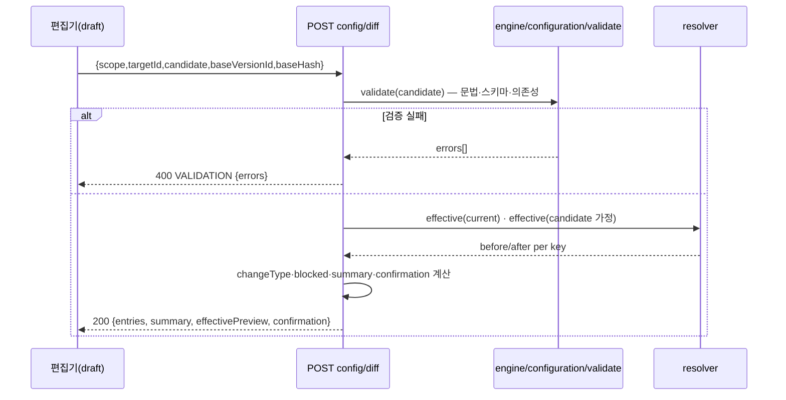

# 08. Configuration Diff API — `POST /api/admin/v1/config/diff`

> 원문 §88·§91·§92. 정본: `../api-contract.md`(요청/응답 정본) · `../configuration-resolution.md`. 여기서는 Diff 계산 의미, 응답 필드, UI 렌더링, **Form ↔ JSON 동기화 규칙**을 정한다. Validate/Test/Apply 파이프라인 전체는 `10`.

## 1. 목적

Apply 전에 "무엇이 어떻게 바뀌고, 그 변경이 실제로 효력이 있는지(env 에 가려지지 않는지), 재기동이 필요한지, Production 확인 대상인지"를 키 단위로 보여준다(§125-9).

## 2. 범위

- 포함: 요청·응답 계약, 변경 유형, `blocked` 판정, Production Change Summary·확인 토큰 발급, UI, Form/JSON 동기화.
- 제외: 스키마 검증 규칙(`10` §4), 버전 생성(`06`).

## 3. 요청

```json
POST /api/admin/v1/config/diff
{
  "scope": "ENGINE_CONNECTION",
  "targetId": "whisper-voicevault",
  "candidate": {
    "connection": { "baseUrl": "http://127.0.0.1:8090", "timeoutMs": 15000 },
    "runtime": { "model": "large-v3", "device": "cpu", "computeType": "int8", "cpuThreads": 8, "workers": 1 },
    "logging": { "level": "INFO" }
  },
  "baseVersionId": "cfgv_01J…",
  "baseHash": "sha256:…",
  "includeEffectivePreview": true
}
```

- `candidate` = 관리 층(snapshot 형식, `06` §6) 전체. 부분 patch 가 아니다(편집기가 항상 전체 draft 를 보낸다).
- `baseVersionId`/`baseHash` = 편집기가 로드한 시점의 ACTIVE 버전·Effective hash. 다르면 `409 CONFLICT` 로 "다른 변경이 먼저 적용됨, 다시 불러오세요".
- `environment` 는 요청에 없다 — 항상 `APP_ENV`. (다른 환경의 Diff 는 Import 미리보기 `16` §7 로만.)
- capability: `config.effective.read`. Diff 는 아무것도 저장하지 않으며 `config.validate` 를 내부에서 먼저 수행한다(검증 실패면 400, Diff 없음).

## 4. 응답

```json
{
  "success": true,
  "data": {
    "baseVersionId": "cfgv_01J…",
    "candidateHash": "sha256:…",
    "entries": [
      {
        "key": "runtime.model",
        "changeType": "CHANGED",
        "before": { "value": "medium", "source": "CONNECTION_PROFILE", "sourceRef": "db:EngineConnection/whisper-voicevault#runtime.model" },
        "after":  { "value": "large-v3", "source": "CONNECTION_PROFILE", "sourceRef": "candidate" },
        "editability": "RESTART_REQUIRED",
        "restartRequired": true,
        "productionSensitive": true,
        "blocked": null
      },
      {
        "key": "runtime.cpuThreads",
        "changeType": "CHANGED",
        "before": { "value": 4, "source": "ENVIRONMENT", "sourceRef": "env:SPEECH_THREADS" },
        "after":  { "value": 4, "source": "ENVIRONMENT", "sourceRef": "env:SPEECH_THREADS", "storedValue": 8 },
        "editability": "RUNTIME_EDITABLE",
        "restartRequired": false,
        "productionSensitive": false,
        "blocked": { "code": "SHADOWED_BY_ENVIRONMENT", "message": "env SPEECH_THREADS=4 가 우선합니다. 저장은 되지만 효력이 없습니다." }
      }
    ],
    "summary": {
      "changed": 2, "added": 0, "removed": 0,
      "restartRequired": true, "redeployRequired": false,
      "secretTouched": false, "productionSensitive": true,
      "affectedServices": [{ "connectionId": "whisper-voicevault", "service": "worker", "restart": true }]
    },
    "effectivePreview": { "hash": "sha256:…", "entries": [ "…04 형식…" ] },
    "confirmation": { "required": true, "token": null, "reason": "PRODUCTION 에서 productionSensitive 키 변경" }
  }
}
```

| 필드 | 의미 |
|---|---|
| `changeType` | `ADDED`(스키마 키에 값 신규) · `REMOVED`(관리 층 값 제거 → 하위 층으로 복귀) · `CHANGED` · `UNCHANGED`(기본 생략, `?all=true` 로 포함) |
| `before.source` / `after.source` | 각각 현재 Effective 와 **candidate 적용 후 Effective** 의 출처. 관리 층 값을 바꿔도 env 가 이기면 `after.source` 가 그대로 `ENVIRONMENT` |
| `after.storedValue` | 저장될 값(효력 없는 경우 `value` 와 다름) |
| `blocked` | `SHADOWED_BY_ENVIRONMENT` · `READ_ONLY` · `REDEPLOY_REQUIRED` · `SECRET_VALUE_IN_PAYLOAD` · **`SERVICE_MANAGED`**(task-012c D-C4 — Python 서비스가 읽는 키, 콘솔 편집 불가) · **`RESTART_REQUIRED`**(task-012c Codex C1 CX-2 — 012c 에서 편집 불가, 재기동 전 실행 검증 불가) — `READ_ONLY`·`SECRET_VALUE_IN_PAYLOAD`·`SERVICE_MANAGED`·`RESTART_REQUIRED` 는 Apply 자체가 400, 나머지는 경고 |
| `summary.affectedServices` | Python 서비스 재기동 필요 여부(어댑터의 `restartTarget` 메타) |
| `confirmation` | PRODUCTION + `productionSensitive` 변경일 때 `required:true`. ~~호출자가 `config.apply.production` 을 가지면 `token`(서명, 10분) 발급~~ → **task-012c D-C1(2026-09-29)로 폐기**: Diff 는 `summaryHash`(무상태 — apply 가 같은 후보로 다시 계산해 대조)만 돌려주고, apply 는 `confirm:"PRODUCTION"` + `summaryHash` + `testResultId` + `reason≥10` + SUPER_ADMIN(정본 `configuration-resolution.md` §8-1) |

## 5. UI 렌더링 (§92)

```text
Configuration Diff · whisper-voicevault                         PRODUCTION ⚠

runtime.model          medium  →  large-v3          RESTART  · Production 확인 필요
runtime.cpuThreads     4       →  4 (저장값 8)      ⚠ env SPEECH_THREADS 가 우선 — 효력 없음
connection.timeoutMs   10000   →  15000             RUNTIME

변경 2 · 재기동 필요: worker(whisper-voicevault) · Secret 변경 없음
[ 취소 ]   [ 테스트 ]   [ 적용 ]  ← PRODUCTION 은 [ 변경 요약 확인 후 적용 ]
```

- 행 색: CHANGED 노랑 · ADDED 초록 · REMOVED 빨강 · blocked 회색 줄무늬. `before/after` 옆에 source 배지.
- `restartRequired` 가 하나라도 있으면 상단에 "적용 후 `pm2 restart <service>` 필요" 배너 + 적용 응답의 `pendingRestart` 와 연결(`09` §6).
- [테스트] 는 candidate 로 `POST config/test`(Functional Test) 를 실행하고 결과를 같은 화면에 붙인다. [적용] 은 `POST config/apply {candidate, baseVersionId, baseHash, candidateHash, reason, confirmation?}`.

## 6. Form ↔ JSON 양방향 동기화 (§91)

- 편집기의 **정본 draft 는 JSON 객체 하나**(`components/admin/configEditor` 의 store). Form 은 스키마로 draft 를 투영한 뷰, JSON 편집기는 draft 의 직렬화 뷰다. 두 뷰가 각자 상태를 갖지 않는다.
- Form 필드 변경 → draft 의 해당 leaf 갱신 → JSON 텍스트 재직렬화(키 순서는 스키마 순서 고정, 2칸 들여쓰기). 
- JSON 텍스트 변경 → 디바운스 300ms 후 파싱. 성공하면 draft 교체 → Form 재투영. 실패하면 draft 유지, Form 을 잠그고 "JSON 문법 오류 (line N)" 배너, [검증]·[적용] 비활성.
- 스키마에 없는 키: JSON 에 남겨두고 Form 에는 "스키마 외 키 n개" 경고 칩으로 표시. `config/validate` 에서 `UNKNOWN_KEY` 로 거부된다(`10` §5) — 호환 목적의 `x-` 접두 키만 통과·보존.
- `SECRET_REF` 키: Form 은 ref 선택, JSON 은 ref 문자열만. JSON 에 평문 값 패턴이 들어오면 즉시 `SECRET_VALUE_IN_PAYLOAD` 경고.
- 탭 전환은 draft 를 잃지 않는다. [취소] 는 draft 를 마지막 로드 값(`baseVersionId` 의 snapshot)으로 되돌린다.

## 7. 시퀀스



## 8. 검증/오류

| 코드 | 상황 |
|---|---|
| `400 VALIDATION` | candidate 스키마 위반(`10` §5 형식으로 `errors[]`) |
| `404 NOT_FOUND` | 대상 없음 |
| `409 CONFLICT` | `baseVersionId`/`baseHash` 불일치 |
| `403 FORBIDDEN` | capability 부족 |

- 단위 테스트: env 가 이기는 키의 `after.source=ENVIRONMENT`·`blocked` 유지, REMOVED 키의 `after.source` 가 하위 층으로 내려감, SECRET 키 `value` 미노출.
- Diff 응답의 `candidateHash` 는 Apply 에서 그대로 재계산·대조한다(편집기 조작 방지).

## 9. Phase

2: Diff API·UI·Form/JSON 동기화 · 4: Import 미리보기에서 재사용.

## 10. 미결

- `effectivePreview` 전체 포함이 응답을 키우면 `?preview=changedOnly` 로 축소.
- 대규모 diff(Import) 의 UI 는 대상별 접기/펼치기 — `16` §7 에서 확정.
