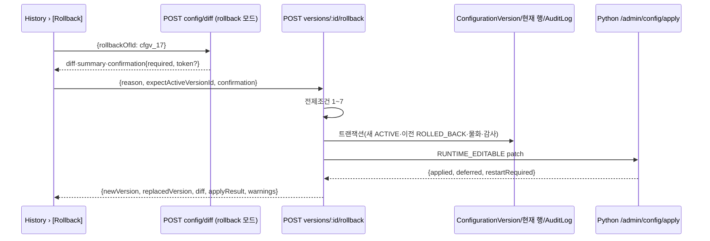

# 09. Configuration Rollback API — `POST /api/admin/v1/config/versions/:id/rollback`

> 원문 §93·§94·§96. 정본: `../api-contract.md` · `../domain-model.md`(`ConfigurationVersion`). 버전 엔티티 규칙은 `06`, Production 확인 흐름은 `16` §6.

## 1. 목적

과거 `ConfigurationVersion` 의 `snapshot` 을 **새 ACTIVE 버전으로 복원**한다. 기록은 지우지 않고, 복원도 검증·Diff·(Production 이면) 확인을 거치며, Python 서비스에 다시 밀어넣는다.

## 2. 범위

- 포함: 요청·응답, 전제조건, 상태 변화, Production 확인, 서비스 재적용, 부분 실패 처리, UI.
- 제외: Prompt 버전 롤백(`14` §7 — `activate` 로 처리), Override 철회(`16` §8).

## 3. 요청·응답

> **task-012c 확정(2026-09-29 C1)** — 이 문서의 예시 중 바뀐 것: ① `confirmation{token}` 은 폐기 → 본문 `baseVersion`(= 지금 ACTIVE 번호, `expectActiveVersionId` 대신) + PRODUCTION 이면 `confirm:"PRODUCTION"`·`summaryHash`(대상 스냅샷을 후보로 한 Diff, 서버 재계산 대조)·`testResultId`·`reason≥10`(D-C1, 정본 `../configuration-resolution.md` §8-1, 계약 `../api-contract.md` #109) ② §4 전제 4 는 "지금 스키마에 없는 키만 버림(`droppedKeys`), 남은 키는 지금 규칙으로 엄격 재검증해 위반이면 `422 E_SNAPSHOT_INTEGRITY`"(D-C6 — 발음 사전 Codex C2 교훈) ③ 전제 3(`TARGET_DELETED`)은 012c 에 연결 삭제가 없어 발생하지 않는다(삭제는 Phase 4) ④ §6 Python 서비스 재적용은 **015c 로 이관**(D-C10 — 수신 경로가 아직 없음). 012c 의 Rollback 은 앱 소비 키만 다루므로 `applyResult.services` 는 빈 배열이고 `[다시 밀어넣기]` 도 015c.

```json
POST /api/admin/v1/config/versions/cfgv_17/rollback
{
  "reason": "large-v3 전환 후 p95 12s 초과, medium 으로 복귀",
  "expectActiveVersionId": "cfgv_18",
  "confirmation": { "token": "…" }          // PRODUCTION + productionSensitive 변경 시
}
```

```json
{
  "success": true,
  "data": {
    "newVersion": { "id": "cfgv_19", "version": 19, "status": "ACTIVE", "origin": "ROLLBACK", "rollbackOfId": "cfgv_17" },
    "replacedVersion": { "id": "cfgv_18", "status": "ROLLED_BACK" },
    "diff": { "entries": ["…08 형식…"], "summary": { "changed": 2, "restartRequired": true } },
    "applyResult": {
      "app": "APPLIED",
      "services": [ { "connectionId": "whisper-voicevault", "service": "worker", "result": "RESTART_REQUIRED", "keysDeferred": ["runtime.model"] } ]
    },
    "effective": { "hash": "sha256:…" },
    "warnings": [ "활성 RuntimeOverride 1건(ovr_…)이 이 대상에 남아 있어 runtime.model 은 만료 전까지 large-v3 로 유지됩니다" ]
  }
}
```

`:id` 는 **복원 대상**(과거 버전). `expectActiveVersionId` 는 낙관적 잠금(현재 ACTIVE 가 아니면 409). capability `config.rollback`.

## 4. 전제조건 (서버가 순서대로 검사)

| # | 조건 | 실패 |
|---|---|---|
| 1 | 대상 버전 존재, `environment = APP_ENV`, 같은 `scope/targetId` 의 현재 ACTIVE 와 짝 | 404 / 409 |
| 2 | 대상이 이미 ACTIVE 가 아님(자기 자신 롤백 금지) | `409 CONFLICT {code:'ALREADY_ACTIVE'}` |
| 3 | 대상 연결/프로필이 아직 존재(삭제된 `EngineConnection` 은 복원 불가) | `409 {code:'TARGET_DELETED'}` |
| 4 | `snapshot` 을 현재 스키마로 재검증(`schemaVersion` 상승 대비): 사라진 키는 제거·경고, 새 키는 DEFAULT, 제약 위반은 실패 | `400 VALIDATION {errors, droppedKeys[]}` |
| 5 | `SECRET` 키의 `credentialRef` 가 SecretResolver 에 존재 | `400 {code:'CREDENTIAL_REF_MISSING'}` |
| 6 | Diff 계산 → PRODUCTION + `productionSensitive` 변경이면 확인 토큰 필요(토큰은 `POST config/diff` 를 `rollbackOfId` 모드로 호출해 발급) | `403 {code:'PRODUCTION_CONFIRMATION_REQUIRED'}` |
| 7 | `config.rollback` + (6 해당 시) 토큰 발급자의 `config.apply.production` | 403 |

## 5. 상태 변화와 트랜잭션

1. 새 행 INSERT: `snapshot` = 대상 버전 snapshot(재검증 후 정규화본), `diff` = 현재 ACTIVE 대비, `origin=ROLLBACK`, `rollbackOfId=:id`, `status=ACTIVE`.
2. 현재 ACTIVE → `ROLLED_BACK` (복원 대상 `:id` 의 상태는 그대로).
3. 현재 행 물화(`EngineConnection`·`EngineFallbackPolicy`·`AppSetting`·`VoiceProfile`).
4. `AuditLog config.rollback {before:{fromVersionId}, after:{toVersionId, restoredFromVersionId}}`.
5. 커밋 → `config.changed` 이벤트 → resolver 캐시 무효화.

snapshot 은 env·yaml 을 포함하지 않으므로 "그때와 같은 Effective" 를 보장하지 않는다. 응답의 `diff`/`effective` 로 지금의 결과를 확인하도록 한다(§94 의 "이전 설정"은 관리 층 값이라는 뜻).

## 6. Python 서비스 재적용

- 트랜잭션 밖에서 어댑터가 `RUNTIME_EDITABLE` 키만 골라 해당 서비스(`gateway :8100`·`worker`·M4 `tts-service :8200`)에 `POST /admin/config/apply {connectionId, patch, versionId, traceId}` 를 보낸다. 서비스는 RESTART_REQUIRED 키가 섞여 있으면 그 키를 거부하고 `{applied[], deferred[], restartRequired:true}` 로 응답한다(계획 §9-C Python 계약).
- 결과는 `applyResult.services[]` 로 그대로 돌려주고, `RESTART_REQUIRED`·`FAILED` 는 `EngineHealth{kind:HEALTH, ok:false|true, detail:{pendingRestart:true, versionId}}` 1건과 Dashboard 배지 "재기동 대기" 로 남긴다. 상태 enum 은 늘리지 않는다.
- 서비스 push 실패는 롤백을 취소하지 않는다(DB 가 진실). Console 은 `[다시 밀어넣기]` 버튼(`POST config/apply` 를 `reapplyVersionId` 로 재호출, 새 버전 없음)을 제공한다.
- 온디바이스(`ONDEVICE`) 연결은 push 대상이 아니며 앱이 다음 `GET /api/v1/speech/config` 에서 받는다.

## 7. 시퀀스



## 8. UI (§94)

```text
History · whisper-voicevault
v19  ACTIVE     ROLLBACK ← v17   2026-09-26 11:02  superadmin   "p95 초과 복귀"
v18  ROLLED_BACK APPLY           2026-09-26 10:32  developer    "large-v3 실험"
v17  SUPERSEDED  APPLY           2026-09-25 18:10  superadmin
v1   SUPERSEDED  SYSTEM          2026-09-20 09:00  system
[ v17 로 Rollback ] → Diff 모달 → (PRODUCTION) 변경 요약 + 확인 → 실행 → 결과·재기동 안내
```

## 9. 검증/오류

- 오류 코드는 §4 표. 모든 실패는 `AuditLog config.rollback result=FAILED|DENIED` 로도 남는다.
- QA: (a) v1→v3 적용 후 v1 롤백 → v4 ACTIVE, v3 ROLLED_BACK, v1 상태 불변 (b) 스키마 키 제거 후 옛 버전 롤백 → `droppedKeys` 경고 (c) PRODUCTION 에서 model 변경 롤백 → 토큰 없으면 403 (d) worker 중지 상태에서 롤백 → DB 반영·`FAILED` 보고·재기동 후 `[다시 밀어넣기]` 성공.

## 10. Phase

2: Rollback API·History UI·Python 재적용 · 3: `pendingRestart` Dashboard 배지 · 4: Import 묶음 단위 롤백(`importId` 로 다건, 미결).

## 11. 미결

- `importId` 단위 일괄 롤백 엔드포인트 필요 여부(현재는 대상별 개별 롤백).
- `reapplyVersionId` 재푸시가 정본 API 에 없음 — `config/apply` 의 옵션으로 추가 제안.
