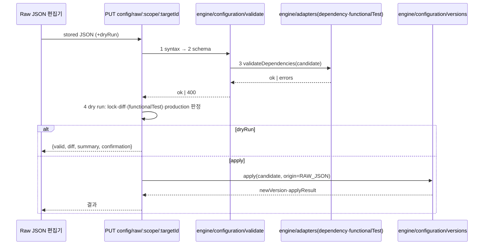

# 10. Raw JSON Configuration API — `GET/PUT /api/admin/v1/config/raw/:scope/:targetId`

> 원문 §89·§90·§91. 정본: `../api-contract.md`. Form 편집(`config/validate`·`test`·`diff`·`apply`)과 **같은 파이프라인**을 JSON 한 덩어리로 타는 개발자용 경로다. Diff·동기화는 `08`, 버전은 `06`.

## 1. 목적

개발자가 관리 층 설정을 JSON 으로 그대로 보고(View), 권한이 있으면 고쳐서(Edit) `JSON 문법 → 스키마 → 의존성 → Dry Run → Apply` 의 안전장치를 빠짐없이 거치게 한다(§125-7·8).

## 2. 범위

- 포함: GET/PUT 계약, 검증 5단계, 오류 형식·예시, dry run, 권한, UI.
- 제외: Export/Import 파일 포맷(`16` §7), 스키마 정의(`03`).

## 3. GET — View JSON

`GET /api/admin/v1/config/raw/ENGINE_CONNECTION/whisper-voicevault` (`config.raw.read`)

```json
{
  "success": true,
  "data": {
    "scope": "ENGINE_CONNECTION",
    "targetId": "whisper-voicevault",
    "environment": "PRODUCTION",
    "versionId": "cfgv_19", "version": 19, "hash": "sha256:…",
    "schemaVersion": 3,
    "stored": {
      "connection": { "baseUrl": "http://127.0.0.1:8090", "timeoutMs": 15000, "credentialRef": null },
      "runtime": { "model": "medium", "device": "cpu", "computeType": "int8", "cpuThreads": 8, "workers": 1 },
      "logging": { "level": "INFO" }
    },
    "effective": { "runtime.cpuThreads": { "value": 4, "source": "ENVIRONMENT" } },
    "readOnlyKeys": ["runtime.modelPath"],
    "secretKeys": ["connection.credentialRef"]
  }
}
```

- `stored` = 관리 층 snapshot(§89 의 `{engine, connection, runtime}` 형태를 스키마 그룹으로 정규화). `engine`·`connection id` 는 identity 라 본문에 넣지 않고 경로가 대신한다.
- `effective` 는 `stored` 와 Effective 가 다른 키만 요약(전체는 `GET config/effective`).
- `?format=download` 면 `Content-Disposition: attachment; filename=whisper-voicevault.PRODUCTION.v19.json`.

## 4. PUT — Edit JSON

`PUT /api/admin/v1/config/raw/ENGINE_CONNECTION/whisper-voicevault?dryRun=true|false` (`config.raw.read` + `config.edit`)

```json
{
  "stored": { "connection": {…}, "runtime": { "model": "large-v3", "cpuThreads": -1, … }, "logging": {…} },
  "baseVersionId": "cfgv_19", "baseHash": "sha256:…",
  "reason": "int8 + large-v3 실험",
  "confirmation": { "token": "…" },
  "runFunctionalTest": true
}
```

| 단계 | 내용 | 실패 코드 |
|---|---|---|
| 1 JSON Syntax | 본문 파싱(라우트 진입 전 body parser; 텍스트로 받는 `?raw=1` 모드는 라인·컬럼 보고) | `400 VALIDATION {code:'JSON_SYNTAX', line, column}` |
| 2 Schema | 키 존재·타입·범위·enum·pattern, `READ_ONLY` 키 변경 금지, `SECRET` 키 값 평문 금지, 미지 키(`x-` 제외) 거부 | `400 VALIDATION {errors[]}` |
| 3 Dependency | `dependsOn` 충족, 교차 키 규칙(어댑터 `validateDependencies()`: 예 `device=cuda` 인데 우분투 GPU 없음, `computeType=float16` 는 `device≠cpu`, `workers>cpuThreads` 금지, `baseUrl` 의 host 가 SecretResolver 허용 목록 밖), Fallback 정책의 connection 존재·역할 일치 | `400 VALIDATION {errors[], code:'DEPENDENCY'}` |
| 4 Dry Run | 낙관적 잠금(`baseVersionId`/`baseHash`), Diff 계산, `runFunctionalTest` 면 candidate 로 Functional Test 1회(어댑터가 임시 설정 인스턴스로 실행, 저장 없음), Production 확인 판정 | `409 CONFLICT` / `422 ENGINE_UNAVAILABLE`(테스트 실패) / `403 PRODUCTION_CONFIRMATION_REQUIRED` |
| 5 Apply | `dryRun=false` 일 때만: `config/apply` 와 동일 트랜잭션(`06` §10), `origin=RAW_JSON` | 동일 |

`dryRun=true` 응답 = `{valid:true, diff, summary, functionalTest?, confirmation}` (저장 없음). `dryRun=false` 응답 = `09` §3 과 같은 `{newVersion, diff, applyResult, effective, warnings}`.

## 5. 오류 형식과 예시 (§90)

```json
{
  "success": false,
  "message": "설정 검증 실패 (2건)",
  "data": {
    "code": "VALIDATION",
    "stage": "SCHEMA",
    "errors": [
      { "key": "runtime.cpuThreads", "rule": "min", "expected": 1, "actual": -1, "message": "cpuThreads must be >= 1" },
      { "key": "runtime.modle", "rule": "unknownKey", "message": "스키마에 없는 키입니다. 'runtime.model' 을 의도했습니까?", "suggestion": "runtime.model" }
    ]
  }
}
```

의존성 예: `{ "key": "runtime.computeType", "rule": "dependency", "message": "computeType=float16 은 device=cpu 에서 지원되지 않습니다", "related": ["runtime.device"] }`.
Secret 예: `{ "key": "connection.credentialRef", "rule": "secretValue", "message": "평문 값이 감지되었습니다. env:NAME 또는 file:<name> 참조만 허용됩니다" }` — 이 경우 감사 로그 `after` 에도 값이 남지 않도록 검증 단계에서 페이로드를 마스킹한 뒤 기록한다.

`errors[]` 는 최대 50건, `rule` 은 `type|min|max|enum|pattern|maxLength|required|unknownKey|readOnly|secretValue|dependency|reference` 로 고정(클라이언트가 필드에 매핑).

## 6. UI (§89·§91)

- Configuration › Raw JSON 탭: 코드 편집기(읽기 전용 기본, `config.edit` 보유 시 [Edit JSON] 토글). 상단에 `version`·`hash`·환경 배지, 하단에 [검증(Dry Run)] [테스트] [적용].
- 편집 중 스키마 힌트(키 자동완성·타입 툴팁)는 `GET config/schema/:engineId` 에서.
- 오류는 편집기 라인 마커 + 목록. `suggestion` 이 있으면 클릭으로 치환.
- Form 탭과 draft 를 공유하므로 JSON 에서 고친 값이 Form 에 즉시 반영된다(`08` §6).

## 7. 시퀀스



## 8. 검증/오류 요약

| 코드 | 단계 |
|---|---|
| `400 VALIDATION` (`stage: JSON_SYNTAX|SCHEMA|DEPENDENCY`) | 1~3 |
| `403 FORBIDDEN` (`FORBIDDEN` / `PRODUCTION_CONFIRMATION_REQUIRED`) | 권한·4 |
| `404 NOT_FOUND` | 대상 없음 |
| `409 CONFLICT` | 낙관적 잠금 |
| `422 ENGINE_UNAVAILABLE` / `502 ENGINE_ERROR` / `504 ENGINE_TIMEOUT` | 4(테스트) |

- 단위 테스트 픽스처: `cpuThreads=-1`, 미지 키 오타, `float16+cpu`, SECRET 평문, READ_ONLY 변경, `x-note` 키 보존.
- QA: dryRun 응답 후 DB 버전 수 불변, apply 후 +1.

## 9. Phase

1: GET(View) · 2: PUT·5단계 검증·Dry Run · 3: Functional Test 결합 · 4: Import 가 같은 파이프라인 재사용.

## 10. 미결

- `?raw=1` 텍스트 모드(라인·컬럼 보고)를 정본 API 에 넣을지, 클라이언트 파싱으로 대신할지.
- 어댑터별 `validateDependencies()` 규칙 목록은 speech-platform `07` 의 스키마 옆에 표로 두는 것을 제안.
