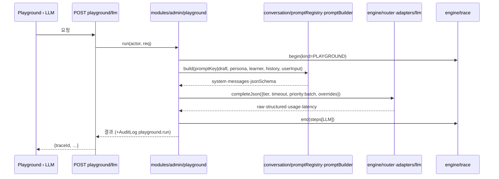

# 11. Engine Playground API — `POST /api/admin/v1/playground/{stt,tts,llm}`

> 원문 §108·§116·§120. 정본: `../api-contract.md`. Console(admin 층)이 L4 speech·L2 conversation·L5 engine 을 **조합**해 개별 엔진을 단발 호출하는 개발자 도구. E2E 는 `12`, Trace 는 `13`.

## 1. 목적

특정 Connection(또는 역할의 활성 Connection)에 대해 STT·TTS·LLM 을 사용자 데이터 부작용 없이 호출하고, 지연·원 응답·구조화 응답·토큰 사용량을 Trace 와 함께 돌려준다(§125-15).

## 2. 범위

- 포함: 3개 엔드포인트 계약, 공통 옵션, 파일 제한, 결과 형태, 부작용 금지 규칙, rate limit, UI.
- 제외: 사용자용 `/api/v1/voices/preview`(speech-platform `04`), Functional Test(고정 입력, speech-platform `10`).

## 3. 공통 규칙

- capability `playground.use`. 모든 호출은 `RequestTrace{kind:PLAYGROUND, userId:actor}` 1건 + `AuditLog playground.run` 1건을 만든다. 입력 텍스트·오디오는 Trace/Audit 에 저장하지 않는다(길이·해시만, `13` §6).
- 공통 요청 필드: `connectionId?`(없으면 역할의 라우터 선택), `overrides?`(RUNTIME_EDITABLE 키 patch, 이 호출에만 적용 — DB 저장 없음, PRODUCTION 은 `override.production` 정책에 따름), `traceLabel?`(≤60자).
- 공통 응답 필드: `traceId`, `connection{id,engineId,model}`, `latencyMs`, `steps[]`(단일 step 이라도 `13` 형식), `warnings[]`.
- 부작용 금지: `Chat·ChatMessage·Utterance·StudyLog·Correction·LearnerErrorStat·TtsCache(쓰기)` 어디에도 쓰지 않는다. TTS 는 캐시 **읽기**만 허용(`cacheHit` 표시). 생성 오디오는 `DATA_ROOT/playground/<traceId>.wav` 에 24시간 보관 후 삭제.
- rate limit: actor 당 분당 20회, 동시 2회(`429 RATE_LIMITED`). LLM 은 Claude CLI 큐의 `batch` 레인을 쓰며 사용자 회화 턴(`interactive`)을 밀어내지 않는다.
- PRODUCTION 에서도 사용 가능하되 배지 경고 + `overrides` 는 정책 게이트.

## 4. STT — `POST playground/stt` (multipart)

| 필드 | 규칙 |
|---|---|
| `audio` | wav/m4a/webm/ogg, ≤10MB, ≤60초(서버가 ffprobe 로 검사), 16kHz mono 로 정규화 |
| `role` | `REALTIME_STT` \| `ANALYSIS_STT`(기본). `REALTIME_STT` 는 gateway 배치 모드로 세그먼트 전사(온디바이스 연결은 선택 불가 → `422`) |
| `connectionId?` · `overrides?` | 공통 |
| `options.language` | 기본 `ja` |
| `options.wordTimestamps` | 어댑터 capability 있을 때만 |

응답 `data`: `{traceId, connection, transcript, segments:[{startMs,endMs,text,confidence?}], latencyMs:{queueMs, inferenceMs, totalMs}, raw?:{…어댑터 원 응답 요약(≤8KB)}, audioMeta:{durationMs, sampleRate}}`.

## 5. TTS — `POST playground/tts`

```json
{ "connectionId": "style-bert-m4", "text": "こんにちは。今日は何について話しましょうか？",
  "voiceProfileId": "haruka", "style": "Friendly", "styleWeight": 0.8, "speed": 0.9, "pitch": 1.0, "intonation": 1.1,
  "speechProfile": "LEARNING_NORMAL", "renderingPlan": null, "returnAudio": "url" }
```

- `text` ≤300자(문장 분할은 사용자 경로와 동일한 `speech/tts/sentenceSplit`), 파라미터 범위는 `UserVoiceSetting` 과 같은 제약(speed 0.5~1.5 등, 정본 `preferences` `VOICE_PARAM_RANGES` — task-022)을 **관리자는 넘을 수 있으나** 스키마 `min/max` 는 넘을 수 없다(§116 "더 상세한 Preview").
- 파라미터 해석은 TTS Parameter Resolver 를 **우회하지 않고** 요청값을 최상위 입력으로 넣어 실행한다(persona·LLM style 입력 없음). 실제 SBV2 파라미터(`model_id, speaker_id, style, style_weight, length, pitch_scale, intonation_scale`)를 `resolvedParams` 로 응답에 포함한다.
- 응답: `returnAudio=url` → `{traceId, connection, audioUrl:"/api/admin/v1/playground/audio/<traceId>", durationMs, latencyMs:{firstByteMs,totalMs}, cacheHit, resolvedParams, sentences:[{text, latencyMs}]}`; `returnAudio=inline` → `audio/wav` 바디 + `X-Trace-Id` 헤더.

## 6. LLM — `POST playground/llm`

```json
{ "connectionId": "claude-cli", "tier": "fast",
  "prompt": { "kind": "promptKey", "key": "talk", "version": 12 },
  "persona": { "key": "teacher-persona", "version": null },
  "userInput": "昨日映画を見ました",
  "learner": { "level": "N4", "politeness": "POLITE", "strictness": "NORMAL", "explainLang": "ko" },
  "structured": true, "history": [], "timeoutMs": 20000 }
```

- `prompt.kind`: `promptKey`(등록 프롬프트 + 버전, 없으면 ACTIVE) \| `draft`(본문 직접, `prompts.edit` 필요 — `14` §8 의 저장 전 테스트가 이 경로) \| `raw`(system 문자열만, 페르소나·헤더 조립 없음).
- `structured=true` 면 해당 프롬프트 키의 JSON 스키마(§67)로 `--json-schema` + ajv 재검증까지 사용자 경로와 동일하게 수행한다.
- 응답: `{traceId, connection:{id, engineId, model:"claude-haiku-…"}, raw:string, structured?:object, validation:{ok, errors[]}, latencyMs:{spawnMs?, totalMs}, usage?:{inputTokens, outputTokens, cacheReadTokens?}, promptMeta:{key, version, source, assembledChars}}`. `usage` 는 어댑터가 제공할 때만(claude-cli `--json` 결과의 usage, home-m4 는 없음 → `null`).
- `raw` 는 ≤32KB 로 절단(`truncated:true`). 조립된 최종 프롬프트 전문은 응답에 포함하지 않고 `assembledChars` 만 준다(`?includeAssembledPrompt=true` 는 `config.raw.read` 보유자에게만).

## 7. 시퀀스 (LLM 예)



## 8. UI (§108)

- 3개 탭. 좌측 입력(Connection 선택 = 역할별 활성 표시 + 전체 목록, Override 패널은 `override.create` 보유자만), 우측 결과(지연 타임라인·Raw/Structured 토글·▶ 재생·`resolvedParams`·`traceId` 링크 → Diagnostics Trace 뷰).
- STT 탭은 파일 업로드 + (데스크톱) 브라우저 녹음 15초. TTS 탭은 Voices 상세의 [Preview] 와 같은 컴포넌트를 재사용(`components/admin/playground/TtsForm`).
- LLM 탭의 Prompt 선택은 Prompts 화면과 연결(버전 드롭다운·"현재 편집 중인 초안으로 테스트").

## 9. 검증/오류

| 코드 | 상황 |
|---|---|
| `400 VALIDATION` | 파일 형식·크기·길이, 텍스트 길이, 파라미터 범위, 잘못된 `promptKey` |
| `403 FORBIDDEN` | capability / PRODUCTION override 정책 |
| `404 NOT_FOUND` | connection·voiceProfile·프롬프트 버전 없음 |
| `422 ENGINE_UNAVAILABLE` | 라우터가 고를 연결 없음, ONDEVICE 지정 |
| `429 RATE_LIMITED` | 한도 초과 |
| `502 ENGINE_ERROR` / `504 ENGINE_TIMEOUT` | 어댑터 실패(Trace 에 `status:FAILED, errorCode`) |

- QA: 각 탭 성공 1회 후 `Chat/Utterance/StudyLog` 행 수 불변, `RequestTrace` +1(kind=PLAYGROUND), `AuditLog` +1, 오디오 파일 24h 후 삭제(스케줄 확인).

## 10. Phase

2: STT/TTS/LLM 3종·UI · 3: `overrides` 요청 옵션·녹음 입력 · 4: PRODUCTION override 게이트 연동.

## 11. 미결

- `playground/audio/<traceId>` 정적 제공 엔드포인트가 정본 API 목록에 없음 — 추가 제안(또는 inline 만 지원).
- home-m4 어댑터의 토큰 사용량 부재 시 대략치를 추정해 표시할지(문자 수/4) — 표시하지 않는 쪽 권장.
