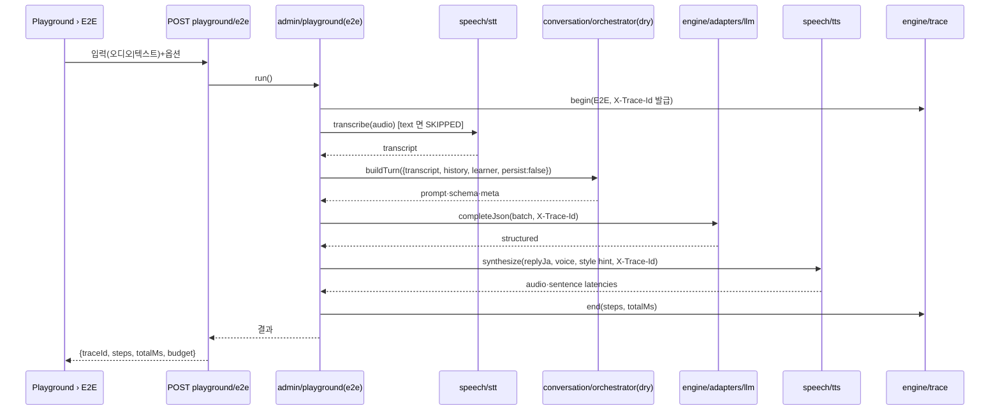

# 12. End-to-End Test API — `POST /api/admin/v1/playground/e2e`

> 원문 §109·§110·§125-16. 정본: `../api-contract.md`. STT → Conversation Orchestrator → LLM → TTS 를 **사용자 데이터 부작용 없이** 한 번에 돌리고 단계별 결과를 Trace 로 돌려준다. 개별 엔진은 `11`, Trace 형식은 `13`.

## 1. 목적

"5초 예산"(design-spec §8: 발화 종료→강사 음성 시작 p50 ≤4.5s) 을 구성요소별로 계측하고, 설정 변경·프롬프트 버전·Voice 조합이 실제 대화 파이프라인에서 동작하는지 검증한다. QA 의 30턴 p50/p95 보고도 이 API 로 자동화한다.

## 2. 범위

- 포함: 요청(오디오 또는 텍스트)·응답, 단계 정의, 오케스트레이터 "dry" 모드, 부작용 금지, 시간 예산, UI.
- 제외: 실제 사용자 턴 SSE(`POST /api/v1/chats/:id/turns`), 부하 테스트.

## 3. 요청

multipart(오디오) 또는 JSON(텍스트):

```json
{
  "input": { "kind": "text", "text": "昨日映画を見ました" },          // 또는 kind:"audio" + 파일 필드 audio
  "mode": "TALK",                                                       // TALK | CHAT
  "learner": { "level": "N4", "politeness": "POLITE", "strictness": "NORMAL", "explainLang": "ko", "explainDepth": "NORMAL" },
  "history": [ { "role": "USER", "textJa": "こんにちは" }, { "role": "ASSISTANT", "textJa": "こんにちは！今日は何をしましたか？" } ],
  "voice": { "voiceProfileId": "haruka", "style": "AUTO", "speed": 0.9, "speechProfile": "LEARNING_NORMAL" },
  "engines": { "stt": { "connectionId": null, "role": "ANALYSIS_STT" }, "llm": { "connectionId": null, "tier": "fast" }, "tts": { "connectionId": null } },
  "prompt": { "talkVersion": null, "personaVersion": null },
  "overrides": {},
  "options": { "returnAudio": "url", "captureStepOutputs": true, "repeat": 1 }
}
```

- `input.audio`: `11` §4 와 같은 제한(≤10MB·≤60초). `kind=text` 면 STT 단계는 `SKIPPED`.
- `history` ≤12턴, 텍스트만(DB 의 Chat 을 참조하지 않음). `repeat` 1~30: 같은 입력을 반복해 p50/p95 를 응답 `aggregate` 로 계산(QA 용).
- capability `e2e.run`. rate limit: actor 당 분당 6회, `repeat` 총합 시간당 200턴.

## 4. 단계와 응답 (§109)

| step | 실행 주체 | 기록 |
|---|---|---|
| `STT` | L4 speech(`stt` 어댑터, ANALYSIS 또는 gateway 배치) | transcript·segments·latency |
| `ORCHESTRATOR` | L2 conversation orchestrator **dry 모드** | 창(window) 크기·조립 프롬프트 길이·페르소나 절·Prompt 버전·`learner` 헤더 |
| `LLM` | L5 adapters/llm | raw·§67 구조화 응답·검증 결과·usage·latency |
| `TTS` | L4 speech tts(문장 분할·Parameter Resolver·합성) | 문장별 latency·첫 문장 `ttsStartMs`·resolvedParams |
| `PLAYBACK` | (계측만) | 오디오 길이·URL |

```json
{
  "success": true,
  "data": {
    "traceId": "trc_01J…",
    "steps": [
      { "name": "STT", "status": "OK", "connectionId": "whisper-voicevault", "engineId": "faster-whisper", "model": "medium", "latencyMs": 615, "output": { "transcript": "昨日映画を見ました" } },
      { "name": "ORCHESTRATOR", "status": "OK", "latencyMs": 12, "output": { "promptKey": "talk", "promptVersion": 12, "personaVersion": 3, "assembledChars": 2740, "windowTurns": 2 } },
      { "name": "LLM", "status": "OK", "connectionId": "claude-cli", "model": "claude-haiku-…", "latencyMs": 920, "output": { "structured": { "conversation": { "replyJa": "昨日はどんな映画を見ましたか？", "replyKo": "어제는 어떤 영화를 봤나요?" }, "correction": null, "speech": { "style": "CHEERFUL" } }, "validation": { "ok": true }, "usage": { "inputTokens": 1210, "outputTokens": 88 } } },
      { "name": "TTS", "status": "OK", "connectionId": "style-bert-m4", "model": "teacher_haruka", "latencyMs": 410, "output": { "sentences": [ { "text": "昨日はどんな映画を見ましたか？", "latencyMs": 410 } ], "ttsStartMs": 410, "resolvedParams": { "style": "Cheerful", "length": 1.11 } } },
      { "name": "PLAYBACK", "status": "OK", "output": { "audioUrl": "/api/admin/v1/playground/audio/trc_01J…", "durationMs": 2100 } }
    ],
    "totalMs": 1957,
    "budget": { "targetP50Ms": 4500, "targetP95Ms": 7000, "withinP50": true },
    "aggregate": null
  }
}
```

`repeat>1` 이면 `aggregate:{runs, p50Ms, p95Ms, perStep:{STT:{p50,p95}, LLM:{…}, TTS:{…}}, failures}` 와 각 run 의 `traceId[]`.

## 5. Orchestrator dry 모드 (부작용 금지)

- `Chat·ChatMessage·Utterance·SpeechJob·Correction·TutorProposal·StudyLog·LearnerErrorStat·StatsSnapshot·Attendance` 에 쓰지 않는다. 오케스트레이터는 `persist:false` 옵션으로 실행되며 창(window)은 요청 `history` 로만 조립한다.
- 동시 턴 락(사용자당 1)은 잡지 않는다. LLM 큐는 `batch` 레인.
- TTS 캐시는 읽기만. 생성 오디오는 `DATA_ROOT/playground/` 24시간 보관.
- `RequestTrace{kind:E2E}` 와 `AuditLog e2e.run` 만 남는다. `captureStepOutputs=true` 여도 Trace 에는 텍스트를 넣지 않고(길이·해시), 응답에만 포함한다. 텍스트·오디오를 Trace 에 남기려면 `DebugSession` 을 열고 `debugSessionId` 를 요청에 넣는다(`15` §6).

## 6. 시퀀스



## 7. 시간 예산·실패 처리

- 단일 run 서버 상한 45초(STT 15 + LLM 20 + TTS 10). 초과 단계는 `status:TIMEOUT` 으로 기록하고 **다음 단계는 실행하지 않는다**(`SKIPPED`). 응답은 200 + 부분 결과(전체 실패가 아니라 진단 결과이므로).
- `repeat>1` 은 순차 실행(동시 부하 금지), 총 상한 10분 → 초과 시 `aggregate.partial:true`.
- 어댑터 오류는 step 에 `errorCode`(`ENGINE_ERROR|ENGINE_TIMEOUT|ENGINE_UNAVAILABLE|VALIDATION`)와 메시지(민감정보 마스킹)만.

## 8. UI (§109)

```text
Step 1  STT          whisper-voicevault · medium      615 ms   昨日映画を見ました
Step 2  Orchestrator talk v12 · teacher-persona v3     12 ms   2,740 chars · 2 turns
Step 3  LLM          claude-cli · haiku               920 ms   昨日はどんな映画を見ましたか？   [Raw] [Structured]
Step 4  TTS          style-bert-m4 · haruka           410 ms   ▶ 재생 · 첫 문장 410 ms
Total 1,957 ms   목표 p50 4,500 ms ✓
```

세로 타임라인 + 각 step 펼침. `repeat` 실행 시 p50/p95 표와 run 별 traceId 목록. [Trace 열기] 는 Diagnostics 의 Trace 뷰로.

## 9. 검증/오류

| 코드 | 상황 |
|---|---|
| `400 VALIDATION` | 입력 없음, 오디오 제한, `history` 초과, `repeat` 범위 |
| `403 FORBIDDEN` | `e2e.run` 없음 / PRODUCTION override 정책 |
| `422 ENGINE_UNAVAILABLE` | 어느 역할이든 선택 가능한 연결 없음(실행 전 사전 검사) |
| `429 RATE_LIMITED` | 한도 |

- QA: 텍스트 입력 1회 → `RequestTrace` +1, 사용자 테이블 불변, `audioUrl` 재생 가능; STT 타임아웃 강제(worker 중지) → step1 TIMEOUT·2~4 SKIPPED·200 응답; `repeat=10` → aggregate p50/p95 존재.

## 10. Phase

3: E2E API·UI·`repeat` 집계 · 4: Override·DebugSession 결합, QA 자동 보고 스크립트(`npm run e2e:budget`).

## 11. 미결

- 오디오 입력 E2E 에서 `REALTIME_STT`(온디바이스) 경로는 서버가 재현할 수 없다 — gateway 배치 전사로 대체하고 응답 `warnings` 에 명시. 온디바이스 실측은 앱 내 개발자 옵션(Phase 4)으로 별도 검토.
- 45초 상한을 넘는 장문 테스트를 위한 SSE/잡 변형은 필요 시 추가.
