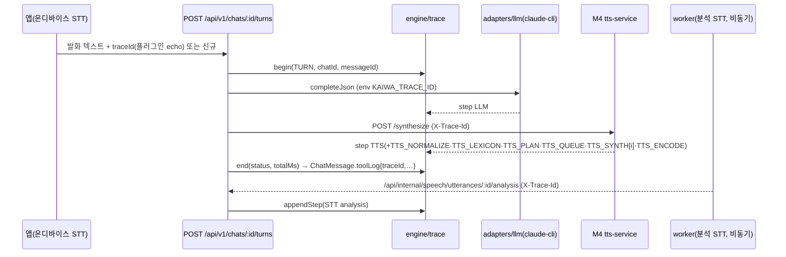

# 13. Request Trace 모델 — `RequestTrace` · `EngineMetricsDaily`

> 원문 §110·§111·§113. 정본: `../domain-model.md`(L5 engine 소유) · `../api-contract.md`(`GET traces`, `traces/:traceId`). 기록 모듈 `src/modules/engine/trace`, 조회 `src/modules/admin/diagnostics`.

## 1. 목적

하나의 요청(회화 턴·미리듣기·Playground·E2E·Functional Test)이 어떤 Engine/Connection/모델을 거쳐 얼마나 걸렸고 어디서 실패했는지를 `traceId` 하나로 추적하고(§125-17), 그 집계로 Diagnostics 메트릭을 만든다. 원음·전체 대화 텍스트·시크릿은 절대 담지 않는다(§113).

## 2. 범위

- 포함: 엔티티, steps 스키마, traceId 전파, `ChatMessage.toolLog` 관계, 민감정보 규칙, 보존, 조회 API, `EngineMetricsDaily` 파생.
- 제외: 서비스 프로세스 로그 포맷(`infra/logging`), Health(`EngineHealth`).

## 3. 정의 (정본 발췌)

```prisma
enum TraceKind { TURN PREVIEW PLAYGROUND E2E FUNCTIONAL_TEST }
enum TraceStatus { OK PARTIAL ERROR }   // domain-model §3 과 동일(정합성 #9, 2026-09-26). 단계(step) 상태는 아래 status 목록

model RequestTrace {
  traceId        String   @id @db.VarChar(40)      // "trc_" + ULID
  environment    Environment
  kind           TraceKind
  userId         String?                           // TURN/PREVIEW = 학습자, PLAYGROUND/E2E = actor
  chatId         String?  @db.VarChar(40)          // TURN 일 때
  messageId      String?  @db.VarChar(40)
  sessionId      String?  @db.VarChar(64)          // SESSION override 매칭용
  debugSessionId String?
  status         TraceStatus
  steps          Json                              // 아래 스키마 배열
  totalMs        Int
  budgetMs       Int?                              // 5초 예산 등 목표(선택)
  inputMeta      Json?                             // {textChars?, audioMs?, audioSha256?} — 본문 없음
  overrideIds    Json?                             // 적용된 RuntimeOverride id[]
  createdAt      DateTime @default(now())
  @@index([environment, kind, createdAt])
  @@index([userId, createdAt])
  @@index([chatId])
}

model EngineMetricsDaily {
  connectionId String  @db.VarChar(120)
  environment  Environment
  date         DateTime @db.Date
  kind         TraceKind?                          // null = 전체
  requests     Int
  errors       Int
  timeouts     Int
  p50Ms        Int
  p95Ms        Int
  avgMs        Int
  @@id([connectionId, environment, date, kind])
}
```

`status`·`chatId`·`messageId`·`sessionId`·`budgetMs`·`inputMeta`·`overrideIds`·`EngineMetricsDaily.{timeouts,avgMs,kind,environment}` 는 초안 대비 추가(정본 반영 제안).

## 4. `steps[]` 스키마

```json
{
  "name": "STT",                        // VAD | STT | ORCHESTRATOR | LLM | TTS | TTS_NORMALIZE | TTS_LEXICON | TTS_PLAN | TTS_QUEUE | TTS_SYNTH (구 TTS_SENTENCE) | TTS_ENCODE | TTS_TIMING | PLAYBACK | CACHE | ROUTER | FALLBACK
  "seq": 1,
  "engineId": "faster-whisper",
  "connectionId": "whisper-voicevault",
  "model": "medium",
  "startedAt": "2026-09-26T10:32:11.120+09:00",
  "latencyMs": 615,
  "status": "OK",                       // OK | FAILED | TIMEOUT | SKIPPED | FALLBACK
  "errorCode": null,                    // ENGINE_ERROR | ENGINE_TIMEOUT | ENGINE_UNAVAILABLE | VALIDATION
  "errorMessage": null,                 // 마스킹된 ≤300자
  "attempt": 1,                         // 라우터 재시도 횟수(1 = 첫 시도)
  "fallbackFrom": null,                 // FALLBACK 시 이전 connectionId
  "meta": { "audioMs": 5100, "transcriptChars": 9, "confidence": 0.93 }   // 단계별 요약(본문 금지)
}
```

단계별 `meta` 허용 키: STT `{audioMs, transcriptChars, segments, confidence}` · ORCHESTRATOR `{promptKey, promptVersion, personaVersion, assembledChars, windowTurns}` · LLM `{tier, inputTokens?, outputTokens?, cacheReadTokens?, structuredOk, jsonRetry}` · TTS `{sentences, chunks, ttfaMs, speechProfile, cacheHits, resolvedParams, modelVersion, dictionaryVersion}` · TTS_NORMALIZE `{inputChars, outputChars, rulesApplied}` · TTS_LEXICON `{dictionaryVersion, matches}` · TTS_PLAN `{segments, styleSource, speechProfile}` · TTS_QUEUE `{waitMs, position}` · TTS_SYNTH `{chunkIndex, synthMs, audioMs, rtf, modelLoaded, modelVersion, cacheHit, connectionKey}` · TTS_ENCODE `{bytes, format}` · TTS_TIMING `{words, moras, method, alignMs}` · PLAYBACK `{playbackStartDelayMs, firstAudioAtMs}`(5차 보완, `speech-platform/16` §7.2) · ROUTER `{role, candidates[], chosen}`. 그 외 키는 기록 시 제거된다(화이트리스트).

## 5. traceId 전파 (앱 → gateway/worker → M4 tts-service)

- 앱이 요청 진입점(턴 라우트·Playground·E2E·Preview·Functional Test)에서 `trc_<ULID>` 를 발급하고 `engine/trace.begin()` 으로 컨텍스트(AsyncLocalStorage)에 둔다.
- 어댑터의 모든 아웃바운드 호출에 헤더 `X-Trace-Id` 를 붙인다: HTTP(gateway·worker 콜백·tts-service·home-m4), WebSocket(첫 메시지 `{type:'hello', traceId}`), Claude CLI(`--json` 결과에는 헤더가 없으므로 spawn env `KAIWA_TRACE_ID` 와 step meta 로 대신), 온디바이스 플러그인(앱이 `traceId` 를 플러그인 호출 인자로 전달, 결과 이벤트에 echo).
- Python 서비스는 받은 `X-Trace-Id` 를 응답 헤더로 echo 하고 구조화 로그(`{"traceId":…, "stage":…, "ms":…}`)에 남기며, 없으면 자체 발급하되 `generated:true` 를 표시한다. `SpeechJob` 행에도 `traceId` 컬럼(정본 제안)으로 잡 처리 결과가 원 요청과 연결된다.
- 앱 콜백(`/api/internal/*`)은 헤더의 `traceId` 로 기존 Trace 에 step 을 **추가**한다(비동기 분석 STT·Pronunciation 은 원 턴 Trace 에 늦게 붙는다).

## 6. `ChatMessage.toolLog` 와의 관계 (충돌 5 해소)

`toolLog = { traceId, vadMs?, sttMs?, llmMs?, ttsMs?, ttsStartMs?, totalMs, connectionIds:{stt?, llm?, tts?}, fallback:boolean }` — 사용자 화면·통계용 요약만. 단계 상세는 `RequestTrace.steps`. Trace 가 보존기간 후 삭제되어도 `toolLog` 는 남는다.

## 7. 민감정보 규칙 (§113)

- 저장 금지: 원음(wav/bytes/base64), 전사·응답·프롬프트 **본문**, 사용자 이름·이메일, API 키·토큰·`credentialRef` 의 값. 허용: 길이·해시(`audioSha256`, `textSha256`)·토큰 수·모델명·연결 id.
- `errorMessage` 는 `infra/logging` 마스킹 필터를 거친다(URL 쿼리·Bearer·키 패턴).
- `debugSessionId` 가 있는 Trace 만 본문 캡처가 허용되며, 본문은 Trace 가 아니라 `DATA_ROOT/debug/<sessionId>/<traceId>.json|wav` 에 저장되고 세션 만료와 함께 삭제된다(`15` §6). Trace 에는 파일 존재 여부만.
- 학습자 Trace(`TURN`)를 조회하려면 `trace.read` 가 필요하고, 조회 자체를 `AuditLog` 에 남기지는 않는다(과다) — 대신 DebugSession 생성은 감사.

## 8. 보존

- `RequestTrace`: **90일**(design-spec §18·domain-model §6 과 동일 — 정합성 #9 로 30일→90일 정정, `AppSetting trace.retentionDays=90`). 일일 스케줄이 `createdAt < now-90d` 를 삭제(배치 5,000행). `debugSessionId` 가 있는 행도 동일(수집물은 `expiresAt+7일`).
- `EngineMetricsDaily`: 365일. 삭제 없이 월 단위 롤업은 Phase 4 검토.
- 삭제 정책 원칙(스냅샷 불변)과 충돌하지 않는다: Trace 는 집계 대상이지 `StatsSnapshot` 이 아니다.

## 9. 조회 API·화면

- `GET /api/admin/v1/traces?kind=&from=&to=&connectionId=&status=&userId=&cursor=&limit=50` → `{items:[{traceId, kind, status, totalMs, createdAt, connections[], stepNames[]}], nextCursor}`.
- `GET /api/admin/v1/traces/:traceId` → 전체 행(`steps` 포함). `trace.read` 필요.
- Diagnostics › Traces: 목록(필터) → 상세 = 세로 타임라인(step 별 지연 막대·상태·fallback 표시·`meta`), 헤더에 `overrideIds`·`debugSessionId`·연결된 `chatId`(학습자 화면은 링크 없음).

## 10. `EngineMetricsDaily` 파생

- 스케줄 `00:10 KST` 에 전날 `RequestTrace.steps[]` 를 `connectionId × kind` 로 펼쳐 `requests`(step 수), `errors`(`FAILED`), `timeouts`(`TIMEOUT`), `p50/p95/avg`(`latencyMs`, 성공 step 만) 를 집계해 upsert. `kind=null` 행은 합계.
- 오늘 값은 Diagnostics 조회 시 즉석 집계(최근 24h 캐시 60초). `15` §3 의 `metrics` 가 이 두 소스를 합친다.
- Health(`EngineHealth`) 의 latency 는 별도이며 섞지 않는다(합성 트래픽 vs 실제 트래픽).

## 11. 시퀀스 — 회화 턴의 Trace



## 12. 검증/오류

- 기록 실패는 요청을 실패시키지 않는다(로그만). `steps` 화이트리스트 외 키·본문 유사 문자열(≥200자 일본어 문장) 유입 시 테스트가 실패하도록 픽스처를 둔다.
- QA: 회화 턴 1회 → `toolLog.traceId` 로 `GET traces/:id` 조회 시 LLM·TTS step 존재, 텍스트 본문 없음; 31일 전 픽스처 행이 스케줄 후 삭제.

## 13. Phase

1: 엔티티·`begin/end`·턴/Functional Test 기록·`GET traces` · 2: Playground/Preview 기록·전파 헤더 전 구간 · 3: `EngineMetricsDaily` 스케줄·Diagnostics 연동·DebugSession 캡처 · 4: Override id 기록.

## 14. 미결

- 추가 필드와 `SpeechJob.traceId` 의 정본 반영.
- Claude CLI 는 헤더가 없어 `KAIWA_TRACE_ID` env 로 대체 — CLI 로그와의 상관관계는 step meta 의 `sessionId`(CLI `--json` 의 session_id)로 보강할지.
