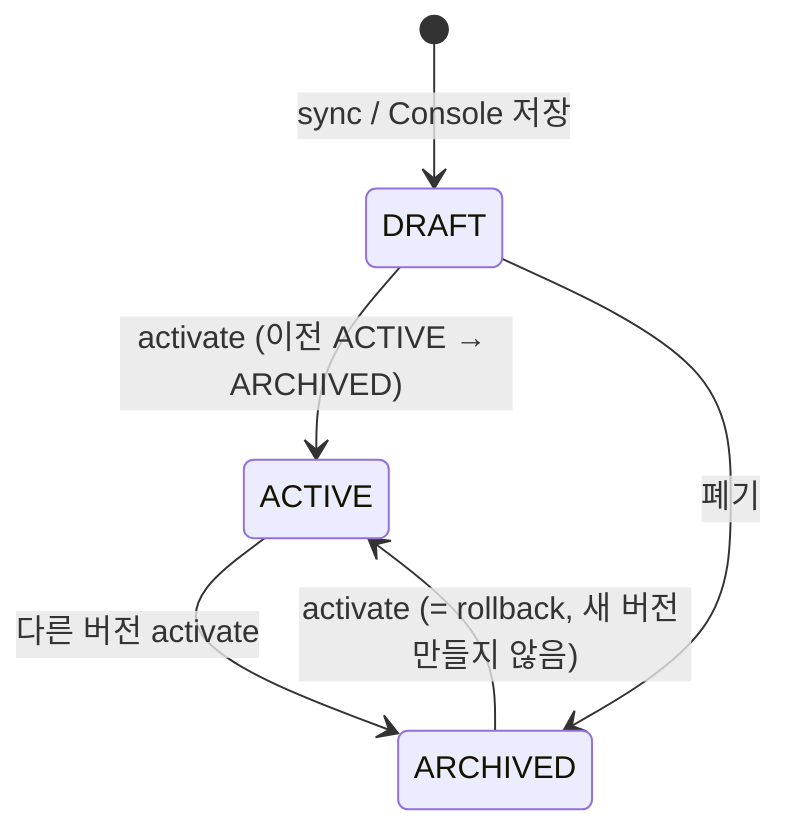

# 14. Prompt Registry / Versioning — `PromptTemplate` · `PromptVersion`

> 원문 §118·§119·§120. 정본: `../domain-model.md`(L2 conversation 소유) · `../api-contract.md`(`prompts*`) · `../configuration-resolution.md`(SOURCE_CODE 층). 충돌 3 해소(`00` §3)를 구체화한다.

## 1. 목적

강사 페르소나와 10개 AI 지점의 프롬프트를 코드에만 묶어두지 않고 버전·활성화·롤백·저장 전 테스트가 가능한 레지스트리로 관리하되, **개발 정본은 여전히 저장소 파일(prompt-engineer 소유)** 이 되도록 파일↔DB 관계를 고정한다.

## 2. 범위

- 포함: 키 카탈로그, 엔티티, 파일↔DB 동기화, 런타임 해석, 상태 전이, activate/rollback, 저장 전 테스트, prompt-engineer 역할과의 관계, UI.
- 제외: 프롬프트 내용 자체(§8 A1~A10, `tutor.md` 절 구조), LLM 어댑터.

## 3. 키 카탈로그 (`PromptTemplate`)

| key | 파일(SOURCE_CODE v0) | 용도(§8) | 모델 tier | ownerRole |
|---|---|---|---|---|
| `teacher-persona` | `.claude/agents/tutor.md` | 강사 페르소나(절 필터로 모드별 발췌) | — (모든 턴에 합성) | prompt-engineer |
| `talk` | `src/modules/conversation/prompts/talk.ts` | A1 회화 턴(응답+교정) | haiku | prompt-engineer |
| `chat` | `…/prompts/chat.ts` | A2 채팅 턴 | haiku | prompt-engineer |
| `chatReview` | `…/prompts/chatReview.ts` | A3 표현 점검 | sonnet | prompt-engineer |
| `lesson` | `…/prompts/lesson.ts` | A4 오늘의 회화 레슨 | sonnet | prompt-engineer |
| `reviewMix` | `…/prompts/reviewMix.ts` | A5 복습 혼합 | sonnet | prompt-engineer |
| `evalGen` | `…/prompts/evalGen.ts` | A6 평가 출제 | sonnet | prompt-engineer |
| `evalGrade` | `…/prompts/evalGrade.ts` | A7 평가 채점 | sonnet | prompt-engineer |
| `planAnalysis` | `…/prompts/planAnalysis.ts` | A8 분석→계획 | opus | prompt-engineer |
| `ask` | `…/prompts/ask.ts` | A9 무엇이든 물어보세요 | profile tier | prompt-engineer |
| `wordEnrich` | `…/prompts/wordEnrich.ts` | A10 단어 보강 | home-m4/haiku | prompt-engineer |

키는 코드 상수(`conversation/prompts/keys.ts`)로 고정하며 Console 에서 새 키를 만들 수 없다(§118 의 `conversation-default` 등 예시 이름은 이 11개로 대체).

## 4. 정의 (정본 발췌)

```prisma
enum PromptSource { SOURCE_CODE CONSOLE }
enum PromptStatus { DRAFT ACTIVE ARCHIVED }

model PromptTemplate {
  key         String  @id @db.VarChar(40)
  description String  @db.VarChar(200)
  ownerRole   String  @db.VarChar(40)       // "prompt-engineer"
  filePath    String  @db.VarChar(200)      // SOURCE_CODE v0 위치
  schemaRef   String? @db.VarChar(80)       // §67 등 출력 JSON 스키마 id
  versions    PromptVersion[]
}
model PromptVersion {
  id           String  @id @default(cuid())
  key          String
  environment  Environment
  version      Int
  body         String  @db.Text            // 템플릿 본문({{learnerHeader}} 등 placeholder 허용)
  bodySha256   String  @db.VarChar(64)
  source       PromptSource
  status       PromptStatus @default(DRAFT)
  modelHints   Json?                       // {tier, maxChars, jsonSchemaRef, sections?}
  changeNote   String? @db.VarChar(500)
  actorUserId  String?                     // null = sync 시스템
  syncedFromSha String? @db.VarChar(64)    // SOURCE_CODE 일 때 git blob sha
  createdAt    DateTime @default(now())
  activatedAt  DateTime?
  archivedAt   DateTime?
  template     PromptTemplate @relation(fields: [key], references: [key])
  @@unique([key, environment, version])
  @@index([key, environment, status])
}
```

`environment`·`bodySha256`·`changeNote`·`syncedFromSha`·`filePath`·`schemaRef` 는 초안 대비 추가(정본 반영 제안). 프롬프트도 환경별로 ACTIVE 가 다를 수 있다(LOCAL 에서 실험, PRODUCTION 은 검증본).

## 5. 파일 ↔ DB 동기화

- `npm run prompts:sync [--env LOCAL|PRODUCTION] [--activate] [--key talk]`: 각 키의 파일 본문을 읽어 `bodySha256` 이 최신 SOURCE_CODE 버전과 다르면 새 `PromptVersion{source:SOURCE_CODE, status:DRAFT, syncedFromSha}` 를 만든다. `--activate` 면 즉시 ACTIVE(LOCAL 기본 허용, PRODUCTION 은 `prompts.activate` 보유 실행자 + 확인 프롬프트). `AuditLog prompt.sync`.
- 배포(`scripts/deploy.sh`)는 `prompts:sync` 를 **DRAFT 로만** 실행한다. 운영에서 새 파일 버전을 켜는 것은 Console 또는 `--activate` 의 명시적 행위다.
- `npm run prompts:diff`: 파일 vs 각 환경 ACTIVE 본문 diff 를 출력(prompt-engineer 가 Console 편집본을 파일로 역반영할 때 사용).
- 역방향(DB → 파일) 자동 쓰기는 없다. CONSOLE 버전이 PRODUCTION ACTIVE 인 채로 파일과 다르면 Console Prompts 화면과 `prompts:diff` 가 "파일과 불일치" 경고를 낸다.

## 6. 런타임 해석 (`conversation/promptRegistry`)

```text
get(key, env=APP_ENV):
  1. PromptVersion{key, env, status:ACTIVE} 있으면 그 body   → source=DATABASE (sourceRef db:PromptVersion/<id>)
  2. 없으면 파일 v0                                        → source=SOURCE_CODE (sourceRef code:<filePath>)
```

- 결과는 프로세스 캐시, `prompt.activated{key}` 이벤트로 무효화. 프롬프트 빌더는 `{body, version, source}` 를 받아 Trace ORCHESTRATOR step 의 `promptKey/promptVersion` 에 기록한다(`13` §4).
- `ConfigurationVersion(scope=PROMPT, targetId=key)` 은 "어느 PromptVersion 이 ACTIVE 인가"의 이력만 갖는다(`06` §8). Effective Configuration 화면의 `prompt.<key>.activeVersion` 키가 이 값이다.
- placeholder 는 빌더가 채우는 고정 집합(`{{learnerHeader}}·{{mode}}·{{window}}·{{utterance}}·{{mixSpec}}·{{rubric}}`)만 허용. 미지 placeholder 는 저장 시 검증 실패.

## 7. 상태 전이·activate·rollback



- `POST prompts/:key/versions/:v/activate {reason}` (`prompts.activate`): 트랜잭션으로 대상 ACTIVE·이전 ARCHIVED, `ConfigurationVersion(PROMPT)` 새 행, `AuditLog prompt.activate`, 캐시 무효화. PRODUCTION 은 `productionSensitive` 로 취급해 확인 토큰 필요(`16` §6; 프롬프트는 학습자 경험에 직접 영향).
- 롤백은 과거 버전 `activate` 로 표현한다(본문 불변이므로 새 버전 불필요). History 에는 `ConfigurationVersion(origin=PROMPT_ACTIVATE)` 로 남는다.
- ACTIVE 버전은 편집 불가. 편집은 항상 새 DRAFT(`POST prompts/:key/versions {body, changeNote, baseVersion}`, `source=CONSOLE`).

## 8. 저장 전 테스트 (§120)

- `POST prompts/:key/test {body(draft) | version, input:{userInput, learner, history, mode}, structured:true}` (`prompts.edit`) — 내부적으로 `11` §6 의 `playground/llm {prompt:{kind:'draft'}}` 와 동일 경로. 응답에 구조화 검증 결과·지연·usage·`assembledChars`(상한 §8: A1 총 ≤3,000자 등 `modelHints.maxChars` 초과 경고).
- 회귀 픽스처: `src/modules/conversation/prompts/__fixtures__/<key>/*.json`(입력·기대 필드) 을 Console 의 [픽스처로 테스트] 가 순회 실행해 통과율을 표시한다(Phase 3). 파일 경로·DB 경로 모두 같은 픽스처를 쓴다(충돌 3 해소 조건).
- 테스트는 `RequestTrace{kind:PLAYGROUND}` 만 남기고 사용자 데이터를 건드리지 않는다.

## 9. prompt-engineer 역할과의 관계

- 파일이 개발 정본: 팀 워크플로우(Developer→Reviewer→QA)는 파일을 고치고 `prompts:sync` 로 올린다. Console 편집은 운영 중 긴급 조정·실험용이며, ACTIVE 로 남기려면 prompt-engineer 가 파일로 역반영(`prompts:diff` 참고)하고 다음 sync 에서 SOURCE_CODE 버전이 같은 sha 로 올라오면 "파일과 일치" 로 돌아온다.
- `teacher-persona` 는 `tutor.md` 절 구조(`## N.`)를 유지해야 절 필터가 동작하므로 저장 시 절 헤더 존재를 검증한다.

## 10. UI (§118·§119)

```text
Prompts
  talk            ACTIVE v12 (CONSOLE, 09-24)   파일과 불일치 ⚠   [열기]
  teacher-persona ACTIVE v3  (SOURCE_CODE)      일치 ✓
  …
talk › 버전: v12 ACTIVE · v11 ARCHIVED · v10 ARCHIVED · v13 DRAFT(편집 중)
  [편집기(본문·changeNote·placeholder 힌트)]  [테스트]  [픽스처 실행]  [DRAFT 저장]  [Activate]
```

## 11. 검증/오류

- 저장 검증: 본문 ≤20,000자, 미지 placeholder 금지, `teacher-persona` 절 헤더, `modelHints.tier ∈ {fast,balanced,deep}`.
- 오류: `400 VALIDATION`, `403`(activate·PRODUCTION 확인), `404`(키·버전), `409`(이미 ACTIVE / `baseVersion` 불일치).
- QA: sync 2회(파일 불변) → 버전 증가 없음; 파일 수정 후 sync → DRAFT +1; activate → 런타임 Trace 의 `promptVersion` 갱신; 과거 버전 activate → ConfigurationVersion +1, PromptVersion 행 수 불변.

## 12. Phase

2: 엔티티·sync·registry 해석·Console 목록/편집/activate/test · 3: 픽스처 실행·`prompts:diff` · 4: PRODUCTION 확인 토큰 결합.

## 13. 미결

- 추가 필드의 정본 반영. 환경별 ACTIVE 분리가 과하면 `environment` 를 제거하고 단일 ACTIVE 로 축소 가능(사용자 결정).
- `ask`·`wordEnrich` 처럼 home-m4 로 갈 수 있는 키의 `modelHints` 에 provider 힌트를 둘지(엔진명 노출 금지 원칙과 충돌 여부 검토).
