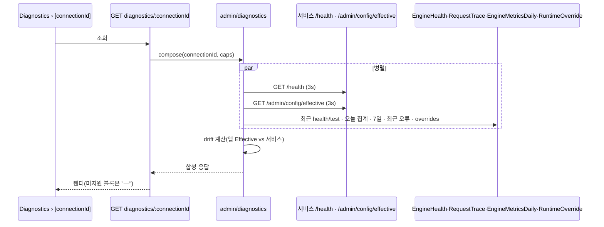

# 15. Developer Diagnostic API — Diagnostics · Log level · Debug session

> 원문 §111·§112·§113·§58·§59. 정본: `../api-contract.md`(`diagnostics/:connectionId`, `engine-connections/:id/log-level`, `debug-sessions`) · `../domain-model.md`(`EngineHealth`·`EngineMetricsDaily`·`DebugSession`). Health/Functional Test 자체는 speech-platform `09`·`10`.

## 1. 목적

Connection 하나의 상태(Health·모델 로드·메모리)·실제 트래픽 메트릭(p50/p95·요청·오류)·설정 드리프트·로그 레벨을 한 화면에서 보고, 필요할 때만 명시적 Debug Session 으로 본문 캡처를 허용한다(§125-14·17).

## 2. 범위

- 포함: `GET diagnostics/:connectionId` 합성 응답, 서비스 `/health` 계약, 메트릭 소스, 드리프트, Log level API 와 PRODUCTION 제한, Debug session 생명주기.
- 제외: Trace 조회(`13` §9), E2E(`12`).

## 3. `GET /api/admin/v1/diagnostics/:connectionId` (`engine.read`; `metrics`·`recentErrors` 는 `trace.read` 없으면 생략)

```json
{
  "success": true,
  "data": {
    "connection": { "id": "whisper-voicevault", "engineId": "faster-whisper", "role": "ANALYSIS_STT", "connectionType": "HTTP", "status": "HEALTHY", "lastHealthAt": "…", "activeVersionId": "cfgv_19", "pendingRestart": false },
    "health": { "kind": "HEALTH", "ok": true, "latencyMs": 42, "checkedAt": "…", "detail": { "schemaDrift": false } },
    "functionalTest": { "ok": true, "latencyMs": 3120, "checkedAt": "…" },
    "service": { "available": true, "version": "0.3.1", "uptimeSec": 86400, "modelLoaded": true, "model": "medium", "device": "cpu", "computeType": "int8",
                 "memory": { "rssBytes": 8800000000, "supported": true }, "logLevel": "INFO", "schemaHash": "sha256:…", "queueDepth": 0 },
    "metrics": { "today": { "requests": 128, "errors": 1, "timeouts": 0, "p50Ms": 680, "p95Ms": 1420, "avgMs": 730 },
                 "last7d": [ { "date": "2026-09-25", "requests": 1210, "errors": 3, "p50Ms": 655, "p95Ms": 1380 } ] },
    "drift": [ { "key": "runtime.cpuThreads", "app": 4, "service": 8, "reason": "서비스 재기동 필요(env 변경 후 미반영)" } ],
    "recentErrors": [ { "traceId": "trc_…", "at": "…", "errorCode": "ENGINE_TIMEOUT", "step": "STT" } ],
    "overrides": [ { "id": "ovr_…", "kind": "TEMPORARY", "keys": ["runtime.model"], "expiresAt": "…" } ]
  }
}
```

| 블록 | 소스 |
|---|---|
| `connection`·`health`·`functionalTest` | `EngineConnection` + `EngineHealth` 최근 1건씩(kind 별) |
| `service` | 해당 Python 서비스 `GET /health` 실시간 호출(타임아웃 3s, 실패 시 `available:false` 만). ONDEVICE·CLI 연결은 `service:null` |
| `metrics` | `13` §10: 오늘 = 즉석 집계(60s 캐시), 과거 = `EngineMetricsDaily` |
| `drift` | 앱 resolver Effective vs 서비스 `GET /admin/config/effective` 키별 비교(`04` §6) |
| `recentErrors` | `RequestTrace` 최근 24h `FAILED|TIMEOUT` step ≤10건 |
| `overrides` | 활성 `RuntimeOverride`(이 대상) |

Hardware 메트릭(메모리·GPU)은 서비스가 지원할 때만(`supported:false` 면 화면에서 "미지원")—§111.

## 4. Python 서비스 `/health` 계약 (gateway :8100 · worker · M4 tts-service :8200 공통)

```json
{ "ok": true, "service": "tts-service", "version": "0.3.1", "uptimeSec": 86400, "env": "PRODUCTION",
  "models": [ { "id": "teacher_haruka", "loaded": true, "device": "mps" } ],
  "memory": { "rssBytes": 6100000000 }, "logLevel": "INFO", "schemaHash": "sha256:…", "queueDepth": 0,
  "checks": { "model_dir": true, "torch": true } }
```

`ok=false` 여도 200 으로 응답한다(연결 거부와 구분). 인증은 `/api/internal` 과 같은 공유 시크릿 헤더. 5분 주기 Health 스케줄과 Console 수동 [Health] 가 같은 엔드포인트를 쓴다.

## 5. Log level — `GET/PUT /api/admin/v1/engine-connections/:id/log-level`

- 값: `ERROR | WARN | INFO | DEBUG | TRACE`. 앱 측 저장 위치는 Connection 의 `logging.level`(RUNTIME_EDITABLE) — 즉 **일반 Apply 와 같은 버전·감사 경로**를 타되, 이 엔드포인트가 그 한 키만 바꾸는 단축 경로다. 반영은 `POST /admin/log-level {level, traceId}` 로 서비스에 push, 앱 자체 로거(`infra/logging`)의 연결별 레벨도 갱신.
- PRODUCTION 제한(§112): `AppSetting log.production.maxLevel`(기본 `INFO`) 초과 값은 `environment.policy` 보유자만, `ttlMinutes`(≤60) 필수, `reason` 필수. TTL 후 스케줄러가 원 레벨로 복귀시키고 `AuditLog loglevel.set`(시스템 actor) 을 남긴다. TTL 상향은 `ConfigurationVersion` 을 만들지 않는다(임시) — `RuntimeOverride` 도 아니다(Production 에서 Override 가 비활성일 수 있으므로 별도 `AppSetting log.tempElevations` 로 추적).
- 요청 `{ "level": "DEBUG", "ttlMinutes": 30, "reason": "TTS 첫 문장 지연 조사" }` → 응답 `{ level, effectiveUntil?, previousLevel, serviceResult: "APPLIED"|"FAILED" }`.
- capability: `engine.connections.manage`(LOCAL 전 레벨) / PRODUCTION `DEBUG` 이상: + `environment.policy`.

## 6. Debug session — `POST /api/admin/v1/debug-sessions`

```json
{ "purpose": "E2E TTS 지연 재현", "captureAudio": true, "captureText": true, "ttlMinutes": 30,
  "scope": { "kinds": ["PLAYGROUND", "E2E"], "userIds": ["<actor self>"], "connectionIds": ["style-bert-m4"] } }
```

- 응답 `{ id, expiresAt, storagePath: "DATA_ROOT/debug/<id>/" }`. capability `debug_session.create`. `AuditLog debug_session.create`.
- 규칙(§113): `ttlMinutes ≤ 60`; `scope.userIds` 는 **actor 자신만**(학습자 본문 캡처 금지 — 다른 사용자를 넣으면 400); `kinds` 에 `TURN` 을 넣으려면 `userIds` 가 자신이어야 하고 PRODUCTION 은 SUPER_ADMIN(`environment.policy`)만. 캡처 대상 요청은 `debugSessionId` 를 Trace 에 남기고 본문·오디오를 `storagePath` 에 쓴다(`13` §7). 만료 시 스케줄러가 디렉터리를 삭제하고 `AuditLog debug_session.end`.
- 세션 동시 1개(actor 당). 조기 종료·목록은 정본 API 목록에 없으므로 `GET debug-sessions`·`DELETE debug-sessions/:id` 를 추가 제안(§10 미결). 없을 때는 TTL 만료로만 끝난다.

## 7. 시퀀스 — Diagnostics 조회



## 8. UI (§111)

```text
whisper-voicevault · faster-whisper · ANALYSIS_STT           ● HEALTHY   v19   PRODUCTION
Status HEALTHY · Model medium (loaded) · Device cpu/int8 · Memory 8.2 GB · Uptime 1d
Avg 730 ms · p50 680 · p95 1,420 · Requests 128 · Errors 1 · Timeouts 0     [7일 그래프]
드리프트 1건: runtime.cpuThreads 앱 4 / 서비스 8 → 재기동 필요
Log level [INFO ▼] (PRODUCTION: DEBUG 이상은 TTL·사유 필요)      [Health] [Functional Test]
최근 오류: trc_… ENGINE_TIMEOUT STT 10:14                       [Debug Session 열기]
```

## 9. 검증/오류

- `404`(연결 없음) · `403`(capability·PRODUCTION 레벨 제한) · `400`(TTL·scope 위반) · 서비스 불가 시 `service.available=false` 로 200(오류 아님).
- QA: 서비스 중지 → `service.available=false`·health `ok=false`·나머지 블록 정상; PRODUCTION 에서 ADMIN 이 `TRACE` 요청 → 403; DEBUG+TTL 30분 → 만료 후 INFO 복귀·감사 2행; DebugSession 만료 후 디렉터리 삭제·Trace 행은 유지.

## 10. Phase

1: Health 블록·서비스 `/health`·`GET diagnostics`(metrics 제외) · 3: metrics·drift·recentErrors·Log level·Debug session · 4: TTL 상향 스케줄러·overrides 블록.

## 11. 미결

- `GET/DELETE debug-sessions` 엔드포인트 추가 여부.
- Log level TTL 상향의 추적 저장소(`AppSetting log.tempElevations` vs 전용 테이블) — 건수가 적어 `AppSetting` 으로 시작.
- 서비스 `/health` 응답의 `schemaHash` 계산 규약(정규화 JSON 직렬화 순서)을 Python·TS 공통 문서(speech-platform `07`)에 명시.
