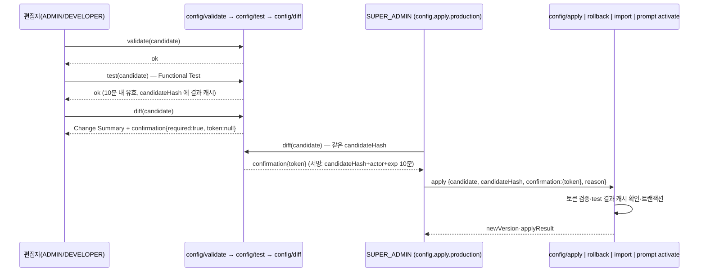

# 16. Environment 별 Configuration 정책 — APP_ENV · Production 보호 · Preset/Export/Import · Override

> 원문 §95·§96·§102~§107·§125-18·20. 정본: `../configuration-resolution.md`(Environment·Override TTL·Production 보호 흐름의 정본) · `../api-contract.md`(`environment`, `config/export|import`, `presets`, `overrides`) · `../domain-model.md`. 충돌 4 해소(`00` §3).

## 1. 목적

같은 NAS MariaDB 를 쓰는 dev(LOCAL)와 운영(PRODUCTION)의 설정 행을 섞이지 않게 분리하고, PRODUCTION 변경에는 확인 절차를 강제하며, 환경 간 설정 이동(Preset·Export·Import)과 임시 변경(Override)의 규칙을 정한다.

## 2. 범위

- 포함: 환경 값·`APP_ENV`·행 분리·기동 규칙, `GET environment`, Production 확인 토큰 흐름, 민감 키 정의, Preset, Export/Import 포맷·절차, Override 규칙·TTL·만료.
- 제외: 배포 절차(`docs/deploy-order.md`), 시크릿 파일 배치(speech-platform `08`).

## 3. 환경과 `APP_ENV`

| Environment | 사용 | 프로세스 | DB |
|---|---|---|---|
| `LOCAL` | 개발 미러(`~/.node-local/thekaiwa`, 맥 로컬) | `APP_ENV=LOCAL` | NAS MariaDB 공용, `environment=LOCAL` 행 |
| `DEVELOPMENT` · `STAGING` | **슬롯**(현재 미사용) | — | 필요 시 활성 |
| `PRODUCTION` | pm2 `thekaiwa` blue/green :3010, M4 tts-service, 우분투 gateway/worker | `APP_ENV=PRODUCTION` | 같은 DB, `environment=PRODUCTION` 행 |

- `environment` 컬럼을 갖는 엔티티: `EngineConnection`·`EngineHealth`·`EngineFallbackPolicy`·`ConfigurationVersion`·`RuntimeOverride`·`RequestTrace`·`EngineMetricsDaily`·`AuditLog`·`AppSetting`·`PromptVersion`·`VoiceProfile`(정본 표). `User`·학습 데이터는 환경 컬럼이 없고 공유된다(1인 앱, 같은 계정으로 양쪽 로그인).
- 모든 설정 조회는 `infra/db` 의 스코프 헬퍼(`scoped(env)`)를 거쳐 `where environment = APP_ENV` 가 자동으로 붙는다. 헬퍼를 우회한 raw 쿼리는 reviewer 가 거부한다.
- 기동 규칙: `APP_ENV` 미설정 → 기동 실패. `APP_ENV=PRODUCTION` 인데 `NODE_ENV≠production` 이면 경고 로그. Python 서비스도 같은 값을 `APP_ENV` 로 받아 `/health.env` 로 보고하고, 앱은 연결의 서비스 env 가 다르면 `MISCONFIGURED` 로 표시한다(LOCAL 앱이 PRODUCTION M4 tts-service 를 가리키는 것은 **허용**하되 배지 경고 — 실제 운영 관행).
- `GET /api/admin/v1/environment` → `{ environment, appVersion, nodeEnv, policies:{ overridesEnabled, overrideMaxTtlMinutes, logMaxLevel, productionConfirmationTtlMinutes, importEnabled }, activeOverrides, pendingRestart:[connectionId] }`. `engine.read`.

## 4. 정책 키 (`AppSetting`, `environment.policy` 로만 편집)

| key | 기본(LOCAL) | 기본(PRODUCTION) | 의미 |
|---|---|---|---|
| `override.production.enabled` | — | `false` | PRODUCTION 에서 TEMPORARY/SESSION Override 허용 |
| `override.maxTtlMinutes` | 240 | 60 | Override 최대 TTL |
| `log.production.maxLevel` | — | `INFO` | 초과 시 `15` §5 절차 |
| `config.import.enabled` | `true` | `false` | Import 허용(PRODUCTION 은 `config.import.production` + 이 키 true) |
| `production.confirmation.ttlMinutes` | — | 10 | 확인 토큰 수명 |
| `production.sensitiveExtraKeys` | — | `[]` | 스키마 `productionSensitive` 외 추가 민감 키 |

## 5. 민감 변경 정의 (§96)

`productionSensitive=true` 인 스키마 키(`03`) = Engine 선택·모델(`runtime.model`)·연결(`connection.baseUrl`·`connectionType`)·Credential(`credentialRef`)·Fallback(`EngineFallbackPolicy` 전체)·프롬프트 activate·Voice `disable/archive`. 그 외 RUNTIME_EDITABLE 키(`timeoutMs`·`logging.level`·`retry`)는 PRODUCTION 에서도 `config.edit` 로 Validate→Apply 가능(버전·감사는 동일).

## 6. Production 변경 보호 흐름

> **task-012c D-C1(2026-09-29) — 아래 서명 확인 토큰(HMAC) 흐름은 폐기한다.** 정본은 `../configuration-resolution.md` §8-1: apply·rollback·(012c-2) 페르소나 활성화는 `confirm:"PRODUCTION"` + `summaryHash`(무상태 — 서버가 같은 후보로 Diff 를 다시 계산해 대조) + `testResultId`(`EngineHealth(FUNCTIONAL).id`, 30분·같은 후보·변경 키 전부 실행 검증 — Codex C1 CX-2) + `reason≥10` + SUPER_ADMIN 본인을 요구한다. 1인 앱에서 "Change Summary 를 반드시 한 번 보게 한다"는 목적은 확인 다이얼로그(`PRODUCTION` 직접 입력)로 지키고, blue/green 두 프로세스에서도 서버 상태 없이 동작한다. §4 의 `production.confirmation.ttlMinutes` 키는 쓰지 않는다.



- 토큰은 `candidateHash`(Diff 응답의 값)·발급자·만료에 바인딩된 HMAC(`JWT_SECRET` 파생 키). Apply 시 재계산한 `candidateHash` 와 다르면 403. 발급자 ≠ apply 실행자여도 되지만 **발급자는 `config.apply.production` 보유자**여야 한다. 1인 앱에서는 같은 사람이 두 단계를 밟는다 — 그래도 Change Summary 를 반드시 한 번 보게 하는 것이 목적.
- 민감 변경은 `POST config/test` 결과가 캐시에 있어야 한다(`{code:'FUNCTIONAL_TEST_REQUIRED'}`). 비민감은 선택.
- 적용 결과에 `restartRequired` 가 있으면 `pendingRestart` 에 등록되고 Dashboard 배지·`GET environment` 에 노출된다.
- Rollback(`09`)·Import(§7)·Prompt activate(`14`) 는 같은 토큰 메커니즘을 쓴다(각각 `rollbackOfId`·`importId`·`promptVersionId` 를 candidateHash 재료로).

## 7. Export / Import (§102~§104)

`GET /api/admin/v1/config/export?scopes=ENGINE_CONNECTION,FALLBACK_POLICY,APP_SETTING,VOICE_PROFILE,PROMPT&targetIds=` (`config.export`) →

```json
{ "formatVersion": 1, "exportedAt": "…", "environment": "LOCAL", "appVersion": "1.4.0",
  "schemaVersions": { "faster-whisper": 3, "style-bert": 2 },
  "engineConnections": [ { "id": "whisper-voicevault", "engineId": "faster-whisper", "role": "ANALYSIS_STT", "connectionType": "HTTP", "enabled": true,
      "stored": { "connection": { "baseUrl": "http://127.0.0.1:8090", "credentialRef": "file:whisper-token" }, "runtime": { "model": "medium" } }, "versionId": "cfgv_…" } ],
  "fallbackPolicies": [ { "role": "REALTIME_STT", "primaryConnectionId": "reazon-ondevice", "fallbackConnectionIds": ["reazon-gateway"] } ],
  "appSettings": { "voice.preview.defaultText": "…" },
  "voiceProfiles": [ { "id": "haruka", "defaults": { "speed": 0.9 } } ],
  "prompts": [ { "key": "talk", "version": 12, "source": "CONSOLE", "bodySha256": "…", "body": "…" } ],
  "secretsRedacted": true }
```

- `SECRET` 키는 값이 애초에 DB 에 없으므로 `credentialRef` 문자열만 나간다(§103). Export 는 `AuditLog config.export`(파일 내용 미기록). 정책 키(`override.*`·`log.*`·`production.*`)는 Export 에서 제외.
- `POST /api/admin/v1/config/import` (multipart 또는 JSON body, `config.import`; 대상이 PRODUCTION 이면 `config.import.production` + `config.import.enabled=true`) `{ file, mode: "MERGE"|"REPLACE", dryRun, reason, confirmation? }`:
  1. `formatVersion`·`schemaVersions` 호환 검사(스키마 상승은 `10` §4 의 재검증, 하락은 거부)
  2. 대상별 `10` 5단계(문법·스키마·의존성) — 참조 무결성(fallback 이 가리키는 connection 이 파일 또는 DB 에 존재, `credentialRef` 가 이 서버 SecretResolver 에 존재)
  3. 대상별 Diff 묶음 응답(`08` 형식 × N, 접기/펼치기 UI) + 민감 변경 포함 시 `confirmation`
  4. `dryRun=false`: 단일 트랜잭션으로 대상별 `ConfigurationVersion(origin=IMPORT, importId)` + `AuditLog config.import` → Python push(대상별 결과)
- `MERGE` 는 파일에 있는 대상만 갱신, `REPLACE` 는 파일에 없는 연결을 `enabled=false` 로(삭제 아님). 파일의 `environment` 와 대상 환경이 달라도 되며(그게 용도), `id` 충돌은 같은 대상으로 간주.

## 8. Preset (§105)

- `ConfigurationPreset{id, name, description, environmentHint?, snapshot(Export 와 같은 포맷의 부분집합), createdBy, createdAt}`. `GET/POST/DELETE presets` (`presets.manage`). 환경 컬럼 없음(어느 환경에서든 불러올 수 있음).
- 적용은 서버 엔드포인트가 아니라 **편집기로 불러오기** → 일반 Validate/Test/Diff/Apply(대상마다). 결과 버전 `reason` 에 `preset:<id>`. 시드 Preset: `Fast Development`(온디바이스+haiku+캐시), `High Accuracy Test`(gateway+large-v3+sonnet), `Low Resource`, `Offline Test`, `Production Default`(운영 seed 와 동일).

## 9. Runtime Override (§106·§107)

> Override(TEMPORARY·SESSION)와 SESSION override 의 Python 요청별 전달(`../configuration-resolution.md` §13 #7)은 **Phase 4(task-016)** — task-012c D-C10 으로 012c 에서 이관(2026-09-29).

| 항목 | TEMPORARY | SESSION |
|---|---|---|
| 적용 범위 | 환경 전역(모든 요청) | `sessionId` 일치 요청만(Playground/E2E 의 `sessionId`, 또는 개발자 자신의 앱 세션 쿠키 id) |
| TTL | `ttlMinutes ≤ override.maxTtlMinutes` (기본 30) | ≤ 24h |
| 대상 키 | RUNTIME_EDITABLE 만, `productionSensitive` 키는 PRODUCTION 에서 `override.production` 필요 | 동일 |
| PRODUCTION | `override.production.enabled=true` 이고 `override.production` 보유 시만 | 동일 |
| 버전 | 만들지 않음(`baseVersionId` 만 기록) | 동일 |
| 감사 | `override.create/revoke/expire` | 동일 |

- `POST overrides {scope, targetId, kind, patch, ttlMinutes | sessionId, reason}` → `{id, expiresAt}`; `DELETE overrides/:id` 철회. Resolver 8층으로 즉시 반영(`04` §5 무효화), Python 에는 `POST /admin/config/apply {patch, overrideId, expiresAt}` 로 push 하고 만료 시 원 값으로 되돌리는 push 를 다시 보낸다(스케줄러 1분 주기 스윕; 서비스가 자체 만료를 지원하면 `expiresAt` 으로 이중 안전).
- 동일 키에 TEMPORARY 와 SESSION 이 겹치면 SESSION 이 이긴다(더 좁은 범위). 같은 kind 끼리는 나중 것이 이기고 이전 것은 자동 철회.
- Effective 화면에서 Override 값은 `RUNTIME_OVERRIDE` 배지 + 남은 시간 카운트다운, Dashboard 상단에 활성 Override 수.
- Rollback·Apply 는 Override 를 건드리지 않고 `warnings` 로 알린다(`09` §3).

## 10. 검증/오류

- `403 {code:'PRODUCTION_CONFIRMATION_REQUIRED'|'OVERRIDE_DISABLED_IN_PRODUCTION'|'IMPORT_DISABLED'}` · `400 {code:'FUNCTIONAL_TEST_REQUIRED'|'TTL_EXCEEDS_POLICY'|'FORMAT_VERSION_UNSUPPORTED'}` · `409`(토큰 hash 불일치·낙관적 잠금).
- QA: LOCAL 앱에서 만든 버전이 PRODUCTION 앱 Effective 에 나타나지 않음(행 분리); PRODUCTION 에서 `runtime.model` 변경 → 토큰 없이 403, 토큰 발급 후 성공; `override.production.enabled=false` 에서 Override → 403; TTL 30분 Override 만료 후 Effective 복귀·서비스 push 확인; Export → Import(dryRun) 왕복 시 diff 0건.

## 11. Phase

1: `APP_ENV`·행 분리·`GET environment`·배지 · 2: Production 확인(task-012c — 토큰 대신 §6 머리 방식)·Functional Test 요구 · 4: Preset·Export/Import·Override·정책 키 편집 UI.

## 12. 미결

- 확인 토큰을 서명 토큰이 아니라 `PendingChange` 테이블(승인 대기 큐)로 둘지 — 2인 이상 운영 시 전환.
- `REPLACE` Import 가 연결을 `enabled=false` 로 내리는 것과 라우터 Fallback 의 상호작용(마지막 남은 연결 비활성 방지 규칙)은 speech-platform `12` 와 함께 확정.
- Preset 을 환경별로 잠글지(`environmentHint` 강제) 여부.
