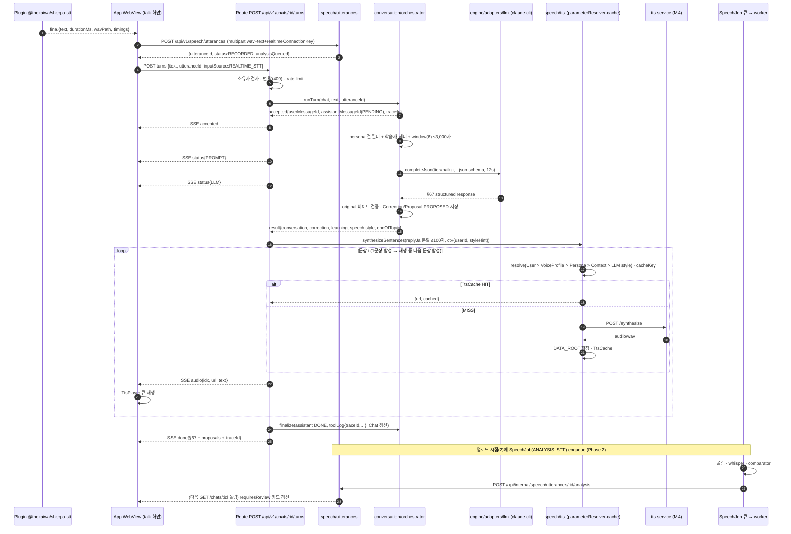
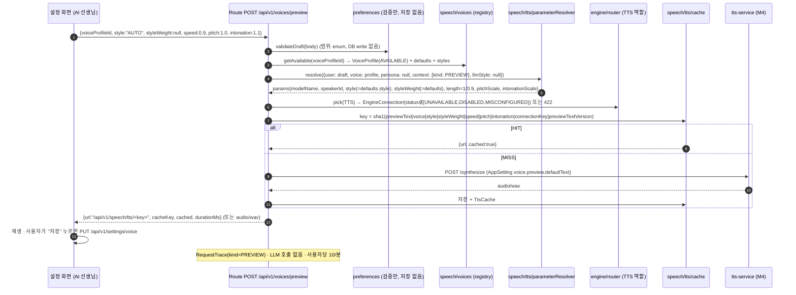
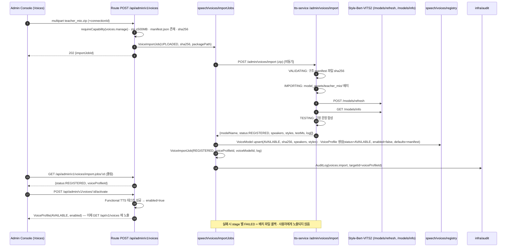

# TheKaiwa API Contract (정본)

> 작성일 2026-09-26 · 상태: 설계 확정(구현 전) · 소유: leader(계약) / developer(구현 일치 책임) / reviewer(감사)
>
> 이 문서는 TheKaiwa 의 **모든 HTTP · WebSocket · SSE 계약의 단일 출처**다. `docs/design-spec.md` §10 은 요약과 링크만 두고, 엔드포인트별 요청/응답 JSON·검증 상한·오류 코드·권한·소유 층·Phase 는 여기서만 정의한다.
> 엔티티 이름은 `docs/design/domain-model.md`, 모듈·층 이름은 `docs/design/module-dependency.md`, capability 문자열은 `docs/design/role-permission.md`, 설정 해석 규칙은 `docs/design/configuration-resolution.md` 를 따른다. 이 문서는 그 이름들을 **인용만** 하고 재정의하지 않는다.

---

## 0. 목적 · 정본 관계 · 공통 규약

### 0-1. 목적

- 라우트 파일(`src/app/api/**/route.ts`)은 이 문서의 계약을 그대로 구현한다. 라우트는 얇다 — 인증·capability 검사·입력 검증·모듈 호출·응답 봉투만 담당하고, 엔진명 분기·spawn·fetch·네이티브 호출은 하지 않는다(`module-dependency.md` 의존 규칙).
- task-002 완료 기준 "`api-contract.md` 와 라우트 목록 일치" 의 대조 기준이 이 문서 §1 총람 표다.
- 다른 설계 문서(`speech-platform/*`, `admin-console/*`)는 이 문서의 엔드포인트를 **링크로 인용**하고 요청/응답을 다시 쓰지 않는다.

### 0-2. 응답 봉투 (Response Envelope)

모든 JSON 응답은 TheRoute·TheMeal 규약의 3키 봉투를 쓴다.

```json
{ "success": true,  "data": { "...": "..." }, "message": null }
{ "success": false, "data": { "code": "VALIDATION", "details": { "field": "speed", "reason": "0.6~1.2" } }, "message": "속도는 0.6~1.2 사이여야 합니다" }
```

- 성공: `data` 는 객체 또는 배열, `message` 는 사용자에게 보여줄 안내가 있을 때만 문자열.
- 실패: `data.code` 는 §0-5 오류 코드 중 하나(TheMeal 은 `data:null` 이지만 TheKaiwa 는 엔진·설정 오류를 클라이언트가 분기해야 하므로 코드를 싣는다). `details` 는 선택이며 **시크릿·원본 오디오·전체 대화 텍스트·서버 경로**를 담지 않는다.
- 오디오 응답(`audio/wav`)·SSE(`text/event-stream`)·리다이렉트(인증)·정적 모델 파일은 봉투를 쓰지 않는다. 이 예외는 §2 각 항목에 명시한다.
- 문자열 폭·숫자 범위 검증은 라우트 진입 시 수행하고 위반은 전부 `400 VALIDATION` 이다. 본문 상한은 항목별로 적는다(기본 JSON 본문 ≤ 64KB).

### 0-3. 인증

| 채널 | 방식 |
|---|---|
| 웹(모바일 브라우저) | Google OAuth → `POST /api/auth/complete`(초대코드) → **httpOnly JWT 쿠키 `thekaiwa_session`**(SameSite=Lax, Secure, 만료 30일 슬라이딩) |
| 앱(Capacitor) | Chrome Custom Tab 에서 같은 OAuth 진행 → `complete` 가 쿠키 대신 **60초 1회용 `AppAuthCode`** 를 발급하고 `thekaiwa://auth/callback?code=` 딥링크로 복귀 → 앱 WebView 가 `GET /api/auth/app-exchange?code=` 로 이동 → 코드 소각 + 세션 쿠키 → `/study/today` 302 |
| WebSocket `/ws/speech` | 쿠키를 쓰지 않는다. `POST /api/v1/speech/ticket` 이 발급한 **60초 티켓 JWT**(같은 `JWT_SECRET`, `aud:"ws-speech"`)를 `start` 메시지에 싣는다 |
| 내부 콜백 `/api/internal/*` | 사용자 세션 없음. 헤더 **`X-Internal-Secret: <SPEECH_INTERNAL_SECRET>`** 상수 시간 비교. 불일치는 `401 UNAUTHENTICATED`, 헤더 자체가 없으면 `404`(경로 존재를 숨김) |
| Python 서비스 `/admin/*`, tts-service 전체 | 앱 서버(Next.js)만 호출한다. 같은 `X-Internal-Secret` 헤더 + LAN/loopback 바인딩. 앱·모바일은 절대 직접 호출하지 않는다(추가 기획안 §35·§51) |

- `/api/v1/*` 는 세션 필수(미인증 `401`). `/api/admin/v1/*` 는 세션 + **capability** 검사(`can(user, 'config.edit')`; 부족하면 `403 FORBIDDEN`, 단 `(admin)` 페이지 라우트는 404). 검사 대상은 role 이 아니라 `role-permission.md` 매트릭스의 capability 문자열이다.
- 세션 사용자 객체는 `{ id, email, name, role }` 만 노출한다.

### 0-4. 소유자 검사 → 404

`userId` 를 가진 모든 리소스(`Chat·ChatMessage·Correction·TutorProposal·WordEntry·VocabSession·Lesson·ReviewSchedule·Evaluation·StudyPlan·StudyLog·Utterance·AiJob·SpeechJob·UserVoiceSetting·UserSpeechSetting·Profile`)는 세션 사용자의 것만 조회·변경할 수 있다. **타인의 리소스는 존재 여부를 숨기기 위해 `403` 이 아니라 `404 NOT_FOUND`** 로 응답한다. 관리자도 `/api/v1/*` 에서는 자기 리소스만 본다(관리자 열람은 `/api/admin/v1/traces` 등 별도 계약).

### 0-5. 오류 코드 표

| HTTP | `data.code` | 언제 | 클라이언트 처리 |
|---|---|---|---|
| 400 | `VALIDATION` | 형식·범위·필수값 위반, 본문 상한 초과, 지원하지 않는 enum | 필드 안내 표시 |
| 401 | `UNAUTHENTICATED` | 세션 없음·만료, WS 티켓 무효, 내부 시크릿 불일치 | 로그인 화면(앱은 딥링크 재로그인) |
| 403 | `FORBIDDEN` | capability 부족, **Production 보호**(`confirm` 없음·SUPER_ADMIN 아님·override 비활성), 초대코드 불일치 | 안내만, 재시도 없음 |
| 404 | `NOT_FOUND` | 리소스 없음 **또는 타인 소유**, capability 없는 admin 페이지 | 목록으로 복귀 |
| 409 | `CONFLICT` | 사용자당 동시 턴 1 초과, 상태 전이 위반(예: DONE 세션에 attempt), 이미 채택/거절된 제안 재승인, `ConfigurationVersion` 낙관적 충돌(`baseVersion` 불일치) | 최신 상태 재조회 후 안내 |
| 422 | `UNPROCESSABLE` | 요청 모양은 맞지만 도메인 규칙 위반(task-003g 발음 사전 — 칸 규칙·가져오기 파일·미리듣기 예문). 갈래는 `details.reason`(`E_LEXICON_ENTRY_INVALID`·`E_IMPORT_*`·`E_PREVIEW_TEXT_TOO_LONG`, §7-2a) | 칸 오류 표시(`details.errors`·`fields`) |
| 422 | `ENGINE_UNAVAILABLE` | Engine Router 가 역할에 대해 선택 가능한 connection 이 없음(전부 `UNAVAILABLE/DISABLED/MISCONFIGURED`) | 텍스트 폴백 안내, 관리자면 콘솔 링크 |
| 429 | `RATE_LIMITED` | 초대코드 시도, 미리듣기(사용자당 10/분), TTS(60/분), 턴(분당 12), 내부 콜백 폭주 | `Retry-After` 초 후 재시도 |
| 502 | `ENGINE_ERROR` | 어댑터 호출이 실패로 종료(HTTP 5xx·프로세스 비정상 종료·스키마 위반 응답 재시도 소진) | "잠시 후 다시" + traceId 표시(개발자만) |
| 504 | `ENGINE_TIMEOUT` | 어댑터 타임아웃(턴 12s fail-fast, TTS 문장 8s, 기능 테스트 30s 등) | 동일 |

- `500` 은 계약 밖 예외(코드 `INTERNAL`)이며 발생 자체가 결함이다.
- 502/504 응답과 SSE `error` 이벤트에는 `traceId` 를 싣는다(`RequestTrace.traceId`). 값은 랜덤 22자(`t_` + base62)이며 사용자 식별 정보를 포함하지 않는다.

### 0-6. 날짜·시간

- **KST 날짜(`YYYY-MM-DD`)는 서버가 정한다.** 출석·오늘의 단어·레슨·복습·달력의 "오늘" 은 클라이언트가 보내지 않고 서버 `infra/dates` 가 `Asia/Seoul` 로 계산한다. 클라이언트는 조회 범위(`month=2026-09`, `date=2026-09-26`)만 보낸다.
- 타임스탬프는 ISO-8601 UTC(`2026-09-26T02:15:00.000Z`). `@db.Date` 컬럼은 KST 날짜 문자열로 직렬화한다.

### 0-7. 페이지네이션

- 목록은 **커서 방식**: 쿼리 `?limit=20&cursor=<opaque>`(limit 1~100, 기본 20). 응답 `data = { items: [...], nextCursor: string|null }`. 커서는 서버가 만든 불투명 문자열(정렬키+id)이며 클라이언트가 해석하지 않는다.
- 달력·월 단위(`?month=`)·`?date=` 조회와 관리자 `versions`·`audit`·`traces` 는 같은 커서 규약이되 `from`/`to` 필터를 추가로 받는다.
- 정렬은 항목별 기본값 고정(예: 채팅 `lastMessageAt desc`). 클라이언트 임의 정렬 파라미터는 두지 않는다.

### 0-8. 네임스페이스

| 접두 | 대상 | 인증 | 버전 정책 |
|---|---|---|---|
| `/api/health` · `/api/auth/*` · `/api/app/version` · `/models/*` | 헬스체크·OAuth 콜백 URI·앱 배너·모델 다운로드 | 공개 또는 자체 규약 | **무버전**(외부 고정 URI) |
| `/api/v1/*` | 사용자(학습자) API | 세션 | v1 안정 계약(§4) |
| `/api/admin/v1/*` | Admin/Developer Console | 세션 + capability | v1, 사용자 API 와 독립 진화 |
| `/api/internal/*` | gateway/worker → 앱 콜백 | `X-Internal-Secret` | 무버전(같은 배포 단위) |
| `wss://kaiwa.…/ws/speech` | 실시간 STT 폴백(gateway) | 티켓 JWT | 프로토콜 `v:1` 필드로 협상 |
| Python 서비스 `:8100`(gateway) · `:8200`(M4 tts-service) · worker | 앱 서버 전용 내부 API | `X-Internal-Secret` | 앱과 같은 저장소·배포 |

### 0-9. SSE 공통

- `Content-Type: text/event-stream` · `Cache-Control: no-cache, no-transform` · `X-Accel-Buffering: no`. nginx 는 `proxy_buffering off; proxy_read_timeout 600s`.
- 이벤트 형식 `event: <name>\ndata: <json>\n\n`. 15초마다 주석 줄 `: ping` 전송.
- **끊김은 오류가 아니다.** 서버는 스트림이 끊겨도 끝까지 처리·저장한다. 클라이언트는 `GET /api/v1/chats/:id`(2.5s → 5s 백오프)로 `running` 이 false 가 될 때까지 폴링한 뒤 마지막 메시지를 읽는다.

### 0-10. 요청 공통 헤더

| 헤더 | 용도 |
|---|---|
| `X-Client-Platform: app` | 앱 WebView 가 붙인다(구현값 `app` 이 정본 — task-003f Leader ⑫, 종전 표기 `android`). 인식 모드 해석(#16 OFFLINE 허용)·#19 `onDevice` 블록·계측. 없거나 다른 값이면 `web`. 클라이언트가 붙이므로 위조될 수 있으나 영향은 자기 계정의 인식 경로뿐 |
| `X-App-Version: 1.2.0` | 앱 versionName(`App.getInfo().version`). 표시·로그용 — **비교에 쓰지 않는다**. 웹은 생략 |
| `X-App-Build: 12` | 앱 versionCode(`App.getInfo().build`). #8 배너·강제 업데이트 판단은 **이 정수로만**(task-003f Leader ③ — 이름 문자열 비교는 `1.10 < 1.9` 류 오판). 웹은 생략 |
| `X-Debug-Session: <DebugSession.id>` | DEVELOPER 이상이 만든 디버그 세션에 요청을 귀속(§2-24). 세션이 없거나 만료면 무시 |

---

## 1. 엔드포인트 총람

범례 — **auth**: `S`=세션, `S+cap`=세션+capability(문자열 표기), `P`=공개, `T`=WS 티켓, `I`=`X-Internal-Secret`. **층**: `module-dependency.md` 의 소유 모듈. **Phase**: 앱 Phase(1~4; 0=스캐폴딩). 요청/응답은 요약이며 상세는 §2.

### 1-1. 무버전 (Phase 0)

| # | Method | Path | 목적 | auth | 층 | Phase | 요청 | 응답 |
|---|---|---|---|---|---|---|---|---|
| 1 | GET | `/api/health` | 의존성 boolean 점검(필수 실패 시 503) | P | infra | 0 | — | `{app,env,status:ok\|degraded\|down,degraded[],checks{}}` |
| 2 | GET | `/api/auth/google?platform=web\|app&callbackUrl=&challenge=` | OAuth 시작(앱은 PKCE `challenge` 필수) | P | infra/auth | 0 | query | 302 Google |
| 3 | GET | `/api/auth/google/callback` | OAuth 콜백 → pending 쿠키 | P | infra/auth | 0 | `code,state` | 302 `/invite` 또는 착지 |
| 4 | POST | `/api/auth/complete` | 초대코드 확인·계정 생성·세션/딥링크 | P(pending 쿠키) | infra/auth | 0 | `{inviteCode?}` | `{user}` 또는 `{appRedirect}` |
| 5 | POST | `/api/auth/app-exchange` | 앱 코드+PKCE verifier → 세션 쿠키(JSON 본문 — REV-021) | P(코드+verifier, 같은 출처) | infra/auth | 0 | `{code, verifier, next?}` | `{next}` + Set-Cookie |
| 6 | POST | `/api/auth/logout` | 세션 종료 | S | infra/auth | 0 | — | `{ok:true}` |
| 7 | GET | `/api/auth/me` | 세션 사용자 | S | infra/auth | 0 | — | `{user}` |
| 8 | GET | `/api/app/version` | APK 최신 버전·배너 | P | infra | 0 | `X-App-Build`·`X-App-Version` | `{latest,latestCode,minSupported,minSupportedCode,url,notes,sha256,bytes,publishedAt,updateAvailable,reinstallRequired,updateRequired}` |
| 8a | GET | `/app/download/<file>` | APK 배포본(`latest.apk` = 최신) | P | infra | 0 | `Range` | `application/vnd.android.package-archive` |
| 9 | GET | `/models/ondevice-ja-v1/manifest.json` | 온디바이스 모델 manifest(불투명 id) | P | speech/stt(배포) | 0 | — | manifest JSON |
| 10 | GET | `/models/ondevice-ja-v1/<version>/<file>` | 모델 파일(Range 지원) | P | speech/stt(배포) | 0 | `Range` | 바이너리 |

### 1-2. 사용자 `/api/v1`

| # | Method | Path | 목적 | auth | 층 | Phase | 요청 | 응답 |
|---|---|---|---|---|---|---|---|---|
| 11 | GET | `/api/v1/settings/profile` | 학습 설정 조회 | S | preferences | 1 | — | `Profile` 화이트리스트 |
| 12 | PUT | `/api/v1/settings/profile` | 학습 설정 수정 | S | preferences | 1 | 화이트리스트 | 동일 |
| 13 | GET | `/api/v1/settings/voice` | AI 선생님 음성 설정 | S | preferences | 1 | — | `UserVoiceSetting` |
| 14 | PUT | `/api/v1/settings/voice` | 음성 설정 저장 | S | preferences | 1 | `{voiceProfileId,style,styleWeight,speed,pitch,intonation,speechProfile}` | 동일 |
| 15 | GET | `/api/v1/settings/speech` | 음성 인식 설정 | S | preferences | 1 | — | `UserSpeechSetting` |
| 16 | PUT | `/api/v1/settings/speech` | 인식 모드 저장 | S | preferences | 1 | `{recognitionMode,explainLang}` | 동일 |
| 17 | GET | `/api/v1/voices` | 선택 가능한 Voice 목록 | S | speech/voices | 1 | — | `[{id,name,description,available,defaults,styles[]}]` |
| 18 | POST | `/api/v1/voices/preview` | draft 설정 통합 미리듣기 | S | speech/voices | 1 | draft | `audio/wav` 또는 `{url}` |
| 19 | GET | `/api/v1/speech/config` | 앱 기동 시 온디바이스 런타임·manifest·fallback | S | speech | 1 | — | 설정 JSON(시크릿 없음) |
| 20 | POST | `/api/v1/speech/ticket` | WS 60초 티켓 | S | speech/stt | 1 | `{chatId?}` | `{ticket,expiresAt,wsPath}` |
| 21 | POST | `/api/v1/speech/utterances` | 발화 wav+실시간 텍스트 업로드 | S | speech/utterances | 1 | multipart ≤2MB/≤60s | `{utteranceId,status}` |
| 21a | PATCH | `/api/v1/speech/utterances/:id` | requiresReview 발화의 finalText 확정(USER) | S | speech/utterances | 2 | `{finalText}` | `Utterance` |
| 21b | GET | `/api/v1/speech/utterances/:id/audio` | 소유자 원음(30일) — 회화방 "내 발음 다시 듣기" | S | speech/utterances | 1(task-007 최소판) | — | `audio/wav` |
| 22 | GET | `/api/v1/speech/utterances/:id` | 발화·분석 결과 | S | speech/utterances | 2 | — | `Utterance`+`SpeechAnalysis` |
| 23 | POST | `/api/v1/speech/tts` | 문장 → 음성(정규화·사전·Rendering Plan·캐시) | S | speech/tts | 1 | `{text,voiceId?,speechProfile?,renderingPlan?,context?}` | `audio/wav` 또는 `{url,cacheKey,durationMs,ttfaMs,timing?,runtime}` (5차 §133·§146) |
| 24 | GET | `/api/v1/speech/tts/:token` | 캐시 오디오 조회(**서명 URL**, 사용자 결속·10분) | S | speech/tts | 1 | — | `audio/wav` 또는 `{audioUrl,durationMs,timing}` |
| 25 | POST | `/api/v1/attendance/check-in` | 출석(멱등) | S | learning/attendance | 1 | — | `{date,isNew,streak}` |
| 26 | GET | `/api/v1/attendance?month=` | 월 출석 | S | learning/attendance | 1 | query | `{month,days[]}` |
| 27 | GET | `/api/v1/chats?kind=&limit=&cursor=` | 대화 목록 | S | conversation/chats | 1 | query | 목록 |
| 28 | POST | `/api/v1/chats` | 대화 생성 | S | conversation/chats | 1 | `{kind,topicId?,title?,level?}` | `Chat` |
| 29 | GET | `/api/v1/chats/:id?after=` | 대화 상세(메시지·running) | S | conversation/chats | 1 | query | `Chat`+messages |
| 30 | PATCH | `/api/v1/chats/:id` | 제목 변경 | S | conversation/chats | 1 | `{title}` | `Chat` |
| 31 | DELETE | `/api/v1/chats/:id` | 대화 삭제 | S | conversation/chats | 1 | — | `{deleted:true}` |
| 32 | POST | `/api/v1/chats/:id/turns` | **턴 실행(SSE)** | S | app(conversation+speech 조합) | 1 | `{text,utteranceId?,inputSource?,clientTimings?}` 또는 `{resumePending:true}` | SSE |
| 33 | POST | `/api/v1/chats/:id/review` | 채팅 표현 점검(A3) | S | conversation/corrections | 1 | — | `{items[]}` 또는 `{jobId}` |
| 34 | GET | `/api/v1/corrections?status=&chatId=` | 교정 목록 | S | conversation/corrections | 1 | query | 목록 |
| 35 | POST | `/api/v1/corrections/:id/accept` | 교정 채택(+단어 추가) | S | conversation/corrections | 1 | `{addWord?}` | `Correction`(+`wordId`) |
| 36 | POST | `/api/v1/corrections/:id/reject` | 교정 거절 | S | conversation/corrections | 1 | — | `Correction` |
| 37 | GET | `/api/v1/proposals?status=&chatId=` | 강사 제안 목록 | S | conversation/proposals | 1 | query | 목록 |
| 38 | POST | `/api/v1/proposals/:id/accept` | 제안 채택 | S | conversation/proposals | 1 | `{payloadOverride?}` | `TutorProposal`+`result` |
| 39 | POST | `/api/v1/proposals/:id/reject` | 제안 거절 | S | conversation/proposals | 1 | — | `TutorProposal` |
| 40 | GET | `/api/v1/words?q=&category=&archived=&sort=` | 단어장 | S | learning/vocab | 1 | query | 목록 |
| 41 | POST | `/api/v1/words` | 단어 추가(A10 보강 옵션) | S | learning/vocab | 1 | `WordEntry` 입력 | `WordEntry` |
| 42 | GET | `/api/v1/words/:id` | 단어 상세(+이력) | S | learning/vocab | 1 | — | `WordEntry`+stats |
| 43 | PATCH | `/api/v1/words/:id` | 단어 수정 | S | learning/vocab | 1 | 부분 | `WordEntry` |
| 44 | DELETE | `/api/v1/words/:id` | 단어 삭제(스냅샷 보존) | S | learning/vocab | 1 | — | `{deleted:true,snapshotKept:true}` |
| 45 | POST | `/api/v1/words/:id/archive` · `/unarchive` | 보관 토글 | S | learning/vocab | 1 | — | `WordEntry` |
| 46 | GET | `/api/v1/words/categories` | 카테고리·개수 | S | learning/vocab | 1 | — | `[{category,count}]` |
| 46b | POST | `/api/v1/words/seed-pack` | 기본 단어 팩 추가(빈 단어장 CTA, task-008 E1) | S | learning/vocab | 1 | `{pack:"N5"}` | `{added,skipped}` |
| 47 | POST | `/api/v1/vocab/sessions` | 오늘의 단어 세트 생성(**정답 미포함**) | S | learning/vocab | 1 | `{count?,mode?,category?}` | `VocabSession`+cards |
| 48 | GET | `/api/v1/vocab/sessions?kept=1` | 세션 목록/보관함 | S | learning/vocab | 1 | query | 목록 |
| 49 | GET | `/api/v1/vocab/sessions/:id` | 세션 상세(이어풀기) | S | learning/vocab | 1 | — | 세션+cards(+답한 카드만 정답) |
| 50 | POST | `/api/v1/vocab/sessions/:id/attempts` | 카드 답(order 멱등) | S | learning/vocab | 1 | `{order,chosenText?,selfResult?,responseMs,flagged?}` | `{answer,correctText,example}` |
| 51 | POST | `/api/v1/vocab/sessions/:id/finish` | 세트 완료(단일 트랜잭션) | S | learning/vocab | 1 | — | 집계 |
| 52 | POST | `/api/v1/vocab/sessions/:id/keep` | 세트 보관 토글 | S | learning/vocab | 1 | `{kept}` | `VocabSession` |
| 53 | POST | `/api/v1/vocab/sessions/:id/replay` | 보관 세트 다시 풀기 | S | learning/vocab | 1 | — | 새 `VocabSession`+cards |
| 54 | GET | `/api/v1/vocab/stats` | 개수별 맞춘/틀린(스냅샷) | S | learning/snapshots | 1 | `?days=` | 집계 |
| 55 | GET | `/api/v1/jobs/:id` | AI 잡 폴링 | S | infra/jobs | 1 | — | `AiJob` |
| 56 | GET | `/api/v1/topics?level=&mine=` | 주제(시드+사용자, 조각 포함) | S | learning/topics | 2 | query | 목록 |
| 57 | POST | `/api/v1/topics` | 사용자 주제 생성 | S | learning/topics | 2 | `{title,titleJa?,level,description?,chunks[]}` | `ConversationTopic` |
| 58 | GET | `/api/v1/lessons/today` | 오늘 레슨 모드(NEW/REVIEW/BOTH) | S | learning/lessons+repetition | 2 | — | `{mode,date,review?,guard?,todayLessons[],cycle}`(정합성 #2, review 에 `itemIds·decidedBy·tutorRationale`) |
| 59 | POST | `/api/v1/lessons` | 레슨 생성(A4, 잡) | S | learning/lessons | 2 | `{topicId}` 또는 `{sourceText}` | `{lessonId,jobId}` |
| 60 | GET | `/api/v1/lessons/:id` | 레슨 상세 | S | learning/lessons | 2 | — | `Lesson` |
| 61 | PATCH | `/api/v1/lessons/:id/progress` | 단계 진행 저장 | S | learning/lessons | 2 | `{stageDone,progress}` | `Lesson` |
| 62 | POST | `/api/v1/lessons/:id/complete` | 레슨 완료(트랜잭션+RepetitionItem 갱신+A11 잡) | S | learning/lessons+repetition | 2 | `{score?}` | `{lesson,studyLogId,reviewDecisionJobId,nextReview?}` |
| 63 | POST | `/api/v1/reviews/:id/start` | 복습 레슨 생성(A5, 잡) | S | learning/reviewSchedule | 2 | — | `{lessonId,jobId}` |
| 64 | POST | `/api/v1/reviews/:id/skip` | 복습 건너뛰기 | S | learning/reviewSchedule | 2 | — | `ReviewSchedule` |
| 65 | POST | `/api/v1/evaluations` | 평가 출제(A6, 잡) | S | learning/evaluation | 2 | `{kind,topicId?,level?}` | `{evaluationId,jobId}` |
| 66 | GET | `/api/v1/evaluations/:id` | 평가 상세(문항/결과) | S | learning/evaluation | 2 | — | `Evaluation`+items |
| 67 | POST | `/api/v1/evaluations/:id/items/:itemId/answer` | 문항 답 저장 | S | learning/evaluation | 2 | `{answerText,inputSource,utteranceId?}` | `EvaluationItem`(코드 채점 즉시) |
| 68 | POST | `/api/v1/evaluations/:id/submit` | 채점(A7, 잡; DONE 단일 트랜잭션) | S | learning/evaluation | 2 | — | `{jobId}` |
| 69 | GET | `/api/v1/evaluations?limit=&cursor=` | 평가 이력 | S | learning/evaluation | 2 | query | 목록 |
| 70 | GET | `/api/v1/plan/calendar?month=` | 달력(출석·학습) | S | learning/studyLog | 2 | query | `{days[]}` |
| 71 | GET | `/api/v1/plan/day?date=` | 하루 상세 | S | learning/studyLog | 2 | query | `{date,logs[],attended}` |
| 72 | GET | `/api/v1/study-logs?from=&to=&type=` | 학습 기록 | S | learning/studyLog | 2 | query | 목록 |
| 73 | DELETE | `/api/v1/study-logs/:id` | 기록 삭제(스냅샷 보존) | S | learning/studyLog | 2 | — | `{deleted:true,snapshotKept:true}` |
| 74 | POST | `/api/v1/plan/analysis` | 분석→공부계획서(A8, 잡; hash 재사용) | S | learning/studyPlan | 3 | `{weeks?}` | `{jobId,planId?}` |
| 75 | GET | `/api/v1/plan/analysis/latest` | 최신 PROPOSED/ACCEPTED 계획 | S | learning/studyPlan | 3 | — | `StudyPlan` |
| 76 | GET | `/api/v1/plan/current` | 현재 ACCEPTED 계획 | S | learning/studyPlan | 3 | — | `StudyPlan` |
| 77 | POST | `/api/v1/plan/:id/accept` · `/reject` | 계획 채택/거절 | S | learning/studyPlan | 3 | — | `StudyPlan` |
| 78 | GET | `/api/v1/plan/growth?weeks=` | 성장기록(**StatsSnapshot 만**) | S | learning/snapshots | 3 | query | 시계열 |
| 79 | GET | `/api/v1/drawer/corrections?errorType=&limit=&cursor=` | 채택 교정 서랍 | S | conversation/corrections | 3 | query | 목록 |
| — | — | ASK: `POST /api/v1/chats {kind:"ASK"}` + `#32` 턴 재사용 | 무엇이든 물어보세요(A9) | S | conversation | 3 | — | — |

### 1-3. 관리자 `/api/admin/v1`

| # | Method | Path | 목적 | capability | 층 | Phase | 요청 | 응답 |
|---|---|---|---|---|---|---|---|---|
| 80 | GET | `/api/admin/v1/overview` | 대시보드 | `engine.read` | admin/console | 1 | — | 역할별 활성 connection·상태·voice 수·config version |
| 81 | GET | `/api/admin/v1/environment` | 현재 `APP_ENV`·보호 정책 | `console.access`(파생) | admin/console | 1 | — | `{environment,protection}` |
| 81a | PUT | `/api/admin/v1/environment/policy` | 정책 키 편집(override.production.enabled 등) | `environment.policy` | admin/console | 4 | `{patch,reason}` | `ConfigurationVersion` |
| 82 | GET | `/api/admin/v1/voices?status=` | Voice 전체(상태 포함) | `voices.read` | speech/voices | 1 | query | `VoiceProfile[]` |
| 82a | GET | `/api/admin/v1/voices/:id` | Voice 상세 | `voices.read` | speech/voices | 1 | — | `VoiceProfile`+model+usage |
| 83 | POST | `/api/admin/v1/voices` | Voice Package zip import | `voices.manage` | speech/voices/importJobs | 4 | multipart zip ≤500MB | `{importJobId}` |
| 84 | PUT | `/api/admin/v1/voices/:id` | 표시명·설명·defaults·정렬 | `voices.manage` | speech/voices | 2 | 부분 | `VoiceProfile` |
| 85 | POST | `/api/admin/v1/voices/:id/activate` | AVAILABLE 전환 | `voices.manage` | speech/voices | 2 | — | `VoiceProfile` |
| 86 | POST | `/api/admin/v1/voices/:id/disable` | DISABLED + 사용자 기본 voice 전환 | `voices.manage` | speech/voices | 2 | `{reason?}` | `{voice,reassignedUsers}` |
| 87 | DELETE | `/api/admin/v1/voices/:id` | DISABLED→ARCHIVED | `voices.manage` | speech/voices | 4 | — | `VoiceProfile` |
| 88 | POST | `/api/admin/v1/voices/sync` | tts-service `/voices` 재동기화 | `voices.manage` | speech/voices/registry | 2 | `{connectionId?}` | `{added[],updated[],missing[]}` |
| 89 | GET | `/api/admin/v1/voices/import-jobs/:id` | import 진행 | `voices.read` | speech/voices/importJobs | 4 | — | `VoiceImportJob` |
| 89a | POST | `/api/admin/v1/voices/:id/preview` | Voice Preview Playground(텍스트·styleWeight 지정) | `voices.manage` | speech/voices/preview | 2 | `{text,style,styleWeight,speed,pitch,intonation}` | `audio/wav` |
| 90 | GET | `/api/admin/v1/engines` | Engine descriptor+schema | `engine.read` | engine/registry | 1 | — | `[{engine,schema}]` |
| 91 | GET | `/api/admin/v1/engine-connections?role=` | Connection 목록 | `engine.read` | engine/connections | 1 | query | `EngineConnection[]`(credentialRef 만) |
| 91a | GET | `/api/admin/v1/engine-connections/:id` | Connection 상세 | `engine.read` | engine/connections | 1 | — | `EngineConnection`+effectiveSummary |
| 92 | POST | `/api/admin/v1/engine-connections` | Connection 생성 | `engine.connections.manage` | engine/connections | 2 | 본문 | `EngineConnection` |
| 93 | PUT | `/api/admin/v1/engine-connections/:id` | Connection 수정(→ ConfigurationVersion) | `engine.connections.manage` | engine/connections+configuration | 2 | 본문+`baseVersion` | `EngineConnection`+`version` |
| 93a | PUT | `/api/admin/v1/engine-connections/:id/enabled` | enable/disable | `engine.connections.manage` | engine/connections | 2 | `{enabled,reason}` | `EngineConnection` |
| 93b | PUT | `/api/admin/v1/engine-connections/:id/credential` | credentialRef 연결/해제(값 없음) | `credentials.manage` | engine/credentials | 1 | `{credentialRef\|null,reason}` | `EngineConnection` |
| 94 | DELETE | `/api/admin/v1/engine-connections/:id` | Connection 삭제(fallback 참조 시 409) | `engine.connections.manage` | engine/connections | 2 | — | `{deleted:true}` |
| 95 | POST | `/api/admin/v1/engine-connections/:id/health` | Health Check 실행 | `health.run` | engine/health | 1 | — | `EngineHealth` |
| 95a | GET | `/api/admin/v1/engine-connections/:id/health?kind=&limit=` | 최근 Health/Functional 결과 | `engine.read` | engine/health | 1 | query | `EngineHealth[]` |
| 96 | POST | `/api/admin/v1/engine-connections/:id/test` | Functional Test 실행 | `functional_test.run` | engine/functionalTest | 1 | `{overrideRuntime?}` | `EngineHealth`+`traceId` |
| 97 | GET | `/api/admin/v1/engine-connections/:id/log-level` | 로그 레벨 조회 | `engine.read` | engine/connections | 3 | — | `{level,source}` |
| 98 | PUT | `/api/admin/v1/engine-connections/:id/log-level` | 로그 레벨 변경(RUNTIME_EDITABLE) | `config.edit` | engine/connections | 3 | `{level}` | `{level,applied}` |
| 99 | GET | `/api/admin/v1/fallback-policies` | 역할별 fallback | `engine.read` | engine/fallbackPolicy | 1 | — | `EngineFallbackPolicy[]` |
| 99a | GET | `/api/admin/v1/fallback-policies/:role` | 역할 단건 | `engine.read` | engine/fallbackPolicy | 1 | — | `EngineFallbackPolicy` |
| 100 | PUT | `/api/admin/v1/fallback-policies/:role` | fallback 편집(→ Version) | `engine.connections.manage` | engine/fallbackPolicy+configuration | 2 | `{primaryConnectionId,fallbackConnectionIds[]}` | `EngineFallbackPolicy`+`version` |
| 101 | GET | `/api/admin/v1/secrets` | credentialRef 이름·존재·마지막 사용 | `secrets.read_ref` | infra/secrets | 1 | — | `[{ref,exists,lastUsedAt}]` |
| 102 | GET | `/api/admin/v1/config/effective?scope=&targetId=` | Effective Configuration | `config.effective.read` | engine/configuration/resolver | 1 | query | `[{key,value,source,sourceRef,editability}]` |
| 103 | GET | `/api/admin/v1/config/schema/:engineId` | Configuration Schema | `config.raw.read` | engine/registry/schemas | 1 | — | schema JSON |
| 104 | POST | `/api/admin/v1/config/validate` | 스키마·의존성 검증 | `config.edit` | engine/configuration/validate | 2 | `{scope,targetId,patch}` | `{valid,errors[],warnings[],impact}` |
| 105 | POST | `/api/admin/v1/config/test` | 후보 설정으로 Functional Test | `functional_test.run` | engine/functionalTest | 2 | `{scope,targetId,patch}` | 테스트 결과+`traceId` |
| 106 | POST | `/api/admin/v1/config/diff` | 현재 vs 후보 diff | `config.edit` | engine/configuration/diff | 2 | `{scope,targetId,patch}` | `{changes[]}` |
| 107 | POST | `/api/admin/v1/config/apply` | 적용 → `ConfigurationVersion` | `config.edit` (+`config.apply.production`) | engine/configuration/versions | 2 | `{scope,targetId,patch,baseVersion,reason,confirm?}` | `ConfigurationVersion` |
| 108 | GET | `/api/admin/v1/config/versions?scope=&targetId=` | 버전 이력 | `config.effective.read` | engine/configuration/versions | 2 | query | 목록 |
| 108a | GET | `/api/admin/v1/config/versions/:id` | 버전 상세(snapshot·diff) | `config.effective.read` | engine/configuration/versions | 2 | — | `ConfigurationVersion` |
| 109 | POST | `/api/admin/v1/config/versions/:id/rollback` | 롤백(=새 버전) | `config.rollback` (+`config.apply.production`) | engine/configuration/versions | 2 | `{reason,confirm?}` | `ConfigurationVersion` |
| 110 | GET | `/api/admin/v1/config/raw/:scope/:targetId` | Raw JSON 조회 | `config.raw.read` | engine/configuration | 2 | — | `{json,version,schemaRef}` |
| 111 | PUT | `/api/admin/v1/config/raw/:scope/:targetId` | Raw JSON 저장(검증+dry run) | `config.edit` | engine/configuration | 2 | `{json,baseVersion,dryRun?,reason}` | 검증 결과 또는 `ConfigurationVersion` |
| 112 | GET | `/api/admin/v1/config/export?scopes=` | 스냅샷 내보내기(secret→ref) | `config.export` | admin/configuration | 4 | query | export JSON |
| 113 | POST | `/api/admin/v1/config/import` | 가져오기(Validate→Diff→Apply) | `config.import` (+`config.import.production`) | admin/configuration | 4 | `{snapshot,mode,confirm?}` | diff 또는 versions[] |
| 114 | GET | `/api/admin/v1/presets` | Preset 목록 | `config.effective.read` | admin/configuration | 4 | — | `ConfigurationPreset[]` |
| 115 | POST | `/api/admin/v1/presets` | Preset 저장 | `presets.manage` | admin/configuration | 4 | `{name,description,scopes[]}` | `ConfigurationPreset` |
| 116 | DELETE | `/api/admin/v1/presets/:id` | Preset 삭제 | `presets.manage` | admin/configuration | 4 | — | `{deleted:true}` |
| 117 | POST | `/api/admin/v1/presets/:id/apply` | Preset 적용(=import) | `config.import` | admin/configuration | 4 | `{confirm?}` | versions[] |
| 118 | GET | `/api/admin/v1/overrides?active=1` | 활성 Override | `config.effective.read` | engine/configuration/overrides | 4 | query | `RuntimeOverride[]` |
| 119 | POST | `/api/admin/v1/overrides` | TEMPORARY/SESSION Override | `override.create` (+`override.production`) | engine/configuration/overrides | 4 | `{scope,targetId,patch,kind,ttlMinutes?,sessionId?}` | `RuntimeOverride` |
| 120 | DELETE | `/api/admin/v1/overrides/:id` | Override 즉시 해제 | `override.create` | engine/configuration/overrides | 4 | — | `RuntimeOverride`(revokedAt) |
| 121 | GET | `/api/admin/v1/plugins` | Plugin Registry | `plugins.read` | engine/registry/plugins | 1 | — | `[{id,version,type,loaded,initError}]` |
| 122 | GET | `/api/admin/v1/plugins/:id` | Plugin 상세(descriptor·schema·capabilities) | `plugins.read` | engine/registry/plugins | 1 | — | 상세 |
| 123 | GET | `/api/admin/v1/diagnostics/:connectionId?days=` | health+metrics+서비스 메모리 | `trace.read` | admin/diagnostics | 3 | query | 진단 JSON |
| 123a | GET | `/api/admin/v1/metrics?from=&to=&role=` | `EngineMetricsDaily` 집계 | `trace.read` | admin/diagnostics | 3 | query | 표 |
| 123b | GET/PUT | `/api/admin/v1/app-settings/:key` | 운영 설정 키(→ ConfigurationVersion) | `config.edit` (정책 키 `environment.policy`) | preferences/appSetting | 2 | `{value,baseVersion,reason}` | `AppSetting` |
| 124 | POST | `/api/admin/v1/playground/stt` | STT 단발 테스트 | `playground.use` | admin/playground | 2 | multipart audio ≤2MB | `{text,segments[],latencyMs,traceId}` |
| 125 | POST | `/api/admin/v1/playground/tts` | TTS 상세 파라미터 테스트 | `playground.use` | admin/playground | 2 | `{text,voiceProfileId,style,styleWeight,speed,pitch,intonation,connectionId?}` | `audio/wav`+`X-Trace-Id` |
| 126 | POST | `/api/admin/v1/playground/llm` | LLM 프롬프트 테스트 | `playground.use` | admin/playground | 2 | `{promptKey?,promptBody?,input,level,connectionId?}` | `{raw,structured,latencyMs,usage,traceId}` |
| 127 | POST | `/api/admin/v1/playground/e2e` | STT→Orchestrator→LLM→TTS | `e2e.run` | admin/playground | 3 | multipart audio + params | `{steps[],totalMs,traceId}` |
| 127a | GET | `/api/admin/v1/playground/audio/:id` | Playground/E2E 임시 오디오(1시간) | `playground.use` | admin/playground | 2 | — | `audio/wav` |
| 128 | GET | `/api/admin/v1/traces?kind=&from=&to=&connectionId=` | Trace 목록 | `trace.read` | engine/trace | 1 | query | 목록 |
| 129 | GET | `/api/admin/v1/traces/:traceId` | Trace 상세 | `trace.read` | engine/trace | 1 | — | `RequestTrace` |
| 130 | POST | `/api/admin/v1/debug-sessions` | Explicit Debug Session | `debug_session.create` | admin/diagnostics | 3 | `{purpose,captureAudio,captureText,ttlMinutes}` | `DebugSession` |
| 131 | DELETE | `/api/admin/v1/debug-sessions/:id` | 즉시 종료·수집물 삭제 | `debug_session.create` | admin/diagnostics | 3 | — | `{ended:true,purged:true}` |
| 132 | GET | `/api/admin/v1/prompts` | Prompt Registry | `prompts.read` | conversation/promptRegistry | 2 | — | `PromptTemplate[]`+active version |
| 133 | GET | `/api/admin/v1/prompts/:key/versions` | 버전 목록 | `prompts.read` | conversation/promptRegistry | 2 | — | `PromptVersion[]`(bodyChars 만) |
| 133a | GET | `/api/admin/v1/prompts/:key/versions/:v` | 버전 상세(body) | `prompts.read` | conversation/promptRegistry | 2 | — | `PromptVersion` |
| 134 | POST | `/api/admin/v1/prompts/:key/versions` | 새 버전(DRAFT) | `prompts.edit` | conversation/promptRegistry | 2 | `{body,modelHints?,note}` | `PromptVersion` |
| 135 | POST | `/api/admin/v1/prompts/:key/versions/:v/activate` | ACTIVE 전환(→ Version+Audit) | `prompts.activate` | conversation/promptRegistry | 2 | `{reason,confirm?}` | `PromptVersion` |
| 136 | POST | `/api/admin/v1/prompts/:key/test` | draft+입력 → 미리보기 | `prompts.edit` | conversation/promptRegistry | 2 | `{body?,version?,input,level}` | `{structured,raw,latencyMs,traceId}` |
| 137 | GET | `/api/admin/v1/audit?from=&to=&scope=&actor=` | 감사 로그 | `audit.read` | infra/audit | 1 | query | `AuditLog[]` |
| 137a | PATCH | `/api/admin/v1/users/:id/role` | 역할 변경 | `users.role.manage` | admin/permissions | 1 | `{role,reason}` | `{user}` |
| 137b | GET | `/api/admin/v1/me/capabilities` | 내 capability(UI 숨김용) | `console.access` | admin/permissions | 1 | — | `{role,capabilities[]}` |
| 138 | GET | `/api/admin/v1/lexicon?q=&scope=&scopeRefId=&enabled=1\|all&sort=&page=&pageSize=` | 발음 사전 목록(task-003g) | `voices.read` | admin/speech/lexicon → speech/tts | 1 | query | `LexiconListDto`(§7-2a) |
| 139 | POST | `/api/admin/v1/lexicon` | 항목 추가(→ 새 버전 + Audit) | `voices.manage` (+PRODUCTION `config.apply.production`) | 〃 | 1 | 항목 + `{baseVersion,reason,confirm?}` | `LexiconWriteResultDto` |
| 139a | GET · PUT · DELETE | `/api/admin/v1/lexicon/:id` | 항목 조회 · 수정 · 비활성(DELETE 본문 이유) | `voices.read` / `voices.manage` | 〃 | 1 | 부분 / `{baseVersion,reason,confirm?}` | `LexiconEntryDto` / `LexiconWriteResultDto` |
| 140 | POST | `/api/admin/v1/lexicon/import?mode=&dryRun=` | Import(multipart, 전부 아니면 전무) | `voices.manage` | 〃 | 1 | multipart `file`·`reason`·`baseVersion`·`confirm` | `LexiconImportResultDto` |
| 141 | GET | `/api/admin/v1/lexicon/export?format=csv\|json` | Export(파일) | `voices.read` | 〃 | 1 | — | 파일 |
| 142 | POST | `/api/admin/v1/lexicon/preview` | 저장 전 미리듣기(읽기 확인 JSON · `Accept: audio/wav`+`side` 소리) | `voices.manage` | 〃 | 1 | `{text,voiceId?,draftEntries?,compare?,side?}` | `LexiconPreviewDto` / `audio/wav` |
| 143 | GET | `/api/admin/v1/lexicon/versions?page=&pageSize=` | 사전 버전 목록 | `voices.read` | 〃 | 1 | query | `LexiconVersionListDto` |
| 143a | GET | `/api/admin/v1/lexicon/versions/:v?compare=previous\|active` | 버전 상세 + diff | `voices.read` | 〃 | 1 | query | `LexiconVersionDetailDto` |
| 144 | POST | `/api/admin/v1/lexicon/versions/:v/rollback` | Rollback(=새 ACTIVE) | `voices.manage` (+PRODUCTION) | 〃 | 1 | `{baseVersion,reason,confirm?}` | `LexiconRollbackResultDto` |

### 1-4. 내부 `/api/internal` · WebSocket · Python 서비스

| # | Method | Path | 목적 | auth | 층 | Phase | 요청 | 응답 |
|---|---|---|---|---|---|---|---|---|
| 138 | POST | `/api/internal/speech/utterances/:id/analysis` | worker → 분석 결과 저장 | I | speech/analysis | 2 | `SpeechAnalysis` 입력 | `{stored:true,requiresReview}` |
| 139 | POST | `/api/internal/speech/jobs/claim` | (선택) worker 잡 클레임 — DB 직접 폴링 대체 | I | infra/jobs | 2 | `{workerId,kinds[],max}` | `SpeechJob[]` |
| 140 | POST | `/api/internal/speech/jobs/:id/result` | (선택) 잡 완료/실패 보고 | I | infra/jobs | 2 | `{status,error?}` | `{ok:true}` |
| 141 | POST | `/api/internal/traces` | gateway 단계 trace 병합 | I | engine/trace | 1 | `{traceId,steps[]}` | `{merged:true}` |
| 141a | GET | `/api/internal/speech/config?role=&connectionKey=` | 서비스 기동 시 Effective config 수신(credentialRef 그대로) | I | engine/configuration/resolver | 1 | query | 평면 config+`configVersion` |
| 142 | WS | `/ws/speech` | 실시간 STT 폴백 | T | speech/gateway | 1 | `start`/PCM16/`stop` | `vad`/`partial`/`final`/`error` |
| 143 | GET | gateway `/health` | 모델 로드·메모리·버전 | I | speech/gateway | 1 | — | `{ok,models[],rssMb,version}` |
| 144 | POST | gateway `/admin/log-level` | 로그 레벨 | I | speech/gateway | 3 | `{level}` | `{level}` |
| 145 | POST | gateway `/admin/config/apply` | RUNTIME_EDITABLE 키 반영 | I | speech/gateway | 2 | `{version,patch}` | `{applied[],rejected[]}` |
| 146 | GET | gateway `/admin/config/effective` | gateway 측 Effective | I | speech/gateway | 2 | — | `[{key,value,source}]` |
| 147 | POST | tts-service `/synthesize` | 문장 1개 합성(엔진 중립 파라미터 — **요청·응답 정본은 `speech/tts-service/README.md` §2**, task-003d) | I(`X-Internal-Secret`=TTS 전용) | speech/tts-service(M4) | 1 | `{text≤100, voice, controls, engine?, profile?, traceId?}` | `audio/wav` |
| 148 | GET | tts-service `/voices` | `/models/info` 정규화 | I | speech/tts-service | 1 | — | `[{modelName,speakers[],styles[],version}]` |
| 149 | POST | tts-service `/admin/voices/import` | zip 검증·배치·테스트 | I | speech/tts-service | 4 | multipart zip | `{modelName,status,log[]}` |
| 150 | POST | tts-service `/admin/voices/{model}/disable` · `/delete` | 모델 비활성/삭제 | I | speech/tts-service | 4 | — | `{modelName,status}` |
| 151 | POST | tts-service `/admin/models/refresh` | 모델 재검색(**M4 loopback 전용**, 원격 404 — task-003d S2) | M4 로컬 | speech/tts-service | 2 | — | `{models[]}` |
| 152 | GET | tts-service `/health` | 로드 모델·장치·예열·메모리(인증 없음, 시크릿·경로 없음) | 공개(LAN) | speech/tts-service | 1 | — | `{ok,version,modelsLoaded,defaultModel,device,uptimeSec,warmedUp,memoryMb}` |
| 153 | — | worker 잡 루프 | `SpeechJob` 폴링·처리·콜백 | DB+I | speech/worker | 2 | — | §2-28 |
| 154 | GET/POST | worker `/health` · `/admin/log-level` · `/admin/config/apply` · `/admin/config/effective` | gateway 와 동일 규약 | I | speech/worker | 2 | 동일 | 동일 |

---

## 2. 상세 계약

각 항목: 목적 → 요청(검증 상한) → 응답 예시 → 오류 → 비고(소유 층·트랜잭션·계측). 총람 번호(#n)를 함께 적는다.

### 2-1. Phase 0 — 헬스 · 인증 · 앱 버전 · 모델 서빙

#### #1 `GET /api/health` (공개 — 필수 의존성 실패면 503)

> **task-009 개정(2026-09-28)**: 운영 blue/green 헬스 게이트(`release.sh` 가 `curl -fsS`)로 쓰이므로 **필수 항목**(`db` = DB 접속 `SELECT 1` 2초 · `env_database` · `env_jwt` · `env_google_oauth` · `env_data_root`) 중 하나라도 실패하면 **HTTP 503 `status:"down"`** — 빈 `.env`·DB 불통 릴리스가 `current` 로 올라가지 않게 한다. 선택 항목(`llm`·`stt_gateway`·`stt_analysis`·`tts`·`env_internal_secret` 등)만 빠지면 **200 `status:"degraded"`**(TTS·M4 가 잠시 죽어도 배포는 막지 않는다). `down` 판정은 5초만 캐시(기동 직후 일시 실패가 30초 헬스 대기 내내 굳지 않게), 나머지 60초. 응답 `data.env` = `APP_ENV`(LOCAL|PRODUCTION). 아래 예시는 degraded(200) 형태, `checks` 에 `db` 키가 추가됐다.

값을 절대 노출하지 않고 **설정·연결 여부 boolean 만** 보고한다(TheMeal `health/route.ts` 규약: 경로·URL·키를 싣지 않는다). 외부 서비스 점검은 각 서비스 `/health` 를 1.5초 타임아웃으로 호출하고 실패는 `false` 로만 기록한다(예외 메시지 미포함). 60초 메모리 캐시.

```json
{
  "success": true,
  "data": {
    "app": "thekaiwa",
    "status": "degraded",
    "degraded": ["tts"],
    "checks": {
      "env_database": true,
      "env_jwt": true,
      "env_google_oauth": true,
      "env_data_root": true,
      "env_internal_secret": true,
      "llm": true,
      "stt_gateway": true,
      "stt_analysis": true,
      "tts": false
    },
    "now": "2026-09-26T02:15:00.000Z"
  },
  "message": null
}
```

- 키는 **역할 이름**(`llm`·`stt_gateway`·`stt_analysis`·`tts`) — 무인증 엔드포인트에 엔진명을 싣지 않는다(2026-09-26 구현 시 변경, 종전 `claude_cli`·`speech_gateway`·`whisper_service`·`tts_service`). `stt_gateway`/`stt_analysis`/`tts` = 각 서비스 `/health` 200(1.5초). `llm` 은 Phase 0 에서 `CLAUDE_CLI_PATH` 설정 여부만, 실행 파일 프로브는 EngineHealth(task-004). 판정은 `admin.getHealthSummary()`(module-dependency §3-1 규칙 4). `status` 는 `ok | degraded`.
- 금지: `checks` 에 문자열·숫자·객체를 넣지 않는다(리뷰어 체크 항목).

#### #2~#7 인증 6종 (TheMeal 이식, 쿠키·스킴·착지만 교체)

| # | 계약 |
|---|---|
| #2 `GET /api/auth/google?platform=web\|app&callbackUrl=/study/today&challenge=<43자>` | `state` 에 `platform`·`next`(동일 출처 절대경로로 정규화)·**앱이면 PKCE `challenge`**(S256, base64url 43자) 서명. 302 → Google. `platform` 기본 `web`. `platform=app` 인데 challenge 가 없거나 형식이 다르면 Google 로 가지 않고 302 `thekaiwa://auth/callback?error=app_login_invalid`(첫 APK 부터 필수 — task-003f C1-1) |
| #3 `GET /api/auth/google/callback?code=&state=` | 신원 검증 후 **계정을 만들지 않고** 서명된 pending 쿠키(`thekaiwa_oauth_pending`, 15분 — challenge 도 함께 서명)만 심는다. 기존 사용자면 바로 세션(웹) 또는 `AppAuthCode` 딥링크(앱 — 아래 PKCE 결속). 신규면 302 `/invite` |
| #4 `POST /api/auth/complete` body `{ "inviteCode": "..." }` | IP 기준 시도 제한(5회/10분, 초과 `429`) → 초대코드 검증(`SIGNUP_INVITE_CODE`, 불일치 `403 FORBIDDEN`) → (앱인데 pending 에 challenge 없으면 계정 생성 **전** `400`) → `User` 생성(`OWNER_EMAIL` 이면 `role: SUPER_ADMIN`, 그 외 `USER`) + `Profile`·`UserVoiceSetting`·`UserSpeechSetting` 기본행. 웹: 세션 쿠키 + `{ "user": {...}, "next": "/study/today" }`. 앱: `{ "appRedirect": "thekaiwa://auth/callback?code=<code_r 64hex>" }`(코드 60초·1회용) |
| #5 `POST /api/auth/app-exchange` body `{ "code": "<code_r>", "verifier": "<PKCE verifier>", "next": "/study/ai" }` | **POST JSON 본문만**(task-003f REV-021 — 쿼리스트링은 nginx 접근 로그·WebView 방문 기록에 남는다, RFC 8252 관례). 로그인 CSRF 방어: `Content-Type: application/json` 만(HTML 폼·`text/plain` 거절) + `Sec-Fetch-Site`/`Origin` 중 하나 이상 있고 같은 출처(`Origin` 호스트 = 요청 Host). 본문 ≤4KB. 형식(code 64 hex, verifier RFC 7636 43~128자) → `sha256hex(code_r + ":" + S256(verifier))` 로 조건부 UPDATE 1건(소각) → 세션 쿠키(Set-Cookie) + `200 { "next": "/study/ai" }`(동일 출처 경로만 — 아니면 `/study/today`). 출처·형식 오류·verifier 불일치·만료·재사용·미존재는 **구분 없이** `400 { "code": "APP_CODE_INVALID" }` → 화면은 `/login?oauth_error=app_code_invalid`. 틀린 verifier·잘못된 출처 시도는 코드를 태우지 않는다. **`GET` 은 `405 Allow: POST`(본문 없음)** — 예전 쿼리스트링 교환 경로. 앱 WebView 는 `fetch(…, {method:'POST', credentials:'same-origin'})` 로 교환한 뒤 `location.replace(next)` |
| #6 `POST /api/auth/logout` | 쿠키 삭제, `{ "ok": true }` |
| #7 `GET /api/auth/me` | `{ "user": { "id", "email", "name", "role" } }`. 미인증 `401` |

- 세션 JWT payload `{ userId, email, role, iat, exp }`; role 변경 시 다음 요청에서 DB 재조회로 갱신(캐시 5분).
- **앱 로그인 PKCE 결속(task-003f C1-1, 스키마 변경 없음)**: 앱 WebView 가 시작 때 verifier(32바이트 랜덤 base64url 43자)를 만들어 WebView 메모리 + sessionStorage(10분·1회용)에만 두고 `challenge = base64url(sha256(verifier))` 만 #2 에 싣는다(교환 때 verifier 는 #5 **POST 본문**으로만 — 주소에 싣지 않는다). 콜백·complete 는 딥링크에 랜덤 `code_r` 만 싣고 DB `AppAuthCode.code` 에는 `sha256hex(code_r + ":" + challenge)` 를 저장한다 — `thekaiwa://` 를 가로챈 다른 앱은 verifier 가 없어 #5 를 통과하지 못하고, DB 가 새도 code_r 을 되돌릴 수 없다. Verified App Links(https 콜백 + assetlinks.json)는 후속 강화 항목.

#### #8 `GET /api/app/version` (공개)

`AppRelease` 최신 행(versionCode 내림차순) + 요청 헤더 `X-App-Build`(versionCode). 웹만 바뀐 배포는 행이 없으므로 배너가 뜨지 않는다. IP 당 60/분, `Cache-Control: no-store`.

```json
{
  "success": true,
  "data": {
    "latest": "1.2.0",
    "latestCode": 12,
    "minSupported": "1.1.0",
    "minSupportedCode": 11,
    "url": "https://kaiwa.xn--lh0b87pnudm10a4vd.com/app/download/latest.apk",
    "notes": "온디바이스 음성 인식 플러그인 갱신",
    "sha256": "…",
    "bytes": 31457280,
    "publishedAt": "2026-10-03T09:00:00.000Z",
    "updateAvailable": true,
    "reinstallRequired": true,
    "updateRequired": false
  },
  "message": null
}
```

- **비교는 versionCode 정수로만**(task-003f Leader ③): `updateAvailable = reinstallRequired = X-App-Build < latestCode`(AppRelease 행 = APK 를 새로 깔아야 하는 네이티브 변경), `updateRequired = X-App-Build < minSupportedCode`(닫을 수 없는 띠 — 앱 사용은 막지 않고 휴대폰 인식 경로만 끈다, Leader ④). `X-App-Build` 가 없거나 형식이 다르면 셋 다 `false`. `minSupported`(이름)는 그 번호의 행이 있을 때만.
- `url` = `APK_DOWNLOAD_BASE`(https) + `/latest.apk`, 없으면 `/app/download/latest.apk`. 화면은 같은 출처 `/app/download/` 일 때만 연다. `bytes` = 최신 APK 파일 크기(stat, 없으면 `null`).
- 행이 없으면 `latest`·`latestCode`·`url`·… 전부 `null`, 플래그 `false`.
- 배포 기록: deployer 가 `scripts/build-apk.sh` 후 `AppRelease` 행(`versionCode`·`versionName`·`apkPath` = `DATA_ROOT/releases/` 아래 **파일 이름**·`sha256`·`notes`·`minSupported`)을 넣는다.

#### #8a `GET /app/download/<file>` (공개) — APK 배포본

`latest.apk` = 최신 행, 그 밖은 `apkPath` 파일 이름이 같은 행. `DATA_ROOT/releases/` 아래(실경로 확인)에서 **기록한 `sha256` 과 같은 파일만** 스트리밍한다(파일 해시는 크기·수정 시각 기준 캐시). 헤더 `Content-Type: application/vnd.android.package-archive`·`Content-Disposition: attachment; filename="thekaiwa-1.2.0.apk"`·`X-Content-SHA256`·`ETag: "<sha256>"`·`Accept-Ranges: bytes`(206·416·If-Range)·`Cache-Control: no-cache`(latest) / `public, max-age=86400`(이름 파일). 행·파일이 없거나 해시가 다르면 같은 `404`(서버 로그만). 동시 스트림 4(넘으면 `503 Retry-After: 30`). 앱은 Custom Tabs 로 연다(WebView 이동·`fetch` 금지). nginx 는 프록시만(www-data 는 DATA_ROOT 를 못 읽음).

#### #9~#10 온디바이스 모델 서빙 `/models/<id>/*` (공개) — task-003f

공개 경로는 **불투명 패키지 id**(`ondevice-ja-v1`) — #19 사용자 응답에 엔진·모델 이름이 실리지 않게(완료 기준 8, Leader ⑧). 디스크 위치는 `DATA_ROOT/models/<dir>/`(`SPEECH_MODELS_DIR` 절대 경로가 있으면 그 아래) — `<dir>` 은 ONDEVICE REALTIME_STT connection 의 `connection.manifestUrl`(`/models/<dir>/manifest.json`)에서 읽는다. ONDEVICE connection 이 꺼져 있으면 배포도 `404`. nginx `/models/` 는 앱 라우트로 프록시한다(`GET`·`HEAD`, 인증 없음 — 로그인 전 플러그인이 받는다).

**#9 manifest** — 디스크 manifest 를 **플러그인과 같은 규칙으로 매번 검증**(task-003f REV-021 — 정본은 플러그인 `ManifestValidator`(Manifest.kt), 서버 `speech/stt/manifestRules.ts` 가 그대로 옮기고 공용 픽스처 `plugins/sherpa-stt/test-fixtures/manifest-cases.json` 으로 두 구현을 대조한다): 원문 ≤64KiB·JSON 객체(중복 키 거절) · `name`(`^[A-Za-z0-9][A-Za-z0-9._-]{0,63}$`, `..` 없음) · `version`(`^[A-Za-z0-9][A-Za-z0-9._-]{2,63}$`, `..` 없음) · **`engine`="sherpa-onnx"·`modelType`="transducer"·`sampleRate`=16000(정수)** · 파일 **5~16개**, 역할 **encoder·decoder·joiner·tokens·vad 가 정확히 한 번씩** · `path` 단일 파일명(`/`·`..`·점 시작·`installed.json`·`.part` 불가)·중복 없음 · `sha256` 소문자 64 hex · `bytes` 정수 1~300MiB · 합계 ≤300MiB = `totalBytes`(정수) · `minPluginVersion`(있으면 `x.y.z`). 검증 실패는 배포하지 않음(`404`, 서버 로그만). 통과본에 파일마다 **같은 운영 origin 의 절대 URL** 을 붙여 내보낸다(내보낸 본문도 같은 규칙을 통과). 배포 전 게이트는 `bash scripts/models-verify.sh [모델 루트]`(같은 규칙 + 파일 크기·sha256). `Cache-Control: no-cache` + `ETag`(본문 해시, `If-None-Match` → 304).

```json
{
  "id": "ondevice-ja-v1",
  "name": "reazonspeech-int8",
  "version": "2024-08-01-int8-v1",
  "engine": "sherpa-onnx",
  "model": "zipformer-ja-reazonspeech-2024-08-01-int8",
  "modelType": "transducer",
  "sampleRate": 16000,
  "language": "ja",
  "license": "Apache-2.0",
  "source": "…",
  "minPluginVersion": "0.1.0",
  "createdAt": "2026-09-28T00:01:25+0900",
  "baseUrl": "https://kaiwa.xn--lh0b87pnudm10a4vd.com/models/ondevice-ja-v1/2024-08-01-int8-v1/",
  "totalBytes": 169824553,
  "files": [
    { "path": "encoder-epoch-99-avg-1.int8.onnx", "sha256": "2c7b…", "bytes": 154670139, "role": "encoder",
      "url": "https://kaiwa.xn--lh0b87pnudm10a4vd.com/models/ondevice-ja-v1/2024-08-01-int8-v1/encoder-epoch-99-avg-1.int8.onnx" }
  ]
}
```

- 실제 모델 이름(`name`·`engine`·`model`·`source`)은 **manifest 본문에만** 있다(화면·#19 에는 없음).
- origin: 운영(`NODE_ENV=production`)은 `OAUTH_CALLBACK_BASE`(https), 개발 서버는 요청 origin. 파일 URL = `<manifest 디렉터리>/<version>/<path>`(플러그인 규칙과 같다 — 플러그인은 manifest 와 다른 origin·https 아닌 URL·다른 호스트로의 리다이렉트를 거부, 다운그레이드 거부, `.part` 재개 후 전체 sha256 재검증·원자적 rename).

**#10 파일** — **현재 manifest 의 현재 `version` 에 적힌 파일**과, **버전 전환 뒤 24시간 동안은 직전 버전(최대 2개)의 검증된 manifest 스냅샷에 적힌 파일**만(task-003f Codex C2 — 전환 전에 시작한 받기의 Range 이어받기용. 서버가 전환을 알아챈 순간부터 TTL, 스냅샷은 프로세스 메모리라 재시작하면 사라진다 — 디스크에서 되살리지 않는다). 디스크에 남아 있기만 한 파일·스냅샷 밖 파일·TTL 지난 버전·배포가 꺼진 뒤(connection 끔·manifest 무효)는 `404`. #9 manifest 는 언제나 최신 버전만 가리킨다. 디스크 크기가 기록과 같을 때만(실경로가 모델 루트 안인지 확인 — 밖을 가리키는 링크는 따라가지 않음). `Accept-Ranges: bytes`, 단일 구간 `206`(여러 구간은 무시하고 `200`), 범위 밖 `416 Content-Range: bytes */<size>`, `ETag: "<sha256>"`(= 이어받기 `If-Range` 기준, 다르면 `200` 전체), `X-Content-SHA256`, `Cache-Control: public, max-age=31536000, immutable`(버전 디렉터리는 불변), `HEAD` 지원.

- **분당 제한 없음, 동시 스트림 4**(프로세스 단위, 넘으면 `503 Retry-After: 30`) — 이어받기 클라이언트는 짧은 간격으로 요청을 여러 번 보내고, nginx `/models/` 는 X-Forwarded-For 를 넘기지 않아 앱이 IP 를 모른다. 대역 제한이 필요하면 nginx(`limit_conn`·`limit_rate`).
- 모델 갱신 = 새 버전 디렉터리 배치 → `bash scripts/models-verify.sh --manifest …` 게이트 → `manifest.json` 원자적 교체. #19 `onDevice.model.version` 이 서빙 manifest 를 따르므로 앱은 다음 설정 조회에서 알아챈다(connection `runtime.modelVersion` Apply 불필요). 옛 버전 디렉터리는 지우지 않는다(위 24시간 이어받기 + gateway 롤백 — speech/models/README §5).

### 2-2. 설정 `/api/v1/settings/*` (L1 preferences)

#### #11~#12 `GET/PUT /api/v1/settings/profile`

화이트리스트 필드만: `displayName(≤40)`, `teacherName?(≤30, null="선생님" — 2026-09-26 결정)`, `level(JlptLevel)`, `politeness(POLITE|CASUAL)`, `goalLevel?`, `goalTopics?(string[] ≤10, 각 ≤40)`, `goalDeadline?(YYYY-MM-DD)`, `dailyWordCount(5~30)`, `dailyMinutes(5~120)`, `strictness(GENTLE|NORMAL|STRICT)`, `explainLang(ko|ja|en)`, `explainDepth(BRIEF|NORMAL|DETAILED)`. 음성·엔진 관련 키는 여기서 받지 않는다(있으면 `400`).

```json
{ "success": true, "data": { "displayName": "준", "teacherName": "유우", "level": "N4", "politeness": "POLITE", "goalLevel": "N3", "goalTopics": ["여행", "직장"], "goalDeadline": "2026-12-31", "dailyWordCount": 10, "dailyMinutes": 15, "strictness": "NORMAL", "explainLang": "ko", "explainDepth": "NORMAL", "updatedAt": "…" }, "message": null }
```

#### #13~#14 `GET/PUT /api/v1/settings/voice`

`UserVoiceSetting` 1:1. `PUT` 본문:

```json
{ "voiceProfileId": "teacher_haruka", "style": "AUTO", "styleWeight": null, "speed": 0.9, "pitch": 1.0, "intonation": 1.1, "speechProfile": "NATIVE" }
```

- 검증: `voiceProfileId` 는 `VoiceProfile.status = AVAILABLE`(아니면 `400`, 상세 `VOICE_NOT_AVAILABLE`), `style` 은 `"AUTO"` 또는 해당 Voice 의 `VoiceStyle.name`, `styleWeight 0~2 | null`, `speed 0.6~1.2`, `pitch 0.8~1.2`, `intonation 0.8~1.2`, `speechProfile NATIVE|LEARNING_NORMAL|LEARNING_SLOW`(5차 §138, 종전 `ttsMode`; 기본 `NATIVE`). **PRONUNCIATION·SHADOWING 은 저장할 수 없다(`400`)** — 그 둘은 화면이 요청 단위로 지정한다(#23 `speechProfile`; task-007 Codex C2-1, 2026-09-28 구현. #18 미리듣기 draft 도 같은 3종). 컬럼 enum 은 5종 그대로이며, 옛 행에 두 값이 남아 있어도 회화(TALK) 턴은 그 저장값을 물려받지 않고 `NATIVE` 로 합성한다(`speech/tts/profiles.resolveSpeechProfile`).
- 응답은 저장값 + `voice: { id, name }`(엔진·model·speaker 는 **미노출**). 저장 시 `AuditLog` 는 남기지 않는다(사용자 설정).
- `"AUTO"` 는 TTS Parameter Resolver 에서 "사용자 미지정" 으로 해석되어 하위 우선순위로 넘어간다(`configuration-resolution.md` §4).

#### #15~#16 `GET/PUT /api/v1/settings/speech`

```json
{ "recognitionMode": "AUTO", "explainLang": "ko" }
```

`recognitionMode ∈ RecognitionMode{AUTO,FAST,ACCURATE,OFFLINE}`. `OFFLINE` 을 웹 클라이언트(`X-Client-Platform: web`)가 저장하려 하면 `400`(온디바이스 불가). 응답에 `resolved: { realtime: "ONDEVICE|GATEWAY", analysis: boolean, reviewThreshold: 0.85|0.9 }` 를 붙여 Speech Mode Resolver 의 해석 결과만 알려준다(엔진명 없음).

### 2-3. Voice `/api/v1/voices` (L4 speech/voices)

#### #17 `GET /api/v1/voices`

`VoiceProfile.status = AVAILABLE AND enabled` 만, `sortOrder` 순. 내부 모델·speaker·connection 은 숨긴다.

```json
{ "success": true, "data": [
  { "id": "teacher_haruka", "name": "Haruka", "description": "밝고 친절한 일본어 선생님", "available": true,
    "defaults": { "style": "Friendly", "styleWeight": 0.8, "speed": 1.0, "pitch": 1.0, "intonation": 1.0 },
    "styles": [ { "name": "Neutral", "label": "기본" }, { "name": "Friendly", "label": "친근" }, { "name": "Cheerful", "label": "활기" } ],
    "previewUrl": "/api/v1/speech/tts/pv_9f2…" }
], "message": null }
```

- `previewUrl` 은 기본 파라미터로 만든 캐시 오디오(없으면 `null`, 첫 미리듣기 때 생성).

#### #18 `POST /api/v1/voices/preview` — 통합 미리듣기(draft)

저장 전 화면의 draft 값을 그대로 받는다. LLM 호출 없음. 텍스트는 `AppSetting voice.preview.defaultText`(기본 `こんにちは。今日も一緒に楽しく日本語を勉強しましょう。`) 고정, 사용자가 텍스트를 보낼 수 없다(관리자 Playground 만 가능).

```json
{ "voiceProfileId": "teacher_haruka", "style": "Friendly", "styleWeight": 0.8, "speed": 0.9, "pitch": 1.0, "intonation": 1.1, "speechProfile": "NATIVE" }
```

- 검증은 #14 와 동일(`"AUTO"` 허용 → Voice defaults 로 해석). 사용자당 10/분(`429`).
- `speechProfile`(선택, "들려주는 방식" draft — task-003d U1)도 반영한다.
- 응답: 본문 `audio/wav`(+ `X-Tts-Cache: HIT|MISS`, `X-Trace-Id`). **JSON(`url`·`cacheKey`) 응답은 #24 서명 URL 과 함께 task-007** 에서 연다(task-003d S3 — 캐시 키로 오디오를 가져오는 경로는 사용자·대상에 묶인 짧은 만료 HMAC 서명 URL 필수). task-007 은 #23 JSON 변형만 열었다 — 미리듣기(#18)는 여전히 wav 본문만(JSON 은 필요해지면 같은 서명 URL 로).
- 캐시 키 = `sha1(text|voiceProfileId|style|styleWeight|speed|pitch|intonation|engineConnectionId|previewTextVersion)`; `TtsCache` 히트면 합성하지 않는다.
- 오류: TTS connection 없음 `422`, 합성 실패 `502`, 8초 초과 `504`. `RequestTrace.kind = PREVIEW`.

### 2-4. 음성 `/api/v1/speech/*` (L4 speech)

#### #19 `GET /api/v1/speech/config` — 앱 기동 시 1회

Engine Router 가 `REALTIME_STT` 역할의 `connectionType = ONDEVICE` connection 과 gateway fallback 을 해석해 **시크릿 없는** 런타임 설정만 돌려준다. `ETag` 지원(`configVersion`), 앱은 변경 시 플러그인 `start` 옵션을 갱신한다.

```json
{
  "success": true,
  "data": {
    "configVersion": "cv_0812",
    "recognitionMode": "AUTO",
    "onDevice": {
      "enabled": true,
      "available": true,
      "connectionKey": "cm1k2…(connection id — 불투명)",
      "runtime": { "numThreads": 2, "decodingMethod": "greedy_search", "provider": "cpu", "vad": { "silenceMs": 500, "threshold": 0.5 }, "partial": true },
      "model": { "id": "ondevice-ja-v1", "version": "2024-08-01-int8-v1", "manifestUrl": "/models/ondevice-ja-v1/manifest.json", "totalBytes": 169824553, "wifiRecommended": true }
    },
    "gateway": { "enabled": true, "wsPath": "/ws/speech", "frameMs": 40, "sampleRate": 16000 },
    "fallback": { "onDeviceFailureThreshold": 2, "toGateway": true, "toTextOnly": true },
    "upload": { "maxBytes": 2097152, "maxDurationMs": 60000, "format": "wav/pcm16/16k/mono" },
    "tts": { "sentenceMaxChars": 100, "learningSpeeds": [0.6, 0.8, 1.0], "nativeSpeed": 1.0,
             "speechProfiles": [ { "id": "NATIVE", "label": "자연 속도" }, { "id": "LEARNING_NORMAL", "label": "학습 속도" }, { "id": "LEARNING_SLOW", "label": "천천히" } ],
             "fallbackChain": [ "style-bert-m4" ] }
  },
  "message": null
}
```

- **(task-003f) `onDevice` 블록**: 앱(`X-Client-Platform: app`) + ONDEVICE connection 이 있으면 **경로와 무관하게** `{enabled, available, connectionKey, runtime, model}` 를 싣는다(Leader ② — 정확하게 방식에서도 설정 카드가 크기·받기·지우기를 보여야 한다). `enabled` = 방식·플랫폼 해석이 휴대폰 경로인가(경로 선택만), `available` = 서버 배포본(#9) 검증 통과. `model` 은 **불투명 id**·서빙 manifest 의 `version`·`totalBytes`·불투명 `manifestUrl` 뿐 — 엔진·모델 이름 없음(완료 기준 8). 배포본이 없으면 `version`·`totalBytes` 가 `null`·`available:false`. `connectionKey` 는 connection id(불투명, task-003e) — #21 `realtimeConnectionKey` 로 그대로 돌려준다. 웹은 `{enabled:false}` 만.
- 클라이언트 라우터는 **누를 때마다** 경로를 고른다(Leader ⑦): 플러그인 + `onDevice.enabled` + 기기에 파일 설치 → 휴대폰, 그 밖·강제 업데이트(#8 `updateRequired`)·앱 실행 중 휴대폰 오류 `fallback.onDeviceFailureThreshold` 회 누적 → 서버(오프라인 방식은 바꾸지 않음). 상세는 `speech-platform/12` §3.5 각주.
- `onDevice.enabled=false`(connection DISABLED 또는 사용자 `recognitionMode` 가 gateway 강제) 면 클라이언트 라우터는 `WebSocketSttClient` 만 쓴다. `gateway.enabled=false` + `onDevice.enabled=false` 면 텍스트 입력만(`422` 가 아니라 정상 응답으로 안내).
- 금지: `credentialRef`, 서버 파일 경로, baseUrl. `connectionKey` 는 계측용(`Utterance.realtimeEngine` 스냅샷) 문자열이며 화면에 표시하지 않는다.

#### #20 `POST /api/v1/speech/ticket`

```json
→ { "chatId": "c_01…" }
← { "ticket": "<jwt>", "expiresAt": "2026-09-26T02:16:00.000Z", "wsPath": "/ws/speech", "sampleRate": 16000, "frameMs": 40 }
```

티켓 JWT `{ sub:userId, chatId?, aud:"ws-speech", jti, exp:+60s }`, 1회 사용(`jti` 는 gateway 메모리 캐시 120초). gateway `REALTIME_STT` connection 이 없으면 `422`.

#### #21 `POST /api/v1/speech/utterances` — 온디바이스 최종 텍스트 + wav 업로드

`multipart/form-data`:

| 필드 | 형식 | 검증 |
|---|---|---|
| `audio` | `audio/wav` PCM16 16kHz mono | ≤ **2MB**, ≤ **60초**(헤더로 계산, 초과 `400 AUDIO_TOO_LONG`) |
| `text` | string | 실시간 인식 텍스트, ≤ 1,000자 |
| `chatId` | string? | 소유 검사(타인 404) |
| `realtimeConnectionKey` | string | `#19` 가 준 `onDevice.connectionKey` 또는 gateway `final.engine` 값(= `EngineConnection.key`). 서버가 존재·역할 검증 후 `Utterance.realtimeEngine` 에 스냅샷 |
| `durationMs` | int | 플러그인 계측값(서버 값과 20% 이상 차이면 서버 값 채택) |
| `segments` | JSON string? | `[{ "start": 0, "end": 1840, "text": "…" }]` ≤ 50개 |
| `timings` | JSON string? | `{ "vadMs", "decodeMs" }` — `toolLog` 계측 원천 |
| `lessonId` | string? | 레슨 "말하기"·청취 단계 발화(소유 검사). `Utterance.lessonId` 로 저장(정합성 +1) |
| `evaluationItemId` | string? | AI평가 말하기 문항 발화(소유 검사). `Utterance.evaluationItemId` 로 저장 |

```json
← { "utteranceId": "u_01…", "status": "RECORDED", "analysisQueued": true, "expiresAt": "2026-10-26T…" }
```

- 저장: `DATA_ROOT/users/<userId>/utterances/YYYY-MM/<id>.wav`(30일 보존), `Utterance{realtimeText=text, finalText=text, finalSource=REALTIME, status=RECORDED}`. `ANALYSIS_STT` 역할 connection 이 있고 Speech Mode 가 분석을 요구하면 `SpeechJob(ANALYSIS_STT, QUEUED)` 를 같은 트랜잭션에 넣고 `status=QUEUED` — Phase 1 은 항상 `analysisQueued:false`.
- 원본 오디오는 LLM·Trace·로그로 절대 전달되지 않는다.

#### #22 `GET /api/v1/speech/utterances/:id`

```json
{ "success": true, "data": {
  "id": "u_01…", "chatMessageId": "m_…", "durationMs": 4800, "status": "ANALYZED",
  "realtimeText": "昨日学校に行った", "analysisText": "昨日学校に行って", "transcriptConfidence": 0.61, "requiresReview": true,
  "finalText": "昨日学校に行った", "finalSource": "REALTIME",
  "analysis": { "grammarScore": 0.95, "pronunciationScore": null, "fluencyScore": 0.86,
                "wordScores": [ { "surface": "新宿", "score": 3, "issues": ["short-mora"] } ], "feedbackKo": "…", "createdAt": "…" },
  "audioUrl": "/api/v1/speech/utterances/u_01…/audio"
}, "message": null }
```

- `PATCH /api/v1/speech/utterances/:id` body `{ "finalText": "…" }`(≤1,000자) 는 `requiresReview=true` 인 발화에 한해 학습자가 두 안 중 하나(또는 직접 입력)를 고르는 경로 — `finalSource=USER`. 이미 확정된 발화는 `409`. (총람 #22 에 포함되는 보조 메서드)
- `GET …/audio`(#21b) 는 소유자에게만 `audio/wav`(30일 후 `404`). **task-007 에서 이 한 경로만 먼저 열었다(최소판)**: 타인·없음·보존 기한 지남·파일 없음은 모두 `404`, 세션 없음 `401`, `Cache-Control: private, max-age=300`, 헤더 `X-Audio-Duration-Ms`, 사용자당 60/분. `GET /utterances/:id`(#22 본문)·`PATCH`(#21a)는 Phase 2.

#### #23 `POST /api/v1/speech/tts` — 문장 → 음성 (5차 TTS 보완 §133~§146 반영, 2026-09-26)

```json
→ { "text": "そうですね。昨日は何をしましたか？", "voiceId": null, "speechProfile": null,
    "renderingPlan": null, "chatMessageId": "m_…",
    "context": { "sentenceIdx": 0, "styleHint": "ENCOURAGING", "lessonId": null, "topicId": null } }
← 200 audio/wav  (헤더 X-Tts-Cache-Key, X-Tts-Duration-Ms, X-Tts-Ttfa-Ms, X-Tts-Execution-Mode: SERVER, X-Trace-Id)
   또는 Accept: application/json →
   { "url": "/api/v1/speech/tts/<token>", "cacheKey": "…", "cached": false, "durationMs": 1420, "ttfaMs": 610,
     "normalizedText": "そうですね。昨日は何をしましたか？", "dictionaryVersion": 13, "modelVersion": "1.0",
     "timing": null,
     "runtime": { "executionMode": "SERVER" }, "traceId": "t_…" }   // connectionKey 등 엔진 식별자는 사용자 응답에 싣지 않는다(task-003d U5 — 관리자 Trace 에만)
   // task-007 구현: JSON 변형의 url 은 #24 서명 URL(10분). 다시 듣기(지난 메시지 ▶)는 #29 speechStyle 을 styleHint 로 실어 이 경로로 문장별 요청 — 같은 캐시 키라 HIT.
```

- **파이프라인(§133)**: `text` → `JapaneseTextNormalizer`(숫자·날짜·시간·단위·Counter·기호·영문·외래어·고유명사·약어 읽기 결정) → `PronunciationLexicon`(ACTIVE 사전 버전, 범위 우선순위 USER>VOICE>LESSON>COURSE>GLOBAL) → `SpeechRenderingPlan`(엔진 독립 세그먼트: `style ∈ FRIENDLY|CALM|ENCOURAGING|EXPLANATION|EMPHASIS`, `speed ∈ NORMAL|SLOW|VERY_SLOW`, `pauseBeforeMs`) → TTS Parameter Resolver(User > VoiceProfile > Persona > Context > LLM `styleHint`) → 어댑터가 SBV2 파라미터로 변환 → M4 tts-service. `renderingPlan` 을 직접 주면(레슨 세그먼트 제어·관리자 Playground) 정규화·사전만 거치고 Resolver 는 값 검증만 한다. **LLM·앱은 엔진 파라미터를 직접 주지 않는다.**
- `voiceId` 없으면 `UserVoiceSetting.voiceProfileId`, `speechProfile` 없으면 `UserVoiceSetting.speechProfile`(기본 NATIVE; 요청값 = 화면 문맥 > 사용자 설정, LLM 은 정하지 않음). 본 라우트는 **단일 청크·동기 응답**(≤100자 세그먼트 1개, 초과는 `400`). 여러 문장은 `#32` 턴의 SSE `audio` 이벤트 또는 `POST /api/v1/speech/tts/chunks`(§7-1) 가 청크 단위로 처리한다. `chatMessageId` 는 소유자 검사 후 Trace 연결용.
- 캐시 키 = `sha1(normalizedText|voiceProfileId|modelVersion|dictionaryVersion|speechProfile|style|styleWeight|speed|pitch|intonation|engineConnectionKey|textVersion)`(5차 §155). `TtsCache.hits` 증가. 사용자당 60/분.
- `timing`(P1, 5차 §145~§146): `{ "words": [ { "text": "昨日", "startMs": 0, "endMs": 420 } ], "moras": [...], "source": "ALIGN" }` — 합성 wav 를 narabas 로 강제정렬해 산출·캐시(옵션 A). P1 전엔 `null`.
- `runtime.executionMode ∈ SERVER|ON_DEVICE|TEXT_ONLY` — 라우터 실제 선택 결과(§158). TEXT_ONLY 는 서버 TTS 불가·온디바이스 없음(자막만) → 본문 없이 `422 ENGINE_UNAVAILABLE`(§0-5 코드, `details.reason:"TTS_UNAVAILABLE"`) + `runtime` JSON. 온디바이스 TTS 는 P2(research track).
- 오류: `422 ENGINE_UNAVAILABLE`(§0-5 코드, `details.reason:"TTS_UNAVAILABLE"`)(connection 없음/TEXT_ONLY) · `502` · `504`(8초). `RequestTrace` 에 TTS 하위 단계 `TTS`(부모)·`TTS_NORMALIZE`·`TTS_LEXICON`·`TTS_PLAN`·`TTS_QUEUE`·`TTS_SYNTH[i]`(기존 `TTS_SENTENCE` 대체)·`TTS_ENCODE`·`TTS_TIMING`·`PLAYBACK`(클라 보고) 를 기록(§144, meta 화이트리스트는 `speech-platform/16` §7.2·`admin-console/13` §4). 본문·표기·읽기는 어느 step 에도 없다.

#### #24 `GET /api/v1/speech/tts/:token` — 캐시 오디오(서명 URL, task-007 K5 · Codex C1-1)

`:token` 은 **서버가 발급한 서명 토큰**이다(캐시 키를 그대로 받지 않는다 — task-003d S3). 발급처: #32 SSE `audio.url`, #23 `Accept: application/json` 의 `url`.

```
token = base64url(JSON {"k": <cacheKey 40hex>, "e": <만료 epoch 초>}) + "." + base64url(HMAC-SHA256(K, "tts-audio|" + userId + "|" + k + "|" + e))
K     = HKDF-SHA256(JWT_SECRET, salt "thekaiwa-subkey", info "thekaiwa/tts-audio-url/v1", 32바이트)   // 새 env 없음, 세션 서명 키와 용도 분리
```

- **userId 는 URL 에 없다**(MAC 입력에만). 검증은 요청 세션 사용자로 MAC 을 다시 계산해 `timingSafeEqual` — 다른 사람 세션이면 불일치. messageId 는 결속하지 않는다(만료 + 사용자 결속으로 충분, Leader 판정).
- 만료 **10분**(발급 시각 기준). 서명이 맞아도 만료가 지금+1시간보다 먼 토큰은 거부(서버가 만든 적 없는 형태).
- 응답: `200 audio/wav` + `Cache-Control: private, max-age=<남은 초>` + `X-Tts-Duration-Ms`·`X-Tts-Model-Version`·`X-Tts-Dictionary-Version`(§7-1). `Accept: application/json` 이면 `{ audioUrl, durationMs, timing: null }`(timing P1).
- 세션 없음 `401`. **형식 오류·만료·서명 불일치(타인 세션 포함)·캐시 없음은 전부 같은 `404` 본문**(존재 오라클 금지). 사용자당 240/분.
- 라우팅: 정적 세그먼트 `/api/v1/speech/tts/status`(§7-1)·`/tts/chunks` 가 이 동적 세그먼트보다 우선한다.
- 클라이언트는 이 URL 을 보관·재사용하지 않는다(재생 큐가 받은 턴 안에서만 쓴다). 지난 메시지 다시 듣기는 #23.
- **발급 직후 곧바로 200**(task-007 수정): 캐시 저장(파일 + `TtsCache` 행 커밋)은 합성 응답 뒤에 이어지므로, 방금 합성한 오디오는 서버 프로세스 메모리(60초·64개·16MB)에서 먼저 준다 — 서명 검증을 통과한 뒤에만 본다. blue/green 전환 순간 다른 인스턴스로 간 요청은 저장이 끝나기 전(≈1s) 404 일 수 있어 클라는 404 에 한해 짧게 재시도한다(`components/talk/chunkFetch`).

### 2-5. 출석 (L3 learning/attendance)

#### #25 `POST /api/v1/attendance/check-in` — 멱등

`(app)/layout.tsx` 의 `AttendancePing` 이 하루 1회 호출(sessionStorage 로 중복 억제, 서버는 `@@unique([userId,date])` 로 최종 보증). 본문 없음. 날짜는 서버 KST.

```json
{ "success": true, "data": { "date": "2026-09-26", "isNew": true, "streak": 4, "source": "APP_OPEN" }, "message": null }
```

`isNew=false` 면 이미 출석한 날(200, 행 추가 없음). `streak` 는 오늘 포함 연속 출석일.

#### #26 `GET /api/v1/attendance?month=YYYY-MM`

```json
{ "success": true, "data": { "month": "2026-09", "days": ["2026-09-01", "2026-09-02", "2026-09-05"], "count": 3, "streak": 4 }, "message": null }
```

### 2-6. 대화 `/api/v1/chats` (L2 conversation/chats · 턴은 app 층 조합)

#### #27 `GET /api/v1/chats?kind=TALK|CHAT|ASK&limit=&cursor=`

`{ items: [ { id, kind, title, topic?: {id,title}, level, lastMessageAt, preview, messageCount, reviewedAt, running } ], nextCursor }`. `running` = 진행 중 턴 락 존재 여부.

#### #28 `POST /api/v1/chats`

```json
→ { "kind": "TALK", "topicId": "t_seed_01", "title": "新宿で道を聞く", "level": "N4", "lessonId": null, "scenarioId": null }   // lessonId = 레슨 "말하기" 단계 역할극(정합성 #11), scenarioId = §6 제안(Scenario 도입 시)
← { "id": "c_01…", "kind": "TALK", "title": "…", "topic": { "id": "t_seed_01", "title": "길 묻기" }, "level": "N4", "messageCount": 0, "running": false, "createdAt": "…" }
```

- `title` ≤100(없으면 주제 제목 또는 TALK `"새 회화"`·CHAT `"새 채팅"`), `level` 기본 `Profile.level`. `kind=ASK` 는 Phase 3 전엔 `400 FEATURE_NOT_READY`. TALK/CHAT 은 사용자당 진행 중(최근 7일·미종료) 대화 상한 없음, 목록 정렬 `lastMessageAt desc`.

#### #29 `GET /api/v1/chats/:id?after=<messageId>&limit=50`

```json
{ "success": true, "data": {
  "chat": { "id": "c_01…", "kind": "TALK", "title": "…", "level": "N4", "running": false, "reviewedAt": null, "messageCount": 6 },
  "messages": [
    { "id": "m_1", "role": "USER", "content": "昨日映画を見に行くました", "inputSource": "REALTIME_STT", "utteranceId": "u_01…", "status": "DONE", "createdAt": "…",
      "corrections": [ { "id": "cr_1", "status": "PROPOSED", "original": "…", "corrected": "…", "explanation": "…", "errorType": "CONJUGATION", "severity": "MINOR", "chunkType": "ACTION" } ] },
    { "id": "m_2", "role": "ASSISTANT", "content": "そうですね。昨日は何をしましたか？", "reading": "そうですね。きのうは なにを しましたか？", "translation": "그렇군요. 어제는 무엇을 했나요?",
      "status": "DONE", "audio": [ { "idx": 0, "text": "そうですね。", "url": "/api/v1/speech/tts/…" }, { "idx": 1, "text": "昨日は何をしましたか？", "url": "/api/v1/speech/tts/…" } ],
      "learning": { "grammarPoint": "動詞の過去形", "difficulty": "N5" }, "traceId": "t_…", "createdAt": "…" }
  ],
  "pendingProposals": 1,
  "nextCursor": null
}, "message": null }
```

- **task-007 구현 차이**: USER 메시지에 `utteranceId`(연결된 발화, 없으면 `null`)·`audioAvailable`(원음이 보존 기간 안이고 지워지지 않음 = #21b 재생 가능) — `Utterance` 는 speech 테이블이라 **#29 라우트가 conversation 결과에 speech 조회를 조합**한다. ASSISTANT 메시지에 `speechStyle`(저장된 LLM `speech.style` — 다시 듣기 #23 의 `styleHint` 로 쓰면 같은 캐시 키 HIT). 예시의 `audio[]` 는 **채우지 않는다**(task-007 후속 — 다시 듣기는 #23 문장별 요청). TALK 방 첫 조회(`after` 없음)는 LLM 예열 트리거다(응답과 무관).
- `after` 는 폴링 재개용(그 id 이후만, 오름차순). `after` 가 없으면 **최근 `limit`(기본 50)건을 오름차순**으로 주고 `nextCursor` 는 그보다 **오래된** 메시지 쪽 커서다(`?cursor=` 로 이전 메시지 로드, task-006 D2). `toolLog` 는 사용자 응답에 싣지 않는다(개발자는 `traceId` 로 `/api/admin/v1/traces/:id`).
- 메시지 `status: PENDING` 이 남아 있고 `running=false` 면 클라이언트는 `{resumePending:true}` 턴을 호출해 정리한다.

#### #30 `PATCH /api/v1/chats/:id` `{ "title": "…" }`(≤100) → `Chat`. #31 `DELETE` → `{ "deleted": true }`(메시지·교정·제안 cascade, `StudyLog`·`StatsSnapshot` 은 남는다).

#### #32 `POST /api/v1/chats/:id/turns` — **턴 실행 (SSE)**

TALK(A1)·CHAT(A2)·ASK(A9) 공용. 라우트는 `conversation` 오케스트레이터와 `speech` TTS 를 **순서대로 조합**한다(두 모듈은 서로 import 하지 않는다).

요청(JSON):

```json
{ "text": "昨日映画を見に行くました", "utteranceId": "u_01…", "inputSource": "REALTIME_STT",
  "clientTimings": { "prevMessageId": "m_…", "sttMs": 63, "releaseToFirstAudioEventMs": 3900, "firstAudioAtMs": 4180, "playbackStartDelayMs": 120 } }
```
또는 끊김 복구 `{ "resumePending": true }`. `clientTimings`(선택, 5차 §142 · task-007 designer §9-11 ⑤): 기준점은 **손 뗌**(글자 턴은 보내기 누름). `sttMs`(손 뗌 → final)만 **이번 턴** 값이고 나머지 셋(`releaseToFirstAudioEventMs` 손 뗌 → 첫 audio 이벤트, `firstAudioAtMs` 손 뗌 → 첫 재생 시작, `playbackStartDelayMs` 첫 audio 수신 → 재생 시작)은 `prevMessageId`(직전 강사 메시지) 턴 값이다. 각 0~120000 숫자(범위 밖·숫자 아님 `400`), 모르는 키는 무시. 서버는 이번 Trace `STT` step 과 직전 턴 Trace `PLAYBACK` step 에만 쓴다(응답·화면에 싣지 않는다).

| 필드 | 검증 |
|---|---|
| `text` | 1~1,000자, 제어문자 제거 후 공백만이면 `400` |
| `utteranceId` | 선택(task-007). **수락 전** 검사: 세션 사용자 소유(타인·없음 `404`) · 아직 어느 메시지에도 연결되지 않음(아니면 `409 CONFLICT {reason:"UTTERANCE_USED"}`) · 생성 10분 이내(아니면 `409 {reason:"UTTERANCE_EXPIRED"}` — 클라는 글자 턴으로 다시 보낼 수 있다). 수락 전 거절(409 턴 진행 중·429·네트워크)로 아직 연결되지 않은 발화는 같은 id 로 재전송 가능. **수락 직후** 조건부 연결(`WHERE chatMessageId IS NULL`)하고 `text ≠ Utterance.finalText` 면 `finalText=text, finalSource=USER`(글자로 고쳐 보냄). 연결 경합으로 count 0 이면 턴은 계속하고 Trace `UTTERANCE_LINK` 경고 |
| `inputSource` | `InputSource{REALTIME_STT,SERVER_STT,TEXT}`; `utteranceId` 없이 `REALTIME_STT` 는 `400`, `utteranceId` 와 `TEXT` 를 함께 보내면 `400`, `utteranceId` 만 오면 `REALTIME_STT` |
| `clientTimings` | 선택 객체(위). 형식·범위 위반 `400` |
| `resumePending` | true 면 다른 필드 무시. 마지막 강사 메시지가 **180초가 지난** `PENDING`(blue/green 두 인스턴스에서 서로의 메모리 락이 보이지 않으므로 시간 조건만 신뢰) 또는 `FAILED` 면 그 앞 사용자 메시지로 다시 실행한다(강사 행을 `PENDING` 으로 되돌려 재사용, 사용자 행은 새로 만들지 않음 — task-006 D1). 둘 다 아니면 `409` |

동시성: 사용자당 진행 중 턴 1(`Chat` 행 `SELECT … FOR UPDATE` + 메모리 락). 초과는 `409 CONFLICT { "details": { "runningMessageId": "m_…" } }`. 분당 12턴 초과 `429`.

응답 `text/event-stream` — 이벤트 순서:

| event | data | 시점 |
|---|---|---|
| `accepted` | `{ "userMessageId": "m_1", "assistantMessageId": "m_2", "traceId": "t_…" }` | 사용자 메시지 저장 직후(`ASSISTANT` 는 `PENDING` 행) |
| `status` | `{ "stage": "PROMPT\|LLM\|PARSE\|TTS", "elapsedMs": 812, "warning"?: "…", "runtime"?: {…} }` | 단계 진입마다(TTS 는 첫 청크 합성 시작 때 1회 — 조기 경로면 LLM 도중). `warning`: PARSE `CORRECTION_ORIGINAL_MISMATCH` · TTS `AUDIO_TEXT_MISMATCH`(아래) · TTS `TTS_UNAVAILABLE` + `runtime:{executionMode:"TEXT_ONLY"}`(이 턴은 자막만 — 이후 audio 없음, `done` 전 1회) |
| `audio` | `{ "chunkIndex": 0, "text": "そうですね。", "url": "/api/v1/speech/tts/<token>", "cacheKey": "…", "durationMs": 900, "cached": false, "pauseBeforeMs": 0, "last": false, "ttfaMs": 2350, "runtime": { "executionMode": "SERVER" }, "status": "OK" }` | **TALK 만**. 문장 합성이 끝날 때마다(동시 2, 캐시 HIT 는 먼저 도착 가능 — 클라는 `chunkIndex` 순으로만 재생). 필드는 §7-1 표 |
| `done` | 아래 §67 구조화 응답 | 저장 + **모든 청크 종료 뒤** 1회 |
| `error` | `{ "code": "ENGINE_TIMEOUT", "message": "…", "traceId": "t_…", "retryable": true }` | 실패 시 1회 후 종료. 사용자 메시지는 남고 `ASSISTANT` 행은 `FAILED` |

`done` payload (§67 구조화 응답을 그대로 실음):

```json
{
  "userMessageId": "m_1",
  "assistantMessageId": "m_2",
  "conversation": { "replyJa": "そうですね。昨日は何をしましたか？", "replyReading": "そうですね。きのうは なにを しましたか？", "replyKo": "그렇군요. 어제는 무엇을 했나요?" },
  "correction": { "id": "cr_1", "required": true, "original": "昨日映画を見に行くました", "corrected": "昨日映画を見に行きました",
                  "explanationKo": "「行くました」가 아니라 「行きました」를 사용합니다.", "errorType": "CONJUGATION", "severity": "MINOR", "chunkType": "ACTION", "status": "PROPOSED" },
  "learning": { "grammarPoint": "動詞の過去形", "difficulty": "N5" },
  "speech": { "style": "ENCOURAGING" },
  "endOfTopic": false,
  "proposals": [ { "id": "p_1", "kind": "ADD_WORD", "payload": { "surface": "映画", "reading": "えいが", "meaning": "영화" }, "status": "PROPOSED" } ],
  "audioCount": 2,
  "traceId": "t_…"
}
```
(`audioCount` = 이 턴에서 보낸 `audio{status:"OK"}` 수. `FAILED`·TEXT_ONLY·불일치 뒤 버린 청크는 세지 않는다.)

- `correction` 은 CHAT/ASK 에서 항상 `null`(A2·A9 는 교정 금지). `correction.original` 은 사용자 `text` 와 **바이트 일치**해야 하며 불일치는 서버가 교정을 버리고 `status` 이벤트 `{ "stage": "PARSE", "warning": "CORRECTION_ORIGINAL_MISMATCH" }` 를 낸다.
- `speech.style ∈ {NEUTRAL, ENCOURAGING, CALM, CHEERFUL}` — TTS Parameter Resolver 의 5순위 입력일 뿐 speaker/model/pitch/styleWeight 를 정하지 않는다.
- 저장 순서(bjj `masterChat` 이식): 사용자 메시지 → `PENDING` 강사 메시지 → LLM → 교정·제안 `PROPOSED` 행 → 강사 메시지 `DONE`(content/reading/translation/toolLog{traceId,model,connectionId,sttMs,llmMs,ttsMs,ttsStartMs,promptChars,attempt}) → `Chat.lastMessageAt/preview/messageCount` → `done`. 어느 단계도 `WordEntry`·`StudyLog` 를 직접 쓰지 않는다(채택 후에만).
- 시간 예산: LLM 12s fail-fast(TALK) / 20s(CHAT) / 120s(ASK), 문장 TTS 8s(청크 스케줄러 상한 9s = 합성 8s + 준비). 예산 초과 시 `error{ENGINE_TIMEOUT}`; TTS 만 실패하면 `done` 은 정상이고 그 문장은 `audio{status:"FAILED"}`(url·cacheKey·durationMs null), TTS 를 쓸 수 없으면(TEXT_ONLY) `status{TTS, warning:"TTS_UNAVAILABLE"}` 1회·audio 없음·`done.audioCount=0`(클라이언트는 텍스트로 진행).
- **TALK 문장 음성(task-007 K2·K3)**: 라우트가 speech 턴 합성기를 conversation 에 주입한다(두 모듈 상호 import 없음). ① **조기 경로** — LLM 스트림(`--include-partial-messages`)을 경로 인식 증분 JSON 리더로 읽어 최상위 `conversation.replyJa` 문자열만 문장 단위(。！？!?… 경계, 부호 뺀 2자 이상)로 꺼내고, 안전 필터(2~100자·제어문자 0·가나/한자 ≥50%·URL/이메일 0·연속 영문 4자 0·JSON/마크업 기호 0·엔진명 0·지시문 낱말 0)를 통과한 문장부터 **검증 전에** 합성한다(첫 LLM 호출만, 필터·리더 실패 시 조기 경로 끔). `speech.style` 이 먼저 오면 첫 청크부터 말투에 반영(talk@v2 키 순서). ② **최종 경로** — 검증을 통과한 replyJa 에서 이미 보낸 문장들을 앞부분 일치로 떼고 나머지를 합성. 앞부분이 맞지 않으면(재시도로 답이 바뀜) `status{TTS, warning:"AUDIO_TEXT_MISMATCH"}` 후 남은·진행 중 청크를 내보내지 않는다 — 클라는 재생을 끊고 드러낸 문장을 거둔 뒤 `done` 의 최종 텍스트만 보인다(들리는 것 = 보이는 것). 조기 경로는 LLM connection `runtime.earlySentenceTts`(기본 true)로 끈다. 잔여 위험(검증 전 문장 1~2개가 소리로 나갈 수 있음)은 C1-3 판정으로 수용.
- **수락과 LLM 병렬(task-007 K2-3)**: 잠금 없는 확인(채팅 소유·모드·수준, `utteranceId` 검사)을 끝낸 뒤 LLM 을 띄우고 수락 트랜잭션(커밋 100~500ms — NAS MariaDB fsync)을 병렬로 기다린다. 수락이 거절되면(404·409·400) LLM 을 abort 하고 그 오류를 봉투로 돌려준다(행 0·SSE 0). 수락 전 이벤트는 모았다가 `accepted` 바로 뒤에 순서대로 보낸다. 음성 합성은 수락 뒤에만. 끊김 복구(`resumePending`)는 수락 뒤에 LLM 을 띄운다. 사용자당 턴 락은 **저장 직후** 풀린다(남은 합성은 락과 무관 — `done` 은 그 뒤).
- **예열(K2-1)**: TALK 방 첫 조회(#29, `after` 없음)·TALK 방 TURN 티켓(#20)에서 LLM CLI 를 미리 띄운다(명시적 warm 라우트 없음, 응답과 무관). connection `runtime.prewarm`(기본 true)·`prewarmMaxIdle`(기본 2, 0 = 끔)·`prewarmIdleTtlSec`(기본 600).
- 계측: `RequestTrace{kind:TURN}` 에 `STT`(clientTimings.sttMs)·`ACCEPT`(parallelWithLlm)·`PROMPT`·`LLM`(startMs·warm·firstDeltaMs·firstSentenceMs·earlyStop)·`PARSE`·`SAVE`·`TTS[i]`(chunkIndex·early·cacheHit·status·errorCode, 0번 ttfaServerMs)·speech 하위 단계(`TTS_SYNTH[i]` 등, 관리자 전용)·`UTTERANCE_LINK`, 다음 턴이 보고하면 이 Trace 에 `PLAYBACK` 을 덧붙인다. `toolLog` 키는 domain-model ChatMessage 주석. 원문·전사·응답 전문은 Trace·toolLog·로그에 저장하지 않는다(DebugSession 헤더가 있을 때만 `captureText`).

#### #33 `POST /api/v1/chats/:id/review` — 채팅 표현 점검(A3)

`kind=CHAT` 전용, `Chat.reviewedAt` 이 있으면 `409 ALREADY_REVIEWED`. 사용자 메시지 ≤20건이면 동기(90s), 초과면 `AiJob(CHAT_REVIEW)`.

```json
← 동기 { "items": [ { "correctionId": "cr_9", "messageId": "m_3", "original": "…", "corrected": "…", "explanation": "…", "errorType": "PARTICLE", "severity": "MAJOR", "chunkType": "MODIFIER", "status": "PROPOSED" } ],
        "summaryKo": "…", "strengths": ["…"], "focus": ["に/で 구분"], "reviewedAt": "…" }
← 잡   { "jobId": "j_…" }   (완료 후 GET /api/v1/corrections?chatId= 로 조회)
```

`original` 은 해당 `message.content` **전체** 또는 그 안의 **문장 하나 전체**(。！？!?·줄바꿈 경계)와 바이트 일치해야 한다 — 여러 문장짜리 메시지에서 틀린 문장만 짚기 위한 예외이며, 문장 안의 임의 조각은 인정하지 않는다(2026-09-27 구현·reviewer REV-005, `conversation/structuredResponse/checks.ts`). 불일치 항목은 1회 재시도 후에도 남으면 버린다(응답 `dropped` 카운트 포함).

### 2-7. 교정 `/api/v1/corrections` (L2 conversation/corrections)

#### #34 `GET /api/v1/corrections?status=PROPOSED|ACCEPTED|REJECTED&chatId=&limit=&cursor=` → `{ items: Correction[], nextCursor }` (필드는 #29 의 교정 객체 + `chat:{id,title,kind}` + `savedWordId`).

#### #35 `POST /api/v1/corrections/:id/accept`

```json
→ { "addWord": { "surface": "行きました", "reading": "いきました", "meaning": "갔습니다", "partOfSpeech": "VERB", "chunkType": "ACTION", "category": "회화" } }
← { "correction": { "id": "cr_1", "status": "ACCEPTED", "resolvedAt": "…", "savedWordId": "w_…" }, "word": { "id": "w_…", "surface": "行きました" } }
```

- `addWord` 는 선택(단어 시트에서 편집한 값, `WordEntry` 검증과 동일, `source=CORRECTION, sourceRefId=cr_1`). 단일 트랜잭션: `Correction.status=ACCEPTED` + (선택) `WordEntry` + `LearnerErrorStat` 증가 + `StudyLog` 는 만들지 않는다(대화 종료 시 `ADD_STUDY_LOG` 제안으로).
- 이미 ACCEPTED/REJECTED 면 `409`. **`Correction.original` 은 어떤 경로로도 갱신하지 않는다.**

#### #36 `POST /api/v1/corrections/:id/reject` → `{ "id", "status": "REJECTED", "resolvedAt" }`.

### 2-8. 강사 제안 `/api/v1/proposals` (L2 conversation/proposals)

#### #37 `GET /api/v1/proposals?status=&chatId=&kind=` → `{ items: [ { id, kind, payload, status, chat?: {id,title}, messageId?, createdAt, resolvedAt, result? } ], nextCursor }`.

#### #38 `POST /api/v1/proposals/:id/accept`

```json
→ { "payloadOverride": { "meaning": "영화(명사)" } }
← { "proposal": { "id": "p_1", "kind": "ADD_WORD", "status": "ACCEPTED", "result": { "wordId": "w_…" } } }
```

`kind` 별 결과: `ADD_WORD → WordEntry(source=TUTOR)` · `ADD_STUDY_LOG → StudyLog(origin=ACCEPTED)` + `StatsSnapshot(DAILY)` 증가 · `ADD_TOPIC → ConversationTopic(userId)` · `SET_LEVEL → Profile.level` · `SCHEDULE_REVIEW → ReviewSchedule upsert`. `payloadOverride` 는 화이트리스트 키만 덮어쓴다. 승인 전에는 어떤 테이블에도 행이 생기지 않는다(QA: 채택 전 행 수 0 대조). 재승인 `409`, 30일 지난 제안은 `EXPIRED`(`409`).

#### #39 `POST /api/v1/proposals/:id/reject` → `{ "id", "status": "REJECTED" }`.

### 2-9. 단어장 `/api/v1/words` (L3 learning/vocab)

공통 `WordEntry` 응답 객체:

```json
{ "id": "w_01…", "surface": "映画", "reading": "えいが", "meaning": "영화", "partOfSpeech": "NOUN", "chunkType": "NAME", "jlpt": "N5",
  "example": "昨日映画を見ました。", "exampleKo": "어제 영화를 봤습니다.", "note": null, "category": "일상", "source": "CORRECTION", "sourceRefId": "cr_1",
  "correctCount": 3, "wrongCount": 1, "lastSeenAt": "…", "lastResult": "CORRECT", "archived": false, "createdAt": "…", "updatedAt": "…" }
```

검증: `surface` 1~80 · `reading` ≤120 · `meaning` 1~200 · `example/exampleKo` ≤2,000 · `note` ≤500 · `category` ≤40 · enum 은 `domain-model.md`.

| # | 계약 |
|---|---|
| #40 `GET /api/v1/words?q=&category=&archived=0\|1&sort=recent\|wrong\|surface&limit=&cursor=` | `q` 는 `surface/reading/meaning` 부분 일치(≤40자). 기본 `archived=0, sort=recent`. 응답 `{ items, nextCursor, total }` |
| #41 `POST /api/v1/words` body `{ surface, meaning?, reading?, …, "enrich": true }` | `enrich=true` 이고 `meaning` 이 비면 A10 단어 보강(home-m4 또는 haiku, 20s, 메모리 캐시)으로 `reading/meaning/partOfSpeech/jlpt/example/exampleKo` 채운 뒤 **사용자 확인 없이 저장하지 않는다** — 응답은 `{ "draft": {...}, "saved": false }`(일본어 단어가 아니라고 판단되면 `200 { "draft": { "valid": false, "invalidReason": "…" }, "saved": false }` — F8); `enrich` 없이 완전한 본문이면 즉시 저장 `{ "word": {...}, "saved": true }`. 같은 `surface` 가 이미 있으면 `409 { details: { existingId } }` |
| #42 `GET /api/v1/words/:id` | `WordEntry` + `stats: { attempts: 12, last7d: {correct,wrong}, evalAppearances: 2 }` + `corrections: [{id, chatId}]` |
| #43 `PATCH /api/v1/words/:id` | 부분 갱신(카운터·source 는 불가) |
| #44 `DELETE /api/v1/words/:id` | 행 삭제. `VocabAttempt.wordId`·`Correction.savedWordId`·`EvaluationItem.wordId` 는 `SetNull`, `*Snap` 컬럼으로 이력 유지. 응답 `{ "deleted": true, "snapshotKept": true }` |
| #45 `POST /api/v1/words/:id/archive` · `/unarchive` | `archived` 토글(`archivedAt`). 보관 단어는 세트 생성 풀에서 제외 |
| #46 `GET /api/v1/words/categories` | `[ { "category": "일상", "count": 32, "archivedCount": 2 }, { "category": null, "count": 5 } ]` |
| #46b `POST /api/v1/words/seed-pack` body `{ "pack": "N5" }` | 원본 `prisma/seed-data/words-n5.json`(domain-model 시드 §3, 단일 출처)을 `source=SEED, category="N5 기초", jlpt=N5` 로 복사. 이미 있는 표현(JS 바이트 일치)은 건너뜀 → `{ "added": 50, "skipped": 0 }`. 다른 `pack` 값은 `400`. 사용자 직접 행위(CTA)라 제안·채택 규칙 대상 아님 |

### 2-10. 오늘의 단어 `/api/v1/vocab/*` (L3 learning/vocab · snapshots)

#### #47 `POST /api/v1/vocab/sessions` — 세트 생성 (**정답 미포함**)

```json
→ { "count": 10, "mode": "CHOICE", "category": null }
← { "session": { "id": "vs_01…", "date": "2026-09-26", "mode": "CHOICE", "requestedCount": 10, "cardCount": 10, "status": "IN_PROGRESS", "startedAt": "…", "downgraded": false },
    "cards": [ { "order": 0, "wordId": "w_01…", "surface": "映画", "reading": "えいが", "choices": ["영화", "음악", "사진", "여행"], "flagged": false, "answered": false } ] }
```

- `count` 5~30(기본 `Profile.dailyWordCount`), `mode CHOICE|FLIP`(기본 CHOICE). 풀 = `archived=false`(카테고리 필터) − 오늘 DONE 세션 단어. 풀 0 → `200 { "session": null, "empty": { "reason": "NO_WORDS", "cta": ["ADD_WORD", "SEED_PACK"] } }`; 풀 <4 이고 CHOICE → FLIP 강등(`downgraded:true`). `choices` 는 셔플된 4개(정답 위치·정답값은 응답에 없음), FLIP 은 `choices` 없음. **FLIP 카드는 자기 채점이라 `meaning`·`example`·`exampleKo` 를 처음부터 싣는다**(뒷면 표시용 — 정답 미노출 규칙은 CHOICE 에만 적용, task-008 F1). 빈 풀 사유 `empty.reason ∈ { NO_WORDS(단어 0) | ALL_DONE_TODAY(오늘 세트에서 다 풂) | NO_WORDS_IN_CATEGORY }`(F5).
- `VocabAttempt` 행은 카드 생성 시 `answer=null` 로 미리 만들어지며 `surfaceSnap/readingSnap/meaningSnap/choices` 를 스냅샷한다. 진행 중 세션이 이미 있으면 `409 { details: { sessionId } }`(이어풀기 유도).

#### #48 `GET /api/v1/vocab/sessions?kept=1&status=IN_PROGRESS&limit=&cursor=` → `{ items: [ { id, date, mode, cardCount, answeredCount, correctCount, wrongCount, skippedCount, status, keptAt, replayOfId, durationSec, startedAt } ], nextCursor }`. 정렬 `startedAt desc`(F3).

#### #49 `GET /api/v1/vocab/sessions/:id` → #47 형태. **답한 카드만** `answer/correctText/example/chosenText` 를 포함하고, 미답 카드는 정답을 숨긴다. `status=DONE` 이면 전체 카드 정답 포함(결과 화면). 세션 객체에 `correctCount/wrongCount/skippedCount/durationSec/keptAt/replayOfId`, 답한 카드에 `exampleKo` 포함(F4).

#### #50 `POST /api/v1/vocab/sessions/:id/attempts` — `order` 멱등

```json
→ { "order": 3, "chosenText": "영화", "responseMs": 4200, "flagged": false }          // CHOICE
→ { "order": 3, "selfResult": "CORRECT", "responseMs": 6100 }                        // FLIP
→ { "order": 3, "skipped": true }
← { "order": 3, "answer": "CORRECT", "correctText": "영화", "chosenText": "영화", "example": "昨日映画を見ました。", "exampleKo": "…", "answeredAt": "…" }
```

- `{ "order": 3, "flagged": true }` 처럼 **답 필드 없이** 보내면 표시(`flagged`)만 바꾼다(`IN_PROGRESS` 에서만, task-008 E2).
- 같은 `order` 재전송은 첫 결과를 그대로 돌려준다(`200`, 변경 없음). `responseMs` 0~60,000. 세션이 `DONE/ABANDONED` 면 `409`. CHOICE 에서 `chosenText ∉ choices` 면 `400`.

#### #51 `POST /api/v1/vocab/sessions/:id/finish` — 단일 트랜잭션

미답 카드는 `SKIPPED` 로 확정 → 세션 카운터 확정·`status=DONE`·`durationSec` → `WordEntry.correctCount/wrongCount/lastSeenAt/lastResult` → `StudyLog(WORDS, DIRECT, refId=sessionId, summary)` → `StatsSnapshot(VOCAB_SESSION, periodKey=sessionId)` + `StatsSnapshot(DAILY, periodKey=date)` 증가.

```json
← { "session": { "id": "vs_01…", "status": "DONE", "correctCount": 7, "wrongCount": 2, "skippedCount": 1, "durationSec": 156 },
    "studyLogId": "sl_…", "wrongWords": [ { "wordId": "w_…", "surface": "…", "correctText": "…" } ], "flaggedCount": 2 }
```

이미 DONE 이면 같은 응답을 재전송(멱등). **답한 카드가 0장이면** 기록 없이 `status=ABANDONED` 로 닫는다(StudyLog·스냅샷·카운터 변화 0, 응답 `session.status="ABANDONED"`, `studyLogId:null` — F2).

#### #52 `POST /api/v1/vocab/sessions/:id/keep` `{ "kept": true|false }` → `VocabSession`(`keptAt`). DONE 세션만(`409`).

#### #53 `POST /api/v1/vocab/sessions/:id/replay` → **보관(`keptAt`)한 DONE 세트만**(아니면 `409`, F7). 보관 세트의 **같은 단어 목록**(삭제된 단어는 `*Snap` 으로 FLIP 카드)으로 새 `VocabSession{replayOfId}` 생성, #47 응답. 진행 중 세션 있으면 `409`.

#### #54 `GET /api/v1/vocab/stats?days=30`

`StatsSnapshot(VOCAB_SESSION)` 만 읽는다(원본 삭제와 무관).

```json
{ "byCount": [ { "cardCount": 10, "sessions": 12, "correct": 84, "wrong": 28, "skipped": 8 } ], "daily": [ { "date": "2026-09-26", "correct": 7, "wrong": 2 } ], "streakDays": 5 }
```

### 2-11. 잡 폴링 `/api/v1/jobs/:id` (#55, L6 infra/jobs)

```json
{ "success": true, "data": { "id": "j_…", "kind": "LESSON_GEN", "status": "RUNNING", "progress": 40, "stage": "LLM", "refId": "ls_…", "error": null, "createdAt": "…", "finishedAt": null }, "message": null }
```

`status ∈ JobStatus{QUEUED,RUNNING,DONE,FAILED}`. 클라이언트 폴링 2s → 5s 백오프, `DONE` 이면 `refId` 리소스를 조회. 앱 기동 시 `RUNNING` 잔여는 `FAILED("restart")` 로 정리된다. `SpeechJob` 은 사용자에게 노출하지 않는다(발화 응답의 `status` 로만).

### 2-12. 주제 `/api/v1/topics` (#56~#57, L3 learning/topics · Phase 2)

```json
GET → { "items": [ { "id": "t_seed_01", "title": "길 묻기", "titleJa": "道を聞く", "level": "N4", "description": "…", "tags": ["여행"], "isSeed": true,
                     "chunks": [ { "id": "tc_1", "chunkType": "NAME", "textJa": "駅", "reading": "えき", "meaningKo": "역", "order": 0 } ], "lessonCount": 2, "lastLessonAt": "…" } ] }
POST → { "title": "직장 인사", "titleJa": "職場の挨拶", "level": "N4", "description": "…", "chunks": [ { "chunkType": "ACTION", "textJa": "お疲れ様です", "reading": "…", "meaningKo": "수고하셨습니다" } ] }
```

- `level` 필터 없으면 `Profile.level ±1`. `mine=1` 은 사용자 주제만. `chunks` ≤40, `textJa` ≤120, `meaningKo` ≤160. 시드 주제는 수정·삭제 불가(`404`).

### 2-13. 오늘의 회화 `/api/v1/lessons` · 복습 `/api/v1/reviews` (#58~#64, L3 learning/lessons·reviewSchedule · Phase 2)

#### #58 `GET /api/v1/lessons/today`

§7-4 3일 반복 알고리즘의 결과(코드가 "언제·무엇" 을 정한다).

```json
{ "mode": "BOTH", "date": "2026-09-26",
  "review": { "id": "rv_…", "dueDate": "2026-09-26", "status": "DUE", "sourceLessons": [ { "id": "ls_1", "title": "…", "date": "2026-09-23" } ], "lessonId": null },
  "guard": null,
  "todayLessons": [ { "id": "ls_9", "kind": "NEW", "status": "DONE", "title": "…" } ],
  "cycle": { "reviewEvery": 3, "studyDaysSinceReview": 3, "reason": null } }
```

`mode ∈ NEW|REVIEW|BOTH`, `guard ∈ null | { reason: "cycle"|"insufficient"|"stale", needed?: 1 }`. 

#### #59 `POST /api/v1/lessons`

```json
→ { "topicId": "t_seed_01" }            또는  → { "sourceText": "자막 문장 3~8줄 …" }
← { "lessonId": "ls_…", "jobId": "j_…", "status": "GENERATING" }
```

`sourceText` 50~2,000자. 같은 날 같은 주제의 `GENERATING/READY` 레슨이 있으면 그것을 반환(`200`, 새 잡 없음). A4 잡 120s, 실패 시 `Lesson.status=FAILED, error` + 클라이언트 "다시 만들기".

#### #60 `GET /api/v1/lessons/:id`

```json
{ "id": "ls_…", "kind": "NEW", "date": "2026-09-26", "title": "新宿で道を聞く", "level": "N4", "status": "READY", "stageDone": 2, "progress": { "quiz": { "answers": [1, 0, 2] } }, "score": null,
  "topic": { "id": "t_seed_01", "title": "길 묻기" }, "sourceLessonIds": null,
  "content": { "title": "…", "dialogue": [ { "speaker": "A", "ja": "…", "reading": "…", "ko": "…" } ], "chunks": [ { "type": "NAME", "ja": "駅", "reading": "えき", "ko": "역" } ],
               "grammar": [ { "point": "〜てください", "explainKo": "…", "examples": ["…"] } ], "quiz": [ { "kind": "assemble", "prompt": "…", "pieces": ["…"], "answer": "…" } ],
               "application": ["…"], "speaking": ["…"] },
  "audio": { "dialogue": [ { "idx": 0, "url": "/api/v1/speech/tts/…" } ] }, "reviewScheduleId": null, "createdAt": "…", "completedAt": null }
```

`content` 는 A4/A5 스키마 JSON 그대로(`quiz[].answer` 는 클라이언트 채점용으로 포함 — 학습용이라 정답 노출이 요구사항). `audio` 는 대화문 TTS 캐시 URL(없으면 클라이언트가 #23 으로 요청).

#### #61 `PATCH /api/v1/lessons/:id/progress` `{ "stageDone": 3, "progress": {...} }`(stageDone 0~5, progress ≤8KB) → `Lesson`. `DONE` 이면 `409`.

#### #62 `POST /api/v1/lessons/:id/complete` `{ "score": 80 }`(0~100 선택)

트랜잭션(2026-09-26 R-1 반영): `Lesson.status=DONE, completedAt, score` → `StudyLog(LESSON|REVIEW, DIRECT)` → `StatsSnapshot(LESSON)+DAILY` → `RepetitionItem` 등록/갱신(레슨의 chunks·grammar·핵심 표현을 항목으로 upsert, `studiedCount+1`, quiz 오답은 `wrongCount+1`, 강사 교정은 `feedbackCount+1`) → `kind=REVIEW` 면 `ReviewSchedule.status=DONE, resolvedAt` → 트랜잭션 **뒤** `AiJob(REVIEW_DECISION)` enqueue(A11 강사 판단, 3~7일, 코드가 클램프·폴백). 응답의 `nextReview` 는 판단 잡이 끝나기 전엔 `null`(클라이언트는 `jobs/:id` 폴링 후 `lessons/today` 재조회).

```json
← { "lesson": { "id": "ls_…", "status": "DONE" }, "studyLogId": "sl_…", "reviewDecisionJobId": "j_…", "nextReview": null }
```

#### #63 `POST /api/v1/reviews/:id/start` → `{ "lessonId": "ls_…", "jobId": "j_…" }` — A5 복습 혼합 레슨(`mixSpec` = `ReviewSchedule.itemIds` 의 `RepetitionItem` 들 — 코드가 만든다, 후검증 `chunks ⊆ mixSpec` 실패 시 1회 재시도). 이미 `lessonId` 가 있으면 그 레슨 반환. `status≠DUE` 면 `409`.

#### #64 `POST /api/v1/reviews/:id/skip` → `{ "id", "status": "SKIPPED", "resolvedAt" }`. 다음 학습일에 코드가 다시 DUE 를 만든다.

### 2-14. AI평가 `/api/v1/evaluations` (#65~#69, L3 learning/evaluation · Phase 2)

#### #65 `POST /api/v1/evaluations`

```json
→ { "kind": "WORDS", "topicId": null, "level": "N4" }
← { "evaluationId": "ev_…", "jobId": "j_…", "status": "GENERATING" }
```

- `kind ∈ EvalKind{WORDS,TALK}`, `level` 기본 `Profile.level`, `topicId` 는 TALK 권장. 진행 중(`GENERATING/READY/IN_PROGRESS/GRADING`) 평가가 있으면 `409 { details: { evaluationId } }`. A6 출제 잡 60s: WORDS 10문항(MEANING_CHOICE 4·READING_INPUT 2·USAGE_CHOICE 2·CHUNK_CLASSIFY 2) / TALK 6문항(LISTEN_RESPOND 2·ASSEMBLE 1·SITUATION_RESPOND 2·CORRECTION_SPOT 1). 재료 = 사용자 단어장 ≥60%(오답 우선) + 강사 생성 ≤40%, 최근 14일 출제 해시 중복 금지.

#### #66 `GET /api/v1/evaluations/:id`

```json
{ "id": "ev_…", "kind": "WORDS", "level": "N4", "status": "IN_PROGRESS", "topic": null, "timeLimitSec": 600, "startedAt": "…", "submittedAt": null,
  "items": [
    { "id": "ei_1", "order": 0, "kind": "MEANING_CHOICE", "prompt": { "surface": "駅", "reading": "えき", "choices": ["역", "학교", "병원", "공원"] }, "maxScore": 10, "answered": false },
    { "id": "ei_2", "order": 1, "kind": "LISTEN_RESPOND", "prompt": { "audioUrl": "/api/v1/speech/tts/…", "textHidden": true, "instructionKo": "들은 문장에 답해 보세요" }, "maxScore": 10, "answered": true, "answerText": "…", "inputSource": "REALTIME_STT" }
  ],
  "result": null }
```

- `READY/IN_PROGRESS` 에서는 `expected`(정답)·`score`·`feedback` 을 숨긴다. `DONE` 이면 `result` 와 문항별 `expected/score/feedback/dims` 포함:

```json
"result": { "totalScore": 82, "grade": "GOOD", "rubric": { "accuracy": 4, "vocabulary": 4, "grammar": 3, "naturalness": 4, "assembly": 5 },
            "comment": "…", "nextFocus": ["に/で 구분", "て형 연결"], "studyLogId": "sl_…", "completedAt": "…" }
```

`grade`: ≥90 `EXCELLENT` / ≥75 `GOOD` / ≥60 `FAIR` / <60 `NEEDS_WORK`. 루브릭 5차원 0~5(발음·유창성 제외).

#### #67 `POST /api/v1/evaluations/:id/items/:itemId/answer`

```json
→ { "answerText": "역", "inputSource": "TEXT", "utteranceId": null }
← { "id": "ei_1", "answered": true, "graded": true, "score": 10, "expectedShown": false }
```

- 객관식(`MEANING_CHOICE·USAGE_CHOICE·CHUNK_CLASSIFY·READING_INPUT·ASSEMBLE`)은 코드가 즉시 채점하되 `score` 만 돌려주고 정답은 제출 후 공개. 서술형은 `graded:false`. `answerText` ≤2,000자. 같은 문항 재답은 제출 전까지 덮어쓴다. TALK 의 `LISTEN_RESPOND/SITUATION_RESPOND` 는 `utteranceId` 로 발화를 연결(분석 텍스트가 있으면 `Utterance.finalText` 사용). 상태 `≠IN_PROGRESS/READY` 면 `409`. 첫 답에서 `status=IN_PROGRESS`.

#### #68 `POST /api/v1/evaluations/:id/submit` → `{ "jobId": "j_…", "status": "GRADING" }`

미답 문항은 0점. A7 채점 잡 120s. 잡 마지막 단계는 **단일 트랜잭션** `Evaluation(DONE, totalScore, rubric, comment, nextFocus, studyLogId)` + `StudyLog(EVALUATION, DIRECT)` + `StatsSnapshot(EVALUATION, periodKey=evaluationId)` + `DAILY`. 실패 시 `GRADING` 잔류·재시도(클라이언트 "다시 채점"). 제한 시간 10분 경과 후 submit 도 허용(초과 표시만). 같은 레벨 ≥90 을 2회 연속이면 `TutorProposal(SET_LEVEL)` 생성.

#### #69 `GET /api/v1/evaluations?limit=&cursor=&kind=` → `{ items: [ { id, kind, level, status, totalScore, grade, completedAt } ], nextCursor }`.

### 2-15. 공부계획표 `/api/v1/plan` (#70~#78, L3 learning/studyLog·studyPlan·snapshots)

#### #70 `GET /api/v1/plan/calendar?month=2026-09` (Phase 2)

```json
{ "month": "2026-09", "days": [ { "date": "2026-09-26", "attended": true, "types": ["WORDS", "TALK"], "minutes": 23, "logCount": 3, "hasEvaluation": false, "reviewDue": false } ],
  "summary": { "attendedDays": 18, "studyDays": 15, "streak": 4 } }
```

#### #71 `GET /api/v1/plan/day?date=2026-09-26` (Phase 2)

```json
{ "date": "2026-09-26", "attended": true,
  "logs": [ { "id": "sl_…", "type": "WORDS", "origin": "DIRECT", "summary": "오늘의 단어 10장 · 7/2/1", "result": { "correct": 7, "wrong": 2, "skipped": 1 }, "correctionsCount": 0, "durationSec": 156, "refId": "vs_…", "createdAt": "…" } ],
  "review": { "id": "rv_…", "status": "DONE" } }
```

#### #74 `POST /api/v1/plan/analysis` (Phase 3)

```json
→ { "weeks": 2 }
← { "jobId": "j_…", "planId": null, "reused": false }        // 신규 A8 잡(opus, 300s, batch 레인)
← { "jobId": null, "planId": "sp_…", "reused": true }         // 같은 sourceRange.hash 의 PROPOSED 계획 재사용
```

- 입력은 **코드 집계**(출석·유형별 횟수·평가 추이·오류 top5·오답 단어 top10·목표) ≤6,000자. `sourceRange = { from, to, hash }`. 기존 `PROPOSED` 가 있으면 새로 만들지 않는다. `weeks` 1~4(기본 2).

#### #75 `GET /api/v1/plan/analysis/latest` / #76 `GET /api/v1/plan/current` (Phase 3)

```json
{ "id": "sp_…", "status": "PROPOSED", "periodStart": "2026-09-28", "periodEnd": "2026-10-11",
  "analysis": { "strengths": ["…"], "weaknesses": ["…"], "levelEstimate": "N4", "evidence": [ { "metric": "particle_errors", "value": 7 } ] },
  "curriculum": { "reviewEvery": 3, "weeks": [ { "week": 1, "focusKo": "조사 に/で", "days": [ { "date": "2026-09-28", "items": [ { "type": "LESSON", "topicTitle": "길 묻기", "level": "N4", "minutes": 15, "reasonKo": "…" } ] } ] } ] },
  "rationaleKo": "…", "sourceRange": { "from": "2026-08-31", "to": "2026-09-27", "hash": "…" }, "createdAt": "…", "acceptedAt": null }
```

`latest` = 가장 최근 `PROPOSED` 또는 없으면 `ACCEPTED`; `current` = `ACCEPTED` 1개(없으면 `404`).

#### #77 `POST /api/v1/plan/:id/accept` · `/reject` (Phase 3)

`accept`: 트랜잭션으로 기존 `ACCEPTED → ARCHIVED(archivedAt)`, 대상 `ACCEPTED(acceptedAt)`. `reviewEvery`(2~4, 기본 3 — 정합성 #14·15) 는 **참고값**이다: 2026-09-26 결정으로 실제 복습 간격은 A11 강사 판단(항목별 3~7일, `RepetitionItem.intervalDays`)이 정하고, `reviewEvery` 는 A11 프롬프트 헤더에 '학습자가 원하는 리듬'으로만 전달된다. `reject`: `REJECTED`. `PROPOSED` 가 아니면 `409`.

#### #78 `GET /api/v1/plan/growth?weeks=8` (Phase 3)

**`StatsSnapshot` 만 읽는다**(원본 삭제와 무관, 삭제 정책의 실증 API).

```json
{ "weeks": [ { "weekStart": "2026-09-21", "attendedDays": 5, "words": { "sessions": 4, "correct": 31, "wrong": 9 }, "lessons": 3, "reviews": 1, "talkTurns": 42, "correctionsAccepted": 6 } ],
  "evaluations": [ { "id": "ev_…", "kind": "WORDS", "level": "N4", "totalScore": 82, "rubric": { "accuracy": 4, "vocabulary": 4, "grammar": 3, "naturalness": 4, "assembly": 5 }, "completedAt": "…" } ],
  "errorTrend": [ { "type": "PARTICLE", "pattern": "に/で", "counts": [3, 2, 1, 0] } ] }
```

### 2-16. 학습 기록 `/api/v1/study-logs` (#72~#73, L3 learning/studyLog · Phase 2)

- #72 `GET /api/v1/study-logs?from=&to=&type=&limit=&cursor=` → `{ items: StudyLog[], nextCursor }`(#71 의 로그 객체). `from/to` 최대 92일.
- #73 `DELETE /api/v1/study-logs/:id` → `{ "deleted": true, "snapshotKept": true }`. `Evaluation.studyLogId` 는 `SetNull`. **`StatsSnapshot` 은 건드리지 않는다**(집계 불변). `origin=DIRECT` 기록 삭제도 허용(사용자 데이터).

### 2-17. 서랍장 교정 `/api/v1/drawer/corrections` (#79, L2 conversation/corrections · Phase 3)

`GET /api/v1/drawer/corrections?errorType=&chunkType=&q=&limit=&cursor=` → `status=ACCEPTED` 교정만, `{ items: [ { id, original, corrected, explanation, errorType, severity, chunkType, chat: { id, title, kind }, savedWord?: { id, surface }, resolvedAt } ], nextCursor, facets: { errorType: [ { value: "PARTICLE", count: 12 } ] } }`. `q` 는 `original/corrected` 부분 일치 ≤40자.

### 2-18. 무엇이든 물어보세요 (ASK · Phase 3)

전용 엔드포인트 없음. `POST /api/v1/chats { "kind": "ASK", "title": "…" }` → `#32 POST /api/v1/chats/:id/turns` 재사용(A9: 페르소나 전체 + `[모드] ASK`, 최근 12개 ≤8,000자, `profile.tutorModel` 대신 `runtime.tiers.review` 티어, 120s). `done` 은 §67 형태이되 `correction=null`, `learning` 은 선택, `conversation.replyJa` 대신 **`conversation.answerMd`**(한국어 마크다운 ≤4,000자, `replyReading/replyKo` 는 `null`)를 채우고 `proposals[]` 에 `ADD_WORD·ADD_STUDY_LOG·ADD_TOPIC·SET_LEVEL` 제안 카드를 싣는다(정합성 #3 로 통일; `SCHEDULE_REVIEW` 는 A11 복습 판단의 정식 경로로만 생성). **(3차 보완)** `conversation.sources[]`(`{type, id, date, label}` — 본인 기록 근거, `learning/recordRetrieval` 화이트리스트 조회 결과에서만), `conversation.confidence`(`HIGH|MEDIUM|LOW`), `conversation.needsScope?`(결과 없음·불확실 시 범위 되묻기 문장)를 additive 로 추가한다(`structuredResponse@1` 선택 필드). ASK 대화는 `StudyLog(ASK)` 를 만들지 않는다(제안 채택 시에만). Phase 3b 는 MCP `propose_*` 도구로 같은 제안을 만든다(계약 동일).

### 2-19. 관리자 공통 규약 (`/api/admin/v1/*`)

- 모든 라우트 첫 줄 `requireCapability(req, '<capability>', { targetEnvironment })`. `console.access` 조차 없으면 `404`, capability 부족은 `403 { data: { code: "FORBIDDEN", details: { missing: ["config.edit"] } } }`.
- **환경 컨텍스트**: 조회는 프로세스 `APP_ENV` 행이 기본이며 `?environment=` 로 다른 환경을 볼 수 있다(SUPER_ADMIN 외에는 `403`). 변경은 **대상 행의 `environment`** 를 `targetEnvironment` 로 삼고, PRODUCTION 이면 `role-permission.md` §6 흐름(`confirm:true` + `summaryHash` + `testResultId` + `reason ≥10자` + SUPER_ADMIN actor). 조건 미충족은 `403 PRODUCTION_PROTECTED`, `summaryHash` 불일치는 `409`.
- **감사**: 모든 쓰기는 같은 트랜잭션에서 `AuditLog` 1행(`action` = capability 규약). 응답에 `auditId` 를 포함한다. 민감 읽기(`config/export`, `secrets`, PRODUCTION `config/raw`)도 기록.
- **시크릿 마스킹**: 응답의 `connection` JSON 에서 `SECRET_REF` 타입 키는 `credentialRef` 문자열만, 그 외 시크릿 의심 값은 `"***"`. 요청 본문에 `env:`/`file:` 형식이 아닌 시크릿 값이 오면 `400 E_CONN_SECRET_VALUE`.
- **낙관적 잠금**: 변경 API 는 `baseVersion`(대상의 현재 `ConfigurationVersion.version`)을 받고 불일치면 `409 { details: { currentVersion } }`.

공통 `EngineConnection` 응답 객체(`credentialRef` 는 이름만):

```json
{ "id": "ec_01…", "key": "style-bert-m4", "environment": "PRODUCTION", "engineId": "style-bert", "name": "Mac M4 TTS", "role": "TTS", "connectionType": "HTTP", "enabled": true,
  "connection": { "baseUrl": "http://192.168.219.100:8200", "timeoutMs": 20000, "retry": 1, "credentialRef": "file:tts-service-token" },
  "runtime": { "language": "JP", "maxChars": 100, "device": "mps", "concurrency": 1, "warmup": true },
  "logLevel": "INFO", "status": "HEALTHY", "statusReason": null, "lastHealthAt": "…", "lastFunctionalAt": "…",
  "version": 7, "fallbackRole": { "primaryOf": ["TTS"], "fallbackOf": [] }, "createdAt": "…", "updatedAt": "…" }
```

### 2-20. Voice 관리 `/api/admin/v1/voices` (#82~#89, L4 speech/voices)

| # | 계약 |
|---|---|
| #82 `GET /api/admin/v1/voices?status=&includeArchived=0` (`voices.read`) | 전체 `VoiceProfile` + `model: { id, status, version, speakers[], styles[] }` + `usage: { users: 3 }` + `styles: VoiceStyle[]`. 기본 `ARCHIVED` 제외 |
| #82a `GET /api/admin/v1/voices/:id` (`voices.read`) | 상세(위 + `previewPath` 존재 여부 + 최근 Functional Test) |
| #83 `POST /api/admin/v1/voices` (`voices.manage`, Phase 4) | `multipart/form-data` `package`(zip ≤500MB, `manifest.json` 필수) + `connectionId?`(TTS HTTP connection, 기본 fallback primary). 응답 `202 { "importJobId": "vij_…", "status": "UPLOADED" }`. 흐름: sha256 → `VoiceImportJob(UPLOADED)` → tts-service `POST /admin/voices/import` → `VALIDATING→IMPORTING→TESTING`(고정 문장 합성) → `REGISTERED`(`VoiceModel` + `VoiceProfile(status=AVAILABLE, enabled=false)` 생성) / `FAILED(error)`. 같은 sha256 재업로드는 `409 { details: { importJobId } }` |
| #84 `PUT /api/admin/v1/voices/:id` (`voices.manage`) | `{ displayName(≤60), description(≤300), defaults{style,styleWeight,speed,pitch,intonation}, sortOrder, styles:[{name,label,styleWeightDefault}], baseVersion, reason? }`. `defaults.style ∈ VoiceModel.styles`. → `ConfigurationVersion(VOICE_PROFILE)` |
| #85 `POST /api/admin/v1/voices/:id/activate` (`voices.manage`) | 조건: `VoiceModel.status=AVAILABLE` + Functional TTS 성공(자동 실행, 실패 `422`). `status=AVAILABLE, enabled=true`. 응답 `VoiceProfile` + `testTraceId` |
| #86 `POST /api/admin/v1/voices/:id/disable` (`voices.manage`, PRODUCTION `config.apply.production`) | `{ reason, confirm? }`. 트랜잭션: `status=DISABLED, enabled=false` + 이 voice 를 쓰는 `UserVoiceSetting.voiceProfileId` 를 기본 voice(`AppSetting voice.default`)로 전환. 응답 `{ "voice": {...}, "reassignedUsers": 3, "auditId": "…" }` |
| #87 `DELETE /api/admin/v1/voices/:id` (`voices.manage`, Phase 4) | `DISABLED → ARCHIVED` 만(그 외 상태 `409`). 물리 삭제·tts-service `delete` 는 별도 관리 작업(runbook) |
| #88 `POST /api/admin/v1/voices/sync` (`voices.manage`) | `{ connectionId? }` → tts-service `GET /voices` → `VoiceModel` upsert. 응답 `{ "added": ["teacher_mio"], "updated": ["teacher_haruka"], "missing": ["teacher_old"], "profilesAffected": [ { "id": "…", "newStatus": "ERROR" } ] }`. 사라진 모델을 참조하는 프로필은 `ERROR(statusReason)` |
| #89 `GET /api/admin/v1/voices/import-jobs/:id` (`voices.read`) | `VoiceImportJob { id, packageName, sha256, status, stage, log[], error, voiceProfileId, voiceModelId, createdAt, finishedAt }` |
| #89a `POST /api/admin/v1/voices/:id/preview` (`voices.manage`) | Voice Preview Playground(§116): `{ text(≤200), style, styleWeight, speed, pitch, intonation, connectionId? }` → `audio/wav`(+`X-Trace-Id`). 사용자 미리듣기와 달리 텍스트·styleWeight 지정 가능. `RequestTrace.kind=PLAYGROUND` |

### 2-21. Engine · Connection · Fallback · Secret (#90~#101, L5 engine)

#### #90 `GET /api/admin/v1/engines?includeSchema=true` (`engine.read`)

코드 디스크립터(`Engine` 스냅샷) + Configuration Schema(`includeSchema` 는 `config.raw.read` 필요, 없으면 `schema:null`).

```json
{ "success": true, "data": [
  { "engine": { "id": "faster-whisper", "displayName": "faster-whisper", "type": "STT", "roles": ["ANALYSIS_STT"], "connectionTypes": ["HTTP", "LOCAL"], "capabilities": ["TRANSCRIPTION", "WORD_TIMESTAMP"], "schemaVersion": 3, "pluginVersion": "0.1.0", "enabled": true },
    "schema": { "engineId": "faster-whisper", "schemaVersion": 3, "keys": [ { "key": "runtime.cpuThreads", "type": "INTEGER", "default": 4, "min": 1, "max": 16, "editability": "RESTART_REQUIRED", "restartRequired": true, "description": "…", "impact": "…" } ] },
    "connections": 1 }
], "message": null }
```

#### #91~#94 Connection CRUD

- #91 `GET /api/admin/v1/engine-connections?role=&engineId=&status=&environment=` (`engine.read`) → `EngineConnection[]`(§2-19 객체). #91a `GET …/:id` → 상세 + `effectiveSummary`(키 수·최상위 source 분포) + 최근 Health 5건.
- #92 `POST /api/admin/v1/engine-connections` (`engine.connections.manage`)

```json
→ { "key": "whisper-local-2", "engineId": "faster-whisper", "name": "우분투 whisper 전용", "role": "ANALYSIS_STT", "connectionType": "HTTP", "enabled": false,
    "connection": { "baseUrl": "http://127.0.0.1:8091", "timeoutMs": 60000, "retry": 1, "credentialRef": null }, "runtime": { "model": "large-v3-turbo", "beamSize": 5 }, "reason": "전용 인스턴스 준비" }
← 201 { ...EngineConnection, "version": 1, "validation": { "valid": true, "warnings": [] }, "auditId": "…" }
```

`key` `^[a-z0-9][a-z0-9-]{2,63}$` 환경 내 유일(`409`), `engineId` 존재, `role` 은 디스크립터 `roles` 안, `connectionType ∈ connectionTypes`, `connection/runtime` 은 스키마 검증(`400` 에 `errors[{key,reason}]`). 생성 시 `status=UNKNOWN`, `ConfigurationVersion(ENGINE_CONNECTION, v1)`.

- #93 `PUT /api/admin/v1/engine-connections/:id` (`engine.connections.manage`) — 본문 `{ name?, connection?, runtime?, enabled?, baseVersion, reason, confirm?, summaryHash?, testResultId? }`. 내부적으로 `config/validate → diff → apply` 를 한 번에 수행(Form 편집 경로). 응답 `EngineConnection` + `version` + `restartRequired: ["runtime.model"]`(RESTART_REQUIRED 키가 바뀌면 나열, deployer 안내) + `pushed: { runtimeEditable: ["connection.timeoutMs"], serviceApplied: true }`.
- #93a `PUT /api/admin/v1/engine-connections/:id/enabled` `{ "enabled": false, "reason": "…" }` (`engine.connections.manage`) — fallback primary 인 connection 을 끄면 `409 PRIMARY_IN_USE`.
- #93b `PUT /api/admin/v1/engine-connections/:id/credential` `{ "credentialRef": "file:tts-service-token" | null, "reason": "…" }` (`credentials.manage`) — 값 필드가 있으면 `400`. ref 존재 확인 후 `MISCONFIGURED` 해제, `AuditLog(credentials.set|clear)`.
- #94 `DELETE /api/admin/v1/engine-connections/:id` (`engine.connections.manage`) — fallback primary 참조는 `409 PRIMARY_IN_USE`, fallback 배열 포함은 `409 FALLBACK_IN_USE`. `EngineHealth·EngineMetricsDaily` cascade, `ConfigurationVersion` 은 남는다.

#### #95 `POST /api/admin/v1/engine-connections/:id/health` (`health.run`)

```json
← { "id": "eh_…", "kind": "HEALTH", "ok": true, "status": "HEALTHY", "latencyMs": 42,
    "detail": { "models": 5, "memoryMb": 1820, "version": "0.3.1", "serviceEnv": "PRODUCTION" }, "checkedAt": "…", "connectionStatus": "HEALTHY" }
```

어댑터 `healthCheck(profile)`(타임아웃 5s). 실패 `{ ok:false, status:"UNAVAILABLE", detail:{ errorCode:"ECONNREFUSED", message:"connection refused" } }` — baseUrl 은 `detail` 에 싣지 않는다(화면은 connection 객체에서 읽음). `EngineConnection.status/lastHealthAt` 갱신. 스케줄 Health(5분)는 같은 코드 경로.

#### #95a `GET /api/admin/v1/engine-connections/:id/health?kind=&limit=20` (`engine.read`) → 최근 `EngineHealth[]`.

#### #96 `POST /api/admin/v1/engine-connections/:id/test` (`functional_test.run`)

```json
→ { "overrideRuntime": { "beamSize": 1 } }      // 선택: 저장하지 않고 이번 테스트에만 적용(RUNTIME_EDITABLE 키만)
← { "id": "eh_…", "kind": "FUNCTIONAL", "ok": true, "status": "HEALTHY", "latencyMs": 624, "traceId": "t_…",
    "detail": { "transcript": "昨日友達と新宿に行きました", "expectedSimilarity": 0.97 } }              // STT: speech/test-assets/ja-sample.wav
    // TTS: { "audioBytes": 48210, "durationMs": 1480 }  · LLM: { "schemaValid": true, "model": "claude-haiku", "outputChars": 212 }
```

타임아웃 30s(`504`). `RequestTrace(FUNCTIONAL_TEST)`·`EngineHealth(FUNCTIONAL)`·`lastFunctionalAt` 기록. 오디오 결과물은 `TtsCache` 가 아니라 임시 파일(1시간)로 `detail.audioUrl`(admin 세션만).

#### #97~#98 `GET/PUT /api/admin/v1/engine-connections/:id/log-level`

- GET (`engine.read`) → `{ "level": "INFO", "source": "CONNECTION_PROFILE", "override": null }`.
- PUT (`config.edit`, DEVELOPER 이상) `{ "level": "DEBUG", "ttlMinutes": 30, "reason": "…" }` — `level ∈ ERROR|WARN|INFO|DEBUG|TRACE`. 비Production: `EngineConnection.logLevel` 갱신(RUNTIME_EDITABLE, `ConfigurationVersion`). PRODUCTION 의 `DEBUG/TRACE` 는 SUPER_ADMIN + `RuntimeOverride(TEMPORARY, ≤30분)` 로만(§6-5), 만료 시 `INFO` 복귀. Python 서비스에는 `POST /admin/log-level` 전달. 응답 `{ "level", "applied": true, "expiresAt"?, "serviceAck": true }`.

#### #99~#100 Fallback Policy

- #99 `GET /api/admin/v1/fallback-policies` (`engine.read`) → `[ { "id": "efp_…", "role": "REALTIME_STT", "primary": { id, key, name, status }, "fallbacks": [ { id, key, name, status } ], "retryOnce": true, "enabled": true, "version": 3, "effectiveOrder": ["reazon-ondevice", "reazon-gateway"] } ]`. #99a `GET …/:role` 단건.
- #100 `PUT /api/admin/v1/fallback-policies/:role` (`engine.connections.manage`, PRODUCTION §6)

```json
→ { "primaryConnectionId": "ec_01…", "fallbackConnectionIds": ["ec_02…"], "retryOnce": true, "enabled": true, "baseVersion": 3, "reason": "gateway 전용 인스턴스 추가" }
← { ...policy, "version": 4, "warnings": ["fallback ec_02… 의 status=UNKNOWN"], "auditId": "…" }
```

검증: 모든 connection 이 같은 `environment`·같은 `role`·`enabled`; 중복 금지; 배열 ≤4. `ConfigurationVersion(FALLBACK_POLICY, targetId=policy.id)`.

#### #101 `GET /api/admin/v1/secrets` (`secrets.read_ref`, 감사 기록)

```json
[ { "ref": "file:tts-service-token", "source": "file", "exists": true, "mtime": "…", "usedBy": ["ec_01…"], "lastUsedAt": "…" },
  { "ref": "env:HOME_M4_API_KEY", "source": "env", "exists": false, "usedBy": ["ec_05…"], "lastUsedAt": null } ]
```

값을 만들거나 바꾸는 API 는 없다(서버 파일 `SECRETS_DIR/<name>` 0600 만).

### 2-22. Overview · Environment (#80~#81, L0 admin/console)

#### #80 `GET /api/admin/v1/overview` (`engine.read`)

```json
{ "environment": "PRODUCTION",
  "roles": [ { "role": "REALTIME_STT", "engine": { "id": "sherpa-onnx", "displayName": "sherpa-onnx" }, "connection": { "id": "ec_…", "key": "reazon-ondevice", "name": "온디바이스" }, "status": "HEALTHY", "lastHealthAt": "…", "fallbacks": 1, "configVersion": 5 },
             { "role": "TTS", "engine": { "id": "style-bert" }, "connection": { "key": "style-bert-m4", "name": "Mac M4 TTS" }, "status": "HEALTHY", "model": "teacher_haruka", "voices": 3 } ],
  "voices": { "available": 3, "disabled": 1, "importing": 0 },
  "llm": { "connection": { "key": "claude-cli" }, "tiers": { "talk": "haiku", "review": "sonnet", "analysis": "opus" }, "status": "HEALTHY" },
  "config": { "latestVersionAt": "…", "activeOverrides": 0, "pendingProductionApprovals": 0 },
  "traces24h": { "turns": 120, "errors": 2, "p50Ms": 4100, "p95Ms": 6800 } }
```

ADMIN 은 모델명·엔진명이 보인다(관리자 화면이므로 허용, 사용자 화면 금지 규칙과 별개).

#### #81 `GET /api/admin/v1/environment` (`console.access`) · #81a `PUT /api/admin/v1/environment/policy` (`environment.policy`)

```json
GET ← { "environment": "PRODUCTION", "appVersion": "0.4.2", "nodeEnv": "production",
        "protection": { "strictKeys": ["Engine", "Model", "Connection", "Credential", "Fallback"], "overrideEnabled": false, "debugMaxTtlMinutes": 60, "loglevelMaxLevel": "INFO", "audioRetentionDays": 30, "traceRetentionDays": 90 },
        "services": { "gateway": { "env": "PRODUCTION", "version": "0.3.1" }, "tts": { "env": "PRODUCTION", "version": "0.2.0" }, "worker": { "env": "PRODUCTION" } } }
PUT → { "patch": { "override.production.enabled": true }, "reason": "회귀 테스트 30분" }   // 정책 키만, AppSetting(APP_SETTING) ConfigurationVersion
```

### 2-23. Configuration (#102~#113, L5 engine/configuration · L0 admin/configuration)

`scope ∈ ConfigScope{ENGINE_CONNECTION,FALLBACK_POLICY,PROMPT,APP_SETTING,VOICE_PROFILE,PRESET}`. `targetId` 는 `ConfigurationVersion.targetId` 규약(`EngineConnection.id` · `EngineFallbackPolicy.id` · `PromptTemplate.key` · `AppSetting.key` · `VoiceProfile.id` · `ConfigurationPreset.id`). 편의상 `ENGINE_CONNECTION` 은 `key` 도 받아 서버가 `id` 로 정규화한다. `patch` 는 점 표기 키 → 값의 평면 객체(`{ "runtime.cpuThreads": 8 }`).

#### #102 `GET /api/admin/v1/config/effective?scope=&targetId=&context=` (`config.effective.read`)

`configuration-resolution.md` §3 알고리즘의 출력. ADMIN 은 `sourceRef`·`layers` 생략(값+Source 이름만), DEVELOPER 이상은 전체.

```json
{ "environment": "PRODUCTION", "scope": "ENGINE_CONNECTION", "targetId": "ec_…", "targetKey": "whisper-voicevault", "engineId": "faster-whisper", "schemaVersion": 3, "resolvedAt": "…", "cacheHit": true,
  "keys": [
    { "key": "runtime.cpuThreads", "value": 4, "source": "ENVIRONMENT", "sourceRef": "env:KAIWA_ANALYSIS_STT_RUNTIME_CPUTHREADS", "editability": "RESTART_REQUIRED", "restartRequired": true,
      "layers": [ { "source": "DEFAULT", "value": 4, "sourceRef": "schema:faster-whisper@3#runtime.cpuThreads" }, { "source": "APPLICATION_CONFIG", "value": 8, "sourceRef": "file:speech.config.yml#connections[whisper-voicevault].runtime.cpuThreads" }, { "source": "ENVIRONMENT", "value": 4, "sourceRef": "env:KAIWA_ANALYSIS_STT_RUNTIME_CPUTHREADS" } ] },
    { "key": "connection.credentialRef", "value": "file:whisper-token", "source": "CONNECTION_PROFILE", "sourceRef": "db:EngineConnection[ec_…].credentialRef", "editability": "SECRET", "secret": true },
    { "key": "connection.timeoutMs", "value": 45000, "source": "RUNTIME_OVERRIDE", "sourceRef": "db:RuntimeOverride[ro_…] expires 2026-09-26T03:00Z", "editability": "RUNTIME_EDITABLE" }
  ] }
```

`context` 는 `USER_SETTING` 층을 포함시키려는 요청 시점 파라미터(`?context=user:<userId>` — SUPER_ADMIN 만, TTS 파라미터 미리보기용). 없으면 `USER_SETTING` 층은 비어 있다.

#### #103 `GET /api/admin/v1/config/schema/:engineId` (`config.raw.read`) → `configuration-resolution.md` §5 규격 JSON(`{ engineId, schemaVersion, keys[] }`).

#### #104 `POST /api/admin/v1/config/validate` (`config.edit`)

```json
→ { "scope": "ENGINE_CONNECTION", "targetId": "whisper-voicevault", "patch": { "runtime.cpuThreads": -1, "runtime.model": "large-v3" } }
← { "valid": false,
    "errors": [ { "key": "runtime.cpuThreads", "code": "E_MIN", "message": "cpuThreads must be >= 1", "min": 1 } ],
    "warnings": [ { "key": "runtime.model", "code": "W_RESTART_REQUIRED", "message": "worker 재시작 필요" } ],
    "impact": { "restartRequired": ["runtime.model"], "redeployRequired": [], "runtimeEditable": [], "strict": ["Model"] },
    "dependency": [ { "code": "E_DEP", "message": "runtime.device=cuda 는 이 호스트에 GPU 없음" } ] }
```

검증 순서: JSON 문법 → 스키마(타입·범위·enum·`appliesTo`/`editabilityBy`) → 의존성(호스트 능력·역할 조합·SECRET_REF 형식) → 편집성(`READ_ONLY` 키 변경은 `E_READ_ONLY`). 저장하지 않는다.

#### #105 `POST /api/admin/v1/config/test` (`functional_test.run`)

`{ scope, targetId, patch }` — 후보 설정을 **메모리에서만 합성**해 #96 과 같은 Functional Test 를 실행(RESTART_REQUIRED 키는 실제 반영 불가하므로 `tested:false, reason:"RESTART_REQUIRED"` 로 표시하고 나머지 키로 테스트). 응답 `{ "ok": true, "testResultId": "eh_…", "traceId": "t_…", "latencyMs": 640, "untested": ["runtime.model"], "expiresAt": "+30m" }`. `testResultId` 는 PRODUCTION apply 의 첨부값(30분 유효).

#### #106 `POST /api/admin/v1/config/diff` (`config.edit`)

```json
→ { "scope": "ENGINE_CONNECTION", "targetId": "whisper-voicevault", "patch": { "runtime.model": "large-v3", "runtime.cpuThreads": 8 } }
← { "baseVersion": 7, "summaryHash": "sha256:…", "expiresAt": "+30m",
    "changes": [ { "key": "runtime.model", "before": "medium", "after": "large-v3", "beforeSource": "DATABASE", "editability": "RESTART_REQUIRED", "strict": true },
                 { "key": "runtime.cpuThreads", "before": 4, "after": 8, "beforeSource": "ENVIRONMENT", "editability": "RESTART_REQUIRED", "shadowedBy": "ENVIRONMENT", "note": "env 가 여전히 4 를 덮어씁니다" } ],
    "unchanged": 14, "productionProtected": true, "requiredConfirm": "SUPER_ADMIN" }
```

`shadowedBy` — 더 높은 층이 같은 키를 덮고 있어 apply 해도 Effective 값이 바뀌지 않는 경우를 미리 경고한다(§83 의 threads 사례).

#### #107 `POST /api/admin/v1/config/apply` (`config.edit`, PRODUCTION +`config.apply.production`)

```json
→ { "scope": "ENGINE_CONNECTION", "targetId": "whisper-voicevault", "patch": { "runtime.model": "large-v3" }, "baseVersion": 7, "reason": "정확도 부족 — 실측 게이트 ④ 재시도",
    "confirm": true, "summaryHash": "sha256:…", "testResultId": "eh_…" }
← 201 { "version": { "id": "cfgv_…", "environment": "PRODUCTION", "scope": "ENGINE_CONNECTION", "targetId": "ec_…", "version": 8, "status": "ACTIVE", "diff": [ … ], "testResult": { "ok": true, "traceId": "t_…" }, "actorUserId": "…", "reason": "…", "createdAt": "…" },
        "previousVersion": { "id": "cfgv_…", "version": 7, "status": "SUPERSEDED" },
        "applied": { "runtimeEditable": [], "pushedToService": false, "restartRequired": ["runtime.model"], "restartTarget": "thekaiwa-speech-worker", "redeployRequired": [] },
        "auditId": "…" }
```

- 트랜잭션: validate 재실행 → `baseVersion` 확인(`409`) → 이전 ACTIVE `SUPERSEDED(supersededAt)` → 새 `ConfigurationVersion(ACTIVE, snapshot=적용 후 전체값, diff)` → 대상 행(`EngineConnection.runtime` 등) 갱신 → `AuditLog(config.apply)` → 캐시 무효화. 커밋 후 RUNTIME_EDITABLE 키는 Python 서비스 `POST /admin/config/apply` 로 push(실패해도 버전은 유지, `pushedToService:false` + `EngineHealth(DEGRADED, "config push failed")`).
- PRODUCTION: `confirm:true` 없음 → `403`; `summaryHash` 가 서버의 마지막 diff 와 다르면 `409`; `testResultId` 없음/실패/만료 → `403 PRODUCTION_TEST_REQUIRED`; 엄격 키(Engine/Model/Connection/Credential/Fallback)는 actor 가 SUPER_ADMIN 이어야 한다. `reason` 10자 이상.

#### #108 `GET /api/admin/v1/config/versions?scope=&targetId=&status=&limit=&cursor=` (`config.effective.read`) → `{ items: [ { id, version, status, actor: { id, email }, reason, diffSummary: "runtime.model medium→large-v3 (+1)", restoredFromVersion, testResult: { ok }, createdAt, supersededAt } ], nextCursor }`. #108a `GET …/versions/:id` → 전체 `snapshot`(SECRET 은 credentialRef)+`diff`.

#### #109 `POST /api/admin/v1/config/versions/:id/rollback` (`config.rollback`, PRODUCTION +`config.apply.production`)

```json
→ { "reason": "large-v3 메모리 초과", "confirm": true, "testResultId": "eh_…" }
← 201 { "version": { "id": "cfgv_…", "version": 9, "status": "ACTIVE", "restoredFromVersion": 7, "diff": [ … ] }, "rolledBack": { "id": "cfgv_…", "version": 8, "status": "ROLLED_BACK" }, "applied": { … }, "auditId": "…" }
```

대상 버전의 `snapshot` 을 후보로 삼아 #107 과 같은 흐름을 탄다(**새 버전 생성**, 기존 기록 삭제 없음). 되돌림 당한 버전은 `ROLLED_BACK`, 그 사이 버전들은 `SUPERSEDED` 유지. PRODUCTION 은 Functional Test 필수(§6-8).

#### #110~#111 Raw JSON `GET/PUT /api/admin/v1/config/raw/:scope/:targetId`

- GET (`config.raw.read`; PRODUCTION 대상은 감사 기록) → `{ "json": { "engine": "faster-whisper", "connection": { … }, "runtime": { … } }, "version": 7, "schemaRef": "faster-whisper@3", "editability": { "runtime.model": "RESTART_REQUIRED", … }, "effectiveDiffers": ["runtime.cpuThreads"] }` — `json` 은 **저장값**(DATABASE/CONNECTION_PROFILE 층)이며 Effective 와 다른 키를 `effectiveDiffers` 로 표시.
- PUT (`config.edit` + `config.raw.read`) `{ "json": { … 전체 문서 … }, "baseVersion": 7, "dryRun": true, "reason": "…", "confirm"?, "summaryHash"?, "testResultId"? }` — 전체 문서를 받아 저장값과의 diff 를 서버가 계산. `dryRun:true` → `{ validation, diff }` 만 반환(저장 없음). `dryRun:false` → #107 과 동일 결과. JSON 문법 오류는 `400 E_JSON_SYNTAX { line, column }`.

#### #112 `GET /api/admin/v1/config/export?scopes=ENGINE_CONNECTION,FALLBACK_POLICY,APP_SETTING,VOICE_PROFILE,PROMPT&targetIds=` (`config.export`, 감사 기록)

```json
{ "format": "thekaiwa-config/1", "exportedAt": "…", "environment": "LOCAL", "appVersion": "0.4.2",
  "items": [ { "scope": "ENGINE_CONNECTION", "targetKey": "whisper-voicevault", "engineId": "faster-whisper", "schemaVersion": 3, "version": 7,
               "stored": { "connection": { "baseUrl": "http://127.0.0.1:8090", "credentialRef": "file:whisper-token" }, "runtime": { "model": "medium" } } },
             { "scope": "FALLBACK_POLICY", "targetKey": "ANALYSIS_STT", "stored": { "primary": "whisper-voicevault", "fallbacks": [] } },
             { "scope": "PROMPT", "targetKey": "teacher-persona", "stored": { "version": 12, "checksum": "…", "body": "…" } } ] }
```

SECRET 키는 항상 `credentialRef` 문자열. connection 참조는 `id` 가 아니라 `key` 로 직렬화(환경 간 이식). 서버는 내보내기 직전 시크릿 패턴 스캔(§7 QA 규칙)을 통과해야 응답한다(`500 EXPORT_SECRET_LEAK` 는 결함).

#### #113 `POST /api/admin/v1/config/import` (`config.import`, PRODUCTION `config.import.production`)

```json
→ { "snapshot": { …#112 형식… }, "mode": "DIFF" | "APPLY", "reason": "LOCAL→PRODUCTION 승격", "confirm"?, "summaryHash"?, "testResultIds"?: { "whisper-voicevault": "eh_…" } }
← DIFF  { "items": [ { "scope", "targetKey", "targetId", "exists": true, "validation": { "valid": true }, "diff": { "changes": [ … ], "summaryHash": "…" } } ], "blocked": [ { "targetKey": "…", "reason": "E_SECRET_VALUE" } ] }
← APPLY { "versions": [ { "targetId", "version", "id" } ], "skipped": [ { "targetKey", "reason": "NO_CHANGE" } ], "auditId": "…" }
```

`key` 로 대상을 찾고 없으면 `ENGINE_CONNECTION` 은 생성(`exists:false`), 그 외 scope 는 `blocked`. 항목별로 #104~#107 을 순서대로 적용하며 하나라도 PRODUCTION 검증에 실패하면 전체 롤백(`409`).

### 2-24. Preset · Override · Plugin · Diagnostics · AppSetting (#114~#123, Phase 3~4)

| # | 계약 |
|---|---|
| #114 `GET /api/admin/v1/presets` (`config.effective.read`) | `[ { id, name, description, scopeSummary: [ { scope, targetKey } ], createdBy: { email }, createdAt } ]` (현재 환경) |
| #115 `POST /api/admin/v1/presets` (`presets.manage`) | `{ name(≤80, 환경 내 유일 → 409), description?, scopes: [ { scope, targetId } ] }` → 지금 저장값을 #112 형식으로 `snapshot` 에 넣어 `ConfigurationPreset` 생성 |
| #116 `DELETE /api/admin/v1/presets/:id` (`presets.manage`) | `{ deleted:true }` |
| #117 `POST /api/admin/v1/presets/:id/apply` (`presets.manage` + `config.import` 흐름) | `{ mode: "DIFF"\|"APPLY", reason, confirm?, summaryHash?, testResultIds? }` → #113 과 동일 응답 |
| #118 `GET /api/admin/v1/overrides?active=1&scope=&targetId=` (`config.effective.read`) | `[ { id, scope, targetId, targetKey, patch, kind, sessionId, expiresAt, actor: { email }, reason, createdAt, revokedAt } ]` |
| #119 `POST /api/admin/v1/overrides` (`override.create`, PRODUCTION `override.production`) | `{ scope, targetId, patch, kind: "TEMPORARY"\|"SESSION", ttlMinutes?, sessionId?, reason }`. TEMPORARY: `ttlMinutes` 1~1440(PRODUCTION ≤30). SESSION: `sessionId` 필수(`DebugSession.id` 또는 Playground 세션 `pg_…`), TTL = 그 세션 만료. `patch` 는 RUNTIME_EDITABLE 키만(그 외 `400 E_NOT_RUNTIME_EDITABLE`), 스키마 검증. PRODUCTION 은 `AppSetting override.production.enabled=true` 아니면 `403`. 생성 즉시 캐시 무효화 + Python 서비스 push(TEMPORARY 만; SESSION 은 요청 컨텍스트에서만 해석). 응답 `RuntimeOverride` + `effectivePreview: [ { key, before, after } ]` |
| #120 `DELETE /api/admin/v1/overrides/:id` (`override.create`) | `revokedAt` 기록(행 삭제 없음), 캐시 무효화, 서비스에 원복 push |
| #121 `GET /api/admin/v1/plugins` (`plugins.read`) | `[ { "id": "style-bert", "providerClass": "StyleBertTtsProvider", "version": "0.2.0", "type": "TTS", "roles": ["TTS"], "connectionTypes": ["HTTP"], "loaded": true, "initError": null, "connections": 1 } ]` — 코드 레지스트리 `engine/registry/plugins` 의 로드 상태(`Engine` 행과 대조해 `orphan:true` 표시) |
| #122 `GET /api/admin/v1/plugins/:id` (`plugins.read`) | 상세: descriptor · `capabilities[]` · `defaultConfiguration`(스키마 default 만 모은 문서) · `schema` · `loaded` · `initError` · `sourcePath`(`src/modules/engine/adapters/tts/styleBertHttp.ts`) |
| #123 `GET /api/admin/v1/diagnostics/:connectionId?days=7` (`trace.read`) | `{ "connection": { key, role, status, statusReason, lastHealthAt }, "service": { "modelLoaded": true, "model": "large-v3", "device": "cpu", "memoryMb": 1820, "version": "…", "uptimeSec": 86400 }, "metrics": { "days": [ { date, requests, errors, avgMs, p50Ms, p95Ms } ], "today": { … 당일 RequestTrace 실시간 재계산 … } }, "recentErrors": [ { traceId, errorCode, at } ], "logLevel": { level, source } }` — `service` 는 해당 서비스 `/health` 응답(지원 환경에서만) |
| #123a `GET /api/admin/v1/metrics?from=&to=&role=` (`trace.read`) | `EngineMetricsDaily` 전 connection 집계 표(Dashboard 차트용) |
| #123b `GET/PUT /api/admin/v1/app-settings/:key` (`config.edit`; 정책 키는 `environment.policy`) | GET `{ key, value, description, editability, version }` · PUT `{ value, baseVersion, reason }` → `ConfigurationVersion(APP_SETTING)`. 알려진 키: `voice.default`, `voice.preview.defaultText`, `voice.preview.textVersion`, `speech.review.threshold`, `override.production.enabled`(정책), `debug.production.maxTtlMinutes`(정책), `loglevel.production.maxLevel`(정책), `speech.audio.retentionDays`(정책), `trace.retentionDays`(정책) |

### 2-25. Playground · Trace · Debug Session (#124~#131, L0 admin/playground · L5 engine/trace)

Playground 요청은 사용자 데이터를 만들지 않는다(`Chat/ChatMessage/Utterance` 없음). 모든 결과는 `RequestTrace(PLAYGROUND|E2E)` 로만 남는다. 세션 스코프 Override 를 쓰려면 헤더 `X-Playground-Session: pg_<id>`(콘솔이 발급, 2시간)를 보낸다.

#### #124 `POST /api/admin/v1/playground/stt` (`playground.use`)

`multipart/form-data` `audio`(wav/pcm16 ≤2MB/≤60s) + `connectionId`(REALTIME_STT 또는 ANALYSIS_STT) + `overrideRuntime?`(JSON, RUNTIME_EDITABLE 키).

```json
← { "text": "昨日友達と新宿に行きました", "segments": [ { "start": 0, "end": 2140, "text": "…" } ], "latencyMs": 624, "engine": { "id": "faster-whisper", "connectionKey": "whisper-voicevault", "model": "medium" }, "traceId": "t_…" }
```

#### #125 `POST /api/admin/v1/playground/tts` (`playground.use`)

```json
→ { "text": "こんにちは。今日は何について話しましょうか？", "voiceProfileId": "teacher_haruka", "style": "Friendly", "styleWeight": 0.8, "speed": 0.9, "pitch": 1.0, "intonation": 1.1, "connectionId": null, "bypassCache": true }
← 200 audio/wav  (헤더 X-Trace-Id, X-Tts-Duration-Ms, X-Tts-Resolved: base64(JSON{ model, speakerId, style, styleWeight, length, pitchScale, intonationScale }))
```

`text` ≤200자(문장 분할 없이 1회 합성 — 100자 초과는 tts-service 가 거부하므로 `400`). 관리자는 Resolver 우선순위를 무시하고 파라미터를 직접 지정한다(§116). `X-Tts-Resolved` 는 실제 전달된 SBV2 파라미터(개발자 확인용).

#### #126 `POST /api/admin/v1/playground/llm` (`playground.use`)

```json
→ { "promptKey": "talk", "promptBody": null, "personaVersion": null, "input": "昨日映画を見ました", "level": "N4", "mode": "TALK", "connectionId": null, "tier": "haiku", "jsonSchema": true }
← { "raw": "{…}", "structured": { "conversation": { … }, "correction": { … }, "learning": { … }, "speech": { "style": "ENCOURAGING" }, "endOfTopic": false },
    "schemaValid": true, "latencyMs": 2310, "usage": { "inputTokens": 1840, "outputTokens": 212 }, "model": "claude-haiku", "promptChars": 2790, "traceId": "t_…" }
```

`promptBody` 를 주면 저장된 프롬프트 대신 그 본문(≤12,000자)으로 실행(Prompt Test 와 동일 엔진). `tier ∈ haiku|sonnet|opus`. 회화 큐의 batch 레인을 쓰며 사용자 턴에 우선권이 있다.

#### #127 `POST /api/admin/v1/playground/e2e` (`e2e.run`, Phase 3)

`multipart/form-data` `audio` + `params`(JSON `{ level, mode: "TALK", voiceProfileId?, sttConnectionId?, llmConnectionId?, ttsConnectionId?, learnerContext?: { recentCorrections: [] } }`).

```json
← { "traceId": "t_…", "totalMs": 1945, "status": "OK",
    "steps": [ { "name": "STT", "engineId": "sherpa-onnx", "connectionKey": "reazon-gateway", "latencyMs": 615, "status": "OK", "output": { "text": "昨日映画を見ました" } },
               { "name": "ORCHESTRATOR", "latencyMs": 12, "status": "OK", "output": { "promptChars": 2790, "personaSections": ["1", "2", "3", "6"] } },
               { "name": "LLM", "engineId": "claude-cli", "model": "claude-haiku", "latencyMs": 920, "status": "OK", "output": { "structured": { … } } },
               { "name": "TTS", "engineId": "style-bert", "connectionKey": "style-bert-m4", "latencyMs": 410, "status": "OK", "output": { "sentences": 2, "audioUrls": ["/api/admin/v1/playground/audio/pga_…"] } } ] }
```

단계 실패 시 그 단계 `status:"ERROR", errorCode` 와 이후 단계 `SKIPPED`, HTTP 는 200(결과 자체가 진단). 오디오 결과는 임시(1시간) `GET /api/admin/v1/playground/audio/:id`(`playground.use`).

#### #128 `GET /api/admin/v1/traces?kind=&from=&to=&connectionId=&status=&userId=&refType=&refId=&limit=50&cursor=` (`trace.read`)

`{ items: [ { traceId, kind, status, totalMs, errorCode, refType, refId, userId(마스킹: 앞 4자), stepNames: ["STT","LLM","TTS"], createdAt } ], nextCursor }`. `userId` 필터는 SUPER_ADMIN 만.

#### #129 `GET /api/admin/v1/traces/:traceId` (`trace.read`)

```json
{ "traceId": "t_…", "environment": "PRODUCTION", "kind": "TURN", "status": "OK", "totalMs": 4120, "refType": "chatMessage", "refId": "m_2", "debugSessionId": null, "createdAt": "…",
  "steps": [ { "name": "STT", "engineId": "sherpa-onnx", "connectionId": "ec_…", "connectionKey": "reazon-ondevice", "model": "reazonspeech-int8@2024-08-01.1", "startedAt": "…", "latencyMs": 480, "status": "OK", "sizes": { "audioMs": 4800, "textChars": 14 }, "client": "android" },
             { "name": "PROMPT", "latencyMs": 9, "status": "OK", "sizes": { "promptChars": 2790, "windowMessages": 6 } },
             { "name": "LLM", "engineId": "claude-cli", "connectionKey": "claude-cli", "model": "claude-haiku", "latencyMs": 2610, "status": "OK", "sizes": { "outputChars": 212 }, "attempt": 1 },
             { "name": "PARSE", "latencyMs": 3, "status": "OK" },
             { "name": "TTS[0]", "engineId": "style-bert", "connectionKey": "style-bert-m4", "latencyMs": 640, "status": "OK", "sizes": { "textChars": 7, "audioMs": 900 }, "cache": "MISS" },
             { "name": "TTS[1]", "latencyMs": 710, "status": "OK", "cache": "MISS" } ],
  "captured": null }
```

**원음·전체 대화 텍스트·시크릿은 없다.** `captured` 는 `DebugSession(captureText|captureAudio)` 범위의 trace 에서만 `{ textUrl?, audioUrl? }`(admin 세션·세션 만료+7일까지).

#### #130~#131 Debug Session

- #130 `POST /api/admin/v1/debug-sessions` (`debug_session.create`) `{ "purpose": "S25+ 온디바이스 인식률 재현", "captureAudio": true, "captureText": true, "targetUserId": "u_…", "ttlMinutes": 30 }` → `DebugSession { id, environment, purpose, captureAudio, captureText, targetUserId, expiresAt, createdAt }`. PRODUCTION: SUPER_ADMIN 만, TTL ≤ `debug.production.maxTtlMinutes`(기본 60), `targetUserId` 필수. 이후 앱 요청에 `X-Debug-Session: <id>` 를 붙이면(대상 사용자 세션 또는 actor 본인) 해당 요청의 `RequestTrace.debugSessionId` 가 채워지고 수집이 허용된다.
- #131 `DELETE /api/admin/v1/debug-sessions/:id` → `{ "ended": true, "purged": true }`(`revokedAt` + 수집물 즉시 삭제). 만료된 세션의 수집물은 `expiresAt+7일` 에 자동 삭제.

### 2-26. Prompt Registry (#132~#136, L2 conversation/promptRegistry · Phase 2)

키 규약: `teacher-persona`(= `.claude/agents/tutor.md`), `talk`, `chat`, `chatReview`, `lesson`, `reviewMix`, `evalGen`, `evalGrade`, `planAnalysis`, `ask`, `wordEnrich`. 파일(`src/modules/conversation/prompts/**`)이 `SOURCE_CODE` v0 이고 `npm run prompts:sync` 가 파일→`PromptVersion(source=SOURCE_CODE)` 새 버전으로 올린다. 런타임은 `(environment,key)` 의 `ACTIVE` 가 있으면 DB, 없으면 파일.

| # | 계약 |
|---|---|
| #132 `GET /api/admin/v1/prompts` (`prompts.read`) | `[ { key, description, ownerRole, filePath, active: { version, source, activatedAt, checksum } \| null, latestVersion, fileChecksum, fileDiffersFromActive: true } ]` |
| #133 `GET /api/admin/v1/prompts/:key/versions?limit=&cursor=` (`prompts.read`) | `{ items: [ { id, version, source, status, checksum, note, modelHints, actor: { email }, createdAt, activatedAt, archivedAt, bodyChars } ], nextCursor }` · #133a `GET …/versions/:v` → `body` 포함 |
| #134 `POST /api/admin/v1/prompts/:key/versions` (`prompts.edit`) | `{ "body": "…(≤12,000자)", "modelHints": { "tier": "haiku", "maxChars": 3000, "jsonSchemaRef": "structuredResponse@1" }, "note": "교정 원칙 문구 조정" }` → `PromptVersion(DRAFT, source=CONSOLE, version=max+1, checksum)`. 같은 checksum 의 버전이 있으면 `409 { details: { version } }` |
| #135 `POST /api/admin/v1/prompts/:key/versions/:v/activate` (`prompts.activate`, PRODUCTION +`config.apply.production`) | `{ reason, confirm?, testResultId? }`. 트랜잭션: 기존 ACTIVE → `ARCHIVED(archivedAt)`, 대상 `ACTIVE(activatedAt)`, `ConfigurationVersion(PROMPT, targetId=key, snapshot={version,checksum})`, `AuditLog(prompts.activate)`, 프롬프트 캐시 무효화. PRODUCTION 은 회귀 픽스처 테스트(#136 `fixture:true`) 통과 `testResultId` 필수(§6-10) |
| #136 `POST /api/admin/v1/prompts/:key/test` (`prompts.edit`) | `{ "body"?: "…", "version"?: 12, "input": "昨日映画を見ました", "level": "N4", "fixture": false, "tier"?: "haiku" }` → 단발: `{ structured, raw, schemaValid, latencyMs, traceId }` · `fixture:true`: 회귀 픽스처(`prompts/fixtures/<key>.json`, 20문장) 일괄 실행 `{ "testResultId": "pt_…", "passed": 19, "failed": 1, "failures": [ { "fixtureId", "reason": "SCHEMA_INVALID" } ], "traceIds": [ … ], "expiresAt": "+30m" }`. 사용자 데이터에 영향 없음 |

### 2-27. Audit · 사용자 역할 · 내 capability (#137, L6 infra/audit · L0 admin/permissions)

- #137 `GET /api/admin/v1/audit?from=&to=&scope=&targetId=&actorUserId=&action=&limit=50&cursor=` (`audit.read`) → `{ items: [ { id, environment, actor: { id, email, roleSnap }, action, scope, targetId, targetKey?, before, after, reason, ip(마스킹 /24), traceId, createdAt } ], nextCursor }`. `before/after` 는 저장 시점에 이미 마스킹된 값.
- #137a `PATCH /api/admin/v1/users/:id/role` (`users.role.manage`, SUPER_ADMIN) `{ "role": "DEVELOPER", "reason": "…" }` → `{ user: { id, email, role } }`. 자기 자신을 SUPER_ADMIN 아래로 내리는 것은 `409 LAST_SUPER_ADMIN`(SUPER_ADMIN 최소 1명).
- #137b `GET /api/admin/v1/me/capabilities` (세션, `console.access`) → `{ "role": "DEVELOPER", "environment": "LOCAL", "capabilities": ["engine.read", …], "productionApplyAllowed": false }` — UI 버튼 숨김 용도일 뿐, 서버는 매 요청 재검사.

### 2-28. 내부 콜백 `/api/internal/*` (#138~#141, gateway/worker → 앱)

공통: 헤더 `X-Internal-Secret`(`SPEECH_INTERNAL_SECRET`, 상수 시간 비교; 없으면 `404`, 틀리면 `401`) + `X-Service: gateway|worker|tts-service` + `X-Service-Env: PRODUCTION`(앱 `APP_ENV` 와 다르면 `409 ENV_MISMATCH`, LOCAL 앱이 PRODUCTION 서비스를 부르는 반대 방향은 허용). 본문 ≤256KB. 폭주 방지 600/분(`429`).

#### #138 `POST /api/internal/speech/utterances/:id/analysis` (worker → 앱, Phase 2)

```json
→ { "jobId": "sj_…", "analysisEngine": "whisper-voicevault", "analysisText": "昨日、新宿で友達と映画を見に行きました",
    "segments": [ { "start": 0, "end": 2140, "text": "…", "confidence": 0.91 } ], "language": "ja", "latencyMs": 11200,
    "comparator": { "normalizedRealtime": "きのうしんじゅくでともだちとえいがをみにいきました", "normalizedAnalysis": "…", "similarity": 0.94 },
    "pronunciation": null,                           // Phase 3: { grammarScore?, pronunciationScore, fluencyScore, wordScores[], mora, pitch, feedbackKo }
    "engineVersions": { "whisper": "medium-int8", "comparator": "1.0" }, "traceId": "t_…" }
← { "stored": true, "utteranceStatus": "ANALYZED", "transcriptConfidence": 0.94, "requiresReview": false, "finalSource": "REALTIME" }
```

- 트랜잭션: `Utterance{analysisEngine, analysisText, transcriptConfidence, requiresReview(= similarity < AppSetting speech.review.threshold, 기본 0.85·ACCURATE 0.9), status=ANALYZED}` + `SpeechAnalysis` upsert(`utteranceId @unique`) + `SpeechJob(DONE)` + `LearnerErrorStat`(발음 항목, Phase 3). `requiresReview` 면 `finalText` 를 바꾸지 않고(학습자가 #21a 로 확정) 채팅 화면의 교정 카드가 2안을 보여준다. 이미 `ANALYZED` 인 발화 재보고는 `200 { stored:false, reason:"ALREADY_ANALYZED" }`.
- 원본 오디오 경로·본문은 요청에 없다(worker 는 `Utterance.audioPath` 를 DB 에서 직접 읽는다 — 같은 호스트 `DATA_ROOT`).

#### #139~#140 잡 클레임·결과 (선택 경로 — 기본은 worker 가 MariaDB 를 직접 폴링, §2-30)

- #139 `POST /api/internal/speech/jobs/claim` `{ "workerId": "worker-1", "kinds": ["ANALYSIS_STT"], "max": 2 }` → `{ "jobs": [ { "id": "sj_…", "kind", "utteranceId", "audioPath", "realtimeText", "attempts", "leaseUntil": "+5m" } ] }`. 앱이 `SELECT … FOR UPDATE SKIP LOCKED` 로 `RUNNING` 전이. DB 직접 접근을 끊고 싶을 때(별도 호스트 worker)만 쓴다.
- #140 `POST /api/internal/speech/jobs/:id/result` `{ "status": "DONE" | "FAILED", "error"?: "…(≤300)" }` → `{ ok:true }`. `FAILED` 는 `attempts` 증가, 3회 초과 시 영구 `FAILED` + `Utterance.status=FAILED`.

#### #141 `POST /api/internal/traces` (gateway → 앱, Phase 1)

```json
→ { "traceId": "t_…", "steps": [ { "name": "VAD", "connectionKey": "reazon-gateway", "startedAt": "…", "latencyMs": 420, "status": "OK" },
                                  { "name": "STT", "engineId": "sherpa-onnx", "connectionKey": "reazon-gateway", "model": "reazonspeech-int8@2024-08-01.1", "latencyMs": 310, "status": "OK", "sizes": { "audioMs": 4800, "textChars": 14 } } ] }
← { "merged": true, "stepCount": 2 }
```

`traceId` 가 없으면 `RequestTrace(kind=TURN, refType=utterance)` 를 새로 만든다. 단계에 텍스트 본문을 싣지 않는다(`sizes` 만).

#### #141a `GET /api/internal/speech/config?role=REALTIME_STT|ANALYSIS_STT|TTS&connectionKey=` (gateway/worker → 앱, 기동 시)

Python 서비스가 자기 역할의 Effective Configuration(시크릿은 `credentialRef` 그대로, 서비스가 자체 `SecretResolver` 로 해석)을 받아 부팅한다. 응답 = #102 의 `keys[]` 를 `{ key: value }` 로 평면화한 문서 + `configVersion` + `logLevel`. 앱 DB 가 불가하면 서비스는 `speech.config.yml` 로 degraded 부팅한다.

### 2-29. WebSocket `/ws/speech` (#142, gateway 폴백 실시간 STT)

- URL `wss://kaiwa.xn--lh0b87pnudm10a4vd.com/ws/speech` → nginx `Upgrade` 프록시 → `127.0.0.1:8100/ws/speech`. 서브프로토콜 없음. 텍스트 프레임 = JSON, 바이너리 프레임 = PCM16LE mono 16kHz **40ms(1,280바이트)**.
- 인증: 첫 메시지 `start.ticket`(#20). 3초 안에 `start` 가 없거나 티켓 무효면 서버가 `error{UNAUTHENTICATED}` 후 close `4401`. 연결당 발화 여러 번 가능(`start` 후 `stop` → 다음 발화는 새 `start` 없이 바로 오디오 전송 가능, 세션 유지 10분).

클라이언트 → 서버

| type | payload | 규칙 |
|---|---|---|
| `start` | `{ "v": 1, "chatId": "c_…", "sampleRate": 16000, "ticket": "<jwt>", "partial": true, "clientPlatform": "web" }` | 세션당 1회. `sampleRate` 는 16000 만(다르면 `error{VALIDATION}`) |
| (binary) | PCM16 40ms 프레임 | `start` 이후만. 프레임 크기 불일치는 버림(카운트만). 60초 연속 음성이면 서버가 강제 `final` |
| `stop` | `{}` | 남은 버퍼를 디코드해 `final` 을 보낸 뒤 `idle`. 푸시투토크 놓음 |
| `cancel` | `{}` | 현재 발화 폐기(`final` 없음) |
| `ping` | `{}` | 선택. 서버 `pong` |

서버 → 클라이언트

| type | payload |
|---|---|
| `ready` | `{ "sessionId": "ws_…", "engine": "reazon-gateway", "model": "reazonspeech-int8@2024-08-01.1", "vad": { "silenceMs": 500 } }` — `start` 수락 직후 |
| `vad` | `{ "state": "SPEECH" \| "SILENCE", "atMs": 1240 }` — 상태 변화마다 |
| `partial` | `{ "segIdx": 0, "text": "きのう しんじゅくで", "atMs": 2140 }` — VAD 세그먼트 디코드마다(자막). `partial:false` 면 생략 |
| `final` | `{ "utteranceId": "u_…", "text": "昨日新宿で友達と映画を見に行きました", "engine": "reazon-gateway", "durationMs": 4800, "segments": [ { "segIdx": 0, "start": 0, "end": 2140, "text": "…" } ], "timings": { "vadMs": 420, "sttMs": 310 }, "traceId": "t_…" }` — 발화 종료(`stop` 또는 endpoint) 시. gateway 가 wav 를 `DATA_ROOT` 에 쓰고 `Utterance` 행을 만든 뒤(앱 DB 직접 INSERT 또는 #21 과 동일한 내부 경로) id 를 준다. 클라이언트는 이 `utteranceId` 로 #32 턴을 호출한다 |
| `error` | `{ "code": "UNAUTHENTICATED" \| "VALIDATION" \| "ENGINE_UNAVAILABLE" \| "ENGINE_ERROR" \| "RATE_LIMITED" \| "SESSION_EXPIRED", "message": "…", "fatal": true }` — `fatal` 이면 이어서 close |
| `pong` | `{}` |

- **ping**: 서버가 15초마다 WS ping 프레임, 30초 무응답이면 close `4408`. 클라이언트도 유휴 15초마다 `ping` 텍스트 메시지를 보낼 수 있다.
- **재연결**: 클라이언트는 close 코드 `4401/4403`(인증) 은 새 티켓 발급 후 1회 재시도, `1006/4408/1011` 은 지수 백오프(1s→2s→4s, 최대 3회). 재연결은 **새 세션**이며 진행 중이던 발화는 잃는다 — 클라이언트는 `final` 을 못 받은 발화를 "다시 말해 주세요" 로 처리하고, 온디바이스 플러그인이 있으면 이 시점에 `OnDeviceSherpaClient` 로 전환(플러그인 오류 2회 → gateway 였던 반대 방향도 동일). 서버는 세션 상태를 저장하지 않는다.
- close 코드: `1000` 정상 · `4401` 인증 실패 · `4403` 티켓 재사용 · `4408` 타임아웃 · `4413` 프레임 과다(60초 초과 3회) · `4422` 엔진 불가 · `1011` 서버 오류.
- gateway 는 사용자당 동시 세션 1(`4409` 로 이전 세션 종료 후 새 세션 수락).

### 2-30. Python 서비스 내부 API (#143~#154 — 앱 서버 전용, 모바일·웹 직접 호출 금지)

공통: `X-Internal-Secret` 필수(loopback 제외 없음), JSON 봉투 없이 **서비스 고유 본문**(FastAPI). 오류는 `{ "error": { "code", "message" } }` + HTTP 상태. 로그에 원음·텍스트 본문 금지(길이만).

#### gateway (우분투 pm2 `thekaiwa-speech-gateway`, `127.0.0.1:8100`)

| # | 계약 |
|---|---|
| #143 `GET /health` | `{ "ok": true, "service": "gateway", "version": "0.3.1", "env": "PRODUCTION", "models": [ { "key": "reazon-gateway", "loaded": true, "model": "reazonspeech-int8@2024-08-01.1", "loadMs": 2100 } ], "sessions": 1, "rssMb": 512, "configVersion": "cv_0812", "logLevel": "INFO", "uptimeSec": 86400 }` — 앱 `/api/health.speech_gateway` 는 이 응답의 `ok` 만 본다 |
| #144 `POST /admin/log-level` `{ "level": "DEBUG", "expiresAt"?: "…" }` | → `{ "level": "DEBUG", "previous": "INFO", "expiresAt" }`. `expiresAt` 경과 시 자체 타이머로 `INFO` 복귀 |
| #145 `POST /admin/config/apply` `{ "configVersion": "cv_0813", "connectionKey": "reazon-gateway", "patch": { "runtime.vad.minSilenceMs": 600, "runtime.model": "…" } }` | RUNTIME_EDITABLE 키만 즉시 반영. 응답 `{ "applied": ["runtime.vad.minSilenceMs"], "rejected": [ { "key": "runtime.model", "reason": "RESTART_REQUIRED" } ], "configVersion": "cv_0813" }`. 거부 키가 있어도 200(앱이 `restartRequired` 로 안내). 알 수 없는 키 `400` |
| #146 `GET /admin/config/effective?connectionKey=` | `[ { "key": "runtime.vad.minSilenceMs", "value": 600, "source": "RUNTIME_OVERRIDE" \| "DATABASE" \| "APPLICATION_CONFIG" \| "DEFAULT" } ]` — 서비스가 **실제로 쓰는** 값. 앱 #102 와 대조해 드리프트(`effectiveDiffers`)를 잡는다 |
| WS `/ws/speech` | §2-29 |
| `POST /transcribe`(선택, Playground·Functional Test 용) | `multipart audio` + `connectionKey` → `{ text, segments[], latencyMs }`. gateway 가 REALTIME_STT 어댑터를 단발 실행 |

#### tts-service (맥 M4 `~/kaiwa-tts-run`, `:8200` LAN, Style-Bert-VITS2 래퍼 · AGPL 격리)

| # | 계약 |
|---|---|
| #147 `POST /synthesize` | `{ "text": "そうですね。", "modelName": "teacher_haruka", "speakerId": 0, "style": "Friendly", "styleWeight": 0.8, "length": 1.11, "pitchScale": 1.0, "intonationScale": 1.1, "sdpRatio": 0.2, "noise": 0.6, "noiseW": 0.8, "language": "JP", "requestId": "t_…" }` → `audio/wav`(24kHz mono) + 헤더 `X-Synth-Ms`, `X-Model-Loaded: hit|cold`. `text` ≤ `runtime.maxChars`(100) 초과 `413`. 모델 미로드 시 첫 호출이 로드(콜드 수 초) — 앱은 `warmup` 으로 완화. 동시성은 `runtime.concurrency`, 초과는 큐(최대 8, 넘치면 `429`) |
| #148 `GET /voices` | SBV2 `/models/info` 정규화: `[ { "modelName": "teacher_haruka", "path": "model_assets/teacher_haruka", "version": "1.0.0", "sha256": "…", "speakers": [ { "id": 0, "name": "Haruka" } ], "styles": ["Neutral", "Friendly", "Cheerful"], "status": "AVAILABLE" \| "DISABLED" \| "ERROR", "loaded": true } ]` — 앱 #88 `sync` 의 원천 |
| #149 `POST /admin/voices/import` | `multipart zip` (+`sha256`) → 검증 순서: zip 구조(`manifest.json`, `model/config.json`, `model/*.safetensors`, `model/style_vectors.npy`, `preview/preview.wav` 선택) → manifest 필드(`voiceId, name, engine:"STYLE_BERT", modelName, speaker, defaultStyle, version`) → 파일 sha256 → `model_assets/<modelName>/` 배치(기존 있으면 `409`) → `/models/refresh` → 고정 문장 TTS 테스트 → 응답 `{ "modelName": "teacher_mio", "status": "REGISTERED", "speakers": [ … ], "styles": [ … ], "testMs": 1320, "log": [ { "stage": "VALIDATING", "ok": true }, … ] }`. 실패는 단계별 `{ "status": "FAILED", "stage": "TESTING", "error": "…" }` + 배치 파일 롤백. 장시간 작업이라 앱은 `202` 로 받고 `GET /admin/voices/import/:jobId` 로 폴링(`VoiceImportJob.log` 로 미러) |
| #150 `POST /admin/voices/{model}/disable` · `/delete` | disable: 모델 언로드 + `model_assets/<model>/.disabled` 마커 → `{ modelName, status: "DISABLED" }`. delete: `.disabled` 상태에서만 `model_assets/<model>` → `archive/<model>-<ts>/` 이동(물리 삭제 없음) → `{ modelName, status: "ARCHIVED" }`. 그 외 상태 `409` |
| #151 `POST /admin/models/refresh` | SBV2 `/models/refresh` 호출 후 #148 목록 반환 `{ "models": [ … ], "added": [ … ], "removed": [ … ] }` |
| #152 `GET /health` | `{ "ok": true, "service": "tts-service", "version": "0.2.0", "env": "PRODUCTION", "device": "mps", "models": { "loaded": ["teacher_haruka"], "available": 3 }, "rssMb": 2900, "queue": 0, "warm": true, "uptimeSec": … }` |
| `POST /admin/log-level` · `POST /admin/config/apply` · `GET /admin/config/effective` | gateway 와 동일 규약(RUNTIME_EDITABLE: `runtime.maxChars, sdpRatio, noise, noiseW`; RESTART_REQUIRED: `device, concurrency, warmup`) |

앱은 SBV2 원 API(`/voice`, `/models/info`, `/models/refresh`)를 직접 호출하지 않는다. tts-service 코드는 `speech/tts-service/` 에 두고 `LICENSE-NOTICE.md` 로 AGPL 경계를 명시한다.

#### worker (우분투 pm2 `thekaiwa-speech-worker`) — 잡 루프 계약 (#153~#154)

```
loop every 2s (idle backoff → 10s):
  jobs = SELECT * FROM SpeechJob WHERE status='QUEUED' AND kind IN (:kinds) AND (leaseUntil IS NULL OR leaseUntil < now())
         ORDER BY createdAt LIMIT :batch FOR UPDATE SKIP LOCKED
  UPDATE status='RUNNING', attempts=attempts+1, workerId=:id, leaseUntil=now()+5m, startedAt=now()
  for job:
    audio = DATA_ROOT + Utterance.audioPath      (없으면 FAILED 'AUDIO_MISSING', 재시도 없음)
    text  = adapter(ANALYSIS_STT).transcribe(audio)          # whisper-voicevault HTTP 또는 로컬 faster-whisper
    cmp   = comparator(Utterance.realtimeText, text)         # NFKC·구두점 제거·かな 변환 → 편집거리 유사도
    pron  = PronunciationAnalyzer(audio, text)  if kind == PRONUNCIATION (Phase 3)
    POST /api/internal/speech/utterances/{id}/analysis  (#138)  → 성공 시 status='DONE' (앱이 같은 트랜잭션에서 갱신)
  on error: attempts < 3 → status='QUEUED', leaseUntil=now()+backoff(30s·2m·10m), error=msg
            attempts ≥ 3 → status='FAILED' (+ Utterance.status=FAILED via #140 또는 직접 UPDATE)
startup: RUNNING AND leaseUntil < now()  → QUEUED (고아 잡 회수)
```

- 동시 처리 1(메모리 1.7GB whisper 상주), `batch=1`. `kinds` 는 `runtime.kinds`(`["ANALYSIS_STT"]`, Phase 3 에 `PRONUNCIATION` 추가).
- 실시간 경로에 절대 동기로 끼어들지 않는다(큐만). 처리량 부족이 실측되면 Redis 로 교체(사용자 sudo).
- #154 `GET /health` `{ ok, service:"worker", env, whisper: { reachable, model }, queue: { queued, running, failed24h }, lastJobAt, rssMb }` · `/admin/log-level` · `/admin/config/apply`(RUNTIME_EDITABLE: `runtime.beamSize, language, vadFilter`; RESTART_REQUIRED: `runtime.model, device, computeType, cpuThreads, workers`) · `/admin/config/effective` — gateway 와 동일 규약.

---

## 3. 대표 시퀀스 3개

라우트(app 층)가 L2 conversation 과 L4 speech 를 조합하는 순서를 보여준다. 두 모듈은 서로 import 하지 않는다.

### 3-1. 음성 턴 (온디바이스 경로) — 플러그인 final → 발화 업로드 → SSE 턴 → 문장 TTS → 비동기 분석



- 5초 예산 구간: (1)→(4) 업로드는 백그라운드(턴과 병렬), (11)~(13) LLM 2.0~3.5s, (16)~(20) 첫 문장 TTS 0.4~1.5s. `RequestTrace.steps` 에 각 구간이 남는다.
- SSE 끊김 시 서버는 (21)(22)까지 완료하고, 클라이언트는 `GET /api/v1/chats/:id` 폴링으로 `done` 상당 정보를 읽는다.

### 3-2. 통합 미리듣기 (draft) — 저장 전 설정으로 TTS Parameter Resolver 통과



### 3-3. Voice Package Import — zip → M4 tts-service → refresh → Voice Registry (Phase 4)



---

## 4. 버전 · 호환 규칙

1. **`/api/v1` 는 안정 계약**이다. 이 문서의 요청/응답 키·enum 값·오류 코드는 Phase 1 배포 이후 **추가만**(additive) 허용한다: 새 선택 필드, 새 enum 값(클라이언트는 미지 값을 무시), 새 엔드포인트, 새 SSE/WS 이벤트 타입(미지 이벤트 무시). 기존 키 삭제·의미 변경·타입 변경·필수화는 `v2` 네임스페이스에서만 한다.
2. **앱(APK) 호환**: 앱은 라이브 웹을 로드하므로 웹 번들과 API 는 항상 같은 배포다. 호환이 깨지는 것은 **네이티브 플러그인 ↔ 서버** 계약뿐이다: `GET /api/v1/speech/config` 의 `onDevice.runtime`·manifest 규약과 플러그인 이벤트(`vad/partial/final`)는 `manifest.minPluginVersion` 과 `AppRelease.minSupported` 로 게이트한다. 플러그인 계약 변경 = `versionCode` 증가 + `reinstallRequired:true` + 서버는 구 플러그인 버전을 `X-App-Version` 으로 판별해 이전 형식을 90일간 유지.
3. **WS 프로토콜**: `start.v` 로 협상. 서버는 `v:1` 을 최소 2개 메이저 동안 유지하고 미지원 버전은 `error{VALIDATION, message:"unsupported protocol"}` + close `4400`.
4. **관리자 API `/api/admin/v1`** 는 사용자 API 와 독립적으로 진화하되 같은 additive 규칙을 따른다. Configuration Schema 의 키 추가는 `schemaVersion` 증가 + 새 키의 `default` 필수(기존 저장값은 그대로 유효). 키 삭제는 `deprecatedSince` 로 1 Phase 유지 후 제거(저장값은 무시, Effective 에 `W_DEPRECATED` 경고).
5. **내부 API `/api/internal/*`·Python 서비스**: 앱과 같은 저장소·같은 배포 단위이므로 버전 없음. 다만 M4 tts-service 는 별도 배포(사용자 승인 게이트)라 `X-Service-Version` 헤더를 보고 앱이 최소 버전(`tts.minServiceVersion`, AppSetting)을 요구한다 — 미달이면 `EngineHealth(DEGRADED, "service version")`.
6. **폐기 절차(deprecation)**: 응답 헤더 `Deprecation: true` + `Sunset: <date>` + `Link: <문서>` 를 1 Phase(최소 60일) 동안 보낸 뒤 제거. 폐기 대상은 §5 미결이 아니라 이 문서의 "폐기 예정" 절에 기록한다(현재 없음).
7. **오류 코드**: §0-5 의 9개 코드는 고정. 세부 사유는 `data.details.code`(예: `E_MIN`, `PRIMARY_IN_USE`) 로만 늘린다.
8. **날짜·ID**: `YYYY-MM-DD`(KST)·ISO UTC 타임스탬프·cuid 문자열 id 는 불변 규약. 숫자 id 를 도입하지 않는다.
9. **문서 갱신 규칙**: 라우트 추가/변경 PR 은 이 문서 §1 표와 §2 항목을 같은 PR 에서 갱신한다(reviewer 체크리스트 "api-contract 불일치"). QA 는 배포 전 `§1 표 ↔ src/app/api/**/route.ts` 목록 대조 스크립트 결과를 첨부한다.

---

## 5. 미결 (Open Questions)

| # | 항목 | 현재 가정 | 결정 시점 |
|---|---|---|---|
| 1 | SSE `audio` 이벤트를 서버가 내는가(현 설계) vs 클라이언트가 `done` 후 문장 분할해 `POST /speech/tts` 를 부르는가 | 서버 측 문장 파이프라인(첫 문장 지연 최소) + `#23/#24` 는 재생·비교 듣기·레슨 오디오용으로 병행 | task-007 실측(첫 문장 TTS 시작 시각) |
| 2 | gateway `final` 이 `Utterance` 를 **직접 INSERT**(같은 DB)할지, 앱 내부 API 로 위임할지 | 직접 INSERT(지연 최소) + `#141` trace 병합. 별도 호스트 분리 시 `#139/#140` 경로로 전환 | task-003 |
| 3 | `ConfigurationVersion.targetId` 를 `EngineConnection.id` 로 둘지 `key` 로 둘지 — `domain-model.md` 는 `id`, `admin-console/10` 예시는 `key` | API 는 둘 다 받고 서버가 `id` 로 정규화, Export/Import 는 `key` | task-005b 구현 시 통일 |
| 4 | `/api/internal/speech/analysis`(speech-platform 문서 일부 표기) vs `/api/internal/speech/utterances/:id/analysis`(이 문서) | 후자가 정본, 전자는 별칭 없이 문서만 정정 | 문서 교차 검증 — **2026-09-26 통일 완료**: 관련 문서를 이 문서 경로로 수정 |
| 5 | 캐시 오디오 조회 경로 `GET /api/v1/speech/tts/:cacheKey`(이 문서) vs `GET /api/v1/tts/cache/{key}`(speech-platform/04 표기) | 이 문서가 정본 | 문서 교차 검증 — **2026-09-26 통일 완료**: `/api/v1/speech/tts/:cacheKey` 로 수정 |
| 6 | 사용자 API 에서 관리자 `voices.read` 외 capability 를 검사할지(현재 `settings.*`·`voices.read` 는 전 역할 O 라 실질 무효) | 라우트는 세션만 검사, capability 는 관리자 API 에만 | — |
| 7 | 턴 rate limit(분당 12)·미리듣기(10/분)·TTS(60/분) 값 | 1인 앱 기준 임시값, `AppSetting rate.*` 로 옮길지 | Phase 1 QA |
| 8 | `X-Tts-Resolved` 헤더로 SBV2 파라미터를 관리자에게 노출하는 것이 "엔진명 비노출" 원칙과 충돌하는지 | 관리자 Playground 한정 허용(사용자 API 에는 없음) | reviewer 감사 |
| 9 | Prompt 회귀 픽스처 테스트를 PRODUCTION activate 의 필수 조건으로 둘 때 Claude 구독 사용량(20문장×sonnet) | 픽스처 크기 20 고정, haiku 로 실행 가능 여부는 prompt-engineer 결정 | task-004 |
| 10 | `EngineMetricsDaily` 물화 시점(03:00 KST 배치)과 `diagnostics.today` 실시간 재계산의 부하 | RequestTrace 90일 보존 내에서 인덱스 집계, 문제 시 시간별 물화 | Phase 3 |
| 11 | ASK 의 `conversation.answerMd` 가 §67 스키마의 확장인지 별도 스키마인지 | `structuredResponse@1` 에 선택 필드로 추가(additive) — **2026-09-26 확정**: `answerMd·sources·confidence·needsScope` 도 같은 방식 | task-015 |
| 12 | `POST /api/internal/speech/jobs/claim` 을 Phase 2 에 구현할지(현 설계는 DB 직접 폴링) | 미구현·계약만 예약 | Phase 2 실측 |

## 6. 제안·추가 엔드포인트 (3차 보완 2026-09-26)

정본 `learning-personalization-and-llm-data.md` §1~§3 과 `domain-model.md §9` 와 짝. **결정 완료**(R-1 반복 학습·R-3 청취 구간)는 §1 총람에 승격 대상, **사용자 결정 필요** 항목은 그 결정 후 승격한다. 모두 `/api/v1`·capability 규약 동일.

### 6-1. 반복 학습 (결정 완료 — 승격 대상)

| 메서드·경로 | 목적 | 계약 |
|---|---|---|
| `GET /api/v1/reviews/due` | 오늘의 복습 카드 | `→ { "schedule": { "id", "dueDate", "status", "decidedBy": "TUTOR|FALLBACK", "tutorRationale": "…", "items": [ { "id", "itemType", "textJa", "meaningKo", "studiedCount", "wrongCount", "feedbackCount", "priority", "intervalDays", "nextDueAt" } ] } | null, "guard": null | { "reason": "insufficient", "needed": 1 }, "decisionPending": false }` — `decisionPending=true` 면 A11 잡 진행 중(`jobs/:id` 폴링) |
| `POST /api/v1/reviews/decision` | 강사 재판단 요청(하루 1회 자동 + 수동 새로고침) | `→ {}` `← { "jobId" }` — `AiJob(REVIEW_DECISION)`. 결과는 `RepetitionItem.intervalDays/priority/decisionReason` + `ReviewSchedule` upsert. 코드가 3~7 클램프·FOCUS ≤3·누락 폴백 |
| `GET /api/v1/repetition/items?priority=&due=1&limit=50` | 반복 항목 목록(서랍장 "복습 대상" 탭) | `→ { "items": [ … 위 필드 + "decisionReason", "decidedAt" ] }` — 사용자는 읽기만(직접 편집 없음, 강사 판단 우선) |
| `#58 GET /api/v1/lessons/today` (변경) | `review` 가 `ReviewSchedule` 새 형태(`itemIds`·`decidedBy`·`tutorRationale`), `cycle.reviewEvery` 는 참고값 | 위 표 |
| `#62` (변경) | 완료 트랜잭션에 `RepetitionItem` 갱신 + `reviewDecisionJobId` | §2 #62 |
| `#54 finish`·`#35 accept`·`#32 turns done` (변경, 정합성 #7) | 단어 세트 finish → 단어별 `RepetitionItem(WORD)` 갱신 / 교정 accept → `RepetitionItem(EXPRESSION, feedbackCount+1)` + `StatsSnapshot(DAILY).corrections.accepted+1` / 턴 done → `DAILY.talkTurns|chatTurns+1` | 각 항목 |

### 6-2. 청취 구간·단어 메모 (결정 완료 — 승격 대상)

| 메서드·경로 | 목적 | 계약 |
|---|---|---|
| `#61 PATCH /api/v1/lessons/:id/progress` (변경) | `progress.listen{segmentsDone[], memoWords[{ja, reading?}]}` 허용 | 서버가 `memoWords` 중 단어장 미등록 항목을 `TutorProposal(ADD_WORD)` 로 생성해 응답 `proposals[]` 에 싣는다(채택 후 저장) |
| `#60 GET /api/v1/lessons/:id` (변경) | `content.dialogue[].segment`, `content.nextPreview{kind, ref, teaser_ko}`, `audio.dialogue[]` 에 구간별 `rate` 변형(0.8/1.0) URL | — |

### 6-3. 주제·상황 (사용자 결정 필요 — Scenario 도입 Phase)

| 메서드·경로 | 목적 | 계약 |
|---|---|---|
| `GET /api/v1/scenarios?topicId=&level=&recommended=1&limit=20` | 상황 목록(주제 선택 후 / 바로 선택) | `→ { "items": [ { "id", "title", "titleJa", "level", "difficulty", "roles", "goal", "keyExpressions": [...], "topics": [ { "id", "title" } ], "recommended": true, "lastAttemptAt" } ] }` — `recommended` 는 `learning/skills`(도입 시) 또는 `RepetitionItem` FOCUS·미학습 우선 |
| `GET /api/v1/scenarios/:id` | 상세(역할·목표·조건·분기·완료 기준) | — |
| `POST /api/v1/scenarios` | 사용자 상황 추가 | `{title, level, roles, goal, keyExpressions, topicIds[]}` |
| `#59 POST /api/v1/lessons` (변경) | `{scenarioId}` 허용(주제·상황 중 하나 이상) | `Lesson.scenarioId` |
| `#28 POST /api/v1/chats` (변경) | `{scenarioId?, lessonId?}` → 역할극 세션. 턴 헤더에 `[상황]` 블록 | `done.learning.scenario{goalAchieved, communicationSuccess, usedExpressions[], missedExpressions[]}`(additive) |
| `GET /api/v1/scenarios/:id/attempts` | 내 시도 이력(목표 달성·사용 표현) | `StudyLog.result.scenario` 파생 |

### 6-4. 능력 축·관측 (사용자 결정 필요)

| 메서드·경로 | 목적 | 계약 |
|---|---|---|
| `GET /api/v1/skills` | 5축 현재 추정·신뢰도·근거·재평가 권장일 | `→ { "skills": [ { "skill": "VOCAB_RECALL", "level": 42, "band": "N5", "confidence": 0.6, "trend": 1, "evidence": [ { "refType", "refId", "date" } ], "lastAssessedAt", "reviewDueAt" } ] }` — 화면은 성장기록 탭 |
| (내부) `learning.recordObservation` | 라우트가 세트 attempt·턴 done·교정 accept·역할극 종료·평가 채점에서 호출 | API 없음 |

### 6-5. '무엇이든 물어보세요' 기록 조회 (Phase 3a)

- 별도 엔드포인트 없음. `#32` 턴(ASK)이 서버에서 `conversation.askRouter.classifyIntent` → `learning.retrieveRecords(userId, intent, scope)`(화이트리스트: `getProgressSummary·getDueReviews·getRecentCorrections·findExpressions·getLessonsByTopic·getSkillState`) → 결과 ≤2,000자를 프롬프트에 삽입. **LLM 은 SQL 을 만들거나 실행하지 않는다.** `done.conversation.sources[]`·`confidence`·`needsScope` 는 §2 ASK 참조.
- 사용자가 `needsScope` 에 답하면 같은 채팅에서 다음 턴으로 이어진다(별도 API 없음). 타 사용자 기록은 조회 계층이 `userId` 로 강제(QA: 격리 0건).

### 6-6. 데이터 흐름(엔진별 전송 범위, 사용자 결정 필요 항목 포함)

| 지점 | 전송 대상 엔진 | 범위 | 최소화 |
|---|---|---|---|
| A1/A2 턴 | Claude CLI(외부 구독 경로) | 헤더 ≤300자(표시명·수준·설정·약점 top3) + 최근 6/12개 + 발화 | 이름 대신 표시명, 이메일·id 없음 |
| A9 ASK | Claude CLI | 헤더 ≤600 + 조회 결과 ≤2,000자(발췌 ≤300자/건) + 최근 12개 | 가명화, 원문 대화 전문 금지 — **범위 확대는 사용자 결정 필요** |
| A11 복습 판단 | Claude CLI(sonnet) | 항목 텍스트·횟수·오답·피드백 ≤40건 | 원문 대화 없음 |
| A10 단어 보강 | home-m4(LAN) 또는 haiku | 단어 1개 | — |
| 3c 의미 검색 | home-m4 `bge-m3`(LAN) + Qdrant | 채택 교정·레슨 표현·요약 | 대화 전문 임베딩 금지 — 도입 조건 사용자 결정 |

## 7. TTS 플랫폼 보완 엔드포인트 (5차 기획안 §129~§163, 2026-09-26)

정본 `speech-platform/16-tts-productization-layer.md`·`domain-model.md §3(P0)·§10(P1)` 과 짝. P0 는 Phase 1 승격 대상, P1 은 Phase 2, P2 는 Phase 4.

### 7-1. 사용자 (P0)

| 메서드·경로 | 목적 | 계약 |
|---|---|---|
| `GET /api/v1/speech/tts/status` | AI 강사 프로필 옆 **실행 상태 표시등**(§158, `speech-platform/16` §12) | `→ { "executionMode": "SERVER|ON_DEVICE|TEXT_ONLY", "networkStatus": "ONLINE|OFFLINE", "serverHealth": "HEALTHY|DEGRADED|UNAVAILABLE|UNKNOWN", "fallbackReason": null|"SERVER_ERROR|SERVER_TIMEOUT|NO_CONNECTION|OFFLINE", "lastUpdatedAt": "…" }` — 서버 관점(TTS role connection 최근 `EngineHealth` + 최근 N분 폴백 소진). 클라가 자기 네트워크 상태를 합쳐 5상태(🟢 ONLINE / 🔴 ON_DEVICE / 🔴 TEXT_ONLY / 🟡 SWITCHING / ⚪ CHECKING)로 변환, 폴링은 정상 5분·저하 30초, 대화 중에는 합성 결과 `runtime.executionMode` 가 곧 신호. 판단 근거는 네트워크가 아니라 **TTS Router 의 실제 선택 결과**. 색+라벨+`aria-label`(`role=status`), 전환 시 1회 토스트 |
| `POST /api/v1/speech/tts/chunks` (신규) | 레슨 대화문·긴 본문·비교 듣기용 청크 스트리밍 | `{text ≤2,000, voiceId?, speechProfile?, chatMessageId?, lessonId?}` → SSE `audio` 이벤트(아래)와 `done{audioCount}`. 분당 20회 |
| `#32` SSE `audio` 이벤트 (변경, **task-007 구현 확정**) | 청크 재생(§140~§141) | `audio { "chunkIndex": 0, "text": "そうですね。", "url": "/api/v1/speech/tts/<token>", "cacheKey": "…", "durationMs": 820, "cached": false, "pauseBeforeMs": 0, "last": false, "ttfaMs": 2350, "runtime": { "executionMode": "SERVER" }, "status": "OK\|FAILED" }` — 기존 `idx` → `chunkIndex`. **`runtime` 에 `connectionKey` 를 싣지 않는다**(task-003d U5 — 관리자 Trace 에만). `url` = #24 서명 URL(10분·사용자 결속), `FAILED` 면 `url·cacheKey·durationMs` null·`cached` false. `cached` = 캐시 HIT(합류 포함). `pauseBeforeMs` = 이 청크 앞 재생 간격(SpeechProfile 간격 정책 + Rendering Plan 쉼, 첫 청크 0 — 클라가 프로필 정책을 몰라도 된다). `last` = 서버가 마지막임을 **알 때만** true(조기 청크는 항상 false) — 끝의 기준은 `done`. `ttfaMs` 는 `chunkIndex:0` 에만: 턴 요청 수신 → 첫 청크 오디오 준비(서버 ms, 실패 청크면 null). `timing` 은 P1 전까지 싣지 않는다. 캐시 HIT 청크는 순서와 무관하게 먼저 도착할 수 있고 클라 `TtsPlaybackQueue` 가 `chunkIndex` 순으로만 재생·다음 URL 프리페치. 청크 실패는 그 청크만 `FAILED`(턴은 정상 `done`, `audioCount` 는 OK 수) |
| `#23` (변경) | 위 상세 | — |
| `#24 GET /api/v1/speech/tts/:token` (변경, task-007 구현) | 서명 URL(§2 #24) — 응답 헤더에 `X-Tts-Model-Version`·`X-Tts-Dictionary-Version`; `Accept: application/json` 이면 `{audioUrl, durationMs, timing}`(timing 만 가져오는 경로, 신규 라우트 없음) | — |
| `#19 GET /api/v1/speech/config` (변경) | `tts.speechProfiles[]`(라벨은 서버 관리)·`tts.fallbackChain[]` 추가 | — |

### 7-2. 관리자 (P0: 사전 / P1: 품질·버전·지표)

| 메서드·경로 | capability | 계약 |
|---|---|---|
| `GET /api/admin/v1/lexicon?q=&scope=&scopeRefId=&enabled=1\|all&sort=recent\|surface&page=&pageSize=` | `voices.read` | 발음 사전 목록(현재 환경). **task-003g 구현 — 상세 §7-2a** |
| `POST /api/admin/v1/lexicon` · `GET/PUT …/:id` · `DELETE …/:id`(=`enabled=false`, **이유는 본문**) | `voices.read`(GET) / `voices.manage` | 변경마다 새 `PronunciationLexiconVersion`(ACTIVE) + `AuditLog`(scope=null, action `lexicon.*`). PRODUCTION 은 `config.apply.production`(SUPER_ADMIN) + 본문 `confirm:"PRODUCTION"` |
| `POST /api/admin/v1/lexicon/import?mode=MERGE\|REPLACE_SCOPE&dryRun=1\|0`(**multipart**) · `GET …/export?format=csv\|json` | `voices.manage` / `voices.read` | CSV 헤더 `surface,reading,accentType,priority,scope,scopeRefId,wordType,note,enabled`(같은 키의 JSON 배열 또는 `{entries}`). 전부 아니면 전무(오류 행 ≥1 → 422 `E_IMPORT_HAS_ERRORS`). Export 메타 `dictionaryVersion·environment·exportedAt`(JSON 본문·CSV 는 헤더) |
| `POST /api/admin/v1/lexicon/preview` | `voices.manage` | `{text(≤200), voiceId?, draftEntries?[≤20], compare?, side?}` → JSON 읽기·악센트(`before`=지금 사전, `after`=초안 적용) / `Accept: audio/wav`+`side` → 합성 WAV. 캐시·DB 변화 0, `RequestTrace(PLAYGROUND)` |
| `GET /api/admin/v1/lexicon/versions?page=&pageSize=` · `GET …/versions/:v?compare=previous\|active` · `POST …/versions/:v/rollback` | `voices.read` / `voices.read` / `voices.manage` | Rollback = 과거 스냅샷을 새 ACTIVE 버전으로(§132), 밀려난 직전 ACTIVE = `ROLLED_BACK`, TtsCache 는 `dictionaryVersion` 으로 자연 무효 |
| `GET /api/admin/v1/voices/:id/versions` · `POST …/versions`(패키지 업로드) · `POST …/versions/:v/validate|stage|canary{percent}|promote|deprecate` | `voices.manage`(promote/canary PRODUCTION 은 SUPER_ADMIN) | `VoiceModelVersion.deployStatus` 전이(§153~§154). validate = Golden 회귀 실행 후 합격 시 |
| `GET/POST /api/admin/v1/tts/golden` · `PUT/DELETE …/:id` · `POST …/import` | `voices.manage` | Golden Dataset(§149, 카테고리 12종, 100~300문장) |
| `POST /api/admin/v1/tts/quality-runs {voiceModelVersionId, baselineVersionId?}` · `GET …/:id`(results·metrics) | `voices.manage` | 회귀 실행(§150): 실패율·지연·TTFA·RTF·길이 편차·(수동)발음/자연스러움/악센트 |
| `POST /api/admin/v1/tts/ab-compare` · `GET …?voiceA=&voiceB=` | `voices.manage` | Blind Compare 세션(§151): 문장별 A/B 무작위 순서 재생·5항목 점수 |
| `GET /api/admin/v1/tts/metrics?range=&connectionId=&voiceId=` | `engine.read` | §143 대시보드(`(admin)/admin/diagnostics/tts`): req/min·avg·p50·p95·p99·TTFA·error rate·cache hit·voice/engine 별·model load·폴백 건수. 당일은 `RequestTrace` 즉석 집계(60초 캐시), 과거는 `EngineMetricsDaily`. 경보: 15분 창 TTFA p95 > 2s 또는 error > 5% → WARN 로그 + 배지 |

### 7-2a. 발음 사전 관리 API 상세 (task-003g 구현, 2026-09-28)

DTO 는 `src/types/lexicon.ts` 가 단일 출처(화면 `components/admin/lexicon` 도 여기서 import). 서비스 = `admin/speech/lexicon`(L0: 권한·PRODUCTION·감사·대상 확인) → `speech/tts/{lexiconStore,lexiconRules,lexiconCsv,lexiconPreview}`(L4). 엔진 읽기 확인은 `engine.tts.g2p`(어댑터 → tts-service `POST /g2p`).

**공통 쓰기 규칙** — 본문 `baseVersion`(화면이 본 ACTIVE 번호, 사전이 비었으면 0 — 없거나 정수가 아니면 400) · `reason`(1~200자, 칸 오류 `E_REASON`) · `confirm`(PRODUCTION 만 `"PRODUCTION"`). 한 트랜잭션 = 환경 잠금(가장 오래된 버전 행 `FOR UPDATE` — 두 관리자·두 프로세스 직렬화, 버전 행이 없던 환경은 `@@unique(environment, version)` 가 마지막 방어) → `baseVersion` 확인 → 항목 변경 → 직전 ACTIVE `SUPERSEDED`(Rollback 이면 `ROLLED_BACK`) → 새 버전(번호 = 최대+1, 스냅샷 = 환경의 모든 항목 + `note`, `snapshotHash` = 활성 항목) → `AuditLog` 1행(`scope=null`, `action=lexicon.create|update|disable|import|rollback`, `targetId=lexicon:v<새 버전>`). **ConfigurationVersion 은 만들지 않는다**(자체 버전 테이블이 정본). 변경이 없으면 버전·감사 없이 `changed:false`(Rollback 은 409 `NO_CHANGE`). 저장 1번 = 버전 1개. 커밋 뒤 이 프로세스의 사전 캐시를 비운다(다른 프로세스 ≤30초).

**검증(정본 16 §2.2 L-4 우선)** — 표기 1~40자, 공백·제어·보이지 않는 문자 금지(`E_SURFACE_CHARS`), 가나·한자 1자 이상(`E_SURFACE_NOT_JA`), 빈 값·길이 `E_SURFACE` · 읽기 = **가타카나·長音符(ー)만** 1~60자(반각 가나는 전각으로 바꿔 받음, 히라가나 거부 — 화면이 보내기 전에 가타카나로 변환) `E_READING` · 악센트 0~모라 수 정수 `E_ACCENT` · 우선순위 0~1000 `E_PRIORITY` · 범위 `E_SCOPE` · 대상 id(GLOBAL 은 null, 그 외 필수·`[A-Za-z0-9_-]{1,40}`) `E_SCOPE_REF`, 존재(COURSE=주제·LESSON=레슨·VOICE=목소리·USER=사용자) `E_SCOPE_REF_NOT_FOUND` · 종류 `E_WORD_TYPE` · 메모 ≤200 `E_NOTE` · 사용 여부 `E_ENABLED`. 같은 (범위, 대상, 표기) 활성 항목이 있으면 409 `E_LEXICON_DUPLICATE`(꺼진 항목이면 그 행을 되살린다 — `revived:true`, 같은 id). 수정은 키(표기·범위·대상)를 바꾸지 않는다(`E_IMMUTABLE`).

| 경로 | 요청 | 응답(`data`) | 오류 |
|---|---|---|---|
| `GET /lexicon` | `q`(≤40, 표기 부분 일치 + 히라가나→가타카나로 바꾼 읽기 부분 일치) · `scope`(`ALL`·5종) · `scopeRefId` · `enabled=1\|all\|0`(기본 all) · `sort=recent`(updatedAt desc, 기본)`\|surface` · `page`(1~) · `pageSize`(1~100, 기본 50) | `{environment, items: LexiconEntryDto[], page, pageSize, total, dictionaryVersion, counts:{enabled, disabled}, active: LexiconVersionDto\|null}` — counts·active 는 필터와 무관한 사전 전체 | 400 |
| `GET /lexicon/:id` | — | `LexiconEntryDto{id, surface, reading, accentType, priority, scope, scopeRefId, wordType, note, enabled, moraCount, createdAt, updatedAt}` | 404 |
| `POST /lexicon` | 항목 필드(`surface, reading, accentType?, priority?, scope?, scopeRefId?, wordType?, note?`) + 쓰기 공통 | `LexiconWriteResultDto{changed, entry, version:{version, createdAt}, previousVersion, revived?}` | 400·403·409(`VERSION_CONFLICT`·`E_LEXICON_DUPLICATE`)·422(`E_LEXICON_ENTRY_INVALID`) |
| `PUT /lexicon/:id` | 바꿀 필드만(`reading, accentType, priority, wordType, note, enabled`) + 쓰기 공통 | 〃 (같은 값이면 `changed:false`) | + 404·422 `E_IMMUTABLE` |
| `DELETE /lexicon/:id` | **본문** `{baseVersion, reason, confirm?}`(이유를 URL 에 싣지 않는다) | 〃 (`entry.enabled=false`, 이미 꺼져 있으면 `changed:false`) | 〃 |
| `POST /lexicon/import?mode=MERGE\|REPLACE_SCOPE&dryRun=1\|0` | **multipart** `file`(`.csv`/`.json`, ≤256KB, ≤2,000행, UTF-8) + 적용 때 `baseVersion`·`reason`·`confirm?`, 선택 `format=csv\|json`. MERGE = 추가·갱신만, REPLACE_SCOPE = 파일에 나온 (범위, 대상) 묶음에서 파일에 없는 활성 항목을 끈다. **값 없음**(머리글에 없는 열·머리글보다 짧은 행의 뒤쪽 칸·JSON 에 없는 키) = 기존 값 유지(추가면 기본값) — 꺼진 항목은 `enabled` 값이 없으면 꺼진 채 / **빈 값**(칸이 있는 `""`·JSON `null`) = 기본값으로 되돌림(REV-017) | `LexiconImportResultDto{dryRun, mode, format, baseVersion, rows, counts:{add, update, disable, unchanged, error}, scopes:[{scope, scopeRefId, disable}], changes: LexiconDiffRowDto[≤100], changesTruncated, errors:[{row, field, code}≤200], errorsTruncated, warnings, applied, version:{version, createdAt}\|null}` — dryRun 은 DB 변화 0, 그 `baseVersion` 을 적용 요청에 보낸다 | 400(mode·dryRun·file 없음·baseVersion) · 403 · 409 · 422 `E_IMPORT_HAS_ERRORS`(details `counts·errors·errorsTruncated`) · `E_IMPORT_TOO_LARGE` · `E_IMPORT_TOO_MANY_ROWS`(details `rows`) · `E_IMPORT_FORMAT` · `E_IMPORT_HEADER` · `E_LEXICON_ENTRY_INVALID`(이유) |
| `GET /lexicon/export?format=csv\|json` | — | 파일(봉투 없음) `Content-Disposition: attachment; filename="lexicon-<env>-v<n>-<KST yyyymmdd>.<ext>"`, 헤더 `X-Lexicon-Dictionary-Version`·`X-Lexicon-Environment`·`X-Lexicon-Exported-At`·`X-Lexicon-Consistent`(항목 표 == ACTIVE 스냅샷). CSV = UTF-8 BOM + 머리글 + CRLF, `= + - @ 탭 CR '` 로 시작하는 셀은 `'` 접두(가져올 때 그 접두만 제거 → 왕복 불변). JSON = `{dictionaryVersion, environment, exportedAt, entries}` | 400 |
| `POST /lexicon/preview` | `{text(1~200), voiceId?, draftEntries?[≤20 항목 필드], compare?:boolean, side?:'before'\|'after'}`. 초안은 범위 문맥과 무관하게 적용되고 같은 키의 저장 항목을 대신한다(저장 안 함). 예문은 서버가 문장 단위 60자 이하 조각으로 나눠 조각마다 읽기 확인·합성(소리는 200ms 간격으로 이어 붙임) | JSON(기본): `LexiconPreviewDto{dictionaryVersion, voiceId, before, after\|null, traceId}`, 쪽 = `{normalizedText, reading, accent, matches:[{surface, reading, accentType, scope, source:'DRAFT'\|'ACTIVE'}] (등장마다, ≤50), audioUrl:null}` — `before` = 지금 사전(ACTIVE), `after` = `compare:true` 일 때 지금 사전 + 초안. **소리** = 같은 경로 `Accept: audio/wav` + `side` → `audio/wav`(헤더 `X-Tts-Duration-Ms`·`X-Lexicon-Dictionary-Version`·`X-Trace-Id`, `Cache-Control: private, no-store`). 목소리 수치는 중립(스타일 AUTO·속도 1)·NATIVE. `TtsCache`·singleFlight·메모리 보관 0 | 400(text·side·초안 모양) · 422 `E_LEXICON_ENTRY_INVALID`(초안 칸, details `index`) · 422 `E_PREVIEW_TEXT_TOO_LONG` · 422 `ENGINE_UNAVAILABLE` · 429(읽기 확인·소리 각각 관리자당 분당 10) · 502 · 504 |
| `GET /lexicon/versions?page=&pageSize=` | `pageSize` 1~50(기본 20) | `{environment, items: LexiconVersionDto[], page, pageSize, total, activeVersion}`, `LexiconVersionDto{version, status, createdAt, actor:{name, role}\|null(시드), changeSummary, entryCount, enabledCount, snapshotHash, integrity, reason, action, restoredFrom}` — 되돌림의 `changeSummary` = `v7 로 되돌림: {이유}`. `integrity` = `OK\|MALFORMED\|INVALID_ENTRIES\|MISMATCH`(아래 무결성) — OK 가 아니면 그 버전은 diff·되돌리기 불가(화면: "기록 손상" 배지 + 되돌리기 숨김), `entryCount` = 배열 원소 수(손상 행 포함)·`enabledCount` = 멀쩡한 행 중 켜진 수 | 400 |
| `GET /lexicon/versions/:v?compare=previous\|active` | `previous`(기본) = 바로 앞 버전 스냅샷 → v, `active` = **지금 항목 표** → v(되돌리면 생길 변화 — Rollback 계획과 같은 기준, `against` = 지금 ACTIVE 번호) | `LexiconVersionDetailDto` = 버전 필드 + `{compare, against, counts:{added, changed, disabled, enabled}, rows: LexiconDiffRowDto[≤100]{kind, surface, scope, scopeRefId, before, after}, truncated}` — 옛 스냅샷(시드 v1)은 메모를 비교하지 않는다 | 400·404·422 `E_SNAPSHOT_INTEGRITY`(v 또는 비교 기준 앞 버전의 스냅샷 손상 — `details.version` 이 손상된 쪽) |
| `POST /lexicon/versions/:v/rollback` | 쓰기 공통 | `LexiconRollbackResultDto{version:{version, createdAt}, replaced:{version, status:'ROLLED_BACK'}, restoredFrom, counts:{add, update, disable}}` — 대상 스냅샷의 **무결성을 먼저 확인**(아래)한 뒤에만 항목 표를 대상 스냅샷과 같게(스냅샷에 없는 활성 항목은 끔, 물리 삭제 없음), 새 ACTIVE 의 snapshotHash = 대상 | 403·404·409(`VERSION_CONFLICT`·`ALREADY_ACTIVE`·`NO_CHANGE`)·422(이유 · `E_SNAPSHOT_INTEGRITY` — 버전·감사 쓰기 0) |

**스냅샷 무결성(Codex C2, 2026-09-28)**: 되돌리기·버전 diff 는 스냅샷을 엄격히 읽는다 — ① 모양(surface·reading 문자열, accentType·priority 정수, scope 5종, scopeRefId·wordType 키가 있고 문자열|null, enabled 불리언, note 는 없거나 문자열|null) ② 지금의 쓰기 규칙(위 검증)·정규형 ③ 키 중복 없음 ④ 활성 항목 해시 = 저장된 `snapshotHash`(생성 때와 같은 함수). 문제 행을 **조용히 버리지 않고** 422 `UNPROCESSABLE` + `details{reason:'E_SNAPSHOT_INTEGRITY', version, integrity:'MALFORMED'|'INVALID_ENTRIES'|'MISMATCH', issues:[{index, surface, codes}] ≤50}` 로 거절한다(409 가 아닌 이유: 다시 불러와도 풀리지 않는 데이터 문제). 규칙이 나중에 강화돼 옛 버전이 지금 규칙을 어기면(INVALID_ENTRIES) 그 버전으로는 되돌리지 않는다 — 규칙 위반 값을 항목 표에 다시 쓰지 않기 위해서다(고친 파일을 Import 로 올린다). 해시는 꺼진 행·메모를 덮지 않으므로 그 변조는 ①~③ 으로만 잡힌다. 합성 경로(`loadActiveLexicon`)는 별도의 엄격 파서로 규칙 위반 행을 엔진에 보내지 않고 나머지로 계속 합성한다(해시 불일치로 합성을 멈추지는 않는다).

**오류 봉투**: 화면은 status 먼저, 같은 status 안은 `details.reason`. 409 `CONFLICT` + `reason` ∈ `VERSION_CONFLICT`(details `baseVersion`·`currentVersion`) · `E_LEXICON_DUPLICATE`(details `existing`=항목 DTO(꺼진 항목 포함)·`existingId`) · `ALREADY_ACTIVE` · `NO_CHANGE`. 422 `UNPROCESSABLE` + `reason` ∈ `E_LEXICON_ENTRY_INVALID`(details `errors[{field, code, message}]`·`fields{field: code}`) · `E_IMPORT_*` · `E_PREVIEW_TEXT_TOO_LONG` · `E_SNAPSHOT_INTEGRITY`(details `version·integrity·issues`). 403 `FORBIDDEN` + `missing`(예 `config.apply.production`) 또는 `reason: PRODUCTION_CONFIRMATION_REQUIRED`. USER(콘솔 없음)는 모든 경로 404, 세션 없음 401.

### 7-3. Python tts-service(M4) 내부 계약 변경

> **2026-09-27 task-003d 구현으로 정본 이관**: 래퍼의 실제 요청·응답·오류·헤더 계약은 **`speech/tts-service/README.md` §2 가 정본**이다(아래 줄은 설계 당시 초안 — segments 배열·lexiconHints 는 P0 구현에서 채택하지 않음: 앱이 문장 단위로 한 번씩 부르고 사전은 앱 쪽 방식 A 치환). `/admin/*` 는 M4 loopback 전용, 인증 시크릿은 TTS 전용(`TTS_SERVICE_SECRET` ↔ `KAIWA_TTS_INTERNAL_SECRET`).

- **tts-service 는 SBV2 `server_fastapi.py` 프록시가 아니라 `style_bert_vits2` 라이브러리 위의 자체 FastAPI** 다(실측: server_fastapi 에는 `pitch_scale/intonation_scale`·사용자 사전·타이밍·스트리밍 라우트가 없음; `TTSModel.infer` 의 pitch/intonation 인자 존재는 task-003 검증, 없으면 descriptor 에서 축을 끄고 UI 도 숨김). narabas·pyopenjtalk 는 래퍼가 직접 import 하고 `speech/common` 은 import 하지 않는다.
- `POST /synthesize {segments[{text, style, styleWeight, speed, pitch, intonation, pauseBeforeMs}], voice:{model, version, speaker}, engine:{sdpRatio, noise, noiseW, language}, lexiconHints[{surface, reading, accentType, wordType}], dictionaryVersion, modelVersion, timing:boolean}` → `audio/wav`(청크 1개) + 헤더 `X-Trace-Id`(echo)·`X-Synth-Ms`·`X-Queue-Ms`·`X-Model-Load-Ms`·`X-Model-Loaded: hit|cold`·`X-Encode-Ms`·`X-Audio-Ms`; `timing=true` 면 오디오를 먼저 돌려주고 timing 은 완료 후 콜백(`/api/internal/speech/tts-timing {cacheKey, timing, alignerVersion}`)으로 `TtsCache.timing` 에 붙인다(옵션 A). 래퍼는 `dictionaryVersion` 별 pyopenjtalk user-dict 컴파일 산출물을 최근 3개 버전 보관.
- `POST /g2p {text, lexiconHints[], dictionaryVersion}` → `{reading, accent, moras[]}`(사전 미리듣기·정규화 검증) · `GET /voices`(모델·`versions[]`·화자·스타일, `/models/info` 정규화) · `POST /admin/lexicon/apply {dictionaryVersion, snapshotHash, entries[]}`(게시 직후 선컴파일, 실패해도 게시 유효 — lazy 컴파일) · `POST /admin/models/refresh` · `GET /health {ok, service:'tts-service', version, modelLoaded, models, memoryMb, dictionaryVersion, modelVersions[], alignerVersion?}` · `GET /metrics`(요청·지연·RTF·큐).
- 옵션 B(SBV2 `text/user_dict` push) 사용 여부는 task-003 에서 "SBV2 내부 g2p 가 전역 pyopenjtalk user-dict 를 따르는지" 실측 후 결정(정본 domain-model §8 #17, `speech-platform/16` §2.4).

### 7-4. §5 미결 추가
| # | 항목 | 가정 | 시점 |
|---|---|---|---|
| 13 | `timing` 산출 방식 A(narabas 정렬) vs B(VITS duration) | A | Phase 2 |
| 14 | 청크 스트리밍의 전송 방식(SSE `audio` URL vs WS 바이너리) | SSE URL(캐시 재사용) | task-007 실측 |
| 15 | 온디바이스 TTS 도입 전 TEXT_ONLY 상태의 UX(자막 자동 표시·재시도 버튼) | 자막 + "다시 시도" | task-003 |
