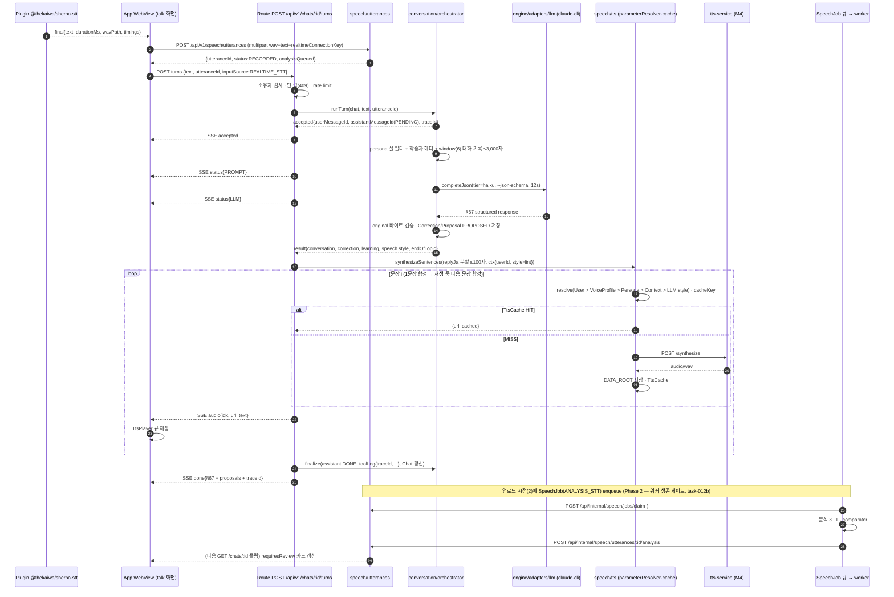
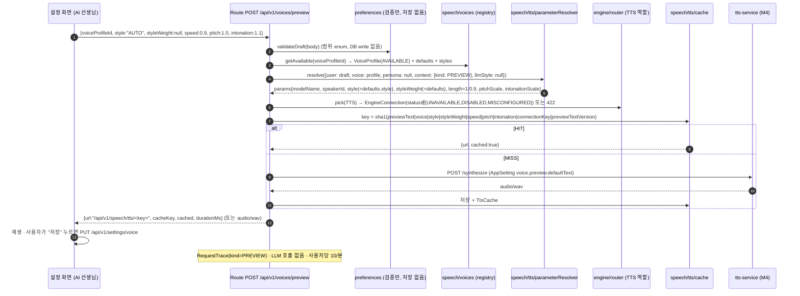
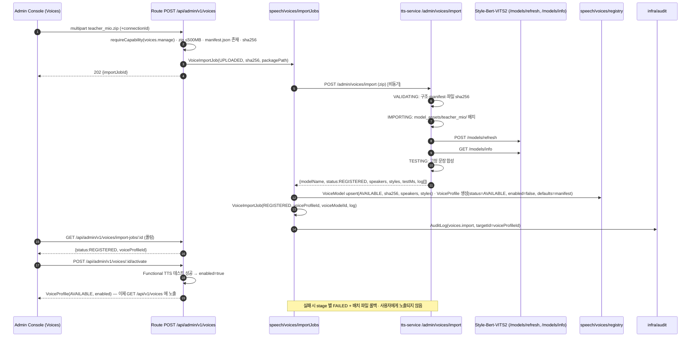

# TheKaiwa API Contract (정본)

> 작성일 2026-09-26 · 상태: 설계 확정(구현 전) · 소유: leader(계약) / developer(구현 일치 책임) / reviewer(감사)
>
> 이 문서는 TheKaiwa 의 **모든 HTTP · WebSocket · SSE 계약의 단일 출처**다. `docs/design-spec.md` §10 은 요약과 링크만 두고, 엔드포인트별 요청/응답 JSON·검증 상한·오류 코드·권한·소유 층·Phase 는 여기서만 정의한다.
> 엔티티 이름은 `docs/design/domain-model.md`, 모듈·층 이름은 `docs/design/module-dependency.md`, capability 문자열은 `docs/design/role-permission.md`, 설정 해석 규칙은 `docs/design/configuration-resolution.md` 를 따른다. 이 문서는 그 이름들을 **인용만** 하고 재정의하지 않는다.

---

## 0. 목적 · 정본 관계 · 공통 규약

### 0-1. 목적

- 라우트 파일(`src/app/api/**/route.ts`)은 이 문서의 계약을 그대로 구현한다. 라우트는 얇다 — 인증·capability 검사·입력 검증·모듈 호출·응답 봉투만 담당하고, 엔진명 분기·spawn·fetch·네이티브 호출은 하지 않는다(`module-dependency.md` 의존 규칙).
- task-002 완료 기준 "`api-contract.md` 와 라우트 목록 일치" 의 대조 기준이 이 문서 §1 총람 표다.
- 다른 설계 문서(`speech-platform/*`, `admin-console/*`)는 이 문서의 엔드포인트를 **링크로 인용**하고 요청/응답을 다시 쓰지 않는다.

### 0-2. 응답 봉투 (Response Envelope)

모든 JSON 응답은 TheRoute·TheMeal 규약의 3키 봉투를 쓴다.

```json
{ "success": true,  "data": { "...": "..." }, "message": null }
{ "success": false, "data": { "code": "VALIDATION", "details": { "field": "speed", "reason": "0.5~1.5" } }, "message": "속도는 0.5~1.5 사이여야 합니다" }
```

- 성공: `data` 는 객체 또는 배열, `message` 는 사용자에게 보여줄 안내가 있을 때만 문자열.
- 실패: `data.code` 는 §0-5 오류 코드 중 하나(TheMeal 은 `data:null` 이지만 TheKaiwa 는 엔진·설정 오류를 클라이언트가 분기해야 하므로 코드를 싣는다). `details` 는 선택이며 **시크릿·원본 오디오·전체 대화 텍스트·서버 경로**를 담지 않는다.
- 오디오 응답(`audio/wav`)·SSE(`text/event-stream`)·리다이렉트(인증)·정적 모델 파일은 봉투를 쓰지 않는다. 이 예외는 §2 각 항목에 명시한다.
- 문자열 폭·숫자 범위 검증은 라우트 진입 시 수행하고 위반은 전부 `400 VALIDATION` 이다. 본문 상한은 항목별로 적는다(기본 JSON 본문 ≤ 64KB).

### 0-3. 인증

| 채널 | 방식 |
|---|---|
| 웹(모바일 브라우저) | Google OAuth → `POST /api/auth/complete`(초대코드) → **httpOnly JWT 쿠키 `thekaiwa_session`**(SameSite=Lax, Secure, 만료 30일 슬라이딩) |
| 앱(Capacitor) | Chrome Custom Tab 에서 같은 OAuth 진행 → `complete` 가 쿠키 대신 **60초 1회용 `AppAuthCode`** 를 발급하고 `thekaiwa://auth/callback?code=` 딥링크로 복귀 → 앱 WebView 가 `GET /api/auth/app-exchange?code=` 로 이동 → 코드 소각 + 세션 쿠키 → `/study/today` 302 |
| WebSocket `/ws/speech` | 쿠키를 쓰지 않는다. `POST /api/v1/speech/ticket` 이 발급한 **60초 티켓 JWT**(같은 `JWT_SECRET`, `aud:"ws-speech"`)를 `start` 메시지에 싣는다 |
| 내부 콜백 `/api/internal/*` | 사용자 세션 없음. 헤더 **`X-Internal-Secret: <SPEECH_INTERNAL_SECRET>`** 상수 시간 비교. 불일치는 `401 UNAUTHENTICATED`, 헤더 자체가 없으면 `404`(경로 존재를 숨김) |
| Python 서비스 `/admin/*`, tts-service 전체 | 앱 서버(Next.js)만 호출한다. 같은 `X-Internal-Secret` 헤더 + LAN/loopback 바인딩. 앱·모바일은 절대 직접 호출하지 않는다(추가 기획안 §35·§51) |

- `/api/v1/*` 는 세션 필수(미인증 `401`). `/api/admin/v1/*` 는 세션 + **capability** 검사(`can(user, 'config.edit')`; 부족하면 `403 FORBIDDEN`, 단 `(admin)` 페이지 라우트는 404). 검사 대상은 role 이 아니라 `role-permission.md` 매트릭스의 capability 문자열이다.
- 세션 사용자 객체는 `{ id, email, name, role }` 만 노출한다.

### 0-4. 소유자 검사 → 404

`userId` 를 가진 모든 리소스(`Chat·ChatMessage·Correction·TutorProposal·WordEntry·VocabSession·Lesson·ReviewSchedule·Evaluation·StudyPlan·StudyLog·Utterance·AiJob·SpeechJob·UserVoiceSetting·UserSpeechSetting·Profile`)는 세션 사용자의 것만 조회·변경할 수 있다. **타인의 리소스는 존재 여부를 숨기기 위해 `403` 이 아니라 `404 NOT_FOUND`** 로 응답한다. 관리자도 `/api/v1/*` 에서는 자기 리소스만 본다(관리자 열람은 `/api/admin/v1/traces` 등 별도 계약).

### 0-5. 오류 코드 표

| HTTP | `data.code` | 언제 | 클라이언트 처리 |
|---|---|---|---|
| 400 | `VALIDATION` | 형식·범위·필수값 위반, 본문 상한 초과, 지원하지 않는 enum | 필드 안내 표시 |
| 401 | `UNAUTHENTICATED` | 세션 없음·만료, WS 티켓 무효, 내부 시크릿 불일치 | 로그인 화면(앱은 딥링크 재로그인) |
| 403 | `FORBIDDEN` | capability 부족, **Production 보호**(`confirm` 없음·SUPER_ADMIN 아님·override 비활성), 초대코드 불일치 | 안내만, 재시도 없음 |
| 404 | `NOT_FOUND` | 리소스 없음 **또는 타인 소유**, capability 없는 admin 페이지 | 목록으로 복귀 |
| 409 | `CONFLICT` | 사용자당 동시 턴 1 초과, 상태 전이 위반(예: DONE 세션에 attempt), 이미 채택/거절된 제안 재승인, `ConfigurationVersion` 낙관적 충돌(`baseVersion` 불일치) | 최신 상태 재조회 후 안내 |
| 422 | `UNPROCESSABLE` | 요청 모양은 맞지만 도메인 규칙 위반(task-003g 발음 사전 — 칸 규칙·가져오기 파일·미리듣기 예문 / task-012c 설정 편집 — 허용 밖 credentialRef·비밀 유사 이유·손상 스냅샷). 갈래는 `details.reason`(`E_LEXICON_ENTRY_INVALID`·`E_IMPORT_*`·`E_PREVIEW_TEXT_TOO_LONG`, §7-2a · `E_REF_NOT_ALLOWED`·`E_REASON_SECRET_LIKE`·`E_SNAPSHOT_INTEGRITY`, §2-19·§2-23) | 칸 오류 표시(`details.errors`·`fields`) |
| 422 | `ENGINE_UNAVAILABLE` | Engine Router 가 역할에 대해 선택 가능한 connection 이 없음(전부 `UNAVAILABLE/DISABLED/MISCONFIGURED`) | 텍스트 폴백 안내, 관리자면 콘솔 링크 |
| 429 | `RATE_LIMITED` | 초대코드 시도, 미리듣기(사용자당 10/분), TTS(60/분), 턴(분당 12), 내부 콜백 폭주 | `Retry-After` 초 후 재시도 |
| 502 | `ENGINE_ERROR` | 어댑터 호출이 실패로 종료(HTTP 5xx·프로세스 비정상 종료·스키마 위반 응답 재시도 소진) | "잠시 후 다시" + traceId 표시(개발자만) |
| 504 | `ENGINE_TIMEOUT` | 어댑터 타임아웃(턴 12s fail-fast, TTS 문장 8s, 기능 테스트 30s 등) | 동일 |

- `500` 은 계약 밖 예외(코드 `INTERNAL`)이며 발생 자체가 결함이다.
- 502/504 응답과 SSE `error` 이벤트에는 `traceId` 를 싣는다(`RequestTrace.traceId`). 값은 랜덤 22자(`t_` + base62)이며 사용자 식별 정보를 포함하지 않는다.

### 0-6. 날짜·시간

- **KST 날짜(`YYYY-MM-DD`)는 서버가 정한다.** 출석·오늘의 단어·레슨·복습·달력의 "오늘" 은 클라이언트가 보내지 않고 서버 `infra/dates` 가 `Asia/Seoul` 로 계산한다. 클라이언트는 조회 범위(`month=2026-09`, `date=2026-09-26`)만 보낸다.
- 타임스탬프는 ISO-8601 UTC(`2026-09-26T02:15:00.000Z`). `@db.Date` 컬럼은 KST 날짜 문자열로 직렬화한다.

### 0-7. 페이지네이션

- 목록은 **커서 방식**: 쿼리 `?limit=20&cursor=<opaque>`(limit 1~100, 기본 20). 응답 `data = { items: [...], nextCursor: string|null }`. 커서는 서버가 만든 불투명 문자열(정렬키+id)이며 클라이언트가 해석하지 않는다.
- 달력·월 단위(`?month=`)·`?date=` 조회와 관리자 `versions`·`audit`·`traces` 는 같은 커서 규약이되 `from`/`to` 필터를 추가로 받는다.
- 정렬은 항목별 기본값 고정(예: 채팅 `lastMessageAt desc`). 클라이언트 임의 정렬 파라미터는 두지 않는다.

### 0-8. 네임스페이스

| 접두 | 대상 | 인증 | 버전 정책 |
|---|---|---|---|
| `/api/health` · `/api/auth/*` · `/api/app/version` · `/models/*` | 헬스체크·OAuth 콜백 URI·앱 배너·모델 다운로드 | 공개 또는 자체 규약 | **무버전**(외부 고정 URI) |
| `/api/v1/*` | 사용자(학습자) API | 세션 | v1 안정 계약(§4) |
| `/api/admin/v1/*` | Admin/Developer Console | 세션 + capability | v1, 사용자 API 와 독립 진화 |
| `/api/internal/*` | gateway/worker → 앱 콜백 | `X-Internal-Secret` | 무버전(같은 배포 단위) |
| `wss://kaiwa.…/ws/speech` | 실시간 STT 폴백(gateway) | 티켓 JWT | 프로토콜 `v:1` 필드로 협상 |
| Python 서비스 `:8100`(gateway) · `:8200`(M4 tts-service) · worker | 앱 서버 전용 내부 API | `X-Internal-Secret` | 앱과 같은 저장소·배포 |

### 0-9. SSE 공통

- `Content-Type: text/event-stream` · `Cache-Control: no-cache, no-transform` · `X-Accel-Buffering: no`. nginx 는 `proxy_buffering off; proxy_read_timeout 600s`.
- 이벤트 형식 `event: <name>\ndata: <json>\n\n`. 15초마다 주석 줄 `: ping` 전송.
- **끊김은 오류가 아니다.** 서버는 스트림이 끊겨도 끝까지 처리·저장한다. 클라이언트는 `GET /api/v1/chats/:id`(2.5s → 5s 백오프)로 `running` 이 false 가 될 때까지 폴링한 뒤 마지막 메시지를 읽는다.

### 0-10. 요청 공통 헤더

| 헤더 | 용도 |
|---|---|
| `X-Client-Platform: app` | 앱 WebView 가 붙인다(구현값 `app` 이 정본 — task-003f Leader ⑫, 종전 표기 `android`). 인식 모드 해석(#16 OFFLINE 허용)·#19 `onDevice` 블록·계측. 없거나 다른 값이면 `web`. 클라이언트가 붙이므로 위조될 수 있으나 영향은 자기 계정의 인식 경로뿐 |
| `X-App-Version: 1.2.0` | 앱 versionName(`App.getInfo().version`). 표시·로그용 — **비교에 쓰지 않는다**. 웹은 생략 |
| `X-App-Build: 12` | 앱 versionCode(`App.getInfo().build`). #8 배너·강제 업데이트 판단은 **이 정수로만**(task-003f Leader ③ — 이름 문자열 비교는 `1.10 < 1.9` 류 오판). 웹은 생략 |
| `X-Debug-Session: <DebugSession.id>` | DEVELOPER 이상이 만든 디버그 세션에 요청을 귀속(§2-24). 세션이 없거나 만료면 무시 |

---

## 1. 엔드포인트 총람

범례 — **auth**: `S`=세션, `S+cap`=세션+capability(문자열 표기), `P`=공개, `T`=WS 티켓, `I`=`X-Internal-Secret`. **층**: `module-dependency.md` 의 소유 모듈. **Phase**: 앱 Phase(1~4; 0=스캐폴딩). 요청/응답은 요약이며 상세는 §2.

### 1-1. 무버전 (Phase 0)

| # | Method | Path | 목적 | auth | 층 | Phase | 요청 | 응답 |
|---|---|---|---|---|---|---|---|---|
| 1 | GET | `/api/health` | 의존성 boolean 점검(필수 실패 시 503) | P | infra | 0 | — | `{app,env,status:ok\|degraded\|down,degraded[],checks{}}` |
| 2 | GET | `/api/auth/google?platform=web\|app&callbackUrl=&challenge=` | OAuth 시작(앱은 PKCE `challenge` 필수) | P | infra/auth | 0 | query | 302 Google |
| 3 | GET | `/api/auth/google/callback` | OAuth 콜백 → pending 쿠키 | P | infra/auth | 0 | `code,state` | 302 `/invite` 또는 착지 |
| 4 | POST | `/api/auth/complete` | 초대코드 확인·계정 생성·세션/딥링크 | P(pending 쿠키) | infra/auth | 0 | `{inviteCode?}` | `{user}` 또는 `{appRedirect}` |
| 5 | POST | `/api/auth/app-exchange` | 앱 코드+PKCE verifier → 세션 쿠키(JSON 본문 — REV-021) | P(코드+verifier, 같은 출처) | infra/auth | 0 | `{code, verifier, next?}` | `{next}` + Set-Cookie |
| 6 | POST | `/api/auth/logout` | 세션 종료 | S | infra/auth | 0 | — | `{ok:true}` |
| 7 | GET | `/api/auth/me` | 세션 사용자 | S | infra/auth | 0 | — | `{user}` |
| 8 | GET | `/api/app/version` | APK 최신 버전·배너 | P | infra | 0 | `X-App-Build`·`X-App-Version` | `{latest,latestCode,minSupported,minSupportedCode,url,notes,sha256,bytes,publishedAt,updateAvailable,reinstallRequired,updateRequired}` |
| 8a | GET | `/app/download/<file>` | APK 배포본(`latest.apk` = 최신) | P | infra | 0 | `Range` | `application/vnd.android.package-archive` |
| 9 | GET | `/models/ondevice-ja-v1/manifest.json` | 온디바이스 모델 manifest(불투명 id) | P | speech/stt(배포) | 0 | — | manifest JSON |
| 10 | GET | `/models/ondevice-ja-v1/<version>/<file>` | 모델 파일(Range 지원) | P | speech/stt(배포) | 0 | `Range` | 바이너리 |

### 1-2. 사용자 `/api/v1`

| # | Method | Path | 목적 | auth | 층 | Phase | 요청 | 응답 |
|---|---|---|---|---|---|---|---|---|
| 11 | GET | `/api/v1/settings/profile` | 학습 설정 조회 | S | preferences | 1 | — | `Profile` 화이트리스트 |
| 12 | PUT | `/api/v1/settings/profile` | 학습 설정 수정 | S | preferences | 1 | 화이트리스트 | 동일 |
| 13 | GET | `/api/v1/settings/voice` | AI 선생님 음성 설정 | S | preferences | 1 | — | `UserVoiceSetting` |
| 14 | PUT | `/api/v1/settings/voice` | 음성 설정 저장 | S | preferences | 1 | `{voiceProfileId,style,styleWeight,speed,pitch,intonation,speechProfile}` | 동일 |
| 15 | GET | `/api/v1/settings/speech` | 음성 인식 설정 | S | preferences | 1 | — | `UserSpeechSetting` |
| 16 | PUT | `/api/v1/settings/speech` | 인식 모드 저장 | S | preferences | 1 | `{recognitionMode,explainLang}` | 동일 |
| 17 | GET | `/api/v1/voices` | 선택 가능한 Voice 목록 | S | speech/voices | 1 | — | `[{id,name,description,available,defaults,styles[]}]` |
| 18 | POST | `/api/v1/voices/preview` | draft 설정 통합 미리듣기 | S | speech/voices | 1 | draft | `audio/wav` 또는 `{url}` |
| 19 | GET | `/api/v1/speech/config` | 앱 기동 시 온디바이스 런타임·manifest·fallback | S | speech | 1 | — | 설정 JSON(시크릿 없음) |
| 20 | POST | `/api/v1/speech/ticket` | WS 60초 티켓 | S | speech/stt | 1 | `{chatId?}` | `{ticket,expiresAt,wsPath}` |
| 21 | POST | `/api/v1/speech/utterances` | 발화 wav+실시간 텍스트 업로드(Phase 2: 분석 잡 적재 — 워커 생존 게이트, task-012b D-B3) | S | speech/utterances | 1 | multipart ≤2MB/≤60s | `{utteranceId,status,analysisQueued,expiresAt}` |
| 21a | PATCH | `/api/v1/speech/utterances/:id` | requiresReview 발화의 텍스트 확정 — 고른 안의 출처 기록(`Utterance` 만 변경, task-012b D-B5·D-B6) | S | speech/utterances | 2 | `{choice:'REALTIME'\|'ANALYSIS'\|'USER', text?}` | `Utterance`(#22 형태) |
| 21b | GET | `/api/v1/speech/utterances/:id/audio` | 소유자 원음(30일) — 회화방 "내 발음 다시 듣기" | S | speech/utterances | 1(task-007 최소판) | — | `audio/wav` |
| 21c | GET | `/api/v1/speech/utterances?chatId=&reviewable=1&cursor=&limit=` | 내 발화 목록(task-012b-2) — 소유자 행만 `createdAt desc, id desc` 키셋 커서. `chatId` 는 내 방만(남의 방·없는 방 404), `reviewable=1` 은 지금 확인할 수 있는 발화(`ANALYZED ∧ requiresReview ∧ finalSource=REALTIME ∧ realtimeText≠''`)만. DB 읽기 2번(목록·개수), 사용자당 60/분(초과 429) | S | speech/utterances | 2(task-012b-2) | query `chatId?`·`reviewable?`(`1`\|`0`)·`cursor?`·`limit?`(1~50, 기본 20) — 모르는 키·잘못된 값 400 | `{items:[{id,createdAt,durationMs,status,realtimeText,analysisText\|null,finalText\|null,finalSource,requiresReview,wasReviewTarget,audioAvailable,chatMessageId\|null,context:{kind:'TALK'\|'LESSON'\|'EVALUATION'\|'ROOM_ONLY'\|'UNSENT',id\|null}}],nextCursor,reviewableCount}` · `private, no-store` · 엔진명·신뢰도·임계 없음, 원음은 `audioAvailable` 만(#21b 로 받는다) |
| 22 | GET | `/api/v1/speech/utterances/:id` | 발화·분석 결과 | S | speech/utterances | 2 | — | `Utterance`+`SpeechAnalysis` |
| 23 | POST | `/api/v1/speech/tts` | 문장 → 음성(정규화·사전·Rendering Plan·캐시) | S | speech/tts | 1 | `{text,voiceId?,speechProfile?,renderingPlan?,context?}` | `audio/wav` 또는 `{url,cacheKey,durationMs,ttfaMs,timing?,runtime}` (5차 §133·§146) |
| 24 | GET | `/api/v1/speech/tts/:token` | 캐시 오디오 조회(**서명 URL**, 사용자 결속·10분) | S | speech/tts | 1 | — | `audio/wav` 또는 `{audioUrl,durationMs,timing}` |
| 24r | POST | `/api/v1/text/annotate` | 일본어 읽기 분석 — 형태소별 표기·후리가나·발음 가나·구절 경계(task-026 S1, 저장 없음) | S | speech/reading | 2 | `{texts: string[≤64, 각 ≤400자]}` | `{items:[{segments}\|null], available}` |
| 25 | POST | `/api/v1/attendance/check-in` | 출석(멱등) | S | learning/attendance | 1 | — | `{date,isNew,streak}` |
| 26 | GET | `/api/v1/attendance?month=` | 월 출석 | S | learning/attendance | 1 | query | `{month,days[]}` |
| 27 | GET | `/api/v1/chats?kind=&limit=&cursor=` | 대화 목록 | S | conversation/chats | 1 | query | 목록(+`total` — task-067) |
| 28 | POST | `/api/v1/chats` | 대화 생성 | S | conversation/chats | 1 | `{kind,topicId?,title?,level?}` | `Chat` |
| 29 | GET | `/api/v1/chats/:id?after=` | 대화 상세(메시지·running) | S | conversation/chats | 1 | query | `Chat`+messages |
| 30 | PATCH | `/api/v1/chats/:id` | 제목 변경 | S | conversation/chats | 1 | `{title}` | `Chat` |
| 31 | DELETE | `/api/v1/chats/:id` | 대화 삭제 | S | conversation/chats | 1 | — | `{deleted:true}` |
| 32 | POST | `/api/v1/chats/:id/turns` | **턴 실행(SSE)** | S | app(conversation+speech 조합) | 1 | `{text,utteranceId?,inputSource?,clientTimings?}` 또는 `{resumePending:true}` | SSE |
| 32t | POST | `/api/v1/chats/:id/messages/:messageId/translation` | 내 말 번역 다시 가져오기(task-026) | S | conversation/chats | 2 | — | `{messageId,translation,cached}` |
| 33 | POST | `/api/v1/chats/:id/review` | 채팅 표현 점검(A3) | S | conversation/corrections | 1 | — | `{items[]}` 또는 `{jobId}` |
| 34 | GET | `/api/v1/corrections?status=&chatId=` | 교정 목록 | S | conversation/corrections | 1 | query | 목록 |
| 35 | POST | `/api/v1/corrections/:id/accept` | 교정 채택(+단어 추가) | S | conversation/corrections | 1 | `{addWord?}` | `Correction`(+`wordId`) |
| 36 | POST | `/api/v1/corrections/:id/reject` | 교정 거절 | S | conversation/corrections | 1 | — | `Correction` |
| 37 | GET | `/api/v1/proposals?status=&chatId=` | 강사 제안 목록 | S | conversation/proposals | 1 | query | 목록 |
| 38 | POST | `/api/v1/proposals/:id/accept` | 제안 채택 | S | conversation/proposals | 1 | `{payloadOverride?}` | `TutorProposal`+`result` |
| 39 | POST | `/api/v1/proposals/:id/reject` | 제안 거절 | S | conversation/proposals | 1 | — | `TutorProposal` |
| 40 | GET | `/api/v1/words?q=&category=&chunkType=&source=&archived=&favorite=&sort=&page=&limit=` | 단어장(내 단어 + 공용 기본 단어, 쪽 번호 — task-068 · 즐겨찾기 필터 `favorite=1` — task-074) | S | learning/vocab | 1 | query | `{items,total,page,pages,limit,baseTotal}` |
| 41 | POST | `/api/v1/words` | 단어 추가(A10 보강 옵션) | S | learning/vocab | 1 | `WordEntry` 입력 | `WordEntry` |
| 42 | GET | `/api/v1/words/:id` | 단어 상세(+이력) | S | learning/vocab | 1 | — | `WordEntry`+stats |
| 43 | PATCH | `/api/v1/words/:id` | 단어 수정 | S | learning/vocab | 1 | 부분 | `WordEntry` |
| 44 | DELETE | `/api/v1/words/:id` | 단어 삭제(스냅샷 보존) | S | learning/vocab | 1 | — | `{deleted:true,snapshotKept:true}` |
| 45 | POST | `/api/v1/words/:id/archive` · `/unarchive` | 보관 토글 | S | learning/vocab | 1 | — | `WordEntry` |
| 46 | GET | `/api/v1/words/categories` | 카테고리·개수 | S | learning/vocab | 1 | — | `[{category,count}]` |
| ~~46b~~ | ~~POST~~ | ~~`/api/v1/words/seed-pack`~~ | **폐지(task-068, 2026-10-14)** — 기본 단어는 공용 읽기 전용 행이라 넣는 단계가 없다. 라우트 파일 삭제(옛 탭 호출은 404 또는 405 — `words/[id]` 라우트가 `seed-pack` 을 id 로 받아 POST 가 없으면 405, QA 실측 2026-10-14. 화면은 일반 오류로 처리) | — | — | — | — | — |
| 47 | POST | `/api/v1/vocab/sessions` | 오늘의 단어 세트 생성(기본 카드 우선 `FLIP`+카드 `choices` · `mode:'CHOICE'` 명시 세트만 **정답 미포함**) | S | learning/vocab | 1 | `{count?,mode?,category?,topicId?,generate?}` | `VocabSession`+cards(+주제 세트면 `generation`, §2-10) |
| 48 | GET | `/api/v1/vocab/sessions?kept=1` | 세션 목록/보관함 | S | learning/vocab | 1 | query | 목록 |
| 49 | GET | `/api/v1/vocab/sessions/:id` | 세션 상세(이어풀기) | S | learning/vocab | 1 | — | 세션+cards(+답한 카드만 정답) |
| 50 | POST | `/api/v1/vocab/sessions/:id/attempts` | 카드 답(order 멱등) | S | learning/vocab | 1 | `{order,chosenText?,selfResult?,responseMs,flagged?}` | `{answer,correctText,example}` |
| 51 | POST | `/api/v1/vocab/sessions/:id/finish` | 세트 완료(단일 트랜잭션) | S | learning/vocab | 1 | — | 집계(+`challenge`, §2-31) |
| 52 | POST | `/api/v1/vocab/sessions/:id/keep` | 세트 보관 토글 | S | learning/vocab | 1 | `{kept}` | `VocabSession` |
| 53 | POST | `/api/v1/vocab/sessions/:id/replay` | 보관 세트 다시 풀기 | S | learning/vocab | 1 | — | 새 `VocabSession`+cards |
| 54 | GET | `/api/v1/vocab/stats` | 개수별 맞춘/틀린(스냅샷) | S | learning/snapshots | 1 | `?days=` | 집계 |
| 55 | GET | `/api/v1/jobs/:id` | AI 잡 폴링 | S | infra/jobs | 1 | — | `AiJob` |
| 56 | GET | `/api/v1/topics?level=&mine=` | 주제(시드+사용자, 조각 포함). **task-045 변경**: `level=all` = 다섯 수준 전부(관리 화면, `mine=1` 과 조합 가능 — 기존 `level` 규칙은 그대로). 이 사용자가 숨기거나 내 버전으로 바꾼 시드는 목록에서 빠진다(`mine=1` 이면 시드 자체가 없음 — 숨긴 시드는 #179 로 본다) | S | learning/topics | 2(task-010 · task-045) | query | `{items[], level[]}` |
| 57 | POST | `/api/v1/topics` | 내 주제 만들기 — 학습자가 AI 초안(#170)을 검토·고쳐 [저장]할 때만(제안→채택, 초안 단계 DB 행 없음). **task-045 구현**: 본문 ≤16KB · 칸 검사는 초안 계약과 같은 규칙 | S | learning/topics | 2(task-010d 예약 · task-045 구현) | `{title(1~20자),titleJa?(≤20자),level,description?(≤120자),chunks[8~20]{chunkType,textJa,reading,meaningKo}}` | 201 `{topic(#56 항목 모양), warnings[]}` · 400 `{field,reason,problems[]}`(한도 미소모) · 409 `TOPIC_LIMIT`(내 주제 30) · 429 `DAILY_LIMIT`(하루 10, KST·`retryAfterSec`)·분당 20(`topic-write`, #171·#173·#174 와 공유) |
| 58 | GET | `/api/v1/lessons/today` | 오늘 레슨 모드(NEW/REVIEW/BOTH) + 오늘의 복습 | S | learning/lessons+repetition+reviewSchedule | 2(task-010 NEW · task-010b 복습) | — | `{mode,date,review,guard,cycle,decisionPending,decisionJobId,nextReview,todayLessons[],resume,recommendation}`(정합성 #2 · task-010b — §2-13 #58) |
| 59 | POST | `/api/v1/lessons` | 레슨 생성(A4, 잡) | S | app(conversation+learning 조합) | 2(task-010) | `{topicId}` 또는 `{sourceText}` | `{lessonId,jobId,status,reused}` |
| 60 | GET | `/api/v1/lessons/:id` | 레슨 상세 | S | learning/lessons | 2(task-010) | — | `Lesson` |
| 61 | PATCH | `/api/v1/lessons/:id/progress` | 단계 진행 저장 | S | learning/lessons | 2(task-010) | `{stageDone?,progress?}` | `Lesson` |
| 62 | POST | `/api/v1/lessons/:id/complete` | 레슨 완료(트랜잭션+RepetitionItem 갱신+관측, 트랜잭션 뒤 A11 잡 — task-010b) | S | learning/lessons+repetition | 2(task-010·010b) | `{score?}`(무시) | `{lesson,studyLogId,reviewDecisionJobId,nextReview,result,challenge}`(`challenge` 는 §2-31) |
| 62a | POST | `/api/v1/lessons/:id/memo` | 들린 단어 메모 → ADD_WORD 제안 | S | app(learning+conversation 조합) | 2(task-010) | `{segments:[{segment,words[≤5]}]}` | `{proposals[],skipped[],memo}` |
| 62b | POST | `/api/v1/lessons/:id/speaking` | 말하기 확인(목표 표현 포함, LLM 없음) | S | app(learning+speech 조합) | 2(task-010) | `{itemId,text,utteranceId?}` | `{itemId,used,matchedIds,missedIds,unknownIds,modelAnswer,utteranceId,hasAudio}` |
| 185 | POST | `/api/v1/lessons/:id/speaking-translation` | 말하기 ⑤ 「내가 한 말」 한국어 뜻(task-077 — #32t 와 같은 `userTranslation@v1`·엔진 태스크, fast 15s, **저장 없음**, 레슨 상태 무관). 상세 §2-13 #185 | S | app(learning 소유 확인 + conversation 번역 조합) | 2(task-077) | `{text}`(정리 뒤 1~1,000자, 본문 ≤8KB, 다른 키 400) | `{ko}` · 400 · 401 · 404 · 409 `TRANSLATION_BUSY`·`CANCELLED` · 429 분당 20(별도 키) · 502(`TRANSLATION_REJECTED` 포함)·504·422 |
| 62c | POST | `/api/v1/lessons/:id/audio` | 레슨 문장 음성(느리게/보통) | S | app(learning+speech 조합) | 2(task-010) | `{kind,idx,pace?}` | `{clips[{url,durationMs,pauseBeforeMs,cached}],runtime}` |
| 63 | POST | `/api/v1/reviews/:id/start` | 복습 레슨 생성(A5, 잡) | S | app(conversation+learning 조합) | 2(task-010b) | — | `{lessonId,jobId,status,reused}` |
| 64 | POST | `/api/v1/reviews/:id/skip` | 복습 건너뛰기 | S | learning/reviewSchedule | 2(task-010b) | — | `{id,status:"SKIPPED",resolvedAt}` |
| 65 | POST | `/api/v1/evaluations` | 평가 출제(A6, 잡) | S | app(learning+conversation 조합) | 2(task-011) | `{kind,topicId?,level?}` | `{evaluationId,jobId,status}` |
| 66 | GET | `/api/v1/evaluations/:id` | 평가 상세(문항/결과) | S | learning/evaluation(+conversation 레벨 제안, speech 발화 대조 — 라우트 조합) | 2(task-011) | — | `Evaluation`+items(제출 전 정답 숨김, `items[].voiced` — task-012b-2) |
| 67 | POST | `/api/v1/evaluations/:id/items/:itemId/answer` | 문항 답 저장 | S | app(learning+speech 조합) | 2(task-011) | `{answerText?,inputSource?,utteranceId?,pieceOrder?,spotIndex?}` | `{id,answered,graded,expectedShown:false,answerSpot,…}`(점수 없음) |
| 67a | POST | `/api/v1/evaluations/:id/items/:itemId/audio` | 듣고 답하기 소리 | S | app(learning+speech 조합) | 2(task-011) | `{}` | `{itemId,clips[],runtime}` |
| 67b | POST | `/api/v1/evaluations/:id/start` | 평가 시작(10분 시계) — 화면 [시작하기](결정 (d)=B) | S | learning/evaluation | 2(task-011) | — | #66 상세 |
| 67c | POST | `/api/v1/evaluations/:id/items/:itemId/reveal` | 듣고 답하기 "글자로 보기"(결정 (b)=B) | S | learning/evaluation | 2(task-011) | `{}` | `{itemId,textJa,textRevealed:true,textRevealedAt}` |
| 68 | POST | `/api/v1/evaluations/:id/submit` | 채점(A7, 잡; DONE 단일 트랜잭션) | S | app(learning+conversation 조합) | 2(task-011) | `{}` | `{evaluationId,jobId,status,reused,overtime}` |
| 69 | GET | `/api/v1/evaluations?limit=&cursor=&kind=` | 평가 이력 | S | learning/evaluation | 2(task-011) | query | 목록 |
| 70 | GET | `/api/v1/plan/calendar?month=` | 달력(출석·학습) | S | learning/studyLog | 2 | query | `{days[]}`(+`days[].challenge`·`summary.challenge`, §2-31) |
| 71 | GET | `/api/v1/plan/day?date=` | 하루 상세 | S | learning/studyLog | 2 | query | `{date,logs[],attended}`(+`challenge`, §2-31) |
| 72 | GET | `/api/v1/study-logs?from=&to=&type=` | 학습 기록 | S | learning/studyLog | 2 | query | 목록 |
| 73 | DELETE | `/api/v1/study-logs/:id` | 기록 삭제(스냅샷 보존) | S | learning/studyLog | 2 | — | `{deleted:true,snapshotKept:true}` |
| 74 | POST | `/api/v1/plan/analysis` | 분석→공부계획서(A8, 잡; hash 재사용) | S | learning/studyPlan | 3 | `{weeks?}` | `{jobId,planId?}` |
| 75 | GET | `/api/v1/plan/analysis/latest` | 최신 PROPOSED/ACCEPTED 계획 | S | learning/studyPlan | 3 | — | `StudyPlan` |
| 76 | GET | `/api/v1/plan/current` | 현재 ACCEPTED 계획 | S | learning/studyPlan | 3 | — | `StudyPlan` |
| 77 | POST | `/api/v1/plan/:id/accept` · `/reject` | 계획 채택/거절 | S | learning/studyPlan | 3 | — | `StudyPlan` |
| 78 | GET | `/api/v1/plan/growth?weeks=` | 성장기록(**StatsSnapshot 만**) | S | learning/snapshots | 3 | query | 시계열 |
| 79 | GET | `/api/v1/drawer/corrections?errorType=&chunkType=&q=&limit=&cursor=` | 채택 교정 서랍 | S | conversation/corrections | 3 | query | 목록 |
| — | — | ASK: `POST /api/v1/chats {kind:"ASK"}` + `#32` 턴 재사용 | 무엇이든 물어보세요(A9) | S | conversation | 3 | — | — |

### 1-3. 관리자 `/api/admin/v1`

| # | Method | Path | 목적 | capability | 층 | Phase | 요청 | 응답 |
|---|---|---|---|---|---|---|---|---|
| 80 | GET | `/api/admin/v1/overview` | 대시보드 | `engine.read` | admin/console | 1 | — | 역할별 활성 connection·상태·voice 수·config version |
| 81 | GET | `/api/admin/v1/environment` | 현재 `APP_ENV`·보호 정책 | `console.access`(파생) | admin/console | 1 | — | `{environment,protection}` |
| 81a | PUT | `/api/admin/v1/environment/policy` | 정책 키 편집(override.production.enabled 등) | `environment.policy` | admin/console | 4 | `{patch,reason}` | `ConfigurationVersion` |
| 82 | GET | `/api/admin/v1/voices?status=` | Voice 전체(상태 포함) | `voices.read` | speech/voices | 1 | query | `VoiceProfile[]` |
| 82a | GET | `/api/admin/v1/voices/:id` | Voice 상세 | `voices.read` | speech/voices | 1 | — | `VoiceProfile`+model+usage |
| 83 | POST | `/api/admin/v1/voices` | Voice Package zip import | `voices.manage` | speech/voices/importJobs | 4 | multipart zip ≤500MB | `{importJobId}` |
| 84 | PUT | `/api/admin/v1/voices/:id` | 표시명·설명·defaults·정렬 | `voices.manage` | speech/voices | 2 (012c-2 — D-C14 이관: VoiceProfile 은 환경 칸 없는 전역 행) | 부분 | `VoiceProfile` |
| 85 | POST | `/api/admin/v1/voices/:id/activate` | AVAILABLE 전환 | `voices.manage` | speech/voices | 2 (012c-2) | — | `VoiceProfile` |
| 86 | POST | `/api/admin/v1/voices/:id/disable` | DISABLED + 사용자 기본 voice 전환 | `voices.manage` | speech/voices | 2 (012c-2) | `{reason?}` | `{voice,reassignedUsers}` |
| 87 | DELETE | `/api/admin/v1/voices/:id` | DISABLED→ARCHIVED | `voices.manage` | speech/voices | 4 | — | `VoiceProfile` |
| 88 | POST | `/api/admin/v1/voices/sync` | tts-service `/voices` 재동기화 | `voices.manage` | speech/voices/registry | 2 (012c-2) | `{connectionId?}` | `{added[],updated[],missing[]}` |
| 89 | GET | `/api/admin/v1/voices/import-jobs/:id` | import 진행 | `voices.read` | speech/voices/importJobs | 4 | — | `VoiceImportJob` |
| 89a | POST | `/api/admin/v1/voices/:id/preview` | Voice Preview Playground(텍스트·styleWeight 지정) | `voices.manage` | speech/voices/preview | 2 (012c-2) | `{text,style,styleWeight,speed,pitch,intonation}` | `audio/wav` |
| 90 | GET | `/api/admin/v1/engines` | Engine descriptor+schema | `engine.read` | engine/registry | 1 | — | `[{engine,schema}]` |
| 91 | GET | `/api/admin/v1/engine-connections?role=` | Connection 목록 | `engine.read` | engine/connections | 1 | query | `EngineConnection[]`(credentialRef 만) |
| 91a | GET | `/api/admin/v1/engine-connections/:id` | Connection 상세 | `engine.read` | engine/connections | 1 | — | `EngineConnection`+effectiveSummary |
| 92 | POST | `/api/admin/v1/engine-connections` | Connection 생성 | `engine.connections.manage` | engine/connections | 4 (012c D-C10 이관 — Import·Preset 과 함께) | 본문 | `EngineConnection` |
| 93 | PUT | `/api/admin/v1/engine-connections/:id` | Connection 수정(→ ConfigurationVersion) | `engine.connections.manage` | engine/connections+configuration | 2 (012c — 주소·자격 키는 D-C3 선결 게이트 뒤) | 본문+`baseVersion` | `EngineConnection`+`version` |
| 93a | PUT | `/api/admin/v1/engine-connections/:id/enabled` | enable/disable | `engine.connections.manage` | engine/connections | 2 (012c) | `{enabled,reason}` | `EngineConnection` |
| 93b | PUT | `/api/admin/v1/engine-connections/:id/credential` | credentialRef 연결/해제(값 없음) | `credentials.manage` | engine/credentials | 2 (012c — 005b 이월, D-C3(b) 허용 목록) | `{credentialRef\|null,reason}` | `EngineConnection` |
| 94 | DELETE | `/api/admin/v1/engine-connections/:id` | Connection 삭제(fallback 참조 시 409) | `engine.connections.manage` | engine/connections | 4 (012c D-C10 이관) | — | `{deleted:true}` |
| 95 | POST | `/api/admin/v1/engine-connections/:id/health` | Health Check 실행 | `health.run` | engine/health | 1 | — | `EngineHealth` |
| 95a | GET | `/api/admin/v1/engine-connections/:id/health?kind=&limit=` | 최근 Health/Functional 결과 | `engine.read` | engine/health | 1 | query | `EngineHealth[]` |
| 96 | POST | `/api/admin/v1/engine-connections/:id/test` | Functional Test 실행 | `functional_test.run` | engine/functionalTest | 1 | `{overrideRuntime?}` | `EngineHealth`+`traceId` |
| 97 | GET | `/api/admin/v1/engine-connections/:id/log-level` | 로그 레벨 조회 | `engine.read` | engine/connections | 3 | — | `{level,source}` |
| 98 | PUT | `/api/admin/v1/engine-connections/:id/log-level` | 로그 레벨 변경(RUNTIME_EDITABLE) | `config.edit` | engine/connections | 3 | `{level}` | `{level,applied}` |
| 99 | GET | `/api/admin/v1/fallback-policies` | 역할별 fallback | `engine.read` | engine/fallbackPolicy | 1 | — | `EngineFallbackPolicy[]` |
| 99a | GET | `/api/admin/v1/fallback-policies/:role` | 역할 단건 | `engine.read` | engine/fallbackPolicy | 1 | — | `EngineFallbackPolicy` |
| 100 | PUT | `/api/admin/v1/fallback-policies/:role` | fallback 편집(→ Version) | `engine.connections.manage` | engine/fallbackPolicy+configuration | 2 (012c) | `{primaryConnectionId,fallbackConnectionIds[]}` | `EngineFallbackPolicy`+`version` |
| 101 | GET | `/api/admin/v1/secrets` | credentialRef 이름·존재·마지막 사용 | `secrets.read_ref` | infra/secrets | 1 | — | `[{ref,exists,lastUsedAt}]` |
| 102 | GET | `/api/admin/v1/config/effective?scope=&targetId=` | Effective Configuration | `config.effective.read` | engine/configuration/resolver | 1 | query | `[{key,value,source,sourceRef,editability}]` |
| 103 | GET | `/api/admin/v1/config/schema/:engineId` | Configuration Schema | `config.raw.read` | engine/registry/schemas | 1 | — | schema JSON |
| 104 | POST | `/api/admin/v1/config/validate` | 스키마·의존성 검증 | `config.edit` | engine/configuration/validate | 2 (012c) | `{scope,targetId,patch}` | `{valid,errors[],warnings[],impact}` |
| 105 | POST | `/api/admin/v1/config/test` | 후보 설정으로 Functional Test | `functional_test.run` | engine/functionalTest | 2 (012c) | `{scope,targetId,patch}` | 테스트 결과+`traceId` |
| 106 | POST | `/api/admin/v1/config/diff` | 현재 vs 후보 diff | `config.edit` | engine/configuration/diff | 2 (012c) | `{scope,targetId,patch}` | `{changes[]}` |
| 107 | POST | `/api/admin/v1/config/apply` | 적용 → `ConfigurationVersion` | `config.edit` (+`config.apply.production`) | engine/configuration/versions | 2 (012c) | `{scope,targetId,patch,baseVersion,reason,confirm?}` | `ConfigurationVersion` |
| 108 | GET | `/api/admin/v1/config/versions?scope=&targetId=` | 버전 이력 | `config.effective.read` | engine/configuration/versions | 2 (012c) | query | 목록 |
| 108a | GET | `/api/admin/v1/config/versions/:id` | 버전 상세(snapshot·diff) | `config.effective.read` | engine/configuration/versions | 2 (012c) | — | `ConfigurationVersion` |
| 109 | POST | `/api/admin/v1/config/versions/:id/rollback` | 롤백(=새 버전) | `config.rollback` (+`config.apply.production`) | engine/configuration/versions | 2 (012c) | `{reason,confirm?}` | `ConfigurationVersion` |
| 110 | GET | `/api/admin/v1/config/raw/:scope/:targetId` | Raw JSON 조회 | `config.raw.read` | engine/configuration | 2 (012c) | — | `{json,version,schemaRef}` |
| 111 | PUT | `/api/admin/v1/config/raw/:scope/:targetId` | Raw JSON 저장(검증+dry run) | `config.edit` | engine/configuration | 2 (012c) | `{json,baseVersion,dryRun?,reason}` | 검증 결과 또는 `ConfigurationVersion` |
| 112 | GET | `/api/admin/v1/config/export?scopes=` | 스냅샷 내보내기(secret→ref) | `config.export` | admin/configuration | 4 | query | export JSON |
| 113 | POST | `/api/admin/v1/config/import` | 가져오기(Validate→Diff→Apply) | `config.import` (+`config.import.production`) | admin/configuration | 4 | `{snapshot,mode,confirm?}` | diff 또는 versions[] |
| 114 | GET | `/api/admin/v1/presets` | Preset 목록 | `config.effective.read` | admin/configuration | 4 | — | `ConfigurationPreset[]` |
| 115 | POST | `/api/admin/v1/presets` | Preset 저장 | `presets.manage` | admin/configuration | 4 | `{name,description,scopes[]}` | `ConfigurationPreset` |
| 116 | DELETE | `/api/admin/v1/presets/:id` | Preset 삭제 | `presets.manage` | admin/configuration | 4 | — | `{deleted:true}` |
| 117 | POST | `/api/admin/v1/presets/:id/apply` | Preset 적용(=import) | `config.import` | admin/configuration | 4 | `{confirm?}` | versions[] |
| 118 | GET | `/api/admin/v1/overrides?active=1` | 활성 Override | `config.effective.read` | engine/configuration/overrides | 4 | query | `RuntimeOverride[]` |
| 119 | POST | `/api/admin/v1/overrides` | TEMPORARY/SESSION Override | `override.create` (+`override.production`) | engine/configuration/overrides | 4 | `{scope,targetId,patch,kind,ttlMinutes?,sessionId?}` | `RuntimeOverride` |
| 120 | DELETE | `/api/admin/v1/overrides/:id` | Override 즉시 해제 | `override.create` | engine/configuration/overrides | 4 | — | `RuntimeOverride`(revokedAt) |
| 121 | GET | `/api/admin/v1/plugins` | Plugin Registry | `plugins.read` | engine/registry/plugins | 1 | — | `[{id,version,type,loaded,initError}]` |
| 122 | GET | `/api/admin/v1/plugins/:id` | Plugin 상세(descriptor·schema·capabilities) | `plugins.read` | engine/registry/plugins | 1 | — | 상세 |
| 123 | GET | `/api/admin/v1/diagnostics/:connectionId?days=` | health+metrics+서비스 메모리 | `trace.read` | admin/diagnostics | 3 | query | 진단 JSON |
| 123a | GET | `/api/admin/v1/metrics?from=&to=&role=` | `EngineMetricsDaily` 집계 | `trace.read` | admin/diagnostics | 3 | query | 표 |
| 123b | GET/PUT | `/api/admin/v1/app-settings/:key` | 운영 설정 키(→ ConfigurationVersion) | `config.edit` (정책 키 `environment.policy`) | preferences/appSetting | 2 (012c — 정책 키 편집은 4) | `{value,baseVersion,reason}` | `AppSetting` |
| 124 | POST | `/api/admin/v1/playground/stt` | STT 단발 테스트 | `playground.use` | admin/playground | 2 (012c-2) | multipart audio ≤2MB | `{text,segments[],latencyMs,traceId}` |
| 125 | POST | `/api/admin/v1/playground/tts` | TTS 상세 파라미터 테스트 | `playground.use` | admin/playground | 2 (012c-2) | `{text,voiceProfileId,style,styleWeight,speed,pitch,intonation,connectionId?}` | `audio/wav`+`X-Trace-Id` |
| 126 | POST | `/api/admin/v1/playground/llm` | LLM 프롬프트 테스트 | `playground.use` | admin/playground | 2 (012c-2) | `{promptKey?,promptBody?,input,level,connectionId?}` | `{raw,structured,latencyMs,usage,traceId}` |
| 127 | POST | `/api/admin/v1/playground/e2e` | STT→Orchestrator→LLM→TTS | `e2e.run` | admin/playground | 3 | multipart audio + params | `{steps[],totalMs,traceId}` |
| 127a | GET | `/api/admin/v1/playground/audio/:id` | Playground/E2E 임시 오디오(1시간) | `playground.use` | admin/playground | 2 (012c-2) | — | `audio/wav` |
| 128 | GET | `/api/admin/v1/traces?kind=&from=&to=&connectionId=` | Trace 목록 | `trace.read` | engine/trace | 1 | query | 목록 |
| 129 | GET | `/api/admin/v1/traces/:traceId` | Trace 상세 | `trace.read` | engine/trace | 1 | — | `RequestTrace` |
| 130 | POST | `/api/admin/v1/debug-sessions` | Explicit Debug Session | `debug_session.create` | admin/diagnostics | 3 | `{purpose,captureAudio,captureText,ttlMinutes}` | `DebugSession` |
| 131 | DELETE | `/api/admin/v1/debug-sessions/:id` | 즉시 종료·수집물 삭제 | `debug_session.create` | admin/diagnostics | 3 | — | `{ended:true,purged:true}` |
| 132 | GET | `/api/admin/v1/prompts` | Prompt Registry | `prompts.read` | conversation/promptRegistry | 2 (012c-2 — A안 D-C12) | — | `PromptTemplate[]`+active version |
| 133 | GET | `/api/admin/v1/prompts/:key/versions` | 버전 목록 | `prompts.read` | conversation/promptRegistry | 2 (012c-2 — A안 D-C12) | — | `PromptVersion[]`(bodyChars 만) |
| 133a | GET | `/api/admin/v1/prompts/:key/versions/:v` | 버전 상세(body) | `prompts.read` | conversation/promptRegistry | 2 (012c-2 — A안 D-C12) | — | `PromptVersion` |
| 134 | POST | `/api/admin/v1/prompts/:key/versions` | 새 버전(DRAFT) | `prompts.edit` | conversation/promptRegistry | 2 (012c-2 — A안 D-C12) | `{body,modelHints?,note}` | `PromptVersion` |
| 135 | POST | `/api/admin/v1/prompts/:key/versions/:v/activate` | ACTIVE 전환(→ Version+Audit) | `prompts.activate` | conversation/promptRegistry | 2 (012c-2 — A안 D-C12) | `{reason,confirm?}` | `PromptVersion` |
| 136 | POST | `/api/admin/v1/prompts/:key/test` | draft+입력 → 미리보기 | `prompts.edit` | conversation/promptRegistry | 2 (012c-2 — A안 D-C12) | `{body?,version?,input,level}` | `{structured,raw,latencyMs,traceId}` |
| 137 | GET | `/api/admin/v1/audit?from=&to=&scope=&actor=` | 감사 로그 | `audit.read` | infra/audit | 2 (012c — 표기는 1 이었으나 005b 미구현) | query | `AuditLog[]` |
| 137a | PATCH | `/api/admin/v1/users/:id/role` | 역할 변경 | `users.role.manage` | admin/permissions | 1 | `{role,reason}` | `{user}` |
| 137b | GET | `/api/admin/v1/me/capabilities` | 내 capability(UI 숨김용) | `console.access` | admin/permissions | 1 | — | `{role,capabilities[]}` |
| 138 | GET | `/api/admin/v1/lexicon?q=&scope=&scopeRefId=&enabled=1\|all&sort=&page=&pageSize=` | 발음 사전 목록(task-003g) | `voices.read` | admin/speech/lexicon → speech/tts | 1 | query | `LexiconListDto`(§7-2a) |
| 139 | POST | `/api/admin/v1/lexicon` | 항목 추가(→ 새 버전 + Audit) | `voices.manage` (+PRODUCTION `config.apply.production`) | 〃 | 1 | 항목 + `{baseVersion,reason,confirm?}` | `LexiconWriteResultDto` |
| 139a | GET · PUT · DELETE | `/api/admin/v1/lexicon/:id` | 항목 조회 · 수정 · 비활성(DELETE 본문 이유) | `voices.read` / `voices.manage` | 〃 | 1 | 부분 / `{baseVersion,reason,confirm?}` | `LexiconEntryDto` / `LexiconWriteResultDto` |
| 140 | POST | `/api/admin/v1/lexicon/import?mode=&dryRun=` | Import(multipart, 전부 아니면 전무) | `voices.manage` | 〃 | 1 | multipart `file`·`reason`·`baseVersion`·`confirm` | `LexiconImportResultDto` |
| 141 | GET | `/api/admin/v1/lexicon/export?format=csv\|json` | Export(파일) | `voices.read` | 〃 | 1 | — | 파일 |
| 142 | POST | `/api/admin/v1/lexicon/preview` | 저장 전 미리듣기(읽기 확인 JSON · `Accept: audio/wav`+`side` 소리) | `voices.manage` | 〃 | 1 | `{text,voiceId?,draftEntries?,compare?,side?}` | `LexiconPreviewDto` / `audio/wav` |
| 143 | GET | `/api/admin/v1/lexicon/versions?page=&pageSize=` | 사전 버전 목록 | `voices.read` | 〃 | 1 | query | `LexiconVersionListDto` |
| 143a | GET | `/api/admin/v1/lexicon/versions/:v?compare=previous\|active` | 버전 상세 + diff | `voices.read` | 〃 | 1 | query | `LexiconVersionDetailDto` |
| 144 | POST | `/api/admin/v1/lexicon/versions/:v/rollback` | Rollback(=새 ACTIVE) | `voices.manage` (+PRODUCTION) | 〃 | 1 | `{baseVersion,reason,confirm?}` | `LexiconRollbackResultDto` |

### 1-4. 내부 `/api/internal` · WebSocket · Python 서비스

| # | Method | Path | 목적 | auth | 층 | Phase | 요청 | 응답 |
|---|---|---|---|---|---|---|---|---|
| 138 | POST | `/api/internal/speech/utterances/:id/analysis` | worker → 분석 결과 저장(requiresReview 는 앱이 판정) | I | speech/analysis | 2 | `{jobId,analysisText,comparator{similarity,flags[]},…}` | `{stored,utteranceStatus,transcriptConfidence,requiresReview,finalSource}` |
| 139 | POST | `/api/internal/speech/jobs/claim` | **worker 잡 클레임 — 기본 경로**(task-012b D-B1; worker 는 DB 를 직접 읽지 않는다) · 워커 생존 하트비트(D-B3·D-B4) · 고아 회수·self-reclaim(같은 `workerId` 가 쥔 RUNNING 되돌림) | I | speech/analysis | 2 | `{workerId,kinds[],max}` | `{jobs:[{id,kind,utteranceId,audioPath,realtimeText,recognitionMode,attempts}]}` |
| 140 | POST | `/api/internal/speech/jobs/:id/result` | 잡 실패 보고(재시도 백오프·확정 실패). 성공은 #138 이 같은 트랜잭션에서 `DONE` | I | speech/analysis | 2 | `{status:'FAILED',error,retryable}` | `{ok:true,jobStatus}` |
| 141 | POST | `/api/internal/traces` | gateway 단계 trace 병합 | I | engine/trace | 1 | `{traceId,steps[]}` | `{merged:true}` |
| 141a | GET | `/api/internal/speech/config?role=&connectionKey=` | 서비스 기동 시 Effective config 수신(credentialRef 그대로) | I | engine/configuration/resolver | 1 | query | 평면 config+`configVersion` |
| 142 | WS | `/ws/speech` | 실시간 STT 폴백 | T | speech/gateway | 1 | `start`/PCM16/`stop` | `vad`/`partial`/`final`/`error` |
| 143 | GET | gateway `/health` | 모델 로드·메모리·버전 | I | speech/gateway | 1 | — | `{ok,models[],rssMb,version}` |
| 144 | POST | gateway `/admin/log-level` | 로그 레벨 | I | speech/gateway | 3 | `{level}` | `{level}` |
| 145 | POST | gateway `/admin/config/apply` | RUNTIME_EDITABLE 키 반영 | I | speech/gateway | 2 | `{version,patch}` | `{applied[],rejected[]}` |
| 146 | GET | gateway `/admin/config/effective` | gateway 측 Effective | I | speech/gateway | 2 | — | `[{key,value,source}]` |
| 147 | POST | tts-service `/synthesize` | 문장 1개 합성(엔진 중립 파라미터 — **요청·응답 정본은 `speech/tts-service/README.md` §2**, task-003d) | I(`X-Internal-Secret`=TTS 전용) | speech/tts-service(M4) | 1 | `{text≤100, voice, controls, engine?, profile?, traceId?}` | `audio/wav` |
| 148 | GET | tts-service `/voices` | `/models/info` 정규화 | I | speech/tts-service | 1 | — | `[{modelName,speakers[],styles[],version}]` |
| 149 | POST | tts-service `/admin/voices/import` | zip 검증·배치·테스트 | I | speech/tts-service | 4 | multipart zip | `{modelName,status,log[]}` |
| 150 | POST | tts-service `/admin/voices/{model}/disable` · `/delete` | 모델 비활성/삭제 | I | speech/tts-service | 4 | — | `{modelName,status}` |
| 151 | POST | tts-service `/admin/models/refresh` | 모델 재검색(**M4 loopback 전용**, 원격 404 — task-003d S2) | M4 로컬 | speech/tts-service | 2 | — | `{models[]}` |
| 152 | GET | tts-service `/health` | 로드 모델·장치·예열·메모리(인증 없음, 시크릿·경로 없음) | 공개(LAN) | speech/tts-service | 1 | — | `{ok,version,modelsLoaded,defaultModel,device,uptimeSec,warmedUp,memoryMb}` |
| 153 | — | worker 잡 루프 | #139 클레임 → 전사·비교 → #138 저장 / #140 실패 보고 (HTTP 만) | I | speech/worker | 2 | — | §2-28 · §2-30 |
| 154 | — | ~~worker `/health` · `/admin/*`~~ **claim 하트비트로 대체**(task-012b D-B4): worker 는 포트를 열지 않는다. 생존은 앱이 마지막 #139 시각으로 판단해 #1 `/api/health` `checks.stt_analysis_worker`(degraded, 배포 비차단)로 보인다. 설정·로그 레벨은 기동 시 읽는다(`speech.config.yml`·env, #141a 가 구현되면 그것) — 바꾸려면 재기동(Console 은 `RESTART_REQUIRED` 로 표시) | — | speech/worker | 2 | — | — |

### 1-5. 상황·역할극·주제 관리 사용자 API (#161~#184 — task-010d · task-045 · task-056 · task-072 · task-074 · task-077, 2026-10-07 코드 기준, #180 은 2026-10-11, #181 은 2026-10-17, #182·#183(단어 즐겨찾기) 은 2026-10-18, #184(레슨 일본어 도우미 — 도우미 묶음이라 여기에 둔다) 는 2026-10-18 추가)

> **문서 정합(2026-10-07)**: 이 절은 구현된 라우트(`src/app/api/v1/{scenarios,topics,seed-overrides,chats/[id]/{scenario/finish,reply-practice}}/**/route.ts`)의 요약이다. **코드와 다르면 코드가 정답**이다. 오류는 §0-5 코드(`VALIDATION`·`NOT_FOUND`·`CONFLICT`·`UNPROCESSABLE`·`RATE_LIMITED`)에 `details.reason` 으로 세부 사유를 단다(아래 `reason`·대문자 이름). 모든 `/api/v1` 은 세션 + 소유자 검사(남의 것·없음 404), 모든 쓰기는 사용자 행 잠금(`lockUserRow`) 아래 한 트랜잭션이다. 구현 계약·결정 이유는 [topic-scenario-manager.md](topic-scenario-manager.md). **#155~#159 는 챌린지 — 아래 §1-5a 총람과 §2-31 상세에 2026-10-10 코드 기준(`src/app/api/v1/challenges/**`)으로 반영했다**(설계서 [challenge.md](challenge.md) §9 는 설계 정본이라 코드와 다르면 코드가 정답). **#160 은 라우트가 없다**(challenge.md v2.3 에서 예약 해제 — 재사용 금지). **#168 은 라우트가 없다**(010d 예약 번호였고 쓰이지 않음 — 확인 필요, 재사용 금지). #161~#179 는 §2 상세 항목이 아직 없다.

| # | Method | Path | 목적 | auth | 층 | Phase | 요청 | 응답 |
|---|---|---|---|---|---|---|---|---|
| 161 | GET | `/api/v1/scenarios` | 상황 목록 — 시드 + 내 ACTIVE 상황(남의 상황 0, 이 사용자가 가린 시드 제외) | S | learning/scenarios | 2(task-010d) | query `topicId?`·`level?`·`recommended=1`·`mine=1`·`limit?`·`cursor?` | `{items[], nextCursor, recommendedIds[]}` — 추천(≤3)은 코드 규칙(LLM 0), `inProgressChatId` 는 라우트가 conversation `listOpenRolePlayChats` 와 조합 |
| 162 | GET | `/api/v1/scenarios/:id` | 상황 상세(역할·목표·대화 순서·핵심 표현·필수 수·첫마디) | S | learning/scenarios | 2(task-010d) | — | 상세 · 남의·없음 404 · 지운 상황 404 `ARCHIVED` |
| 163 | POST | `/api/v1/scenarios` | 내 상황 만들기 — 학습자가 [저장]할 때만(제안→채택) | S | learning/scenarios | 2(task-010d) | `ScenarioInput`(AI 초안 모양, 본문 ≤16KB) | 201 #162 상세 · 400 `{field,reason,problems[]}`(장소가 이 사용자가 가린 시드 주제면 `not_linked`) · 409 `SCENARIO_LIMIT`(ACTIVE 50) · 429 `DAILY_LIMIT`(하루 30)·분당 20(`scenario-write`, #164·#165·#175 와 공유) |
| 164 | PATCH | `/api/v1/scenarios/:id` | 내 상황 고치기(보낸 칸만) | S | learning/scenarios | 2(task-010d) | 부분 `ScenarioInput` | 상세 · 시드 404 `SEED`(→ #175 로 사본) · 남의 것 404 · 지운 상황 409 `ARCHIVED` · 400 `{field,reason,problems[]}` |
| 165 | DELETE | `/api/v1/scenarios/:id` | 상황 지우기(멱등). **task-045 변경**: 시드 id 는 시드 행을 건드리지 않고 이 사용자 목록에서만 숨긴다 | S | learning/scenarios + seedOverride | 2(task-010d · task-045) | — | 내 상황 200 `{id,status:'ARCHIVED',alreadyArchived,result:'ARCHIVED'}`(두 번째 호출도 200 `alreadyArchived:true`) · 시드 id 200 `{id,result:'HIDDEN',state,alreadyHidden}` · 내 시드 사본이면 보관과 같은 트랜잭션에서 override 를 숨김으로 정리(`detachCopy`) · 404 남의·없음 · `USER_GONE` · 429 분당 20(`scenario-write`) |
| 166 | POST | `/api/v1/scenarios/drafts` | AI 상황 초안(`scenarioDraft@v1`, balanced 40s) — **행 없음**, 저장은 #163. **task-045 변경**: 저장 전 새 주제를 인라인으로 | S | conversation/chats | 2(task-010d · task-045) | `{description(5~300자),level,topicId?}` 또는 `{description,level,topic:{title,titleJa?,level?}}`(둘 다 보내면 400 `topic` `conflict`, 본문 ≤4KB, 그 밖 키 400) | 200 `{draft}`(= #163 본문 모양) · 400 `topicId` `not_found`(남의·없는 장소)·`not_linked`(이 사용자가 가린 시드 주제 — 초안은 나오는데 #163 에서 막히는 일을 없앤다) · 422 `NOT_A_SCENARIO`(상황 아닌·안전하지 않은 글, 같은 문구) · 409 `DRAFT_BUSY` · 429 분당 6·하루 40(`scenario-draft-day`, #177 과 공유) · 502/504 |
| 167 | POST | `/api/v1/chats/:id/scenario/finish` | 역할극 마치기 — 학습자 직접 행위라 결과를 바로 기록(StudyLog DIRECT + 반복 항목 + 관측, 한 트랜잭션) | S | app(conversation + learning 조합) | 2(task-010d) | — | ResultView(`RolePlayResultView`) + `next?`(코드 추천) · 여러 번 불러도 기록은 한 번(`replayed:true`, 끝낸 표식 = `Chat.endedAt` 우선·관측 2차 — task-048) · 404 · 400 역할극 아님 · 409 `NO_TURNS`·`TURN_RUNNING` · 429 분당 10(`scenario-finish`) |
| 169 | POST | `/api/v1/chats/:id/reply-practice` | 역할극 대답 연습(`replyPractice@v1`, fast 12s) — **저장 없음** | S | conversation/chats | 2(task-010d) | `{messageId}`(그 대화의 마지막 DONE 선생님 말, 본문 ≤1KB) | 200 `{messageId,ja,ko,blank?{start,end},choices?[3],answerIndex?,hintKo?}` · 404 · 400 본문 · 409 `ENDED`·`TURN_RUNNING`·`NOT_LATEST`·`PRACTICE_BUSY`·`CANCELLED`(task-058: 손님이 요청을 끊어 엔진 호출을 멈춘 경우, 읽히지 않는 응답) · 429 분당 10·하루 300 · 502/504 |
| 170 | POST | `/api/v1/topics/drafts` | AI 주제 초안(`topicDraft@v2`, balanced 40s) — **행 없음**, 저장은 #57 | S | conversation/chats | 2(task-045) | `{title(2~40자),level?(없으면 학습자 수준),note?(≤200자)}`(본문 ≤4KB, 그 밖 키 400) | 200 `{draft,warnings[]}` · 400 칸(한도 미소모) · 422 `NOT_A_TOPIC`(주제 아닌·부적절한 글, 같은 문구) · 409 `DRAFT_BUSY`(사용자당 동시 1) · 429 분당 6·하루(24시간) 20 · 502(쓸 수 없는 초안·엔진 오류·시간 초과, 같은 문구) |
| 171 | PATCH | `/api/v1/topics/:id` | 내 주제 고치기 — 보낸 칸만. `chunks` 를 보내면 그 목록이 새 전체 목록(조각 diff) | S | learning/topics | 2(task-045) | 부분 #57 본문(≤16KB) — `chunks[].id` 있는 표현은 행 id 유지·수정, 없는 것은 새로, 빠진 기존 표현은 삭제. **`id` 가 같아도 표현 글(`textJa`, 정규화 기준)이 바뀌면 옛 행을 지우고 새 id**(복습 항목·챌린지 진행이 조각 id 로 세므로) | 200 `{topic,warnings[]}` · 400 칸·`chunks[i].id` `not_found`\|`duplicate`(한도 미소모) · 404 `TOPIC_GONE`(남의·없는 주제) · 409 `USE_FORK`(시드 — #174) · 429 분당 20(`topic-write`) |
| 172 | GET | `/api/v1/topics/:id/removal` | 주제 지우기 확인 창 사전 조회(읽기 전용·쓰기·한도 없음, `Cache-Control: private, no-store`) | S | learning/topics | 2(task-045) | — | `TopicRemovalPreview` `{topicId,title,isSeed,isSeedCopy,ack,activeChallenge:{id,title,day,lengthDays}\|null,finishedChallenges,scenariosArchived[],scenariosUnlinked[],scenariosRelinked[],delete:{…},restore:{…}\|null,doneLessons,chunks}` — 맨 위 세 목록 = `delete` 값, `restore` 는 내 버전일 때만, `ack` 는 #173·#176 에 그대로 보낸다 · 시드 id 는 `isSeed:true`(상황 목록 빈 배열) · 404 `TOPIC_GONE` |
| 173 | DELETE | `/api/v1/topics/:id?ack=` | 주제 지우기 | S | learning/topics | 2(task-045) | query `ack` = #172 응답의 `ack`(진행 중 챌린지 id 또는 `none`) | 내 주제(내 버전 포함) = 한 트랜잭션 삭제(진행 중 챌린지 행 삭제·끝난 챌린지 유지·그 주제에만 붙은 내 상황 보관) → 200 `TopicRemovalResult` `{topicId,result:'REMOVED',mode:'DELETE',challengeDeleted,deletedChallengeId,scenariosArchived,scenariosUnlinked,scenariosRelinked,seedId}` · **시드 id = 이 사용자 목록에서만 숨김**(`ack` 무시, 진행 중 챌린지 계속) 200 `result:'HIDDEN'` · 400 `VALIDATION` `field:'ack'`(한도 미소모) · 404 `TOPIC_GONE` · 409 `CONFLICT` `reason:'IMPACT_CHANGED'` + `details.preview`(새 사전 조회 — 확인 창을 다시 연다) · 429 분당 20(`topic-write`) |
| 174 | POST | `/api/v1/topics/:id/fork` | 시드 주제를 "내 버전"으로 **저장 시점에** 복사(편집을 취소하면 사본이 남지 않는다) | S | learning/seedOverride | 2(task-045) | #57 과 같은 전체 입력·같은 검사(≤16KB), 빈 `{}` = 시드 그대로 복사 | 201 `{topic,warnings[],seedId,copyId,relinkedScenarioIds[]}`(사본의 표현 진행은 0부터, 시드에 붙어 있던 내 상황은 사본 주제로 옮겨 이음) · 400 칸 · 404 `SEED_NOT_FOUND`(시드 아님·없음 — 내 주제는 #171) · 409 `ALREADY_COPIED`(`state`)·`TOPIC_LIMIT`(30) · 429 `DAILY_LIMIT`(하루 10, #57 과 공유)·분당 20 |
| 175 | POST | `/api/v1/scenarios/:id/fork` | 시드 상황을 "내 버전"으로 저장 시점에 복사(`keyExpressions` id·`constraints.exprSeq` 를 그대로 복사한 뒤 보낸 칸을 덮는다) | S | learning/seedOverride | 2(task-045) | #164 와 같은 칸·같은 검사(≤16KB, 빠진 칸은 시드 값), 빈 `{}` = 시드 그대로 복사. 장소는 #163 과 같은 검사 | 201 #162 상세(사본) · 400 `{field,reason,problems[]}`(가린 시드 주제는 `not_linked` — 내 버전 주제 id 를 보낸다) · 404 `SEED_NOT_FOUND` · 409 `ALREADY_COPIED`·`SCENARIO_LIMIT`(ACTIVE 50) · 429 `DAILY_LIMIT`(하루 30, #163 과 공유)·분당 20(`scenario-write` 공유) |
| 176 | POST | `/api/v1/seed-overrides/restore` | "기본으로 되돌리기"·숨긴 시드 다시 보기 | S | learning/seedOverride | 2(task-045) | `{kind:'TOPIC'\|'SCENARIO',seedId,ack?}`(≤4KB) | 200 `{kind,seedId,path:'HIDDEN'\|'COPY'\|'ORPHAN',copyId\|null,removal\|null}` — 숨김·고아는 override 만 지움, 상황 사본은 보관(#165 의미), 주제 사본은 주제 삭제와 같은 트랜잭션(`removal` = `TopicRemovalResult` `mode:'RESTORE'`, 사본에 붙은 내 상황을 시드 주제로 되돌려 붙이고 사본·진행 중 챌린지를 지움, `ack` 필요 = 사본 id 로 부른 #172 의 `ack`) · 400 `kind`·`seedId`·`ack` · 404 `NOT_OVERRIDDEN`(되돌릴 것 없음)·`USER_GONE` · 409 `CONFLICT` `reason:'IMPACT_CHANGED'` + `details.preview`(`preview.restore`) · 429 분당 20(종류별 `topic-write`\|`scenario-write`) |
| 177 | POST | `/api/v1/scenarios/:id/variants/drafts` | 변형 상황 초안(변형 A, `scenarioVariant@v3`, balanced 40s) — **행 없음**, 저장은 #163. 기준 상황 = `:id`(내 상황 또는 가리지 않은 시드), 장소는 기준 상황의 것을 이어받는다 | S | conversation/chats | 2(task-045) | `{axes:{persona?,twist?,flow?,level?},note?(≤100자)}`(본문 ≤4KB, 그 밖 키 400) | 200 `{draft,changedFields,axes}` · 404 기준 상황(남의·없음·지운 것·가린 시드) · 400 칸(한도 미소모) · 422 `NO_VARIATION`(바꿀 점 없음, 한도 미소모)·`NOT_A_VARIANT`(같은 문구) · 409 `DRAFT_BUSY` · 429 **분당 6(`scenario-variant`) + 하루 40 은 #166 과 같은 `scenario-draft-day` 카운터를 공유** · 502(쓸 수 없는 초안·엔진 오류) · 504(시간 초과) |
| 178 | POST | `/api/v1/scenarios/openings/draft` | 한국어 첫마디 → 일본어 첫마디 제안(`openingDraft@v2`, balanced 25s) — **행 없음**(일본어는 상황 저장 때 `opening{ja,ko}` 로, `reading` 은 확인용이라 저장하지 않는다) | S | conversation/chats | 2(task-045) | `{ko(1~80자, 한글 1자 이상),scenario:{title?,titleJa?,goal?,placeTitle?,level?,roles:{learner,tutor}}}`(본문 ≤4KB, 그 밖 키 400) | 200 `{ja,reading\|null,warnings[]}` · 400 칸(한도 미소모) · 422 `NOT_AN_UTTERANCE`(첫마디 아닌·부적절한 글, 같은 문구)·`TOO_LONG` · 409 `DRAFT_BUSY`·`CANCELLED`(task-058: 손님이 요청을 끊어 엔진 호출을 멈춘 경우, 읽히지 않는 응답) · 429 분당 10·하루 60(`opening-draft`·`opening-draft-day`) · 502(쓸 수 없는 제안·엔진 오류·시간 초과, 같은 문구) |
| 179 | GET | `/api/v1/seed-overrides?kind=` | 내가 숨겼거나 내 버전으로 바꾼 시드 목록(관리 화면, 읽기 전용·본인 override 만, `private, no-store`) | S | learning/seedOverride | 2(task-045) | query `kind=TOPIC\|SCENARIO`(없으면 둘 다) | 200 `{items:[{kind,seedId,seedTitle\|null,state:'HIDDEN'\|'COPIED',copyId\|null,orphan,updatedAt}]}` — `copyId` 있으면 내 버전, null 이면 숨김(`seedTitle` 은 시드 행이 사라졌으면 null) · 400 `kind` `enum` |
| 180 | POST | `/api/v1/chats/:id/phrase-help` | 회화방 일본어 도우미(`phraseHelp@v1`, fast 12s) — 한국어로 하고 싶은 말 → 일본어 표현 1~3개, **저장 없음**(제안만). 일반 회화방·역할극 방 공통. 맥락은 수준 + (역할극) 장면 한 줄뿐(직전 선생님 말·대화·이름·원음 안 넣음). 질의·답 원문은 로그·Trace 에 남기지 않는다. 본문 1KB 초과·JSON 형식 오류·본문이 객체가 아님(예: 배열)은 `reason`·`field` 없는 400 `VALIDATION`(공용 `readJsonObject` 가 LLM 앞에서 막음, QA-A F-1). 수준이 대화에 없고 Profile 행도 없으면 최초 호출이 Profile 1행을 만든다(#169 와 같음). 계약 상세: task-056 `pe-record` §2·§4 | S | conversation/chats | 2(task-056) | `{queryKo}`(정리 뒤 1~100자·한글 1자 이상, 본문 ≤1KB) | 200 `{items:[{ja,ko,labelKo?,whyKo?}]}`(1~3개, 거절·못 찾음도 `items:[]`) · 400 `VALIDATION`(`required`·`max_length`·`no_hangul`·`no_text`·`forbidden_char`·`secret_like`·`type`·`unknown_key`, 한도 미소모) · 404 · 409 `ENDED`·`PHRASE_BUSY`(사용자당 동시 1건 — #181·#184 와 같은 잠금; `TURN_RUNNING` 은 두지 않음)·`CANCELLED`(클라이언트가 요청을 끊은 경우 — 손님이 읽지 않는 응답, #47 선례) · 429 분당 10·하루 300(#181·#184 와 같은 키로 합산) · 502 · 504 |
| 181 | POST | `/api/v1/words/phrase-help` | 단어 추가 시트의 일본어 도우미(단어 모드 `phraseHelp@v2`, fast 12s — 입력에 `mode:'word'` 가 붙으면 사전형 표제어 + 한국어 뜻을 낸다; 모드는 **서버가 고정**하고 요청 본문은 정하지 않는다) — 한국어 낱말·짧은 표현 → 일본어 표제어 0~3개, **저장 없음**(제안만; 단어장 행·StudyLog·스냅샷 0). #180 과 같은 프롬프트 모듈·검증·엔진 호출·재시도 정책을 쓰되 **채팅방이 없다**: 대화 소유·종류·종료·역할극 장면을 읽지 않으므로 404·409 `ENDED` 가 없고, 수준은 프로필(`level`)·장면은 `null`. 맥락은 수준뿐(원음·대화·이름 안 넣음). **한도·잠금은 #180 과 공유한다**(task-072 L3, task-077 부터 #184 레슨 도우미도 같은 키·잠금): `rateLimit('phrase-help:'+uid, 10)`·`rateLimit('phrase-help-day:'+uid, 300)` 같은 키라 두 도우미가 분당 10·하루 300 을 합산하고, 사용자당 동시 1건 잠금(`PHRASE_BUSY`)도 같은 Set 이라 회화 도우미와 단어 도우미가 한 사용자에게서 동시에 돌 수 없다(한쪽이 도는 동안 다른 쪽 409, 끝나면·실패·취소여도 풀림). 순서: 세션(401) → 본문(400, 한도·DB·엔진 미접촉) → 한도(429) → 잠금(409) → 엔진. 질의·답 원문은 로그·`RequestTrace` 에 남기지 않는다(Trace 는 코드·수치와 `refType:'phraseHelp'`·`refId:null`·`mode:'word'`·`promptVersion`). 본문 1KB 초과·JSON 형식 오류·본문이 객체가 아님은 `reason`·`field` 없는 400 `VALIDATION`(공용 `readJsonObject`). 수준이 프로필에 없으면 최초 호출이 Profile 1행을 만든다(#180·#169 와 같음). 사용 화면: 단어 추가 시트(표현 칸 라벨 줄의 「가あ」 — 화면 정본 `docs/screens.md` §30). 계약 상세: task-072 `pe-record` §4·§8·`dev-server-record` | S | conversation/chats | 2(task-072) | `{queryKo}`(정리 뒤 1~100자·한글 1자 이상, 본문 ≤1KB — #180 과 같은 검증) | 200 `{items:[{ja,ko}]}`(0~3개 — **`labelKo`·`whyKo` 는 없다**; 거절·못 찾음도 `items:[]`, 사유를 구분해 알리지 않음) · 400 `VALIDATION`(`required`·`max_length`·`no_hangul`·`no_text`·`forbidden_char`·`secret_like`·`type`·`unknown_key`, 한도 미소모) · 401 · 409 `PHRASE_BUSY`(회화·단어 도우미 통틀어 사용자당 동시 1건)·`CANCELLED`(클라이언트가 요청을 끊은 경우 — 손님이 읽지 않는 응답) · 429 분당 10·하루 300(`Retry-After`, #180 과 합산) · 502 · 504. 응답 헤더 `Cache-Control: private, no-store` |
| 182 | POST | `/api/v1/words/:id/favorite` | 단어 즐겨찾기(task-074 — 보이는 단어만, 멱등, `UserWordState` 의 별 칸만 씀, 보관과 독립, 분당 한도 없음 — #45 와 같은 모양) | S | learning/vocab | 1(task-074) | — | `WordEntry`(나의 `favorite`·`favoritedAt` 포함) · 404 남의 단어·없는 id · 401 |
| 183 | POST | `/api/v1/words/:id/unfavorite` | 단어 즐겨찾기 풀기(task-074 — #182 와 같은 규칙, 상태 행이 없으면 만들지 않음) | S | learning/vocab | 1(task-074) | — | `WordEntry` · 404 · 401 |
| 184 | POST | `/api/v1/lessons/:id/phrase-help` | 오늘의 회화 ⑤ 말하기의 일본어 도우미(task-077 IMP-0054, `phraseHelp@v1` 문장 모드, fast 12s) — 한국어로 하고 싶은 말 → 일본어 표현 1~3개, **저장 없음**(제안만). **요청·결과는 장면 없는 회화방(#180 일반 모드)과 같다**: 같은 프롬프트 모듈·검증·엔진 태스크 `phraseHelp`·재시도, 모드 생략(단어 모드 아님), 장면 `null`, **레슨 맥락(과제 문장·목표 표현)은 싣지 않는다**(B2 A — 맥락이 질의를 바꿔 쓰게 한 실측, `prompts/phraseHelp.ts` 머리). 수준은 프로필(`level` — 레슨 행의 수준이 아니다, #181 과 같음). 레슨 소유만 본다(learning `assertOwnedLesson` — 남의·없는·형식 틀린 id `404`, **상태는 묻지 않음**: READY·IN_PROGRESS·DONE·GENERATING·FAILED 모두 통과, `409 ENDED` 없음). **한도·잠금은 #180·#181 과 공유한다**(B3 A): 같은 키 `phrase-help:`·`phrase-help-day:` 로 세 도우미가 분당 10·하루 300 을 합산하고, 사용자당 동시 1건(`PHRASE_BUSY`)도 같은 Set(한쪽이 도는 동안 다른 쪽 409, 끝나면·실패·취소여도 풀림). 순서: 세션(401) → 본문(400, 한도·DB·엔진 미접촉) → 한도(429) → 레슨 소유(404, DB 를 읽는 거절이라 한도 안) → 잠금(409) → 엔진. 질의·답 원문은 로그·`RequestTrace` 에 남기지 않는다(Trace 는 코드·수치와 `refType:'phraseHelp'`·`refId:<레슨 id>`·단계 `entry:'lesson'`·`promptVersion:'phraseHelp@v1'`). 사용 화면: 오늘의 회화 ⑤ 하단 「가あ」(화면 정본 `docs/screens.md` §34). 계약 상세: §2-13 #184 · task-077 `dev-server-b-record` | S | app(learning 소유 확인 + conversation 도우미 조합) | 2(task-077) | `{queryKo}`(#180 과 같은 검증 — 정리 뒤 1~100자·한글 1자 이상, 본문 ≤1KB) | 200 `{items:[{ja,ko,labelKo?,whyKo?}]}`(**#180 과 같은 모양** — 성공·오류 봉투 바이트 동일, 1~3개, 거절·못 찾음도 `items:[]`) · 400 `VALIDATION`(#180 과 같은 reason, 한도 미소모) · 401 · 404 · 409 `PHRASE_BUSY`(세 도우미 통틀어 사용자당 동시 1건)·`CANCELLED`(클라이언트가 요청을 끊은 경우) · 429 분당 10·하루 300(`Retry-After`·`retryAfterSec`, #180·#181 과 합산) · 502 · 504. 응답 헤더 `Cache-Control: private, no-store` |

### 1-5a. 챌린지 사용자 API (#155~#159 — task-041, 2026-10-10 코드 기준)

> 라우트 `src/app/api/v1/challenges/{route,today/route,[id]/route,[id]/end/route}.ts`, 모듈 `learning/challenges`(L3). 모두 세션 필수(401) + 소유자만(`where {id, userId}` — 없거나 남의 것·형식이 잘못된 id 는 404). capability 없는 일반 사용자 API(`role-permission.md` 변경 없음). 챌린지 라우트는 LLM·엔진을 부르지 않는다(DB 만 — #158 이 부르는 `findActiveJob` 이 오래된 생성 잡 행을 `FAILED('stale')` 로 닫는 infra 기존 동작을 탈 뿐 챌린지 쪽 쓰기는 없다, §2-31 #158). 응답 모양의 단일 출처는 `src/types/challenge.ts`. 상세·오류는 §2-31.

| # | Method | Path | 목적 | auth | 층 | Phase | 요청 | 응답 |
|---|---|---|---|---|---|---|---|---|
| 155 | GET | `/api/v1/challenges?status=ACTIVE\|FINISHED\|ALL&limit=&cursor=` | 챌린지 기록 — 진행 중 1개(첫 쪽만) 먼저, 끝난 것 `endedAt desc, id desc`. `FINISHED` = `COMPLETED`+`ENDED`. 기간 지난 진행 중은 이 요청에서 지연 전이 | S | learning/challenges | 2(task-041) | query `status`(기본 `ALL`)·`limit`(1~50, 기본 20)·`cursor` | `{items: ChallengeSummary[], nextCursor}` · `private, no-store` |
| 156 | POST | `/api/v1/challenges` | 챌린지 만들기(한 트랜잭션: 사용자 행 잠금 → 지연 전이 → 진행 중 확인 → 하루 20회 확인 → 1행) | S | learning/challenges | 2(task-041) | `{topicId, lengthDays:7\|14\|30, start:'TODAY'\|'TOMORROW', dailyGoal:{lesson,words,wordCount?:5\|10\|15}, title?(≤40자), level?:'N5'\|'N4'\|'N3'\|'N2'\|'N1'(task-076 — 생략 = 주제 난이도)}`(본문 ≤4KB) | `ChallengeDetail` · 400 `VALIDATION`(`NO_TASK`·`WORD_COUNT_OVER_POOL{poolSize}`·`unknown_key`) · 404 `TOPIC_GONE` · 409 `ACTIVE_EXISTS{challengeId}` · 429 `RATE_LIMITED`(하루 20회) |
| 157 | GET | `/api/v1/challenges/:id` | 상세 = 수행 현황(날짜 띠·달성률·연속·주제 표현·새 단어 진행·누적·오늘 할 일). 끝난 챌린지는 얼린 `result` | S | learning/challenges | 2(task-041) | — | `ChallengeDetail` · `private, no-store` · 404 |
| 158 | GET | `/api/v1/challenges/today` | 계획표 카드·오늘 탭·덱 머리용 요약(DB 만) | S | learning/challenges | 2(task-041) | — | `{challenge: ChallengeSummary\|null, today: ChallengeTodayTasks\|null, recentlyEnded: {id,status,title,endedAt,result}\|null}` · `private, no-store` |
| 159 | POST | `/api/v1/challenges/:id/end` | 그만두기(`ACTIVE` → `ENDED`, 결과 얼림·`activeKey` 비움) — 이미 `ENDED` 면 같은 응답(멱등) | S | learning/challenges | 2(task-041) | `{}`(본문 ≤1KB, 모르는 키 400) | `ChallengeSummary` · 404 · 409 `NOT_ACTIVE{status:'COMPLETED'}` |

---

## 2. 상세 계약

각 항목: 목적 → 요청(검증 상한) → 응답 예시 → 오류 → 비고(소유 층·트랜잭션·계측). 총람 번호(#n)를 함께 적는다.

### 2-1. Phase 0 — 헬스 · 인증 · 앱 버전 · 모델 서빙

#### #1 `GET /api/health` (공개 — 필수 의존성 실패면 503)

> **task-009 개정(2026-09-28)**: 운영 blue/green 헬스 게이트(`release.sh` 가 `curl -fsS`)로 쓰이므로 **필수 항목**(`db` = DB 접속 `SELECT 1` 2초 · `env_database` · `env_jwt` · `env_google_oauth` · `env_data_root`) 중 하나라도 실패하면 **HTTP 503 `status:"down"`** — 빈 `.env`·DB 불통 릴리스가 `current` 로 올라가지 않게 한다. 선택 항목(`llm`·`stt_gateway`·`stt_analysis`·`tts`·`env_internal_secret` 등)만 빠지면 **200 `status:"degraded"`**(TTS·M4 가 잠시 죽어도 배포는 막지 않는다). `down` 판정은 5초만 캐시(기동 직후 일시 실패가 30초 헬스 대기 내내 굳지 않게), 나머지 60초. 응답 `data.env` = `APP_ENV`(LOCAL|PRODUCTION). 아래 예시는 degraded(200) 형태, `checks` 에 `db` 키가 추가됐다.

값을 절대 노출하지 않고 **설정·연결 여부 boolean 만** 보고한다(TheMeal `health/route.ts` 규약: 경로·URL·키를 싣지 않는다). 외부 서비스 점검은 각 서비스 `/health` 를 1.5초 타임아웃으로 호출하고 실패는 `false` 로만 기록한다(예외 메시지 미포함). 60초 메모리 캐시.

```json
{
  "success": true,
  "data": {
    "app": "thekaiwa",
    "env": "PRODUCTION",
    "status": "degraded",
    "degraded": ["tts"],
    "checks": {
      "db": true,
      "env_database": true,
      "env_jwt": true,
      "env_google_oauth": true,
      "env_data_root": true,
      "env_internal_secret": true,
      "llm": true,
      "stt_gateway": true,
      "stt_analysis": true,
      "tts": false
    },
    "now": "2026-09-26T02:15:00.000Z"
  },
  "message": null
}
```

- 키는 **역할 이름**(`llm`·`stt_gateway`·`stt_analysis`·`tts`) — 무인증 엔드포인트에 엔진명을 싣지 않는다(2026-09-26 구현 시 변경, 종전 `claude_cli`·`speech_gateway`·`whisper_service`·`tts_service`). `stt_gateway`/`stt_analysis`/`tts` = 각 서비스 `/health` 200(1.5초). `llm` 은 Phase 0 에서 `CLAUDE_CLI_PATH` 설정 여부만, 실행 파일 프로브는 EngineHealth(task-004). 판정은 `admin.getHealthSummary()`(module-dependency §3-1 규칙 4). `status` 는 `ok | degraded | down` — `down`(필수 `db`·`env_database`·`env_jwt`·`env_google_oauth`·`env_data_root` 중 하나 실패)이면 **HTTP 503**, 그 밖은 200. `db` = DB 접속 `SELECT 1`(2초, 실패 사유 미노출).
- 금지: `checks` 에 문자열·숫자·객체를 넣지 않는다(리뷰어 체크 항목).
- **task-012b(2026-09-28, additive)**: `checks.stt_analysis_worker`(boolean) — 이 앱 프로세스가 최근 120초 안에 #139 claim 을 받았는가(워커는 포트가 없어 하트비트로 판단, D-B4). false 면 `degraded` 에만 들어가고 **배포 게이트(503)를 막지 않는다**. 워커를 아직 등록하지 않은 운영(U1 전)에서는 계속 degraded 로 보이는 것이 정상이다 — deployer 판정은 기존대로 503 여부만. 필드 이름은 역할 이름 — 엔진명 없음. 하트비트는 빈 claim 에도 갱신되고(워커 유휴 간격 ≤10초), 앱 재기동 직후 워커의 첫 claim 전 몇 초 동안은 false 가 정상이다(2026-09-29 구현 확인).

#### #2~#7 인증 6종 (TheMeal 이식, 쿠키·스킴·착지만 교체)

| # | 계약 |
|---|---|
| #2 `GET /api/auth/google?platform=web\|app&callbackUrl=/study/today&challenge=<43자>` | `state` 에 `platform`·`next`(동일 출처 절대경로로 정규화)·**앱이면 PKCE `challenge`**(S256, base64url 43자) 서명. 302 → Google. `platform` 기본 `web`. `platform=app` 인데 challenge 가 없거나 형식이 다르면 Google 로 가지 않고 302 `thekaiwa://auth/callback?error=app_login_invalid`(첫 APK 부터 필수 — task-003f C1-1) |
| #3 `GET /api/auth/google/callback?code=&state=` | 신원 검증 후 **계정을 만들지 않고** 서명된 pending 쿠키(`thekaiwa_oauth_pending`, 15분 — challenge 도 함께 서명)만 심는다. 기존 사용자면 바로 세션(웹) 또는 `AppAuthCode` 딥링크(앱 — 아래 PKCE 결속). 신규면 302 `/invite` |
| #4 `POST /api/auth/complete` body `{ "inviteCode": "..." }` | IP 기준 시도 제한(5회/10분, 초과 `429`) → 초대코드 검증(`SIGNUP_INVITE_CODE`, 불일치 `403 FORBIDDEN`) → (앱인데 pending 에 challenge 없으면 계정 생성 **전** `400`) → `User` 생성(`OWNER_EMAIL` 이면 `role: SUPER_ADMIN`, 그 외 `USER`) + `Profile`·`UserVoiceSetting`·`UserSpeechSetting` 기본행. 웹: 세션 쿠키 + `{ "user": {...}, "next": "/study/today" }`. 앱: `{ "appRedirect": "thekaiwa://auth/callback?code=<code_r 64hex>" }`(코드 60초·1회용) |
| #5 `POST /api/auth/app-exchange` body `{ "code": "<code_r>", "verifier": "<PKCE verifier>", "next": "/study/ai" }` | **POST JSON 본문만**(task-003f REV-021 — 쿼리스트링은 nginx 접근 로그·WebView 방문 기록에 남는다, RFC 8252 관례). 로그인 CSRF 방어: `Content-Type: application/json` 만(HTML 폼·`text/plain` 거절) + `Sec-Fetch-Site`/`Origin` 중 하나 이상 있고 같은 출처(`Origin` 호스트 = 요청 Host). 본문 ≤4KB. 형식(code 64 hex, verifier RFC 7636 43~128자) → `sha256hex(code_r + ":" + S256(verifier))` 로 조건부 UPDATE 1건(소각) → 세션 쿠키(Set-Cookie) + `200 { "next": "/study/ai" }`(동일 출처 경로만 — 아니면 `/study/today`). 출처·형식 오류·verifier 불일치·만료·재사용·미존재는 **구분 없이** `400 { "code": "APP_CODE_INVALID" }` → 화면은 `/login?oauth_error=app_code_invalid`. 틀린 verifier·잘못된 출처 시도는 코드를 태우지 않는다. **`GET` 은 `405 Allow: POST`(본문 없음)** — 예전 쿼리스트링 교환 경로. 앱 WebView 는 `fetch(…, {method:'POST', credentials:'same-origin'})` 로 교환한 뒤 `location.replace(next)` |
| #6 `POST /api/auth/logout` | 쿠키 삭제, `{ "ok": true }` |
| #7 `GET /api/auth/me` | `{ "user": { "id", "email", "name", "role" } }`. 미인증 `401` |

- 세션 JWT payload `{ userId, email, role, iat, exp }`; role 변경 시 다음 요청에서 DB 재조회로 갱신(캐시 5분).
- **앱 로그인 PKCE 결속(task-003f C1-1, 스키마 변경 없음)**: 앱 WebView 가 시작 때 verifier(32바이트 랜덤 base64url 43자)를 만들어 WebView 메모리 + sessionStorage(10분·1회용)에만 두고 `challenge = base64url(sha256(verifier))` 만 #2 에 싣는다(교환 때 verifier 는 #5 **POST 본문**으로만 — 주소에 싣지 않는다). 콜백·complete 는 딥링크에 랜덤 `code_r` 만 싣고 DB `AppAuthCode.code` 에는 `sha256hex(code_r + ":" + challenge)` 를 저장한다 — `thekaiwa://` 를 가로챈 다른 앱은 verifier 가 없어 #5 를 통과하지 못하고, DB 가 새도 code_r 을 되돌릴 수 없다. Verified App Links(https 콜백 + assetlinks.json)는 후속 강화 항목.

#### #8 `GET /api/app/version` (공개)

`AppRelease` 최신 행(versionCode 내림차순) + 요청 헤더 `X-App-Build`(versionCode). 웹만 바뀐 배포는 행이 없으므로 배너가 뜨지 않는다. IP 당 60/분, `Cache-Control: no-store`.

```json
{
  "success": true,
  "data": {
    "latest": "1.2.0",
    "latestCode": 12,
    "minSupported": "1.1.0",
    "minSupportedCode": 11,
    "url": "https://kaiwa.xn--lh0b87pnudm10a4vd.com/app/download/latest.apk",
    "notes": "온디바이스 음성 인식 플러그인 갱신",
    "sha256": "…",
    "bytes": 31457280,
    "publishedAt": "2026-10-03T09:00:00.000Z",
    "updateAvailable": true,
    "reinstallRequired": true,
    "updateRequired": false
  },
  "message": null
}
```

- **비교는 versionCode 정수로만**(task-003f Leader ③): `updateAvailable = reinstallRequired = X-App-Build < latestCode`(AppRelease 행 = APK 를 새로 깔아야 하는 네이티브 변경), `updateRequired = X-App-Build < minSupportedCode`(닫을 수 없는 띠 — 앱 사용은 막지 않고 휴대폰 인식 경로만 끈다, Leader ④). `X-App-Build` 가 없거나 형식이 다르면 셋 다 `false`. `minSupported`(이름)는 그 번호의 행이 있을 때만.
- `url` = `APK_DOWNLOAD_BASE`(https) + `/latest.apk`, 없으면 `/app/download/latest.apk`. 화면은 같은 출처 `/app/download/` 일 때만 연다. `bytes` = 최신 APK 파일 크기(stat, 없으면 `null`).
- 행이 없으면 `latest`·`latestCode`·`url`·… 전부 `null`, 플래그 `false`.
- 배포 기록: deployer 가 `scripts/build-apk.sh` 후 `AppRelease` 행(`versionCode`·`versionName`·`apkPath` = `DATA_ROOT/releases/` 아래 **파일 이름**·`sha256`·`notes`·`minSupported`)을 넣는다.

#### #8a `GET /app/download/<file>` (공개) — APK 배포본

`latest.apk` = 최신 행, 그 밖은 `apkPath` 파일 이름이 같은 행. `DATA_ROOT/releases/` 아래(실경로 확인)에서 **기록한 `sha256` 과 같은 파일만** 스트리밍한다(파일 해시는 크기·수정 시각 기준 캐시). 헤더 `Content-Type: application/vnd.android.package-archive`·`Content-Disposition: attachment; filename="thekaiwa-1.2.0.apk"`·`X-Content-SHA256`·`ETag: "<sha256>"`·`Accept-Ranges: bytes`(206·416·If-Range)·`Cache-Control: no-cache`(latest) / `public, max-age=86400`(이름 파일). 행·파일이 없거나 해시가 다르면 같은 `404`(서버 로그만). 동시 스트림 4(넘으면 `503 Retry-After: 30`). 앱은 Custom Tabs 로 연다(WebView 이동·`fetch` 금지). nginx 는 프록시만(www-data 는 DATA_ROOT 를 못 읽음).

#### #9~#10 온디바이스 모델 서빙 `/models/<id>/*` (공개) — task-003f

공개 경로는 **불투명 패키지 id**(`ondevice-ja-v1`) — #19 사용자 응답에 엔진·모델 이름이 실리지 않게(완료 기준 8, Leader ⑧). 디스크 위치는 `DATA_ROOT/models/<dir>/`(`SPEECH_MODELS_DIR` 절대 경로가 있으면 그 아래) — `<dir>` 은 ONDEVICE REALTIME_STT connection 의 `connection.manifestUrl`(`/models/<dir>/manifest.json`)에서 읽는다. ONDEVICE connection 이 꺼져 있으면 배포도 `404`. nginx `/models/` 는 앱 라우트로 프록시한다(`GET`·`HEAD`, 인증 없음 — 로그인 전 플러그인이 받는다).

**#9 manifest** — 디스크 manifest 를 **플러그인과 같은 규칙으로 매번 검증**(task-003f REV-021 — 정본은 플러그인 `ManifestValidator`(Manifest.kt), 서버 `speech/stt/manifestRules.ts` 가 그대로 옮기고 공용 픽스처 `plugins/sherpa-stt/test-fixtures/manifest-cases.json` 으로 두 구현을 대조한다): 원문 ≤64KiB·JSON 객체(중복 키 거절) · `name`(`^[A-Za-z0-9][A-Za-z0-9._-]{0,63}$`, `..` 없음) · `version`(`^[A-Za-z0-9][A-Za-z0-9._-]{2,63}$`, `..` 없음) · **`engine`="sherpa-onnx"·`modelType`="transducer"·`sampleRate`=16000(정수)** · 파일 **5~16개**, 역할 **encoder·decoder·joiner·tokens·vad 가 정확히 한 번씩** · `path` 단일 파일명(`/`·`..`·점 시작·`installed.json`·`.part` 불가)·중복 없음 · `sha256` 소문자 64 hex · `bytes` 정수 1~300MiB · 합계 ≤300MiB = `totalBytes`(정수) · `minPluginVersion`(있으면 `x.y.z`). 검증 실패는 배포하지 않음(`404`, 서버 로그만). 통과본에 파일마다 **같은 운영 origin 의 절대 URL** 을 붙여 내보낸다(내보낸 본문도 같은 규칙을 통과). 배포 전 게이트는 `bash scripts/models-verify.sh [모델 루트]`(같은 규칙 + 파일 크기·sha256). `Cache-Control: no-cache` + `ETag`(본문 해시, `If-None-Match` → 304).

```json
{
  "id": "ondevice-ja-v1",
  "name": "reazonspeech-int8",
  "version": "2024-08-01-int8-v1",
  "engine": "sherpa-onnx",
  "model": "zipformer-ja-reazonspeech-2024-08-01-int8",
  "modelType": "transducer",
  "sampleRate": 16000,
  "language": "ja",
  "license": "Apache-2.0",
  "source": "…",
  "minPluginVersion": "0.1.0",
  "createdAt": "2026-09-28T00:01:25+0900",
  "baseUrl": "https://kaiwa.xn--lh0b87pnudm10a4vd.com/models/ondevice-ja-v1/2024-08-01-int8-v1/",
  "totalBytes": 169824553,
  "files": [
    { "path": "encoder-epoch-99-avg-1.int8.onnx", "sha256": "2c7b…", "bytes": 154670139, "role": "encoder",
      "url": "https://kaiwa.xn--lh0b87pnudm10a4vd.com/models/ondevice-ja-v1/2024-08-01-int8-v1/encoder-epoch-99-avg-1.int8.onnx" }
  ]
}
```

- 실제 모델 이름(`name`·`engine`·`model`·`source`)은 **manifest 본문에만** 있다(화면·#19 에는 없음).
- origin: 운영(`NODE_ENV=production`)은 `OAUTH_CALLBACK_BASE`(https), 개발 서버는 요청 origin. 파일 URL = `<manifest 디렉터리>/<version>/<path>`(플러그인 규칙과 같다 — 플러그인은 manifest 와 다른 origin·https 아닌 URL·다른 호스트로의 리다이렉트를 거부, 다운그레이드 거부, `.part` 재개 후 전체 sha256 재검증·원자적 rename).

**#10 파일** — **현재 manifest 의 현재 `version` 에 적힌 파일**과, **버전 전환 뒤 24시간 동안은 직전 버전(최대 2개)의 검증된 manifest 스냅샷에 적힌 파일**만(task-003f Codex C2 — 전환 전에 시작한 받기의 Range 이어받기용. 서버가 전환을 알아챈 순간부터 TTL, 스냅샷은 프로세스 메모리라 재시작하면 사라진다 — 디스크에서 되살리지 않는다). 디스크에 남아 있기만 한 파일·스냅샷 밖 파일·TTL 지난 버전·배포가 꺼진 뒤(connection 끔·manifest 무효)는 `404`. #9 manifest 는 언제나 최신 버전만 가리킨다. 디스크 크기가 기록과 같을 때만(실경로가 모델 루트 안인지 확인 — 밖을 가리키는 링크는 따라가지 않음). `Accept-Ranges: bytes`, 단일 구간 `206`(여러 구간은 무시하고 `200`), 범위 밖 `416 Content-Range: bytes */<size>`, `ETag: "<sha256>"`(= 이어받기 `If-Range` 기준, 다르면 `200` 전체), `X-Content-SHA256`, `Cache-Control: public, max-age=31536000, immutable`(버전 디렉터리는 불변), `HEAD` 지원.

- **분당 제한 없음, 동시 스트림 4**(프로세스 단위, 넘으면 `503 Retry-After: 30`) — 이어받기 클라이언트는 짧은 간격으로 요청을 여러 번 보내고, nginx `/models/` 는 X-Forwarded-For 를 넘기지 않아 앱이 IP 를 모른다. 대역 제한이 필요하면 nginx(`limit_conn`·`limit_rate`).
- 모델 갱신 = 새 버전 디렉터리 배치 → `bash scripts/models-verify.sh --manifest …` 게이트 → `manifest.json` 원자적 교체. #19 `onDevice.model.version` 이 서빙 manifest 를 따르므로 앱은 다음 설정 조회에서 알아챈다(connection `runtime.modelVersion` Apply 불필요). 옛 버전 디렉터리는 지우지 않는다(위 24시간 이어받기 + gateway 롤백 — speech/models/README §5).

### 2-2. 설정 `/api/v1/settings/*` (L1 preferences)

#### #11~#12 `GET/PUT /api/v1/settings/profile`

화이트리스트 필드만: `showFurigana`·`showHangul`·`showTranslation`(불리언만 — 문자열·0/1·null 은 `400`, task-026 일본어 표시 스위치 · 앱 전체 하나 · 기본 true·true·false), `displayName(≤40)`, `teacherName?(≤30, null="선생님" — 2026-09-26 결정)`, `level(JlptLevel)`, `politeness(POLITE|CASUAL)`, `goalLevel?`, `goalTopics?(string[] ≤10, 각 ≤40)`, `goalDeadline?(YYYY-MM-DD)`, `dailyWordCount(5~30)`, `dailyMinutes(5~120)`, `strictness(GENTLE|NORMAL|STRICT)`, `correctionMode(FLUENCY|COACH, 기본 FLUENCY — task-010c)`, `explainLang(ko|ja|en)`, `explainDepth(BRIEF|NORMAL|DETAILED)`. 음성·엔진 관련 키는 여기서 받지 않는다(있으면 `400`). PUT 은 **보낸 키만** 바꾼다(회화 메뉴의 교정 방식은 `{ "correctionMode": "COACH" }` 하나만 보낸다). 저장 뒤 턴 프롬프트용 학습자 캐시(60초)를 비워 **다음 말부터** 적용된다.

- **표시 스위치(task-026)**: 후리가나(한자 위 읽기)·한글 발음 줄·번역을 회화·채팅·오늘의 회화·단어장에서 한꺼번에 켜고 끈다(화면별 값 없음 — 말풍선별 [번역 ▾] 은 화면 상태). 옛 `localStorage kaiwa.chat.readingDefault='off'` 는 화면이 첫 로드 때 서버 값이 기본이면 `{ "showFurigana": false }` 를 1회 PUT 하고 키를 지운다(서버는 PUT 만 받는다). 프롬프트에 쓰지 않는 값이라 학습자 캐시와 무관하다.
- **`correctionMode`(task-010c, learning-personalization §2-7·§2-8)**: 회화(TALK)에서 교정을 **언제** 보여 줄지. `strictness`(무엇을 오류로 볼지)와 독립. FLUENCY = 의미 전달을 막는 큰 오류(`severity=MAJOR`)만 그 자리 카드, 나머지는 "모아 둔 교정"(#29 `laterPending`·#34 `deliver=LATER`) / COACH = 말마다 교정 + 힌트 먼저. 역할극(상황 대화 `Chat.scenarioId`)은 값과 무관하게 코치(task-010d). 글 채팅(CHAT)에는 적용하지 않는다.

```json
{ "success": true, "data": { "displayName": "준", "teacherName": "유우", "level": "N4", "politeness": "POLITE", "goalLevel": "N3", "goalTopics": ["여행", "직장"], "goalDeadline": "2026-12-31", "dailyWordCount": 10, "dailyMinutes": 15, "strictness": "NORMAL", "explainLang": "ko", "explainDepth": "NORMAL", "showFurigana": true, "showHangul": true, "showTranslation": false, "updatedAt": "…" }, "message": null }
```

#### #13~#14 `GET/PUT /api/v1/settings/voice`

`UserVoiceSetting` 1:1. `PUT` 본문:

```json
{ "voiceProfileId": "teacher_haruka", "style": "AUTO", "styleWeight": null, "speed": 0.9, "pitch": 1.0, "intonation": 1.1, "speechProfile": "NATIVE" }
```

- 검증: `voiceProfileId` 는 `VoiceProfile.status = AVAILABLE`(아니면 `400`, 상세 `VOICE_NOT_AVAILABLE`), `style` 은 `"AUTO"` 또는 해당 Voice 의 `VoiceStyle.name`, `styleWeight 0~4 | null`, `speed 0.5~1.5`, `pitch 0.7~1.4`, `intonation 0.6~1.4`(task-022 2026-09-30 확대 — 정본 `preferences` `VOICE_PARAM_RANGES`, 밖이면 `400 VALIDATION {field, reason:"<min>~<max>"}`, 옛 범위 저장값은 그대로 유효), `speechProfile NATIVE|LEARNING_NORMAL|LEARNING_SLOW`(5차 §138, 종전 `ttsMode`; 기본 `NATIVE`). **PRONUNCIATION·SHADOWING 은 저장할 수 없다(`400`)** — 그 둘은 화면이 요청 단위로 지정한다(#23 `speechProfile`; task-007 Codex C2-1, 2026-09-28 구현. #18 미리듣기 draft 도 같은 3종). 컬럼 enum 은 5종 그대로이며, 옛 행에 두 값이 남아 있어도 회화(TALK) 턴은 그 저장값을 물려받지 않고 `NATIVE` 로 합성한다(`speech/tts/profiles.resolveSpeechProfile`).
- 응답은 저장값 + `voice: { id, name }`(엔진·model·speaker 는 **미노출**). 저장 시 `AuditLog` 는 남기지 않는다(사용자 설정).
- `"AUTO"` 는 TTS Parameter Resolver 에서 "사용자 미지정" 으로 해석되어 하위 우선순위로 넘어간다(`configuration-resolution.md` §4).

#### #15~#16 `GET/PUT /api/v1/settings/speech`

```json
{ "recognitionMode": "AUTO", "explainLang": "ko" }
```

`recognitionMode ∈ RecognitionMode{AUTO,FAST,ACCURATE,OFFLINE}`. `OFFLINE` 을 웹 클라이언트(`X-Client-Platform: web`)가 저장하려 하면 `400`(온디바이스 불가). 응답에 `resolved: { realtime: "ONDEVICE|GATEWAY", analysis: boolean, reviewThreshold: 0.85|0.9 }` 를 붙여 Speech Mode Resolver 의 해석 결과만 알려준다(엔진명 없음).

### 2-3. Voice `/api/v1/voices` (L4 speech/voices)

#### #17 `GET /api/v1/voices`

`VoiceProfile.status = AVAILABLE AND enabled` 만, `sortOrder` 순. 내부 모델·speaker·connection 은 숨긴다.

```json
{ "success": true, "data": [
  { "id": "teacher_haruka", "name": "Haruka", "description": "밝고 친절한 일본어 선생님", "available": true,
    "defaults": { "style": "Friendly", "styleWeight": 0.8, "speed": 1.0, "pitch": 1.0, "intonation": 1.0 },
    "styles": [ { "name": "Neutral", "label": "기본" }, { "name": "Friendly", "label": "친근" }, { "name": "Cheerful", "label": "활기" } ],
    "previewUrl": "/api/v1/speech/tts/pv_9f2…" }
], "message": null }
```

- `previewUrl` 은 기본 파라미터로 만든 캐시 오디오(없으면 `null`, 첫 미리듣기 때 생성).

#### #18 `POST /api/v1/voices/preview` — 통합 미리듣기(draft)

저장 전 화면의 draft 값을 그대로 받는다. LLM 호출 없음. 텍스트는 `AppSetting voice.preview.defaultText`(기본 `こんにちは。今日も一緒に楽しく日本語を勉強しましょう。`) 고정, 사용자가 텍스트를 보낼 수 없다(관리자 Playground 만 가능).

```json
{ "voiceProfileId": "teacher_haruka", "style": "Friendly", "styleWeight": 0.8, "speed": 0.9, "pitch": 1.0, "intonation": 1.1, "speechProfile": "NATIVE" }
```

- 검증은 #14 와 동일(`"AUTO"` 허용 → Voice defaults 로 해석). 사용자당 10/분(`429`).
- `speechProfile`(선택, "들려주는 방식" draft — task-003d U1)도 반영한다.
- 응답: 본문 `audio/wav`(+ `X-Tts-Cache: HIT|MISS`, `X-Trace-Id`). **JSON(`url`·`cacheKey`) 응답은 #24 서명 URL 과 함께 task-007** 에서 연다(task-003d S3 — 캐시 키로 오디오를 가져오는 경로는 사용자·대상에 묶인 짧은 만료 HMAC 서명 URL 필수). task-007 은 #23 JSON 변형만 열었다 — 미리듣기(#18)는 여전히 wav 본문만(JSON 은 필요해지면 같은 서명 URL 로).
- 캐시 키 = `sha1(text|voiceProfileId|style|styleWeight|speed|pitch|intonation|engineConnectionId|previewTextVersion)`; `TtsCache` 히트면 합성하지 않는다.
- 오류: TTS connection 없음 `422`, 합성 실패 `502`, 8초 초과 `504`. `RequestTrace.kind = PREVIEW`.

### 2-4. 음성 `/api/v1/speech/*` (L4 speech)

#### #19 `GET /api/v1/speech/config` — 앱 기동 시 1회

Engine Router 가 `REALTIME_STT` 역할의 `connectionType = ONDEVICE` connection 과 gateway fallback 을 해석해 **시크릿 없는** 런타임 설정만 돌려준다. `ETag` 지원(`configVersion`), 앱은 변경 시 플러그인 `start` 옵션을 갱신한다.

```json
{
  "success": true,
  "data": {
    "configVersion": "cv_0812",
    "recognitionMode": "AUTO",
    "onDevice": {
      "enabled": true,
      "available": true,
      "connectionKey": "cm1k2…(connection id — 불투명)",
      "runtime": { "numThreads": 2, "decodingMethod": "greedy_search", "provider": "cpu", "vad": { "silenceMs": 500, "threshold": 0.5 }, "partial": true },
      "model": { "id": "ondevice-ja-v1", "version": "2024-08-01-int8-v1", "manifestUrl": "/models/ondevice-ja-v1/manifest.json", "totalBytes": 169824553, "wifiRecommended": true }
    },
    "gateway": { "enabled": true, "wsPath": "/ws/speech", "frameMs": 40, "sampleRate": 16000 },
    "fallback": { "onDeviceFailureThreshold": 2, "toGateway": true, "toTextOnly": true },
    "upload": { "maxBytes": 2097152, "maxDurationMs": 60000, "format": "wav/pcm16/16k/mono" },
    "tts": { "sentenceMaxChars": 100, "learningSpeeds": [0.6, 0.8, 1.0], "nativeSpeed": 1.0,
             "speechProfiles": [ { "id": "NATIVE", "label": "자연 속도" }, { "id": "LEARNING_NORMAL", "label": "학습 속도" }, { "id": "LEARNING_SLOW", "label": "천천히" } ],
             "fallbackChain": [ "style-bert-m4" ] }
  },
  "message": null
}
```

- **(task-003f) `onDevice` 블록**: 앱(`X-Client-Platform: app`) + ONDEVICE connection 이 있으면 **경로와 무관하게** `{enabled, available, connectionKey, runtime, model}` 를 싣는다(Leader ② — 정확하게 방식에서도 설정 카드가 크기·받기·지우기를 보여야 한다). `enabled` = 방식·플랫폼 해석이 휴대폰 경로인가(경로 선택만), `available` = 서버 배포본(#9) 검증 통과. `model` 은 **불투명 id**·서빙 manifest 의 `version`·`totalBytes`·불투명 `manifestUrl` 뿐 — 엔진·모델 이름 없음(완료 기준 8). 배포본이 없으면 `version`·`totalBytes` 가 `null`·`available:false`. `connectionKey` 는 connection id(불투명, task-003e) — #21 `realtimeConnectionKey` 로 그대로 돌려준다. 웹은 `{enabled:false}` 만.
- 클라이언트 라우터는 **누를 때마다** 경로를 고른다(Leader ⑦): 플러그인 + `onDevice.enabled` + 기기에 파일 설치 → 휴대폰, 그 밖·강제 업데이트(#8 `updateRequired`)·앱 실행 중 휴대폰 오류 `fallback.onDeviceFailureThreshold` 회 누적 → 서버(오프라인 방식은 바꾸지 않음). 상세는 `speech-platform/12` §3.5 각주.
- `onDevice.enabled=false`(connection DISABLED 또는 사용자 `recognitionMode` 가 gateway 강제) 면 클라이언트 라우터는 `WebSocketSttClient` 만 쓴다. `gateway.enabled=false` + `onDevice.enabled=false` 면 텍스트 입력만(`422` 가 아니라 정상 응답으로 안내).
- 금지: `credentialRef`, 서버 파일 경로, baseUrl. `connectionKey` 는 계측용(`Utterance.realtimeEngine` 스냅샷) 문자열이며 화면에 표시하지 않는다.

#### #20 `POST /api/v1/speech/ticket`

```json
→ { "chatId": "c_01…" }
← { "ticket": "<jwt>", "expiresAt": "2026-09-26T02:16:00.000Z", "wsPath": "/ws/speech", "sampleRate": 16000, "frameMs": 40 }
```

티켓 JWT `{ sub:userId, chatId?, aud:"ws-speech", jti, exp:+60s }`, 1회 사용(`jti` 는 gateway 메모리 캐시 120초). gateway `REALTIME_STT` connection 이 없으면 `422`.

#### #21 `POST /api/v1/speech/utterances` — 온디바이스 최종 텍스트 + wav 업로드

`multipart/form-data`:

| 필드 | 형식 | 검증 |
|---|---|---|
| `audio` | `audio/wav` PCM16 16kHz mono | ≤ **2MB**, ≤ **60초**(헤더로 계산, 초과 `400 AUDIO_TOO_LONG`) |
| `text` | string | 실시간 인식 텍스트, ≤ 1,000자 |
| `chatId` | string? | 소유 검사(타인 404). 확인한 방을 `Utterance.chatId` 로 저장 — #32 턴은 같은 방에서만 이 발화를 받는다(task-018). 없으면 방 없는 발화(어느 방 턴에도 쓸 수 있음) |
| `realtimeConnectionKey` | string | `#19` 가 준 `onDevice.connectionKey` 또는 gateway `final.engine` 값(= `EngineConnection.key`). 서버가 존재·역할 검증 후 `Utterance.realtimeEngine` 에 스냅샷 |
| `durationMs` | int | 플러그인 계측값(서버 값과 20% 이상 차이면 서버 값 채택) |
| `segments` | JSON string? | `[{ "start": 0, "end": 1840, "text": "…" }]` ≤ 50개 |
| `timings` | JSON string? | `{ "vadMs", "decodeMs" }` — `toolLog` 계측 원천 |
| `lessonId` | string? | 레슨 "말하기"·청취 단계 발화(소유 검사 — 타인 `404`, `chatId` 와 함께면 `400`). `Utterance.lessonId` 로 저장(정합성 +1). **task-010 부터 받는다**(그 전엔 `400 FEATURE_NOT_READY`). 업로드 때 안 붙였어도 #62b 가 연결한다 |
| `evaluationItemId` | string? | AI평가 말하기 문항 발화. **task-011 구현: 업로드에서는 계속 `400 FEATURE_NOT_READY`** — 업로드는 이 필드 없이 하고 #67 `utteranceId` 가 소유·미사용·10분을 확인해 `Utterance.evaluationItemId` 로 연결한다(#62b 레슨 연결과 같은 방식) |

```json
← { "utteranceId": "u_01…", "status": "QUEUED", "analysisQueued": true, "expiresAt": "2026-10-26T…" }
```

`status` 는 실제 발화 상태다 — 적재했으면 `QUEUED`·`analysisQueued:true`, 안 했으면 `RECORDED`·`false`(task-012b ⑪, 두 값은 항상 짝).

- 저장: `DATA_ROOT/users/<userId>/utterances/YYYY-MM/<id>.wav`(30일 보존), `Utterance{realtimeText=text, finalText=text, finalSource=REALTIME, status=RECORDED}`. `ANALYSIS_STT` 역할 connection 이 있고 Speech Mode 가 분석을 요구하면 `SpeechJob(ANALYSIS_STT, QUEUED)` 를 같은 트랜잭션에 넣고 `status=QUEUED` — Phase 1 은 항상 `analysisQueued:false`.
- **분석 잡 적재 조건(task-012b, 2026-09-28 C1 확정)** — 전부 만족할 때만 적재하고 `analysisQueued:true`, 하나라도 아니면 적재 없이 `false`(발화 저장은 그대로):
  1. **워커 생존 게이트(D-B3)**: 이 앱 프로세스가 최근 **120초** 안에 #139 claim 을 받았다(프로세스 메모리). 워커를 배포하기 전에 앱이 먼저 나가도 `QUEUED` 가 쌓이지 않는다 — 환경변수·AppSetting 없음.
  2. 사용자 `recognitionMode ≠ OFFLINE`(speech-platform/11 §3.3).
  3. 현재 환경의 `ANALYSIS_STT` connection 이 enabled.
  4. 오디오 파일이 있다(wav 저장 성공).
  - **대기 시간·사용자별 디바운스(D-B8 수정, Leader 2026-09-29)**: 새 잡 `runAfter` = 지금 + max(**20초**, FAST 모드 30초). 잡을 적재할 때 **같은 사용자의 `QUEUED` 분석 잡** `runAfter` 를 `max(runAfter, min(지금 + 20초, createdAt + 5분))` 로 민다 — 발화 저장과 **같은 트랜잭션**(`withTransaction` 인터랙티브 트랜잭션 — READ COMMITTED·P2034 재시도, REV-033 L2)이고 **디바운스 UPDATE 를 발화 INSERT 보다 먼저** 한다(진행 중인 발화 트랜잭션이 그 사용자의 옛 `QUEUED` 잡 행을 먼저 잠가 두어 동시 claim 의 `SKIP LOCKED` 가 건너뛴다 — Codex C2), `RUNNING`·다른 사용자 잡은 그대로, 만든 지 5분이 지난 잡은 더 밀지 않는다(끝없는 대화에서 분석 기아 방지). 시각은 앱 시각(UTC) 파라미터로 비교한다(DB `NOW()` 와 섞지 않음). 이유: 분석 전사가 같은 호스트 CPU 코어를 다 쓰고 결과가 공유 DB 에 커밋돼, 디바운스 없이는 연속 대화의 첫 음성 p50 이 +42% 늘었다(실측). 디바운스 뒤 연속 30턴 첫 음성 p50 워커 없음 대비 +1.2%·대화 중 시작된 분석 0/30. 결과는 마지막 발화 ≈20초 + 발화당 ≈4~5초 뒤(30발화 백로그 p50 90초·max 155초). claim 이 같은 규칙을 한 번 더 적용한다(#139 재검사 — 디바운스와 claim 의 경합 방지). 모드별 우선순위(speech-platform/11 §3.3 HIGH/NORMAL/LOW)는 이 오프셋으로만 근사한다(우선순위 칸 없음).
  - gateway TURN 콜백(`POST /api/internal/speech/utterances`, task-003e — MIC_TEST 는 원래 저장 안 함)도 같은 규칙으로 적재한다. gateway 는 콜백 응답을 받은 **뒤** wav 를 제자리로 옮기므로 최소 10초 여유가 필요한데, 20초 디바운스가 이를 덮는다(코드 상수 `GATEWAY_AUDIO_GRACE_MS` 10초는 하한으로 남김, task-012b ①).
  - `@@unique([utteranceId, kind])` 로 같은 발화 중복 적재는 DB 가 막는다.
  - 앱 재기동(blue/green 전환 포함) 직후 워커의 다음 claim(≤10초) 전까지는 게이트 1 이 닫혀 그 사이 발화는 적재되지 않는다(`analysisQueued:false` — 분석 누락, 대화 영향 없음).
- 원본 오디오는 LLM·Trace·로그로 절대 전달되지 않는다.

#### #22 `GET /api/v1/speech/utterances/:id`

```json
{ "success": true, "data": {
  "id": "u_01…", "chatMessageId": "m_…", "durationMs": 4800, "status": "ANALYZED",
  "realtimeText": "昨日学校に行った", "analysisText": "昨日学校に行って", "transcriptConfidence": 0.61, "requiresReview": true,
  "finalText": "昨日学校に行った", "finalSource": "REALTIME",
  "analysis": { "grammarScore": 0.95, "pronunciationScore": null, "fluencyScore": 0.86,
                "wordScores": [ { "surface": "新宿", "score": 3, "issues": ["short-mora"] } ], "feedbackKo": "…", "createdAt": "…" },
  "audioUrl": "/api/v1/speech/utterances/u_01…/audio"
}, "message": null }
```

- `PATCH /api/v1/speech/utterances/:id` body `{ "finalText": "…" }`(≤1,000자) 는 `requiresReview=true` 인 발화에 한해 학습자가 두 안 중 하나(또는 직접 입력)를 고르는 경로 — `finalSource=USER`. 이미 확정된 발화는 `409`. (총람 #22 에 포함되는 보조 메서드) — **task-012b C1 에서 아래로 대체**.

**#22 · #21a — task-012b 확정 계약(2026-09-28, D-B5·D-B6)**

- #22 응답은 위 예시 형태. **엔진 정보(`realtimeEngine`·`analysisEngine`·`engineVersions`)는 싣지 않는다**(사용자 API 엔진명 0). `status ≠ ANALYZED` 면 `analysisText`·`transcriptConfidence` 는 `null`, `analysis` 는 `SpeechAnalysis` 가 없으면 `null`. Phase 2 는 `grammarScore·pronunciationScore·fluencyScore·wordScores·feedbackKo` 가 전부 `null`(Phase 3 발음 분석이 채운다). 타인·없음 `404`, 세션 없음 `401`.
- **`requiresReview` 의 뜻 = "학습자 확정 대기"**. 분석 결과(#138)만으로는 `finalText`·`finalSource` 를 **바꾸지 않는다**(이미 보낸 턴·교정의 근거 텍스트와 같게 유지).
- #21a 요청 `{ "choice": "REALTIME" | "ANALYSIS" | "USER", "text"?: "…" }` — `USER` 일 때만 `text`(1~1,000자, 앞뒤 공백 제거) 필수, 나머지는 `text` 를 받지 않는다(`400`).
  - 한 번의 조건부 갱신: `WHERE id=? AND userId=? AND status='ANALYZED' AND requiresReview=true` → `finalText = realtimeText | analysisText | text`, `finalSource = choice`, `requiresReview = false`. 갱신 0행이면 — 타인·없음 `404`, 그 밖(분석 전·재확인 대상 아님·이미 확정) `409 NOT_REVIEWABLE`. 동시 두 요청은 한쪽만 성공.
  - **`Utterance` 만 바꾼다**: `ChatMessage.content`·`Correction.original`·`EvaluationItem` 답·`Lesson` 기록은 건드리지 않는다(원문 무수정). 확정 뒤 재점검 같은 후속 흐름은 012b-2(화면)에서 정한다.
  - "원래 재확인 대상이었는가"는 `transcriptConfidence < engineVersions.reviewThreshold` **또는** `engineVersions.flags` 가 비어 있지 않음(둘 다 #138 때 스냅샷, task-012b ⑥)으로 판단한다 — 분석 안 채택률 = 그 집합의 `finalSource` 분포.
  - 응답 = #22 형태.
  - **(task-012b ⑫, 2026-09-29 Leader 확정 — 서버 차단)** #138 저장 시점에 이미 `finalSource=USER`(채팅 턴 "글자로 고치기" #32 등)인 발화는 `requiresReview=false` 로 저장한다 → #21a 는 `409 NOT_REVIEWABLE`. 학습자의 앞선 확정을 카드가 덮지 않게 화면 규칙에만 맡기지 않는다. 품질 지표는 저장된 `transcriptConfidence`·`engineVersions.reviewThreshold` 로 계산한다.
- `GET …/audio`(#21b) 는 소유자에게만 `audio/wav`(30일 후 `404`). **task-007 에서 이 한 경로만 먼저 열었다(최소판)**: 타인·없음·보존 기한 지남·파일 없음은 모두 `404`, 세션 없음 `401`, `Cache-Control: private, max-age=300`, 헤더 `X-Audio-Duration-Ms`, 사용자당 60/분. `GET /utterances/:id`(#22 본문)·`PATCH`(#21a)는 Phase 2(task-012b, 서버만 — 화면은 012b-2).

#### #23 `POST /api/v1/speech/tts` — 문장 → 음성 (5차 TTS 보완 §133~§146 반영, 2026-09-26)

```json
→ { "text": "そうですね。昨日は何をしましたか？", "voiceId": null, "speechProfile": null,
    "renderingPlan": null, "chatMessageId": "m_…",
    "context": { "sentenceIdx": 0, "styleHint": "ENCOURAGING", "lessonId": null, "topicId": null } }
← 200 audio/wav  (헤더 X-Tts-Cache-Key, X-Tts-Duration-Ms, X-Tts-Ttfa-Ms, X-Tts-Execution-Mode: SERVER, X-Trace-Id)
   또는 Accept: application/json →
   { "url": "/api/v1/speech/tts/<token>", "cacheKey": "…", "cached": false, "durationMs": 1420, "ttfaMs": 610,
     "normalizedText": "そうですね。昨日は何をしましたか？", "dictionaryVersion": 13, "modelVersion": "1.0",
     "timing": null,
     "runtime": { "executionMode": "SERVER" }, "traceId": "t_…" }   // connectionKey 등 엔진 식별자는 사용자 응답에 싣지 않는다(task-003d U5 — 관리자 Trace 에만)
   // task-007 구현: JSON 변형의 url 은 #24 서명 URL(10분). 다시 듣기(지난 메시지 ▶)는 #29 speechStyle 을 styleHint 로 실어 이 경로로 문장별 요청 — 같은 캐시 키라 HIT.
```

- **파이프라인(§133)**: `text` → `JapaneseTextNormalizer`(숫자·날짜·시간·단위·Counter·기호·영문·외래어·고유명사·약어 읽기 결정) → `PronunciationLexicon`(ACTIVE 사전 버전, 범위 우선순위 USER>VOICE>LESSON>COURSE>GLOBAL) → `SpeechRenderingPlan`(엔진 독립 세그먼트: `style ∈ FRIENDLY|CALM|ENCOURAGING|EXPLANATION|EMPHASIS`, `speed ∈ NORMAL|SLOW|VERY_SLOW`, `pauseBeforeMs`) → TTS Parameter Resolver(User > VoiceProfile > Persona > Context > LLM `styleHint`) → 어댑터가 SBV2 파라미터로 변환 → M4 tts-service. `renderingPlan` 을 직접 주면(레슨 세그먼트 제어·관리자 Playground) 정규화·사전만 거치고 Resolver 는 값 검증만 한다. **LLM·앱은 엔진 파라미터를 직접 주지 않는다.**
- `voiceId` 없으면 `UserVoiceSetting.voiceProfileId`, `speechProfile` 없으면 `UserVoiceSetting.speechProfile`(기본 NATIVE; 요청값 = 화면 문맥 > 사용자 설정, LLM 은 정하지 않음). 본 라우트는 **단일 청크·동기 응답**(≤100자 세그먼트 1개, 초과는 `400`). 여러 문장은 `#32` 턴의 SSE `audio` 이벤트 또는 `POST /api/v1/speech/tts/chunks`(§7-1) 가 청크 단위로 처리한다. `chatMessageId` 는 소유자 검사 후 Trace 연결용.
- 캐시 키 = `sha1(normalizedText|voiceProfileId|modelVersion|dictionaryVersion|speechProfile|style|styleWeight|speed|pitch|intonation|engineConnectionKey|textVersion)`(5차 §155). `TtsCache.hits` 증가. 사용자당 60/분.
- `timing`(P1, 5차 §145~§146): `{ "words": [ { "text": "昨日", "startMs": 0, "endMs": 420 } ], "moras": [...], "source": "ALIGN" }` — 합성 wav 를 narabas 로 강제정렬해 산출·캐시(옵션 A). P1 전엔 `null`.
- `runtime.executionMode ∈ SERVER|ON_DEVICE|TEXT_ONLY` — 라우터 실제 선택 결과(§158). TEXT_ONLY 는 서버 TTS 불가·온디바이스 없음(자막만) → 본문 없이 `422 ENGINE_UNAVAILABLE`(§0-5 코드, `details.reason:"TTS_UNAVAILABLE"`) + `runtime` JSON. 온디바이스 TTS 는 P2(research track).
- 오류: `422 ENGINE_UNAVAILABLE`(§0-5 코드, `details.reason:"TTS_UNAVAILABLE"`)(connection 없음/TEXT_ONLY) · `502` · `504`(8초). `RequestTrace` 에 TTS 하위 단계 `TTS`(부모)·`TTS_NORMALIZE`·`TTS_LEXICON`·`TTS_PLAN`·`TTS_QUEUE`·`TTS_SYNTH[i]`(기존 `TTS_SENTENCE` 대체)·`TTS_ENCODE`·`TTS_TIMING`·`PLAYBACK`(클라 보고) 를 기록(§144, meta 화이트리스트는 `speech-platform/16` §7.2·`admin-console/13` §4). 본문·표기·읽기는 어느 step 에도 없다.

#### #24 `GET /api/v1/speech/tts/:token` — 캐시 오디오(서명 URL, task-007 K5 · Codex C1-1)

`:token` 은 **서버가 발급한 서명 토큰**이다(캐시 키를 그대로 받지 않는다 — task-003d S3). 발급처: #32 SSE `audio.url`, #23 `Accept: application/json` 의 `url`.

```
token = base64url(JSON {"k": <cacheKey 40hex>, "e": <만료 epoch 초>}) + "." + base64url(HMAC-SHA256(K, "tts-audio|" + userId + "|" + k + "|" + e))
K     = HKDF-SHA256(JWT_SECRET, salt "thekaiwa-subkey", info "thekaiwa/tts-audio-url/v1", 32바이트)   // 새 env 없음, 세션 서명 키와 용도 분리
```

- **userId 는 URL 에 없다**(MAC 입력에만). 검증은 요청 세션 사용자로 MAC 을 다시 계산해 `timingSafeEqual` — 다른 사람 세션이면 불일치. messageId 는 결속하지 않는다(만료 + 사용자 결속으로 충분, Leader 판정).
- 만료 **10분**(발급 시각 기준). 서명이 맞아도 만료가 지금+1시간보다 먼 토큰은 거부(서버가 만든 적 없는 형태).
- 응답: `200 audio/wav` + `Cache-Control: private, max-age=<남은 초>` + `X-Tts-Duration-Ms`·`X-Tts-Model-Version`·`X-Tts-Dictionary-Version`(§7-1). `Accept: application/json` 이면 `{ audioUrl, durationMs, timing: null }`(timing P1).
- 세션 없음 `401`. **형식 오류·만료·서명 불일치(타인 세션 포함)·캐시 없음은 전부 같은 `404` 본문**(존재 오라클 금지). 사용자당 240/분.
- 라우팅: 정적 세그먼트 `/api/v1/speech/tts/status`(§7-1)·`/tts/chunks` 가 이 동적 세그먼트보다 우선한다.
- 클라이언트는 이 URL 을 보관·재사용하지 않는다(재생 큐가 받은 턴 안에서만 쓴다). 지난 메시지 다시 듣기는 #23.
- **발급 직후 곧바로 200**(task-007 수정): 캐시 저장(파일 + `TtsCache` 행 커밋)은 합성 응답 뒤에 이어지므로, 방금 합성한 오디오는 서버 프로세스 메모리(60초·64개·16MB)에서 먼저 준다 — 서명 검증을 통과한 뒤에만 본다. blue/green 전환 순간 다른 인스턴스로 간 요청은 저장이 끝나기 전(≈1s) 404 일 수 있어 클라는 404 에 한해 짧게 재시도한다(`components/talk/chunkFetch`).

#### #24r `POST /api/v1/text/annotate` — 일본어 읽기 분석(task-026 S1, 2026-10-04)

화면의 **후리가나(한자 위)·한글 발음 줄** 데이터. 서버가 문장별 형태소를 계산해 돌려주고 **DB 에 저장하지 않는다**(표시 시점 계산 + 앱 메모리 LRU — 옛 메시지·레슨에도 그대로 적용).
계산은 speech gateway 내부 라우트 `POST /text/annotate`(127.0.0.1, `X-Internal-Secret`, nginx 비노출) — 앱은 엔진 파사드 `text.annotate` 만 거친다.

- 요청: `{ "texts": ["今日は何を食べましたか？", …] }` — 1~64개, 각 ≤400자(빈 문자열 허용 → 빈 배열). 그 밖 `400 VALIDATION`. 본문 ≤256KB.
- 응답 `200`: `{ "items": [ { "segments": Segment[] } | null ], "available": true }` — 입력 순서 그대로.
  - `Segment = { surface, ruby, pron, boundary }`
    - `surface`: 원문 조각. **이어 붙이면 원문과 정확히 같다**(정규화로 바뀐 반각·숫자도 원문 위치로 되돌린 값).
    - `ruby`: 한자 묶음별 `[[표기, 히라가나|null], …]`(送り仮名는 null — `持ち帰る` → `[["持","も"],["ち",null],["帰","かえ"],["る",null]]`). 한자 없음·정렬 실패 = `null`.
    - `pron`: 발음 가타카나(조사 は→ワ·へ→エ·を→オ, 장음 ー). 기호·공백은 원문 그대로. 대응 못 한 조각(소수점 일부·사전 밖 글자 등) = `null`.
    - `boundary`: 이 조각 **앞** 구분 — `"phrase"`(악센트구·문장부호 뒤) · `"particle"`(조사 は·を·へ 뒤) · `null`.
  - 칸이 `null` = 그 문장을 분석하지 못함. `available:false` = 분석기를 쓸 수 없어 비운 칸이 있음(연결 실패 뒤 30초는 재시도 안 함) — **오류 코드가 아니다**. 화면은 후리가나·한글 자리를 비운다("애매하면 숨김").
- 화면은 세그먼트를 직접 해석하지 않고 클라이언트 순수 모듈 `@/modules/speech/reading/client` 만 쓴다: `rubyPieces()`(루비 렌더) · `hangulLine()`(한글 줄, `pron` 이 하나라도 null 이면 null) · `kanaToHangul()`(가나→한글 '까' 계열, D1-A) · `alignWordRuby(surface, reading)`(단어장 표제어 — 저장된 읽기로 서버 없이).
- 과부하(REV-089): 앱 전역 동시 4건·사용자당 동시 2건을 넘거나 gateway 가 `503 {error:{code:"BUSY"}}`(대기+실행 6건 초과, 입력 미포함)를 주면 분석기를 기다리지 않고 `available:false` — 실패가 아니라 쉼(30초)을 걸지 않는다(쉼은 연결 실패·시간 초과 등에만).
- 로그인 필요(`401`), 소유권 무관(받은 문장만 분석). 사용자당 60/분(`429`). 응답에 엔진명·버전 없음. 서버 로그는 건수·글자 수·실패 종류만(문장 본문 없음).
- **발음 사전 반영(task-032, 2026-10-05)**: 분석 결과(캐시 원본은 불변, 복사본) 위에 그 환경의 활성 발음 사전 중 **GLOBAL + 세션 사용자 USER** 범위만(VOICE·LESSON·COURSE 제외) 최장 일치로 덮어쓴다 — 같은 소리면 유지 · 다르면 `ruby`·`pron` 교체(분절이 틀린 `青か`·`愚か`·`密か` 교정) · 복합어 안이면 분석기 유지 · 더 긴 가나 활용형과 읽기가 충돌하면(`上手`=ジョウズ vs `上手い`) 그 조각 `ruby`·`pron` = `null`(숨김). 사전 조회는 분석과 병렬·1초 제한, 실패하면 직전 사전 또는 덮어쓰기 생략. 사전 변경·끄기·Rollback 은 다음 요청부터(프로세스별 캐시 최대 30초). 응답 모양 불변.

### 2-5. 출석 (L3 learning/attendance)

#### #25 `POST /api/v1/attendance/check-in` — 멱등

`(app)/layout.tsx` 의 `AttendancePing` 이 하루 1회 호출(sessionStorage 로 중복 억제, 서버는 `@@unique([userId,date])` 로 최종 보증). 본문 없음. 날짜는 서버 KST.

```json
{ "success": true, "data": { "date": "2026-09-26", "isNew": true, "streak": 4, "source": "APP_OPEN" }, "message": null }
```

`isNew=false` 면 이미 출석한 날(200, 행 추가 없음). `streak` 는 오늘 포함 연속 출석일.

#### #26 `GET /api/v1/attendance?month=YYYY-MM`

```json
{ "success": true, "data": { "month": "2026-09", "days": ["2026-09-01", "2026-09-02", "2026-09-05"], "count": 3, "streak": 4 }, "message": null }
```

### 2-6. 대화 `/api/v1/chats` (L2 conversation/chats · 턴은 app 층 조합)

#### #27 `GET /api/v1/chats?kind=TALK|CHAT|ASK&limit=&cursor=`

`{ items: [ { id, kind, title, topic?: {id,title}, level, lastMessageAt, preview, messageCount, reviewedAt, running } ], nextCursor, total }`. `running` = 진행 중 턴 락 존재 여부.

- **`total`(number, task-067 D3 — additive, 2026-10-13)**: **같은 필터(본인 + `kind`, `kind` 가 없으면 본인 전체)의 전체 대화 수.** 커서·`limit` 과 무관하다(어느 쪽을 읽어도 같은 값 — 쪽 조건과 개수 조건은 서버 한 곳 `chatListFilter` 에서 만든다). 대화 삭제(#31)는 행을 지우므로 다음 읽기부터 줄어든다. 단어장 #40 의 `total` 과 같은 뜻. 화면: 질문 탭 「지난 질문」 시트가 `‹ 이전 · 1 / 3 · 다음 ›`·「모두 n개」(쪽 수 = `max(1, ⌈total / 5⌉)`)에 쓴다(screens.md §27-4). 다음 쪽 판정은 여전히 `nextCursor`(`null` 이면 마지막).

```json
GET /api/v1/chats?kind=ASK&limit=5
← { "success": true, "data": { "items": [ { "id": "c_12…", "kind": "ASK", "title": "大丈夫", "lastMessageAt": "2026-10-13T05:02:11.000Z", "preview": "「大丈夫」는 ‘괜찮아요’라는 뜻이에요…", "messageCount": 2, "reviewedAt": null, "running": false }, … 5개 ],
      "nextCursor": "eyJ0Ijoi…", "total": 12 }, "message": null }
GET /api/v1/chats?kind=ASK&limit=5&cursor=eyJ0Ijoi…
← { …, "data": { "items": [ … 5개 ], "nextCursor": "eyJ0Ijoi…", "total": 12 } }      // 3쪽(2개)은 "nextCursor": null, "total": 12
```

#### #28 `POST /api/v1/chats`

```json
→ { "kind": "TALK", "topicId": "t_seed_01", "title": "新宿で道を聞く", "level": "N4", "lessonId": null, "scenarioId": null }   // lessonId = 레슨 "말하기" 단계 역할극(정합성 #11), scenarioId = §6 제안(Scenario 도입 시)
← { "id": "c_01…", "kind": "TALK", "title": "…", "topic": { "id": "t_seed_01", "title": "길 묻기" }, "level": "N4", "messageCount": 0, "running": false, "createdAt": "…" }
```

- `title` ≤100(없으면 주제 제목 또는 TALK `"새 회화"`·CHAT `"새 채팅"`), `level` 기본 `Profile.level`. `kind=ASK` 는 Phase 3 전엔 `400 FEATURE_NOT_READY` (**task-064 로 해제 — §2-18-A**). TALK/CHAT 은 사용자당 진행 중(최근 7일·미종료) 대화 상한 없음, 목록 정렬 `lastMessageAt desc`.

#### #29 `GET /api/v1/chats/:id?after=<messageId>&limit=50`

```json
{ "success": true, "data": {
  "chat": { "id": "c_01…", "kind": "TALK", "title": "…", "level": "N4", "running": false, "reviewedAt": null, "messageCount": 6 },
  "messages": [
    { "id": "m_1", "role": "USER", "content": "昨日映画を見に行くました", "translation": "어제 영화를 보러 갔어요.", "inputSource": "REALTIME_STT", "utteranceId": "u_01…", "status": "DONE", "createdAt": "…",
      "corrections": [ { "id": "cr_1", "status": "PROPOSED", "original": "…", "corrected": "…", "explanation": "…", "extraNoteKo": "〜ました(N5): 동사 ます형의 과거", "errorType": "CONJUGATION", "severity": "MINOR", "chunkType": "ACTION" } ] },
    { "id": "m_2", "role": "ASSISTANT", "content": "そうですね。昨日は何をしましたか？", "reading": null, "translation": "그렇군요. 어제는 무엇을 했나요?",
      "status": "DONE", "audio": [ { "idx": 0, "text": "そうですね。", "url": "/api/v1/speech/tts/…" }, { "idx": 1, "text": "昨日は何をしましたか？", "url": "/api/v1/speech/tts/…" } ],
      "learning": { "grammarPoint": "動詞の過去形", "difficulty": "N5" }, "traceId": "t_…", "createdAt": "…" }
  ],
  "pendingProposals": 1,
  "nextCursor": null
}, "message": null }
```

- **task-007 구현 차이**: USER 메시지에 `utteranceId`(연결된 발화, 없으면 `null`)·`audioAvailable`(원음이 보존 기간 안이고 지워지지 않음 = #21b 재생 가능) — `Utterance` 는 speech 테이블이라 **#29 라우트가 conversation 결과에 speech 조회를 조합**한다. ASSISTANT 메시지에 `speechStyle`(저장된 LLM `speech.style` — 다시 듣기 #23 의 `styleHint` 로 쓰면 같은 캐시 키 HIT). 예시의 `audio[]` 는 **채우지 않는다**(task-007 후속 — 다시 듣기는 #23 문장별 요청). TALK 방 첫 조회(`after` 없음)는 LLM 예열 트리거다(응답과 무관).
- **task-010c(TALK 만)**: 교정 객체에 `deliver`(`NOW`\|`LATER` — 메타가 없는 옛 교정은 `NOW`)·`hintKo`(코치 힌트, 정답 미포함 ≤200자, 없으면 `null`)·`selfCheck`(`SELF`\|`REPEAT`\|`MISSED`\|`null` — 다음 말 판정, 아래 #32) 를 더한다. 최상위에 `laterPending`(이 회화 **전체**(페이지와 무관)의 `deliver=LATER`·`PROPOSED` 수 — 칩 숫자). 값의 원천은 교정이 달린 USER 메시지의 `toolLog.correction = {id, mode, deliver, hintKo, selfCheck}`(같은 저장 트랜잭션에서 쓰고, toolLog 자체는 응답에 싣지 않는다). CHAT 응답은 그대로(필드 없음).
- **task-026**: USER 메시지 `translation` = 내 말의 한국어 번역(턴 응답 `userKo` 를 정리해 저장, 또는 #32t). `null` = 아직 없음·가져오기 실패 → 화면은 [다시 가져오기](#32t). 이전 메시지에도 같은 칸(옛 USER 행은 `null`).
- **task-039(TALK·CHAT 공통 교정 객체)**: 교정 객체에 `extraNoteKo`(string \| null) — **JLPT·교과서식 추가 설명** 한 줄(문형 이름·접속 형태·급수, 저장 전 정리 통과분 ≤200자·개행 없음). 메인 설명 `explanation` 은 일상 쓰임 중심이고 이 칸이 "추가 설명"이다(화면은 교정 카드 안 접이식 줄, 늘 접힘). `null` = 추가 설명 없음(옛 교정 행·모델이 칸을 안 냈거나 정리에서 버려짐) → 줄을 그리지 않는다. 키는 늘 있다. 원천은 `Correction.extraNoteKo`(생성 시에만 기록, 수정 경로 없음). #34 목록·모아 둔 교정(`deliver=LATER`)도 같은 교정 객체라 같은 칸을 싣는다.
- **task-036(talk@v8·chat@v3)**: ASSISTANT 메시지 `reading`(히라가나 읽기 한 줄)은 **제거됨 — 새 메시지에서는 늘 `null`**(LLM 이 더는 만들지 않고 `saveTurn` 이 `null` 을 쓴다). 응답 필드 자체는 **옛 메시지(task-036 이전) 값 호환용으로 남겨 둔다** — 화면은 읽지 않는다(읽기 줄은 후리가나·한글 분석 #24r 이 대신함). DB `ChatMessage.reading` 컬럼도 그대로(마이그레이션 없음).
- `after` 는 폴링 재개용(그 id 이후만, 오름차순). `after` 가 없으면 **최근 `limit`(기본 50)건을 오름차순**으로 주고 `nextCursor` 는 그보다 **오래된** 메시지 쪽 커서다(`?cursor=` 로 이전 메시지 로드, task-006 D2). `toolLog` 는 사용자 응답에 싣지 않는다(개발자는 `traceId` 로 `/api/admin/v1/traces/:id`).
- 메시지 `status: PENDING` 이 남아 있고 `running=false` 면 클라이언트는 `{resumePending:true}` 턴을 호출해 정리한다.

#### #30 `PATCH /api/v1/chats/:id` `{ "title": "…" }`(≤100) → `Chat`. #31 `DELETE` → `{ "deleted": true }`(메시지·교정·제안 cascade, `StudyLog`·`StatsSnapshot` 은 남는다).

#### #32 `POST /api/v1/chats/:id/turns` — **턴 실행 (SSE)**

TALK(A1)·CHAT(A2)·ASK(A9) 공용. 라우트는 `conversation` 오케스트레이터와 `speech` TTS 를 **순서대로 조합**한다(두 모듈은 서로 import 하지 않는다).

요청(JSON):

```json
{ "text": "昨日映画を見に行くました", "utteranceId": "u_01…", "inputSource": "REALTIME_STT",
  "clientTimings": { "prevMessageId": "m_…", "sttMs": 63, "releaseToFirstAudioEventMs": 3900, "firstAudioAtMs": 4180, "playbackStartDelayMs": 120 } }
```
또는 끊김 복구 `{ "resumePending": true }`. `clientTimings`(선택, 5차 §142 · task-007 designer §9-11 ⑤): 기준점은 **손 뗌**(글자 턴은 보내기 누름). `sttMs`(손 뗌 → final)만 **이번 턴** 값이고 나머지 셋(`releaseToFirstAudioEventMs` 손 뗌 → 첫 audio 이벤트, `firstAudioAtMs` 손 뗌 → 첫 재생 시작, `playbackStartDelayMs` 첫 audio 수신 → 재생 시작)은 `prevMessageId`(직전 강사 메시지) 턴 값이다. 각 0~120000 숫자(범위 밖·숫자 아님 `400`), 모르는 키는 무시. 서버는 이번 Trace `STT` step 과 직전 턴 Trace `PLAYBACK` step 에만 쓴다(응답·화면에 싣지 않는다).

| 필드 | 검증 |
|---|---|
| `text` | 1~1,000자, 제어문자 제거 후 공백만이면 `400` |
| `utteranceId` | 선택(task-007). **수락 전** 검사: 세션 사용자 소유(타인·없음 `404`) · 아직 **어느 용도에도** 연결되지 않음 — 채팅 메시지·레슨(`lessonId`)·평가 문항(`evaluationItemId`) 모두 비어 있음(아니면 `409 CONFLICT {reason:"UTTERANCE_USED"}`, task-010 Codex C2 수정 2026-09-28: 레슨·평가에 쓰인 발화도 USED — 새 reason 을 만들지 않아 회화방 클라 동작 불변) · 발화에 대화방이 기록돼 있으면(`Utterance.chatId` — gateway 티켓·#21 `chatId`, task-018) **이 턴의 방과 같음**(아니면 `409 {reason:"UTTERANCE_OTHER_CHAT"}`, 방이 없는 발화는 검사 생략) · 생성 10분 이내(아니면 `409 {reason:"UTTERANCE_EXPIRED"}`). 세 409 모두 클라는 발화 id 없이 글자 턴으로 다시 보낸다(같은 id 재전송은 같은 409). 판정 순서 USED → OTHER_CHAT → EXPIRED. 수락 전 거절(409 턴 진행 중·429·네트워크)로 아직 연결되지 않은 발화는 같은 id 로 재전송 가능. **수락 직후** 조건부 연결(`WHERE chatMessageId IS NULL AND lessonId IS NULL AND evaluationItemId IS NULL` — `speech/utterances/usage.unclaimedUtteranceWhere`, 레슨·평가 연결과 같은 조건)하고 `text ≠ Utterance.finalText` 면 `finalText=text, finalSource=USER`(글자로 고쳐 보냄). 연결 경합으로 count 0 이면 턴은 계속하고 Trace `UTTERANCE_LINK` 경고 `UTTERANCE_LINK_SKIPPED`, `chatMessageId @unique` 위반(한 메시지에 두 발화, P2002)도 턴은 계속하고 경고 `UTTERANCE_USED` |
| `inputSource` | `InputSource{REALTIME_STT,SERVER_STT,TEXT}`; `utteranceId` 없이 `REALTIME_STT` 는 TALK·CHAT 에서 `400`(방 종류를 안 뒤에 검사 — 남의 방은 먼저 `404`), **ASK 는 반대로 발화 id 없는 `REALTIME_STT` 가 정상**(§2-18-A, task-066), `utteranceId` 와 `TEXT` 를 함께 보내면 `400`, `utteranceId` 만 오면 `REALTIME_STT` |
| `clientTimings` | 선택 객체(위). 형식·범위 위반 `400`. **ASK 는 값을 받기만 하고 Trace 에 쓰지 않는다**(task-066 REV-S1 F-6) |
| `coachRevealed` | 선택 불리언(task-010c). 직전 코치 힌트 카드의 **정답을 열고** 이번 말을 했는가 — 자기수정 판정 `SELF`(열지 않음)·`REPEAT`(열고 고침)을 가른다. 생략·`null` = false, 불리언이 아니면 `400` |
| `resumePending` | true 면 다른 필드 무시. 마지막 강사 메시지가 **180초가 지난** `PENDING`(blue/green 두 인스턴스에서 서로의 메모리 락이 보이지 않으므로 시간 조건만 신뢰) 또는 `FAILED` 면 그 앞 사용자 메시지로 다시 실행한다(강사 행을 `PENDING` 으로 되돌려 재사용, 사용자 행은 새로 만들지 않음 — task-006 D1). 둘 다 아니면 `409` |

동시성: 사용자당 진행 중 턴 1(`Chat` 행 `SELECT … FOR UPDATE` + 메모리 락). 초과는 `409 CONFLICT { "details": { "runningMessageId": "m_…" } }`. 분당 12턴 초과 `429`.

응답 `text/event-stream` — 이벤트 순서:

| event | data | 시점 |
|---|---|---|
| `accepted` | `{ "userMessageId": "m_1", "assistantMessageId": "m_2", "traceId": "t_…" }` | 사용자 메시지 저장 직후(`ASSISTANT` 는 `PENDING` 행) |
| `status` | `{ "stage": "PROMPT\|LLM\|PARSE\|TTS", "elapsedMs": 812, "warning"?: "…", "runtime"?: {…} }` | 단계 진입마다(TTS 는 첫 청크 합성 시작 때 1회 — 조기 경로면 LLM 도중). `warning`: PARSE `CORRECTION_ORIGINAL_MISMATCH` · TTS `AUDIO_TEXT_MISMATCH`(아래) · TTS `TTS_UNAVAILABLE` + `runtime:{executionMode:"TEXT_ONLY"}`(이 턴은 자막만 — 이후 audio 없음, `done` 전 1회) |
| `audio` | `{ "chunkIndex": 0, "text": "そうですね。", "url": "/api/v1/speech/tts/<token>", "cacheKey": "…", "durationMs": 900, "cached": false, "pauseBeforeMs": 0, "last": false, "ttfaMs": 2350, "runtime": { "executionMode": "SERVER" }, "status": "OK" }` | **TALK 만**. 문장 합성이 끝날 때마다(동시 2, 캐시 HIT 는 먼저 도착 가능 — 클라는 `chunkIndex` 순으로만 재생). 필드는 §7-1 표 |
| `done` | 아래 §67 구조화 응답 | 저장 + **모든 청크 종료 뒤** 1회 |
| `error` | `{ "code": "ENGINE_TIMEOUT", "message": "…", "traceId": "t_…", "retryable": true }` | 실패 시 1회 후 종료. 사용자 메시지는 남고 `ASSISTANT` 행은 `FAILED` |

`done` payload (§67 구조화 응답을 그대로 실음):

```json
{
  "userMessageId": "m_1",
  "assistantMessageId": "m_2",
  "conversation": { "replyJa": "そうですね。昨日は何をしましたか？", "replyKo": "그렇군요. 어제는 무엇을 했나요?" },
  "correction": { "id": "cr_1", "required": true, "original": "昨日映画を見に行くました", "corrected": "昨日映画を見に行きました",
                  "explanationKo": "「行くました」가 아니라 「行きました」를 사용합니다.", "extraNoteKo": "〜ました(N5): 동사 ます형의 과거", "errorType": "CONJUGATION", "severity": "MINOR", "chunkType": "ACTION", "status": "PROPOSED" },
  "learning": { "grammarPoint": "動詞の過去形", "difficulty": "N5" },
  "speech": { "style": "ENCOURAGING" },
  "endOfTopic": false,
  "userTranslation": "어제 영화를 보러 가요.",
  "proposals": [ { "id": "p_1", "kind": "ADD_WORD", "payload": { "surface": "映画", "reading": "えいが", "meaning": "영화" }, "status": "PROPOSED" } ],
  "audioCount": 2,
  "traceId": "t_…"
}
```
(`audioCount` = 이 턴에서 보낸 `audio{status:"OK"}` 수. `FAILED`·TEXT_ONLY·불일치 뒤 버린 청크는 세지 않는다.)

- **구 읽기 줄 제거(task-036, talk@v8·chat@v3)**: A1·A2 응답의 `conversation` 은 이제 `{ replyJa, replyKo }` 둘뿐이다(구 히라가나 읽기 필드는 지시 줄·골격·스키마 required·타입에서 모두 제거 — 이전 버전 `done` 에는 `replyReading` 이 있었다). 키 순서는 `speech → conversation(replyJa → replyKo) → …` 로 **`replyJa` 앞은 그대로**라 조기 추출·문장 단위 합성은 불변이다. 스키마는 `conversation.additionalProperties:false` 라 모델이 옛 키를 내면 ajv 위반(1회 재시도, 재실패 시 `JsonSchemaError`) — TALK·CHAT 요청은 스키마 밖 필드 제거 옵션(`stripAdditionalProperties`)을 켜지 않는다. 읽기 줄은 서버 분석 #24r(후리가나·한글)이 만든다.
- **구문 슬립 복구(task-037, 요청 단위 옵트인)**: TALK·CHAT 응답이 루트 객체를 한 칸 일찍 닫는 구문 슬립(`…"proposals":[]},"userKo":"…"}`)이면 `JSON.parse` 가 실패해 1회 재시도하던 것을, 두 요청(`buildTalkRequest`·`buildChatRequest`)에 한해 `repairRootClose`(`engine/json/repairRootClose`)가 **`extractJson` ② 와 같은 전역 코드펜스 표식 제거를 거친 텍스트에서, 문자열 리터럴을 인식하는 스캔으로 처음 닫힌 루트의 `}` 하나를 지운 뒤** 읽는다(문자열 값 안의 코드펜스 표식도 함께 지워질 수 있으나 슬립과 겹칠 확률이 매우 낮고, `correction.original` 은 후검증의 바이트 일치가 막는다) — 기존 파서(`extractJson`)가 **실패한 응답에만**, 한 번만 적용하고(그 밖의 모양·정상 응답은 결과 불변) 복구한 객체도 같은 스키마·후검증을 그대로 통과해야 한다(위반이면 기존 재시도). 복구가 쓰이면 서버 로그 `[json] 구문 슬립 복구(ROOT_CLOSE)` 한 줄(내용 없음)과 `RequestTrace` LLM 단계 `repaired: "ROOT_CLOSE"` 가 남는다(SSE·`done` 계약 불변). 나머지 프롬프트(레슨·점검·평가·단어 보강·복습 판단)는 옵션을 켜지 않는다.
- **추가 설명(task-039, talk@v9)**: LLM 응답 `correction.extraNoteKo`(**선택·null 가능**, 스키마 required 아님·길이 규칙 없음 — 이 칸 때문에 재시도·턴 실패가 없다)를 서버가 `sanitizeExtraNoteKo(explanationKo, extraNoteKo, 학습자 text)`로 정리한 값만 `Correction.extraNoteKo` 에 **교정 행 생성과 같은 insert** 로 쓰고 `done.correction.extraNoteKo` 로 내린다(저장 행과 같은 값). 정리(task-039 dev-039d 기준): ① **거부(`null`, 지우지 않음) — 접기 전 원값에서 검사**: 서식 문자(`\p{Cf}` — 영폭·BiDi·isolate·BOM 등)·기본 무시 코드 포인트(`\p{Default_Ignorable_Code_Point}` — 변이 선택자 U+FE00–FE0F·CGJ U+034F·한글 채움 U+3164·U+115F·U+1160·U+FFA0 등, 따라서 U+FE0F 가 붙은 이모지도)·U+2800(점자 빈 칸)·짝 없는 서로게이트 ② **접기**: 공백류(JS `\s` — 개행·탭·NBSP·전각 공백 등)와 U+0085(NEL)·U+2028·U+2029 는 공백 하나로 접어 한 줄로 ③ 그 밖 `null`: 누락·비문자열·공백뿐·**접은 뒤** 200자 초과(자르지 않음)·접은 뒤 C0/C1/DEL 제어문자(U+0000–001F·U+007F–009F) 잔존·한글 0·**메인 설명 복제**(같거나 통째 포함)·**학습자 말 통째 포함**·엔진명. 두 복제 비교는 양쪽을 NFKC 로 맞춘 뒤 공백·구두점(`\p{P}`)·①의 보이지 않는 문자를 지우고 한다 — 학습자 말은 이렇게 정규화한 **뒤** 4자 이상일 때만, 메인 설명은 정규화 결과가 빈 문자열이면 건너뛴다(저장값은 정규화하지 않는다). 모델 값을 그대로 저장하지 않는다. 값은 `toolLog`·Trace·로그에 싣지 않는다(교정 표시 메타 `toolLog.correction` 도 불변). 복습·관측 입력은 `explanation` 만 쓴다(추가 설명은 복습 재료가 아니다).
- **내 말 번역(task-026, talk@v7·chat@v2)**: LLM 응답 최상위 `userKo`(학습자 말의 한국어 번역 — **선택·null 가능**, 스키마 required 아님·길이 규칙 없음, 지시문·골격에서는 맨 끝 키로 요구)를 서버가 `sanitizeUserKo`(누락·공백·비문자열·입력 베끼기·일본어 입력인데 한글 0·이중 높임·저장 상한 초과 → `null`, 자르지 않음)로 거른 값만 이번 **USER** `ChatMessage.translation` 에 **같은 저장 트랜잭션**으로 쓰고(교정 표시 메타와 같은 갱신 1회), `done.userTranslation` 으로 내린다(`null` = 번역 없음 → 화면 [다시 가져오기] #32t). 모델 값을 그대로 저장하지 않는다. 번역 문제로 턴이 재시도·실패하지 않는다(부가 정보). ASK 는 늘 `null`. 강사 말 번역(`conversation.replyKo`)은 그대로 ASSISTANT 행 `translation`.

- **교정 방식(task-010c, TALK 만)**: 서버가 설정 `correctionMode`(역할극은 코치)를 A1 `[교정] 유창성|코치` 줄로 넘긴다. **교정 행 생성 규칙은 그대로**(모드와 무관하게 `Correction(PROPOSED)`). `done.correction` 에 `deliver`(유창성: `severity=MAJOR` → `NOW`, `MINOR` → `LATER` / 코치: 늘 `NOW`)·`hintKo`(코치만, 정답을 그대로 담거나(교정문 전체, 또는 원문 대비 바뀐 조각 정규화 길이 2자 이상 — 문자열 비교, 한국어 뜻은 보지 않음) 비었거나 200자를 넘으면 `null` — 그 카드는 바로 정답)·`selfCheck: null` 을 더하고, 최상위 `selfCheck: { correctionId, result: "SELF"|"REPEAT"|"MISSED" } | null` 은 **직전 사용자 말의 코치 힌트 교정**(힌트 있음·미판정·PROPOSED) 판정이다 — LLM 없이 코드가 교정문(NFKC·공백·문장부호 제거)이 이번 말에 들어 있는지 본다(원문을 그대로 다시 말한 "지우기" 교정은 MISSED, 교정문 2자 미만·원문과 같으면 판정 불가 = MISSED). `SELF`·`REPEAT` 면 같은 저장 트랜잭션에서 `LearningObservation(SELF_CORRECTION, SUCCESS|PARTIAL, skill=CONVERSATION_MAINTAIN, refType=Correction)` 1행(라우트가 learning 으로 조합, 관측 기록 실패는 턴을 막지 않음 — 교착만 트랜잭션 재시도). 판정은 그 교정이 달린 USER 메시지 `toolLog.correction.selfCheck` 에 남는다(채택은 여전히 사용자 몫 — 상태 불변). CHAT/ASK 의 `done` 에는 `selfCheck` 키가 없다. 판정 재료 읽기는 수락 뒤 LLM 과 병렬(첫 음성 경로 밖), 모드 읽기는 학습자 헤더와 같은 60초 캐시라 5초 예산에 더하는 DB 왕복이 없다. `toolLog`(ASSISTANT)에 `correctionMode`·`deliver`·`selfCheck`(코드만), Trace `PROMPT` 단계에 `correctionMode`.
- `correction` 은 CHAT/ASK 에서 항상 `null`(A2·A9 는 교정 금지). `correction.original` 은 사용자 `text` 와 **바이트 일치**해야 하며 불일치는 서버가 교정을 버리고 `status` 이벤트 `{ "stage": "PARSE", "warning": "CORRECTION_ORIGINAL_MISMATCH" }` 를 낸다.
- `speech.style ∈ {NEUTRAL, ENCOURAGING, CALM, CHEERFUL}` — TTS Parameter Resolver 의 5순위 입력일 뿐 speaker/model/pitch/styleWeight 를 정하지 않는다.
- 저장 순서(bjj `masterChat` 이식): 사용자 메시지 → `PENDING` 강사 메시지 → LLM → 교정·제안 `PROPOSED` 행 → 강사 메시지 `DONE`(content/translation/toolLog{traceId,model,connectionId,sttMs,llmMs,ttsMs,ttsStartMs,promptChars,attempt}) → `Chat.lastMessageAt/preview/messageCount` → `done`(`reading` 컬럼은 새 메시지에서 늘 `null` — task-036). 어느 단계도 `WordEntry`·`StudyLog` 를 직접 쓰지 않는다(채택 후에만).
- 시간 예산: LLM 12s fail-fast(TALK) / 20s(CHAT) / 120s(ASK), 문장 TTS 8s(청크 스케줄러 상한 9s = 합성 8s + 준비). 예산 초과 시 `error{ENGINE_TIMEOUT}`; TTS 만 실패하면 `done` 은 정상이고 그 문장은 `audio{status:"FAILED"}`(url·cacheKey·durationMs null), TTS 를 쓸 수 없으면(TEXT_ONLY) `status{TTS, warning:"TTS_UNAVAILABLE"}` 1회·audio 없음·`done.audioCount=0`(클라이언트는 텍스트로 진행).
- **TALK 문장 음성(task-007 K2·K3)**: 라우트가 speech 턴 합성기를 conversation 에 주입한다(두 모듈 상호 import 없음). ① **조기 경로** — LLM 스트림(`--include-partial-messages`)을 경로 인식 증분 JSON 리더로 읽어 최상위 `conversation.replyJa` 문자열만 문장 단위(。！？!?… 경계, 부호 뺀 2자 이상)로 꺼내고, 안전 필터(2~100자·제어문자 0·가나/한자 ≥50%·URL/이메일 0·연속 영문 4자 0·JSON/마크업 기호 0·엔진명 0·지시문 낱말 0)를 통과한 문장부터 **검증 전에** 합성한다(첫 LLM 호출만, 필터·리더 실패 시 조기 경로 끔). `speech.style` 이 먼저 오면 첫 청크부터 말투에 반영(talk@v2 키 순서). ② **최종 경로** — 검증을 통과한 replyJa 에서 이미 보낸 문장들을 앞부분 일치로 떼고 나머지를 합성. 앞부분이 맞지 않으면(재시도로 답이 바뀜) `status{TTS, warning:"AUDIO_TEXT_MISMATCH"}` 후 남은·진행 중 청크를 내보내지 않는다 — 클라는 재생을 끊고 드러낸 문장을 거둔 뒤 `done` 의 최종 텍스트만 보인다(들리는 것 = 보이는 것). 조기 경로는 LLM connection `runtime.earlySentenceTts`(기본 true)로 끈다. 잔여 위험(검증 전 문장 1~2개가 소리로 나갈 수 있음)은 C1-3 판정으로 수용.
- **수락과 LLM 병렬(task-007 K2-3)**: 잠금 없는 확인(채팅 소유·모드·수준, `utteranceId` 검사)을 끝낸 뒤 LLM 을 띄우고 수락 트랜잭션(커밋 100~500ms — NAS MariaDB fsync)을 병렬로 기다린다. 수락이 거절되면(404·409·400) LLM 을 abort 하고 그 오류를 봉투로 돌려준다(행 0·SSE 0). 수락 전 이벤트는 모았다가 `accepted` 바로 뒤에 순서대로 보낸다. 음성 합성은 수락 뒤에만. 끊김 복구(`resumePending`)는 수락 뒤에 LLM 을 띄운다. 사용자당 턴 락은 **저장 직후** 풀린다(남은 합성은 락과 무관 — `done` 은 그 뒤).
- **예열(K2-1)**: TALK 방 첫 조회(#29, `after` 없음)·TALK 방 TURN 티켓(#20)에서 LLM CLI 를 미리 띄운다(명시적 warm 라우트 없음, 응답과 무관). connection `runtime.prewarm`(기본 true)·`prewarmMaxIdle`(기본 2, 0 = 끔)·`prewarmIdleTtlSec`(기본 600).
- 계측: `RequestTrace{kind:TURN}` 에 `STT`(clientTimings.sttMs)·`ACCEPT`(parallelWithLlm)·`PROMPT`·`LLM`(startMs·warm·firstDeltaMs·firstSentenceMs·earlyStop, 구문 슬립을 복구해 받은 턴만 `repaired:"ROOT_CLOSE"` — task-037)·`PARSE`·`SAVE`·`TTS[i]`(chunkIndex·early·cacheHit·status·errorCode, 0번 ttfaServerMs)·speech 하위 단계(`TTS_SYNTH[i]` 등, 관리자 전용)·`UTTERANCE_LINK`, 다음 턴이 보고하면 이 Trace 에 `PLAYBACK` 을 덧붙인다. `toolLog` 키는 domain-model ChatMessage 주석. 원문·전사·응답 전문은 Trace·toolLog·로그에 저장하지 않는다(DebugSession 헤더가 있을 때만 `captureText`).

#### #32t `POST /api/v1/chats/:id/messages/:messageId/translation` — 내 말 번역 다시 가져오기(task-026 S2)

본문 없음 → `{ "messageId": "m_1", "translation": "어제 영화를 보러 갔어요.", "cached": false }`(`cached:true` = 이미 저장돼 있던 값, LLM 호출 없음). 턴이 번역을 못 남긴 말(`translation=null`)·`userKo` 도입 전 메시지에 쓴다.
- 소유: 메시지를 `(id, chatId, 세션 userId)` 로만 찾는다 — 남의 것·없음·id 형식 이상 `404`. **USER 메시지만**(강사 말 `400 {reason:"not_user_message"}`), 본문 비었거나 1,000자 초과 `400 {reason:"text_length"}`.
- 그 방에 턴 진행 중 `409 {reason:"TURN_RUNNING"}` · 같은 사용자의 번역 요청이 이미 진행 중 `409 {reason:"TRANSLATION_BUSY"}`(프로세스 메모리) · 사용자당 분당 20회 초과 `429`.
- LLM 1회(`userTranslation@v1`, 태스크 `userTranslation` = tier fast·15s·interactive, 타임아웃 재시도 없음, home-m4 `allowedTasks` 밖) → 턴과 같은 정리 규칙(`sanitizeUserKo`) → **비어 있을 때만** 저장(`translation IS NULL` 조건부 — 그사이 다른 경로가 저장했으면 그 값을 `cached:true` 로). 정리에서 버려지면 저장 없이 `502 ENGINE_ERROR {reason:"TRANSLATION_REJECTED"}`, 엔진 실패는 `504 ENGINE_TIMEOUT`·`422 ENGINE_UNAVAILABLE`·`502 ENGINE_ERROR` — 모두 다시 시도 가능(실패 상태는 저장하지 않는다). 원문·번역은 로그·Trace 에 남기지 않는다. `Cache-Control: private, no-store`.

#### #33 `POST /api/v1/chats/:id/review` — 채팅 표현 점검(A3)

`kind=CHAT` 전용, `Chat.reviewedAt` 이 있으면 `409 ALREADY_REVIEWED`. 사용자 메시지 ≤20건이면 동기(90s), 초과면 `AiJob(CHAT_REVIEW)`.

```json
← 동기 { "items": [ { "correctionId": "cr_9", "messageId": "m_3", "original": "…", "corrected": "…", "explanation": "…", "extraNoteKo": null, "errorType": "PARTICLE", "severity": "MAJOR", "chunkType": "MODIFIER", "status": "PROPOSED" } ],
        "summaryKo": "…", "strengths": ["…"], "focus": ["に/で 구분"], "reviewedAt": "…" }
← 잡   { "jobId": "j_…" }   (완료 후 GET /api/v1/corrections?chatId= 로 조회)
```

점검이 만든 교정(PROPOSED)마다 관측 `CORRECTION_PROPOSED`(MAJOR=FAIL·MINOR=PARTIAL, 축 = 오류 유형)를 같은 저장 트랜잭션에 쓴다(task-010b — 턴 #32 의 TALK 교정도 같다. 관측 실패는 경고만 남기고 결과는 저장, 교착은 트랜잭션 전체 재시도). 채택 전이라 반복 항목·단어·기록은 만들지 않는다.

`original` 은 해당 `message.content` **전체** 또는 그 안의 **문장 하나 전체**(。！？!?·줄바꿈 경계)와 바이트 일치해야 한다 — 여러 문장짜리 메시지에서 틀린 문장만 짚기 위한 예외이며, 문장 안의 임의 조각은 인정하지 않는다(2026-09-27 구현·reviewer REV-005, `conversation/structuredResponse/checks.ts`). 불일치 항목은 1회 재시도 후에도 남으면 버린다(응답 `dropped` 카운트 포함).

**추가 설명(task-039, chatReview@v3)**: 항목의 `extraNoteKo`(string \| null)는 A3 응답 항목 `extra_note_ko`(선택·null 가능, required 아님)를 TALK 과 같은 정리(`sanitizeExtraNoteKo`)로 거른 값이다 — 학습자 원문 통째 포함 검사는 **메시지 전체**와 **짚은 문장(`original`)** 양쪽으로 건다. 병합(1회 재시도 후보 합치기)이 고른 항목의 값이 그대로 `Correction.extraNoteKo` 에 생성 시 저장되고 응답 항목에 실린다(같은 값). 칸을 안 낸 항목·옛 행은 `null`. 잡 경로 결과(#34)도 같은 칸.

### 2-7. 교정 `/api/v1/corrections` (L2 conversation/corrections)

#### #34 `GET /api/v1/corrections?status=PROPOSED|ACCEPTED|REJECTED&chatId=&limit=&cursor=` → `{ items: Correction[], nextCursor }` (필드는 #29 의 교정 객체 + `chat:{id,title,kind}` + `savedWordId`).

- **`deliver=LATER`(task-010c)**: 그 회화의 "모아 둔 교정" **전부**(상태 무관 — 처리한 카드도 시트에 남는다, `status` 를 주면 그 상태만)를 메시지 순서 오름차순으로, #29 의 TALK 표시 필드(`deliver`·`hintKo`·`selfCheck`)와 함께 한 번에(상한 200, `nextCursor` 늘 `null`). `chatId` 필수(없으면 `400 {field:"chatId"}`), `LATER` 외 값 `400 {field:"deliver"}`, 남의 회화 `404`. 회화방 시트가 열 때마다 부른다.

#### #35 `POST /api/v1/corrections/:id/accept`

```json
→ { "addWord": { "surface": "行きました", "reading": "いきました", "meaning": "갔습니다", "partOfSpeech": "VERB", "chunkType": "ACTION", "category": "회화" } }
← { "correction": { "id": "cr_1", "status": "ACCEPTED", "resolvedAt": "…", "savedWordId": "w_…" }, "word": { "id": "w_…", "surface": "行きました" } }
```

- `addWord` 는 선택(단어 시트에서 편집한 값, `WordEntry` 검증과 동일, `source=CORRECTION, sourceRefId=cr_1`). 단일 트랜잭션: `Correction.status=ACCEPTED` + (선택) `WordEntry` + `LearnerErrorStat` 증가 + `StudyLog` 는 만들지 않는다(대화 종료 시 `ADD_STUDY_LOG` 제안으로).
- 이미 ACCEPTED/REJECTED 면 `409`. **`Correction.original` 은 어떤 경로로도 갱신하지 않는다.**
- **task-010b(같은 트랜잭션, L8)**: 반복 항목 `RepetitionItem(itemType=EXPRESSION, refType="Correction", refId=sha1(정규화 교정문), textJa=교정문, meaningKo=설명 첫 문장 ≤80자)` 등록/갱신 — **피드백 +1 만**(교정 채택은 공부가 아니라 `studiedCount`·`lastStudiedAt` 은 그대로, 새 항목은 0·null). 같은 교정문을 다시 채택하면 같은 항목의 피드백이 늘고 3회면 `FOCUS`(간격 ≤3). **재채택 때 그 항목의 일정은 다시 정해진다(의도된 동작 — REV-061 L-1)**: 강사가 이미 판단한 항목이어도 `nextDueAt = 오늘 + 간격`(기존 간격을 3~7·FOCUS ≤3 로 자른 값)·`decidedBy=FALLBACK` 으로 돌아간다 — 같은 실수가 다시 나왔으니 더 빨리 복습한다는 뜻이고, 다음 A11 판단이 그 일정을 다시 정한다. + 관측 `CORRECTION_ACCEPTED`(SUCCESS, 축 = 오류 유형 — 조사·활용·문법 → GRAMMAR_PARTICLE, 어휘 → VOCAB_RECALL, 그 밖 → SENTENCE_PRODUCTION) + `DAILY observations`. 단어 중복 `409` 면 이 행들도 전부 롤백.

#### #36 `POST /api/v1/corrections/:id/reject` → `{ "id", "status": "REJECTED", "resolvedAt" }`. 한 트랜잭션(사용자 행 → 교정 행 조건부 전이) + 관측 `CORRECTION_IGNORED`(SKIPPED) + `DAILY observations`(task-010b). 그 밖의 행(단어·기록·오류 통계·반복 항목)은 만들지 않는다.

### 2-8. 강사 제안 `/api/v1/proposals` (L2 conversation/proposals)

#### #37 `GET /api/v1/proposals?status=&chatId=&kind=` → `{ items: [ { id, kind, payload, status, chat?: {id,title}, messageId?, createdAt, resolvedAt, result? } ], nextCursor }`.

#### #38 `POST /api/v1/proposals/:id/accept`

```json
→ { "payloadOverride": { "meaning": "영화(명사)" } }
← { "proposal": { "id": "p_1", "kind": "ADD_WORD", "status": "ACCEPTED", "result": { "wordId": "w_…" } } }
```

`kind` 별 결과: `ADD_WORD → WordEntry(source=TUTOR, sourceRefId=제안 id)`(레슨 메모 제안 `payload.source="LESSON"` 이면 `source=LESSON, sourceRefId=payload.lessonId` + 실린 `partOfSpeech·jlpt·example·exampleKo` — task-010 #62a) · `ADD_STUDY_LOG → StudyLog(origin=ACCEPTED)` + `StatsSnapshot(DAILY)` 증가 · `ADD_TOPIC → ConversationTopic(userId)` · `SET_LEVEL → Profile.level`(task-011 부터 채택 가능 — `payload.level` 이 N5~N1 이 아니면 400, `result {level}`, override 키 없음) · `SCHEDULE_REVIEW → ReviewSchedule upsert`. `payloadOverride` 는 화이트리스트 키만 덮어쓴다. 승인 전에는 어떤 테이블에도 행이 생기지 않는다(QA: 채택 전 행 수 0 대조). 재승인 `409`, 30일 지난 제안은 `EXPIRED`(`409`).

#### #39 `POST /api/v1/proposals/:id/reject` → `{ "id", "status": "REJECTED" }`.

### 2-9. 단어장 `/api/v1/words` (L3 learning/vocab)

> **task-068 개정(2026-10-14, 승인 데모 `docs/demo/task-068-wordbook-v1.html` v1 · 화면 정본 `docs/screens.md` §28)** — 기본 단어는 사용자별 사본이 아니라 **공용 읽기 전용 행**(`WordEntry.userId = NULL` + `source=SEED` + `seedKey`)이고, 사용자별 학습 상태·보관은 `UserWordState`(사용자·단어 한 쌍당 한 행, 없으면 0·보관 안 함)가 정본이다(내 단어 포함). 아래 표의 #40~#46 은 이 개정을 반영했고, 바뀐 규칙의 자세한 내용은 표 아래 「task-068 개정 상세」. **v1 「추가만」 규칙(§4-1)의 예외**: #40 `cursor`·`nextCursor` 폐지, #40 `chunkType=none` 거절, #41/#43 `jlpt` 거절, #46b 삭제 — 호출자가 같은 배포의 웹 번들뿐이라(§4-2) 같은 배포에서 함께 바꾼다(screens.md §28-10 L2).

공통 `WordEntry` 응답 객체(task-068: `origin`·`readOnly` 추가, 상태 칸 6개는 **요청한 사용자의** `UserWordState` 값):

```json
{ "id": "w_01…", "surface": "映画", "reading": "えいが", "meaning": "영화", "partOfSpeech": "NOUN", "chunkType": "NAME", "jlpt": "N5",
  "example": "昨日映画を見ました。", "exampleKo": "어제 영화를 봤습니다.", "note": null, "category": "일상", "source": "CORRECTION", "sourceRefId": "cr_1",
  "origin": "MINE", "readOnly": false,
  "correctCount": 3, "wrongCount": 1, "lastSeenAt": "…", "lastResult": "CORRECT", "archived": false, "archivedAt": null, "favorite": false, "favoritedAt": null, "createdAt": "…", "updatedAt": "…" }
```

- `origin`: `"BASE"`(공용 기본 단어 — `userId` NULL) | `"MINE"`(요청한 사용자의 단어). `readOnly` = `origin === "BASE"`. **`userId`·`seedKey` 는 응답에 싣지 않는다.**
- `chunkType`: `NAME | ACTION | FEELING | MODIFIER | EXPRESSION | null`(task-068 D4 — `EXPRESSION` 「표현」은 **단어 전용**, 교정·주제 조각·평가 응답은 4유형만 낸다). 기본 단어는 재분류로 모두 값이 있다. 옛 채택 단어는 `null` 일 수 있다.
- `correctCount`·`wrongCount`·`lastSeenAt`·`lastResult`·`archived`·`archivedAt`: 그 사용자의 `UserWordState`(행이 없으면 `0·0·null·null·false·null`). `WordEntry` 의 같은 이름 컬럼은 이관 뒤 읽지 않는다.
- `favorite`·`favoritedAt`(**task-074**): 그 사용자의 `UserWordState` 즐겨찾기(행이 없으면 `false·null`). `WordEntry` 에는 이 칸이 없다. 다른 사용자의 별은 어떤 응답에도 싣지 않는다. 보관과 독립(보관해도 별은 그대로). #40·#41(새 단어는 `false`, 채택이 기본 단어로 연결되면 나의 별)·#42·#43·#45·#182/#183 응답에 모두 실린다.
- 기본 단어의 `source` = `"SEED"`, `createdAt` = 시드 시각(화면은 「추가한 날」로 쓰지 않는다).

검증: `surface` 1~80 · `reading` ≤120 · `meaning` 1~200 · `example/exampleKo` ≤2,000 · `note` ≤500 · `category` ≤40 · enum 은 `domain-model.md`.

| # | 계약 |
|---|---|
| #40 `GET /api/v1/words?q=&category=&chunkType=&source=all\|mine\|base&archived=0\|1&favorite=0\|1&sort=recent\|wrong\|surface&page=&limit=` | **task-068**: 보이는 단어 = **내 단어(`userId`=나) + 공용 기본 단어(`userId` NULL)**, 상태·보관은 내 `UserWordState`. `q` 는 `surface/reading/meaning` 부분 일치(≤40자). `chunkType` 은 `NAME\|ACTION\|FEELING\|MODIFIER\|EXPRESSION` **한 값**(`none` 은 폐지 → `400 VALIDATION { field: "chunkType" }`), 빈 값은 조건 없음. `source`(기본 `all`) = `mine`(내 단어만)·`base`(기본 단어만), 그 밖은 `400 { field: "source" }`. `archived`(기본 0)는 **나의** 보관 상태. **task-074**: `favorite`(기본 0) — `1` 이면 **내가** 즐겨찾기한 단어만(`UserWordState(나, 단어).favorite = true`), `0`·빈 값·없음은 **조건 없음**(「즐겨찾기 아닌 것만」이 아니다), 그 밖은 `400 VALIDATION { field: "favorite", reason: "0\|1" }`. `source`·`archived` 와 독립 파라미터 — `archived=1&favorite=1` = 보관한 즐겨찾기(화면은 출처 4번째 칸 「즐겨찾기」 = `source=all&favorite=1` 만 쓴다, screens.md §32). 모든 조건은 AND. **쪽 번호 방식**: `page` 1부터(정수 1~100,000, 기본 1, 그 밖 `400 { field: "page" }`), `limit` 1~100(기본 20 — 화면은 7). `cursor` 를 보내면 `400 { field: "cursor", reason: "use_page" }`. 응답 `{ items, total, page, pages, limit, baseTotal }` — `total` = 조건을 모두 건 전체 수, `pages = max(1, ⌈total / limit⌉)`, `page` = 요청 값 그대로(쪽 수보다 크면 `items: []` — 화면이 마지막 쪽으로 다시 읽는다), `baseTotal` = 기본 단어 전체 수(조건·보관과 무관). 정렬·같은 값 순서는 아래 상세 ① |
| #41 `POST /api/v1/words` body `{ surface, meaning?, reading?, …, "enrich": true }` | `enrich=true` 이고 `meaning` 이 비면 A10 단어 보강(home-m4 또는 haiku, 20s, 메모리 캐시)으로 `reading/meaning/partOfSpeech/chunkType/jlpt/example/exampleKo` 채운 뒤 **사용자 확인 없이 저장하지 않는다** — 응답은 `{ "draft": {...}, "saved": false }`(일본어 단어가 아니라고 판단되면 `200 { "draft": { "valid": false, "invalidReason": "…" }, "saved": false }` — F8. **task-068**: `draft.chunkType` = 5유형 중 하나(`valid=false` 면 `null`, `wordEnrich@v2`), `draft.jlpt` 는 남지만 화면은 쓰지 않는다); `enrich` 없이 완전한 본문이면 즉시 저장 `{ "word": {...}, "saved": true }`(`source=MANUAL`, 저장 행 = 내 단어). **task-068 저장 본문**: `chunkType`(5유형, **선택** — 폼은 늘 보낸다, 빠른 넣기·채택 경로는 없을 수 있다 — screens.md §28-10 L1), `jlpt` 키는 **#41 에서 거절**(`400 { field: "jlpt", reason: "unknown_key" }` — #35·#38 채택 경로는 그대로 받는다). 같은 `surface` 의 **내 단어**가 있으면 `409 CONFLICT { details: { existingId } }`(지금 그대로), **기본 단어와 같으면** `409 CONFLICT { details: { code: "BASE_DUPLICATE", existingId: <기본 단어 id> } }` — 판정은 아래 상세 ② |
| #42 `GET /api/v1/words/:id` | `WordEntry` + `stats: { attempts: 12, last7d: {correct,wrong}, evalAppearances: 2 }` + `corrections: [{id, chatId}]`. **task-068**: 기본 단어는 **누구에게나** 준다(읽기 전용), 남의 내 단어는 404(§0-4). `stats` 는 **요청한 사용자의 기록만** 센다 — `attempts`·`last7d` = 내 세트(`VocabSession.userId`=나)의 카드, `evalAppearances` = 내 평가(`Evaluation.userId`=나)의 문항. 기본 단어 id 는 모든 사용자의 카드·문항이 가리키므로 `wordId` 만으로 세면 남의 기록이 섞인다 |
| #43 `PATCH /api/v1/words/:id` | 부분 갱신(카운터·source·보관 상태는 `400 read_only` — 지금 그대로; **task-074** `favorite`·`favoritedAt` 도 `400 read_only` — 별은 #182/#183 으로만 바꾸고, 응답 `WordEntry` 에는 나의 별이 그대로 실린다). **task-068**: 기본 단어 id → `403 FORBIDDEN { details: { code: "READ_ONLY" } }`(행 변경 없음), 남의 내 단어 → 404. `chunkType` 은 5유형 중 하나(`null` 은 `400 { field: "chunkType", reason: "required" }` — 폼이 늘 고른다), `jlpt` 키 → `400 { field: "jlpt", reason: "read_only" }`(내 단어는 수준을 고르지 않는다 — 옛 값은 그대로 남음). 표현·읽기가 바뀌면 중복 검사: 내 단어(표기 바이트 일치, 자기 자신 제외) → `409 { existingId }`, 기본 단어(상세 ②) → `409 { code: "BASE_DUPLICATE", existingId }` |
| #44 `DELETE /api/v1/words/:id` | 행 삭제. `VocabAttempt.wordId`·`Correction.savedWordId`·`EvaluationItem.wordId` 는 `SetNull`, `*Snap` 컬럼으로 이력 유지. 응답 `{ "deleted": true, "snapshotKept": true }`. **task-068**: 내 단어만 지울 수 있다(그 단어의 `UserWordState` 는 함께 삭제 — cascade). 기본 단어 id → `403 FORBIDDEN { details: { code: "READ_ONLY" } }`(행 변경 없음), 남의 내 단어 → 404 |
| #45 `POST /api/v1/words/:id/archive` · `/unarchive` | `archived` 토글(`archivedAt`). 보관 단어는 세트 생성 풀에서 제외. **task-068**: **기본 단어도 보관할 수 있다**(D6 — 나에게만 숨김). 쓰는 곳은 `UserWordState(나, id)` upsert 뿐이고 `WordEntry` 행은 바꾸지 않는다. 남의 내 단어 → 404. 이미 그 상태면 그대로(`archivedAt` 유지). 응답 `WordEntry`(나의 상태). 보관한 단어는 목록(`archived=0`)·#47 풀·평가 재료에서 빠진다 — 다른 사용자에게는 영향 없음. **task-074**: 보관해도 즐겨찾기는 그대로(응답에 `favorite`·`favoritedAt` 도 실림) |
| #182 `POST /api/v1/words/:id/favorite` · #183 `/unfavorite` | **task-074**(IMP-0049) 즐겨찾기 토글 — #45 와 같은 모양. 대상 = 보이는 단어(내 단어 + 공용 기본 단어), 남의 내 단어·없는 id → `404 NOT_FOUND`(존재를 숨김). 쓰는 곳은 `UserWordState(나, id)` 의 `favorite`·`favoritedAt` 뿐 — `WordEntry` 행·보관 칸은 그대로, 기본 단어도 상태 행은 **나의 것**으로 생긴다. 멱등: 이미 그 상태면 쓰지 않고 그대로 돌려준다(켜기 두 번 = `favoritedAt` 유지, 행이 없는데 끄기 = 행을 만들지 않음). 켜기 = `favoritedAt` 지금, 끄기 = `null`. 사용자 행을 먼저 잠근다(빠른 연타 두 요청이 같은 상태 행을 동시에 만들어 유니크 충돌이 나지 않게). 분당 한도 없음(#45 와 같음). 본문 없음. 응답 `WordEntry`(나의 상태 전부 — `favorite`·`favoritedAt`·`archived` 포함). 세션 없음 401 |
| #46 `GET /api/v1/words/categories` | `[ { "category": "일상", "count": 32, "archivedCount": 2 }, { "category": null, "count": 5 } ]`. **task-068**: 세는 대상 = #40 과 같은 「내 단어 + 기본 단어」, `count`/`archivedCount` 는 **나의** 보관 상태 기준. **난이도 이름 분류**(`초보자 (N5)`·`초급 (N4)`·`중급 (N3)`·`고급 (N2)`·`최상급 (N1)`·옛 `N5 기초` — 정본 `src/types/seedPack.ts` `LEVEL_CATEGORY_NAMES`, 바이트 일치)는 **`category: null` 묶음에 합쳐서** 돌려준다 — 칩으로 나오지 않고(D3 B) 모든 묶음의 합(=「전체」·평가 시작 단어 수)은 그대로다. 그래서 기본 단어는 보통 `null` 묶음에 들어가고, 칩은 사용자가 내 단어에 직접 적은 분류만 남는다 |
| #181 `POST /api/v1/words/phrase-help` body `{ queryKo }` | 단어 추가 시트의 일본어 도우미(task-072, 단어 모드 `phraseHelp@v2`) — 한국어 낱말 → 일본어 표제어 `{items:[{ja,ko}]}` 0~3개, **저장 없음**. 전체 계약은 §1-5 #181(번호가 #180 회화 도우미와 한 묶음이라 그쪽에 둔다). 한도·동시 1건 잠금은 #180 과 공유. |
| ~~#46b `POST /api/v1/words/seed-pack`~~ | **폐지(task-068, 2026-10-14)** — 라우트·`addSeedPack` 삭제. 기본 단어는 시드 스크립트(S-A `scripts/seed-base-words.ts`)만 공용 행으로 쓴다. 아래는 폐지 전 기록(task-051) |
| (폐지 전 기록) #46b `POST /api/v1/words/seed-pack` body `{ "pack": "N5" }` — `pack` = `N5`·`N4`·`N3`·`N2`·`N1`(task-051) | 원본 `prisma/seed-data/jlpt/{n5,n4,n3,n2,n1}.json`(OpenJLPT 바탕 CC BY-SA 4.0 파생, 출처 `SOURCES.md`)의 그 단계를 `source=SEED, jlpt=<pack>, category=<단계 표시 이름>` 으로 복사. 표시 이름 = `초보자 (N5)`·`초급 (N4)`·`중급 (N3)`·`고급 (N2)`·`최상급 (N1)`(정본 `src/types/seedPack.ts` `SEED_PACK_LABEL`, 분류 칩 이름도 같은 글자). 단계별 개수 = `SEED_PACK_COUNT`(`src/types/seedPackCounts.ts` 생성 파일, 데이터 길이와 같음을 시험이 단언). **건너뜀**: 내 단어장(보관 포함)에 같은 표기(JS 바이트 일치 — DB 콜레이션이 같게 보는 가나·탁음 차이는 다른 표기)가 있고 그 단어의 읽기가 **같거나 비어 있으면** `skipped`. 같은 표기·다른 읽기(明日 あした/あす)는 다른 단어로 넣는다(데이터 키 = 표기+읽기). 사용자 행 잠금 아래 **한 트랜잭션**(조회·삽입은 500개씩 나눔, 중간 실패 시 전부 되돌림) → `{ "added": 674, "skipped": 0 }`. 다시 눌러도 같은 단어는 두 번 들어가지 않는다(`{ "added": 0, "skipped": <단계 개수> }`). 다른 `pack` 값은 `400 VALIDATION`(`details.reason="N5\|N4\|N3\|N2\|N1"`), 다른 키는 `400 VALIDATION`(`unknown_key`). 어느 단계를 보낼지는 클라이언트가 정한다(지금 수준·목표 수준). 이전 원본 `prisma/seed-data/words-n5.json` 50개는 OWNER 시드 전용으로 남고(분류 `N5 기초`, 기존 행 변경 없음) 그 단어를 가진 사용자는 같은 (표기, 읽기)만큼 `skipped`. 사용자 직접 행위(CTA)라 제안·채택 규칙 대상 아님 |

#### task-068 개정 상세 (2026-10-14 — #40~#46)

**① #40 정렬 · 같은 값 순서**(Leader ③ · J7 — 오프셋 쪽 조회라 순서가 매번 같아야 한다)

| `sort` | 순서(앞에서부터) |
|---|---|
| `recent`(기본) | **내 단어 전부**(`createdAt desc, id desc`) → **기본 단어**(`jlpt` N5→N4→N3→N2→N1, 같은 단계 안에서 `seedKey` 오름차순) |
| `wrong` | 나의 `wrongCount desc`(상태 행이 없으면 0) → 같으면 `recent` 와 같은 순서 |
| `surface` | `surface asc`(DB 콜레이션 — 지금 그대로) → 같으면 내 단어 먼저(`id asc`) → 기본 단어(`seedKey` 오름차순) |

- **함정**: `seedKey` 형식(`N5-0001`·`N5X-0001`·`N4-0001` …)을 글자 순으로만 정렬하면 `N1-…` 이 `N5-…` 보다 앞이다. 단계(`jlpt`)를 먼저 본다 — MariaDB `ENUM` 정렬은 선언 순서(`N5,N4,N3,N2,N1`)라 `jlpt asc` 가 N5 부터지만, 원시 SQL 이면 `FIELD(jlpt,'N5','N4','N3','N2','N1')` 처럼 명시해 둔다. 기본 단어는 모두 `jlpt` 가 있다(옛 `words-n5.json` 행 = N5).
- 오프셋 = `(page − 1) × limit`. 행 수는 약 7.8천이라 오프셋 조회로 충분하다 [가능성 높음 — QA 가 NAS 에서 p95 측정, screens.md §28-9 Q3].

**② 기본 단어와 같은 단어(D9 A — `BASE_DUPLICATE`)**

| 경로 | 막는 조건 | 응답 |
|---|---|---|
| #41 `enrich:true`(보강 전 확인 — 읽기를 아직 모름) | 기본 단어 중 **표기(바이트 일치)가 같은 행이 있음** | `409 CONFLICT { details: { code: "BASE_DUPLICATE", existingId } }` — LLM 을 부르지 않는다 |
| #41 저장 · #43 수정 · #35 교정 채택 `addWord` · #38 제안 채택 `ADD_WORD`(모두 `createWord`/`updateWord` 한 곳) | 표기가 같고 **(입력 읽기가 비었거나, 입력 읽기 = 그 기본 단어 읽기)**(앞뒤 공백 정리 뒤 바이트 일치) | 같은 409. 채택 경로는 트랜잭션 전체 되돌림(지금 내 단어 중복과 같음) |

- 같은 표기·**다른 읽기**는 다른 단어로 저장된다(기본 단어 안에도 같은 표기·다른 읽기가 105쌍 — 日 にち/ひ). 그래서 보강 전 확인은 표기만 보지만 저장은 읽기까지 본다(사용자는 「직접 입력하기」에서 읽기를 적어 넣는다).
- `existingId` 는 조건에 맞는 기본 단어가 여럿이면 ①의 기본 단어 순서로 **첫 행**(호출마다 같은 값).
- 내 단어끼리의 중복(표기 바이트 일치 → `409 { existingId }`, `code` 없음)은 지금 그대로이고 먼저 본다. 화면은 `details.code` 로 두 안내를 가른다.

**③ 이 개정의 오류 응답**(§0-5 의 9개 코드 안 — 세부는 `details.code`·`field`·`reason`)

| 상황 | 응답 |
|---|---|
| 기본 단어를 고치거나(#43) 지움(#44) | `403 FORBIDDEN { details: { code: "READ_ONLY" } }` |
| 남의 내 단어 id(#42~#45) | `404 NOT_FOUND`(존재 숨김 — §0-4 그대로) |
| 기본 단어와 같은 표기(·읽기) | `409 CONFLICT { details: { code: "BASE_DUPLICATE", existingId } }` |
| 내 단어와 같은 표기 | `409 CONFLICT { details: { existingId } }`(그대로) |
| #40 `cursor` · `chunkType=none` · 잘못된 `source`·`archived`·`favorite`(task-074 — `0`·`1`·빈 값 외)·`sort`·`page` | `400 VALIDATION { field: "cursor"\|"chunkType"\|"source"\|"archived"\|"favorite"\|"sort"\|"page", reason }` |
| #41 `jlpt` 키 · #43 `jlpt` 키 · #43 `chunkType: null` | `400 VALIDATION { field: "jlpt", reason: "unknown_key"\|"read_only" }` · `{ field: "chunkType", reason: "required" }` |

**④ 예시**
```json
// GET /api/v1/words?source=all&archived=0&sort=recent&page=3&limit=7
← { "items": [ { "id": "w_b2…", "surface": "映画", "reading": "えいが", "meaning": "영화", "partOfSpeech": "NOUN", "chunkType": "NAME", "jlpt": "N5",
                 "category": "초보자 (N5)", "source": "SEED", "origin": "BASE", "readOnly": true,
                 "correctCount": 3, "wrongCount": 1, "lastSeenAt": "…", "lastResult": "CORRECT", "archived": false, "archivedAt": null, … } /* … 7개 */ ],
    "total": 7758, "page": 3, "pages": 1109, "limit": 7, "baseTotal": 7755 }

// POST /api/v1/words { "surface": "映画", "enrich": true }
← 409 { "success": false, "data": { "code": "CONFLICT", "details": { "code": "BASE_DUPLICATE", "existingId": "w_b2…" } }, "message": "기본 단어에 이미 있어요." }

// PATCH /api/v1/words/w_b2…  { "meaning": "무비" }
← 403 { "success": false, "data": { "code": "FORBIDDEN", "details": { "code": "READ_ONLY" } }, "message": "기본 단어는 고칠 수 없어요." }
```
(응답 봉투 모양은 §0-2 그대로 — 위는 키만 보인다. 화면은 400 외에는 서버 `message` 를 쓰지 않는다.)

**⑤ 이 개정이 닿는 다른 계약**
- **#47 세트 생성 풀** = 내 단어 + 기본 단어 중 **내가 보관하지 않은** 것(카테고리 필터는 그대로 `category` 일치 — 난이도 이름을 보내도 그 분류의 단어를 고른다, 화면은 보내지 않음). 빈 풀 `NO_WORDS` 의 `cta` = `["ADD_WORD"]`(`SEED_PACK` 삭제). #51 끝내기의 카운터(`correctCount`·`wrongCount`·`lastSeenAt`·`lastResult`)는 `UserWordState` 에만 쓴다.
- **#65 평가 재료**·**레슨 메모(#62a)의 「이미 단어장에 있음」**·**복습 재료의 단어 읽기**·**#79 교정 모음의 `savedWord`** 도 같은 「내 단어 + 기본 단어」 범위(교정의 `savedWordId` 가 이관으로 기본 단어를 가리킬 수 있다 — `savedWord` 는 기본 단어도 싣는다).
- 기본 단어 행은 **앱이 쓰지 않는다**(시드 스크립트만 — 멱등 upsert, 오타 수정도 시드로). 앱의 모든 쓰기 쿼리는 `where { id, userId }` 모양이라 `userId` NULL 행에 닿지 않고, 라우트는 기본 단어 id 를 403 으로 따로 거절한다(두 겹).

### 2-10. 오늘의 단어 `/api/v1/vocab/*` (L3 learning/vocab · snapshots)

#### #47 `POST /api/v1/vocab/sessions` — 세트 생성 (**기본은 카드 우선 `FLIP`+카드 `choices`(뜻·예문 처음부터 포함). `mode:'CHOICE'` 를 명시한 이전 방식 세트만 정답 미포함**)

```json
// (a) 기본 — task-059 이후 화면이 보내는 형태: mode 생략 → 카드 우선(FLIP + 카드 choices)
→ { "count": 10, "category": null }
← { "session": { "id": "vs_01…", "date": "2026-10-11", "mode": "FLIP", "requestedCount": 10, "cardCount": 10, "status": "IN_PROGRESS", "startedAt": "…", "downgraded": false },
    "cards": [ { "order": 0, "wordId": "w_01…", "surface": "映画", "reading": "えいが", "meaning": "영화", "example": "昨日映画を見ました。", "exampleKo": "…", "choices": ["영화", "음악", "사진", "여행"], "flagged": false, "answered": false } ] }

// (b) mode:'CHOICE' 명시(이전 방식 — 정답 미노출: 미답 카드에 meaning·example·exampleKo 키 없음)
→ { "count": 10, "mode": "CHOICE", "category": null }
← { "session": { "id": "vs_01…", "date": "2026-09-26", "mode": "CHOICE", "requestedCount": 10, "cardCount": 10, "status": "IN_PROGRESS", "startedAt": "…", "downgraded": false },
    "cards": [ { "order": 0, "wordId": "w_01…", "surface": "映画", "reading": "えいが", "choices": ["영화", "음악", "사진", "여행"], "flagged": false, "answered": false } ] }
```

- `count` 5~30(기본 `Profile.dailyWordCount`), `mode CHOICE|FLIP`(**기본 FLIP** — task-059 이전 기본은 CHOICE, 아래 「카드 우선 세트」). 풀 = `archived=false`(카테고리 필터) − 오늘 DONE 세션 단어(**task-068**: 내 단어 + 공용 기본 단어, 보관 여부는 나의 `UserWordState` — §2-9 개정 상세 ⑤). 풀 0 → `200 { "session": null, "empty": { "reason": "NO_WORDS", "cta": ["ADD_WORD"] } }`(task-068 이전 `cta` 의 `"SEED_PACK"` 은 #46b 폐지로 삭제); 풀 <4 이고 CHOICE → FLIP 강등(`downgraded:true`). `choices` 는 셔플된 4개(정답 위치·정답값은 응답에 없음). `FLIP` 의 `choices` 는 조건을 채울 때만 있다(아래 「카드 우선 세트」 — 없으면 키 생략). **FLIP 카드는 `meaning`·`example`·`exampleKo` 를 처음부터 싣는다**(뒷면 표시용 — 정답 미노출 규칙은 `CHOICE` 에만 적용, task-008 F1·task-059). 빈 풀 사유 `empty.reason ∈ { NO_WORDS(단어 0) | ALL_DONE_TODAY(오늘 세트에서 다 풂) | NO_WORDS_IN_CATEGORY | TOPIC_EMPTY | TOPIC_ALL_DONE_TODAY }`(F5; 뒤 둘은 주제 세트 — 아래 "주제 세트 요청·응답 보강").
- `VocabAttempt` 행은 카드 생성 시 `answer=null` 로 미리 만들어지며 `surfaceSnap/readingSnap/meaningSnap/choices` 를 스냅샷한다. 진행 중 세션이 이미 있으면 `409 { details: { sessionId } }`(이어풀기 유도).
- **카드 우선 세트(task-059·IMP-0011, 2026-10-11 확정 — 스키마 변경 없음, `VocabSession.mode` 의 기존 값 `FLIP` 재사용)**:
  - **`mode` 생략 시 기본은 `FLIP`**(task-059 이전 기본은 `CHOICE`). 화면은 더 이상 푸는 방식을 고르지 않고 `mode` 를 보내지 않는다. `mode:'CHOICE'` 를 명시하면 이전과 똑같이 동작한다(정답 미노출 CHOICE 세트 — 이전에 만든 진행 중·보관 세트가 이 형태).
  - **`FLIP` 세트의 카드도 `choices` 를 가질 수 있다**: 풀 ≥4 이고 서로 다른 뜻 ≥4 (`CHOICE_COUNT`)일 때 `pickChoices` 로 셔플된 4개를 만들어 `VocabAttempt.choices` 에 스냅샷하고 #47·#49 카드 응답에 싣는다(조건을 못 채우거나 카드 하나라도 4개를 못 만들면 그 세트의 **모든 카드에 `choices` 가 없다**(기존 FLIP 와 같이 키를 생략한다 — 화면은 `undefined`·`null`·`[]` 를 모두 「없음」으로 본다) — 화면이 객관식 열기를 숨긴다. 같은 세트 안에서 카드마다 있고 없고가 섞이지 않는다. 이때 `downgraded` 는 쓰지 않는다: 카드 우선 요청은 강등할 방식이 없다). `meaning`·`example`·`exampleKo` 는 FLIP 규칙대로 처음부터 싣는다.
  - **정답 미노출 규칙은 `CHOICE` 세트에만 적용된다**(FLIP 세트는 뜻이 처음부터 실리므로 `choices` 가 정답을 더 드러내지 않는다 — 혼자 쓰는 학습 앱이라 순위·보상이 없고, 객관식 채점은 계속 서버가 한다). reviewer 가 task-059 감사에서 이 판단을 확인한다.
  - 주제 세트·챌린지 세트·내 단어장 세트 모두 같은 규칙(`insertSession` 한 곳).

- **주제 단어 세트(task-040·042 — 챌린지 하루 단어 과제의 원천)**: 본문에 `topicId?`·`generate?` 가 더해졌다(라우트가 `{count, mode, category, topicId, generate}` 를 `createVocabSession` 에 넘긴다). `topicId` 가 있으면 주제 세트(`VocabSession.topicId`) — 그날 그 주제의 첫 세트는 A12 새 단어를 요청 안에서 동기로 만들고(요청 시작부터 큐 대기 포함 30초), 클라이언트가 끊으면(`req.signal`) 생성을 멈추고 세트를 만들지 않는다. 생성 중 두 번째 요청은 409 `{reason:'GENERATING'}`. A12 요청·결과 검사(conversation `buildTopicWordsRequest`·`assembleTopicWords`)는 라우트가 값으로 learning 에 넘긴다(L3 → L2 import 없음).
- **카드 예문 규칙(task-049, 2026-10-10 — #47·#49·#50 공통)**: 새 단어(`refType='AiWord'`) 카드의 일본어 예문·한국어 번역은 세트를 만들 때 `VocabAttempt.exampleSnap`·`exampleKoSnap` 에 스냅샷으로 저장한다(둘 다 비지 않은 문자열이고 각 ≤300자일 때만 쌍으로, 아니면 둘 다 null. 단어장 카드는 저장하지 않고 지금 단어를 읽는다). 응답의 `example`·`exampleKo` 는 **단어장 단어(`WordEntry`)의 예문 > 카드 스냅샷 > `null`** 순으로 고른다. CHOICE 세트는 정답 미노출 규칙에 따라 **답하기 전 카드에는 #47·#49 응답에 `example`·`exampleKo` 키가 없고**, #50 의 답 응답과(답한 카드·`DONE` 세트의) #49 에서 공개된다. FLIP 세트는 처음부터 싣는다. 다시 풀기(#53)는 주제 세트의 스냅샷을 새 카드로 복사한다.
- **주제 세트 요청·응답 보강(task-040·042·049, 코드 기준 2026-10-10 — #47~#53)**:
  - 요청 검사(#47): `topicId` 와 `category` 를 같이 보내면 400 `VALIDATION` `{field:'category', reason:'with_topicId'}`. `generate` 는 boolean 이어야 하고(`reason:'boolean'`) `topicId` 없이 보내면 400 `{field:'generate', reason:'topicId_required'}`. `generate` 를 생략하면 `true`(주제 세트에서만 의미 — `false` 면 새 단어를 만들지 않고(`generation.reason:'SKIPPED'`) 이미 있는 풀과 오늘 만들어 둔 새 단어로만 세트를 짠다).
  - `generation`(**#47 응답에만**, 저장 안 함, 주제 세트일 때만 키가 있다): `{ source:'AI'|'MIXED'|'TOPIC', generatedNow:boolean, reason:null|'SHORT'|'NEW_DONE'|'TIMEOUT'|'FAILED'|'INVALID'|'LIMIT'|'SKIPPED' }`. 엔진·모델 이름 없이 사유 코드만 싣는다.
  - 세션 객체의 `topic: { id, title, lessonCardCount, aiCardCount } | null` — 세션 객체를 싣는 응답 공통(#47·#48 `items[]`·#49·#51·#52·#53). 주제 세트만 값이 있고 내 단어장 세트·주제가 지워진 세트는 `null`. 두 수는 **그 세트의 카드 행**에서 센다(`lessonCardCount` = 수업 표현 카드 `Expr`, `aiCardCount` = 새 단어 카드 `AiWord`) — 새로 고침·이어 풀기·다시 풀기 뒤에도 같은 값.
  - 빈 상태 `empty` (주제 세트): `{ reason:'TOPIC_EMPTY'|'TOPIC_ALL_DONE_TODAY', cta:['MY_WORDS'] }` — `TOPIC_EMPTY` = 그 주제 풀·그날 새 단어·방금 만든 새 단어가 모두 0, `TOPIC_ALL_DONE_TODAY` = 그 밖에 오늘 더 낼 카드가 없음. `cta MY_WORDS` = 내 단어장으로 풀기.

#### #48 `GET /api/v1/vocab/sessions?kept=1&status=IN_PROGRESS&limit=&cursor=` → `{ items: [ { id, date, mode, cardCount, answeredCount, correctCount, wrongCount, skippedCount, status, keptAt, replayOfId, durationSec, startedAt } ], nextCursor }`. 정렬 `startedAt desc`(F3).

#### #49 `GET /api/v1/vocab/sessions/:id` → #47 형태. **답한 카드만** `answer/correctText/example/chosenText` 를 포함하고, 미답 카드는 정답을 숨긴다. `status=DONE` 이면 전체 카드 정답 포함(결과 화면). 세션 객체에 `correctCount/wrongCount/skippedCount/durationSec/keptAt/replayOfId`, 답한 카드에 `exampleKo` 포함(F4).

#### #50 `POST /api/v1/vocab/sessions/:id/attempts` — `order` 멱등

```json
→ { "order": 3, "chosenText": "영화", "responseMs": 4200, "flagged": false }          // CHOICE
→ { "order": 3, "selfResult": "CORRECT", "responseMs": 6100 }                        // FLIP
→ { "order": 3, "skipped": true }
← { "order": 3, "answer": "CORRECT", "correctText": "영화", "chosenText": "영화", "example": "昨日映画を見ました。", "exampleKo": "…", "answeredAt": "…" }
```

- 응답의 `example`·`exampleKo` 는 단어장 예문 > 카드 스냅샷(`exampleSnap`·`exampleKoSnap`) > `null` 순이다(위 #47 "카드 예문 규칙", task-049). CHOICE 세트의 첫 예문 출처가 이 응답이다.
- `{ "order": 3, "flagged": true }` 처럼 **답 필드 없이** 보내면 표시(`flagged`)만 바꾼다(`IN_PROGRESS` 에서만, task-008 E2).
- 같은 `order` 재전송은 첫 결과를 그대로 돌려준다(`200`, 변경 없음). `responseMs` 0~60,000. 세션이 `DONE/ABANDONED` 면 `409`. CHOICE 에서 `chosenText ∉ choices` 면 `400`.
- **`FLIP`(카드 우선) 세트는 `selfResult` 와 `chosenText` 를 둘 다 받는다**(task-059, 2026-10-11): 카드 한 장에 **둘 중 하나만** 보낸다(함께 보내면 `parseAttemptBody` 가 모드 검사보다 먼저 `400 VALIDATION` `{field:<두 번째 답 필드>, reason:'one_answer'}` 로 거절 — 코드 기준 확정, 2026-10-11). `chosenText` 는 서버가 채점한다(`chosenText === meaningSnap` → `CORRECT`, 아니면 `WRONG`; `VocabAttempt.chosenText` 에 기록) — 응답은 CHOICE 와 같은 모양(`answer`·`correctText`·`chosenText`·`example`·`exampleKo`). 카드에 `choices` 가 없으면(= `null` 또는 `chosenText ∉ choices`) `400 {field:'chosenText', reason:'not_in_choices'}`. **`CHOICE` 세트에 `selfResult` 를 보내면 계속 `400`**(`reason:'mode'`). 건너뛰기(`skipped`)·`flagged`·`order` 멱등(첫 결과 유지)·`DONE/ABANDONED` 409 는 그대로. 세트 합산(맞힘/틀림/건너뜀)·`WordEntry` 카운터·반복 항목·관측(`VOCAB_RECOGNITION`)은 **답한 방식과 무관하게 같은 규칙**(finish #51 변경 없음). 채점 방식 구분(섞인 결과의 한 줄)은 #49 의 `chosenText` 유무로 화면이 센다 — API 에 새 필드를 두지 않는다.

#### #51 `POST /api/v1/vocab/sessions/:id/finish` — 단일 트랜잭션

미답 카드는 `SKIPPED` 로 확정 → 세션 카운터 확정·`status=DONE`·`durationSec` → `WordEntry.correctCount/wrongCount/lastSeenAt/lastResult` → `StudyLog(WORDS, DIRECT, refId=sessionId, summary)` → `StatsSnapshot(VOCAB_SESSION, periodKey=sessionId)` + `StatsSnapshot(DAILY, periodKey=date)` 증가. (`StudyLog.summary` 의 방식 문구만 task-059 에서 바뀐다: `CHOICE` 세트 「보기 고르기」, 그 밖(`FLIP` = 카드 우선) 「카드」 — 이전 기록의 「뒤집기」는 그대로 남고, 응답 모양·카운터·통계는 변경 없음. 계획표 날짜 시트가 이 문구를 그대로 보여 준다.)

```json
← { "session": { "id": "vs_01…", "status": "DONE", "correctCount": 7, "wrongCount": 2, "skippedCount": 1, "durationSec": 156 },
    "studyLogId": "sl_…", "wrongWords": [ { "wordId": "w_…", "surface": "…", "reading": "…", "correctText": "…", "source": "WORD" } ], "flaggedCount": 2 }
```

`wrongWords[]` 항목: `wordId` 와 `reading` 은 null 일 수 있고(주제 세트의 수업 표현·새 단어 카드는 단어장 행이 없다), `source` = 카드 출처 — 내 단어장 카드 `'WORD'`, 주제 세트 카드(`refType` 있음) `'TOPIC'`. 주제 세트의 응답에는 세션 객체 `topic` 도 실린다(위 "주제 세트 요청·응답 보강"). 진행 중 챌린지가 있으면 응답에 `challenge` 키(없으면 `null`)가 더해진다(§2-31).

이미 DONE 이면 같은 응답을 재전송(멱등). **답한 카드가 0장이면** 기록 없이 `status=ABANDONED` 로 닫는다(StudyLog·스냅샷·카운터 변화 0, 응답 `session.status="ABANDONED"`, `studyLogId:null` — F2).

**task-010b(같은 트랜잭션, 응답 형태 불변)**: 답한 카드(맞힘·틀림, 단어가 남아 있는 것)마다 `RepetitionItem(itemType=WORD, refType="WordEntry", refId=단어 id)` 등록/갱신(`studiedCount+1`·정오답 — 건너뜀은 공부로 세지 않는다) + `DAILY repetition.studied+n` + 카드마다 관측 `VOCAB_RECOGNITION`(맞힘 SUCCESS·틀림 FAIL·건너뜀 SKIPPED, `refType="VocabAttempt"`, `wordId`, 지연 = 응답 시간(건너뜀 null), 신뢰도 1.0) + `DAILY(세트 날짜) observations`. 이번 호출이 세트를 끝냈고 항목이 생겼으면 **트랜잭션 뒤** 강사 복습 판단(A11) 잡을 건다(응답은 기다리지 않는다 — 멱등 재호출·ABANDONED 는 걸지 않음).

#### #52 `POST /api/v1/vocab/sessions/:id/keep` `{ "kept": true|false }` → `VocabSession`(`keptAt`). DONE 세션만(`409`).

#### #53 `POST /api/v1/vocab/sessions/:id/replay` → **보관(`keptAt`)한 DONE 세트만**(아니면 `409`, F7). 보관 세트의 **같은 단어 목록**(삭제된 단어는 `*Snap` 카드로 — task-059 이후 보기 재료가 충분하면 이 카드도 보기를 만든다)으로 새 `VocabSession{replayOfId}` 생성, #47 응답. 진행 중 세션 있으면 `409`. **새 세트의 방식은 카드 우선(`FLIP` + 카드 `choices`)이다 — 원래 `CHOICE` 였던 보관 세트를 다시 풀어도 새 세트는 카드 우선**(task-059 D6 A, 2026-10-11; 원래 `FLIP` 이면 그대로 `FLIP`). 카드 순서는 새 시드로 다시 섞고, 보기(`choices`)는 새로 만든다(삭제된 단어의 `*Snap` 카드도 같은 규칙으로 — 뜻 재료 부족이면 세트 전체 `choices` 없음).

#### #54 `GET /api/v1/vocab/stats?days=30`

`StatsSnapshot(VOCAB_SESSION)` 만 읽는다(원본 삭제와 무관).

```json
{ "byCount": [ { "cardCount": 10, "sessions": 12, "correct": 84, "wrong": 28, "skipped": 8 } ], "daily": [ { "date": "2026-09-26", "correct": 7, "wrong": 2 } ], "streakDays": 5 }
```

### 2-11. 잡 폴링 `/api/v1/jobs/:id` (#55, L6 infra/jobs)

```json
{ "success": true, "data": { "id": "j_…", "kind": "LESSON_GEN", "status": "RUNNING", "progress": 40, "stage": "LLM", "refId": "ls_…", "error": null, "createdAt": "…", "finishedAt": null }, "message": null }
```

`status ∈ JobStatus{QUEUED,RUNNING,DONE,FAILED}`. 클라이언트 폴링 2s → 5s 백오프, `DONE` 이면 `refId` 리소스를 조회. 앱 기동 시 `RUNNING` 잔여는 `FAILED("restart")` 로 정리된다. `SpeechJob` 은 사용자에게 노출하지 않는다(발화 응답의 `status` 로만).

### 2-12. 주제 `/api/v1/topics` (#56~#57, L3 learning/topics · Phase 2)

#### #56 `GET /api/v1/topics?level=&mine=` (task-010 구현)

```json
{ "items": [ { "id": "t_seed_01", "title": "길 묻기", "titleJa": "道を聞く", "level": "N4", "description": "…", "tags": ["여행"], "isSeed": true,
               "chunks": [ { "id": "tc_1", "chunkType": "NAME", "textJa": "駅", "reading": "えき", "meaningKo": "역", "order": 0 } ], "lessonCount": 2, "lastLessonAt": "…", "lastLessonTitle": "はじめての注文" } ],
  "level": ["N5", "N4"] }
```

- `level`(N5~N1) 없으면 `Profile.level ±1`(N5 → N5·N4, N3 → N4·N3·N2) — 응답 `level[]` 은 실제로 적용한 수준 목록. `mine=1` 은 내 주제만(기본 0 = 시드 + 내 주제). 모르는 쿼리 키·잘못된 값 `400`.
- `lessonCount`·`lastLessonAt` = 이 사용자가 **끝낸(DONE)** 이 주제 레슨 수·마지막 완료 시각. `lastLessonTitle` = 마지막으로 끝낸 레슨 제목(일본어, 없으면 null — task-010 화면 §12-11 ② Leader 판정으로 추가, additive). 정렬: 수준(N5→N1) → 시드 먼저 → 만든 순. 최대 100개, 조각은 주제당 ≤40(`order` 순).

#### #57 `POST /api/v1/topics` — 사용자 주제 생성(**task-010d 로 미룸**)

```json
→ { "title": "직장 인사", "titleJa": "職場の挨拶", "level": "N4", "description": "…", "chunks": [ { "chunkType": "ACTION", "textJa": "お疲れ様です", "reading": "…", "meaningKo": "수고하셨습니다" } ] }
```

`chunks` ≤40, `textJa` ≤120, `meaningKo` ≤160. 시드 주제는 수정·삭제 불가(`404`).

### 2-13. 오늘의 회화 `/api/v1/lessons` · 복습 `/api/v1/reviews` (#58~#64, L3 learning/lessons·repetition·reviewSchedule · Phase 2)

task-010 이 #58~#62 와 #62a~#62c 를 구현했다(복습 #63·#64·A11 은 task-010b). 공통: 세션 필수(`401`), 레슨·잡·발화는 **소유자만(타인·없음 `404`)**, 응답·오류 어디에도 엔진명·모델명·프롬프트 버전이 없다(`Lesson.model`·`promptVersion` 은 저장만).

**레슨 상태와 쓰기 가능 여부**: `GENERATING` → (A4 잡 DONE) → `READY` → (첫 #61·#62a·#62b) → `IN_PROGRESS` → (#62) → `DONE`. 진행 쓰기(#61·#62a·#62b)와 완료(#62)는 `READY`·`IN_PROGRESS` 만 — `DONE` 이면 `409 {reason:"ALREADY_DONE"}`, `GENERATING`·`FAILED` 면 `409 {reason:"NOT_READY"}`. 오디오(#62c)는 `DONE` 에서도 된다(다시 듣기).

**잠금 순서**(교착 방지, task-006/008 과 같은 "사용자 행 → 대상 행"): 생성 = 사용자 행 → (오늘 같은 주제 레슨·진행 중 생성 잡) → 레슨·잡 / 진행·메모·말하기 = 사용자 행 → 레슨 행(`FOR UPDATE`) → (제안 행 / 발화 행) → `progress` / 완료 = 사용자 행 → 레슨 행 → `RepetitionItem` → `StudyLog` → `StatsSnapshot(LESSON)` → `DAILY`. 복습(task-010b): 복습 시작 #63 = 사용자 행 → 세션 행(`FOR UPDATE`) → 레슨·잡 / 건너뛰기 #64 = 사용자 행 → 세션(조건부 전이) / 복습 레슨 완료 = 사용자 행 → 레슨 행 → 세션 → `RepetitionItem` → … → `DAILY` / A11 판단 저장 = 사용자 행 → 잡 확인 → `RepetitionItem` → 오늘 세션 → 완료 레슨(`progress.reviewDecision`) → 잡 DONE. 관측(`LearningObservation`)과 `DAILY observations` 는 늘 그 트랜잭션의 끝(사용자 행을 잡은 뒤).

#### #58 `GET /api/v1/lessons/today`
- **task-081 개정(2026-10-21, Leader 승인 — 가이드 `screens.md` §37-12-7)**: `TodayLessonItem.pieces?: number | null` additive — 오늘의 조각 수(`pieceCount(content)`: `type ≠ null` 조각을 `type+ja` 로 한 번씩, 조각 없는 옛 수업 `null`). `score` 는 그대로 내려가되 화면이 쓰지 않는다(«문제 c/5» 제거).

```json
{ "mode": "NEW", "date": "2026-09-28", "review": null, "guard": null, "cycle": null,
  "todayLessons": [ { "id": "ls_9", "kind": "NEW", "status": "DONE", "title": "カフェで注文する", "titleKo": "카페에서 주문하기", "stageDone": 5,
                      "topic": { "id": "t_2", "title": "카페 주문" }, "score": 80, "jobId": null, "speaking": { "used": 4, "total": 5 } } ],
  "resume": { "id": "ls_7", "title": "…", "titleKo": "…", "stageDone": 2, "date": "2026-09-27" },
  "recommendation": { "topicId": "t_2", "topicTitle": "카페 주문", "level": "N5", "reason": "CONTINUE",
                      "nextPreview": { "titleKo": "카페에서 자리 찾기와 결제하기", "teaserKo": "다음엔 자리를 묻고 카드로 계산하는 표현도 배워볼까요?" },
                      "lessonLevel": "N3", "levelSource": "GOAL" } }
```

- task-010 은 `mode:"NEW"` 만. `review`·`guard`·`cycle` 은 형태만 유지(task-010b 가 채운다 — §7-4, `mode ∈ NEW|REVIEW|BOTH`, `guard ∈ null | { reason: "cycle"|"insufficient"|"stale", needed?: 1 }`).
- **task-010b(오늘의 복습, 2026-10-02 — Leader 계약 1~7·★①~⑧, additive)**: 복습 칸은 아래 모양으로 채운다(레슨 칸·기존 키는 그대로).

```json
{ "mode": "BOTH", "guard": null, "cycle": { "reviewEvery": 3 }, "decisionPending": false, "decisionJobId": null,
  "review": { "id": "rs_…", "status": "DUE", "itemCount": 8, "focusCount": 2,
              "preview": [ { "textJa": "〜てもいいですか", "priority": "FOCUS" }, { "textJa": "会社員", "priority": "NORMAL" } ],
              "decidedBy": "TUTOR", "tutorRationale": "「〜てもいい」를 두 번 틀려서 먼저 골랐어요. …", "decidedAt": "…",
              "lessonId": null, "lessonStatus": null, "score": null, "stageDone": null, "jobId": null },
  "nextReview": { "date": "2026-10-05", "days": 3, "itemCount": 4, "decidedBy": "TUTOR" } }
```

  - `guard`(최소 기록 가드 — 공부한 날 2일·반복 항목 2개 미만이면 복습을 열지 않고 A11 도 부르지 않는다, `learning/repetition/review` `REVIEW_GUARD_STUDY_DAYS`·`REVIEW_GUARD_ITEMS`) = `{reason:"insufficient", needed, studyDays:{have,need:2}, items:{have,need:2}}`(`have` 는 `need` 에서 자른 값, `needed` = 모자란 수 중 큰 쪽). "공부한 날" = DAILY 스냅샷에 레슨·복습·단어 세트·평가·교정 채택·대화 기록 중 하나가 있는 날(출석만 한 날 제외 — 기록을 지워도 불변). 가드에 걸리면 `review:null`·`decisionPending:false`·`nextReview:null`.
  - `guard.reason` 뜻(★⑥): **이 서버가 내는 값은 `insufficient` 하나**다. `cycle`(옛 "R일 주기 중 복습일 아님")·`stale`(옛 "오래 쉬어 기록이 낡음")은 R-1(항목별 3~7일) 뒤 **예약값**으로만 남았다 — 복습할 항목이 없는 날은 `review:null`+`nextReview` 로, 오래 쉰 경우는 밀린 항목이 바로 due 가 되고 7일 지난 세션은 `EXPIRED` 로 닫혀 다음 세션이 항목을 이어받는 것으로 표현한다. 클라이언트는 모르는 값이면 숨긴다.
  - `review`(오늘 KST `ReviewSchedule`, 없으면 null): `status ∈ DUE|DONE|SKIPPED`(`EXPIRED` 는 지난 날짜에만) · `itemCount`·`focusCount` · `preview` = 세션 항목을 FOCUS 먼저(세션 순서 유지) **≤7, `textJa`·`priority` 만**(읽기·뜻 없음 — Leader ②③) · `decidedBy ∈ TUTOR|FALLBACK` · `tutorRationale`(≤300, 폴백이면 코드 문구 "지난 학습에서 틀리거나 오래된 항목을 골랐어요") · `decidedAt`(세션을 만든 시각) · `lessonId`(#63 으로 만든 복습 레슨, 없으면 null) · `lessonStatus`·`score`(그 레슨의 상태·점수 — 카드 상태용 additive, ★⑧) · `stageDone` · `jobId`(복습 레슨을 **만드는 중**일 때만 — #55 폴링).
  - `decisionPending`(+`decisionJobId`) = 강사 복습 판단 잡(A11 `REVIEW_DECISION`)이 대기·실행 중. **그날 첫 #58 이 판단 잡을 건다**(가드 통과·판단할 항목 — 내일까지 예정이거나 마지막 학습 뒤 판단 전 — 이 있을 때만, **하루 한 번**: 그날 만든 판단 잡이 이미 있으면 다시 걸지 않는다). 화면은 기다리지 않고 잠시 뒤 #58 을 다시 읽는다. 판단이 끝나면 due 항목이 있을 때 오늘 세션이 생긴다. 판단 경로가 없는데(잡이 죽음) due 가 남았으면 #58 이 폴백 세션(`decidedBy:FALLBACK`)을 바로 만든다. 프로세스 종료·배포 전환으로 판단 잡이 고아가 되면, 대기(`QUEUED`) 고아는 #58 조회가 실행 줄을 다시 깨우고(멱등 — REV-064-F1), 실행 중(`RUNNING`) 고아는 5분 뒤 `FAILED('stale')` → 그날은 강사 판단 없이 폴백 세션이 되며 같은 날 재시도는 없다(수용된 한계 — 다음 날 DAILY 가 회복한다). 예정일에서 7일 넘게 지난 `DUE` 세션은 #58 이 `EXPIRED` 로 닫는다.
  - `nextReview`(오늘 복습 없음·완료·건너뜀 카드용) = 오늘보다 뒤 가장 이른 예정일 묶음 `{date, days(오늘에서 며칠 뒤), itemCount, decidedBy}` — `decidedBy`(★④, 선택값) = 그 묶음이 전부 강사 판단이면 `TUTOR`, 하나라도 기본 규칙(폴백·등록 직후)이면 `FALLBACK`. 없으면 null.
  - `mode` = 오늘 세션이 `DUE` 면 `BOTH`, 아니면 `NEW`(`REVIEW` 는 예약값). `cycle.reviewEvery` = 수락한 `StudyPlan.curriculum.reviewEvery`(2~4, 기본 3) — **참고값**이며 실제 간격은 항목별 3~7일(정합 #14·15).
  - `todayLessons` 는 복습 레슨(`kind:"REVIEW"`)도 그대로 담는다(★⑧ — 홈 카드가 상태·점수를 찾는 곳). `resume` 은 **`kind:"NEW"` 레슨만**(★① — 지난 날짜에 하다 만 복습 레슨이 "하던 수업"으로 새지 않게).
  - 복습 칸 계산이 실패해도 레슨 칸은 그대로 내려주고 복습 칸은 `review:null, guard:null, decisionPending:false, nextReview:null` 로 비운다(Leader ⑥ — 오류는 서버 로그만).
- `todayLessons` = 오늘(KST) 날짜 레슨 전부(최신 먼저, ≤20). `GENERATING` 이면 `jobId`(#55 폴링) — 잡이 죽었으면(재시작·stale) 이 자리에서 `FAILED` 로 닫아 보인다. `speaking{used,total}` = 말하기에서 쓴 표현 수·판정 가능한 목표 수(#62 `result.expressions` 와 같은 계산, 본문이 없으면 null — task-010 화면 §12-11 ① Leader 판정으로 추가, additive, 홈 완료 카드 "말하기 표현 {used}/{total}").
- `resume` = 오늘 이전 날짜의 `READY`·`IN_PROGRESS` **새 수업(`kind:"NEW"`)** 중 가장 최근 것 1개(없으면 null) — "이어서 하기"(task-010b ★①).
- `recommendation`(designer 데모 v1 요청, `reason ∈ CONTINUE|NEXT_TOPIC|START|CHALLENGE` — CHALLENGE 는 진행 중 챌린지 주제를 최우선으로 추천할 때, §2-31): 가장 최근에 끝낸 **주제** 레슨이 있으면 그 주제 + 그 수업의 `content.nextPreview`(CONTINUE). 그 주제를 이미 3번(`TOPIC_ROTATE_AFTER`) 끝냈으면 학습자 수준에서 끝낸 수가 가장 적은 다른 주제(NEXT_TOPIC, `nextPreview:null`). 끝낸 주제 레슨이 없으면 학습자 수준(없으면 ±1)의 주제 중 가장 적게 한 것(START). 하던 수업이 있으면 화면은 그쪽을 먼저 — 추천은 참고용.
  - **task-076(IMP-0051, additive)**: `recommendation.level` 은 지금처럼 **주제 난이도**(의미 불변 — 「주제 고르기」 등 다른 소비처 보호, L8). 새 칸 `lessonLevel` = 이 주제로 #59 주제 수업을 만들 때 실제로 쓰는 **기준 수준 T**(`T = 진행 중 챌린지가 있으면 challenge.level, 없으면 profile.goalLevel ?? profile.level`, `learning/targetLevel.ts`), `levelSource ∈ CHALLENGE|GOAL|LEVEL` = T 의 출처(오늘 탭 회화 뱃지 꼬리표 「챌린지 / 내 목표 / 내 수준」). 「진행 중」 = `isChallengeInProgress`(ACTIVE ∧ 주제 있음 ∧ 종료일 ≥ 오늘 — **시작 전 포함**, 수업 과제 켜짐 여부와 무관). 챌린지 조회가 실패해 T 를 확정하지 못하면 `lessonLevel`·`levelSource` 둘 다 `null`(화면은 지금 뱃지). 추천 주제 고르기(내 수준 ±1 창)·`reason` 은 바뀌지 않는다.

#### #59 `POST /api/v1/lessons`

```json
→ { "topicId": "t_seed_01" }            또는  → { "sourceText": "자막 문장 3~8줄 …" }
← { "lessonId": "ls_…", "jobId": "j_…", "status": "GENERATING", "reused": false }
```

- 정확히 하나(`400 {reason:"one_of"}`). `sourceText` 50~2,000자 + 가나·한자 비율 ≥30%(아니면 `400 {reason:"NOT_JAPANESE"}`). 주제는 시드 또는 내 것(아니면 `404` `details.reason:"TOPIC_GONE"` — 없는 주제·이 사용자가 가린 시드 주제가 같은 응답, 진행 중 챌린지의 수업 주제는 가려져도 허용).
- 라우트 조합(module-dependency §4-4): learning 재료(주제·조각·같은 주제 이전 제목 ≤5·직전 완료 수업의 `nextPreview`) + conversation 읽기(학습자 헤더·최근 채택 교정 ≤5) → `buildLessonRequest`(A4 `lesson@v1`) → learning 점유 트랜잭션 + 같은 프로세스 백그라운드 잡(`AiJob(LESSON_GEN)`, batch 레인, 120s, JSON 재시도 1회). 잡 `payload` 는 입력 메타만(개수·길이, 본문 없음).
- **오늘 같은 주제**의 `GENERATING`(살아 있는 잡)·`READY`·`IN_PROGRESS` 레슨이 있으면 그것을 돌려준다(`200`, `reused:true`, 새 잡 없음 — `READY`·`IN_PROGRESS` 면 `jobId:null`). 같은 날 같은 주제의 `FAILED` 행은 새 잡으로 되살린다(domain-model §5-3). `DONE` 이면 새 레슨(다음 수업).
- **사용자당 동시 생성 1**: 다른 `LESSON_GEN` 잡이 돌고 있으면 `409 {reason:"GENERATING", jobId, lessonId}`. 사용자당 분당 10.
- 잡이 끝나면 `Lesson READY + content`(대화 줄마다 청취 구간 번호) 와 잡 `DONE` 이 한 트랜잭션. 실패하면 `Lesson FAILED`(`error` = 오류 코드만) + 잡 `FAILED` → 화면 "다시 만들기"(같은 요청을 다시 보내면 된다).

#### #60 `GET /api/v1/lessons/:id`
- **task-081 개정(2026-10-21, Leader 승인 — §37-12-1·37-12-9)**: `content.dialogue[i].pieces?: DialoguePiece[] | null`(`{ja, type: NAME|ACTION|FEELING|MODIFIER|EXPRESSION|LINK|null, ko: string|null, slash?: true}` — 키 없음 = 옛 수업·null = 그 줄만 분해 실패, 읽기·한글은 서버 분석(#24r)이라 저장 안 함, 줄의 조각을 이으면 원문과 같아야 함). **새 수업 내용에는 `quiz` 키가 없다**(`readStoredContent` 는 `quiz` 없이도 정상, 돌려줄 때 `quiz ?? []`) — 옛 수업은 `quiz` 를 그대로 가진다. `LessonDto.score` 는 새 수업 완료 뒤에도 `null`.

```json
{ "id": "ls_…", "kind": "NEW", "date": "2026-09-28", "title": "カフェで注文する", "titleKo": "카페에서 주문하기", "level": "N5", "status": "IN_PROGRESS",
  "stageDone": 2, "score": null, "source": "TOPIC", "topic": { "id": "t_2", "title": "카페 주문" }, "sourceLessonIds": null,
  "progress": { "listen": { "segmentsDone": [1], "played": { "slow": [1], "normal": [1] }, "memo": [ { "segment": 1, "ja": "ちゅうもん" } ],
                            "proposed": [ { "ja": "ちゅうもん", "segment": 1, "result": "PROPOSED", "proposalId": "p_…", "wordId": null } ] },
                "quiz": { "answers": [0, 2, null, null, null] }, "application": { "answers": ["紅茶をください。", null, null] },
                "speaking": [ { "itemId": "s1", "text": "…", "matchedIds": ["c1"], "missedIds": [], "utteranceId": "u_…", "at": "…" } ] },
  "content": { "v": 1, "title": "…", "titleKo": "…", "rolesKo": { "A": "점원", "B": "손님" },
               "dialogue": [ { "speaker": "A", "ja": "…", "reading": "…", "ko": "…", "segment": 1 } ], "segmentCount": 3,
               "chunks": [ { "id": "tc_1", "textJa": "注文", "reading": "ちゅうもん", "meaningKo": "주문", "chunkType": "NAME", "isNew": false } ],
               "grammar": [ { "id": "g1", "pattern": "〜をください", "explanationKo": "…", "exampleJa": "…", "exampleReading": "…", "exampleKo": "…" } ],
               "quiz": [ { "id": "q1", "promptKo": "…", "promptJa": null, "choices": ["…", "…", "…", "…"], "answer": 0, "targetIds": ["tc_1"], "explanationKo": "…" } ],
               "application": [ { "id": "a1", "promptKo": "…", "hintJa": null, "modelAnswerJa": "…", "modelReading": "…", "modelKo": "…", "targetIds": ["g1"] } ],
               "speaking": [ { "id": "s1", "promptKo": "…", "targetIds": ["tc_1", "g1"], "modelAnswerJa": "…", "modelReading": "…", "modelKo": "…" } ],
               "nextPreview": { "titleKo": "…", "teaserKo": "…" } },
  "audio": null, "reviewScheduleId": null, "jobId": null, "error": null, "createdAt": "…", "updatedAt": "…", "completedAt": null }
```

- `content` = A4 `LESSON_SCHEMA`(task-010 PE 인계 — 필드명 `targetIds` 는 chunks∪grammar id) + 저장 전에 코드가 붙인 `dialogue[].segment`(청취 구간 번호 1부터, 2~3줄씩 — 6→3·3, 7→3·2·2, 8→3·3·2, 9→3·3·3, 10→3·3·2·2, 1줄 구간 없음)·`segmentCount`·`v:1`. `GENERATING`·`FAILED` 면 `content:null`.
- `quiz[].answer` 포함(자습 — 정답 노출이 요구사항). 대신 **완료(#62) 때 서버가 `progress.quiz.answers` 를 다시 채점**한다.
- `audio` 는 늘 `null` — 오디오는 미리 만들지 않고 재생할 때 #62c 로 요청한다(L2). `jobId` 는 `GENERATING` 일 때만(잡이 죽었으면 여기서 `FAILED` 로 닫는다), `error` 는 `FAILED` 일 때 오류 코드만. `source ∈ TOPIC|TEXT`(붙여 넣은 원문 자체는 싣지 않는다).
- **task-010b(additive)**: `reviewItems` = 복습 레슨(`kind:"REVIEW"`)이면 **모든 상태에서** 세션 항목(세션 순서, 남의·지워진 id 는 빠짐) `[{id, itemType, refType, source, textJa, meaningKo, priority, studiedCount, wrongCount, feedbackCount}]`(★② — `id` = `RepetitionItem.id` = A5 `chunks[].id`, **읽기(가나) 없음**(Leader ③), `source ∈ LESSON|CORRECTION|WORDS` = `refType` 3종 묶음 — `TopicChunk`·`Expr`·`Grammar` → 수업, `Correction` → 회화 교정, `WordEntry` → 단어 세트(Leader ④)), 새 수업이면 `null`. `nextReview` = 끝낸 레슨의 다음 복습 `{decidedBy:"TUTOR"|"FALLBACK", rationaleKo, groups:[{days, date, itemIds}]}`(Leader ⑤ — `days` = 완료한 날에서 며칠 뒤, 날짜 오름차순, 그 레슨이 공부한 항목을 예정일로 묶음). 완료 뒤 판단 잡(A11)이 끝나면 그 결과가 레슨에 저장돼 채워지고(그 뒤 다른 판단이 항목을 바꿔도 이 레슨의 묶음은 그대로), 판단 대기 중이면 `null`, 판단 실패(`FALLBACK`)면 지난 간격 묶음 + 코드 문구. 판단이 저장되지 않았고 대기도 아니면(잡이 죽음) 복습 레슨에 한해 지금 예정일로 묶어 `FALLBACK` 으로 보인다. 아직 끝내지 않은 레슨은 `null`. 판단 저장 칸(`progress.reviewDecision`)은 서버 전용이라 응답 `progress` 에 싣지 않는다(#61 로도 쓸 수 없다 — `unknown_key`).

#### #61 `PATCH /api/v1/lessons/:id/progress` `{ "stageDone": 3, "progress": {...} }` → `Lesson`(#60)
- **task-081 개정(2026-10-21, Leader 승인 — §37-12-8)**: `progress.pieces: { seen: number[] }` 허용(0 ≤ 정수 < 줄 수, 중복 없음, 병합 = 합집합). `quiz` 키는 옛 수업 호환으로 허용 목록에 남긴다(새 수업에선 빈 배열 외 400).

- 둘 중 하나 이상. `stageDone` 0~5 정수, **줄이면 `400 {reason:"monotonic", current}`**(끝낸 단계는 되돌리지 않는다, L11).
- `progress` 는 **클라이언트 칸만**(직렬화 ≤8KB, 넘으면 `400 {reason:"TOO_LARGE"}`): `listen.segmentsDone:int[]`·`listen.played:{slow?:int[], normal?:int[]}`(구간 번호, **합집합** 병합)·`listen.memo:[{segment, ja}]`(들린 단어 초안 — 통째 교체, 구간 ≤5·레슨 ≤15·1~20자 가나/한자, 위반 `400 LIMIT|DUPLICATE|NOT_JAPANESE`)·`quiz.answers:(0~3|null)[]`(**이미 답한 칸은 바뀌지 않는다** — 첫 답 고정)·`application.answers:(string ≤200|null)[]`(보낸 칸만 교체). 서버 칸(`listen.proposed`·`speaking`)이나 모르는 키는 `400 unknown_key`. 보내지 않은 절·서버 칸은 그대로 보존.
- `READY` 면 `IN_PROGRESS` 로. `DONE` `409 ALREADY_DONE`, 생성 전·실패 `409 NOT_READY`.

#### #62 `POST /api/v1/lessons/:id/complete` `{ "score": 80 }`(선택 — 형식만 확인하고 **쓰지 않는다**)
- **task-081 개정(2026-10-21, Leader 승인 — §37-12-9·37-13)**: 새 수업(`content.quiz` 가 비어 있음)은 `lesson.score`·`result.score`·`result.quiz` 가 모두 `null`(옛 수업은 지금 계산 그대로). `StudyLog` 요약에서 «문제 c/t» 가 빠지고 새 수업은 `score`·`quizCorrect`·`quizTotal`·`quizAnswered` 키를 넣지 않는다. 완료 조건 `stageDone ≥ 4` 불변.
- **task-081 D2 결과(학습 관측·반복 항목)**: 새 수업은 문항이 없어 `LearningObservation` 의 `GRAMMAR_USE`·`VOCAB_RECOGNITION` 을 만들지 않고(말하기 `SENTENCE_PRODUCTION` 은 그대로), `RepetitionItem` 은 표현·문형을 정답/오답 0 으로 계속 등록하며 REVIEW 레슨은 `studiedCount+1` 만 — **레슨 완료로 `wrongCount` 가 더는 늘지 않는다**(사용자 결정 D2 공백). 성장 탭 «문형·조사» 축은 대화 교정만 쌓인다(§36 `oneSided`).

**한 트랜잭션**(중간 실패 시 전부 롤백 — 라이브 스모크가 LESSON 스냅샷 선점으로 실패를 일으켜 행 변화 0 을 확인): 서버 재채점(L4 — `score = round(정답 수 / 문항 수 × 100)`, 미답은 틀림으로 세지 않되 분모에 든다) → `RepetitionItem` 등록/갱신(L5, 아래) → `Lesson DONE, completedAt, score, stageDone=5` → `StudyLog(LESSON|REVIEW, DIRECT, refId=레슨)` → `StatsSnapshot(LESSON, periodKey=레슨)` → `DAILY(lessons+1, repetition.studied+n)` → **학습 관측**(task-010b L3, 아래) + `DAILY observations`. 날짜는 **완료한 날(KST)**.

- **복습 레슨(`kind:"REVIEW"`, task-010b L6)**: 새 항목을 등록하지 않는다 — 세션(`ReviewSchedule.itemIds` = mixSpec)의 항목마다 `studiedCount+1`·`lastStudiedAt`·quiz `targetIds` 정오답 증가(이 사용자 항목만), 간격은 기존 값 클램프(3~7, FOCUS ≤3)·`nextDueAt = 오늘+간격`·`decidedBy=FALLBACK`(곧 A11 이 다시 정한다), 세션 `DONE`(건너뛴·지난 세션이어도 레슨을 끝냈으면 DONE). `StudyLog(REVIEW)`·`StatsSnapshot(LESSON).data.kind="REVIEW"`·`DAILY reviews+1`(lessons 는 그대로)·summary 머리 "오늘의 복습".
- **학습 관측**(`LearningObservation`, append-only, 원문 없음 — `refType="Lesson", refId=레슨`): quiz 문항마다 1행(대상에 문법 id 가 있으면 `GRAMMAR_USE`, 아니면 `VOCAB_RECOGNITION` · 정답 SUCCESS/오답 FAIL/미답 SKIPPED · 신뢰도 1.0) + 말하기 과제마다 1행 `SENTENCE_PRODUCTION`(판정 가능한 목표를 모두 씀 SUCCESS · 일부 PARTIAL · 하나도 못 씀 FAIL · 판정할 목표가 없는 과제를 말함 PARTIAL(`meta.unjudged`) · 시도 안 함 SKIPPED, 발화로 답했으면 신뢰도 = 그 발화의 인식 신뢰도 — 사용자가 확정한 글자 1.0·재확인 필요한 실시간 인식 0.5·분석 일치도, 없으면 1.0).
- **트랜잭션 뒤 강사 복습 판단(A11)**: 가드를 통과하고 판단할 항목이 있으면 `AiJob(REVIEW_DECISION)` 을 건다(대기 중 잡이 있으면 거기에 합친다 — 이 레슨 id 를 더함). 응답 `reviewDecisionJobId` = 그 잡(#55 폴링 → 끝나면 #60 `nextReview` 가 채워진다 — Leader ⑤), 이때 `nextReview:null`. 잡을 걸지 않으면(가드·판단할 항목 없음·적재 실패) `reviewDecisionJobId:null`, `nextReview` = 지금 예정일 묶음(`FALLBACK`, 가드면 null). 판단 잡 적재 실패는 완료 응답을 바꾸지 않는다(로그만). `nextReview` 모양은 #60 과 같다(★⑤).

```json
← { "lesson": { "id": "ls_…", "status": "DONE", "score": 80, "stageDone": 5, "completedAt": "…" }, "studyLogId": "sl_…",
    "reviewDecisionJobId": null, "nextReview": null,
    "result": { "score": 80, "quiz": { "correct": 4, "total": 5, "answered": 5 }, "applicationDone": 1,
                "expressions": { "usedIds": ["tc_1", "g1"], "missedIds": ["g2"] }, "repetition": { "items": 11, "created": 11, "updated": 0 },
                "nextPreview": { "titleKo": "…", "teaserKo": "…" } } }
```

- 완료 조건: `READY`·`IN_PROGRESS` + `stageDone ≥ 4`(말하기 단계에 들어섬, 아니면 `409 {reason:"STAGES_LEFT", stageDone, required:4}`). **두 번째 완료 `409 {reason:"ALREADY_DONE"}`, 행 증가 0**(두 프로세스 동시 완료도 200 하나·409 하나 — 라이브 확인).
- `RepetitionItem`(L5, 상한 12, 조각 먼저): 이 레슨 주제의 실제 조각 id 면 `refType="TopicChunk", refId=조각 id, itemType=CHUNK`, A4 가 새로 만든 표현(또는 주제 밖 id)은 `refType="Expr", refId=sha1(NFKC·공백·구두점·물결표 제거 표기) 40자, itemType=EXPRESSION`, 문법은 `refType="Grammar", refId=sha1(문형), itemType=GRAMMAR`. `studiedCount+1`·`lastStudiedAt`, quiz 문항의 `targetIds` 마다 정답 `correctCount+1`/오답 `wrongCount+1`(미답 변화 없음), `intervalDays` = 기존 값(없으면 3)을 3~7(FOCUS ≤3)로 자른 값, `nextDueAt = 오늘 + intervalDays`, `decidedBy=FALLBACK`. 강사 판단(A11)·`ReviewSchedule` 은 task-010b — 그때 `reviewDecisionJobId`·`nextReview` 가 채워진다.
- `StudyLog.result`(LESSON·REVIEW) = `{stageDone, score, quizCorrect, quizTotal, quizAnswered, applicationDone, usedExpressionIds[], missedExpressionIds[], itemIds[], listen:{segmentsDone, memoCount, proposedCount}, speakingDone, topicId, source}` — `itemIds`·`used/missedExpressionIds` 는 **RepetitionItem id**(레슨 밖에서도 뜻이 있는 id). 응답 `result.expressions` 는 화면용 **레슨 안 id**(content 의 chunks/grammar id). `StatsSnapshot(LESSON).data` = `{kind, topicId, score, stageDone, itemCount, quizCorrect, quizTotal, date}`.
- 쓴 표현·못 쓴 표현 = `progress.speaking[]` 의 matched 합집합 / 말하기 목표 전체 − 쓴 것(판정 불가 제외, 시도하지 않은 과제의 목표는 못 쓴 표현).

#### #62a `POST /api/v1/lessons/:id/memo` — 들린 단어 메모 → 단어 제안(task-010 L3, 신설)

```json
→ { "segments": [ { "segment": 1, "words": ["ちゅうもん", "ホット"] }, { "segment": 2, "words": ["めしあがり"] } ] }
← { "proposals": [ { "id": "p_…", "kind": "ADD_WORD", "status": "PROPOSED", "chat": null, "messageId": null, "createdAt": "…", "resolvedAt": null, "result": null,
                     "payload": { "surface": "注文", "reading": "ちゅうもん", "meaning": "주문", "lessonId": "ls_…", "source": "LESSON", "segment": 1, "lineIdx": 0,
                                  "via": "CHUNK", "memo": "ちゅうもん", "example": "ご注文はお決まりですか。", "exampleKo": "주문하시겠어요?" } } ],
    "skipped": [ { "surface": "ケーキ", "reason": "IN_WORDBOOK", "wordId": "w_…" }, { "surface": "coffee", "reason": "NOT_JAPANESE" } ],
    "memo": { "count": 3, "limit": 15 } }
```

- 요청: `segments` 1개 이상, 구간마다 `words` 1~5, 요청 전체 ≤15. 구간 번호가 이 레슨 구간 수를 넘으면 `400 {reason:"segment_range"}`. 사용자당 분당 10.
- 단어마다(요청 순서): 형식 위반(가나·한자 없음·20자 초과) → `skipped NOT_JAPANESE` · 같은 요청 안 중복 → `DUPLICATE` · 이 레슨에서 이미 처리한 단어 → **그때 결과 그대로**(제안 카드는 `proposals` 에 현재 상태로, 단어장 단어는 `IN_WORDBOOK` — 다시 보내도 새 행 없음) · 메모 한도(구간 5·레슨 15, 이미 적어 둔 초안 포함) 초과 → `LIMIT` · 레슨 조각과 표기·읽기가 같으면 조각의 **표기·읽기·뜻**(`via:"CHUNK"`, 표기가 조각 표기로 바뀔 수 있어 `memo` 에 적은 그대로를 싣는다) · 아니면 A10 단어 보강(`via:"ENRICH"`, 저장 안 함 — 보강이 일본어가 아니라고 하면 `NOT_JAPANESE`, 엔진 실패는 `ENRICH_FAILED` 로 알리고 초안에만 남겨 다시 보낼 수 있게) · 단어장에 같은 표현이 있으면(**JS 바이트 일치** — DB 콜레이션은 は/ぱ 를 같게 본다) → `IN_WORDBOOK`. 예문 = 그 단어가 나온 대화 줄(같은 구간 먼저, `lineIdx` 0부터), 없으면 보강 예문.
- **한 트랜잭션**: 레슨 잠금 → conversation 이 `TutorProposal(ADD_WORD, PROPOSED, chatId:null, payload.source="LESSON")` 생성(같은 표현의 처리 전 `ADD_WORD` 제안이 이미 있으면 — 채팅 제안 포함 — 새로 만들지 않고 그 제안) → learning 이 `progress.listen.memo`(초안 합치기)·`listen.proposed`(처리 결과) 기록. TutorProposal 은 L2 소유라 learning 이 아니라 conversation 이 쓰고 라우트가 조합한다.
- **채택 전 `WordEntry` 행 0**. 채택은 기존 #38 — `payload.source="LESSON"` 이면 `WordEntry(source=LESSON, sourceRefId=레슨 id)` + 제안에 실린 `partOfSpeech·jlpt·example·exampleKo`. `reason` 은 `IN_WORDBOOK|DUPLICATE|LIMIT|NOT_JAPANESE|ENRICH_FAILED`(클라이언트는 모르는 값 무시).
- (§6-2 의 "#61 `memoWords` 를 서버가 제안으로 바꿈" 안을 이 별도 엔드포인트로 대체 — #61 은 초안 저장만, 제안은 학습자가 [단어장에 넣을까요?]를 눌렀을 때.)

#### #62b `POST /api/v1/lessons/:id/speaking` — 말하기 확인(task-010 L1, 신설 — **LLM 없음**)

```json
→ { "itemId": "s1", "text": "冷たいコーヒーを小さいサイズでお願いします。", "utteranceId": "u_…" }
← { "itemId": "s1", "used": true, "matchedIds": ["c12", "c11"], "missedIds": [], "unknownIds": [],
    "modelAnswer": { "ja": "…", "reading": "…", "ko": "…" }, "utteranceId": "u_…", "hasAudio": true }
```

- `text` 1~1,000자(음성이면 인식 결과, 키보드면 입력). 과제 id 가 이 레슨에 없으면 `400 {reason:"unknown_item"}`. 사용자당 분당 30.
- 판정(코드): NFKC → 가타카나→히라가나 → 공백·구두점·물결표 제거 후, 조각은 **표기 또는 읽기**가 들어 있으면 사용(끝의 です·でした·ます·ました·ください 를 뗀 핵심, 정중형이 아니면 사전형 끝 가나를 뗀 어간 — 2자 이상 — 도 인정). 문법은 문형을 〜·+·/·괄호·로마자 자리표시에서 나눈 조각이 모두 들어 있으면 사용(용어 조각 "ます形" 등·한글은 버림, 한자가 든 조각은 한자를 건너뛴 가나 조각으로도 인정). 남는 조각이 없으면 `unknownIds`(쓴·못 쓴 어느 쪽에도 넣지 않음). `used` = 판정 가능한 목표를 **모두** 썼다.
- **한 트랜잭션**: 레슨 잠금 → 과제 확인 → `utteranceId` 가 오면 speech 가 소유(`404`)·미사용(채팅 메시지·대화방·평가 문항에 안 쓰임, 아니면 `409 UTTERANCE_USED|UTTERANCE_OTHER_CHAT`)·다른 레슨 아님(`409 UTTERANCE_OTHER_LESSON`)·처음 붙일 때 10분 이내(`409 UTTERANCE_EXPIRED`)를 확인하고 `Utterance.lessonId` 연결(이미 이 레슨에 붙은 발화는 재참조 허용) → `progress.speaking[]` 기록(같은 과제는 마지막 시도로 교체, 말한 내용은 앞 200자만).
- `hasAudio` = 원음이 아직 보존돼 있는가(30일) — "내 목소리 다시 듣기"는 **기존 #21b** `GET /api/v1/speech/utterances/:id/audio` 를 쓴다(새 오디오 라우트 없음).

#### #185 `POST /api/v1/lessons/:id/speaking-translation` — 말하기 「내가 한 말」 번역(task-077 IMP-0053, 신설 — **저장 없음**)
- **task-081 개정(2026-10-21, Leader 승인 — §37-5)**: 응용(④) 단계의 «내가 한 말» 한글 뜻 줄도 이 API 를 쓴다(요청·응답 모양 불변 — 레슨 소유만 확인하고 단계는 보지 않음, 모범 답안과 같으면 AI 호출 없이 `modelKo`).

```json
→ { "text": "週末に友達に会いました。" }
← { "ko": "주말에 친구를 만났어요." }
```

- 화면(⑤ 말하기)은 「내가 한 말」이 모범 답안과 **다를 때만** 부른다(같으면 #62b `modelAnswer.ko` 를 그대로 — 호출 0, 같음 판정은 클라이언트 `compareAnswer`). 자동·비차단(A1)이라 늦거나 실패해도 말하기 흐름(#62b·다음 과제)은 막지 않는다.
- 본문: `{text}` 하나뿐(모르는 키 `400 {field:"body", reason:"unknown_key"}` — `itemId` 도 보내지 않는다). 공용 정리(제어문자 제거·앞뒤 공백 제거, 줄바꿈 유지) 뒤 코드포인트 1~1,000자(`400 {field:"text", reason:"required"|"type"|"max_length"}`), 본문 ≤8KB(넘으면 `reason` 없는 400). 일본어가 아니어도 번역을 시도한다(검증은 길이·타입만).
- 순서: 세션 401 → 본문 400(한도·DB·엔진 미접촉) → 사용자당 **분당 20회** 429(`Retry-After`·`retryAfterSec`; 키 `lesson-speaking-translation:` — #32t `user-translation:`·도우미 #180·#181·#184 `phrase-help:` 와 **별도**, 서로의 한도를 쓰지 않음) → 레슨 소유 404(남의·없는·형식이 잘못된 id — **레슨 상태는 묻지 않는다**, 끝낸 레슨도 된다) → 사용자당 **동시 1건** `409 {reason:"TRANSLATION_BUSY"}`(이 입구만의 잠금 — #32t·도우미 잠금과 서로 막지 않음) → LLM 1회.
- LLM: #32t 와 같은 프롬프트·엔진 태스크(`userTranslation@v1`, tier fast·15s·interactive, 재시도 없음 — 반말은 반말로 옮기는 규칙 포함, 수준 = 프로필) → 같은 정리(`sanitizeUserKo` — 누락·공백·입력 베끼기·일본어 입력인데 한글 0·이중 높임·상한 초과 → 버림). 버려지면 `502 ENGINE_ERROR {reason:"TRANSLATION_REJECTED"}`, 엔진 실패는 #32t 와 같이 `502 ENGINE_ERROR`·`504 ENGINE_TIMEOUT`·`422 ENGINE_UNAVAILABLE`(모두 다시 시도 가능). 손님이 끊으면(`req.signal` — 화면 12초 상한·다음 과제·새 녹음) 엔진 호출을 멈추고 `409 {reason:"CANCELLED"}`(읽는 사람 없는 응답), 잠금은 풀린다.
- 저장 없음: `ChatMessage`·`Lesson.progress`·단어장·StudyLog·스냅샷 0(관측 `RequestTrace` 1행만). 일본어가 없는 말(예: 한국어로 친 답)은 모델이 그대로 베끼기 쉬워 대개 `502 TRANSLATION_REJECTED` 가 된다(화면은 [다시 가져오기]). 수준을 읽을 때 Profile 행이 없으면 최초 호출이 만든다(#32t·#180 과 같음).
- 원문·번역은 로그·`RequestTrace` 에 남기지 않는다: Trace(`kind:TURN`·`refType:"lessonTranslation"`·`refId` = 레슨 id) 단계 `USER_TRANSLATION` 은 글자 수(`textChars`·`koChars`)·결과(`OK|REJECTED`)·오류 코드·연결 키·시도 수·프롬프트 버전만. 응답은 `{ko}` 하나(엔진·모델 이름 없음), `Cache-Control: private, no-store`.
- 화면 처리(screens §34-4, 회화방 `userTrFailure` 와 같은 갈래): 400·404 → 「이 말은 번역할 수 없어요」(단추 없음) · 409 `TRANSLATION_BUSY` → 바쁨 줄 · 429 → 「잠시 뒤 다시 눌러 주세요」 · 그 밖(네트워크 0·5xx·504·422·화면 12초) → 「번역을 가져오지 못했어요 · 다시 가져오기」. 구현 기록 [[task-077-dev-server-a-record]].

#### #184 `POST /api/v1/lessons/:id/phrase-help` — 말하기 ⑤ 일본어 도우미(task-077 IMP-0054, 신설 — **저장 없음**, 표 행은 §1-5 도우미 묶음)

```json
→ { "queryKo": "주말에 친구를 만났어요" }
← { "items": [ { "ja": "週末に友達に会いました。", "ko": "주말에 친구를 만났어요.", "labelKo": "정중하게", "whyKo": "…" }, { "ja": "週末、友達に会ったよ。", "ko": "주말에 친구 만났어.", "labelKo": "편하게" } ] }
```

- **#180 과 같은 계약**: 본문 검사(`readPhraseHelpBody` — 같은 400 `reason`)·응답 모양(`{items:[{ja,ko,labelKo?,whyKo?}]}` 1~3개, 거절·못 찾음 `items:[]`)·오류 코드(409 `PHRASE_BUSY`·`CANCELLED`, 429, 502 `ENGINE_ERROR`(무효 `PHRASE_INVALID`·사용 불가 `ENGINE_UNAVAILABLE` 포함), 504)·`Cache-Control: private, no-store`. 같은 서비스 결과·같은 오류면 응답 본문이 #180 과 **바이트까지 같다**(시험이 두 라우트를 대조) — 화면은 #180 의 오류 매핑(screens §22-9)을 그대로 쓴다.
- **#180 과 다른 점**: ① 경로 id 가 대화가 아니라 레슨 — 소유만 본다(learning `assertOwnedLesson`, 남의·없는·형식 틀린 id 는 같은 `404 NOT_FOUND` 「수업을 찾을 수 없어요.」). ② **레슨 상태를 묻지 않는다**(READY·IN_PROGRESS·DONE·GENERATING·FAILED 모두 통과) → `409 ENDED` 가 없다. ③ 수준 = 프로필(대화 수준 같은 레슨 쪽 값을 읽지 않는다). ④ 장면 없음·**레슨 맥락(과제 문장·목표 표현) 없음**(B2 A) — 엔진 요청은 같은 수준의 장면 없는 회화방 요청과 바이트까지 같다. ⑤ Trace `refId` = 레슨 id, 단계에 `entry:'lesson'`·`promptVersion:'phraseHelp@v1'`.
- **한도·잠금 공유(B3 A)**: 분당 10·하루 300 은 #180·#181 과 같은 키(`phrase-help:`·`phrase-help-day:`)라 세 도우미가 합산한다(회화방에서 많이 물었으면 여기서 429 가 날 수 있다 — 화면 상태 `h-rate`). 사용자당 동시 1건 잠금도 같은 Set — 세 도우미 중 하나가 도는 동안 다른 입구는 `409 PHRASE_BUSY`, 끝나면·실패·취소여도 풀린다. 레슨 번역 #185 와는 서로 막지 않는다(키·잠금 별도).
- 순서: 세션 401 → 본문 400(한도·DB·엔진 미접촉, 본문 ≤1KB) → 한도 429 → 레슨 소유 404(한도 안) → 잠금 409 → 엔진 호출(12s fail-fast, 응답 형식 위반 재시도 규칙은 #180 과 같음). 손님이 끊으면(`req.signal` — 화면 12초·마이크 누름·다음 과제) 엔진 호출을 멈추고 `409 CANCELLED`.
- 저장 없음(행·StudyLog·스냅샷·단어장·`Lesson.progress` 0, `RequestTrace` 1행만). 질의·답 원문은 로그·Trace 에 남기지 않는다. 수준을 읽을 때 Profile 행이 없으면 최초 호출이 만든다(#180·#181 과 같음). 구현 기록 [[task-077-dev-server-b-record]].

#### #62c `POST /api/v1/lessons/:id/audio` — 레슨 오디오(task-010 L2, 신설)
- **task-081 개정(2026-10-21, Leader 승인 — §37-12-6)**: 새 kind `piece`·`phrase` — 요청 `{kind:'piece'|'phrase', idx:<줄 번호>, sub:<조각·구간 index 0~23>, pace?}`. `sub` 는 piece·phrase 에서만 필수(다른 kind 에 오면 400 `field:'sub'`), 클라이언트가 글을 보내는 키는 여전히 `unknown_key`. 서버가 저장된 `pieces` 로 텍스트를 만든다(임의 문장 합성 방지 유지). 줄·조각·구간이 없거나 `pieces` 가 null/없음이면 400 `out_of_range`.

```json
→ { "kind": "dialogue", "idx": 0, "pace": "slow" }
← { "kind": "dialogue", "idx": 0, "pace": "slow", "clips": [ { "url": "/api/v1/speech/tts/<token>", "durationMs": 2140, "pauseBeforeMs": 0, "cached": false } ],
    "runtime": { "executionMode": "SERVER" } }
```

- `kind ∈ dialogue|grammar|application|speaking|chunk`(대화 줄 `ja` · 문법 `exampleJa` · 응용/말하기 `modelAnswerJa` · **오늘의 표현 `chunks[].textJa`** — task-025 IMP-0013), `idx` 0부터(범위 밖 `400 {reason:"out_of_range"}`), `pace ∈ slow|normal`(기본 normal). 엔진 수치 키는 받지 않는다(`400 unknown_key`). 본문이 있는 레슨만(`READY`·`IN_PROGRESS`·`DONE`, 아니면 `409 NOT_READY`).
- 합성은 #23 과 같은 파이프라인(정규화·발음 사전 — 이 레슨·주제 범위 포함·Rendering Plan·12요소 캐시·8초 fail-fast). `slow` = `LEARNING_SLOW`(사용자 `learningSpeed` 0.6/0.8/1.0, 기본 0.8), `normal` = `LEARNING_NORMAL`(1.0), Resolver 문맥 `LESSON_READ`. 한 문장이 세그먼트 상한(100자)을 넘으면 문장 단위 조각 여러 개(≤4) — 클라이언트는 `pauseBeforeMs` 간격으로 이어 재생.
- **문장은 늘 서버가 소유자 레슨 본문에서 고른다** — 본문에 글자(`text`)를 싣지 않는다(`400 unknown_key`). 그래서 이 경로로는 레슨에 없는 문장을 합성할 수 없다(task-025 에서 표현 소리를 #23 범용 합성 대신 여기에 붙인 이유 — 소유자 검사·이 레슨/주제 발음 사전 범위·`LEARNING_*` 프로필·12요소 캐시·분당 한도를 그대로 쓴다).
- 화면의 다시 듣기(task-025): 대화 줄 하나(`dialogue`, 그 구간을 보통 속도로 끝까지 듣기 전 `slow`·뒤 `normal`)·오늘의 표현(`chunk`, `normal`)은 **진행 쓰기(#61)·StudyLog 를 만들지 않는다** — 진행은 구간 재생을 끝까지 들었을 때만 화면이 #61 로 보낸다(이 라우트 자체는 진행·학습 기록을 쓰지 않는다 — 합성 캐시·Trace 만).
- `clips[].url` = #24 서명 URL(10분, 사용자 결속) — 보관·재사용하지 않고 필요할 때 다시 요청(같은 문장·속도는 캐시 HIT). 서버 TTS 불가면 `422 ENGINE_UNAVAILABLE {reason:"TTS_UNAVAILABLE", runtime:{executionMode:"TEXT_ONLY"}}`(화면은 읽기·후리가나만, L12), `502`·`504`(문장 8초). 사용자당 분당 60(#23 과 같은 한도를 나눠 쓴다).

#### #63 `POST /api/v1/reviews/:id/start` → `{ "lessonId": "ls_…", "jobId": "j_…", "status": "GENERATING", "reused": false }` — A5 복습 혼합 레슨(task-010b L6)

- 본문 없음. `:id` = #58 `review.id`(`ReviewSchedule`). 소유자만(타인·없음·형식 오류 `404`), `status≠DUE` 면 `409 {reason:"NOT_DUE", status}`. **[복습 시작]을 누를 때만** 만든다(결정 c=A — 판단 직후 미리 만들지 않음, Leader ⑦).
- 라우트 조합(module-dependency §4-4): learning 이 mixSpec(세션 `itemIds` 의 `RepetitionItem` 표기·뜻 스냅샷 + 원천 조각·단어의 읽기)을 읽고 → conversation `buildReviewMixRequest`(A5 `reviewMix@v3`, A4 `LESSON_SCHEMA`·후검증 재사용 — `chunks ⊆ mixSpec`, 위반 1회 재시도, 4개 미만이면 짧은 연결 표현 `new-N` 예외) → learning 점유 트랜잭션(사용자 행 → 세션 행 FOR UPDATE) + `Lesson(kind=REVIEW, topicId:null, title "오늘의 복습")` + `AiJob(REVIEW_GEN)`(batch, 120s) 백그라운드. 끝나면 `Lesson READY + content` 와 잡 `DONE` 이 한 트랜잭션(#59 와 같은 세대 펜싱).
- 연결된 레슨이 `READY`·`IN_PROGRESS`·`DONE` 이면 그 레슨(`reused:true`, `jobId:null`), 살아 있는 잡으로 `GENERATING` 이면 그 잡(`reused:true`). **`FAILED`(또는 잡이 죽은 `GENERATING`)면 그 레슨 행을 `GENERATING` 으로 되살리고 새 잡을 건다**(★③ — #59 의 FAILED 행 되살림과 같은 규칙, 세션 연결 그대로).
- 사용자당 복습 수업 생성 동시 1(다른 `REVIEW_GEN` 진행 중 `409 {reason:"GENERATING", jobId, lessonId}`), 세션 항목이 비면 `409 {reason:"EMPTY"}`, 사용자당 분당 10. 세션 크기는 항상 4 이상으로 뽑는다(`dailyMinutes` 의 절반, 4~12 — 15분 → 8). 단 사용자의 반복 항목이 4개 미만이면 있는 만큼(가드 최소 2).
- 잡 payload·Trace 는 입력 메타(개수)만 — 항목 본문·프롬프트 없음.

#### #64 `POST /api/v1/reviews/:id/skip` → `{ "id", "status": "SKIPPED", "resolvedAt" }`

- 본문 없음. 소유자만(`404`), `DUE` 만(아니면 `409 {reason:"NOT_DUE", status}`). 연결 레슨이 **하는 중(`IN_PROGRESS`)이면 `409 {reason:"IN_PROGRESS"}`**, 만드는 중·준비됨·**만들기 실패(`FAILED`)는 건너뛸 수 있다**(★⑦). 전이는 `status=DUE` 조건부(동시 시작·건너뛰기는 한쪽만).
- 항목은 그대로(due 유지) — 다음 학습일에 코드가 다시 DUE 세션을 만든다. 5초 되돌리기는 화면이 #64 호출을 늦추는 것으로 구현한다(결정 b=B, 서버 변경 없음).

### 2-14. AI평가 `/api/v1/evaluations` (#65~#69·#67a·#67b·#67c, L3 learning/evaluation · Phase 2 — task-011 구현 기준 2026-09-28, 화면 배선 2026-10-01)

공통: 소유자만(타인·없는 id 는 같은 404). A6·A7 요청은 라우트가 conversation(`buildEvalGenRequest`·`buildEvalGradeRequest`)으로 만들어 learning 에 값(출제)·함수(채점)로 넘긴다(module-dependency §4-4). 응답·잡·Trace 에 엔진명·모델명 없음.

#### #65 `POST /api/v1/evaluations`

```json
→ { "kind": "WORDS", "topicId": null, "level": "N4" }
← { "evaluationId": "ev_…", "jobId": "j_…", "status": "GENERATING" }
```

- `kind ∈ EvalKind{WORDS,TALK}`, `level` 기본 `Profile.level`, `topicId` 는 TALK 권장(시드 또는 내 주제, 아니면 404). 모르는 키 400. 사용자당 분당 10.
- 진행 중(`GENERATING/READY/IN_PROGRESS/GRADING`) 평가가 있으면 `409 { details: { reason:"IN_PROGRESS", evaluationId, status } }`. GENERATING 인데 잡이 죽었으면(재시작) 그 행을 FAILED 로 닫고 진행한다. **채점 실패로 GRADING 에 남은 평가도 진행 중**이다(다시 채점해야 새 평가).
- **단어 부족(계약 공백 6 해소)**: 재료 비율 ≥60% 를 채울 수 없으면 출제 전에 `400 { details: { reason:"NOT_ENOUGH_WORDS", have, need } }` — `need` = WORDS **6**·TALK **4**(60% × 10·6), `have` = 보관하지 않은 단어 수.
- 재료(코드가 고름): 보관하지 않은 단어장 단어에서 오답 우선 가중 비복원 샘플링 ≤15(오늘의 단어 `weightOf`, 최근 14일 평가에 나온 표기는 가중 ×0.1). 최근 14일 문항은 DB 의 A6 원본으로 `computeEvalItemHash` 를 다시 계산해 A6 후검증에 넘긴다(프롬프트에는 안 싣는다).
- A6 출제 잡 60s(`EVAL_GEN`): WORDS 10문항(MEANING_CHOICE 4·READING_INPUT 2·USAGE_CHOICE 2·CHUNK_CLASSIFY 2) / TALK 6문항(LISTEN_RESPOND 2·ASSEMBLE 1·SITUATION_RESPOND 2·CORRECTION_SPOT 1). **CORRECTION_SPOT 의 `prompt` 는 `{sentenceJa, segments}`(evalGen@v4, 2026-10-01 — 틀린 곳 찾기 탭 선택지): `segments` 는 문절 단위 문자열 배열로 `segments.join('')===sentenceJa`·3~12조각·빈 조각·공백 없음·`expected.wrongSpan` 이 이어진 1~2조각에 걸침, 조사만/문장부호만 있는 조각 금지. 모델이 내고 코드가 검사·보정(맞으면 유지·어긋나면 코드 분해기로 대체·그래도 안 되면 1회 재시도). 14일 중복 해시는 `prompt.sentenceJa` 만 쓰므로 `segments` 와 무관. 이전 세대 문항은 `segments` 가 없을 수 있다(자유 입력으로 폴백).** 성공하면 한 트랜잭션 `Evaluation READY + EvaluationItem × n + 잡 DONE`.
  - 문항 순서 = 종류 표시 순(위 나열 순), 같은 종류 안은 A6 순서. 저장 전 코드가 **보기 4개 순서와 조립 조각 순서를 섞는다**(평가 id·순번 시드, 정답 번호를 따라 옮김 — 모델이 정답을 앞쪽 보기에 두는 버릇 제거). `prompt`·`expected` 는 그 밖에 A6 원본 그대로(14일 해시 재현), `wordSurfaceSnap` = A6 `wordSurface`, `wordId` 는 재료 표기와 글자 그대로 같을 때만.
- **출제 실패(계약 공백 5 해소)**: A6 실패(재시도 뒤 후검증 위반·시간 초과)면 `Evaluation FAILED`(`error` = 오류 코드) + 잡 FAILED. FAILED 는 진행 중이 아니므로 "다시 만들기" = 새 #65 — 문항 없는 FAILED 행이 있으면 **그 행을 GENERATING 으로 되살린다**(레슨 #59 와 같은 패턴, 기록 목록에 빈 실패 행이 쌓이지 않게). FAILED 행은 #69 에 나오지 않는다.

#### #66 `GET /api/v1/evaluations/:id`

```json
{ "id": "ev_…", "kind": "TALK", "level": "N4", "status": "IN_PROGRESS", "topic": null, "timeLimitSec": 600,
  "startedAt": "…", "deadlineAt": "…", "submittedAt": null, "completedAt": null, "overtime": false, "jobId": null, "error": null,
  "itemCount": 6, "answeredCount": 1,
  "items": [
    { "id": "ei_1", "order": 0, "kind": "LISTEN_RESPOND", "prompt": { "instructionKo": "들은 말에 답해 보세요", "textHidden": true }, "maxScore": 10,
      "answered": true, "answerText": "コーヒーをお願いします", "answerOrder": null, "answerSpot": null, "textRevealed": false, "inputSource": "REALTIME_STT", "answeredAt": "…",
      "expected": null, "score": null, "correct": null, "feedback": null, "dims": null },
    { "id": "ei_2", "order": 1, "kind": "ASSEMBLE", "prompt": { "promptKo": "…", "pieces": ["を", "コーヒー", "ください"] }, "maxScore": 10,
      "answered": true, "answerText": "コーヒーをください", "answerOrder": [1, 0, 2], "answerSpot": null, "textRevealed": false, "inputSource": "TEXT", "answeredAt": "…",
      "expected": null, "score": null, "correct": null, "feedback": null, "dims": null }
  ],
  "result": null }
```

- **`items[].voiced`(task-012b-2 D-2)**: 문항의 저장된 답이 녹음에서 왔는가. 음성 출처(`inputSource` = `REALTIME_STT`·`SERVER_STT`)면 `true`. 글자(`TEXT`) 답이 말로 답할 수 있는 문항(`LISTEN_RESPOND`·`SITUATION_RESPOND`·`CORRECTION_SPOT`)이면 speech 가 그 문항에 연결된 녹음(소유자 범위, 한 번에 문항 최대 50개)의 글과 답을 대조해 같으면 `true` — 학습자가 #21a 로 직접 고친 글이 채점에 쓰이면 답이 `TEXT` 로 남아 글자로 쓴 답과 구분되지 않기 때문(D-B7). 그 밖은 `false`. 대조가 실패하면 **`voiced` 칸을 통째로 빼고**(옛 응답 모양) 응답한다 — 부가 정보 때문에 평가 상세가 500 이 되지 않게(REV-132 L-2, 로그에는 오류 이름만). learning 은 speech 를 import 하지 않으므로 라우트가 평가 문항과 발화 대조를 조합한다. 응답은 `Cache-Control: private, no-store`.
- `READY/IN_PROGRESS/GRADING` 에서는 문항별 `expected`(정답)·`score`·`correct`·`feedback`·`dims` 가 `null` 이다(객관식은 #67 에서 이미 채점해 저장했지만 공개하지 않는다). **듣고 답하기의 들려줄 문장(`prompt.textJa`)은 싣지 않고 `textHidden:true` 만**(단 #67c "글자로 보기"를 한 문항은 `textRevealedAt` 이 남아 다시 들어와도 `textJa`·`textHidden:false`·`textRevealed:true`) — 소리는 #67a(종전 예시의 `audioUrl` 은 쓰지 않는다: 레슨 #62c 처럼 재생할 때 받는다). `DONE` 이면 전부 공개(`prompt.textJa`·`textHidden:false` 포함) + `result`:

```json
"result": { "totalScore": 82, "grade": "GOOD", "rubric": { "accuracy": 4, "vocabulary": 4, "grammar": 3, "naturalness": 4, "assembly": 5 },
            "comment": "…", "nextFocus": ["に/で 구분", "て형 연결"], "studyLogId": "sl_…", "completedAt": "…", "overtime": false, "durationSec": 412,
            "levelProposal": null }
```

- `startedAt`·`deadlineAt`(= startedAt + 600s)은 IN_PROGRESS 이후만(READY 는 `null` — 시계가 아직 안 돌았다). `overtime` = 제출(안 했으면 지금)이 마감을 넘겼는가(표시만). `jobId` = GENERATING·GRADING 의 살아 있는 잡(#55 폴링) — **GRADING 인데 `jobId:null`(+`error`)이면 채점 실패 → 화면 "다시 채점"(= #68 다시)**. GENERATING 인데 잡이 죽었으면 읽는 자리에서 FAILED 로 닫는다.
- `answerText` = 화면에 보일 내 답(조립은 고른 순서로 이은 문장), `answerOrder` = 조립 문항의 고른 조각 번호(다시 들어왔을 때 되살리기).
- **`answerSpot`**(CORRECTION_SPOT 만, 그 밖 `null`) = 고른 `prompt.segments` 번호 — 다시 들어왔을 때 고른 조각을 되살린다. **`textRevealed`**(LISTEN_RESPOND 만 의미, 그 밖 `false`) = #67c 로 글자를 본 문항 — 결과 화면의 "글자로 봤어요" 표시. 이 둘은 답의 속성이라 채점 점수에 영향이 없다(표시만).
- **CORRECTION_SPOT `prompt.segments`**(evalGen@v4): `{sentenceJa, segments}` 의 `segments` 는 문절 조각 배열(3~12개, 이은 글자 = `sentenceJa`) — 틀린 곳 탭 선택지. 이전 세대 문항은 `segments` 가 없을 수 있고 그때 화면은 자유 입력으로 푼다.
- `grade`: ≥90 `EXCELLENT` / ≥75 `GOOD` / ≥60 `FAIR` / <60 `NEEDS_WORK`(코드 계산, 저장하지 않음). 루브릭 5차원 0~5(발음·유창성 제외).
- `result.levelProposal` = 이 평가가 만든 `SET_LEVEL` 제안(#37 과 같은 `ProposalDto`, 없으면 `null`) — **payload `{level, fromLevel, source:"EVALUATION", evaluationId, basis:[{evaluationId, kind, totalScore, date}×2]}`**(오래된 것 → 최근, 계약 공백 7 해소: 근거 문구 "9월 26일 92점 · 오늘 90점").

#### #67 `POST /api/v1/evaluations/:id/items/:itemId/answer`

```json
→ { "answerText": "역", "inputSource": "TEXT", "utteranceId": null }
→ { "pieceOrder": [1, 0, 2] }                                   (ASSEMBLE)
→ { "inputSource": "REALTIME_STT", "utteranceId": "ut_…" }       (서술형 — 음성)
→ { "spotIndex": 2, "answerText": "を → が, 이유: …" }          (CORRECTION_SPOT — 틀린 곳 탭 + 고친 말·이유)
← { "id": "ei_1", "answered": true, "graded": true, "expectedShown": false, "answerText": "역", "answerOrder": null, "answerSpot": null, "inputSource": "TEXT",
    "answeredAt": "…", "evaluationStatus": "IN_PROGRESS", "startedAt": "…", "deadlineAt": "…", "utteranceId": null, "hasAudio": false }
```

- **응답에 `score` 를 싣지 않는다(task-011 데모 v1 의미 우선 — "답해도 '저장했어요'만", 종전 계약의 `score` 삭제)**. `graded` = 코드가 채점을 끝냈는가(객관식 true·서술형 false). 점수·정답은 DONE 뒤 #66.
- 종류별 답: MEANING_CHOICE·USAGE_CHOICE = 고른 보기 글자 그대로(`answerText`, 보기 밖 400 `not_a_choice`) · READING_INPUT = 입력(≤80자, NFKC·가타카나→히라가나·공백/문장부호 무시하고 `expected.accepted`+`reading` 과 비교) · CHUNK_CLASSIFY = `NAME|ACTION|FEELING|MODIFIER`(400 `not_a_chunk_type`) · **ASSEMBLE = `pieceOrder`(prompt.pieces 번호의 순열 — 같은 조각이 두 번 나와도 순서가 정해지게. 종전 `answerText` 대신, 순열 아니면 400 `not_a_permutation`)** · 서술형(LISTEN_RESPOND·SITUATION_RESPOND·CORRECTION_SPOT) = `answerText`(TEXT) 또는 `utteranceId`. 다른 문항에 `pieceOrder` 400 `not_assemble`, 객관식에 `utteranceId` 400 `not_speaking_item`. `answerText` ≤2,000자. 모르는 키 400.
- **`spotIndex`**(task-011 데모 결정 f=A, CORRECTION_SPOT 의 틀린 곳 탭): 고른 `prompt.segments` 번호(정수 0~19, 아니면 400). **글자 답에만** 붙는다 — `utteranceId` 와 함께 오면 400 `mismatch`, CORRECTION_SPOT 이 아닌 문항에 오면 400 `not_correction_spot`, 조각이 없는 문항이면 400 `no_segments`, 조각 수 밖이면 400 `not_a_segment`. 저장은 `answerText` 를 `{spot, text}` 로 묶어 한 칸에 두므로 스키마 변경이 없고, #66 은 `answerText`(고친 말·이유)와 `answerSpot` 으로 나눠 돌려준다. A7 은 종전처럼 `answerText: string` 한 줄(`고른 곳 「…」 / 고친 말·이유: …`)만 받고, 고른 곳이 `expected.wrongSpan` 에 닿는지는 코드(`judgeSpotPick`)가 먼저 판정해 그 줄을 채점 입력에 붙인다(한국어 이유만 쓴 답은 4~6점으로 채점하도록 evalGrade@v3 프롬프트가 못 박는다). `segments` 가 없는 이전 문항은 `spotIndex` 없이 `answerText` 만으로 자유 입력.
- `inputSource` 기본값: `utteranceId` 가 있으면 `REALTIME_STT`, 없으면 `TEXT`. 음성(`REALTIME_STT|SERVER_STT`)인데 발화 id 없음 400 `required`, `TEXT` 인데 발화 id 400 `mismatch`(#32 와 같은 규칙).
- **한 트랜잭션**: 평가 잠금(사용자 → 평가) → 상태 `READY/IN_PROGRESS` 아니면 409(`ALREADY_DONE`·`SUBMITTED`·`NOT_READY`) → 문항 확인(다른 평가의 문항 404) → `utteranceId` 가 오면 speech 가 소유(404)·미사용(채팅 메시지 409 `UTTERANCE_USED`·대화방 `UTTERANCE_OTHER_CHAT`·레슨 `UTTERANCE_OTHER_LESSON`·다른 문항 `UTTERANCE_USED`)·처음 붙일 때 10분 이내(409 `UTTERANCE_EXPIRED`)를 확인하고 `Utterance.evaluationItemId` 연결(이미 이 문항에 붙은 발화는 재사용 허용) → 채점 재료 = 발화 `finalText`(없으면 실시간 텍스트, L1 — 분석 STT 는 012b) → 답 저장(객관식은 코드 채점 점수도 저장) → 첫 답이면 `READY → IN_PROGRESS`·`startedAt`(10분 시계 시작). 같은 문항 재답은 제출 전까지 덮어쓴다. 사용자당 분당 60.
- 발화는 #21(`evaluationItemId` 없이) 또는 gateway TURN 티켓(chatId 없이)으로 먼저 만든다 — #21 의 `evaluationItemId` 필드는 계속 400 `FEATURE_NOT_READY`(연결은 #67 이 한다).
- **말하기 문항의 채점 텍스트(task-012b D-B7, 2026-09-28 · 구현 반영 2026-09-29 ⑦)**: 채점 잡(#68 A7)이 **시작하는 시점**에 연결된 발화를 다시 본다. 라우트가 speech 의 `pickGradingTexts(userId, [{evaluationItemId, answerText}])` 를 채점 콜백으로 주입한다(learning → speech import ✗). 한 문항에 발화가 여럿 붙을 수 있어(같은 문항 재답) **저장된 답과 텍스트가 같은 발화**(연결 당시 finalText 또는 realtimeText)만 보고, 여럿이면 가장 최근 것.
  1. 학습자가 #21a 로 확정 — `finalSource ≠ REALTIME`, 또는 재확인 대상이었는데 `requiresReview=false`(= 실시간 안을 골랐다) → `finalText`. `inputSource` = 고른 안의 출처(`REALTIME→REALTIME_STT`·`ANALYSIS→SERVER_STT`·`USER(직접 입력)→TEXT`).
  2. `status=ANALYZED && requiresReview=false` 이고 확정 전 → `analysisText`(`SERVER_STT`).
  3. 그 밖(분석 전·실패·확정 대기) → #67 때 저장한 답 그대로(`REALTIME_STT`).
  - 바뀐 문항만 덮어쓰고, 고른 텍스트·`inputSource` 는 채점 결과와 같은 트랜잭션에 남긴다. **채점은 분석을 기다리지 않는다**(기록률 100%·A7 120초 예산 보호 — 디바운스로 대화 직후 제출이면 대개 3번).
- **"글자로 봤어요"(계약 공백 3) — 해소(2026-10-01)**: DB `EvaluationItem.textRevealedAt DateTime?`(task-018 묶음 적용) + **#67c**. 결과 `items[].textRevealed`.

#### #67a `POST /api/v1/evaluations/:id/items/:itemId/audio` — 듣고 답하기 소리(task-011, 신설)

```json
→ {}
← { "itemId": "ei_1", "clips": [ { "url": "/api/v1/speech/tts/<token>", "durationMs": 2140, "pauseBeforeMs": 0, "cached": false } ], "runtime": { "executionMode": "SERVER" } }
```

- 소유자만(404), 문항이 있는 상태(READY·IN_PROGRESS·GRADING·DONE, 아니면 409 `NOT_READY`), LISTEN_RESPOND 가 아니면 400 `not_listen_item`. 본문에 키가 있으면 400.
- #62c 와 같은 파이프라인(정규화·발음 사전 — 평가 주제 COURSE 범위·Rendering Plan·12요소 캐시·8초 fail-fast), `LEARNING_NORMAL`(1.0 고정 — 평가는 느린 재생 없음), Resolver 문맥 `EVAL`. `clips[].url` = #24 서명 URL(10분, 사용자 결속). 응답에 들려줄 문장 글자·엔진명 없음. 서버 TTS 불가면 `422 ENGINE_UNAVAILABLE {reason:"TTS_UNAVAILABLE"}`. 사용자당 분당 60(#23 과 공유). 다시 듣기 횟수 제한(데모 결정 (e))은 화면 몫.

#### #67b `POST /api/v1/evaluations/:id/start` — 시작(10분 시계, 사용자 결정 (d)=B)

- `READY → IN_PROGRESS`·`startedAt = now`, IN_PROGRESS 면 그대로(멱등), 그 밖 409. 응답 = #66 상세(정답 숨김).
- **결정 (d)=B(데모 승인 2026-09-28): 화면은 준비 화면의 [시작하기]에서 부른다**("[시작하기] 누를 때 10분 시계"). #67 첫 답에서도 시계는 시작되므로(이어서 풀기·직접 호출 대비) 두 경로가 같이 있어도 `startedAt` 은 처음 한 번만 정해진다.

#### #67c `POST /api/v1/evaluations/:id/items/:itemId/reveal` — 듣고 답하기 "글자로 보기"(task-011 결정 b=B, 신설 2026-10-01)

```json
→ {}
← { "itemId": "ei_1", "textJa": "コーヒーを一つください。", "textRevealed": true, "textRevealedAt": "2026-10-01T…" }
```

- 푸는 도중 선생님 목소리가 끊겼거나 소리를 받지 못한 듣고 답하기 문항만 화면이 부른다. 들려줄 문장을 돌려주고 `EvaluationItem.textRevealedAt` 에 **처음 공개한 시각**을 남긴다(멱등 — 다시 불러도 시각은 처음 그대로). 결과 화면 "글자로 봤어요"(#66 `items[].textRevealed`)의 근거. 점수에는 영향이 없다.
- 소유자만(타인·없는 평가·없는 문항 404), `READY/IN_PROGRESS` 만(그 밖 409 — `DONE` 이면 #66 이 이미 글자를 준다), `LISTEN_RESPOND` 가 아니면 400 `not_listen_item`, 문장이 없으면 409 `NO_TEXT`. 본문에 키가 있으면 400. 사용자당 분당 30. 10분 시계는 건드리지 않는다. 응답은 `Cache-Control: private, no-store`.

#### #68 `POST /api/v1/evaluations/:id/submit` → `{ "evaluationId": "ev_…", "jobId": "j_…", "status": "GRADING", "reused": false, "overtime": false }`

- 본문 `{}`(키가 있으면 400). 사용자당 분당 10. 10분 경과 후 submit 도 허용(`overtime:true` 표시만).
- 제출(한 트랜잭션, 사용자 → 평가 잠금): `READY/IN_PROGRESS` → 객관식 재채점(미답 0) → `GRADING`·`submittedAt`(READY 에서 바로 내면 `startedAt` 도 지금) → A7 채점 잡(`EVAL_GRADE`) 생성. **`GRADING` + 살아 있는 채점 잡 → 그 잡(`reused:true`, 새 잡 없음)** · `GRADING` + 잡 없음(앞선 채점 실패) → 새 잡("다시 채점") · `DONE` → 409 `ALREADY_DONE {evaluationId}` · `GENERATING/FAILED` → 409 `NOT_READY`.
- A7 채점 잡 120s: 제출 시점 문항·답으로 A7 요청(서술형 문항·답 + 객관식 종류별 정답 수 요약 — WORDS 도 루브릭 근거) → 코드 마무리(누락 문항 0점·0~10 클램프·**미답 서술형은 A7 점수와 무관하게 0**·루브릭 0~5) → 총점 `round(Σscore/Σmax×100)`(**LLM total 은 받지 않는다**).
- 잡 마지막 단계는 **단일 트랜잭션**: 사용자 → 평가 잠금(아직 GRADING 인가) → 서술형 `score·feedback` → `StudyLog(EVALUATION, DIRECT, refId=evaluationId, result {total, grade, rubric, kind, level, itemCount, answered, overtime}, durationSec = 제출 − 시작)` → `Evaluation(DONE, totalScore, rubric, comment, nextFocus, studyLogId, completedAt)` → `StatsSnapshot(EVALUATION, periodKey=evaluationId, {kind, level, total, grade, rubric, itemCount, date})` → `DAILY(evals+1)`. **잡 DONE 은 그 뒤 레벨 제안 단계까지 끝낸 다음**(결과 화면이 잡 DONE 을 보고 #66 을 읽을 때 `levelProposal` 이 이미 있게 — 그 사이 프로세스가 죽으면 잡은 5분 뒤 stale FAILED 지만 평가는 DONE 이므로 화면은 #66 `status` 로 판단한다). 중간 실패는 전부 롤백되고 **`GRADING` 잔류**(`error` = 오류 코드, #66 `jobId:null`) — 클라이언트 "다시 채점" = #68 다시(새 잡, 처음부터). 두 잡이 겹쳐도 GRADING 조건 + 스냅샷 유니크로 DONE 은 한 번(QA: `count(DONE) == count(Snapshot EVALUATION)`). **세대 펜싱**(출제 되살리기·다시 채점 공통, task-010 C2-1 과 같은 방식): 저장·실패 기록은 사용자 행 잠금 뒤 자기 잡이 그 평가의 현재 세대(진행 중·더 새 잡 없음)일 때만 하고, 아니면 결과를 버린다 — stale 로 닫힌 옛 잡의 늦은 성공·실패가 새 잡의 평가를 덮거나 `error` 를 남기지 않는다.
- **SET_LEVEL(L5)**: 트랜잭션 **뒤**(같은 트랜잭션 X) 가장 최근 DONE 두 건이 같은 레벨·둘 다 ≥90·그 레벨이 지금 `Profile.level`·위 단계가 있으면 `TutorProposal(SET_LEVEL, PROPOSED)`(payload 는 #66 `levelProposal`). 두 근거 중 하나라도 이미 다른 SET_LEVEL 제안의 근거면 만들지 않는다(거절 뒤엔 새로 두 번 ≥90 필요), 같은 목표 레벨의 처리 전 제안이 있으면 그것을 쓴다. 채택(#38)해야 `Profile.level` 이 바뀐다(`result {level}`). 제안 실패는 채점 결과에 영향 없음(로그만).
- `LearnerErrorStat` 증가(domain-model §5-4)는 A7 이 오류 유형을 내지 않아 이번 구현에서 하지 않는다. 010b `LearningObservation` 연결도 테이블 적용 뒤(훅 없음).

#### #69 `GET /api/v1/evaluations?limit=&cursor=&kind=`

→ `{ items: [ { id, kind, level, status, topic, totalScore, grade, startedAt, deadlineAt, submittedAt, completedAt } ], nextCursor }` — `limit` 1~50(기본 20), 최근 것부터(`startedAt desc, id desc` 키셋 커서). **진행 중 평가도 넣는다**(오늘 홈 카드가 `limit=1` 로 "이어서 풀기·채점 중·결과 보기"를 고른다), **출제 실패(FAILED) 행은 뺀다**. `totalScore`·`grade` 는 DONE 만, `startedAt`·`deadlineAt` 은 IN_PROGRESS 이후만.

### 2-15. 공부계획표 `/api/v1/plan` (#70~#78, L3 learning/studyLog·studyPlan·snapshots)

#### #70 `GET /api/v1/plan/calendar?month=2026-09` (Phase 2)

```json
{ "month": "2026-09", "days": [ { "date": "2026-09-26", "attended": true, "types": ["WORDS", "TALK"], "minutes": 23, "logCount": 3, "hasEvaluation": false, "reviewDue": false } ],
  "summary": { "attendedDays": 18, "studyDays": 15, "streak": 4 } }
```

**task-012 구현 기준(2026-09-28, additive)**: 응답에 `today`(서버 KST 오늘 — 오늘 표시·미래 달 비활성 판단, §0-6)와 `summary.longestStreak`(그 달 안 최장 연속 출석일)를 더한다. `days` 는 그 달의 **모든 날**(빈 날 포함, 날짜 오름차순). `month` 생략 시 이번 달(KST), 형식 `YYYY-MM`·연도 2000~2100 밖은 `400`. `types` 는 중복 없이 고정 순서(TALK·CHAT·WORDS·LESSON·REVIEW·EVALUATION·ASK), `minutes` = 그날 `durationSec` 합을 분 반올림(값 없는 기록 0 — 추정 안 함), `hasEvaluation` = 그날 EVALUATION 기록 유무, `reviewDue` = 그날이 `ReviewSchedule(status=DUE)` 예정일, `summary.streak` = #25·#26 과 같은 "오늘 기준 연속 출석일", `studyDays` = 기록이 1건 이상인 날 수(출석만 한 날 제외).

#### #71 `GET /api/v1/plan/day?date=2026-09-26` (Phase 2)

```json
{ "date": "2026-09-26", "attended": true,
  "logs": [ { "id": "sl_…", "type": "WORDS", "origin": "DIRECT", "summary": "오늘의 단어 10장 · 7/2/1", "result": { "correct": 7, "wrong": 2, "skipped": 1 }, "correctionsCount": 0, "durationSec": 156, "refId": "vs_…", "createdAt": "…" } ],
  "review": { "id": "rv_…", "status": "DONE" } }
```

**task-012 구현 기준(2026-09-28, additive)**: 로그 객체에 `date`(KST — #72 에서 날짜별 묶음에 필요)와 `refExists`(원본이 지금도 이 사용자 소유로 있는가, `refId` 가 없으면 `false` — 화면의 "원본이 삭제됐어요")를 더한다. 원본 = WORDS→`VocabSession` · LESSON/REVIEW→`Lesson` · EVALUATION→`Evaluation` · TALK/CHAT/ASK→`Chat`(L2 소유라 라우트가 `conversation.ownedChatIds` 로 확인해 learning 에 넘긴다). `review` 에 `lessonId`(복습을 시작해 만든 레슨, 없으면 `null`)를 더하고, 그날 예정 복습이 없으면 `review: null`. `logs` 는 작성 순(최대 200). `date` 필수(실재 날짜, 연도 2000~2100), 위반 `400`.

#### #74 `POST /api/v1/plan/analysis` (Phase 3)

```json
→ { "weeks": 2 }
← { "jobId": "j_…", "planId": null, "reused": false }        // 신규 A8 잡(opus, 300s, batch 레인)
← { "jobId": null, "planId": "sp_…", "reused": true }         // 같은 sourceRange.hash 의 PROPOSED 계획 재사용
```

- 입력은 **코드 집계**(출석·유형별 횟수·평가 추이·오류 top5·오답 단어 top10·목표) ≤6,000자. `sourceRange = { from, to, hash }`. 기존 `PROPOSED` 가 있으면 새로 만들지 않는다. `weeks` 1~4(기본 2).

#### #75 `GET /api/v1/plan/analysis/latest` / #76 `GET /api/v1/plan/current` (Phase 3)

```json
{ "id": "sp_…", "status": "PROPOSED", "periodStart": "2026-09-28", "periodEnd": "2026-10-11",
  "analysis": { "strengths": ["…"], "weaknesses": ["…"], "levelEstimate": "N4", "evidence": [ { "metric": "particle_errors", "value": 7 } ] },
  "curriculum": { "reviewEvery": 3, "weeks": [ { "week": 1, "focusKo": "조사 に/で", "days": [ { "date": "2026-09-28", "items": [ { "type": "LESSON", "topicTitle": "길 묻기", "level": "N4", "minutes": 15, "reasonKo": "…" } ] } ] } ] },
  "rationaleKo": "…", "sourceRange": { "from": "2026-08-31", "to": "2026-09-27", "hash": "…" }, "createdAt": "…", "acceptedAt": null }
```

`latest` = 가장 최근 `PROPOSED` 또는 없으면 `ACCEPTED`; `current` = `ACCEPTED` 1개(없으면 `404`).

#### #77 `POST /api/v1/plan/:id/accept` · `/reject` (Phase 3)

`accept`: 트랜잭션으로 기존 `ACCEPTED → ARCHIVED(archivedAt)`, 대상 `ACCEPTED(acceptedAt)`. `reviewEvery`(2~4, 기본 3 — 정합성 #14·15) 는 **참고값**이다: 2026-09-26 결정으로 실제 복습 간격은 A11 강사 판단(항목별 3~7일, `RepetitionItem.intervalDays`)이 정하고, `reviewEvery` 는 A11 프롬프트 헤더에 '학습자가 원하는 리듬'으로만 전달된다. `reject`: `REJECTED`. `PROPOSED` 가 아니면 `409`.

#### #78 `GET /api/v1/plan/growth?weeks=4` (Phase 3 — task-080, 2026-10-20 개정: 값 집합 4|8|12·응답 additive)

**`StatsSnapshot`(DAILY·EVALUATION) + `Attendance`(출석·연속·`since`) 만 읽는다**(원본 삭제와 무관 — 출석은 삭제 경로가 없어 같은 불변성, 삭제 정책의 실증 API). 상세 계산 규칙·경계값은 `docs/screens.md` §36-6, 응답 필드 표는 §36-7(이 절은 그것을 정본으로 옮긴 것). 주 시작 = **일요일**(`infra/dates WEEK_START_DOW=0`, 2026-10-20 사용자 결정 — 2026-10-01 월요일 결정 대체).

```json
{
  "range": { "weeks": 4, "from": "2026-09-27", "to": "2026-10-20", "today": "2026-10-20", "weekStartsOn": 0 },
  "since": "2026-10-08",
  "summary": { "streak": 2, "longestStreak": 4, "studyDays": 9, "thisWeekStudyDays": 2 },
  "days": [ { "date": "2026-09-27", "attended": false, "kinds": 0 } ],
  "weeks": [ { "weekStart": "2026-09-27", "before": true, "attendedDays": 0, "studyDays": 0,
               "words": { "sessions": 0, "correct": 0, "wrong": 0 }, "lessons": 0, "reviews": 0,
               "talkTurns": 0, "chatTurns": 0, "correctionsAccepted": 0 } ],
  "skills": [ { "axis": "VOCAB_RECALL", "recorded": true, "unit": "OBSERVATION",
                "n": 96, "success": 70, "partial": 4, "fail": 22, "skipped": 6, "obsDays": 7,
                "min": 20, "minDays": 3, "enough": true, "oneSided": false, "stage": 2, "trend": null, "spark": [] } ],
  "evaluations": [ { "id": "ev_…", "kind": "TALK", "level": "N4", "totalScore": 62, "grade": "FAIR",
                     "rubric": { "accuracy": 3, "vocabulary": 3, "grammar": 2, "naturalness": 3, "assembly": 4 },
                     "date": "2026-10-06", "completedAt": "2026-10-06T11:20:00.000Z" } ],
  "hasEvaluations": true
}
```

- 요청 `weeks` = `4|8|12`(생략 시 4), 그 밖 `400 VALIDATION {field:'weeks', reason:'4|8|12'}`. 인증 없음 `401`. 세션 `userId` 만(남의 데이터 없음).
- `skills[].oneSided`(2026-10-21, 사용자 결정 C 규칙) — 표본이 충분(`enough`)하고 판정된 관측의 90% 이상이 교정에서 온 것(`10·fromCorrection ≥ 9·n`)이면 `true`(`!enough` 이면 항상 `false`)이고 그때 `stage`·`trend`·`spark` 는 숨긴다(`null`·`null`·`[]`, `enough` 는 건수·날짜 기준 그대로). `skills[]` 길이 5(`VOCAB_RECALL·GRAMMAR_PARTICLE·LISTEN_RESPOND·SENTENCE_PRODUCTION·CONVERSATION_MAINTAIN` 순), `stage 0..3|null`(null ⇔ `!enough` 또는 `oneSided`), `trend UP|DOWN|FLAT|null`, `LISTEN_RESPOND` 는 기록 코드가 없어 `recorded:false`(숫자 0·`stage:null`). `weeks[]` 길이 = `range.weeks`. `errorTrend` 는 **보내지 않는다**(스냅샷에 오류 유형별 칸이 없음 — 2026-10-20 제외).
- 원천 `StatsSnapshot(DAILY).data.skills`(domain-model §9-3, **교정 채택·무시·자기수정은 세지 않음**) — 과거분은 `scripts/backfill-growth-skills.ts`(dry-run 기본, `--apply` 는 사용자 승인 뒤)가 `LearningObservation` 에서 1회 채운다.

### 2-16. 학습 기록 `/api/v1/study-logs` (#72~#73, L3 learning/studyLog · Phase 2)

- #72 `GET /api/v1/study-logs?from=&to=&type=&limit=&cursor=` → `{ items: StudyLog[], nextCursor }`(#71 의 로그 객체). `from/to` 최대 92일.
- #73 `DELETE /api/v1/study-logs/:id` → `{ "deleted": true, "snapshotKept": true }`. `Evaluation.studyLogId` 는 `SetNull`. **`StatsSnapshot` 은 건드리지 않는다**(집계 불변). `origin=DIRECT` 기록 삭제도 허용(사용자 데이터).
- **task-012 구현 기준(2026-09-28)**: #72 `to` 생략 시 오늘(KST), `from` 생략 시 `to` 포함 92일 전부터 — 구간 뒤집힘·92일 초과·없는 날짜·모르는 `type`(StudyType 하나)·`limit`(1~100, 기본 20)·해석 불가 커서는 `400`. 정렬 `(date desc, createdAt desc, id desc)`, 커서는 그 세 키. #73 은 `DELETE … WHERE id AND userId` 한 문장(남의 기록·없는 기록·이미 지운 기록 `404`, 동시 삭제는 하나만 `200`). `Evaluation.studyLogId` 는 DB FK `ON DELETE SET NULL` 이 처리한다(원본 세트·레슨·평가·대화는 그대로).

### 2-17. 서랍장 교정 `/api/v1/drawer/corrections` (#79, L2 conversation/corrections · Phase 3)

`GET /api/v1/drawer/corrections?errorType=&chunkType=&q=&limit=&cursor=` → `status=ACCEPTED` 교정만, `{ items: [ { id, original, corrected, explanation, extraNoteKo, errorType, severity, chunkType, chat: { id, title, kind }, savedWord?: { id, surface }, resolvedAt } ], nextCursor, facets: { errorType: [ { value: "PARTICLE", count: 12 } ] } }`.

**task-055 데모 v1 승인(2026-10-11, D2~D8)으로 확정한 규칙** — 읽기 전용이며 스키마·쓰기 변경 없음:
- **소유자**: 항상 `userId = 요청자`. 타인 교정은 존재하지 않는 것처럼 빈 목록(IDOR 시험 대상). 연결 단어 `savedWord` 는 같은 사용자 소유일 때만 `{ id, surface }`, 아니면 생략.
- **정렬·페이지**: `resolvedAt desc, id desc`. `limit` 1~50, **기본 20**(범위 밖은 `400 VALIDATION`). `nextCursor` 는 불투명 문자열이고 마지막 쪽이면 `null`. 채택 시각(`resolvedAt`)이 없는 `ACCEPTED` 행은 커서 키가 비어 페이지가 깨지므로 목록·집계에서 제외한다(채택 경로 `acceptCorrection` 은 늘 시각을 함께 기록하므로 실제로 빠지는 행은 없다). 같은 이름의 쿼리 파라미터가 반복되면 첫 값만 쓴다(#40 과 같음).
- **필터**: `errorType` 은 `ErrorType` 9종, `chunkType` 은 `ChunkType` 4종(`NAME`·`ACTION`·`FEELING`·`MODIFIER`) 중 하나 — 「조각 없음」으로 거르는 값은 없다(화면에도 칩이 없음). 그 밖의 값은 `400 VALIDATION`. 필터를 바꾸면 클라이언트는 `cursor` 를 버리고 첫 쪽부터 읽는다.
- **검색 `q`(D8 B)**: 한 줄 필드 정리(제어문자·줄바꿈·탭 제거, 앞뒤 공백 제거 — 단어장 #40 과 같은 `sanitizeText`) 뒤 1~40자(빈 문자열은 `q` 없음으로 본다, 40자 초과는 `400 VALIDATION`). **`original`·`corrected`·`explanation` 셋에서 부분 일치**(SQL `LIKE` 의 `%`·`_`·`\` 는 이스케이프). `extraNoteKo` 는 검색 대상이 아니다. 한국어 설명 속 낱말(예: 「존댓말」)로 찾을 수 있게 하려는 결정이다. 비교는 DB 칼럼 collation(`utf8mb4_unicode_ci`)을 따라 **대소문자·히라가나/가타카나·전각/반각을 구분하지 않는다**(단어장 #40 과 같음 — QA 실측: 「ました」「マシタ」「ﾏｼﾀ」가 같은 행을 찾고 전각 `％`·`＿` 가 `%`·`_` 행을 찾는다).
- **`facets.errorType`**: **`errorType` 조건만 빼고 `chunkType`·`q` 조건은 반영**한 유형별 개수(0개인 유형은 생략, 개수 많은 순·같으면 `ErrorType` 선언 순). 그래서 유형 칩 숫자의 합이 곧 머리 줄의 「n개」이고 `total` 필드는 두지 않는다. 필터가 하나도 없을 때 합이 0이면 「채택한 교정이 아직 없음」, 필터가 있는데 `items` 가 비면 「조건에 맞는 교정 없음」으로 화면이 구분한다. **`cursor` 가 있는 요청(더 보기)에는 `facets` 를 계산하지 않고 응답에서 생략한다** — 화면은 첫 쪽(`cursor` 없음) 응답의 `facets` 만 쓰고, 필터·검색이 바뀌면 첫 쪽부터 다시 읽어 `facets` 를 새로 받는다(집계 쿼리 한 번을 아낌). 첫 쪽 응답에는 항상 `facets` 가 있다(항목이 0개여도 `{ errorType: [] }`).
- **`extraNoteKo`**: #34 와 같은 값(`string | null`, 옛 행 `null`, 시험 문법 한 줄은 화면의 기존 `ExtraNoteLine` 이 그린다).
- **번역 없음(D7 A)**: 교정 객체에 번역 필드가 없고 이 화면은 번역 스위치를 따르지 않는다(히라가나·한글 표시 스위치만). 번역 줄을 넣으려면 저장 칸·프롬프트 계약 변경이 필요해 이번 범위 밖이다.
- **이동 주소**: `chat.kind` 로 정한다 — 회화는 `/study/ai/talk/{chat.id}#cr_{id}`, 채팅은 `/study/ai/chat/{chat.id}/review#cr_{id}`(홈 `PendingCorrectionsCard` 와 같은 주소).
- `Correction.original` 은 저장된 글자 그대로 내려보내고 어떤 정규화도 하지 않는다.

### 2-18. 무엇이든 물어보세요 (ASK · Phase 3)

전용 엔드포인트 없음. `POST /api/v1/chats { "kind": "ASK", "title": "…" }` → `#32 POST /api/v1/chats/:id/turns` 재사용(A9: 페르소나 전체 + `[모드] ASK`, 최근 12개 ≤8,000자, `profile.tutorModel` 대신 `runtime.tiers.review` 티어, 120s). `done` 은 §67 형태이되 `correction=null`, `learning` 은 선택, `conversation.replyJa` 대신 **`conversation.answerMd`**(한국어 마크다운 ≤4,000자, `replyKo` 는 `null`)를 채우고 `proposals[]` 에 `ADD_WORD·ADD_STUDY_LOG·ADD_TOPIC·SET_LEVEL` 제안 카드를 싣는다(정합성 #3 로 통일; `SCHEDULE_REVIEW` 는 A11 복습 판단의 정식 경로로만 생성). **(3차 보완)** `conversation.sources[]`(`{type, id, date, label}` — 본인 기록 근거, `learning/recordRetrieval` 화이트리스트 조회 결과에서만), `conversation.confidence`(`HIGH|MEDIUM|LOW`), `conversation.needsScope?`(결과 없음·불확실 시 범위 되묻기 문장)를 additive 로 추가한다(`structuredResponse@1` 선택 필드). ASK 대화는 `StudyLog(ASK)` 를 만들지 않는다(제안 채택 시에만). Phase 3b 는 MCP `propose_*` 도구로 같은 제안을 만든다(계약 동일).

### 2-18-A. ASK 3a 구현 기준 (task-064, 2026-10-12 — 승인 데모 v2 `docs/demo/task-064-ask-anything-v2.html`, additive)

**범위**: 글자 질문 + **음성 질문(task-066, 2026-10-13)** — 마이크로 말하면 회화와 같은 **실시간 음성 인식이 글자로 바꾼 뒤** 그 글자만 보낸다(`inputSource:"REALTIME_STT"`, `utteranceId` 없음). 원음·발화 행(`Utterance`)은 질문에 연결하지도 서버에 저장하지도 않는다. `inputSource` 는 `TEXT|REALTIME_STT` 만이고 `SERVER_STT`·`utteranceId` 는 ASK 에서 `400`. 3b(MCP)·3c(의미 검색)·지식 자료·home-m4 는 범위 밖.

1. **#28 생성** — `kind:"ASK"` 허용(`FEATURE_NOT_READY` 해제 — orchestrator 의 턴·수락 두 곳도). 허용 키 `kind`·`title` 뿐(`topicId`·`scenarioId`·`lessonId`·`level` 이 오면 `400`). `title` 생략·기본값(「새 질문」)이면 **첫 답 `DONE` 저장과 같은 트랜잭션**에서 서버가 첫 질문을 공백·개행 정리 뒤 30자 이내로(넘으면 앞 29자+「…」, 총 30자 — `truncateCodePoints`) 바꾼다. ASK 방 수 상한 없음, 정렬 `lastMessageAt desc`.
2. **#27 목록(`kind=ASK`)** — 형태 불변(**task-067: 응답에 `total` additive — #27 본문**). `preview`(= `Chat.preview`, 스키마 칸 이미 있음)는 **마지막 ASSISTANT 답의 첫 줄 평문(마크다운 제거)≤60자**, 답이 오기 전·실패 뒤엔 첫 질문 ≤60자. `running`=턴 락 존재(「답 만드는 중」 행).
3. **#32 턴(ASK)** — 요청: `text` 1~1,000자, `inputSource` 는 `TEXT`·`REALTIME_STT`(발화 id 없이)만 — 그 밖은 `400 {field:'inputSource', reason:'TEXT|REALTIME_STT'}`. `utteranceId` 는 어떤 `inputSource` 와도 `400 {field:'utteranceId', reason:'notAllowed'}`(`inputSource:TEXT`+발화 id 는 본문 검사에서 `400 {field:'inputSource'}`). 음성 질문도 같은 한도(분당 3·하루 60·`ASK_BUSY`·수락 전 실패 환불)·같은 락을 쓰고, 저장되는 사용자 메시지의 `inputSource` 는 받은 값 그대로다. **신규 `scope?:{key}`**(`THIS_WEEK|LAST_30D|ALL`, ASK 한정 — 다른 종류에선 `400`). `scope` 는 **직전 ASSISTANT 메시지가 `needsScope` 를 가졌을 때만** 쓰고(아니면 무시) 서버가 **직전 USER 질문의 의도에 그 범위를 결합**해 조회한다(칩 글자만으로 분류하지 않는다). 「직접 쓸게요」 답은 보통 텍스트 턴이다.
   - 한도(Codex C1 #1 반영으로 하향): **ASK 분당 3턴·하루 60턴**(초과 `429` + `retryAfterSec` + **`reason`: 분당 `ASK_RATE`·하루 `ASK_DAILY`** — 클라이언트는 `reason` 으로 안내를 가르고 `reason` 이 없으면 `retryAfterSec>3600` 을 하루 한도로 추정), 사용자당 진행 중 턴 1 — 공용 락이라 **ASK 가 도는 동안 같은 사용자의 회화·채팅 턴은 `409`**(기존 안내 UI 그대로; QA 가 실측). **전역 대기 상한**: 이 프로세스에서 ASK 가 실행 중 1건 + 대기 2건을 넘으면 새 ASK 는 `429 { reason:"ASK_BUSY", retryAfterSec }`(ASK 전용 AI 실행 슬롯은 하나뿐이라 그 앞의 줄이 무한정 길어지지 않게 묶는다 — 회화·채팅은 별도 슬롯이라 이 줄과 서로 기다리지 않는다, 2026-10-12 사용자 결정 「ASK 전용 슬롯」·REV-lane; 화면은 기존 429 안내 재사용). 실행시간 기반 사용자 쿼터는 후속 후보.
   - SSE: `accepted → status{PROMPT|LLM|PARSE} → done|error`. `audio`·TTS 단계 없음. 답 본문 증분 이벤트 없음(`--json-schema` 출력 특성 — 답은 `done` 에 한 번에). 시간 예산 LLM 120s(`ENGINE_TIMEOUT`).
   - **클라이언트가 연결을 끊어도 서버는 턴을 끝까지 실행·저장한다**(`req.signal` 취소를 ASK 에 연결하지 않는다 — task-058 의 취소 신호는 #169·#178 한정). 돌아와 방을 열면(#29) 도착한 답이 보인다.
   - `done`: `conversation:{ answerMd(한국어 마크다운 ≤4,000자), replyKo:null, sources:[{type,id,date,label}], confidence:"HIGH|MEDIUM|LOW", needsScope: null | { prompt, options:[{key,label}] }, records:{ intent:"PROGRESS|EXPRESSION|GENERAL|MIXED", count:n } }`, `correction:null`, `proposals[]`(**3a 허용 = ADD_WORD·ADD_STUDY_LOG·SET_LEVEL**, 채택해야만 저장. **ADD_TOPIC 은 3a 에서 서버가 내지 않는다** — 채택 경로(`proposals` 의 `ACCEPTABLE`)가 아직 없어 채택하면 `FEATURE_NOT_READY` 가 되고, 주제 만들기는 생성 호출을 부르는 별도 작업이라 후속. 데모의 ADD_TOPIC 카드는 구현하지 않는다), `traceId`. `records` 는 **「관련 기록을 못 찾았어요」 줄의 서버 신호**(기록 질문인데 `count=0`).
   - `sources[].type` ∈ `LESSON | CORRECTION | SCENARIO | REVIEW | STUDY_LOG | EVALUATION`(단어장 단어는 외부 전송 범위 밖이라 `WORD` 유형 없음). `sources[].date` = `YYYY-MM-DD`(KST). **`sources[].id` 는 `string | null`** — 기간 학습 요약·복습 대기 수·교정 유형 누적 같은 **집계 항목은 가리킬 행이 없어 `id:null`**. 클라이언트 이동 규칙: `id` 가 있으면 type 별 상세, `id:null` 이면 type 별 기본 화면만(`STUDY_LOG`→`/plan`, `REVIEW`→`/study/today`(복습 카드), 그 밖은 누를 수 없는 라벨). `SCENARIO` 의 `id` = 그 상황 연습의 **역할극 방 `chatId`**(방이 지워졌으면 그 항목은 `sources[]` 에서 뺀다). **LLM 은 `sources[]` 를 만들지 않는다** — 프롬프트의 조회 결과 항목에 턴 안 임시 키(`S1`…`Sn`)를 붙여 주고 LLM 응답은 `sourceKeys:["S1","S3"]` 만 낸다. 서버가 그 키를 실제 조회 행의 `{type,id,date,label}` 로 풀어 `sources[]` 를 만든다(없는 키는 버림 → 근거 일치율 100% 구조, 내부 id 가 프롬프트에 안 나감). 이동 주소는 클라이언트 매핑 한 곳(`sourceHref`): 교정 `/drawer/corrections?focus=<id>` · 복습 `/study/today`(복습 카드) · 평가 `/study/today/eval/<id>` · 레슨/기록/상황은 해당 상세(역할극 방 `/study/ai/talk/<chatId>`).
3-A. **ASK 방에서 다른 종류용 라우트 차단(방어)**: 표현 점검(#33)·상황 마치기(`scenario/finish`)·메시지 번역은 `Chat.kind=ASK` 이면 `400`, 도우미(`phrase-help`)·대답 연습(`reply-practice`)은 원래 TALK 한정 라우트라 ASK 방에서 `404`(AI 비용이 드는 호출을 화면에 메뉴가 없다는 이유만으로 열어 두지 않는다. QA-A1 실측 2026-10-12 로 문구를 실제 동작에 맞춤). 이미 TALK/CHAT 이 아니면 거절하는 라우트는 그대로.
4. **저장(스키마 변경 없음)** — USER `content`=질문, ASSISTANT `content`=`answerMd`, `translation`=null, **구조화 값은 `toolLog.ask={sources,confidence,needsScope,records}`**. #29 메시지 DTO 는 ASK 의 ASSISTANT 에 한해 `ask` 객체로 노출(제안은 기존 `proposals` 그대로). `toolLog` 에 질문 원문·조회 본문 금지(건수·길이만 — 단 `ask.sources[].label` 은 표시용 짧은 라벨 ≤60자). 전용 칸(`ChatMessage.structured`)은 DB 승인이 필요해 후속 후보.
5. **조회 계층 `learning/recordRetrieval`(L3)** — 공개 진입점 `retrieveRecords(userId, intent, scope)`, 화이트리스트 함수 6개(`getProgressSummary`·`getDueReviews`·`getRecentCorrections`·`findExpressions`·`getLessonsByTopic`·`getSkillState`; 해당 표가 아직 없으면 빈 결과). `userId` 는 세션에서만. 범위 `THIS_WEEK`(이번 주 **일~토** KST — 2026-10-20 task-080 Q9: 주 시작 일요일로 달력·성장·질문 통일, 이전은 월~일)·`LAST_30D`·`ALL`. **외부 전송 범위 D2=(b)(확정 2026-10-12 — 사용자가 승인한 데모 v2 「보내는 범위」 시트 문구와 동일, learning-personalization §8 D2)**: ① 질문과 **이 질문 방의** 최근 대화(12개까지) ② 표시 이름·레벨 같은 학습자 정보(헤더 ≤600자) ③ 공부 기록 요약(공부 횟수·점수·복습 예정 목록 — **연속 출석 일수는 보내지 않는다**: 사용자가 본 동의 문구에 없음, REV-064-U L-2) ④ **채택(ACCEPTED) 교정의 원래 문장과 고친 문장**(+ 오류 유형 라벨) ⑤ **수업(레슨)에서 배운 표현**. **제외**: 교정 설명 문구·역할극 표현·단어장 단어(= 사용자가 본 동의 문구에 없는 것은 보내지 않는다), 다른 회화·채팅의 대화 내용, 발화 원문, `PROPOSED`/`REJECTED` 교정, 이메일·내부 id, `toolLog`·`RequestTrace`, 원음. **동의 문구와 실제 전송 범위는 항상 같아야 한다** — 이 5가지를 바꾸면 안내 시트 키(`kaiwa.ask.scopeNotice.v1`)의 버전을 올려 다시 동의를 받는다. 결과 건수 ≤20·총 ≤2,000자·발췌 ≤300자/건. **외부 전송 DTO 를 별도 타입으로 정의한다**(`ExternalRecordItem` — 허용 필드만: `key(S#)`·`type`·`dateKst`·`text`·`label`; 내부 id·`userId`·이메일은 타입에 없다). 프롬프트 빌더는 이 타입만 받는다. **부정 시험 필수**: 대화·발화 원문, `PROPOSED`/`REJECTED` 교정, 내부 id, 타 사용자 행, `toolLog`, 건수·글자 상한 초과가 DTO·프롬프트에 **0건**임을 단언.
6. **의도 분류 `askRouter.classifyIntent`(규칙만 — LLM 분류 없음, 사용자 결정)**: 1인칭·기간·학습어(내/나/제/저번/지난/이번 주/오늘/틀린/교정/배운/진도/복습)가 있으면 기록 의도(`PROGRESS`·`EXPRESSION`), 일본어 문법·표현 질문 표지(차이/뜻/어떻게 말해/〜ている 류)만 있으면 `GENERAL`, 둘 다·애매하면 `MIXED`. 기록 의도인데 기간이 없고 결과가 범위에 민감하면 `needsScope`(고정 칩 이번 주·지난 30일·전체 기간). 오분류율은 QA 가 대표 질문 세트로 실측(부족하면 haiku 분류 도입 재결정).
7. **로그·추적**: `RequestTrace`·프로세스 로그에 질문 원문·조회 본문·답 본문 금지 — 의도·건수·단계 시간·모델 티어만(+ Trace PROMPT 단계의 입력 방식 `inputKind` `TEXT|VOICE` 열거값, task-066). 음성 질문의 원음은 서버로 오지 않는다(인식된 글자만). 엔진명은 어댑터 밖으로 안 나간다.
8. **`answerMd` 살균·렌더(Codex C1 #4)**: 서버가 저장 전에 HTML 태그·마크다운 링크/이미지 문법·`javascript:`/`data:`/스킴 있는 URL·제어 문자를 제거하고(글자만 남김) 길이 ≤4,000자를 강제한다. 클라이언트는 마크다운 **화이트리스트 노드(문단·굵게·기울임·목록·인용·줄바꿈)만 React 요소로** 그린다 — `dangerouslySetInnerHTML` 금지, **3a 에서는 링크를 렌더하지 않는다**(자동 링크 포함). 시험: `<script>`·`onerror=`·`javascript:`·`data:`·`iframe`·마크다운 링크가 서버 저장값과 렌더 결과 모두에서 사라짐.
9. **저장형 프롬프트 주입 방어(Codex C1 #3)**: ① 프롬프트의 조회 결과 블록은 **비신뢰 데이터 구역**으로 경계 표지와 함께 직렬화하고 항목 텍스트 안의 경계 표지는 이스케이프한다(PE `ask@v2` — task-066 이 올림: v1 지시문 12줄·응답 스키마는 바이트 동일, 일본어 단독 입력 한 줄 + 음성 입력 표지 `[입력 방식]`(`inputKind: TEXT|VOICE`, 기본 TEXT) 추가) ② 서버가 모델 출력을 재검증: `sourceKeys` ⊆ 제공 키, **그 의도에서 호출된 함수가 만든 `type` 의 항목만 `sources[]` 로 인정**(GENERAL 의도는 `sources` 항상 빈 배열), `confidence`·`needsScope` 형식, `proposals` 는 기존 제안 모듈의 허용 종류·페이로드 스키마만(그 밖은 버림) ③ 의미적 일치 검증은 하지 않는다(신뢰도 낮음 — 근거 카드는 본인 기록으로만 연결되므로 최악의 경우도 본인 기록 라벨 오표시) ④ 회귀 시험: 기록 텍스트에 지시문(「이전 지시 무시」·가짜 `sourceKeys`·가짜 제안)을 넣은 픽스처에서 지시 불복종·키 정합 100%.
10. **화면 주소(참고 — API 아님, task-067 D5, 2026-10-13)**: 옛 질문 방 주소 `/ask/<chatId>`(페이지)는 화면을 그리지 않고 **서버 리다이렉트(307) `/ask?chat=<chatId>`** — id 형식(`^[A-Za-z0-9_-]{1,64}$`)이 틀리면 `/ask`. 소유 확인은 받는 쪽 화면이 #29 로 한다(없음·남의 대화·질문 아닌 대화 → 빈 대화 + 「대화를 찾을 수 없어요」). `/ask` 의 로그인 돌아올 주소(`callbackUrl`)는 `?chat=` 을 유지한다. 근거 카드 「질문으로」·채팅방 주소로 연 ASK 대화도 `/ask?chat=<id>` 로 간다(screens.md §27-7).

### 2-19. 관리자 공통 규약 (`/api/admin/v1/*`)

- 모든 라우트 첫 줄 `requireCapability(req, '<capability>', { targetEnvironment })`. `console.access` 조차 없으면 `404`, capability 부족은 `403 { data: { code: "FORBIDDEN", details: { missing: ["config.edit"] } } }`.
- **환경 컨텍스트**: 조회는 프로세스 `APP_ENV` 행이 기본이며 `?environment=` 로 다른 환경을 볼 수 있다(SUPER_ADMIN 외에는 `403`). 변경은 **대상 행의 `environment`** 를 `targetEnvironment` 로 삼고, PRODUCTION 이면 `role-permission.md` §6 흐름(`confirm:"PRODUCTION"` + `summaryHash` + `testResultId` + `reason ≥10자` + SUPER_ADMIN actor — `configuration-resolution.md` §8-1). **확인 방식 통일(task-012c D-C1, 2026-09-29)**: `confirm` 은 불리언이 아니라 **문자열 `"PRODUCTION"`**(발음 사전 §7-2a 와 같은 값), 서명 확인 토큰(옛 admin-console/16 §6)은 쓰지 않는다. 응답: `confirm` 없음·불일치 `403 FORBIDDEN {reason:"PRODUCTION_CONFIRMATION_REQUIRED"}` · `testResultId` 없음/만료/실패/다른 후보 `403 FORBIDDEN {reason:"PRODUCTION_TEST_REQUIRED"}` · SUPER_ADMIN 아님 `403 FORBIDDEN {missing:["config.apply.production"]}` · `summaryHash` 불일치 `409 CONFLICT {reason:"SUMMARY_MISMATCH"}` · `reason` 10자 미만 `400 VALIDATION`.
- **`reason` 규칙(모든 관리자 쓰기, Codex C1 CX-3 — 2026-09-29 채택)**: 1~200자(PRODUCTION 은 10~200자), 줄바꿈·제어문자는 공백으로 바꾸고 앞뒤 공백 제거 후 길이 검사(`400 VALIDATION`). **비밀 유사 문자열**(긴 고엔트로피 토큰·`sk-`·`ghp_`·`AKIA`·`Bearer `·`password=`·`secret=`·`token=`·`api_key=` 류 — 판정 규칙은 `role-permission.md` §7)이 있으면 `422 UNPROCESSABLE {reason:"E_REASON_SECRET_LIKE"}`(응답에 원문을 되돌려주지 않는다). 통과한 `reason` 은 `AuditLog.reason`·`ConfigurationVersion.reason` 에만 저장하고 **프로세스 로그(pm2·console)에는 싣지 않는다**.
- **편집 선결 게이트(task-012c D-C3, 2026-09-29)** — 아래 세 가지가 구현·검증되기 전에는 `connection.baseUrl` 등 주소 키와 `credentialRef` 를 바꾸는 쓰기(#93·#93b·#104~#111 의 해당 키)를 열지 않는다: (a) 시크릿을 보내는 모든 어댑터는 **서버 env 에 적힌 서비스 origin** 과 대상 주소의 origin 이 같을 때만 시크릿을 싣는다(다르면 호출 0·`MISCONFIGURED` — TTS 의 `readServiceSecretFor` 방식을 home-m4 API 키 등 전부로 확대) (b) **`credentialRef` — 어댑터별 정확한 허용 목록 + 전역 거부 분류**(Codex C1 CX-1, 2026-09-29 채택 — 처음 안을 대체): 각 어댑터 descriptor 가 그 연결이 쓸 수 있는 ref 를 `env:`·`file:` 모두 **정확히 선언**(예: home-m4 = 자기 API 키 ref 뿐)하고 선언 밖 ref 는 거부 — 한 서비스 시크릿을 다른 연결에 끼워 다른 주소로 보내는 교차 사용 차단. 그보다 먼저 **전역 거부 분류**(부팅·내부 시크릿 — 세션 서명 키·내부 서비스 시크릿·TTS 서비스 시크릿·DB 접속 문자열·OAuth 클라이언트 시크릿·초대코드 등, 같은 이름의 `file:` 포함)를 검사. 위반 `422 UNPROCESSABLE {reason:"E_REF_NOT_ALLOWED"}`(Validate 응답은 `rule:"refNotAllowed"`), 형식·존재 확인은 그 뒤(configuration-resolution §10) (c) 연결 주소 호스트 허용 목록 — loopback·LAN(`192.168.219.0/24`)·서버 env 에 적힌 서비스 origin 만, userinfo·비 http(s) 거부(`400 {rule:"hostNotAllowed"}`), Validate·Health·Test·실호출 공통. `connection.binPath` 는 spawn 에 쓰지 않는다(READ_ONLY). 게이트는 Codex C1 채택분(CX-1 위 (b)·CX-2 `testResultId` 실행 검증 한정·CX-3 `reason` 검사)까지 들어간 뒤에만 연다.
- **감사**: 모든 쓰기는 같은 트랜잭션에서 `AuditLog` 1행(`action` = capability 규약). 응답에 `auditId` 를 포함한다. 민감 읽기(`config/export`, `secrets`, PRODUCTION `config/raw`)도 기록.
- **시크릿 마스킹**: 응답의 `connection` JSON 에서 `SECRET_REF` 타입 키는 `credentialRef` 문자열만, 그 외 시크릿 의심 값은 `"***"`. 요청 본문에 `env:`/`file:` 형식이 아닌 시크릿 값이 오면 `400 E_CONN_SECRET_VALUE`.
- **낙관적 잠금**: 변경 API 는 `baseVersion`(대상의 현재 `ConfigurationVersion.version`)을 받고 불일치면 `409 { details: { currentVersion } }`.

공통 `EngineConnection` 응답 객체(`credentialRef` 는 이름만):

```json
{ "id": "ec_01…", "key": "style-bert-m4", "environment": "PRODUCTION", "engineId": "style-bert", "name": "Mac M4 TTS", "role": "TTS", "connectionType": "HTTP", "enabled": true,
  "connection": { "baseUrl": "http://192.168.219.100:8200", "timeoutMs": 20000, "retry": 1, "credentialRef": "file:tts-service-token" },
  "runtime": { "language": "JP", "maxChars": 100, "device": "mps", "concurrency": 1, "warmup": true },
  "logLevel": "INFO", "status": "HEALTHY", "statusReason": null, "lastHealthAt": "…", "lastFunctionalAt": "…",
  "version": 7, "fallbackRole": { "primaryOf": ["TTS"], "fallbackOf": [] }, "createdAt": "…", "updatedAt": "…" }
```

### 2-20. Voice 관리 `/api/admin/v1/voices` (#82~#89, L4 speech/voices)

| # | 계약 |
|---|---|
| #82 `GET /api/admin/v1/voices?status=&includeArchived=0` (`voices.read`) | 전체 `VoiceProfile` + `model: { id, status, version, speakers[], styles[] }` + `usage: { users: 3 }` + `styles: VoiceStyle[]`. 기본 `ARCHIVED` 제외 |
| #82a `GET /api/admin/v1/voices/:id` (`voices.read`) | 상세(위 + `previewPath` 존재 여부 + 최근 Functional Test) |
| #83 `POST /api/admin/v1/voices` (`voices.manage`, Phase 4) | `multipart/form-data` `package`(zip ≤500MB, `manifest.json` 필수) + `connectionId?`(TTS HTTP connection, 기본 fallback primary). 응답 `202 { "importJobId": "vij_…", "status": "UPLOADED" }`. 흐름: sha256 → `VoiceImportJob(UPLOADED)` → tts-service `POST /admin/voices/import` → `VALIDATING→IMPORTING→TESTING`(고정 문장 합성) → `REGISTERED`(`VoiceModel` + `VoiceProfile(status=AVAILABLE, enabled=false)` 생성) / `FAILED(error)`. 같은 sha256 재업로드는 `409 { details: { importJobId } }` |
| #84 `PUT /api/admin/v1/voices/:id` (`voices.manage`) | `{ displayName(≤60), description(≤300), defaults{style,styleWeight,speed,pitch,intonation}, sortOrder, styles:[{name,label,styleWeightDefault}], baseVersion, reason? }`. `defaults.style ∈ VoiceModel.styles`. → `ConfigurationVersion(VOICE_PROFILE)`. **task-012c D-C14(2026-09-29 Leader 12:10)**: 012c 에서 구현하지 않고 **012c-2**(Voice 관리 #85·#86 과 함께)로 옮긴다 — `VoiceProfile` 은 `environment` 칸이 없는 **전역 행**이라 LOCAL 콘솔에서 고쳐도 운영에 즉시 적용되므로 환경 분리·PRODUCTION 보호 설계를 같이 해야 한다. 012c 의 설정 API 에 `scope=VOICE_PROFILE` 을 보내면 `400 {reason:"SCOPE_DEFERRED"}` |
| #85 `POST /api/admin/v1/voices/:id/activate` (`voices.manage`) | 조건: `VoiceModel.status=AVAILABLE` + Functional TTS 성공(자동 실행, 실패 `422`). `status=AVAILABLE, enabled=true`. 응답 `VoiceProfile` + `testTraceId` |
| #86 `POST /api/admin/v1/voices/:id/disable` (`voices.manage`, PRODUCTION `config.apply.production`) | `{ reason, confirm? }`. 트랜잭션: `status=DISABLED, enabled=false` + 이 voice 를 쓰는 `UserVoiceSetting.voiceProfileId` 를 기본 voice(`AppSetting voice.default`)로 전환. 응답 `{ "voice": {...}, "reassignedUsers": 3, "auditId": "…" }` |
| #87 `DELETE /api/admin/v1/voices/:id` (`voices.manage`, Phase 4) | `DISABLED → ARCHIVED` 만(그 외 상태 `409`). 물리 삭제·tts-service `delete` 는 별도 관리 작업(runbook) |
| #88 `POST /api/admin/v1/voices/sync` (`voices.manage`) | `{ connectionId? }` → tts-service `GET /voices` → `VoiceModel` upsert. 응답 `{ "added": ["teacher_mio"], "updated": ["teacher_haruka"], "missing": ["teacher_old"], "profilesAffected": [ { "id": "…", "newStatus": "ERROR" } ] }`. 사라진 모델을 참조하는 프로필은 `ERROR(statusReason)` |
| #89 `GET /api/admin/v1/voices/import-jobs/:id` (`voices.read`) | `VoiceImportJob { id, packageName, sha256, status, stage, log[], error, voiceProfileId, voiceModelId, createdAt, finishedAt }` |
| #89a `POST /api/admin/v1/voices/:id/preview` (`voices.manage`) | Voice Preview Playground(§116): `{ text(≤200), style, styleWeight, speed, pitch, intonation, connectionId? }` → `audio/wav`(+`X-Trace-Id`). 사용자 미리듣기와 달리 텍스트·styleWeight 지정 가능. `RequestTrace.kind=PLAYGROUND` |

### 2-21. Engine · Connection · Fallback · Secret (#90~#101, L5 engine)

#### #90 `GET /api/admin/v1/engines?includeSchema=true` (`engine.read`)

코드 디스크립터(`Engine` 스냅샷) + Configuration Schema(`includeSchema` 는 `config.raw.read` 필요, 없으면 `schema:null`).

```json
{ "success": true, "data": [
  { "engine": { "id": "faster-whisper", "displayName": "faster-whisper", "type": "STT", "roles": ["ANALYSIS_STT"], "connectionTypes": ["HTTP", "LOCAL"], "capabilities": ["TRANSCRIPTION", "WORD_TIMESTAMP"], "schemaVersion": 3, "pluginVersion": "0.1.0", "enabled": true },
    "schema": { "engineId": "faster-whisper", "schemaVersion": 3, "keys": [ { "key": "runtime.cpuThreads", "type": "INTEGER", "default": 4, "min": 1, "max": 16, "editability": "RESTART_REQUIRED", "restartRequired": true, "description": "…", "impact": "…" } ] },
    "connections": 1 }
], "message": null }
```

#### #91~#94 Connection CRUD

- #91 `GET /api/admin/v1/engine-connections?role=&engineId=&status=&environment=` (`engine.read`) → `EngineConnection[]`(§2-19 객체). #91a `GET …/:id` → 상세 + `effectiveSummary`(키 수·최상위 source 분포) + 최근 Health 5건.
- #92 `POST /api/admin/v1/engine-connections` (`engine.connections.manage`) — **Phase 4 로 이관(task-012c D-C10, 2026-09-29)**: 새 어댑터 없이 만들 연결이 없고, 연결 행은 seed·Import 로만 생긴다. 아래 계약은 Phase 4(Import·Preset) 때 그대로 쓴다.

```json
→ { "key": "whisper-local-2", "engineId": "faster-whisper", "name": "우분투 whisper 전용", "role": "ANALYSIS_STT", "connectionType": "HTTP", "enabled": false,
    "connection": { "baseUrl": "http://127.0.0.1:8091", "timeoutMs": 60000, "retry": 1, "credentialRef": null }, "runtime": { "model": "large-v3-turbo", "beamSize": 5 }, "reason": "전용 인스턴스 준비" }
← 201 { ...EngineConnection, "version": 1, "validation": { "valid": true, "warnings": [] }, "auditId": "…" }
```

`key` `^[a-z0-9][a-z0-9-]{2,63}$` 환경 내 유일(`409`), `engineId` 존재, `role` 은 디스크립터 `roles` 안, `connectionType ∈ connectionTypes`, `connection/runtime` 은 스키마 검증(`400` 에 `errors[{key,reason}]`). 생성 시 `status=UNKNOWN`, `ConfigurationVersion(ENGINE_CONNECTION, v1)`.

- #93 `PUT /api/admin/v1/engine-connections/:id` (`engine.connections.manage`) — 본문 `{ name?, connection?, runtime?, enabled?, baseVersion, reason, confirm?, summaryHash?, testResultId? }`. 내부적으로 `config/validate → diff → apply` 를 한 번에 수행(Form 편집 경로, 결과·기록은 #107 과 동일). 응답 `EngineConnection` + `version` + `restartRequired: ["runtime.model"]`(RESTART_REQUIRED 키가 바뀌면 나열) + `applied`(#107 과 같은 모양). **task-012c(2026-09-29) 확정 사항**: ① 편집할 수 있는 키는 **앱(Node)이 실제로 읽는 키 중 "런타임 실사용값 == Effective" 테스트가 있는 키**뿐이다(D-C4 — 키별 표는 task-012c 이력서 "편집 키 표"). Python 서비스(gateway·worker·tts-service)가 읽는 키는 콘솔에서 편집하지 않는다 → `400 VALIDATION {rule:"serviceManaged"}`("서비스 설정 파일에서 관리"). **RESTART_REQUIRED·REDEPLOY_REQUIRED 키도 012c 편집 대상이 아니다**(`rule:"restartRequired"` — 재기동 전에는 실행 검증이 불가능해 PRODUCTION `testResultId` 를 줄 수 없다, Codex C1 CX-2). **TTS `runtime.maxChars` 는 편집을 닫았다**(Leader 13:30 — `lock:"DEFERRED"`): 런타임 문장 분할이 speech 상수 100자로 고정이고 이 값은 서비스 호출 거부 상한으로만 쓰여, 낮추면 51~100자 문장이 `TEXT_TOO_LONG` 으로 실패하는데 기능 테스트는 못 잡는다(콘솔 값 ≠ 실제 동작). **재개 조건 = 문장 분할기가 연결 값을 쓰도록 바뀔 때.** 012c 최종 편집 가능 키 표는 task-012c 이력서 Developer 기록(서버 2단계). ② 주소·자격 키(`connection.baseUrl`·`wsPath`·`credentialRef`)는 §2-19 편집 선결 게이트(D-C3) 통과 뒤에만 연다. ③ Python 서비스로의 push(`serviceApplied`)는 없다 — Python 쪽 수신 경로(`/admin/config/apply`·#141a)가 생기는 **015c** 로 이관(D-C10).
- #93a `PUT /api/admin/v1/engine-connections/:id/enabled` `{ "enabled": false, "reason": "…", "baseVersion", "confirm"?, … }` (`engine.connections.manage`) — `enabled` 는 엄격 키(PRODUCTION 은 §2-19 흐름 + SUPER_ADMIN). fallback primary 인 connection 을 끄면 `409 PRIMARY_IN_USE`. `ConfigurationVersion(ENGINE_CONNECTION)` 1행 + 감사.
- #93b `PUT /api/admin/v1/engine-connections/:id/credential` `{ "credentialRef": "file:tts-service-token" | null, "reason": "…", "baseVersion", "confirm"?, "testResultId"? }` (`credentials.manage` = SUPER_ADMIN, task-012c — 005b 이월) — 값 필드가 있으면 `400`. 검사 순서: **전역 거부 분류 → 어댑터 descriptor 의 정확한 허용 목록**(Codex C1 CX-1 — 둘 중 하나라도 걸리면 `422 UNPROCESSABLE {reason:"E_REF_NOT_ALLOWED"}`, `null`(해제)은 목록 검사 없음) → ref 형식(`env:`/`file:` 정규식, `400`) → 존재 확인(없으면 `400 {rule:"reference"}`) → `reason` 검사(§2-19) → PRODUCTION 흐름. 화면 선택지는 `allowedRefs ∩ 존재하는 ref`(`GET secrets` 에 `allowedFor[]` 를 더해 연결별로 거른다). 결과: `EngineConnection.credentialRef` 갱신 + `ConfigurationVersion(ENGINE_CONNECTION)`(스냅샷에는 ref 문자열만) + `AuditLog(credentials.set|credentials.clear)`(before/after 는 ref 이름만) 한 트랜잭션, `MISCONFIGURED` 해제는 다음 Health 로.
- #94 `DELETE /api/admin/v1/engine-connections/:id` (`engine.connections.manage`) — **Phase 4 로 이관(task-012c D-C10)**: 삭제는 Fallback 파손 위험. 계약(fallback primary 참조 `409 PRIMARY_IN_USE`, fallback 배열 포함 `409 FALLBACK_IN_USE`, `EngineHealth·EngineMetricsDaily` cascade, `ConfigurationVersion` 은 남김)은 그때 그대로 쓴다. 012c 에서는 끄기(#93a)만.

#### #95 `POST /api/admin/v1/engine-connections/:id/health` (`health.run`)

```json
← { "id": "eh_…", "kind": "HEALTH", "ok": true, "status": "HEALTHY", "latencyMs": 42,
    "detail": { "models": 5, "memoryMb": 1820, "version": "0.3.1", "serviceEnv": "PRODUCTION" }, "checkedAt": "…", "connectionStatus": "HEALTHY" }
```

어댑터 `healthCheck(profile)`(타임아웃 5s). 실패 `{ ok:false, status:"UNAVAILABLE", detail:{ errorCode:"ECONNREFUSED", message:"connection refused" } }` — baseUrl 은 `detail` 에 싣지 않는다(화면은 connection 객체에서 읽음). `EngineConnection.status/lastHealthAt` 갱신. 스케줄 Health(5분)는 같은 코드 경로.

#### #95a `GET /api/admin/v1/engine-connections/:id/health?kind=&limit=20` (`engine.read`) → 최근 `EngineHealth[]`.

#### #96 `POST /api/admin/v1/engine-connections/:id/test` (`functional_test.run`)

```json
→ { "overrideRuntime": { "beamSize": 1 } }      // 선택: 저장하지 않고 이번 테스트에만 적용(RUNTIME_EDITABLE 키만)
← { "id": "eh_…", "kind": "FUNCTIONAL", "ok": true, "status": "HEALTHY", "latencyMs": 624, "traceId": "t_…",
    "detail": { "transcript": "昨日友達と新宿に行きました", "expectedSimilarity": 0.97 } }              // STT: speech/test-assets/ja-sample.wav
    // TTS: { "audioBytes": 48210, "durationMs": 1480 }  · LLM: { "schemaValid": true, "model": "claude-haiku", "outputChars": 212 }
```

타임아웃 30s(`504`). `RequestTrace(FUNCTIONAL_TEST)`·`EngineHealth(FUNCTIONAL)`·`lastFunctionalAt` 기록. 오디오 결과물은 `TtsCache` 가 아니라 임시 파일(1시간)로 `detail.audioUrl`(admin 세션만).

**30초 슬롯(connection 당 1회, `429 RATE_LIMITED` + `Retry-After`) — 원자화(task-012c D-C9, 2026-09-29)**: 슬롯은 프로세스 메모리가 아니라 DB 조건부 갱신 한 문장으로 잡는다 — `UPDATE EngineConnection SET lastFunctionalAt = now WHERE id = ? AND (lastFunctionalAt IS NULL OR lastFunctionalAt < now − 30s)` 이 1행을 바꿨을 때만 실행(blue/green 두 프로세스·동시 요청에서도 1건). 그래서 `lastFunctionalAt` 은 "마지막 **시작** 시각"이다(결과 시각은 `EngineHealth.checkedAt`). #105 `config/test` 도 같은 슬롯을 쓴다. #96 결과(`overrideRuntime` 포함)는 **PRODUCTION `testResultId` 로 쓸 수 없다** — 후보 해시·검증 키 목록이 없기 때문. PRODUCTION 적용용 결과는 #105 만 발급한다(Codex C1 CX-2).

#### #97~#98 `GET/PUT /api/admin/v1/engine-connections/:id/log-level`

- GET (`engine.read`) → `{ "level": "INFO", "source": "CONNECTION_PROFILE", "override": null }`.
- PUT (`config.edit`, DEVELOPER 이상) `{ "level": "DEBUG", "ttlMinutes": 30, "reason": "…" }` — `level ∈ ERROR|WARN|INFO|DEBUG|TRACE`. 비Production: `EngineConnection.logLevel` 갱신(RUNTIME_EDITABLE, `ConfigurationVersion`). PRODUCTION 의 `DEBUG/TRACE` 는 SUPER_ADMIN + `RuntimeOverride(TEMPORARY, ≤30분)` 로만(§6-5), 만료 시 `INFO` 복귀. Python 서비스에는 `POST /admin/log-level` 전달. 응답 `{ "level", "applied": true, "expiresAt"?, "serviceAck": true }`.

#### #99~#100 Fallback Policy

- #99 `GET /api/admin/v1/fallback-policies` (`engine.read`) → `[ { "id": "efp_…", "role": "REALTIME_STT", "primary": { id, key, name, status }, "fallbacks": [ { id, key, name, status } ], "retryOnce": true, "enabled": true, "version": 3, "effectiveOrder": ["reazon-ondevice", "reazon-gateway"] } ]`. #99a `GET …/:role` 단건.
- #100 `PUT /api/admin/v1/fallback-policies/:role` (`engine.connections.manage`, PRODUCTION §6)

```json
→ { "primaryConnectionId": "ec_01…", "fallbackConnectionIds": ["ec_02…"], "retryOnce": true, "enabled": true, "baseVersion": 3, "reason": "gateway 전용 인스턴스 추가" }
← { ...policy, "version": 4, "warnings": ["fallback ec_02… 의 status=UNKNOWN"], "auditId": "…" }
```

검증: 모든 connection 이 같은 `environment`·같은 `role`·`enabled`; 중복 금지; 배열 ≤4. `ConfigurationVersion(FALLBACK_POLICY, targetId=policy.id)`.

#### #101 `GET /api/admin/v1/secrets` (`secrets.read_ref`, 감사 기록)

```json
[ { "ref": "file:tts-service-token", "source": "file", "exists": true, "mtime": "…", "usedBy": ["ec_01…"], "lastUsedAt": "…" },
  { "ref": "env:HOME_M4_API_KEY", "source": "env", "exists": false, "usedBy": ["ec_05…"], "lastUsedAt": null } ]
```

값을 만들거나 바꾸는 API 는 없다(서버 파일 `SECRETS_DIR/<name>` 0600 만). **task-012c(Codex C1 CX-1)**: 각 ref 에 `allowedFor: [connectionKey…]`(어댑터 descriptor 의 정확한 허용 목록 기준)를 더한다 — #93b 화면은 이 값으로 연결별 선택지를 거른다. 전역 거부 분류에 속한 ref 는 목록에 싣지 않는다.

### 2-22. Overview · Environment (#80~#81, L0 admin/console)

#### #80 `GET /api/admin/v1/overview` (`engine.read`)

```json
{ "environment": "PRODUCTION",
  "roles": [ { "role": "REALTIME_STT", "engine": { "id": "sherpa-onnx", "displayName": "sherpa-onnx" }, "connection": { "id": "ec_…", "key": "reazon-ondevice", "name": "온디바이스" }, "status": "HEALTHY", "lastHealthAt": "…", "fallbacks": 1, "configVersion": 5 },
             { "role": "TTS", "engine": { "id": "style-bert" }, "connection": { "key": "style-bert-m4", "name": "Mac M4 TTS" }, "status": "HEALTHY", "model": "teacher_haruka", "voices": 3 } ],
  "voices": { "available": 3, "disabled": 1, "importing": 0 },
  "llm": { "connection": { "key": "claude-cli" }, "tiers": { "talk": "haiku", "review": "sonnet", "analysis": "opus" }, "status": "HEALTHY" },
  "config": { "latestVersionAt": "…", "activeOverrides": 0, "pendingProductionApprovals": 0 },
  "traces24h": { "turns": 120, "errors": 2, "p50Ms": 4100, "p95Ms": 6800 } }
```

ADMIN 은 모델명·엔진명이 보인다(관리자 화면이므로 허용, 사용자 화면 금지 규칙과 별개).

#### #81 `GET /api/admin/v1/environment` (`console.access`) · #81a `PUT /api/admin/v1/environment/policy` (`environment.policy`)

```json
GET ← { "environment": "PRODUCTION", "appVersion": "0.4.2", "nodeEnv": "production",
        "protection": { "strictKeys": ["Engine", "Model", "Connection", "Credential", "Fallback"], "overrideEnabled": false, "debugMaxTtlMinutes": 60, "loglevelMaxLevel": "INFO", "audioRetentionDays": 30, "traceRetentionDays": 90 },
        "services": { "gateway": { "env": "PRODUCTION", "version": "0.3.1" }, "tts": { "env": "PRODUCTION", "version": "0.2.0" }, "worker": { "env": "PRODUCTION" } } }
PUT → { "patch": { "override.production.enabled": true }, "reason": "회귀 테스트 30분" }   // 정책 키만, AppSetting(APP_SETTING) ConfigurationVersion
```

### 2-23. Configuration (#102~#113, L5 engine/configuration · L0 admin/configuration)

> **task-012c(2026-09-29 C1 확정) — 이 절의 구현 기준.** 012c 가 구현하는 scope = `ENGINE_CONNECTION`·`FALLBACK_POLICY`·`APP_SETTING`(`VOICE_PROFILE` 은 **D-C14 로 012c-2** — 환경 칸 없는 전역 행이라 `400 {reason:"SCOPE_DEFERRED"}`, `PROMPT` 는 012c-2 의 #135 가 같은 버전 기록을 쓴다, `PRESET` 은 Phase 4). 공통 규칙:
> - **쓰기 조합**: 라우트 → `admin/configuration`(L0: capability·PRODUCTION 게이트·입력·DTO) → `infra.withTransaction` 하나에서 **대상 소유 층의 tx 쓰기**(engine = `EngineConnection`·`EngineFallbackPolicy` / preferences = `AppSetting` / speech = `VoiceProfile` — 012c-2) + `engine.configuration` 버전 기록 + `infra.audit` — engine 은 speech·preferences 를 import 하지 않는다(6층). 직렬화 = 대상 현재 행 `SELECT … FOR UPDATE` + `@@unique(environment, scope, targetId, version)` 충돌 시 `409`.
> - **낙관적 잠금**: `baseVersion` = 대상의 현재 ACTIVE 번호(버전이 없으면 `0`). 불일치 `409 CONFLICT {reason:"VERSION_CONFLICT", baseVersion, currentVersion}`.
> - **첫 적용 기준선(D-C5)**: 대상에 ACTIVE 버전이 없으면 같은 트랜잭션에서 **v1 = 지금 행 값(기준선, `snapshot._meta.origin="BASELINE"`, actor 없음, 감사 `config.baseline`)** 을 먼저 쓰고 적용은 v2 가 된다 — seed 상태로도 Rollback 할 수 있다.
> - **변경 0**: 후보가 지금 저장값과 같으면 버전·감사를 만들지 않고 `200 {changed:false}`(Rollback 만 `409 NO_CHANGE`).
> - **버전 기록 모양(D-C2, 스키마 0)**: `snapshot` = 관리 층 값 전체(SECRET 은 ref) + 예약 키 `_meta{schemaVersion, origin: BASELINE|APPLY|RAW_JSON|ROLLBACK}`(물화·Diff 에서 제외) · `diff` = 봉투 `{entries:[{key, before, after, beforeSource, afterSource, editability, strict, blocked}], summary, candidateHash}` · 되돌림 원본 = `restoredFromVersion`(번호) · 감사 `action` = `config.baseline|config.apply|config.raw_apply|config.rollback|credentials.set|credentials.clear` 에 `after.versionId`. 추가 컬럼(origin·rollbackOfId·importId·effectiveHash)은 두지 않는다.
> - **캐시(D-C7)**: 적용한 프로세스는 커밋 직후 라우터·해석 캐시를 비운다. 다른 프로세스(blue/green 전환 순간)는 기존 30초 TTL 로 따라온다(`config.cacheEpoch` 폴링은 두지 않음).
> - **Python 서비스 push 없음**: 아래 예시의 `pushedToService` 는 012c 에서 항상 `false` 이고, Python 이 읽는 키는 편집 대상이 아니다(#93 ①). 수신 경로는 015c.
> - **오류 `rule` 정본(Validate·Raw JSON 공통)**: `type|min|max|enum|pattern|maxLength|required|unknownKey|readOnly|secretValue|dependency|reference` + 012c 추가 `serviceManaged|hostNotAllowed|refNotAllowed|restartRequired`(`restartRequired` = RESTART_REQUIRED·REDEPLOY_REQUIRED 키는 012c 에서 편집 불가 — Codex C1 CX-2) — **모두 16종**(구현 `types/admin.ts ConfigRuleName`). `secretValue` 의 뜻 = SECRET_REF 키에 `env:`/`file:` 형식이 아닌 평문이 온 경우 **와** 일반 `STRING`·`PATH`·`URL`·`JSON` 설정 값에서 비밀 유사 문자열이 나온 경우(role-permission §7 `reason` 규칙 ⑥ — task-012c REV-056). 응답은 `400 VALIDATION {rule:'secretValue'}` 이고 입력 원문을 되돌려주지 않는다.
> - **편집 잠금 이유(012c 서버 2단계 구현, 2026-09-29)**: 키마다 `lock ∈ READ_ONLY·RESTART_REQUIRED·CREDENTIAL_ONLY(credentialRef 는 #93b 전용 — config patch 로 보내면 `400 {reason:"CREDENTIAL_ONLY"}`)·DEFERRED(설계 보류 — 예: TTS `runtime.maxChars`)·SERVICE_MANAGED·NOT_CONSUMED(앱이 읽지 않음)·ENV_PINNED(주소가 서버 env 로 고정 — D-C3(a))·AUTO(자동 파생 — `voice.preview.textVersion`)·POLICY(환경 정책 키 — 012c 는 읽기만)`. 잠금 판정은 **어댑터 스키마의 편집 메타**(`consumer`·`verify`·`envPinned`·`runtimeMax`·`runtimeEnvWins`·`consoleEdit` — admin-console/03 §3)로 하고 `engine/configuration` 은 엔진명을 모른다. 연결 `name` 은 편집 대상이 아니다.
> - **실행 검증 분류(`verifiable`)**: `YES`(#105 가 후보 값으로 실제 실행 — LLM tier 프로브·TTS 후보 합성·Fallback 새 연결 기능 테스트·AppSetting 미리듣기 문장/기본 목소리 = 후보로 합성) · `NO`(검증 방법 없음 → 바뀌면 `partial`, PRODUCTION 적용 불가) · `NOT_NEEDED`(런타임 효과 없음·끄기·예비 빼기·순서만 — 테스트 불요) · `DYNAMIC`(값에 따라: 켜기 = 테스트, 끄기 = 불요 / 새로 들어간 예비 연결만 테스트). 바뀐 키가 전부 `NOT_NEEDED` 면 PRODUCTION 에서도 `testResultId` 없이 적용된다(나머지 §2-19 조건은 그대로).
> - **현재 한계 — STT 연결(2026-09-29)**: STT 연결은 기능 테스트가 아직 없다(`NOT_IMPLEMENTED`). 그래서 **분석·실시간 STT 연결 켜기와 STT Fallback 주/예비 변경은 #105 가 항상 `partial` → PRODUCTION 적용 불가**(LOCAL 은 가능). 온디바이스·gateway 연결의 클라이언트 소비 키(`decodingMethod`·`vad.*`·`partial`)도 검증 방법이 없어 같은 이유로 PRODUCTION 불가. STT 기능 테스트가 생기면(012b-3 이후) 풀린다.
> - **교차 환경 쓰기(Leader 12:10)**: 대상 행 environment 가 프로세스 `APP_ENV` 와 다르고 PRODUCTION 이면 — 교차 프로세스에서는 기능 테스트를 대상 환경으로 돌릴 수 없으므로 **바뀐 키가 전부 `NOT_NEEDED` 일 때만** 허용하고 아니면 `403 {reason:"CROSS_ENVIRONMENT_TEST_UNAVAILABLE"}`. 허용될 때도 `environment.policy`(SUPER_ADMIN)·`confirm:"PRODUCTION"`·`reason` 10자 이상·감사 `after.crossEnvironment:true`. #105 를 교차 환경으로 부르면 항상 `403 CROSS_ENVIRONMENT_TEST_UNAVAILABLE` (configuration-resolution §8-1). 오류 항목 `{key, rule, message, expected?, actual?, suggestion?, related?}`, 최대 50건, 단계 `stage: JSON_SYNTAX|SCHEMA|DEPENDENCY`(admin-console/10 §5). 아래 #104 예시의 `code:"E_MIN"` 은 옛 표기 — `rule:"min"` 이 정본.

`scope ∈ ConfigScope{ENGINE_CONNECTION,FALLBACK_POLICY,PROMPT,APP_SETTING,VOICE_PROFILE,PRESET}` — enum 의 `LEXICON`(task-018)은 감사(#137) 전용이라 이 절의 엔드포인트는 `400`. `targetId` 는 `ConfigurationVersion.targetId` 규약(`EngineConnection.id` · `EngineFallbackPolicy.id` · `PromptTemplate.key` · `AppSetting.key` · `VoiceProfile.id` · `ConfigurationPreset.id`). 편의상 `ENGINE_CONNECTION` 은 `key` 도 받아 서버가 `id` 로 정규화한다. `patch` 는 점 표기 키 → 값의 평면 객체(`{ "runtime.cpuThreads": 8 }`).

#### #102 `GET /api/admin/v1/config/effective?scope=&targetId=&context=` (`config.effective.read`)

`configuration-resolution.md` §3 알고리즘의 출력. ADMIN 은 `sourceRef`·`layers` 생략(값+Source 이름만), DEVELOPER 이상은 전체.

```json
{ "environment": "PRODUCTION", "scope": "ENGINE_CONNECTION", "targetId": "ec_…", "targetKey": "whisper-voicevault", "engineId": "faster-whisper", "schemaVersion": 3, "resolvedAt": "…", "cacheHit": true,
  "keys": [
    { "key": "runtime.cpuThreads", "value": 4, "source": "ENVIRONMENT", "sourceRef": "env:KAIWA_ANALYSIS_STT_RUNTIME_CPUTHREADS", "editability": "RESTART_REQUIRED", "restartRequired": true,
      "layers": [ { "source": "DEFAULT", "value": 4, "sourceRef": "schema:faster-whisper@3#runtime.cpuThreads" }, { "source": "APPLICATION_CONFIG", "value": 8, "sourceRef": "file:speech.config.yml#connections[whisper-voicevault].runtime.cpuThreads" }, { "source": "ENVIRONMENT", "value": 4, "sourceRef": "env:KAIWA_ANALYSIS_STT_RUNTIME_CPUTHREADS" } ] },
    { "key": "connection.credentialRef", "value": "file:whisper-token", "source": "CONNECTION_PROFILE", "sourceRef": "db:EngineConnection[ec_…].credentialRef", "editability": "SECRET", "secret": true },
    { "key": "connection.timeoutMs", "value": 45000, "source": "RUNTIME_OVERRIDE", "sourceRef": "db:RuntimeOverride[ro_…] expires 2026-09-26T03:00Z", "editability": "RUNTIME_EDITABLE" }
  ] }
```

**task-012c 추가(서버 2단계)**: `ENGINE_CONNECTION`·`FALLBACK_POLICY` 응답에 `edit: { version, keys: [ { key, type, description, editability, strict, editable, lock, lockMessage, verifiable, consumer, restartTarget, min?, max?, enum?, pattern?, maxLength?, nullable?, allowedRefs? } ] }` — `version` = 쓰기 요청의 `baseVersion`, `keys` 에는 연결 `enabled` 처럼 스키마 밖 편집 칸도 들어간다(Form 칸 잠금·실행 검증 표시용, DTO 정본 `types/admin.ts ConfigKeyPolicyDto`). 저장값 중 시크릿 형태는 `***`, credentialRef 는 이름만.

`context` 는 `USER_SETTING` 층을 포함시키려는 요청 시점 파라미터(`?context=user:<userId>` — SUPER_ADMIN 만, TTS 파라미터 미리보기용). 없으면 `USER_SETTING` 층은 비어 있다.

#### #103 `GET /api/admin/v1/config/schema/:engineId` (`config.raw.read`) → `configuration-resolution.md` §5 규격 JSON(`{ engineId, schemaVersion, keys[] }`).

#### #104 `POST /api/admin/v1/config/validate` (`config.edit`)

```json
→ { "scope": "ENGINE_CONNECTION", "targetId": "whisper-voicevault", "patch": { "runtime.cpuThreads": -1, "runtime.model": "large-v3" } }
← { "valid": false,
    "errors": [ { "key": "runtime.cpuThreads", "code": "E_MIN", "message": "cpuThreads must be >= 1", "min": 1 } ],
    "warnings": [ { "key": "runtime.model", "code": "W_RESTART_REQUIRED", "message": "worker 재시작 필요" } ],
    "impact": { "restartRequired": ["runtime.model"], "redeployRequired": [], "runtimeEditable": [], "strict": ["Model"] },
    "dependency": [ { "code": "E_DEP", "message": "runtime.device=cuda 는 이 호스트에 GPU 없음" } ] }
```

검증 순서: JSON 문법 → 스키마(타입·범위·enum·`appliesTo`/`editabilityBy`) → 의존성(호스트 능력·역할 조합·SECRET_REF 형식) → 편집성(`READ_ONLY` 키 변경은 `E_READ_ONLY`). 저장하지 않는다.

#### #105 `POST /api/admin/v1/config/test` (`functional_test.run`)

`{ scope, targetId, patch }` — 후보 설정을 **메모리에서만 합성**해 #96 과 같은 Functional Test 를 실행(RESTART_REQUIRED 키는 실제 반영 불가하므로 `tested:false, reason:"RESTART_REQUIRED"` 로 표시하고 나머지 키로 테스트). 응답 `{ "ok": true, "testResultId": "eh_…", "traceId": "t_…", "latencyMs": 640, "untested": ["runtime.model"], "expiresAt": "+30m" }`. `testResultId` 는 PRODUCTION apply 의 첨부값(30분 유효). **task-012c 확정(D-C1)**: `testResultId` = `EngineHealth(kind=FUNCTIONAL).id` 이고 `detail.candidateHash`(이 테스트에 쓴 후보의 정규화 해시)·`checkedAt` 을 DB 에 남긴다 — Apply 는 그 행을 읽어 `ok=true` · 30분 이내 · 같은 대상 · `candidateHash` 일치를 확인한다(프로세스 메모리에 두지 않아 blue/green·재기동에도 유효). 30초 슬롯은 #96 과 공유(D-C9). 후보 합성은 메모리에서만 — `EngineConnection`·`TtsCache`·사용자 데이터 무변경.

**Codex C1 CX-2 확정(2026-09-29) — 위 문장의 "RESTART_REQUIRED 키는 `tested:false` 로 표시하고 나머지 키로 테스트"는 폐기.** 응답 `{ "status": "ok"|"partial"|"failed", "testResultId"?: "eh_…", "traceId", "latencyMs", "testedKeys": [...], "untestedKeys": [...], "expiresAt"? }` — **`status:"ok"`(변경 키 전부를 실제로 실행해 검증)일 때만 `testResultId` 를 발급**한다. 검증하지 못한 키가 하나라도 있으면 `partial` + `untestedKeys`(id 없음), 실행 실패는 `failed`(id 없음) — 둘 다 PRODUCTION 적용 불가. 키마다 "실행 검증 방법"(편집 키 표의 열 — 예: `connection.timeoutMs` = 후보 값으로 실제 호출, Fallback = 새 순서의 첫 연결 Functional Test, `VoiceProfile.defaults` = 그 값으로 TTS 합성, AppSetting 미리듣기 문장 = 그 문장 합성)이 정해진 키만 `testedKeys` 에 들어간다. `EngineHealth(FUNCTIONAL).detail` 에 `candidateHash`·`testedKeys` 를 남기고, Apply 는 `testedKeys ⊇ 이번 변경 키` 를 확인한다. 012c 에서는 RESTART_REQUIRED 키가 애초에 편집 대상이 아니다(#93 ①).

**서버 2단계 구현 확정(2026-09-29)**: 본문은 `{ scope, targetId, patch }` 또는 **`{ scope, targetId, versionId }`**(되돌릴 스냅샷을 후보로 — 운영 Rollback 사전 테스트) · 후보가 저장값과 같으면 `400 {reason:"NO_CHANGE"}` · 교차 환경은 항상 `403 CROSS_ENVIRONMENT_TEST_UNAVAILABLE` · 결과는 `EngineHealth(FUNCTIONAL).detail.config{scope, targetId, environment, candidateHash, testedKeys, status, related?}` · Fallback 후보는 새로 들어간 주/예비 연결을 차례로 테스트하고 마지막 결과 행이 앞 실행을 `related` 로 묶는다(**모두 ok** 여야 PRODUCTION 통과) · credentialRef 가 바뀌는 후보(되돌리기 포함)는 `credentials.manage` 보유자만(Validate·Diff 도 같음, 없으면 `403`).

#### #106 `POST /api/admin/v1/config/diff` (`config.edit`)

```json
→ { "scope": "ENGINE_CONNECTION", "targetId": "whisper-voicevault", "patch": { "runtime.model": "large-v3", "runtime.cpuThreads": 8 } }
← { "baseVersion": 7, "summaryHash": "sha256:…", "expiresAt": "+30m",
    "changes": [ { "key": "runtime.model", "before": "medium", "after": "large-v3", "beforeSource": "DATABASE", "editability": "RESTART_REQUIRED", "strict": true },
                 { "key": "runtime.cpuThreads", "before": 4, "after": 8, "beforeSource": "ENVIRONMENT", "editability": "RESTART_REQUIRED", "shadowedBy": "ENVIRONMENT", "note": "env 가 여전히 4 를 덮어씁니다" } ],
    "unchanged": 14, "productionProtected": true, "requiredConfirm": "SUPER_ADMIN" }
```

`shadowedBy` — 더 높은 층이 같은 키를 덮고 있어 apply 해도 Effective 값이 바뀌지 않는 경우를 미리 경고한다(§83 의 threads 사례). 화면은 이 키의 편집 칸을 잠그고 "서버 설정(env)이 우선"을 안내한다(admin-console/04 §7).

**`summaryHash` — 무상태(task-012c D-C1)**: 서버는 Diff 를 저장하지 않는다. `summaryHash` = sha256(`scope`·`targetId`·`baseVersion`·정규화한 후보·변경 목록) 이고, #107·#109·#111 은 받은 후보로 **Diff 를 다시 계산해** 해시를 대조한다(불일치 `409 SUMMARY_MISMATCH` — 그 사이 다른 변경이 들어왔거나 후보가 달라짐). 유효 기간은 따로 두지 않는다 — `baseVersion` 이 바뀌면 자연히 불일치한다. 응답의 `expiresAt` 은 쓰지 않는다. 변경 행에는 `blocked` 칸(`SHADOWED_BY_ENVIRONMENT`·`READ_ONLY`·`SERVICE_MANAGED`·`RESTART_REQUIRED`·`SECRET_VALUE_IN_PAYLOAD` — 첫 번째 외에는 적용 자체가 `400`)을 싣는다.

**서버 2단계 구현 확정**: #106 도 `patch` 대신 `versionId`(되돌릴 스냅샷)를 받는다 — Rollback 확인 화면의 Diff·`summaryHash` 를 #109 와 같은 후보로 만든다. 응답 `summary{changed, strict, blocked, shadowed, secretTouched, notNeeded, unverifiable}` 와 행별 `verifiable` 로 PRODUCTION 에 테스트가 필요한지 보여 준다.

#### #107 `POST /api/admin/v1/config/apply` (`config.edit`, PRODUCTION +`config.apply.production`)

```json
→ { "scope": "ENGINE_CONNECTION", "targetId": "whisper-voicevault", "patch": { "runtime.model": "large-v3" }, "baseVersion": 7, "reason": "정확도 부족 — 실측 게이트 ④ 재시도",
    "confirm": "PRODUCTION", "summaryHash": "sha256:…", "testResultId": "eh_…" }
← 201 { "version": { "id": "cfgv_…", "environment": "PRODUCTION", "scope": "ENGINE_CONNECTION", "targetId": "ec_…", "version": 8, "status": "ACTIVE", "diff": [ … ], "testResult": { "ok": true, "traceId": "t_…" }, "actorUserId": "…", "reason": "…", "createdAt": "…" },
        "previousVersion": { "id": "cfgv_…", "version": 7, "status": "SUPERSEDED" },
        "applied": { "runtimeEditable": [], "pushedToService": false, "restartRequired": ["runtime.model"], "restartTarget": "thekaiwa-speech-worker", "redeployRequired": [] },
        "auditId": "…" }
```

- 트랜잭션: validate 재실행 → 대상 행 잠금 → `baseVersion` 확인(`409 VERSION_CONFLICT`) → (ACTIVE 없음이면 기준선 v1) → 이전 ACTIVE `SUPERSEDED(supersededAt)` → 새 `ConfigurationVersion(ACTIVE, snapshot=적용 후 전체값+_meta, diff 봉투)` → 대상 행 물화(소유 층 tx 쓰기) → `AuditLog(config.apply)` → 커밋 → 캐시 무효화(§2-23 머리 규칙). ~~커밋 후 RUNTIME_EDITABLE 키는 Python 서비스 push~~ → **015c 이관**(task-012c D-C10): 012c 의 `applied.pushedToService` 는 항상 `false`, `restartRequired`·`restartTarget` 은 앱 소비 키에 한해 안내만.
- PRODUCTION(task-012c D-C1 확정): `confirm` 이 `"PRODUCTION"` 이 아니면 `403 {reason:"PRODUCTION_CONFIRMATION_REQUIRED"}`; `summaryHash` 가 서버 재계산 값과 다르면 `409 {reason:"SUMMARY_MISMATCH"}`; `testResultId` 없음/실패/`partial`/30분 초과/다른 후보/`testedKeys` 가 변경 키를 다 덮지 못함 → `403 {reason:"PRODUCTION_TEST_REQUIRED", detail: MISSING|NOT_FOUND|NOT_OK|EXPIRED|OTHER_TARGET|OTHER_CANDIDATE|KEYS_NOT_TESTED|RELATED_NOT_OK}`(Codex C1 CX-2 — 바뀐 키가 전부 `NOT_NEEDED` 면 불요); `config.apply.production` 없음 `403 {missing}`; 엄격 키(Engine/Model/Connection/Credential/Fallback — configuration-resolution §8-2)는 **요청자 본인이 SUPER_ADMIN**(위임 없음). `reason` 은 §2-19 규칙(10~200자·줄바꿈 제거·비밀 유사 `422 E_REASON_SECRET_LIKE`·로그 미기록, Codex C1 CX-3). 교차 환경(LOCAL 프로세스 → PRODUCTION 행)은 SUPER_ADMIN(`environment.policy`) 만 + **바뀐 키 전부 `NOT_NEEDED` 일 때만**(아니면 `403 CROSS_ENVIRONMENT_TEST_UNAVAILABLE`) + 감사 `after.crossEnvironment:true`(§2-23 머리).
- AppSetting 파생 규칙(D-C7): `voice.preview.defaultText` 가 바뀌면 같은 트랜잭션에서 `voice.preview.textVersion` 을 +1(미리듣기 캐시 키 무효화) — 두 키 각각 버전 1행.

#### #108 `GET /api/admin/v1/config/versions?scope=&targetId=&status=&limit=&cursor=` (`config.effective.read`) → `{ items: [ { id, version, status, actor: { id, email }, reason, diffSummary: "runtime.model medium→large-v3 (+1)", restoredFromVersion, testResult: { ok }, createdAt, supersededAt } ], nextCursor }`. #108a `GET …/versions/:id` → 전체 `snapshot`(SECRET 은 credentialRef)+`diff`. **task-012c 추가**: 목록 항목에 `origin`(`snapshot._meta.origin` — BASELINE·APPLY·RAW_JSON·ROLLBACK)·`integrity`(`OK|MALFORMED|INVALID_ENTRIES` — 지금 스키마로 엄격 재검증한 결과, OK 가 아니면 화면은 "기록 손상" 배지 + 되돌리기 버튼 숨김) · #108a 에 `?compare=previous|active`(발음 사전 §7-2a 와 같은 의미 — `previous` = 바로 앞 버전 → 이 버전, `active` = **지금 저장값** → 이 버전 = 되돌리면 생길 변화) → `{…버전, compare, against, entries[≤200]}`, 손상이면 `422 E_SNAPSHOT_INTEGRITY`. ADMIN 은 `sourceRef` 류 칸 생략(#102 와 같은 요약 규칙).

#### #109 `POST /api/admin/v1/config/versions/:id/rollback` (`config.rollback`, PRODUCTION +`config.apply.production`)

```json
→ { "reason": "large-v3 메모리 초과", "baseVersion": 8, "confirm": "PRODUCTION", "summaryHash": "sha256:…", "testResultId": "eh_…" }
← 201 { "version": { "id": "cfgv_…", "version": 9, "status": "ACTIVE", "restoredFromVersion": 7, "diff": [ … ] }, "rolledBack": { "id": "cfgv_…", "version": 8, "status": "ROLLED_BACK" }, "applied": { … }, "auditId": "…" }
```

대상 버전의 `snapshot` 을 후보로 삼아 #107 과 같은 흐름을 탄다(**새 버전 생성**, 기존 기록 삭제 없음). 되돌림 당한 버전은 `ROLLED_BACK`, 그 사이 버전들은 `SUPERSEDED` 유지. PRODUCTION 은 Functional Test 필수(§6-8).

**task-012c 확정(D-C6)**: `ROLLED_BACK` = **밀려난 직전 ACTIVE**(복원 대상 `:id` 의 상태는 그대로 — admin-console/09 §5, 발음 사전과 같은 의미). 새 ACTIVE 의 `restoredFromVersion` = 대상 번호, 감사 `config.rollback`. 전제 검사: 대상 없음/다른 환경 `404` · 이미 ACTIVE `409 ALREADY_ACTIVE` · 지금 저장값과 같음 `409 NO_CHANGE` · **스냅샷 엄격 재검증** — 지금 스키마에서 사라진 키는 버리고 `warnings.droppedKeys[]`, 새 키는 DEFAULT, 타입·범위·편집성·SECRET 평문·ref 허용 목록 위반은 조용히 버리지 않고 `422 UNPROCESSABLE {reason:"E_SNAPSHOT_INTEGRITY", version, integrity, issues[≤50]}`(버전·감사 쓰기 0) · PRODUCTION 은 §2-19 흐름(`summaryHash` 는 "대상 스냅샷을 후보로 한 Diff" 의 해시). 대상 연결 삭제(`TARGET_DELETED`)는 012c 에 삭제 경로가 없어 발생하지 않는다. **서버 2단계 구현 확정**: ① 스냅샷이 지금과 **같은 스키마 버전**이면 "지금 행에는 있고 스냅샷에는 없는 키"를 스키마 기본값으로 되돌린다(연결 행 JSON 은 기본값 키를 생략하므로 — 그 키가 잠긴 키면 엄격 재검증 422), 스키마 버전이 다르면 지금 값 유지. #108a `compare=active` 도 같은 규칙 ② credentialRef 가 달라지는 되돌리기는 `credentials.manage` 가 없으면 `403` ③ 행이 없던 AppSetting 키의 기준선은 `{value, exists:false}` — 그 버전으로 되돌리면 행을 지운다.

#### #110~#111 Raw JSON `GET/PUT /api/admin/v1/config/raw/:scope/:targetId`

- GET (`config.raw.read`; PRODUCTION 대상은 감사 기록) → `{ "json": { "engine": "faster-whisper", "connection": { … }, "runtime": { … } }, "version": 7, "schemaRef": "faster-whisper@3", "editability": { "runtime.model": "RESTART_REQUIRED", … }, "effectiveDiffers": ["runtime.cpuThreads"] }` — `json` 은 **저장값**(DATABASE/CONNECTION_PROFILE 층)이며 Effective 와 다른 키를 `effectiveDiffers` 로 표시.
- PUT (`config.edit` + `config.raw.read`) `{ "json": { … 전체 문서 … }, "baseVersion": 7, "dryRun": true, "reason": "…", "confirm"?, "summaryHash"?, "testResultId"? }` — 전체 문서를 받아 저장값과의 diff 를 서버가 계산. `dryRun:true` → `{ validation, diff }` 만 반환(저장 없음). `dryRun:false` → #107 과 동일 결과. JSON 문법 오류는 `400 E_JSON_SYNTAX { line, column }`. **task-012c**: 오류 봉투는 §2-23 머리 규칙(`400 VALIDATION {stage:"JSON_SYNTAX", line, column}` 형태, `E_JSON_SYNTAX` 는 옛 표기) · `json` 에 `_meta` 는 싣지 않는다 · 저장 버전의 `_meta.origin=RAW_JSON`, 감사 `config.raw_apply` · 편집(PUT)은 DEVELOPER 이상(`config.raw.read`+`config.edit`), ADMIN 은 GET 도 없음(Form 만) · 편집 불가 키(READ_ONLY·SERVICE_MANAGED·D-C3 게이트 전 주소·자격 키)를 바꾸면 `400`. 저장된 키를 JSON 에서 지우면 `400 {rule:"required"}`(행 저장소라 키 삭제 적용은 없다 — 기본값으로 돌리려면 값을 기본값으로 적는다).

#### #112 `GET /api/admin/v1/config/export?scopes=ENGINE_CONNECTION,FALLBACK_POLICY,APP_SETTING,VOICE_PROFILE,PROMPT&targetIds=` (`config.export`, 감사 기록)

```json
{ "format": "thekaiwa-config/1", "exportedAt": "…", "environment": "LOCAL", "appVersion": "0.4.2",
  "items": [ { "scope": "ENGINE_CONNECTION", "targetKey": "whisper-voicevault", "engineId": "faster-whisper", "schemaVersion": 3, "version": 7,
               "stored": { "connection": { "baseUrl": "http://127.0.0.1:8090", "credentialRef": "file:whisper-token" }, "runtime": { "model": "medium" } } },
             { "scope": "FALLBACK_POLICY", "targetKey": "ANALYSIS_STT", "stored": { "primary": "whisper-voicevault", "fallbacks": [] } },
             { "scope": "PROMPT", "targetKey": "teacher-persona", "stored": { "version": 12, "checksum": "…", "body": "…" } } ] }
```

SECRET 키는 항상 `credentialRef` 문자열. connection 참조는 `id` 가 아니라 `key` 로 직렬화(환경 간 이식). 서버는 내보내기 직전 시크릿 패턴 스캔(§7 QA 규칙)을 통과해야 응답한다(`500 EXPORT_SECRET_LEAK` 는 결함).

#### #113 `POST /api/admin/v1/config/import` (`config.import`, PRODUCTION `config.import.production`)

```json
→ { "snapshot": { …#112 형식… }, "mode": "DIFF" | "APPLY", "reason": "LOCAL→PRODUCTION 승격", "confirm"?, "summaryHash"?, "testResultIds"?: { "whisper-voicevault": "eh_…" } }
← DIFF  { "items": [ { "scope", "targetKey", "targetId", "exists": true, "validation": { "valid": true }, "diff": { "changes": [ … ], "summaryHash": "…" } } ], "blocked": [ { "targetKey": "…", "reason": "E_SECRET_VALUE" } ] }
← APPLY { "versions": [ { "targetId", "version", "id" } ], "skipped": [ { "targetKey", "reason": "NO_CHANGE" } ], "auditId": "…" }
```

`key` 로 대상을 찾고 없으면 `ENGINE_CONNECTION` 은 생성(`exists:false`), 그 외 scope 는 `blocked`. 항목별로 #104~#107 을 순서대로 적용하며 하나라도 PRODUCTION 검증에 실패하면 전체 롤백(`409`).

### 2-24. Preset · Override · Plugin · Diagnostics · AppSetting (#114~#123, Phase 3~4)

| # | 계약 |
|---|---|
| #114 `GET /api/admin/v1/presets` (`config.effective.read`) | `[ { id, name, description, scopeSummary: [ { scope, targetKey } ], createdBy: { email }, createdAt } ]` (현재 환경) |
| #115 `POST /api/admin/v1/presets` (`presets.manage`) | `{ name(≤80, 환경 내 유일 → 409), description?, scopes: [ { scope, targetId } ] }` → 지금 저장값을 #112 형식으로 `snapshot` 에 넣어 `ConfigurationPreset` 생성 |
| #116 `DELETE /api/admin/v1/presets/:id` (`presets.manage`) | `{ deleted:true }` |
| #117 `POST /api/admin/v1/presets/:id/apply` (`presets.manage` + `config.import` 흐름) | `{ mode: "DIFF"\|"APPLY", reason, confirm?, summaryHash?, testResultIds? }` → #113 과 동일 응답 |
| #118 `GET /api/admin/v1/overrides?active=1&scope=&targetId=` (`config.effective.read`) | `[ { id, scope, targetId, targetKey, patch, kind, sessionId, expiresAt, actor: { email }, reason, createdAt, revokedAt } ]` |
| #119 `POST /api/admin/v1/overrides` (`override.create`, PRODUCTION `override.production`) | `{ scope, targetId, patch, kind: "TEMPORARY"\|"SESSION", ttlMinutes?, sessionId?, reason }`. TEMPORARY: `ttlMinutes` 1~1440(PRODUCTION ≤30). SESSION: `sessionId` 필수(`DebugSession.id` 또는 Playground 세션 `pg_…`), TTL = 그 세션 만료. `patch` 는 RUNTIME_EDITABLE 키만(그 외 `400 E_NOT_RUNTIME_EDITABLE`), 스키마 검증. PRODUCTION 은 `AppSetting override.production.enabled=true` 아니면 `403`. 생성 즉시 캐시 무효화 + Python 서비스 push(TEMPORARY 만; SESSION 은 요청 컨텍스트에서만 해석). 응답 `RuntimeOverride` + `effectivePreview: [ { key, before, after } ]` |
| #120 `DELETE /api/admin/v1/overrides/:id` (`override.create`) | `revokedAt` 기록(행 삭제 없음), 캐시 무효화, 서비스에 원복 push |
| #121 `GET /api/admin/v1/plugins` (`plugins.read`) | `[ { "id": "style-bert", "providerClass": "StyleBertTtsProvider", "version": "0.2.0", "type": "TTS", "roles": ["TTS"], "connectionTypes": ["HTTP"], "loaded": true, "initError": null, "connections": 1 } ]` — 코드 레지스트리 `engine/registry/plugins` 의 로드 상태(`Engine` 행과 대조해 `orphan:true` 표시) |
| #122 `GET /api/admin/v1/plugins/:id` (`plugins.read`) | 상세: descriptor · `capabilities[]` · `defaultConfiguration`(스키마 default 만 모은 문서) · `schema` · `loaded` · `initError` · `sourcePath`(`src/modules/engine/adapters/tts/styleBertHttp.ts`) |
| #123 `GET /api/admin/v1/diagnostics/:connectionId?days=7` (`trace.read`) | `{ "connection": { key, role, status, statusReason, lastHealthAt }, "service": { "modelLoaded": true, "model": "large-v3", "device": "cpu", "memoryMb": 1820, "version": "…", "uptimeSec": 86400 }, "metrics": { "days": [ { date, requests, errors, avgMs, p50Ms, p95Ms } ], "today": { … 당일 RequestTrace 실시간 재계산 … } }, "recentErrors": [ { traceId, errorCode, at } ], "logLevel": { level, source } }` — `service` 는 해당 서비스 `/health` 응답(지원 환경에서만) |
| #123a `GET /api/admin/v1/metrics?from=&to=&role=` (`trace.read`) | `EngineMetricsDaily` 전 connection 집계 표(Dashboard 차트용) |
| #123b `GET/PUT /api/admin/v1/app-settings/:key` (`config.edit`; 정책 키는 `environment.policy`) | GET `{ key, value, description, editability, version }` · PUT `{ value, baseVersion, reason }` → `ConfigurationVersion(APP_SETTING)`. 알려진 키: `voice.default`, `voice.preview.defaultText`, `voice.preview.textVersion`, `speech.review.threshold`, `override.production.enabled`(정책), `debug.production.maxTtlMinutes`(정책), `loglevel.production.maxLevel`(정책), `speech.audio.retentionDays`(정책), `trace.retentionDays`(정책). **task-012c(Phase 2) 구현 범위 = 일반 키만** — 키 정의(타입·범위·editability·소비자)는 코드 상수 `appSettingSchema`(configuration-resolution §13 #11), 모르는 키 `404`, 정책 키 편집은 Phase 4(`environment.policy`, 012c 에선 읽기만 — PUT 은 `400 {lock:"POLICY"}`). `voice.preview.textVersion` 은 직접 편집하지 않고(`lock:"AUTO"`) `defaultText` 변경 때 자동 +1(D-C7 — 파생 버전·감사 1행씩). 012c 편집 가능 키 = `voice.preview.defaultText`(검증 = 후보 문장 합성)·`voice.default.profileId`(후보 목소리 합성)·`speech.review.threshold`(검증 방법 없음 → **PRODUCTION 잠금, LOCAL 만** — Leader 08:10 R3). seed 의 실제 키 이름은 `voice.default.profileId`(위 `voice.default` 는 옛 표기) |

### 2-25. Playground · Trace · Debug Session (#124~#131, L0 admin/playground · L5 engine/trace)

Playground 요청은 사용자 데이터를 만들지 않는다(`Chat/ChatMessage/Utterance` 없음). 모든 결과는 `RequestTrace(PLAYGROUND|E2E)` 로만 남는다. 세션 스코프 Override 를 쓰려면 헤더 `X-Playground-Session: pg_<id>`(콘솔이 발급, 2시간)를 보낸다.

#### #124 `POST /api/admin/v1/playground/stt` (`playground.use`)

`multipart/form-data` `audio`(wav/pcm16 ≤2MB/≤60s) + `connectionId`(REALTIME_STT 또는 ANALYSIS_STT) + `overrideRuntime?`(JSON, RUNTIME_EDITABLE 키).

```json
← { "text": "昨日友達と新宿に行きました", "segments": [ { "start": 0, "end": 2140, "text": "…" } ], "latencyMs": 624, "engine": { "id": "faster-whisper", "connectionKey": "whisper-voicevault", "model": "medium" }, "traceId": "t_…" }
```

#### #125 `POST /api/admin/v1/playground/tts` (`playground.use`)

```json
→ { "text": "こんにちは。今日は何について話しましょうか？", "voiceProfileId": "teacher_haruka", "style": "Friendly", "styleWeight": 0.8, "speed": 0.9, "pitch": 1.0, "intonation": 1.1, "connectionId": null, "bypassCache": true }
← 200 audio/wav  (헤더 X-Trace-Id, X-Tts-Duration-Ms, X-Tts-Resolved: base64(JSON{ model, speakerId, style, styleWeight, length, pitchScale, intonationScale }))
```

`text` ≤200자(문장 분할 없이 1회 합성 — 100자 초과는 tts-service 가 거부하므로 `400`). 관리자는 Resolver 우선순위를 무시하고 파라미터를 직접 지정한다(§116). `X-Tts-Resolved` 는 실제 전달된 SBV2 파라미터(개발자 확인용).

#### #126 `POST /api/admin/v1/playground/llm` (`playground.use`)

```json
→ { "promptKey": "talk", "promptBody": null, "personaVersion": null, "input": "昨日映画を見ました", "level": "N4", "mode": "TALK", "connectionId": null, "tier": "haiku", "jsonSchema": true }
← { "raw": "{…}", "structured": { "conversation": { … }, "correction": { … }, "learning": { … }, "speech": { "style": "ENCOURAGING" }, "endOfTopic": false },
    "schemaValid": true, "latencyMs": 2310, "usage": { "inputTokens": 1840, "outputTokens": 212 }, "model": "claude-haiku", "promptChars": 2790, "traceId": "t_…" }
```

`promptBody` 를 주면 저장된 프롬프트 대신 그 본문(≤12,000자)으로 실행(Prompt Test 와 동일 엔진). `tier ∈ haiku|sonnet|opus`. 회화 큐의 batch 레인을 쓰며 사용자 턴에 우선권이 있다.

#### #127 `POST /api/admin/v1/playground/e2e` (`e2e.run`, Phase 3)

`multipart/form-data` `audio` + `params`(JSON `{ level, mode: "TALK", voiceProfileId?, sttConnectionId?, llmConnectionId?, ttsConnectionId?, learnerContext?: { recentCorrections: [] } }`).

```json
← { "traceId": "t_…", "totalMs": 1945, "status": "OK",
    "steps": [ { "name": "STT", "engineId": "sherpa-onnx", "connectionKey": "reazon-gateway", "latencyMs": 615, "status": "OK", "output": { "text": "昨日映画を見ました" } },
               { "name": "ORCHESTRATOR", "latencyMs": 12, "status": "OK", "output": { "promptChars": 2790, "personaSections": ["1", "2", "3", "6"] } },
               { "name": "LLM", "engineId": "claude-cli", "model": "claude-haiku", "latencyMs": 920, "status": "OK", "output": { "structured": { … } } },
               { "name": "TTS", "engineId": "style-bert", "connectionKey": "style-bert-m4", "latencyMs": 410, "status": "OK", "output": { "sentences": 2, "audioUrls": ["/api/admin/v1/playground/audio/pga_…"] } } ] }
```

단계 실패 시 그 단계 `status:"ERROR", errorCode` 와 이후 단계 `SKIPPED`, HTTP 는 200(결과 자체가 진단). 오디오 결과는 임시(1시간) `GET /api/admin/v1/playground/audio/:id`(`playground.use`).

#### #128 `GET /api/admin/v1/traces?kind=&from=&to=&connectionId=&status=&userId=&refType=&refId=&limit=50&cursor=` (`trace.read`)

`{ items: [ { traceId, kind, status, totalMs, errorCode, refType, refId, userId(마스킹: 앞 4자), stepNames: ["STT","LLM","TTS"], createdAt } ], nextCursor }`. `userId` 필터는 SUPER_ADMIN 만.

#### #129 `GET /api/admin/v1/traces/:traceId` (`trace.read`)

```json
{ "traceId": "t_…", "environment": "PRODUCTION", "kind": "TURN", "status": "OK", "totalMs": 4120, "refType": "chatMessage", "refId": "m_2", "debugSessionId": null, "createdAt": "…",
  "steps": [ { "name": "STT", "engineId": "sherpa-onnx", "connectionId": "ec_…", "connectionKey": "reazon-ondevice", "model": "reazonspeech-int8@2024-08-01.1", "startedAt": "…", "latencyMs": 480, "status": "OK", "sizes": { "audioMs": 4800, "textChars": 14 }, "client": "android" },
             { "name": "PROMPT", "latencyMs": 9, "status": "OK", "sizes": { "promptChars": 2790, "windowMessages": 6 } },
             { "name": "LLM", "engineId": "claude-cli", "connectionKey": "claude-cli", "model": "claude-haiku", "latencyMs": 2610, "status": "OK", "sizes": { "outputChars": 212 }, "attempt": 1 },
             { "name": "PARSE", "latencyMs": 3, "status": "OK" },
             { "name": "TTS[0]", "engineId": "style-bert", "connectionKey": "style-bert-m4", "latencyMs": 640, "status": "OK", "sizes": { "textChars": 7, "audioMs": 900 }, "cache": "MISS" },
             { "name": "TTS[1]", "latencyMs": 710, "status": "OK", "cache": "MISS" } ],
  "captured": null }
```

**원음·전체 대화 텍스트·시크릿은 없다.** `captured` 는 `DebugSession(captureText|captureAudio)` 범위의 trace 에서만 `{ textUrl?, audioUrl? }`(admin 세션·세션 만료+7일까지).

#### #130~#131 Debug Session

- #130 `POST /api/admin/v1/debug-sessions` (`debug_session.create`) `{ "purpose": "S25+ 온디바이스 인식률 재현", "captureAudio": true, "captureText": true, "targetUserId": "u_…", "ttlMinutes": 30 }` → `DebugSession { id, environment, purpose, captureAudio, captureText, targetUserId, expiresAt, createdAt }`. PRODUCTION: SUPER_ADMIN 만, TTL ≤ `debug.production.maxTtlMinutes`(기본 60), `targetUserId` 필수. 이후 앱 요청에 `X-Debug-Session: <id>` 를 붙이면(대상 사용자 세션 또는 actor 본인) 해당 요청의 `RequestTrace.debugSessionId` 가 채워지고 수집이 허용된다.
- #131 `DELETE /api/admin/v1/debug-sessions/:id` → `{ "ended": true, "purged": true }`(`revokedAt` + 수집물 즉시 삭제). 만료된 세션의 수집물은 `expiresAt+7일` 에 자동 삭제.

### 2-26. Prompt Registry (#132~#136, L2 conversation/promptRegistry · Phase 2)

키 규약: `teacher-persona`(= `.claude/agents/tutor.md`), `talk`, `chat`, `chatReview`, `lesson`, `reviewMix`, `evalGen`, `evalGrade`, `planAnalysis`, `ask`, `wordEnrich`. 파일(`src/modules/conversation/prompts/**`)이 `SOURCE_CODE` v0 이고 `npm run prompts:sync` 가 파일→`PromptVersion(source=SOURCE_CODE)` 새 버전으로 올린다. 런타임은 `(environment,key)` 의 `ACTIVE` 가 있으면 DB, 없으면 파일.

> **task-012c D-C12(2026-09-29 확정, 구현은 012c-2) — A안.** 실제 프롬프트(`teacher-persona` 제외)는 템플릿 본문이 아니라 **TS 빌더**(예산·이력 창·altText 상한 로직 + 버전 상수 `*_PROMPT_VERSION`)라 "DB 본문 ACTIVE 가 런타임 우선" 모델을 그대로 적용할 수 없다. 그래서: ① 키 카탈로그는 **코드 기준**(지금 코드: `talk·chat·chatReview·lesson·reviewMix·evalGen·evalGrade·wordEnrich·reviewDecision`(A11 — 위 목록에 없던 키) + `teacher-persona`; `planAnalysis`·`ask` 는 해당 기능 구현 때 추가) ② `prompts:sync` 는 각 키의 버전 상수·고정 입력으로 조립한 예시 본문·체크섬을 `PromptVersion(SOURCE_CODE)` 으로 기록(운영 배포는 DRAFT 만) ③ #132~#134·#136 = 목록·버전·조립 미리보기·draft 테스트(Playground LLM 경로) ④ **#135 런타임 ACTIVE 전환은 `teacher-persona` 만** — 전환 시 페르소나 캐시와 예열 CLI 풀(persona 바이트 키)을 함께 비운다. 나머지 키의 운영 변경은 지금처럼 파일 수정 → 배포. ⑤ 회귀 픽스처 경로는 `tests/prompts/fixtures/<key>.json`(위 `prompts/fixtures` 는 옛 표기). B안(빌더를 템플릿 본문으로 재구성)은 채택하지 않음 — 10개 프롬프트 회귀·5초 예산 위험.

| # | 계약 |
|---|---|
| #132 `GET /api/admin/v1/prompts` (`prompts.read`) | `[ { key, description, ownerRole, filePath, active: { version, source, activatedAt, checksum } \| null, latestVersion, fileChecksum, fileDiffersFromActive: true } ]` |
| #133 `GET /api/admin/v1/prompts/:key/versions?limit=&cursor=` (`prompts.read`) | `{ items: [ { id, version, source, status, checksum, note, modelHints, actor: { email }, createdAt, activatedAt, archivedAt, bodyChars } ], nextCursor }` · #133a `GET …/versions/:v` → `body` 포함 |
| #134 `POST /api/admin/v1/prompts/:key/versions` (`prompts.edit`) | `{ "body": "…(≤12,000자)", "modelHints": { "tier": "haiku", "maxChars": 3000, "jsonSchemaRef": "structuredResponse@1" }, "note": "교정 원칙 문구 조정" }` → `PromptVersion(DRAFT, source=CONSOLE, version=max+1, checksum)`. 같은 checksum 의 버전이 있으면 `409 { details: { version } }` |
| #135 `POST /api/admin/v1/prompts/:key/versions/:v/activate` (`prompts.activate`, PRODUCTION +`config.apply.production`) | `{ reason, confirm?, testResultId? }`. 트랜잭션: 기존 ACTIVE → `ARCHIVED(archivedAt)`, 대상 `ACTIVE(activatedAt)`, `ConfigurationVersion(PROMPT, targetId=key, snapshot={version,checksum})`, `AuditLog(prompts.activate)`, 프롬프트 캐시 무효화. PRODUCTION 은 회귀 픽스처 테스트(#136 `fixture:true`) 통과 `testResultId` 필수(§6-10) |
| #136 `POST /api/admin/v1/prompts/:key/test` (`prompts.edit`) | `{ "body"?: "…", "version"?: 12, "input": "昨日映画を見ました", "level": "N4", "fixture": false, "tier"?: "haiku" }` → 단발: `{ structured, raw, schemaValid, latencyMs, traceId }` · `fixture:true`: 회귀 픽스처(`prompts/fixtures/<key>.json`, 20문장) 일괄 실행 `{ "testResultId": "pt_…", "passed": 19, "failed": 1, "failures": [ { "fixtureId", "reason": "SCHEMA_INVALID" } ], "traceIds": [ … ], "expiresAt": "+30m" }`. 사용자 데이터에 영향 없음 |

### 2-27. Audit · 사용자 역할 · 내 capability (#137, L6 infra/audit · L0 admin/permissions)

- #137 `GET /api/admin/v1/audit?from=&to=&scope=&targetId=&actorUserId=&action=&limit=50&cursor=` (`audit.read`) → `{ items: [ { id, environment, actor: { id, email, roleSnap }, action, scope, targetId, targetKey?, before, after, reason, ip(마스킹 /24), traceId, createdAt } ], nextCursor }`. `before/after` 는 저장 시점에 이미 마스킹된 값. `scope=LEXICON`(화면 라벨 "발음 사전", task-018) 은 task-018 전 사전 감사 행(`scope=null` + `action` `lexicon.*`)도 함께 돌려준다(감사 행은 append-only 라 고쳐 쓰지 않는다). **task-012c 에서 구현(D-C8)** — 표기는 Phase 1 이었으나 005b 에서 만들지 않았다. 필터 `environment`(기본 현재, 다른 환경은 SUPER_ADMIN)·`scope`·`targetId`·`actorUserId`·`action`(접두 일치 `config.`·`lexicon.` 허용)·`from/to`, 정렬 `createdAt desc`, `limit` ≤100. 응답 항목에 `summary`(after 에서 뽑은 한 줄)와 연결 `versionId`(설정 버전 링크)를 더한다. `before/after` 는 8KB 요약·마스킹 그대로이고 값은 없다. 구현 주의(task-018 L2): `scope` 칸을 넓게 select 하는 쿼리는 LEXICON 이전 릴리스로 롤백했을 때 옛 Prisma 클라이언트가 모르는 enum 값을 만날 수 있다 — 롤백 시나리오를 reviewer 가 확인.
- #137a `PATCH /api/admin/v1/users/:id/role` (`users.role.manage`, SUPER_ADMIN) `{ "role": "DEVELOPER", "reason": "…" }` → `{ user: { id, email, role } }`. 자기 자신을 SUPER_ADMIN 아래로 내리는 것은 `409 LAST_SUPER_ADMIN`(SUPER_ADMIN 최소 1명).
- #137b `GET /api/admin/v1/me/capabilities` (세션, `console.access`) → `{ "role": "DEVELOPER", "environment": "LOCAL", "capabilities": ["engine.read", …], "productionApplyAllowed": false }` — UI 버튼 숨김 용도일 뿐, 서버는 매 요청 재검사.

### 2-28. 내부 콜백 `/api/internal/*` (#138~#141, gateway/worker → 앱)

공통: 헤더 `X-Internal-Secret`(`SPEECH_INTERNAL_SECRET`, 상수 시간 비교; 없으면 `404`, 틀리면 `401`) + `X-Service: gateway|worker|tts-service` + `X-Service-Env: PRODUCTION`(앱 `APP_ENV` 와 다르면 `409 ENV_MISMATCH`, LOCAL 앱이 PRODUCTION 서비스를 부르는 반대 방향은 허용). 본문 ≤256KB. 폭주 방지 600/분(`429`).

> **구현 현황(task-012b, 2026-09-29)**: worker 라우트 3종(#138·#139·#140)은 위 공통 규칙을 전부 검사한다 — 시크릿 없음 `404` · 틀림 `401` · **`X-Service` 가 `worker` 가 아니면 `403`**(⑧) · `X-Service-Env` 없음·다름 `409 ENV_MISMATCH` · GET 등 다른 메서드 `404` · 본문 상한 #139 4KB·#138 256KB(`400`). **기존 gateway 콜백 `POST /api/internal/speech/utterances`(task-003e)는 `X-Service-Env` 를 검사하지 않는다** — 원래 없었고 012b 는 gateway 동작을 바꾸지 않으려고 **현행 유지**, 012b-2 이후 검토(gateway 가 헤더를 이미 보내므로 앱 쪽 검사 추가만 남음). `/api/internal/*` 는 nginx 에서 막혀 있지 않다(시크릿으로만 보호 — gateway·worker 는 127.0.0.1 로 부름) — nginx `location /api/internal/ { return 404; }` 는 Leader 인프라 후보.

#### #138 `POST /api/internal/speech/utterances/:id/analysis` (worker → 앱, Phase 2)

> **task-012b C1 확정(2026-09-28)** — 아래 #138~#140 이 worker 의 **유일한** 앱 접점이다(D-B1). worker 는 MariaDB 에 접속하지 않고(`DATABASE_URL` 없음) `X-Service: worker` 로 이 세 경로만 부른다. 종전 "worker 가 `SpeechJob` 을 직접 폴링" 서술은 폐기.

```json
→ { "jobId": "sj_…", "workerId": "worker-1-3f9a0c1e", "analysisEngine": "whisper-voicevault", "analysisText": "昨日、新宿で友達と映画を見に行きました",
    "segments": [ { "start": 0, "end": 2140, "text": "…" } ], "language": "ja", "latencyMs": 11200,
    "comparator": { "similarity": 0.94, "flags": [], "realtimeLen": 20, "analysisLen": 21, "version": "1.0" },
    "pronunciation": null,                           // Phase 3: { grammarScore?, pronunciationScore, fluencyScore, wordScores[], mora, pitch, feedbackKo }
    "engineVersions": { "analysisStt": "medium-int8", "comparator": "1.0", "reading": "pyopenjtalk-<ver>" }, "traceId": "t_…" }
← { "stored": true, "utteranceStatus": "ANALYZED", "transcriptConfidence": 0.94, "requiresReview": false, "finalSource": "REALTIME" }
```

- **판정은 앱이 한다**: `transcriptConfidence = comparator.similarity`, `requiresReview = similarity < 임계 || flags 가 비어 있지 않음`. 임계 = 사용자 `recognitionMode` 가 ACCURATE 면 0.90, 그 밖 0.85(코드 상수, `AppSetting speech.review.threshold` 가 있으면 그 값 — 012b 는 읽기만). 적용한 임계를 `SpeechAnalysis.engineVersions.reviewThreshold` 에 스냅샷(#21a "원래 재확인 대상" 판단용). **⑤(2026-09-29 Leader 확정)**: 현행 구현은 `AppSetting speech.review.threshold` 가 0~1 숫자면 모든 모드에 그 값을 쓴다 — 운영에 이 행이 없어 지금은 0.85/0.90. 이 키 편집을 여는 **012c 에서 규칙을 ACCURATE = max(설정값, 0.90), 그 밖 = 설정값으로 바꾼다**(012c 편집 키 표·단위 테스트).
- `engineVersions` 스냅샷 = 워커가 보낸 값 + 앱이 붙이는 `comparator`(버전)·`reviewThreshold`·`flags`·`recognitionMode`(⑥). 워커가 이 예약 키(`reviewThreshold`·`flags`·`recognitionMode`)를 보내면 `400`. `analysisEngine` 이 현재 환경의 ANALYSIS_STT connection key 가 아니면 `400`.
- `comparator.flags` ⊆ `LENGTH_RATIO`(한쪽 길이가 3배 이상) · `ANALYSIS_EMPTY`(분석 텍스트 빔) · `REALTIME_EMPTY`(실시간 텍스트 빔 — 이때 `similarity=0`). **둘 다 빈 경우는 #138 이 아니라 #140 `FAILED`(`EMPTY_TRANSCRIPTS`, 재시도 없음)**.
- **정규화 문자열(가나 접기 결과)은 보내지 않는다**(전사 사본이 늘어날 뿐 — 길이만). `segments[].confidence` 는 분석 서비스가 주지 않아 생략(D-B10).
- 트랜잭션: `Utterance{analysisEngine, analysisText, transcriptConfidence, requiresReview, status=ANALYZED}` + `SpeechAnalysis` upsert(`utteranceId @unique`, Phase 2 는 점수 칸 전부 null·`engineVersions` 만) + 해당 `SpeechJob` `DONE`(`finishedAt`) + `LearnerErrorStat`(발음 항목, Phase 3). **`finalText`·`finalSource` 는 바꾸지 않는다**(D-B5 — 학습자가 #21a 로 확정). 판정 순서(④, 2026-09-29 구현): 발화 잠금 → `jobId` 가 이 발화의 ANALYSIS_STT 잡이 아니면 `404` → 발화가 이미 `ANALYZED` 면 `200 { stored:false, reason:"ALREADY_ANALYZED" }`(먼저 온 결과가 이긴다) → 잡이 `FAILED`·`DONE` 이면 `409 STALE_CLAIM`(확정 실패한 발화를 되살리지 않음 — 워커는 무시) → 잡이 `RUNNING` 이거나 **회수돼 `QUEUED` 인 잡의 늦은 결과**는 받아서 저장하고 잡을 `DONE` 으로. 비운영 앱은 QA 계정 발화만(D-B11 — 그 밖 `404`).
- 원본 오디오 경로·본문은 요청에 없다. worker 는 #139 가 준 `audioPath`(`DATA_ROOT` 상대)를 자기 `DATA_ROOT` 에 붙여 읽고, 결과 경로가 `DATA_ROOT` 밖이거나 `..`·절대경로면 열지 않는다(`#140 AUDIO_MISSING`).

#### #139~#140 잡 클레임·결과 (기본 경로 — task-012b D-B1)

- #139 `POST /api/internal/speech/jobs/claim` `{ "workerId": "worker-1-3f9a0c1e", "kinds": ["ANALYSIS_STT"], "max": 1 }` → `{ "jobs": [ { "id": "sj_…", "kind": "ANALYSIS_STT", "utteranceId": "u_…", "audioPath": "users/<uid>/utterances/2026-09/<id>.wav", "realtimeText": "…", "recognitionMode": "AUTO", "attempts": 1 } ] }` (없으면 `jobs: []`, `max` 1~2).
  - 앱이 한 트랜잭션에서: ① **고아 회수**(요청한 `kinds` 의 잡만 — Codex C2) — `status=RUNNING AND lockedAt < now − 15분`(앞 워커가 죽은 잡) **또는 이 claim 을 보낸 `workerId`(인스턴스 id)와 `lockedBy` 가 정확히 같은 `RUNNING` 잡**(**self-reclaim**, 2026-09-29 — 워커는 직렬이라 새 claim = 쥔 잡 없음. claim 응답 유실·앱 재기동으로 응답이 끊긴 잡을 15분 기다리지 않고 바로 되돌린다)을 `QUEUED` 로. 앱은 self-reclaim 을 15분 고아 회수와 **따로 로그**한다(`분석 잡 응답 유실 복구 worker=<인스턴스 id> jobs=N` — 잦으면 claim 응답 지연·id 충돌 신호, REV-033 권고 c). 되돌릴 때 `attempts ≥ maxAttempts` 면 `QUEUED` 가 아니라 `FAILED`(`ORPHANED`) + `Utterance.status=FAILED`(②, 3회 한도에 포함) ② `SELECT … FROM SpeechJob WHERE status='QUEUED' AND kind IN (:kinds) AND runAfter <= :now ORDER BY runAfter, createdAt LIMIT :max FOR UPDATE SKIP LOCKED`(운영 MariaDB 10.11.11 확인 — 낙관 클레임 폴백 불필요. `:now` 는 앱 시각 파라미터) ②-b **재검사(Codex C2, 2026-09-29)** — 잠근 잡마다 같은 트랜잭션에서 그 사용자의 가장 최근 발화 시각(커밋된 `Utterance.createdAt`, 최근 20초 창만 — 기존 `@@index([userId, createdAt])`)을 다시 읽어, **마지막 발화 +20초가 지나지 않았고 잡이 만든 지 5분 전이면 `RUNNING` 으로 올리지 않고** `runAfter = min(마지막 발화 + 20초, createdAt + 5분)` 으로 미뤄 `QUEUED` 로 둔다. 미룬 잡은 `runAfter` 가 미래라 다음 잠금에서 빠지므로 다른 사용자 잡은 같은 claim 에서 계속 본다(최대 3라운드). 디바운스(#21)와 claim 이 엇갈리는 창(발화가 커밋된 뒤 디바운스가 옛 잡에 닿기 전 claim) 을 막는다. 발화 저장 쪽은 디바운스 UPDATE 를 INSERT 보다 먼저 해 진행 중 발화의 옛 잡을 잠가 둔다(#21). **사용자 행 전역 잠금은 쓰지 않는다** — 남는 경우는 claim 이 발화 저장보다 먼저 잠근 때뿐이고, 그건 정상 순서다(발화 저장은 claim 커밋까지 디바운스에서 기다렸다 끝남, 교착 없음 — 다중 연결 실DB 경합 40회 위반 0) ③ `RUNNING`·`attempts+1`·`lockedBy=workerId`·`lockedAt`·`startedAt` ④ `Utterance.status` 는 `QUEUED` 유지.
  - **유휴 claim 은 트랜잭션을 열지 않는다**(2026-09-29): 요청한 `kinds` 에 집을 잡·되돌릴 잡이 없으면 읽기 1회로 끝낸다(빈 큐의 BEGIN·잠금 SELECT·COMMIT 제거 — 유휴 워커의 공유 DB 왕복 축소). 하트비트는 그대로 갱신.
  - **`workerId` = 워커 인스턴스 id**(REV-033 M1, 2026-09-29) — `<SPEECH_WORKER_ID>-<부트 nonce 8hex>`(기동마다 새 nonce, ≤80자 = `SpeechJob.lockedBy` VARCHAR(80)). `SPEECH_WORKER_ID`(없으면 `worker-<host>-<pid>`)는 사람이 읽는 이름일 뿐이다. 펜싱(#140 `lockedBy = workerId`)과 self-reclaim 은 인스턴스 id 가 **정확히 같을 때만** 같은 워커로 본다(#138 의 `workerId` 도 인스턴스 id 지만 #138 은 "먼저 온 결과가 이긴다"라 펜싱에 쓰지 않는다) — 같은 `SPEECH_WORKER_ID` 로 뜬 다른 프로세스나 **재기동한 워커**는 서로의 잡을 되돌리거나 `STALE_CLAIM` 으로 만들지 않고, 재기동 전 잡은 **15분 고아 회수**가 처리한다(SIGTERM 은 지금 잡을 끝내고 멈추므로 보통 남는 잡이 없다).
  - **워커 쪽 claim 요청 타임아웃 30초**(2026-09-29): 앱 트랜잭션(최대 15초)+잠금 대기보다 길게 — 공유 NAS DB 커밋 지연으로 claim 이 5초를 넘은 1회에 앱은 `RUNNING` 을 커밋했지만 워커가 응답을 못 받아 잡이 15분 고착된 실측이 근거. 그래도 끊기면 같은 인스턴스의 다음 claim(self-reclaim)이 되돌린다.
  - **환경 필터(D-B11)**: `APP_ENV ≠ PRODUCTION` 앱은 **QA 계정(provider `test`) 발화의 잡만** 돌려준다 — 개발·운영이 같은 DB·같은 `DATA_ROOT` 를 쓰므로 개발 코드가 실사용자 발화를 갱신하지 않게. 운영 앱은 필터 없음(운영 워커가 개발 QA 잡을 처리하는 것은 QA 데이터라 허용). **한계**: 운영 워커가 떠 있으면 개발 QA 잡을 운영 코드가 먼저 가져갈 수 있다 — 개발 라이브 검증은 결과 계약만 보고, 개발 코드 경로는 단위 테스트·운영 워커가 없는 동안의 라이브로 확인한다. `SpeechJob.environment` 칸은 두지 않는다(필요해지면 별도 스키마 승인).
  - **하트비트(D-B3·D-B4)**: 이 호출을 받은 시각을 프로세스 메모리에 둔다 — #21 적재 게이트(120초)와 `/api/health` `checks.stt_analysis_worker`(마지막 claim 120초 안 = ok, 아니면 degraded·비차단)의 근거. 빈 응답이어도 하트비트는 갱신된다(worker 는 `speech.config.yml worker.poll_interval_ms`(현 1초) 간격, 빈 응답이면 두 배씩 최대 10초 — 게이트 120초 안).
- #140 `POST /api/internal/speech/jobs/:id/result` `{ "workerId": "worker-1-3f9a0c1e", "status": "FAILED", "error": "ANALYSIS_TIMEOUT"(≤300, 엔진 중립 코드값·원문 없음), "retryable": true, "attempt": 1 }` → `{ "ok": true, "jobStatus": "QUEUED" | "FAILED" }`.
  - 펜싱: `status=RUNNING AND lockedBy=workerId`(인스턴스 id 정확 일치) **AND `attempts=attempt`**(claim 세대) 가 아니면 `409 STALE_CLAIM`(회수·재클레임된 잡, 다른 인스턴스의 잡, 앞 claim 세대 — worker 는 무시).
  - **`attempt`(claim 세대, 2026-10-01 REV-033 권고 a)** = 그 잡을 받은 #139 응답의 `attempts` 그대로(1~1000 정수). `attempts` 는 claim 때만 +1 되고 회수·재적재로 줄지 않아 RUNNING 기간마다 값이 다르다 → 인스턴스 id 가 겹쳐 self-reclaim 이 쥔 잡을 되돌려 다시 나눠 준 경우에도, 앞 세대의 늦은 실패 보고가 지금 세대를 `FAILED` 로 뒤집어 그 세대의 #138 결과를 `409` 로 버리게 하지 못한다. 선택 칸(additive) — 없으면 인스턴스 id 만으로 펜싱(구버전 워커 호환), 현 워커는 늘 싣는다. 스키마 변경 없음(기존 `SpeechJob.attempts`). #138 은 종전대로 세대 펜싱을 하지 않는다("먼저 온 결과가 이긴다"). **알려진 수용 동작(REV-044, Codex C2 지적을 Low 로 판정)**: 15분 넘게 지연된 앞 세대의 결과가 재클레임된 세대의 잡을 조기 `DONE` 으로 만들 수 있으나 발화는 1회만 `ANALYZED` 로 저장되고, 뒤 세대의 #138 은 `200 ALREADY_ANALYZED`·#140 은 `409 STALE_CLAIM` 으로 무해하게 끝난다 — 손실은 중복 전사 비용뿐이다(늦은 실패 보고는 살아 있는 작업을 파괴하므로 `attempt` 로 막고, 늦은 성공은 유효한 전사라 받는 의도된 비대칭).
  - `retryable && attempts < maxAttempts(3)` → `QUEUED`, `runAfter = now + 30초 · 2분 · 10분`(attempts 1·2·3 순), `lockedBy/lockedAt` 비움. 그 밖 → `FAILED`(`finishedAt`) + `Utterance.status=FAILED`(한 트랜잭션, 재확인 카드 대상 아님).
  - 재시도 대상(D-B10): 분석 서비스 연결 실패·503·타임아웃·앱 콜백 5xx(`ANALYSIS_UNAVAILABLE`·`ANALYSIS_TIMEOUT`·`ANALYSIS_SERVER_ERROR`·`CALLBACK_FAILED` 등 — 워커가 `retryable` 로 알림). 즉시 실패: 분석 서비스 4xx 등 워커가 `retryable:false` 로 보낸 것 + **앱이 코드로 강제하는 4종 `AUDIO_MISSING`·`AUDIO_INVALID`·`EMPTY_TRANSCRIPTS`·`READING_UNAVAILABLE`**(워커가 `retryable:true` 를 보내도 확정 실패 — 재시도해도 결과가 같다, ③). `READING_UNAVAILABLE` = 읽기 변환기 없음(정상 워커는 이 상태로 claim 하지 않는다).
  - 성공은 #140 을 부르지 않는다 — #138 이 같은 트랜잭션에서 `DONE`.

#### #141 `POST /api/internal/traces` (gateway → 앱, Phase 1)

```json
→ { "traceId": "t_…", "steps": [ { "name": "VAD", "connectionKey": "reazon-gateway", "startedAt": "…", "latencyMs": 420, "status": "OK" },
                                  { "name": "STT", "engineId": "sherpa-onnx", "connectionKey": "reazon-gateway", "model": "reazonspeech-int8@2024-08-01.1", "latencyMs": 310, "status": "OK", "sizes": { "audioMs": 4800, "textChars": 14 } } ] }
← { "merged": true, "stepCount": 2 }
```

`traceId` 가 없으면 `RequestTrace(kind=TURN, refType=utterance)` 를 새로 만든다. 단계에 텍스트 본문을 싣지 않는다(`sizes` 만).

#### #141a `GET /api/internal/speech/config?role=REALTIME_STT|ANALYSIS_STT|TTS&connectionKey=` (gateway/worker → 앱, 기동 시)

Python 서비스가 자기 역할의 Effective Configuration(시크릿은 `credentialRef` 그대로, 서비스가 자체 `SecretResolver` 로 해석)을 받아 부팅한다. 응답 = #102 의 `keys[]` 를 `{ key: value }` 로 평면화한 문서 + `configVersion` + `logLevel`. 앱 DB 가 불가하면 서비스는 `speech.config.yml` 로 degraded 부팅한다.

### 2-29. WebSocket `/ws/speech` (#142, gateway 폴백 실시간 STT)

- URL `wss://kaiwa.xn--lh0b87pnudm10a4vd.com/ws/speech` → nginx `Upgrade` 프록시 → `127.0.0.1:8100/ws/speech`. 서브프로토콜 없음. 텍스트 프레임 = JSON, 바이너리 프레임 = PCM16LE mono 16kHz **40ms(1,280바이트)**.
- 인증: 첫 메시지 `start.ticket`(#20). 3초 안에 `start` 가 없거나 티켓 무효면 서버가 `error{UNAUTHENTICATED}` 후 close `4401`. 연결당 발화 여러 번 가능(`start` 후 `stop` → 다음 발화는 새 `start` 없이 바로 오디오 전송 가능, 세션 유지 10분).

클라이언트 → 서버

| type | payload | 규칙 |
|---|---|---|
| `start` | `{ "v": 1, "chatId": "c_…", "sampleRate": 16000, "ticket": "<jwt>", "partial": true, "clientPlatform": "web" }` | 세션당 1회. `sampleRate` 는 16000 만(다르면 `error{VALIDATION}`) |
| (binary) | PCM16 40ms 프레임 | `start` 이후만. 프레임 크기 불일치는 버림(카운트만). 60초 연속 음성이면 서버가 강제 `final` |
| `stop` | `{}` | 남은 버퍼를 디코드해 `final` 을 보낸 뒤 `idle`. 푸시투토크 놓음 |
| `cancel` | `{}` | 현재 발화 폐기(`final` 없음) |
| `ping` | `{}` | 선택. 서버 `pong` |

서버 → 클라이언트

| type | payload |
|---|---|
| `ready` | `{ "sessionId": "ws_…", "engine": "reazon-gateway", "model": "reazonspeech-int8@2024-08-01.1", "vad": { "silenceMs": 500 } }` — `start` 수락 직후 |
| `vad` | `{ "state": "SPEECH" \| "SILENCE", "atMs": 1240 }` — 상태 변화마다 |
| `partial` | `{ "segIdx": 0, "text": "きのう しんじゅくで", "atMs": 2140 }` — VAD 세그먼트 디코드마다(자막). `partial:false` 면 생략 |
| `final` | `{ "utteranceId": "u_…", "text": "昨日新宿で友達と映画を見に行きました", "engine": "reazon-gateway", "durationMs": 4800, "segments": [ { "segIdx": 0, "start": 0, "end": 2140, "text": "…" } ], "timings": { "vadMs": 420, "sttMs": 310 }, "traceId": "t_…" }` — 발화 종료(`stop` 또는 endpoint) 시. gateway 가 wav 를 `DATA_ROOT` 에 쓰고 `Utterance` 행을 만든 뒤(앱 DB 직접 INSERT 또는 #21 과 동일한 내부 경로) id 를 준다. 클라이언트는 이 `utteranceId` 로 #32 턴을 호출한다 |
| `error` | `{ "code": "UNAUTHENTICATED" \| "VALIDATION" \| "ENGINE_UNAVAILABLE" \| "ENGINE_ERROR" \| "RATE_LIMITED" \| "SESSION_EXPIRED", "message": "…", "fatal": true }` — `fatal` 이면 이어서 close |
| `pong` | `{}` |

- **ping**: 서버가 15초마다 WS ping 프레임, 30초 무응답이면 close `4408`. 클라이언트도 유휴 15초마다 `ping` 텍스트 메시지를 보낼 수 있다.
- **재연결**: 클라이언트는 close 코드 `4401/4403`(인증) 은 새 티켓 발급 후 1회 재시도, `1006/4408/1011` 은 지수 백오프(1s→2s→4s, 최대 3회). 재연결은 **새 세션**이며 진행 중이던 발화는 잃는다 — 클라이언트는 `final` 을 못 받은 발화를 "다시 말해 주세요" 로 처리하고, 온디바이스 플러그인이 있으면 이 시점에 `OnDeviceSherpaClient` 로 전환(플러그인 오류 2회 → gateway 였던 반대 방향도 동일). 서버는 세션 상태를 저장하지 않는다.
- close 코드: `1000` 정상 · `4401` 인증 실패 · `4403` 티켓 재사용 · `4408` 타임아웃 · `4413` 프레임 과다(60초 초과 3회) · `4422` 엔진 불가 · `1011` 서버 오류.
- gateway 는 사용자당 동시 세션 1(`4409` 로 이전 세션 종료 후 새 세션 수락).

### 2-30. Python 서비스 내부 API (#143~#154 — 앱 서버 전용, 모바일·웹 직접 호출 금지)

공통: `X-Internal-Secret` 필수(loopback 제외 없음), JSON 봉투 없이 **서비스 고유 본문**(FastAPI). 오류는 `{ "error": { "code", "message" } }` + HTTP 상태. 로그에 원음·텍스트 본문 금지(길이만).

#### gateway (우분투 pm2 `thekaiwa-speech-gateway`, `127.0.0.1:8100`)

| # | 계약 |
|---|---|
| #143 `GET /health` | `{ "ok": true, "service": "gateway", "version": "0.3.1", "env": "PRODUCTION", "models": [ { "key": "reazon-gateway", "loaded": true, "model": "reazonspeech-int8@2024-08-01.1", "loadMs": 2100 } ], "sessions": 1, "rssMb": 512, "configVersion": "cv_0812", "logLevel": "INFO", "uptimeSec": 86400 }` — 앱 `/api/health.speech_gateway` 는 이 응답의 `ok` 만 본다 |
| #144 `POST /admin/log-level` `{ "level": "DEBUG", "expiresAt"?: "…" }` | → `{ "level": "DEBUG", "previous": "INFO", "expiresAt" }`. `expiresAt` 경과 시 자체 타이머로 `INFO` 복귀 |
| #145 `POST /admin/config/apply` `{ "configVersion": "cv_0813", "connectionKey": "reazon-gateway", "patch": { "runtime.vad.minSilenceMs": 600, "runtime.model": "…" } }` | RUNTIME_EDITABLE 키만 즉시 반영. 응답 `{ "applied": ["runtime.vad.minSilenceMs"], "rejected": [ { "key": "runtime.model", "reason": "RESTART_REQUIRED" } ], "configVersion": "cv_0813" }`. 거부 키가 있어도 200(앱이 `restartRequired` 로 안내). 알 수 없는 키 `400` |
| #146 `GET /admin/config/effective?connectionKey=` | `[ { "key": "runtime.vad.minSilenceMs", "value": 600, "source": "RUNTIME_OVERRIDE" \| "DATABASE" \| "APPLICATION_CONFIG" \| "DEFAULT" } ]` — 서비스가 **실제로 쓰는** 값. 앱 #102 와 대조해 드리프트(`effectiveDiffers`)를 잡는다 |
| WS `/ws/speech` | §2-29 |
| `POST /transcribe`(선택, Playground·Functional Test 용) | `multipart audio` + `connectionKey` → `{ text, segments[], latencyMs }`. gateway 가 REALTIME_STT 어댑터를 단발 실행 |

#### tts-service (맥 M4 `~/kaiwa-tts-run`, `:8200` LAN, Style-Bert-VITS2 래퍼 · AGPL 격리)

| # | 계약 |
|---|---|
| #147 `POST /synthesize` | `{ "text": "そうですね。", "modelName": "teacher_haruka", "speakerId": 0, "style": "Friendly", "styleWeight": 0.8, "length": 1.11, "pitchScale": 1.0, "intonationScale": 1.1, "sdpRatio": 0.2, "noise": 0.6, "noiseW": 0.8, "language": "JP", "requestId": "t_…" }` → `audio/wav`(24kHz mono) + 헤더 `X-Synth-Ms`, `X-Model-Loaded: hit|cold`. `text` ≤ `runtime.maxChars`(100) 초과 `413`. 모델 미로드 시 첫 호출이 로드(콜드 수 초) — 앱은 `warmup` 으로 완화. 동시성은 `runtime.concurrency`, 초과는 큐(최대 8, 넘치면 `429`) |
| #148 `GET /voices` | SBV2 `/models/info` 정규화: `[ { "modelName": "teacher_haruka", "path": "model_assets/teacher_haruka", "version": "1.0.0", "sha256": "…", "speakers": [ { "id": 0, "name": "Haruka" } ], "styles": ["Neutral", "Friendly", "Cheerful"], "status": "AVAILABLE" \| "DISABLED" \| "ERROR", "loaded": true } ]` — 앱 #88 `sync` 의 원천 |
| #149 `POST /admin/voices/import` | `multipart zip` (+`sha256`) → 검증 순서: zip 구조(`manifest.json`, `model/config.json`, `model/*.safetensors`, `model/style_vectors.npy`, `preview/preview.wav` 선택) → manifest 필드(`voiceId, name, engine:"STYLE_BERT", modelName, speaker, defaultStyle, version`) → 파일 sha256 → `model_assets/<modelName>/` 배치(기존 있으면 `409`) → `/models/refresh` → 고정 문장 TTS 테스트 → 응답 `{ "modelName": "teacher_mio", "status": "REGISTERED", "speakers": [ … ], "styles": [ … ], "testMs": 1320, "log": [ { "stage": "VALIDATING", "ok": true }, … ] }`. 실패는 단계별 `{ "status": "FAILED", "stage": "TESTING", "error": "…" }` + 배치 파일 롤백. 장시간 작업이라 앱은 `202` 로 받고 `GET /admin/voices/import/:jobId` 로 폴링(`VoiceImportJob.log` 로 미러) |
| #150 `POST /admin/voices/{model}/disable` · `/delete` | disable: 모델 언로드 + `model_assets/<model>/.disabled` 마커 → `{ modelName, status: "DISABLED" }`. delete: `.disabled` 상태에서만 `model_assets/<model>` → `archive/<model>-<ts>/` 이동(물리 삭제 없음) → `{ modelName, status: "ARCHIVED" }`. 그 외 상태 `409` |
| #151 `POST /admin/models/refresh` | SBV2 `/models/refresh` 호출 후 #148 목록 반환 `{ "models": [ … ], "added": [ … ], "removed": [ … ] }` |
| #152 `GET /health` | `{ "ok": true, "service": "tts-service", "version": "0.2.0", "env": "PRODUCTION", "device": "mps", "models": { "loaded": ["teacher_haruka"], "available": 3 }, "rssMb": 2900, "queue": 0, "warm": true, "uptimeSec": … }` |
| `POST /admin/log-level` · `POST /admin/config/apply` · `GET /admin/config/effective` | gateway 와 동일 규약(RUNTIME_EDITABLE: `runtime.maxChars, sdpRatio, noise, noiseW`; RESTART_REQUIRED: `device, concurrency, warmup`) |

앱은 SBV2 원 API(`/voice`, `/models/info`, `/models/refresh`)를 직접 호출하지 않는다. tts-service 코드는 `speech/tts-service/` 에 두고 `LICENSE-NOTICE.md` 로 AGPL 경계를 명시한다.

#### worker (우분투 pm2 `thekaiwa-speech-worker`) — 잡 루프 계약 (#153~#154)

**task-012b C1 확정(2026-09-28)** — DB 직접 폴링 루프를 HTTP 루프로 바꾼다(D-B1). 종전 SQL 루프·`leaseUntil/workerId` 칸 서술은 폐기(스키마 칸은 `lockedBy/lockedAt/runAfter`).

```
startup: 읽기 변환기(pyopenjtalk) import·사전 로드 확인 — 실패하면 claim 하지 않고 오류 로그만 남기며 대기(앱 health 는 하트비트가 없으니 degraded)
loop:  (2026-09-29 구현) 잡을 처리했으면 바로 다음 claim · 빈 응답이면 poll_interval_ms(speech.config.yml, 현 1초)부터 두 배씩 최대 10초
  jobs = POST /api/internal/speech/jobs/claim {workerId, kinds, max:1}  timeout 30s   (#139 — 잠금·고아 회수·self-reclaim·환경 필터는 앱)
  for job:
    path  = DATA_ROOT / job.audioPath   (DATA_ROOT 밖·'..'·절대경로·없음 → #140 FAILED AUDIO_MISSING, retryable=false)
    text  = adapter(ANALYSIS_STT).transcribe(path)            # HTTP → 분석 STT 서비스(127.0.0.1:8090 /transcribe-chunk, 60s)
    both empty → #140 FAILED EMPTY_TRANSCRIPTS (retryable=false)
    cmp   = comparator(job.realtimeText, text)                # NFKC·구두점 제거·가나 접기·한자 읽기(pyopenjtalk) → 편집거리 유사도 + flags
    pron  = PronunciationAnalyzer(path, text)  if kind == PRONUNCIATION (Phase 3)
    POST /api/internal/speech/utterances/{utteranceId}/analysis {jobId, workerId, …}   (#138 → 앱이 같은 트랜잭션에서 DONE)
  on error: POST #140 {status:FAILED, error:<코드>, retryable, attempt:job.attempts}  → 앱이 백오프(30s·2m·10m) 재적재 또는 확정 실패
SIGTERM: 지금 잡을 끝내고(최대 kill_timeout) 종료 — 끝내지 못한 잡은 15분 뒤 고아 회수가 되돌린다(재기동한 워커는 새 부트 nonce = 새 인스턴스 id 라 self-reclaim 대상이 아니다)
```

- 동시 처리 1, `max=1`. **운영 워커 수 = 1**(Leader 2026-09-29, pm2 `instances: 1`) — 분석 서비스가 전역 잠금으로 직렬이고(VoiceVault 공용) 전사가 호스트 CPU 코어를 다 써(같은 호스트 CPU 작업 +33% 실측) 워커를 늘리면 대화 경로만 느려진다. 워커 2개는 중복 처리 0 검증용으로만. `workerId` = 인스턴스 id(`<SPEECH_WORKER_ID>-<부트 nonce 8hex>`) — 같은 이름으로 둘이 떠도 잡이 섞이지 않는다(REV-033 M1). `kinds` = `["ANALYSIS_STT"]`(Phase 3 에 `PRONUNCIATION` 추가, 별도 프로세스 가능).
- 실시간 경로에 절대 동기로 끼어들지 않는다(큐만). 처리량 부족이 실측되면 Redis 로 교체(사용자 sudo).
- 로그: 전사 원문 0 — 길이·`sha1[:8]`·코드값만. 요청 헤더 `X-Service: worker`·`X-Service-Env: <APP_ENV>`·`X-Trace-Id`.
- 워커 의존성: 운영 venv(`~/.node-local/thekaiwa-speech/venv`, gateway 와 공유)에 `speech/worker/requirements.txt`(pyopenjtalk) 추가 설치 = **사용자 승인(U2)**. 개발·테스트는 별도 dev venv `~/.node-local/thekaiwa-speech-dev`.
- #154 는 **claim 하트비트로 대체**(D-B4) — 워커는 포트를 열지 않는다. 종전 `GET /health`·`/admin/*` 서술은 폐기.

### 2-31. 챌린지 `/api/v1/challenges` (#155~#159, L3 learning/challenges · Phase 2 — task-041 구현 기준 2026-10-10)

> **코드가 정답**이다(설계 정본 [challenge.md](challenge.md) §9 와 다른 곳은 코드를 적었다). 응답 DTO 는 `src/types/challenge.ts`(`ChallengeSummary`·`ChallengeDetail`·`ChallengeTodayResponse`…)가 단일 출처다. 날짜는 전부 서버 KST(클라이언트 날짜를 받지 않는다 — §0-6). 오류는 §0-5 코드에 `details.reason` 으로 세부 사유를 단다.

**공통 DTO 요약** — `ChallengeSummary` = `{id, title, topic:{id:string\|null, title, exists}, level, lengthDays, startDate, endDate, status:'ACTIVE'\|'COMPLETED'\|'ENDED', dailyGoal:{lesson, words, wordCount\|null, wordsMinAnswered\|null, countSkipped, ruleVersion}, stats:{dayIndex, elapsedDays, metDays, rate\|null, streak\|null, longestStreak, todayMet}, endedAt\|null}` (`topic.title` 은 만들 때 얼린 `topicTitleSnap`, `topic.id` 가 null 이면 `exists:false`; `streak` 은 진행 중일 때만, 끝난 챌린지는 null). `ChallengeDetail` = `ChallengeSummary` + `{days[], topicProgress\|null, totals:{lessonsDone, wordSets, wordsCorrect}, today\|null, result\|null}` — `days[]` = `{date, dayIndex, state:'UPCOMING'\|'TODAY'\|'MET'\|'PARTIAL'\|'MISSED'\|'STOPPED', goalMetAt\|null, lesson:{done, quizCorrect\|null, quizTotal\|null, lessonId\|null, refExists}\|null, words:{sets, correct, wrong, skipped, cardCount, answered, need\|null, ok\|null, sessionId\|null, refExists}\|null}`. `result` 모양은 `domain-model.md` §9-3 `Challenge.result`.

#### #155 `GET /api/v1/challenges?status=&limit=&cursor=`

- query 화이트리스트 `status`·`limit`·`cursor` — 모르는 키는 400 `VALIDATION`(`details.reason:'unknown_key'`), `status` 는 `ACTIVE`·`FINISHED`·`ALL`(생략·빈 값 = `ALL`) 밖이면 400, `limit` 1~50(기본 20), 깨진 `cursor` 400.
- 응답 `{ items: ChallengeSummary[], nextCursor: string|null }`. **진행 중 1개는 첫 쪽(커서 없음)에만, `status≠FINISHED` 일 때 맨 앞**에 오고, 끝난 것(`COMPLETED`·`ENDED`)이 `endedAt desc, id desc` 로 이어진다. 커서 = 끝난 것의 `(endedAt, id)`. `status=ACTIVE` 면 끝난 것을 읽지 않는다.
- 요청 시작에 지연 전이를 한다(오늘(KST) > `endDate` 인 ACTIVE → `COMPLETED`, `topicId` 가 null 인 ACTIVE → `ENDED`/`TOPIC_REMOVED`). 끝난 행의 `dailyGoal` 형태가 깨져 있으면 그 행만 목록에서 뺀다(500 으로 만들지 않음). `Cache-Control: private, no-store`.

#### #156 `POST /api/v1/challenges`

```json
→ { "topicId": "t_…", "lengthDays": 7, "start": "TODAY", "dailyGoal": { "lesson": true, "words": true, "wordCount": 10 }, "title": "카페 일주일", "level": "N3" }
← ChallengeDetail   // #157 과 같은 모양, status:"ACTIVE", dailyGoal.wordsMinAnswered:8
```

- 본문 ≤4KB, 키 화이트리스트 `topicId`·`lengthDays`·`start`·`dailyGoal`·`title`·`level`(그 밖은 400 `unknown_key` — **task-076 이전 서버는 `level` 도 400 이므로 서버를 화면보다 먼저 배포**).
- **`level`(task-076, 선택)**: 챌린지 난이도 `N5|N4|N3|N2|N1`(대소문자·공백 그대로 비교). 생략·`null` = 고른 주제의 난이도(task-076 이전 동작). 그 밖의 값·타입(`"N6"`·`"n3"`·`3`·배열 등)은 400 `VALIDATION` `{field:'level', reason:'N5|N4|N3|N2|N1'}`. `Challenge.level` 로 저장해 **만들 때 얼린다**(수정 경로 없음 — 이미 만든 챌린지는 바뀌지 않는다, 스키마 변경 없음). 응답(#157 상세)·#155 목록·#158 의 `level` 이 이 값이다. 진행 중인 동안 이 값이 오늘의 회화 주제 수업 수준·그 챌린지 주제 세트의 「새 단어」 수준·내 단어장 세트 가중 기준이 된다(`docs/design/challenge.md` §4-6). `lengthDays` 7·14·30. `start` `TODAY`(오늘부터)·`TOMORROW`(내일부터) — `endDate` = 시작일 + `lengthDays` − 1. `dailyGoal.lesson`·`words` 는 boolean 필수이고 **둘 다 false 면 400** `reason:'NO_TASK'`. `wordCount` 5·10·15(`words:true` 일 때만 의미, 생략하면 서버가 학습 설정 하루 단어 수 이하에서 가장 큰 선택지를 주제 기본 표현 수 안에서 고르고, 하루 단어 수 이하 선택지가 없으면 주제 기본 표현 수 안의 가장 작은 선택지를 쓴다). `title` 생략·빈 값이면 자동 `"<주제 제목 ≤60자> N일 챌린지"`, 입력은 ≤40자(코드포인트).
- 서버가 `dailyGoal` 에 `wordsMinAnswered = ceil(4×wordCount/5)`(5·10·15 → 4·8·12)·`countSkipped:false`·`ruleVersion:1` 을 채워 **얼린다**(만든 뒤 수정 경로 없음).
- 오류: 400 `VALIDATION` `{field:'dailyGoal.wordCount', reason:'WORD_COUNT_OVER_POOL', poolSize}` — 장수가 그 주제의 기본 표현(`TopicChunk`, 카드 폭 필터 뒤) 수보다 크거나 고를 선택지가 없을 때 · 404 `NOT_FOUND` `{reason:'TOPIC_GONE'}` — 주제가 없거나 남의 주제이거나 이 사용자가 가린 시드(새 챌린지에는 가린 시드 예외 없음) · 409 `CONFLICT` `{reason:'ACTIVE_EXISTS', challengeId}` — 진행 중 챌린지가 이미 있음(`Challenge.activeKey` 유니크 위반 P2002 도 같은 409) · 429 `RATE_LIMITED` `{retryAfterSec}` + `Retry-After` — 사용자당 하루(KST) 20회(만들기·그만두기 반복으로 행이 쌓이는 것 방어, 사용자 삭제 경로가 없음).
- 한 트랜잭션 순서: 사용자 행 잠금(`lockUserRow` — 주제 삭제 #173 과 같은 잠금) → 주제 재확인 → 기간 지난 ACTIVE 지연 전이 → 진행 중 확인(409) → 하루 20회 확인(429) → `Challenge` 1행 INSERT(`StudyLog`·`StatsSnapshot` 은 만들지 않는다). 성공 응답은 만든 챌린지의 #157 상세.

#### #157 `GET /api/v1/challenges/:id`

- 소유자만(`where {id, userId}`) — 없음·남의 것·형식이 잘못된 id 404. 요청 시작에 지연 전이. `private, no-store`.
- 진행 중이면 기간 안 `StatsSnapshot(LESSON·VOCAB_SESSION)` 으로 지금 계산한다. **끝난 챌린지는 얼린 `result` 가 상태·수치를 정하고**, 원본 링크(`lessonId`·`sessionId`)와 `goalMetAt` 만 같은 마감 시각으로 다시 계산해 채운다. `refExists` = 그 수업·세트 행이 아직 있는가.
- `topicProgress` = `{chunkTotal, chunkStudied, chunkMastered, lessonExprCount, lessonsDone, aiWordTotal, aiWordStudied, aiWordMastered}`(이 주제의 지금 상태, 챌린지 전 공부 포함 · 익힘 = `correctCount ≥ 2 ∧ correctCount > wrongCount`, 공부 = `studiedCount ≥ 1`), 주제가 끊겼으면(`topicId=null`) null. `today` 는 아래 `ChallengeTodayTasks`(진행 중 ∧ 시작일 ≤ 오늘 ≤ 마지막 날 ∧ 주제 있음일 때만, 아니면 null).

#### #158 `GET /api/v1/challenges/today`

- 응답 `{ challenge: ChallengeSummary|null, today: ChallengeTodayTasks|null, recentlyEnded: { id, status:'COMPLETED'|'ENDED', title, endedAt, result:{lengthDays, metDays, elapsedDays, rate|null, longestStreak, endReason|null} }|null }`. `recentlyEnded` = `endedAt` 이 어제 00:00 KST 이후인 끝난 챌린지 1개(진행 중 챌린지가 있어도 실린다). 끝난 행의 `dailyGoal` 이 깨져 있으면 그 행은 `recentlyEnded` 에서도 뺀다(#155 와 같은 규칙 — 500 으로 만들지 않음). 챌린지 쪽 쓰기는 없고 LLM·엔진 호출도 없다 — 다만 생성 잡 상태를 보는 `findActiveJob` 이 오래된 QUEUED·RUNNING 잡 행을 `FAILED('stale')` 로 닫는 infra 기존 동작을 탄다(#58·#59 가 쓰는 같은 함수). `private, no-store`.
- `ChallengeTodayTasks` = `{date, dayIndex, topic:{id,title}|null, tasks[], goalMet}`. `tasks` 순서는 화면 순서(**단어 → 회화**)이고 꺼진 과제는 없다. WORDS = `{kind:'WORDS', state:'TODO'|'IN_PROGRESS'|'SHORT'|'DONE', sessionId|null, wordCount|null, minAnswered|null, answered, sets}`(`answered` = 그날 **끝낸** 주제 세트의 맞힘+틀림 합계 — 풀고 있는 세트는 안 들어 있음). LESSON = `{kind:'LESSON', state:'TODO'|'GENERATING'|'READY'|'IN_PROGRESS'|'CONTINUE'|'DONE'|'FAILED', lessonId|null, jobId|null}` — `CONTINUE` = 어제 이전에 만든 챌린지 주제 새 수업을 이어서, `GENERATING` 은 그 수업의 생성 잡이 살아 있을 때만이고 죽은 잡이면 **표시만** `FAILED`(레슨 행을 닫는 것은 #58·#59 몫). 풀 크기는 싣지 않는다.

#### #159 `POST /api/v1/challenges/:id/end`

- 본문은 `{}` 만(≤1KB, 모르는 키 400). 사용자 행 잠금 아래 `ACTIVE` → `ENDED`: `endedAt` = 잠금을 얻은 뒤의 시각, `result.endReason='USER'` 로 결과를 얼리고 `activeKey` 를 비운다(조건부 UPDATE `status='ACTIVE'` — 두 번 일어나지 않음). 이미 `ENDED` 면 같은 응답(멱등), 기간이 지나 `COMPLETED` 로 전이된 챌린지는 409 `CONFLICT` `{reason:'NOT_ACTIVE', status:'COMPLETED'}`. 없음·남의 것 404. 응답 `ChallengeSummary`.

#### 다른 라우트가 붙이는 챌린지 칸 (전부 additive·읽기 전용, `learning/challenges` 의 `index.ts` 함수를 라우트·같은 층 모듈이 부른다)

- **#62** `complete` 응답과 **#51** `finish` 응답에 `challenge` 키(없으면 `null`, 키는 항상 있음) — `{challengeId, date, dayIndex, goalMet, goalMetNow, words:{answered, need}|null}`. 라우트가 **커밋 뒤** `challengeProgressAfter` 를 부르고, 계산이 실패하면 로그만 남기고 `null`(수업 완료·세트 끝내기는 되돌려지지 않는다). #62 는 새 수업(`kind=NEW`) 완료 때만(`words:null`), #51 은 세트가 `DONE` 이고 주제 세트일 때만 계산한다. 값이 나오는 조건: 진행 중 챌린지 ∧ 그 주제·기간 안·마감 전의 공부 ∧ 그 과제가 `dailyGoal` 에서 켜져 있음. 수업·세트 완료 트랜잭션에는 챌린지 쓰기가 없다.
- **#58** `lessons/today` — `recommendation.reason` 에 `CHALLENGE` 추가: 진행 중이고 기간 안이며 수업 과제가 켜진 챌린지가 있고 오늘 그 주제 새 수업을 아직 안 끝냈으면 그 주제를 최우선으로 추천한다(LLM 호출 없음).
- **#70** `plan/calendar` — `days[].challenge`(그 달에 걸친 챌린지 날만, 없는 날은 키 자체가 없음) `{challengeId, dayIndex, state}` · `summary.challenge`(진행 중일 때만) `{id, metDays, elapsedDays, streak}`. **#71** `plan/day` — `challenge`(그날이 챌린지 날일 때만) `{challengeId, title, dayIndex, state, lesson:{quizCorrect|null, quizTotal|null}|null, words:{correct, wrong, skipped, cardCount, ok|null, need|null}|null}`. 챌린지 계산이 실패해도 달력·하루 시트는 그대로 내려간다(로그만).

---

## 3. 대표 시퀀스 3개

라우트(app 층)가 L2 conversation 과 L4 speech 를 조합하는 순서를 보여준다. 두 모듈은 서로 import 하지 않는다.

### 3-1. 음성 턴 (온디바이스 경로) — 플러그인 final → 발화 업로드 → SSE 턴 → 문장 TTS → 비동기 분석



- 5초 예산 구간: (1)→(4) 업로드는 백그라운드(턴과 병렬), (11)~(13) LLM 2.0~3.5s, (16)~(20) 첫 문장 TTS 0.4~1.5s. `RequestTrace.steps` 에 각 구간이 남는다.
- SSE 끊김 시 서버는 (21)(22)까지 완료하고, 클라이언트는 `GET /api/v1/chats/:id` 폴링으로 `done` 상당 정보를 읽는다.

### 3-2. 통합 미리듣기 (draft) — 저장 전 설정으로 TTS Parameter Resolver 통과



### 3-3. Voice Package Import — zip → M4 tts-service → refresh → Voice Registry (Phase 4)



---

## 4. 버전 · 호환 규칙

1. **`/api/v1` 는 안정 계약**이다. 이 문서의 요청/응답 키·enum 값·오류 코드는 Phase 1 배포 이후 **추가만**(additive) 허용한다: 새 선택 필드, 새 enum 값(클라이언트는 미지 값을 무시), 새 엔드포인트, 새 SSE/WS 이벤트 타입(미지 이벤트 무시). 기존 키 삭제·의미 변경·타입 변경·필수화는 `v2` 네임스페이스에서만 한다.
2. **앱(APK) 호환**: 앱은 라이브 웹을 로드하므로 웹 번들과 API 는 항상 같은 배포다. 호환이 깨지는 것은 **네이티브 플러그인 ↔ 서버** 계약뿐이다: `GET /api/v1/speech/config` 의 `onDevice.runtime`·manifest 규약과 플러그인 이벤트(`vad/partial/final`)는 `manifest.minPluginVersion` 과 `AppRelease.minSupported` 로 게이트한다. 플러그인 계약 변경 = `versionCode` 증가 + `reinstallRequired:true` + 서버는 구 플러그인 버전을 `X-App-Version` 으로 판별해 이전 형식을 90일간 유지.
3. **WS 프로토콜**: `start.v` 로 협상. 서버는 `v:1` 을 최소 2개 메이저 동안 유지하고 미지원 버전은 `error{VALIDATION, message:"unsupported protocol"}` + close `4400`.
4. **관리자 API `/api/admin/v1`** 는 사용자 API 와 독립적으로 진화하되 같은 additive 규칙을 따른다. Configuration Schema 의 키 추가는 `schemaVersion` 증가 + 새 키의 `default` 필수(기존 저장값은 그대로 유효). 키 삭제는 `deprecatedSince` 로 1 Phase 유지 후 제거(저장값은 무시, Effective 에 `W_DEPRECATED` 경고).
5. **내부 API `/api/internal/*`·Python 서비스**: 앱과 같은 저장소·같은 배포 단위이므로 버전 없음. 다만 M4 tts-service 는 별도 배포(사용자 승인 게이트)라 `X-Service-Version` 헤더를 보고 앱이 최소 버전(`tts.minServiceVersion`, AppSetting)을 요구한다 — 미달이면 `EngineHealth(DEGRADED, "service version")`.
6. **폐기 절차(deprecation)**: 응답 헤더 `Deprecation: true` + `Sunset: <date>` + `Link: <문서>` 를 1 Phase(최소 60일) 동안 보낸 뒤 제거. 폐기 대상은 §5 미결이 아니라 이 문서의 "폐기 예정" 절에 기록한다(현재 없음).
7. **오류 코드**: §0-5 의 9개 코드는 고정. 세부 사유는 `data.details.code`(예: `E_MIN`, `PRIMARY_IN_USE`) 로만 늘린다.
8. **날짜·ID**: `YYYY-MM-DD`(KST)·ISO UTC 타임스탬프·cuid 문자열 id 는 불변 규약. 숫자 id 를 도입하지 않는다.
9. **문서 갱신 규칙**: 라우트 추가/변경 PR 은 이 문서 §1 표와 §2 항목을 같은 PR 에서 갱신한다(reviewer 체크리스트 "api-contract 불일치"). QA 는 배포 전 `§1 표 ↔ src/app/api/**/route.ts` 목록 대조 스크립트 결과를 첨부한다.

---

## 5. 미결 (Open Questions)

| # | 항목 | 현재 가정 | 결정 시점 |
|---|---|---|---|
| 1 | SSE `audio` 이벤트를 서버가 내는가(현 설계) vs 클라이언트가 `done` 후 문장 분할해 `POST /speech/tts` 를 부르는가 | 서버 측 문장 파이프라인(첫 문장 지연 최소) + `#23/#24` 는 재생·비교 듣기·레슨 오디오용으로 병행 | task-007 실측(첫 문장 TTS 시작 시각) |
| 2 | gateway `final` 이 `Utterance` 를 **직접 INSERT**(같은 DB)할지, 앱 내부 API 로 위임할지 | 직접 INSERT(지연 최소) + `#141` trace 병합. 별도 호스트 분리 시 `#139/#140` 경로로 전환 | task-003 |
| 3 | `ConfigurationVersion.targetId` 를 `EngineConnection.id` 로 둘지 `key` 로 둘지 — `domain-model.md` 는 `id`, `admin-console/10` 예시는 `key` | API 는 둘 다 받고 서버가 `id` 로 정규화, Export/Import 는 `key` | task-005b 구현 시 통일 |
| 4 | `/api/internal/speech/analysis`(speech-platform 문서 일부 표기) vs `/api/internal/speech/utterances/:id/analysis`(이 문서) | 후자가 정본, 전자는 별칭 없이 문서만 정정 | 문서 교차 검증 — **2026-09-26 통일 완료**: 관련 문서를 이 문서 경로로 수정 |
| 5 | 캐시 오디오 조회 경로 `GET /api/v1/speech/tts/:cacheKey`(이 문서) vs `GET /api/v1/tts/cache/{key}`(speech-platform/04 표기) | 이 문서가 정본 | 문서 교차 검증 — **2026-09-26 통일 완료**: `/api/v1/speech/tts/:cacheKey` 로 수정 |
| 6 | 사용자 API 에서 관리자 `voices.read` 외 capability 를 검사할지(현재 `settings.*`·`voices.read` 는 전 역할 O 라 실질 무효) | 라우트는 세션만 검사, capability 는 관리자 API 에만 | — |
| 7 | 턴 rate limit(분당 12)·미리듣기(10/분)·TTS(60/분) 값 | 1인 앱 기준 임시값, `AppSetting rate.*` 로 옮길지 | Phase 1 QA |
| 8 | `X-Tts-Resolved` 헤더로 SBV2 파라미터를 관리자에게 노출하는 것이 "엔진명 비노출" 원칙과 충돌하는지 | 관리자 Playground 한정 허용(사용자 API 에는 없음) | reviewer 감사 |
| 9 | Prompt 회귀 픽스처 테스트를 PRODUCTION activate 의 필수 조건으로 둘 때 Claude 구독 사용량(20문장×sonnet) | 픽스처 크기 20 고정, haiku 로 실행 가능 여부는 prompt-engineer 결정 | task-004 |
| 10 | `EngineMetricsDaily` 물화 시점(03:00 KST 배치)과 `diagnostics.today` 실시간 재계산의 부하 | RequestTrace 90일 보존 내에서 인덱스 집계, 문제 시 시간별 물화 | Phase 3 |
| 11 | ASK 의 `conversation.answerMd` 가 §67 스키마의 확장인지 별도 스키마인지 | `structuredResponse@1` 에 선택 필드로 추가(additive) — **2026-09-26 확정**: `answerMd·sources·confidence·needsScope` 도 같은 방식 | task-015 |
| 12 | `POST /api/internal/speech/jobs/claim` 을 Phase 2 에 구현할지(현 설계는 DB 직접 폴링) | 미구현·계약만 예약 | Phase 2 실측 |

## 6. 제안·추가 엔드포인트 (3차 보완 2026-09-26)

정본 `learning-personalization-and-llm-data.md` §1~§3 과 `domain-model.md §9` 와 짝. **결정 완료**(R-1 반복 학습·R-3 청취 구간)는 §1 총람에 승격 대상, **사용자 결정 필요** 항목은 그 결정 후 승격한다. 모두 `/api/v1`·capability 규약 동일.

### 6-1. 반복 학습 (결정 완료 — 승격 대상)

| 메서드·경로 | 목적 | 계약 |
|---|---|---|
| `GET /api/v1/reviews/due` | 오늘의 복습 카드 | `→ { "schedule": { "id", "dueDate", "status", "decidedBy": "TUTOR|FALLBACK", "tutorRationale": "…", "items": [ { "id", "itemType", "textJa", "meaningKo", "studiedCount", "wrongCount", "feedbackCount", "priority", "intervalDays", "nextDueAt" } ] } | null, "guard": null | { "reason": "insufficient", "needed": 1 }, "decisionPending": false }` — `decisionPending=true` 면 A11 잡 진행 중(`jobs/:id` 폴링) |
| `POST /api/v1/reviews/decision` | 강사 재판단 요청(하루 1회 자동 + 수동 새로고침) | `→ {}` `← { "jobId" }` — `AiJob(REVIEW_DECISION)`. 결과는 `RepetitionItem.intervalDays/priority/decisionReason` + `ReviewSchedule` upsert. 코드가 3~7 클램프·FOCUS ≤3·누락 폴백 |
| `GET /api/v1/repetition/items?priority=&due=1&limit=50` | 반복 항목 목록(서랍장 "복습 대상" 탭) | `→ { "items": [ … 위 필드 + "decisionReason", "decidedAt" ] }` — 사용자는 읽기만(직접 편집 없음, 강사 판단 우선) |
| `#58 GET /api/v1/lessons/today` (변경) | `review` 가 `ReviewSchedule` 새 형태(`itemIds`·`decidedBy`·`tutorRationale`), `cycle.reviewEvery` 는 참고값 | 위 표 |
| `#62` (변경) | 완료 트랜잭션에 `RepetitionItem` 갱신 + `reviewDecisionJobId` | §2 #62 |
| `#54 finish`·`#35 accept`·`#32 turns done` (변경, 정합성 #7) | 단어 세트 finish → 단어별 `RepetitionItem(WORD)` 갱신 / 교정 accept → `RepetitionItem(EXPRESSION, feedbackCount+1)` + `StatsSnapshot(DAILY).corrections.accepted+1` / 턴 done → ~~`DAILY.talkTurns|chatTurns+1`~~ (task-006 개정: **턴 `done` 은 스냅샷을 바꾸지 않는다** — `talkTurns|chatTurns` 는 대화 종료 `ADD_STUDY_LOG` 제안 채택이 증가, domain-model §9 StatsSnapshot DAILY 행·구현 `studyLog/index.ts` 일치) | 각 항목 |

### 6-2. 청취 구간·단어 메모 (결정 완료 — 승격 대상)

| 메서드·경로 | 목적 | 계약 |
|---|---|---|
| `#61 PATCH /api/v1/lessons/:id/progress` (변경) | `progress.listen{segmentsDone[], played, memo[{segment, ja}]}` 허용 | **task-010 에서 승격·변경**: #61 은 메모 초안 저장만 하고, 제안은 별도 **#62a** 가 만든다(학습자가 [단어장에 넣을까요?]를 누를 때) |
| `#60 GET /api/v1/lessons/:id` (변경) | `content.dialogue[].segment`, `content.nextPreview{kind, ref, teaser_ko}`, `audio.dialogue[]` 에 구간별 `rate` 변형(0.8/1.0) URL | **task-010 에서 승격·변경**: `segment` 는 코드가 붙인다, `nextPreview` 는 A4 `{titleKo, teaserKo}`, `audio` 는 null — 재생할 때 **#62c**(`pace: slow|normal`) |

### 6-3. 주제·상황 (사용자 결정 필요 — Scenario 도입 Phase)

> **승격됨(2026-10-07)**: 아래 제안 중 목록·상세·만들기·고치기·지우기는 총람 **#161~#165**(§1-5)로 구현·확정됐다(경로는 같고 응답은 §1-5 가 정본 — 예: 목록 항목은 `lastAttemptAt` 대신 `last?`, `keyExpressions` 대신 `expressionCount`·`stepCount`, 그리고 `inProgressChatId?`·`isMine` — `src/types/scenario.ts` `ScenarioListItem`). 이 표는 당시 제안 기록으로만 남긴다.

| 메서드·경로 | 목적 | 계약 |
|---|---|---|
| `GET /api/v1/scenarios?topicId=&level=&recommended=1&limit=20` | 상황 목록(주제 선택 후 / 바로 선택) | `→ { "items": [ { "id", "title", "titleJa", "level", "difficulty", "roles", "goal", "keyExpressions": [...], "topics": [ { "id", "title" } ], "recommended": true, "lastAttemptAt" } ] }` — `recommended` 는 `learning/skills`(도입 시) 또는 `RepetitionItem` FOCUS·미학습 우선 |
| `GET /api/v1/scenarios/:id` | 상세(역할·목표·조건·분기·완료 기준) | — |
| `POST /api/v1/scenarios` | 사용자 상황 추가 | `{title, level, roles, goal, keyExpressions, topicIds[]}` |
| `#59 POST /api/v1/lessons` (변경) | `{scenarioId}` 허용(주제·상황 중 하나 이상) | `Lesson.scenarioId` |
| `#28 POST /api/v1/chats` (변경) | `{scenarioId?, lessonId?}` → 역할극 세션. 턴 헤더에 `[상황]` 블록 | `done.learning.scenario{goalAchieved, communicationSuccess, usedExpressions[], missedExpressions[]}`(additive) |
| `GET /api/v1/scenarios/:id/attempts` | 내 시도 이력(목표 달성·사용 표현) | `StudyLog.result.scenario` 파생 |

### 6-4. 능력 축·관측 (사용자 결정 필요)

| 메서드·경로 | 목적 | 계약 |
|---|---|---|
| `GET /api/v1/skills` | 5축 현재 추정·신뢰도·근거·재평가 권장일 | `→ { "skills": [ { "skill": "VOCAB_RECALL", "level": 42, "band": "N5", "confidence": 0.6, "trend": 1, "evidence": [ { "refType", "refId", "date" } ], "lastAssessedAt", "reviewDueAt" } ] }` — 화면은 성장기록 탭 |
| (내부) `learning.recordObservation` | 라우트가 세트 attempt·턴 done·교정 accept·역할극 종료·평가 채점에서 호출 | API 없음 |

### 6-5. '무엇이든 물어보세요' 기록 조회 (Phase 3a)

- 별도 엔드포인트 없음. `#32` 턴(ASK)이 서버에서 `conversation.askRouter.classifyIntent` → `learning.retrieveRecords(userId, intent, scope)`(화이트리스트: `getProgressSummary·getDueReviews·getRecentCorrections·findExpressions·getLessonsByTopic·getSkillState`) → 결과 ≤2,000자를 프롬프트에 삽입. **LLM 은 SQL 을 만들거나 실행하지 않는다.** `done.conversation.sources[]`·`confidence`·`needsScope` 는 §2 ASK 참조.
- 사용자가 `needsScope` 에 답하면 같은 채팅에서 다음 턴으로 이어진다(별도 API 없음). 타 사용자 기록은 조회 계층이 `userId` 로 강제(QA: 격리 0건).

### 6-6. 데이터 흐름(엔진별 전송 범위, 사용자 결정 필요 항목 포함)

| 지점 | 전송 대상 엔진 | 범위 | 최소화 |
|---|---|---|---|
| A1/A2 턴 | Claude CLI(외부 구독 경로) | 헤더 ≤300자(표시명·수준·설정·약점 top3) + 최근 6/12개 + 발화 | 이름 대신 표시명, 이메일·id 없음 |
| A9 ASK | Claude CLI | 헤더 ≤600 + 조회 결과 ≤2,000자(발췌 ≤300자/건) + 최근 12개 | 가명화, 원문 대화 전문 금지 — **범위 확대는 사용자 결정 필요** |
| A11 복습 판단 | Claude CLI(sonnet) | 항목 텍스트·횟수·오답·피드백 ≤40건 | 원문 대화 없음 |
| A10 단어 보강 | home-m4(LAN) 또는 haiku | 단어 1개 | — |
| 3c 의미 검색 | home-m4 `bge-m3`(LAN) + Qdrant | 채택 교정·레슨 표현·요약 | 대화 전문 임베딩 금지 — 도입 조건 사용자 결정 |

## 7. TTS 플랫폼 보완 엔드포인트 (5차 기획안 §129~§163, 2026-09-26)

정본 `speech-platform/16-tts-productization-layer.md`·`domain-model.md §3(P0)·§10(P1)` 과 짝. P0 는 Phase 1 승격 대상, P1 은 Phase 2, P2 는 Phase 4.

### 7-1. 사용자 (P0)

| 메서드·경로 | 목적 | 계약 |
|---|---|---|
| `GET /api/v1/speech/tts/status` | AI 강사 프로필 옆 **실행 상태 표시등**(§158, `speech-platform/16` §12) | `→ { "executionMode": "SERVER|ON_DEVICE|TEXT_ONLY", "networkStatus": "ONLINE|OFFLINE", "serverHealth": "HEALTHY|DEGRADED|UNAVAILABLE|UNKNOWN", "fallbackReason": null|"SERVER_ERROR|SERVER_TIMEOUT|NO_CONNECTION|OFFLINE", "lastUpdatedAt": "…" }` — 서버 관점(TTS role connection 최근 `EngineHealth` + 최근 N분 폴백 소진). 클라가 자기 네트워크 상태를 합쳐 5상태(🟢 ONLINE / 🔴 ON_DEVICE / 🔴 TEXT_ONLY / 🟡 SWITCHING / ⚪ CHECKING)로 변환, 폴링은 정상 5분·저하 30초, 대화 중에는 합성 결과 `runtime.executionMode` 가 곧 신호. 판단 근거는 네트워크가 아니라 **TTS Router 의 실제 선택 결과**. 색+라벨+`aria-label`(`role=status`), 전환 시 1회 토스트 |
| `POST /api/v1/speech/tts/chunks` (신규) | 레슨 대화문·긴 본문·비교 듣기용 청크 스트리밍 | `{text ≤2,000, voiceId?, speechProfile?, chatMessageId?, lessonId?}` → SSE `audio` 이벤트(아래)와 `done{audioCount}`. 분당 20회 |
| `#32` SSE `audio` 이벤트 (변경, **task-007 구현 확정**) | 청크 재생(§140~§141) | `audio { "chunkIndex": 0, "text": "そうですね。", "url": "/api/v1/speech/tts/<token>", "cacheKey": "…", "durationMs": 820, "cached": false, "pauseBeforeMs": 0, "last": false, "ttfaMs": 2350, "runtime": { "executionMode": "SERVER" }, "status": "OK\|FAILED" }` — 기존 `idx` → `chunkIndex`. **`runtime` 에 `connectionKey` 를 싣지 않는다**(task-003d U5 — 관리자 Trace 에만). `url` = #24 서명 URL(10분·사용자 결속), `FAILED` 면 `url·cacheKey·durationMs` null·`cached` false. `cached` = 캐시 HIT(합류 포함). `pauseBeforeMs` = 이 청크 앞 재생 간격(SpeechProfile 간격 정책 + Rendering Plan 쉼, 첫 청크 0 — 클라가 프로필 정책을 몰라도 된다). `last` = 서버가 마지막임을 **알 때만** true(조기 청크는 항상 false) — 끝의 기준은 `done`. `ttfaMs` 는 `chunkIndex:0` 에만: 턴 요청 수신 → 첫 청크 오디오 준비(서버 ms, 실패 청크면 null). `timing` 은 P1 전까지 싣지 않는다. 캐시 HIT 청크는 순서와 무관하게 먼저 도착할 수 있고 클라 `TtsPlaybackQueue` 가 `chunkIndex` 순으로만 재생·다음 URL 프리페치. 청크 실패는 그 청크만 `FAILED`(턴은 정상 `done`, `audioCount` 는 OK 수) |
| `#23` (변경) | 위 상세 | — |
| `#24 GET /api/v1/speech/tts/:token` (변경, task-007 구현) | 서명 URL(§2 #24) — 응답 헤더에 `X-Tts-Model-Version`·`X-Tts-Dictionary-Version`; `Accept: application/json` 이면 `{audioUrl, durationMs, timing}`(timing 만 가져오는 경로, 신규 라우트 없음) | — |
| `#19 GET /api/v1/speech/config` (변경) | `tts.speechProfiles[]`(라벨은 서버 관리)·`tts.fallbackChain[]` 추가 | — |

### 7-2. 관리자 (P0: 사전 / P1: 품질·버전·지표)

| 메서드·경로 | capability | 계약 |
|---|---|---|
| `GET /api/admin/v1/lexicon?q=&scope=&scopeRefId=&enabled=1\|all&sort=recent\|surface&page=&pageSize=` | `voices.read` | 발음 사전 목록(현재 환경). **task-003g 구현 — 상세 §7-2a** |
| `POST /api/admin/v1/lexicon` · `GET/PUT …/:id` · `DELETE …/:id`(=`enabled=false`, **이유는 본문**) | `voices.read`(GET) / `voices.manage` | 변경마다 새 `PronunciationLexiconVersion`(ACTIVE) + `AuditLog`(scope=`LEXICON` — task-018, 그 전 행은 null · action `lexicon.*`). PRODUCTION 은 `config.apply.production`(SUPER_ADMIN) + 본문 `confirm:"PRODUCTION"` |
| `POST /api/admin/v1/lexicon/import?mode=MERGE\|REPLACE_SCOPE&dryRun=1\|0`(**multipart**) · `GET …/export?format=csv\|json` | `voices.manage` / `voices.read` | CSV 헤더 `surface,reading,accentType,priority,scope,scopeRefId,wordType,note,enabled`(같은 키의 JSON 배열 또는 `{entries}`). 전부 아니면 전무(오류 행 ≥1 → 422 `E_IMPORT_HAS_ERRORS`). Export 메타 `dictionaryVersion·environment·exportedAt`(JSON 본문·CSV 는 헤더) |
| `POST /api/admin/v1/lexicon/preview` | `voices.manage` | `{text(≤200), voiceId?, draftEntries?[≤20], compare?, side?}` → JSON 읽기·악센트(`before`=지금 사전, `after`=초안 적용) / `Accept: audio/wav`+`side` → 합성 WAV. 캐시·DB 변화 0, `RequestTrace(PLAYGROUND)` |
| `GET /api/admin/v1/lexicon/versions?page=&pageSize=` · `GET …/versions/:v?compare=previous\|active` · `POST …/versions/:v/rollback` | `voices.read` / `voices.read` / `voices.manage` | Rollback = 과거 스냅샷을 새 ACTIVE 버전으로(§132), 밀려난 직전 ACTIVE = `ROLLED_BACK`, TtsCache 는 `dictionaryVersion` 으로 자연 무효 |
| `GET /api/admin/v1/voices/:id/versions` · `POST …/versions`(패키지 업로드) · `POST …/versions/:v/validate|stage|canary{percent}|promote|deprecate` | `voices.manage`(promote/canary PRODUCTION 은 SUPER_ADMIN) | `VoiceModelVersion.deployStatus` 전이(§153~§154). validate = Golden 회귀 실행 후 합격 시. **사용자 결정 대기(task-012c U-C1, 2026-09-29)**: Phase 4(016, Voice Package Import 와 함께)로 옮기자는 권고 — 결정 전까지 012c-3 범위에 넣지 않는다 |
| `GET/POST /api/admin/v1/tts/golden` · `PUT/DELETE …/:id` · `POST …/import` | `voices.manage` | Golden Dataset(§149, 카테고리 12종, 100~300문장) |
| `POST /api/admin/v1/tts/quality-runs {voiceModelVersionId, baselineVersionId?}` · `GET …/:id`(results·metrics) | `voices.manage` | 회귀 실행(§150): 실패율·지연·TTFA·RTF·길이 편차·(수동)발음/자연스러움/악센트 |
| `POST /api/admin/v1/tts/ab-compare` · `GET …?voiceA=&voiceB=` | `voices.manage` | Blind Compare 세션(§151): 문장별 A/B 무작위 순서 재생·5항목 점수 |
| `GET /api/admin/v1/tts/metrics?range=&connectionId=&voiceId=` | `engine.read` | §143 대시보드(`(admin)/admin/diagnostics/tts`): req/min·avg·p50·p95·p99·TTFA·error rate·cache hit·voice/engine 별·model load·폴백 건수. 당일은 `RequestTrace` 즉석 집계(60초 캐시), 과거는 `EngineMetricsDaily`. 경보: 15분 창 TTFA p95 > 2s 또는 error > 5% → WARN 로그 + 배지 |

### 7-2a. 발음 사전 관리 API 상세 (task-003g 구현, 2026-09-28)

DTO 는 `src/types/lexicon.ts` 가 단일 출처(화면 `components/admin/lexicon` 도 여기서 import). 서비스 = `admin/speech/lexicon`(L0: 권한·PRODUCTION·감사·대상 확인) → `speech/tts/{lexiconStore,lexiconRules,lexiconCsv,lexiconPreview}`(L4). 엔진 읽기 확인은 `engine.tts.g2p`(어댑터 → tts-service `POST /g2p`).

**공통 쓰기 규칙** — 본문 `baseVersion`(화면이 본 ACTIVE 번호, 사전이 비었으면 0 — 없거나 정수가 아니면 400) · `reason`(1~200자, 칸 오류 `E_REASON`) · `confirm`(PRODUCTION 만 `"PRODUCTION"`). 한 트랜잭션 = 환경 잠금(가장 오래된 버전 행 `FOR UPDATE` — 두 관리자·두 프로세스 직렬화, 버전 행이 없던 환경은 `@@unique(environment, version)` 가 마지막 방어) → `baseVersion` 확인 → 항목 변경 → 직전 ACTIVE `SUPERSEDED`(Rollback 이면 `ROLLED_BACK`) → 새 버전(번호 = 최대+1, 스냅샷 = 환경의 모든 항목 + `note`, `snapshotHash` = 활성 항목) → `AuditLog` 1행(`scope=LEXICON`(task-018, 그 전 행은 null), `action=lexicon.create|update|disable|import|rollback`, `targetId=lexicon:v<새 버전>`). **ConfigurationVersion 은 만들지 않는다**(자체 버전 테이블이 정본). 변경이 없으면 버전·감사 없이 `changed:false`(Rollback 은 409 `NO_CHANGE`). 저장 1번 = 버전 1개. 커밋 뒤 이 프로세스의 사전 캐시를 비운다(다른 프로세스 ≤30초).

**검증(정본 16 §2.2 L-4 우선)** — 표기 1~40자, 공백·제어·보이지 않는 문자 금지(`E_SURFACE_CHARS`), 가나·한자 1자 이상(`E_SURFACE_NOT_JA`), 빈 값·길이 `E_SURFACE` · 읽기 = **가타카나·長音符(ー)만** 1~60자(반각 가나는 전각으로 바꿔 받음, 히라가나 거부 — 화면이 보내기 전에 가타카나로 변환) `E_READING` · 악센트 0~모라 수 정수 `E_ACCENT` · 우선순위 0~1000 `E_PRIORITY` · 범위 `E_SCOPE` · 대상 id(GLOBAL 은 null, 그 외 필수·`[A-Za-z0-9_-]{1,40}`) `E_SCOPE_REF`, 존재(COURSE=주제·LESSON=레슨·VOICE=목소리·USER=사용자) `E_SCOPE_REF_NOT_FOUND` · 종류 `E_WORD_TYPE` · 메모 ≤200 `E_NOTE` · 사용 여부 `E_ENABLED`. 같은 (범위, 대상, 표기) 활성 항목이 있으면 409 `E_LEXICON_DUPLICATE`(꺼진 항목이면 그 행을 되살린다 — `revived:true`, 같은 id). 수정은 키(표기·범위·대상)를 바꾸지 않는다(`E_IMMUTABLE`).

| 경로 | 요청 | 응답(`data`) | 오류 |
|---|---|---|---|
| `GET /lexicon` | `q`(≤40, 표기 부분 일치 + 히라가나→가타카나로 바꾼 읽기 부분 일치) · `scope`(`ALL`·5종) · `scopeRefId` · `enabled=1\|all\|0`(기본 all) · `sort=recent`(updatedAt desc, 기본)`\|surface` · `page`(1~) · `pageSize`(1~100, 기본 50) | `{environment, items: LexiconEntryDto[], page, pageSize, total, dictionaryVersion, counts:{enabled, disabled}, active: LexiconVersionDto\|null}` — counts·active 는 필터와 무관한 사전 전체 | 400 |
| `GET /lexicon/:id` | — | `LexiconEntryDto{id, surface, reading, accentType, priority, scope, scopeRefId, wordType, note, enabled, moraCount, createdAt, updatedAt}` | 404 |
| `POST /lexicon` | 항목 필드(`surface, reading, accentType?, priority?, scope?, scopeRefId?, wordType?, note?`) + 쓰기 공통 | `LexiconWriteResultDto{changed, entry, version:{version, createdAt}, previousVersion, revived?}` | 400·403·409(`VERSION_CONFLICT`·`E_LEXICON_DUPLICATE`)·422(`E_LEXICON_ENTRY_INVALID`) |
| `PUT /lexicon/:id` | 바꿀 필드만(`reading, accentType, priority, wordType, note, enabled`) + 쓰기 공통 | 〃 (같은 값이면 `changed:false`) | + 404·422 `E_IMMUTABLE` |
| `DELETE /lexicon/:id` | **본문** `{baseVersion, reason, confirm?}`(이유를 URL 에 싣지 않는다) | 〃 (`entry.enabled=false`, 이미 꺼져 있으면 `changed:false`) | 〃 |
| `POST /lexicon/import?mode=MERGE\|REPLACE_SCOPE&dryRun=1\|0` | **multipart** `file`(`.csv`/`.json`, ≤256KB, ≤2,000행, UTF-8) + 적용 때 `baseVersion`·`reason`·`confirm?`, 선택 `format=csv\|json`. MERGE = 추가·갱신만, REPLACE_SCOPE = 파일에 나온 (범위, 대상) 묶음에서 파일에 없는 활성 항목을 끈다. **값 없음**(머리글에 없는 열·머리글보다 짧은 행의 뒤쪽 칸·JSON 에 없는 키) = 기존 값 유지(추가면 기본값) — 꺼진 항목은 `enabled` 값이 없으면 꺼진 채 / **빈 값**(칸이 있는 `""`·JSON `null`) = 기본값으로 되돌림(REV-017) | `LexiconImportResultDto{dryRun, mode, format, baseVersion, rows, counts:{add, update, disable, unchanged, error}, scopes:[{scope, scopeRefId, disable}], changes: LexiconDiffRowDto[≤100], changesTruncated, errors:[{row, field, code}≤200], errorsTruncated, warnings, applied, version:{version, createdAt}\|null}` — dryRun 은 DB 변화 0, 그 `baseVersion` 을 적용 요청에 보낸다 | 400(mode·dryRun·file 없음·baseVersion) · 403 · 409 · 422 `E_IMPORT_HAS_ERRORS`(details `counts·errors·errorsTruncated`) · `E_IMPORT_TOO_LARGE` · `E_IMPORT_TOO_MANY_ROWS`(details `rows`) · `E_IMPORT_FORMAT` · `E_IMPORT_HEADER` · `E_LEXICON_ENTRY_INVALID`(이유) |
| `GET /lexicon/export?format=csv\|json` | — | 파일(봉투 없음) `Content-Disposition: attachment; filename="lexicon-<env>-v<n>-<KST yyyymmdd>.<ext>"`, 헤더 `X-Lexicon-Dictionary-Version`·`X-Lexicon-Environment`·`X-Lexicon-Exported-At`·`X-Lexicon-Consistent`(항목 표 == ACTIVE 스냅샷). CSV = UTF-8 BOM + 머리글 + CRLF, `= + - @ 탭 CR '` 로 시작하는 셀은 `'` 접두(가져올 때 그 접두만 제거 → 왕복 불변). JSON = `{dictionaryVersion, environment, exportedAt, entries}` | 400 |
| `POST /lexicon/preview` | `{text(1~200), voiceId?, draftEntries?[≤20 항목 필드], compare?:boolean, side?:'before'\|'after'}`. 초안은 범위 문맥과 무관하게 적용되고 같은 키의 저장 항목을 대신한다(저장 안 함). 예문은 서버가 문장 단위 60자 이하 조각으로 나눠 조각마다 읽기 확인·합성(소리는 200ms 간격으로 이어 붙임) | JSON(기본): `LexiconPreviewDto{dictionaryVersion, voiceId, before, after\|null, traceId}`, 쪽 = `{normalizedText, reading, accent, matches:[{surface, reading, accentType, scope, source:'DRAFT'\|'ACTIVE'}] (등장마다, ≤50), audioUrl:null}` — `before` = 지금 사전(ACTIVE), `after` = `compare:true` 일 때 지금 사전 + 초안. **소리** = 같은 경로 `Accept: audio/wav` + `side` → `audio/wav`(헤더 `X-Tts-Duration-Ms`·`X-Lexicon-Dictionary-Version`·`X-Trace-Id`, `Cache-Control: private, no-store`). 목소리 수치는 중립(스타일 AUTO·속도 1)·NATIVE. `TtsCache`·singleFlight·메모리 보관 0 | 400(text·side·초안 모양) · 422 `E_LEXICON_ENTRY_INVALID`(초안 칸, details `index`) · 422 `E_PREVIEW_TEXT_TOO_LONG` · 422 `ENGINE_UNAVAILABLE` · 429(읽기 확인·소리 각각 관리자당 분당 10) · 502 · 504 |
| `GET /lexicon/versions?page=&pageSize=` | `pageSize` 1~50(기본 20) | `{environment, items: LexiconVersionDto[], page, pageSize, total, activeVersion}`, `LexiconVersionDto{version, status, createdAt, actor:{name, role}\|null(시드), changeSummary, entryCount, enabledCount, snapshotHash, integrity, reason, action, rollbackOf, restoredFrom}` — 되돌림의 `changeSummary` = `v7 로 되돌림: {이유}`(그대로 유지). `rollbackOf` = 버전 행의 칸(되돌림으로 만든 버전이면 원본 번호, task-018 — 그 전 버전·일반 쓰기는 null, 화면 "v{n} 로 되돌림"), `restoredFrom` = 호환 필드(`rollbackOf` 가 있으면 그 값, 없으면 감사 행 `after.restoredFrom`). `integrity` = `OK\|MALFORMED\|INVALID_ENTRIES\|MISMATCH`(아래 무결성) — OK 가 아니면 그 버전은 diff·되돌리기 불가(화면: "기록 손상" 배지 + 되돌리기 숨김), `entryCount` = 배열 원소 수(손상 행 포함)·`enabledCount` = 멀쩡한 행 중 켜진 수 | 400 |
| `GET /lexicon/versions/:v?compare=previous\|active` | `previous`(기본) = 바로 앞 버전 스냅샷 → v, `active` = **지금 항목 표** → v(되돌리면 생길 변화 — Rollback 계획과 같은 기준, `against` = 지금 ACTIVE 번호) | `LexiconVersionDetailDto` = 버전 필드 + `{compare, against, counts:{added, changed, disabled, enabled}, rows: LexiconDiffRowDto[≤100]{kind, surface, scope, scopeRefId, before, after}, truncated}` — 옛 스냅샷(시드 v1)은 메모를 비교하지 않는다 | 400·404·422 `E_SNAPSHOT_INTEGRITY`(v 또는 비교 기준 앞 버전의 스냅샷 손상 — `details.version` 이 손상된 쪽) |
| `POST /lexicon/versions/:v/rollback` | 쓰기 공통 | `LexiconRollbackResultDto{version:{version, createdAt}, replaced:{version, status:'ROLLED_BACK'}, restoredFrom, counts:{add, update, disable}}` — 대상 스냅샷의 **무결성을 먼저 확인**(아래)한 뒤에만 항목 표를 대상 스냅샷과 같게(스냅샷에 없는 활성 항목은 끔, 물리 삭제 없음), 새 ACTIVE 의 snapshotHash = 대상, `rollbackOf` = 대상 번호(task-018) | 403·404·409(`VERSION_CONFLICT`·`ALREADY_ACTIVE`·`NO_CHANGE`)·422(이유 · `E_SNAPSHOT_INTEGRITY` — 버전·감사 쓰기 0) |

**스냅샷 무결성(Codex C2, 2026-09-28)**: 되돌리기·버전 diff 는 스냅샷을 엄격히 읽는다 — ① 모양(surface·reading 문자열, accentType·priority 정수, scope 5종, scopeRefId·wordType 키가 있고 문자열|null, enabled 불리언, note 는 없거나 문자열|null) ② 지금의 쓰기 규칙(위 검증)·정규형 ③ 키 중복 없음 ④ 활성 항목 해시 = 저장된 `snapshotHash`(생성 때와 같은 함수). 문제 행을 **조용히 버리지 않고** 422 `UNPROCESSABLE` + `details{reason:'E_SNAPSHOT_INTEGRITY', version, integrity:'MALFORMED'|'INVALID_ENTRIES'|'MISMATCH', issues:[{index, surface, codes}] ≤50}` 로 거절한다(409 가 아닌 이유: 다시 불러와도 풀리지 않는 데이터 문제). 규칙이 나중에 강화돼 옛 버전이 지금 규칙을 어기면(INVALID_ENTRIES) 그 버전으로는 되돌리지 않는다 — 규칙 위반 값을 항목 표에 다시 쓰지 않기 위해서다(고친 파일을 Import 로 올린다). 해시는 꺼진 행·메모를 덮지 않으므로 그 변조는 ①~③ 으로만 잡힌다. 합성 경로(`loadActiveLexicon`)는 별도의 엄격 파서로 규칙 위반 행을 엔진에 보내지 않고 나머지로 계속 합성한다(해시 불일치로 합성을 멈추지는 않는다).

**오류 봉투**: 화면은 status 먼저, 같은 status 안은 `details.reason`. 409 `CONFLICT` + `reason` ∈ `VERSION_CONFLICT`(details `baseVersion`·`currentVersion`) · `E_LEXICON_DUPLICATE`(details `existing`=항목 DTO(꺼진 항목 포함)·`existingId`) · `ALREADY_ACTIVE` · `NO_CHANGE`. 422 `UNPROCESSABLE` + `reason` ∈ `E_LEXICON_ENTRY_INVALID`(details `errors[{field, code, message}]`·`fields{field: code}`) · `E_IMPORT_*` · `E_PREVIEW_TEXT_TOO_LONG` · `E_SNAPSHOT_INTEGRITY`(details `version·integrity·issues`). 403 `FORBIDDEN` + `missing`(예 `config.apply.production`) 또는 `reason: PRODUCTION_CONFIRMATION_REQUIRED`. USER(콘솔 없음)는 모든 경로 404, 세션 없음 401.

### 7-3. Python tts-service(M4) 내부 계약 변경

> **2026-09-27 task-003d 구현으로 정본 이관**: 래퍼의 실제 요청·응답·오류·헤더 계약은 **`speech/tts-service/README.md` §2 가 정본**이다(아래 줄은 설계 당시 초안 — segments 배열·lexiconHints 는 P0 구현에서 채택하지 않음: 앱이 문장 단위로 한 번씩 부르고 사전은 앱 쪽 방식 A 치환). `/admin/*` 는 M4 loopback 전용, 인증 시크릿은 TTS 전용(`TTS_SERVICE_SECRET` ↔ `KAIWA_TTS_INTERNAL_SECRET`).

- **tts-service 는 SBV2 `server_fastapi.py` 프록시가 아니라 `style_bert_vits2` 라이브러리 위의 자체 FastAPI** 다(실측: server_fastapi 에는 `pitch_scale/intonation_scale`·사용자 사전·타이밍·스트리밍 라우트가 없음; `TTSModel.infer` 의 pitch/intonation 인자 존재는 task-003 검증, 없으면 descriptor 에서 축을 끄고 UI 도 숨김). narabas·pyopenjtalk 는 래퍼가 직접 import 하고 `speech/common` 은 import 하지 않는다.
- `POST /synthesize {segments[{text, style, styleWeight, speed, pitch, intonation, pauseBeforeMs}], voice:{model, version, speaker}, engine:{sdpRatio, noise, noiseW, language}, lexiconHints[{surface, reading, accentType, wordType}], dictionaryVersion, modelVersion, timing:boolean}` → `audio/wav`(청크 1개) + 헤더 `X-Trace-Id`(echo)·`X-Synth-Ms`·`X-Queue-Ms`·`X-Model-Load-Ms`·`X-Model-Loaded: hit|cold`·`X-Encode-Ms`·`X-Audio-Ms`; `timing=true` 면 오디오를 먼저 돌려주고 timing 은 완료 후 콜백(`/api/internal/speech/tts-timing {cacheKey, timing, alignerVersion}`)으로 `TtsCache.timing` 에 붙인다(옵션 A). 래퍼는 `dictionaryVersion` 별 pyopenjtalk user-dict 컴파일 산출물을 최근 3개 버전 보관.
- `POST /g2p {text, lexiconHints[], dictionaryVersion}` → `{reading, accent, moras[]}`(사전 미리듣기·정규화 검증) · `GET /voices`(모델·`versions[]`·화자·스타일, `/models/info` 정규화) · `POST /admin/lexicon/apply {dictionaryVersion, snapshotHash, entries[]}`(게시 직후 선컴파일, 실패해도 게시 유효 — lazy 컴파일) · `POST /admin/models/refresh` · `GET /health {ok, service:'tts-service', version, modelLoaded, models, memoryMb, dictionaryVersion, modelVersions[], alignerVersion?}` · `GET /metrics`(요청·지연·RTF·큐).
- 옵션 B(SBV2 `text/user_dict` push) 사용 여부는 task-003 에서 "SBV2 내부 g2p 가 전역 pyopenjtalk user-dict 를 따르는지" 실측 후 결정(정본 domain-model §8 #17, `speech-platform/16` §2.4).

### 7-4. §5 미결 추가
| # | 항목 | 가정 | 시점 |
|---|---|---|---|
| 13 | `timing` 산출 방식 A(narabas 정렬) vs B(VITS duration) | A | Phase 2 |
| 14 | 청크 스트리밍의 전송 방식(SSE `audio` URL vs WS 바이너리) | SSE URL(캐시 재사용) | task-007 실측 |
| 15 | 온디바이스 TTS 도입 전 TEXT_ONLY 상태의 UX(자막 자동 표시·재시도 버튼) | 자막 + "다시 시도" | task-003 |
