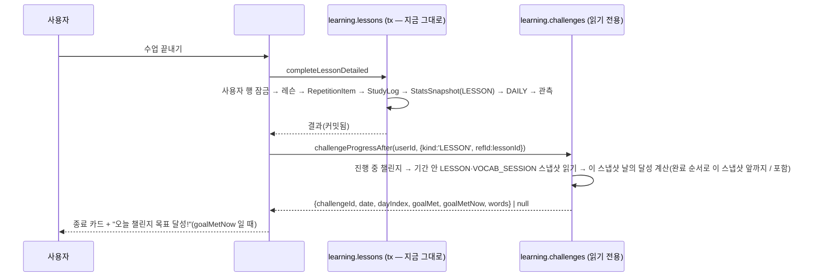
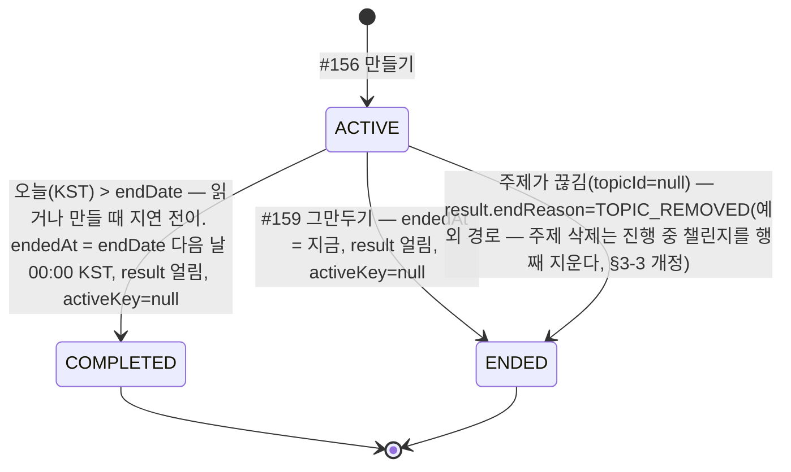
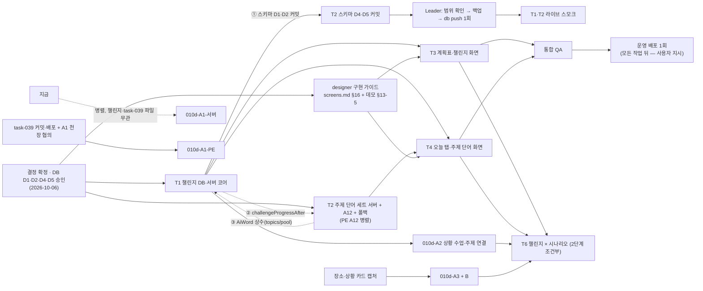

# 챌린지 설계서 (v2.3 — 구현 기준 확정본) — 주제 선택형 매일 학습 · 수행 현황 · 계획표 개편

> **상태: v2.3 (task-040, 2026-10-06, 설계 담당) — 사용자 결정 확정본.** 사용자 지시(2026-10-06) "지금부터 페이즈2작업에 전체 작업을 데모화면 승인없이 한번에 진행해주고 결과를 정리해서 알려줘" + 결정 답: **U1~U15·N1~N3 은 권고안으로 확정, 단 U3 = B2**("오늘의 단어만 LLM 생성" — 챌린지 주제로 매일 새 단어를 A12 `topicWords` 가 만든다) · **DB D1·D2·D4·D5 승인**(이 밖의 새 표·칸 없음 — 필요하면 "추가 DB 승인 필요"로 표시) · **데모 승인 생략**(데모 = 구현 가이드) · 운영 배포는 모든 작업이 끝난 뒤 한 번.
> **v2.3 에서 바뀐 것**: ① 오늘의 단어 = **B2 확정** — A12 호출 명세(§4-3a)·호출 시점 G1 [시작하기] 동기(§4-3b)·실패 폴백 B1(§4-3c)·저장 = 카드 스냅샷 `refType='AiWord'`(반복 항목은 `Expr` 키로 합침, §4-3d)·세트 구성 순서(§4-3e) ② 5초 지표를 B2 에 맞게 다시 씀(§5-2 — 챌린지의 새 LLM 경로는 #47 안의 A12 하나) ③ 남은 모순 3건 Leader 결정 반영 — **누적 세트 수 = 답한 카드 ≥ 1 인 세트만**(§6-1·§6-4·확인 표 13·§9-1) · 두 세트 날 예시 **20장**(§6-0·§6-1·§13-2 19번) · 확인 표 12 소급 세트 **6·3·1**(스크립트 재검산) ④ 구현 task 를 **T1~T4(+T6 2단계 조건부)** 로 다시 나눔 — T5 는 T2 에 흡수(§11-2) ⑤ 결정 목록 확정 표(§11-4a) ⑥ 데모 = 구현 가이드 변경 요구 §13-5(47~62).
> 아래 v2.2·v2.1·v2 머리 설명은 이력으로 남긴다(문서 안 "결정 필요(권고: …)" 문구는 **§11-4a 확정값**으로 읽는다).
>
> **(이력) 초안 v2.2 (task-040, 2026-10-06, 설계 담당)** — v1(726줄) → **REV-112** 반영 v2(902줄) → **REV-113** 반영 v2.1(1108줄, Leader 결정 §13-2b 포함) → Reviewer 재감사 **REV-114(CHANGES_REQUESTED 경미 — Medium 1·Low 10·Info 4, 설계 로직 결함 없음)** 에 따라 문구·명세를 맞췄다. 지적 번호 → 처리 → 새 줄 대조표는 [[task-040-improve-challenge-design]] `## 설계 담당 기록`(v2 표·v2.1 표·v2.2 표)에 있다.
> **v2.2 에서 바뀐 것**: ① "지난 수업 표현 n개 포함"의 원천 `lessonCardCount` 를 **세트 카드 중 `refType='Expr'` 장수**로 정의하고 #47 뿐 아니라 **같은 세션 DTO 를 쓰는 #48·#49(와 #51·#52·#53)** 에도 싣는다(§9-2 — 새로 고침·이어 풀기 뒤에도 같은 값) ② 사용자 문구 "어제 수업 표현" → "**지난** 수업 표현" ③ 결과 화면 "익힘 +n" 지시 잔여 삭제(§13-2b 와 일치) ④ U15 를 **데모 선택 카드**로 통일(§11-5 카드 신설)·결정 목록에 N3 ⑤ `db push` 전 **스키마 diff 확인**(다른 task 의 미적용 칸이 섞이지 않게, §3-5) ⑥ 권장: `challengeProgressAfter` null 조건·결과 화면 장수 원천(§5-4) · 계획표 "만드는 중" 죽은 잡 표시(§6-1) · 단어 판정 3종(`words:false` 모양·건너뜀만 한 세트 = 놓침·U14 W4 제외 권고) · `topicId=null` 전이(§6-4) · 오늘 제외는 같은 주제 세트만(§4-3 ④) · pool 의 barrel import 금지·키 테스트 보강(§10-1) · 소급 달성 확인 행(§6-4 12) · §13-4 데모 영향 13항목. 정본 편입 전 문서다 — 사용자가 데모를 승인하면 구현 task 안에서 정본으로 옮긴다(§11-3). 그 전에는 이 문서가 designer 데모와 구현 task 분할의 기준이다.
> **v2.1 에서 바뀐 것**: ① 단어 과제 = **목표 장수 기준, 그날 주제 세트 합산**(§6-0 — "세트 장수의 80%" 와 "목표 장수의 80%" 두 정의를 하나로) ② §6-4 날짜 상태 계산 순서 정정(그만둔 날 뒤가 "예정"으로 얼던 오류)·마감 기준 시각 고정·`goalMetNow` 를 완료 순서 기준으로 — 스크립트로 확인(§6-4 확인 표) ③ 5초 지표에 "**수업·세트 끝낸 직후 회화**" 경로(A11 완료 트리거) 추가(§5-2) ④ `topics/pool.ts` 가 수업 완료와 **같은 함수**로 출처 키를 얻도록 import 정정(§10-1) ⑤ 010d-A1 을 **A1-서버(지금)** · **A1-PE(task-039 커밋·배포 + 천장 협의 뒤)** 로 나눔(§7-2) ⑥ §13 에 데모 v2 추가 변경 18~33 + v2 첫 판 대비 요약표.
> **v2 에서 바뀐 권고**: ① 지표 원천을 새 원장(`ChallengeDay`) 대신 **이미 있는 `StatsSnapshot(LESSON·VOCAB_SESSION)` 을 읽을 때 계산**(§6-2 iii) → DB 변경에서 D3 철회, 수업·세트 완료 트랜잭션에 **챌린지 쓰기를 넣지 않음**(수업 완료는 무변경, 세트 끝내기는 주제 카드 처리만 — T2) ② 그날 수업을 **자동으로 미리 만들지 않고 오늘의 회화 카드의 한 번 탭(C3+)** 으로 만든다 — 자동 준비가 회화 첫 대답을 늦추기 때문(§5-2) ③ 수업 점수 표기 "문제 n/5" 통일 · 하루 달성 정의 확정 권고(§6-0) ④ API 번호 `#155~#159` ⑤ 010d 병렬 범위 축소(§7-2) ⑥ 데모 v2 변경 요구(§13).
> (v2.2 까지) **"결정 필요(권고: …)"** 는 사용자가 데모 검토 때 정한다고 적었다 — **v2.3 에서 전부 확정**(§11-4a). 근거는 `파일:줄`(코드 `5c3a701` 기준), 확신 수준은 `[확실]`·`[가능성 높음]`·`[추측]`.
> 근거 문서: [[task-040-improve-challenge-design]]·[[IMP-0024-챌린지-계획표-개편|IMP-0024]]·[[IMP-0017-scenario-card-menu|IMP-0017]]·[[IMP-0021-회화-상황흐름-단계진행|IMP-0021]]·[[task-010d-scenario-roleplay]]·[[task-012-calendar]]·[[task-010-today-lesson]]·[[task-008-vocab-today-words]]·[[task-010b-repetition]]·[[task-010b3-a11-timeout-retry]], 정본 5종.

---

## 0. 요약 (한 화면)

| 구분 | 내용 |
|---|---|
| **한 문장** | 사용자가 **주제 하나**를 골라 **기간(7·14·30일)** 과 **하루 목표(오늘의 회화 수업 1개 + 주제 단어 목표 장수 — 예: 10장 중 8장 이상, 세트를 나눠 풀어도 합산)** 를 정하면, 매일 그 주제로 오늘의 회화(한 번 탭으로 생성)와 오늘의 단어(**AI 가 그 주제로 그날 새로 만든 단어 세트** — 만들지 못하면 주제 표현으로)를 하고, 계획표 탭 맨 위에서 **얼마나 잘 하고 있는지**(하루 목표 달성·달성률·수행 연속·주제 표현·새 단어 진행·문제 점수 추이)를 본다. |
| **1단계에서 만드는 것** | ① 챌린지 엔티티 `Challenge`(새 표 1개 — a=A 확정) ② 주제 기반 오늘의 단어 = **B2 확정(v2.3)**: [시작하기] 때 #47 안에서 A12 `topicWords`(fast tier, 벽시계 상한 30초)가 그 주제의 **새 단어**를 만들고, 그날 그 주제 생성은 성공 1회(두 번째 세트는 오늘 만든 단어 중 안 푼 것 재사용) · 실패·지연·부족이면 **B1 풀(주제 기본 표현 + 이 주제 수업 표현)로 폴백·채움** — §4-3a~e ③ 오늘의 회화 = 기존 A4 수업을 **챌린지 주제로 한 번 탭**(c=C3+ 확정, U5) ④ 수행 현황 지표 = 기존 `StatsSnapshot(LESSON·VOCAB_SESSION)` 을 **읽을 때 계산**(e=iii 확정, U7) ⑤ 계획표 개편(맨 위 챌린지 현황 카드 + 달력 유지·달성 표시 + "분석·성장 기록" 자리 유지 — f=F1 확정) ⑥ 오늘 탭 연동(오늘의 회화·단어 카드가 챌린지 주제를 따름) |
| **1단계에서 만들지 않는 것** | 수업 자동 미리 만들기(새벽·첫 진입, §5) · **새 단어 미리 만들기(첫 진입·새벽·별도 탭 잡 — 저장 칸·잡 종류가 없어 추가 DB 승인 필요, §4-3b)** · ~~새 단어 예문 저장(카드에 예문 칸 없음 — 추가 DB 승인 필요, §4-3a E3)~~ → **2026-10-10 사용자 승인으로 채택(task-049 — `VocabAttempt.exampleSnap`·`exampleKoSnap`)** · 여러 날 쓰는 "단어 은행" 표 · 그날 같은 주제 두 번째 생성("새 단어 더") · 시나리오(상황) 하루 과제·역할극·답장 연습 3모드(→ 010d·챌린지 2단계, §7) · AI 가 챌린지를 제안·자동 생성 · 일시정지·목표 수정 · 여러 주제 챌린지 · 푸시 알림 · 랭킹·공유 |
| **DB 변경(사용자 승인 완료 2026-10-06)** | 전부 **추가만**: 새 enum 1(`ChallengeStatus`) · 새 표 1(`Challenge`) · 기존 표 칸 3(`VocabSession.topicId`, `VocabAttempt.refType`·`refId`) — §3-5. v1 의 `ChallengeDay`(D3)는 **철회**(§6-2). **B2 도 이 넷으로 충분**하다(새 단어 = 카드 스냅샷, `refType` 값 `'AiWord'` 는 칸이 아니라 값) |
| **API** | 새 5개 `#155~#159`(목록·만들기·상세·오늘·그만두기) + 기존 additive `#47(+generate·generation)·#48·#49·#51·#53·#58·#62·#70·#71` — §9. `#160` 예약은 U5 = C3+ 확정으로 **쓰지 않음** |
| **010d 와의 관계** | 1단계 챌린지는 **주제만** 쓴다. 010d 는 넷으로 나눈다 — **010d-A1-서버(지금 병렬: 정본 정리·대화 생성·종료 트랜잭션 — task-039 작업 파일을 건드리지 않는 것만, 라우트는 계속 닫힘)** · **010d-A1-PE(task-039 커밋·배포 뒤 + A1 천장 협의 뒤: 상황 헤더·종료 판정 프롬프트)** · 010d-A2(챌린지 T1 뒤: 상황 수업·주제 연결) · 010d-A3+B(캡처 뒤: 시드·목록·화면) — §7 |
| **구현 task(가칭)** | **T1** 챌린지 DB·서버 코어 · **T2** 주제 단어 세트 서버 + A12 + 폴백(PE 포함) · designer 구현 가이드 — 셋 병렬(스키마만 T1 → T2 직렬, push 1회) → **T3** 계획표·챌린지 화면 / **T4** 오늘 탭·주제 단어 화면(병렬) → 통합 QA → 운영 배포 1회 · 2단계 조건부 **T6**(챌린지×시나리오, 010d-B 뒤). v2.2 의 T5(LLM 보충)는 **T2 로 흡수** — §11 |
| **사용자 결정 항목** | **확정(2026-10-06)** — U1~U15 권고안 그대로, **U3 만 B2**, N1~N3 권고 A — 확정 표 §11-4a. 선택 카드 문구 §11-5 는 "확정됨" 표시용, DB 승인 문구 §11-6 은 승인 기록 |

---

## 1. 용어 · 사용자 흐름

### 1-1. 용어

| 용어 | 정의 | 저장 |
|---|---|---|
| **챌린지(challenge)** | 사용자가 만든 "주제 1개 × 기간 × 하루 목표" 약속. 사용자당 **진행 중 1개**(권고). 끝나면 기록(`result`)으로 남는다 | `Challenge`(신규) |
| **챌린지 하루(day)** | 챌린지 기간의 날짜 하나. **저장하지 않는다** — 그날 끝낸 공부의 스냅샷을 읽어 상태를 계산한다(§6-4). 끝난 챌린지는 날짜별 결과를 `result.days[]` 에 한 번 얼린다 | 계산값(`Challenge.result` 에만 얼림) |
| **하루 목표(daily goal)** | 그날 해야 할 과제 묶음. 1단계 = 오늘의 회화(챌린지 주제 수업 1개 끝내기) + 주제 단어(**목표 장수의 80% 이상 풀기** — 그날 푼 주제 세트들의 맞힘+틀림 **합계**, 건너뜀 제외. 목표 10장이면 8장, §6-0). 둘 중 하나만 고를 수도 있다. 목표 장수와 인정 장수까지 만들 때 얼린다 | `Challenge.dailyGoal`(Json) |
| **달성(met) · 일부(partial) · 놓침(missed)** | 하루 목표의 과제를 전부 채운 날 = 달성. 하나라도 했으면(수업을 끝냈거나 주제 세트에서 1장 이상 답함 — 건너뛰기만 한 세트는 안 셈, v2.2) 일부, 아무것도 안 했으면 놓침(§6-0) | 계산값 |
| **인정(counting)** (v1 의 "귀속") | 끝낸 수업·세트를 챌린지 과제로 세는 것. **완료 순간에 쓰지 않고 읽을 때** 스냅샷의 `topicId`·`date` 로 판정한다. 챌린지 화면에서 시작하지 않아도 같은 주제면 센다(§6-0) | 쓰기 없음 |
| **수행 연속(challenge streak)** | 달성한 날이 끊김 없이 이어진 일수. 화면 표기 **"수행 연속 n일"**. **출석 연속(#25·#70 `streak`, 화면 "연속 출석")과 다르다** — 앱을 열기만 한 날은 세지 않는다 | 계산값 |
| **주제 단어(topic words)** | 챌린지 주제로 만든 오늘의 단어 세트(`VocabSession.topicId` 가 있는 세트). **v2.3(B2)**: 카드는 ① **새 단어**(아래) 가 먼저이고, 모자라거나 만들지 못하면 ② 주제 기본 표현(`TopicChunk`)과 그 주제로 끝낸 수업의 표현(`Lesson.content.chunks`)으로 채운다(B1 풀 — §4-3). 단어장(`WordEntry`)과 별개 — 사용자가 [단어장에 넣기]를 눌러야 단어장에 들어간다 | `VocabSession.topicId`(D4) |
| **새 단어(AI word)** (v2.3) | A12 `topicWords` 가 그 주제·수준으로 그날 만든 단어·짧은 표현. **카드 스냅샷에만** 있다(`VocabAttempt.wordId=null`·`surface/reading/meaningSnap`·`refType='AiWord'`·`refId`=정규화 표기 sha1). 그날 그 주제로 **한 번** 만들고(성공 기준), 같은 날 다음 세트는 오늘 만든 새 단어 중 안 푼 것을 다시 쓴다. 이전 날 낸 표기는 다시 만들지 않는다(§4-3a 중복 제외). 화면에 "AI 가 만든 단어라 틀린 곳이 있을 수 있어요" 한 줄 | 카드 `refType='AiWord'`(D5 칸의 값) — 반복 항목은 `Expr` 키(§4-3d) |
| **수업 표현(lesson expression)** (v2.2) | 이 주제로 **끝낸 새 수업**의 조각(`Lesson.content.chunks`) 중 **기본 표현과 다른 것** — 출처 키가 `refType='Expr'` 인 것(조각 id 가 그 주제의 실제 조각이면 기본 표현으로 세고, 표기가 같은 조각은 풀에서 기본 표현 하나로 합쳐진다 — §4-3 ①③). 화면 "지난 수업 표현 n개 포함"의 n = 그 세트 카드 중 이것의 장수(`lessonCardCount`, §9-2), 상세 "수업 표현 +n" = 풀에 있는 이것의 가짓수(§6-1) | 카드 `VocabAttempt.refType='Expr'`(D5) |
| **주제 표현 익힘(mastered)** | 기본 표현 중 **2번 이상 맞혔고 맞힌 횟수가 틀린 횟수보다 많은** 것(§6-1). "공부"(1번 이상 풀어 봄)는 며칠 만에 다 차서 진행 지표로 약하다. **v2.3(B2)**: 세트가 새 단어 위주라 기본 표현은 주로 **수업**(A4 가 주제 조각을 쓰고 완료 때 `TopicChunk` 항목을 올림 — `lessons/content.ts:167-195`)과 폴백·채움 세트에서 오른다. 새 단어는 따로 "새 단어 n개 — 공부·익힘"(§6-1) | `RepetitionItem` 카운터에서 계산 |
| **상황(scenario)** | 010d 의 "역할·목표가 있는 의사소통 과제"(`Scenario`). 1단계 챌린지에는 쓰지 않고 2단계에서 하루 과제로 들어온다 | `Scenario`(010d, 스키마 있음) |

### 1-2. 사용자 흐름 (1단계)

```mermaid
flowchart TD
  P["하단 탭 '계획표' /plan"] --> Q{진행 중 챌린지?}
  Q -- 없음 --> S0["챌린지 시작 카드<br/>'주제 하나로 매일 조금씩'"]
  S0 --> N["챌린지 만들기 /plan/challenge/new<br/>① 주제 고르기(#56) ② 기간 7·14·30 ③ 하루 목표·시작일 ④ 확인"]
  N -->|#156| A["진행 중 챌린지"]
  Q -- 있음 --> A
  A --> C["계획표 맨 위 현황 카드<br/>4일째 / 7일 · 오늘 할 일(단어 → 회화) · 달성률 · 수행 연속"]
  C --> D["챌린지 상세 /plan/challenge/:id<br/>수행 현황 · 날짜 띠 · 주제 표현 익힘 · 문제 점수 추이"]
  C -->|오늘 할 일| T["오늘 탭 /study/today"]
  T --> W["오늘의 단어 — 주제 단어 세트 [시작하기]<br/>(#47 {topicId} — 그날 첫 세트면 A12 새 단어 생성 대기 ≤30초,<br/>실패·지연·부족이면 주제 표현으로 폴백·채움)"]
  T --> L["오늘의 회화 — '카페 주문' 오늘 수업 [만들기]<br/>(한 번 탭 = #59 {topicId}, 약 1분 생성)"]
  W -->|#51 완료(챌린지 쓰기 없음)| SV["StatsSnapshot(VOCAB_SESSION)<br/>data.topicId · date"]
  L -->|#62 완료(트랜잭션 무변경)| SL["StatsSnapshot(LESSON)<br/>data.topicId · date · 문제 n/5"]
  SV & SL --> M{"읽을 때 계산(§6-4)<br/>오늘 목표 다 채웠나?"}
  M -- 예 --> G["'오늘 목표 달성' 토스트·카드"]
  A -->|기간 끝(마지막 날 자정 마감, 지연 전이)| E["COMPLETED — 결과 카드(N일 중 M일 달성)"]
  A -->|그만두기 #159| E2["ENDED — 결과 카드"]
  E & E2 --> N2["챌린지 기록 · [다시 도전](진행 중이 없을 때만) / 다른 주제로"]
```

- **진입 두 갈래**: 계획표(현황·관리)와 오늘 탭(실제 공부). 공부 화면(수업·단어 덱)은 지금 것을 그대로 쓴다 — 챌린지 전용 공부 화면을 새로 만들지 않는다. 오늘 할 일 순서는 오늘 탭 카드 순서와 같게 **단어 → 회화**(`TodayHome.tsx:303,344` · `docs/screens.md:82`).
- **챌린지 화면에서 시작하지 않아도 센다**: 오늘 탭에서 같은 주제로 수업을 만들거나(같은 날 같은 주제면 `claimLesson` 이 같은 수업을 돌려준다, `lessons/generate.ts:101-115`) 주제 단어를 풀면 인정된다. 반대로 "챌린지 화면에서 시작한 것만" 세는 방식은 이 설계에서 만들 수 없다(§11-4 U12).
- **시나리오(010d)와의 관계**: 010d 는 "주제 → 상황 → 역할극"의 **한 번의 대화 과제**이고, 챌린지는 "주제를 **며칠 동안 매일**"의 **습관 틀**이다. 2단계에서 챌린지 하루 과제에 "이 주제의 상황 역할극 1회"가 더해진다(§7). 사용자 요청의 "시나리오와 같이 주제를 선택해서"는 **고르는 방식(카드로 주제 고르기)** 을 닮게 한다는 뜻으로 읽었다 — 만들기 ① 단계의 주제 카드는 010d v2 의 상황 카드와 같은 부품을 쓰도록 designer 가 맞춘다(§8-3).

### 1-3. 예시 — 데모 합성 데이터 기준값 (v2, §6 정의로 재계산)

**진행 중 — "카페 주문 7일 챌린지"** · N5 · 10/03 시작 · 하루 목표 = 수업 1 + 주제 단어 **목표 10장(그날 합계 8장 이상 풀면 인정)** · 오늘 10/06 = **4일째 / 7일**. (v2.1 재계산: 기준 예시는 하루 한 세트(10장)라 "합산" 정의로 바꿔도 날짜별 값이 같다 — 여러 세트를 합치는 예시는 §6-0 표)

| 날짜 | n일째 | 수업(문제) | 주제 단어(맞힘·틀림·건너뜀 / 장, 그날 합계) | 상태 |
|---|---|---|---|---|
| 10/03 | 1 | 끝냄 · **문제 4/5** | 7·2·1 / 10 (푼 장 합계 9 ≥ 8 → 인정) | 달성 ✓ |
| 10/04 | 2 | 끝냄 · **문제 5/5** | 8·2·0 / 10 (10 ≥ 8) | 달성 ✓ |
| 10/05 | 3 | 안 함 | 6·3·1 / 10 (9 ≥ 8 — 단어는 인정, 수업 없음) | 일부 ◐ |
| 10/06 | 4 (오늘) | **아직 — [오늘 수업 만들기] 전** | 아직 0 | 오늘 |
| 10/07~09 | 5~7 | — | — | 예정 |

- 달성률 **2/3 = 67%**("3일 중 2일") · 수행 연속 **0일**(어제 일부, 오늘은 유예) · 최장 연속 **2일** · 오늘 둘 다 끝내면 → **3/4 = 75%**, 수행 연속 **1일**.
- 문제 점수 추이: 10/03 **4/5** → 10/04 **5/5** → (10/05 수업 없음). "80점·90점"·"평균 85" 는 쓰지 않는다(5문항이라 불가능한 값 — §6-1 점수).
- **(v2.3, B2)** 날짜별 단어 세트는 **그날 A12 가 만든 새 단어 10장**(10/03·10/04·10/05 각 10장 — 날마다 다른 표기, 전부 생성 성공 가정). 맞힘·틀림·건너뜀 값(7·2·1 / 8·2·0 / 6·3·1)·달성 판정은 B1 때와 같다 — 판정은 카드가 어디서 왔는지 보지 않는다(§6-0).
- 주제 표현: **기본 표현 12개 — 익힘 7 · 공부 12** · **수업 표현 +5**(이 주제로 끝낸 수업 3개에서 나온 기본 밖 표현) · **이 주제 수업 3개**(챌린지 전 1개 포함). (v2.3: B2 에서 기본 표현 수치는 **수업에서 오른 값**으로 읽는다 — 합성값 그대로)
- **새 단어(v2.3)**: **30개 — 공부 28 · 익힘 0**(3일 × 10장, 푼 9+10+9 = 28. 새 단어는 날마다 한 번만 나와 맞힘이 2번이 될 수 없어 익힘 0 — 다시 풀기(U15)·복습 수업(A5)으로만 오른다, §6-1).
- 챌린지 누적: **수업 2개 · 단어 세트 3개 · 맞힌 카드 21장**(7+8+6). 세트 수는 **답한 카드가 1장 이상인 세트만**(v2.3 — 세 세트 모두 해당).
- 오늘 단어 세트를 끝낸 뒤(맞힘 8·틀림 2): 단어 과제 ✓ · 오늘은 "1/2" 상태(익힘·공부 수는 이 결과 화면이 아니라 상세에서 읽을 때 계산 — Leader 결정 v2.1b). 이어서 수업을 끝내면 달성 → 75% · 수행 연속 1일 · 누적 수업 3 · 세트 4 · 맞힌 카드 29(스크립트 재검산 v2.3 — 확인 표 2). 오늘 세트 = 오늘 새 단어 10장(새 단어 40개 — 공부 38).

**끝난 챌린지 2개(S8·챌린지 기록용)**

| 챌린지 | 날짜별 상태 | 달성률 | 최장 연속 | 결과 문구 |
|---|---|---|---|---|
| "자기소개 7일 챌린지" 09/20~09/26 · COMPLETED | ✓ ✓ ✓ ◐ ✓ ✓ ✕ | 5/7 = **71%** | **3일** | 7일 중 5일 달성 |
| "길 묻기 14일 챌린지" 09/05 시작 · 6일째에 그만둠(ENDED) | ✓ ✓ ✕ ✓ ◐ · (6일째 미달 = 그만둠) · 7~14일째 그만둠 | 3/5 = **60%** | **2일** | 5일 중 3일 달성 · 그만둠 |

- 첫날 아침(아직 아무것도 안 함): 지난 날 0 → 달성률 **"—"**(0÷0 → `rate:null`), 수행 연속 0일.
- 그만둔 챌린지는 **그만둔 그 순간 본 화면과 며칠 뒤 본 화면이 같다** — 6일째(미달)부터 14일째까지 모두 "그만둠"(v2 의사코드는 그만둔 당일에 7~14일째를 "예정"으로 계산해 결과에 얼리는 오류가 있었다 — §6-4 확인 표 8a·8b).
- 끝난 챌린지는 "수행 연속"을 보이지 않고 **최장 연속**만 보인다(`streak:null`).

---

## 2. 현재 상태와 갭 (코드 `5c3a701` 재확인)

### 2-1. 재확인 표

| # | 조사 요약 | 재확인 근거 | 판정 |
|---|---|---|---|
| 1 | `Challenge` 모델·화면 없음 | `prisma/schema.prisma` 모델 목록에 없음 · `src/` 에 challenge 관련 파일 없음 | 맞음 |
| 2 | 계획표 = 달력·출석·하루 시트 + "분석·성장 기록 곧 열려요" | `components/plan/PlanScreen.tsx:141-184` | 맞음 |
| 3 | 연속(streak)은 출석 기준 | `learning/attendance/index.ts:7-19` · `studyLog/calendar.ts:9` | 맞음. 보탬: #54 `streakDays`(세트를 끝낸 날 연속, `vocab/stats.ts:70-76`)도 따로 있다 |
| 4 | 주제 선택 수단 있음(#56·`LessonTopicsScreen`·#59 `{topicId}`) | `learning/topics/index.ts:98-129` · `lessons/generate.ts:39-65` · #56 항목에 `chunks[]`·`lessonCount`(`topics/index.ts:49-64`) | 맞음 |
| 5 | 수업 자동 생성 없음(누를 때만) | `lessons/generate.ts:233-237` | 맞음 |
| 6 | 같은 날 같은 주제 재사용 | `lessons/generate.ts:101-115` — 오늘·같은 주제·NEW 의 `READY·IN_PROGRESS` 그대로, 살아 있는 `GENERATING` 은 잡 반환, `FAILED`·죽은 잡은 되살림. `DONE` 이면 새 수업(:103 조건에 DONE 없음) | 맞음 |
| 7 | 사용자당 동시 생성 1 | `lessons/generate.ts:117-118` — 409 `{reason:'GENERATING'}` | 맞음 |
| 8 | 추천 #58 | `lessons/today.ts:59-78` · `TOPIC_ROTATE_AFTER=3`(:23) — 같은 주제 3번이면 다른 주제를 권함 → 챌린지와 충돌 → #58 에 `CHALLENGE` 이유(§9-2) | 맞음 |
| 9 | 오늘의 단어 = 내 `WordEntry` 풀 가중 샘플링, 주제 개념 없음 | `vocab/sessions.ts:292-321` · `VocabSession`(schema 879-903)에 주제 칸 없음 · 카드(`VocabAttempt`, schema 906-927)는 `wordId` 가 비어도 되고 표기·읽기·뜻을 스냅샷 | 맞음 — 단어장 밖 카드를 담을 구조는 이미 있다 |
| 10 | 010d 스키마(`Scenario`·`ScenarioTopic`·`Lesson.scenarioId`·`Chat.scenarioId`·`Chat.lessonId`) 적용 | schema 971-1016·1024·696-698 — 2026-10-01 "db추가 승인" 묶음(`domain-model.md` §8 #14) | 맞음(task-018 과 별개) |
| 11 | 시나리오 서버·화면·시드 없음 | `learning/scenarios/`·`api/v1/scenarios/`·`seed-data/scenarios.json` 없음 | 맞음 |
| 12 | #28 이 시나리오 대화를 400 으로 막음 | `conversation/chats/validate.ts:63`(`lessonId` — 레슨 역할극)·`:64`(`scenarioId`) 둘 다 `FEATURE_NOT_READY` | 맞음(줄 63 도 함께) |
| 13 | `Profile.goal*` | `goalLevel` 은 설정 화면 입력 있음(`LearningSettings.tsx:154-155`). `goalTopics`(자유 문자열 ≤40자 ×≤10, `preferences/validate.ts:105-106`)·`goalDeadline` 은 입력 화면 없음 | 부분 정정(v1 그대로) |
| 14 | `StudyPlan`(A8) 미구현 | schema 1240-1258 모델만 | 맞음 |
| 15 | 시드 주제 크기 | `prisma/seed-data/topics.json` — 주제 5개(N5 3·N4 2) × 조각 **12개**, 주제마다 **뜻 12개 모두 다름**, 표기 최대 10자, 조각 종류 4가지(NAME·ACTION·FEELING·MODIFIER) | [확실] 실측 |
| 16 | 수업 완료가 조각을 반복 항목으로 등록 | `lessons/content.ts:167-195` — 주제의 실제 조각이면 `TopicChunk`/`CHUNK`, 아니면 `Expr`(sha1)/`EXPRESSION`, 문법 `Grammar`, 상한 12 | 주제 단어 가중치·표현 진행 원천 |
| 17 | 완료 트랜잭션 구조 | 수업 `lessons/lifecycle.ts:99-190` · 단어 `vocab/sessions.ts:503-558` | **v2 는 두 트랜잭션에 챌린지 쓰기를 넣지 않는다** — 수업 완료는 무변경, 세트 끝내기는 주제 카드 처리(반복 항목·스냅샷 `topicId`)만 더한다(T2, §4-3 ⑧·§5-4) |
| 18 | (새로 확인) 스냅샷 `data` | LESSON `{kind, topicId, score, stageDone, itemCount, quizCorrect, quizTotal, date(완료 KST)}`(`snapshots/index.ts:162-176`, 쓰기 `lifecycle.ts:168`) · VOCAB_SESSION `{cardCount, correct, wrong, skipped, durationSec, mode, date(시작 KST)}`(`snapshots/index.ts:139-156`, 쓰기 `sessions.ts:554`) · 인덱스 `(userId, kind, createdAt)`(schema 1274) · #54 가 이미 VOCAB_SESSION 을 `createdAt` 범위로 읽고 `data.date` 로 거른다(`vocab/stats.ts:84-92`) | 지표 원천 (iii) 의 근거(§6-2) |
| 19 | (새로 확인) LLM 호출 큐 | Claude CLI 동시성 1 직렬 큐, interactive 레인은 순서만 앞서고 **실행 중인 batch 를 끊지 않는다**(`engine/adapters/llm/claudeCli.ts:660-702`, `pump` 676-693). A4 는 batch(`generate.ts:206`), #58 하루 첫 진입에 A11 판단 잡(batch)이 이미 자동으로 걸린다(`repetition/decision.ts:8`, `design-spec.md:157`) | 5초 예산과의 충돌(§5-2) |
| 20 | (새로 확인) 수업 점수 | A4 `quiz` 정확히 5문항(`structuredResponse/schemas.ts:483` — `5c3a701` 기준, task-039 미커밋 작업본에서는 줄이 밀려 있음), 점수 = round(정답/5×100)(`lessons/content.ts:94-104`) → 가능한 값 {0,20,40,60,80,100}. 오늘 카드는 "문제 n/5"(`TodayLessonCard.tsx:158`, `lesson/logic.ts:54`) | 표기 통일(§6-1) |
| 21 | (새로 확인) 세트 끝내기 | 1장만 답하고 [여기서 끝내기]해도 DONE(미답은 SKIPPED, `sessions.ts:514-530`) · 기록 날짜 = 세트를 **시작한** 날(`sessions.ts:538`, 안내 `DeckNotice.tsx:18`) | 단어 달성 최소 기준 필요(§6-0) |
| 22 | (새로 확인) 다시 풀기 #53 | 카드를 `wordId` 로만 재구성, `wordId=null` 카드가 하나라도 있으면 FLIP 강등(`sessions.ts:586-610`, 강등 :607) — 주제·출처를 잇지 않는다 | §9-2 #53 |
| 23 | (새로 확인) 수업 삭제 | `src/app/api/v1/lessons/**` 에 삭제 라우트 없음. 정책상 `Lesson` 삭제 시 `StatsSnapshot(LESSON)` 은 남는다(`domain-model.md` §6) | [확실] |
| 24 | (v2.1 확인) 세트 장수 | #47 `count` 5~30(`vocab/sessions.ts:26-27`) — 세트는 요청보다 작게 만들어질 수 있다(풀 부족). `VocabSession.requestedCount` 칸은 이미 있지만(schema 884) VOCAB_SESSION 스냅샷 `data` 에는 없다(`snapshots/index.ts:139-156`) | 단어 과제를 "세트 장수" 기준으로 두면 작은 세트가 쉬워진다 → 목표 장수 기준(§6-0) |
| 25 | (v2.1 확인) 오늘 제외 규칙 | 지금 단어 세트는 오늘 **끝낸 세트의 카드 전부**(건너뛴 카드 포함)를 다음 세트 풀에서 뺀다(`sessions.ts:308-313`) | 주제 세트는 **답한 카드만** 뺀다(§4-3 ④ — 같게 두면 일찍 끝낸 날 목표에 못 닿음) |
| 26 | (v2.1 확인) A11 완료 트리거 | #62 완료·#51 끝내기 라우트가 커밋 **뒤** `afterStudyCompleted` 로 A11 판단 잡(batch)을 건다(`lessons/[id]/complete/route.ts:23` · `vocab/sessions/[id]/finish/route.ts:19` — 세트는 반복 항목을 1개 이상 등록했을 때). 하루 1회 제한은 **첫 진입(DAILY)에만** 있고 완료 트리거는 대기 중 잡에 합치기만 한다(`repetition/decision.ts:165-187`). 운영 실측 WORDS 12.9s·REVIEW 13.0s(task-010b3 이력서 113) | §5-2 |

### 2-2. 갭

| 갭 | 내용 | 다루는 절 |
|---|---|---|
| G1 엔티티 | 기간·주제·하루 목표·결과를 담을 곳이 없다. `Profile.goal*`·`StudyPlan` 으로는 부족 | §3 |
| G2 주제 단어 | 오늘의 단어가 주제를 모른다(핵심 갭). 세트·카드에 주제·출처 칸이 없다 | §4 |
| G3 하루 판정 | "오늘 챌린지 과제를 했는가"를 판정할 연결이 없다. 단 **LESSON 스냅샷에는 이미 `topicId`·`date` 가 있고**, VOCAB_SESSION 스냅샷에는 `date` 만 있다(주제 없음) | §6 |
| G4 수행 기준 지표 | 연속은 출석 기준뿐. 달성률·주제 진행·점수 추이가 없다 | §6 |
| G5 계획표 IA | 계획표에 "지금 할 일"이 없다 | §8 |
| G6 시나리오 서버 | 010d 서버·시드가 없어 시나리오를 챌린지 재료로 쓸 수 없다 | §7 |

---

## 3. 데이터 모델 — 옵션 비교 + 권고 (결정 a)

### 3-1. 옵션 비교

| 기준 | **A. 새 모델 `Challenge` (하루 결과는 스냅샷에서 계산)** | B. Topic/Scenario 묶음 + `Profile.goal*` 재사용 | C. `StudyPlan` 재사용(`curriculum.kind='CHALLENGE'`) |
|---|---|---|---|
| 기간·시작일 | `startDate`·`endDate` 칸 | `goalDeadline` 만(시작일 없음) | `periodStart`·`periodEnd` 있음 |
| 주제 | `topicId`(FK, SetNull) + 제목 스냅샷 | `goalTopics` = 자유 문자열(주제 id 아님) | `curriculum` Json 안 — FK 없음 |
| 하루 목표·판정 파라미터 | `dailyGoal` Json(만들 때 얼림) | 칸 없음(`dailyWordCount` 는 전역 설정) | Json 안 |
| 하루별 결과 | 기간 안 스냅샷에서 계산(§6-4), 끝나면 `result` 에 얼림 | 같은 계산 가능하나 기간·시작일이 없어 범위를 못 정함 | 같은 계산 가능 |
| 지난 챌린지 기록 | 행이 남음(COMPLETED·ENDED + `result`) | 덮어쓰기 — 이력 없음 | `ARCHIVED` 로 남지만 A8 계획과 섞임 |
| 진행 중 1개 보증 | `activeKey @unique`(DB 보증) | Profile 1행이라 자연히 1개 | "ACCEPTED 1개" 규칙이 **A8 공부계획서와 충돌** |
| 의미 충돌 | 없음 | `goal*` 는 "장기 목표(JLPT)" — 단기 챌린지와 섞임 | `StudyPlan` = "AI 제안 → 채택"(규칙 1) — 사용자가 직접 만드는 챌린지와 상태 의미가 다름 |
| DB 변경 | 새 표 1 + enum 1(추가만) | 없음 | 없음 |
| 구현량 | 중 | 소(대신 이력·기간 없음) | 중(+충돌 회피 코드) |

**권고: A (새 모델 `Challenge`)**. 이유: ① 챌린지는 기간·시작일·하루 목표·끝난 기록이 있는 **별도 사물**이다 — `goalTopics` 는 주제 id 가 아니고 이력이 남지 않는다 ② `StudyPlan` 은 A8(Phase 3)의 "제안 → 채택" 의미라 겹쳐 쓰면 둘 다 망가진다 ③ 하루별 결과는 새 표 없이 기존 스냅샷에서 계산하므로(§6-2 iii) 새 표는 **`Challenge` 하나**로 충분하다 ④ 변경이 전부 추가만이라 공유 DB 에서도 위험이 낮다. → **결정 필요(권고: A)**, A 면 **DB 추가 승인(사용자, 데모 승인과 따로)** 이 필요하다(§11-6).

**`Profile.goalTopics`·`goalDeadline` 처리** — 권고: **그대로 두고 쓰지 않는다**. 정본 `domain-model.md` Profile 주석에 "단기 목표는 `Challenge` — 이 두 칸은 화면·프롬프트 미사용"을 적는다(칸 삭제는 데이터 손실 변경이라 하지 않음). `goalLevel` 은 지금처럼 남는다. (사용자 결정 항목 아님 — 설계 판단)

### 3-2. 모델 초안 (Prisma — 정본 편입 전, 구현 task T1·T2 에서 확정)

```prisma
/// 챌린지 상태(task-040). ACTIVE → COMPLETED(기간 끝 — 읽거나 만들 때 지연 전이) | ENDED(사용자가 그만둠). 끝난 상태는 되돌리지 않는다
enum ChallengeStatus {
  ACTIVE
  COMPLETED
  ENDED
}

/// 챌린지 — 사용자가 직접 만든다(규칙 1 의 DIRECT 행위, AI 산출 아님). L3 learning/challenges 소유.
/// 하루별 결과는 저장하지 않는다 — 기간 안 StatsSnapshot(LESSON·VOCAB_SESSION)을 읽을 때 계산하고(§6-4), 끝날 때 result 에 한 번 얼린다.
/// activeKey = ACTIVE 일 때 userId, 끝나면 null → @unique 가 "사용자당 진행 중 1개"를 DB 에서 보증(InnoDB 유니크는 NULL 여러 개 허용).
/// 사용자 삭제 경로 없음(계정 삭제 시에만 Cascade). **주제를 지우면 진행 중(ACTIVE) 챌린지 행은 같은 트랜잭션에서 함께 지워지고, 끝난 챌린지(ENDED·COMPLETED)는 남는다**(task-045 사용자 결정 — `topic-scenario-manager.md` §4, §3-3)
model Challenge {
  id             String          @id @default(cuid())
  userId         String
  /// 자동 "<주제 제목 ≤60자> N일 챌린지" 또는 사용자 입력 ≤40자
  title          String          @db.VarChar(80)
  topicId        String?
  topicTitleSnap String          @db.VarChar(80)
  level          JlptLevel
  lengthDays     Int
  startDate      DateTime        @db.Date
  endDate        DateTime        @db.Date
  /// {lesson:boolean, words:boolean, wordCount:5|10|15|null, wordsMinAnswered:4|8|12|null, countSkipped:false, ruleVersion:1} — 만들 때 얼림(1단계 수정 없음).
  /// wordsMinAnswered = ceil(4×wordCount/5)(정수식, U14 권고 W2) — 그날 주제 세트들의 (맞힘+틀림) 합계가 이 값 이상이면 단어 과제 인정(§6-0).
  /// words:false(단어 과제 끔)면 wordCount·wordsMinAnswered = null(판정에 쓰지 않음 — 세트를 풀면 합계는 기록·표시만, v2.2 REV-114 R4-L6a).
  /// U14 에서 다른 기준을 고르면 같은 칸으로 표현한다: W1 = wordsMinAnswered 1 · W3 = ceil(wordCount/2). countSkipped 는 1단계 늘 false —
  /// W4(건너뜀 포함)는 끝내기의 자동 건너뜀과 직접 건너뜀을 스냅샷이 구분하지 못해 선택지에서 뺐다(§6-0, R4-L6c). 다시 넣으려면 스냅샷 data.skippedAuto 칸(JSON)이 먼저.
  /// 판정 파라미터를 여기 얼려 코드 규칙이 바뀌어도 진행 중 챌린지 수치가 바뀌지 않게 한다. 2단계 scenario 슬롯은 additive 키
  dailyGoal      Json
  status         ChallengeStatus @default(ACTIVE)
  activeKey      String?         @unique @db.VarChar(40)
  /// 끝날 때 한 번만 쓰는 요약(§5-5) — {ruleVersion, endReason, metDays, partialDays, missedDays, stoppedDays, elapsedDays, rate, longestStreak,
  /// lessonsDone, wordSets, wordsCorrect, days:[{date, state, quiz:[c,t]|null, words:[c,w,s,n,sets]|null}] ≤30} — 이후 불변.
  /// endReason = COMPLETED 면 null · ENDED 면 'USER'(#159) | 'TOPIC_REMOVED'(§5-5, v2.2 R4-L7)
  /// days[].words = 그날 주제 세트 합계(맞힘·틀림·건너뜀·카드 수·세트 수). JSON 모양은 정본 domain-model §9-3 에 올린다(§11-3)
  result         Json?
  /// COMPLETED = endDate 다음 날 00:00 KST(마감 시각 — 전이를 실행한 시각이 아님) · ENDED = 그만둔 시각
  endedAt        DateTime?
  createdAt      DateTime        @default(now())
  updatedAt      DateTime        @updatedAt

  user  User               @relation(fields: [userId], references: [id], onDelete: Cascade)
  topic ConversationTopic? @relation(fields: [topicId], references: [id], onDelete: SetNull)

  @@index([userId, status, startDate])
  @@index([userId, endedAt])
}

// ── 기존 모델에 추가(전부 nullable, 추가만) ──
model VocabSession {
  // …기존 칸…
  /// 주제 단어 세트(task-040). null = 기존 "내 단어장" 세트
  topicId String?
  topic   ConversationTopic? @relation(fields: [topicId], references: [id], onDelete: SetNull)
  @@index([userId, topicId, date])
}

model VocabAttempt {
  // …기존 칸…
  /// 주제 카드의 출처(FK 없음 — RepetitionItem 과 같은 규약): 'TopicChunk'(조각 id) | 'Expr'(sha1 정규화 표기 — 수업 표현) |
  /// 'AiWord'(v2.3 B2 — A12 새 단어, refId = 같은 sha1 정규화 표기. 반복 항목 등록·오늘 제외 비교 때는 ('Expr', refId) 로 바꿔 쓴다 — §4-3d).
  /// 단어장 카드는 null(wordId 로 충분)
  refType String? @db.VarChar(30)
  refId   String? @db.VarChar(40)
}
// 관계 역방향 칸만(DB 칸 없음): User.challenges · ConversationTopic.{challenges, vocabSessions}
```

### 3-3. 제약 · 인덱스 · `onDelete` · 소유자 검사

| 항목 | 규칙 | 이유 |
|---|---|---|
| 진행 중 1개 | `Challenge.activeKey @unique` + 만들기 트랜잭션에서 사용자 행 잠금(`lockUserRow`) 뒤 확인 → 409 `ACTIVE_EXISTS`. 유니크 위반(P2002)도 409 로 변환. **끝내는 모든 경로(COMPLETED 전이·#159)가 `activeKey=null`** 을 함께 쓴다 | 앱 검사만으로는 두 요청이 겹칠 때 빈틈 — DB 가 마지막 방어. 이 기법은 `domain-model.md` §8 #4 에서 **제안만 됐고 스키마·코드 선례는 없다** — 이번이 첫 사용이라 T1 테스트에 "동시 두 #156 → 하나 409"·"끝낸 뒤 새로 만들기 성공"을 넣는다 |
| 만들기 상한 | #156 사용자당 하루 20회(429) | 만들기·그만두기 반복으로 행이 쌓이는 것 방어(사용자 삭제 경로가 없으므로) |
| `onDelete` | `Challenge → User` Cascade · 주제 SetNull · 세트의 주제 SetNull | 계정 삭제 = 소유 행 전부. 끝난 챌린지는 `result` 와 `topicTitleSnap` 으로 읽힌다 |
| 주제 삭제 | **(2026-10-07 개정 — task-045 사용자 결정, 계약 `topic-scenario-manager.md` §4)** 주제 삭제(#173)는 **진행 중(ACTIVE) 챌린지 행을 같은 트랜잭션(사용자 행 잠금 뒤)에서 함께 삭제**하고 끝난 챌린지(ENDED·COMPLETED)는 `topicId=null` 로 남긴다(저장된 `topicTitleSnap` 을 평소처럼 보이고 "삭제됨" 표기 없음). 삭제 확인 창은 #172 사전 조회로 진행 중 챌린지가 있다는 사실을 알린다. ~~이전 안: 진행 중이면 409~~. 예외 경로로 ACTIVE 인데 `topicId=null` 이 보이면 읽을 때 ENDED 로 전이(`result.endReason='TOPIC_REMOVED'`) — 이때 인정 집합은 비운다(§6-4 `topicId=null` 줄) | 주제가 끊기면 인정 비교가 항상 실패해 챌린지가 조용히 멈춘다(REV L-14) — #57 구현 task 의 완료 기준에 넣는다. 지금은 주제·조각을 지우는 코드 경로가 없다(`src/` 에 `conversationTopic.delete`·`topicChunk.delete` 0건, 시드 `seed-topics.ts` 는 만들기·고치기만) [확실] → 1단계에서 도달 불가 |
| 소유자 검사 | 모든 #155~#159 는 `where {id, userId}` 로 읽고, 없거나 남의 것은 404(`api-contract.md` §0-4). `topicId` 는 시드 또는 내 주제만(`topics/index.ts:12-15` `getTopicRef`), 아니면 404 | 기존 규약 |
| 사용자 삭제 | 1단계에는 챌린지 지우기 없음(목록에서 끝난 것 접기만 — 화면 처리) | 필요해지면 `hiddenAt` 칸 추가(별도 승인) |
| 날짜 | 전부 서버 KST(`infra.dates.todayKst`) — 클라이언트 날짜를 키로 쓰지 않는다 | `module-dependency.md` §8 #10 |
| 제목 폭 | 자동 제목 = `truncateCodePoints(주제 제목, 60) + " N일 챌린지"`(≤69자) · 사용자 입력 ≤40자 → `VarChar(80)` 안 | REV L-6 |
| 카드 폭 | 주제 풀에서 `textJa` 80자 초과·`reading` 120자 초과 조각은 **제외**(잘라 쓰면 정답이 틀어짐) — `VocabAttempt.surfaceSnap VarChar(80)`·`readingSnap VarChar(120)`(schema 911-912) < `TopicChunk.textJa VarChar(120)`·`reading VarChar(160)`(schema 959-960). 지금 시드 최대 10자·A4 ≤40자라 제외 0. **A12 새 단어(v2.3)** 는 출력 스키마 상한을 수업 조각과 같게(표기 ≤40·읽기 ≤80·뜻 ≤80 — `schemas.ts:387-399` `lessonChunkOut` 과 같은 값) 두어 카드 칸(80·120·200)을 넘을 수 없다 — 자르기 없음 | REV L-6 |

### 3-4. 기존 `StudyLog`·`StatsSnapshot` 와의 연결

| 대상 | 변경 | 비고 |
|---|---|---|
| `StudyLog` | **없음**. 챌린지를 만들거나 하루 목표를 채워도 StudyLog 를 새로 만들지 않는다(같은 공부를 두 번 세지 않음). 달력 하루 시트의 "챌린지 4일째" 줄은 #71 이 계산해 붙인다 | 지표 원천으로 쓰지 않음(지울 수 있음, #73) |
| `StatsSnapshot(LESSON)` | **없음** — 이미 `kind`·`topicId`·`date`·`quizCorrect`·`quizTotal` 이 있다(`snapshots/index.ts:162-176`) | 지표 원천(§6-2 iii) |
| `StatsSnapshot(VOCAB_SESSION)` | `data` 에 **`topicId?` 한 칸 추가**(JSON, 스키마 무관 — T2). 주제 세트만 채운다. 옛 행은 없음 = 내 단어장 세트 | 지표 원천. 정본 `domain-model.md` §9-3 갱신 |
| `StatsSnapshot(DAILY)` | 없음 | 일반 "학습 연속"은 후속 |
| `RepetitionItem` | 스키마 없음. 주제 카드 답을 `itemType=CHUNK\|EXPRESSION`·`refType='TopicChunk'\|'Expr'` 로 등록(수업 완료와 **같은 키** → 한 항목으로 쌓임) | §4-3 ⑦, 표현 익힘의 원천 |

### 3-5. DB 변경 목록 — **사용자 승인 완료(2026-10-06, D1·D2·D4·D5 전부)**

> **v2.3**: 사용자가 D1·D2·D4·D5 를 승인했다. **B2(오늘의 단어 LLM 생성)도 이 넷 안에서 끝난다** — 새 단어는 카드 스냅샷(`surface/reading/meaningSnap`)과 D5 `refType='AiWord'`·`refId` 로 저장하고, 생성은 #47 요청 안 동기 호출이라 `AiJob`·`JobKind` 가 필요 없다(§4-3b). 이 밖에 생길 수 있는 변경은 **추가 DB 승인 필요** 로만 적어 두고 1단계에서 하지 않는다:
>
> | 후보 | 왜 필요해지나 | 상태 |
> |---|---|---|
> | `VocabAttempt.exampleSnap`·`exampleKoSnap`(칸 2) | 새 단어 카드에 예문을 보이려면(§4-3a E3) — 지금 카드 예문은 `WordEntry` 에서만 온다(`vocab/sessions.ts:84-87` `ATTEMPT_SELECT.word`) | **DB 승인 2026-10-10**(사용자 「챌린지 주제 단어에 대하여 승인」, task-049) — nullable 추가 2칸. **A12 출력 증가(대기 시간) 라이브 측정 게이트** 통과 뒤 배포 |
> | `JobKind` 값(예: `TOPIC_WORDS`) + 생성 결과 보관 칸·표 | 새 단어를 [시작하기] 전에 미리 만들려면(G2·G3·G4, §4-3b) — 잡 종류 enum(schema 279-287)과 세트 전 보관 장소가 없다 | **추가 DB 승인 필요** — 1단계 안 함(G1 권고) |
> | "챌린지 단어 은행" 표 | 그날 버린 여분 단어를 다음 날 쓰거나 여러 날 계획을 세우려면 | **추가 DB 승인 필요** — 1단계 안 함 |

| # | 대상 | 변경 | 종류 | 기존 데이터 영향 | 되돌리기 | 쓰는 task |
|---|---|---|---|---|---|---|
| D1 | enum `ChallengeStatus` | 신규(ACTIVE·COMPLETED·ENDED) | 추가 | 없음 | 표 삭제와 함께 | T1 |
| D2 | 표 `Challenge` | 신규(§3-2) — `activeKey` 유니크·인덱스 2·User Cascade·주제 SetNull | 추가 | 없음 | 표 삭제(챌린지 기록만 사라짐) | T1 |
| ~~D3~~ | ~~표 `ChallengeDay`~~ | **철회** — 하루 결과를 기존 스냅샷에서 계산(§6-2 iii) | — | — | — | — |
| D4 | `VocabSession.topicId` | nullable 칸 + FK(SetNull) + 인덱스 `(userId, topicId, date)` | 추가 | 기존 행 null = 지금 동작 그대로 | 칸 삭제 | T2 |
| D5 | `VocabAttempt.refType`·`refId` | nullable 칸 2(FK 없음) | 추가 | 기존 행 null | 칸 삭제 | T2 |
| — | 관계 역방향(User·ConversationTopic) | Prisma 스키마만, DB 칸 없음 | — | — | — | T1·T2 |

- **한 번에 반영(U2 확정)**: D1·D2·D4·D5 를 한 번에 push 한다(010b·010c·010d 선례). 스키마 **작성**은 T1(D1·D2) → T2(D4·D5) 순서로 한 사람씩, **push 는 Leader 가 한 번**(§11-2 직렬 고리 ①).
- **2단계 주의**: v1 은 2단계 슬롯(`ChallengeDay.scenarioId`·`scenariosDone`)을 미리 넣었지만 v2 는 `ChallengeDay` 가 없다. 2단계에서 "하루마다 다른 상황" 계획이나 역할극 완료 스냅샷이 필요하면 **그때 DB 추가 승인을 다시 받는다**(§6-2 마지막 행, §11-2 T6).
- **절차**: 개발·운영이 같은 NAS MariaDB → **push 전 범위 확인(아래)** → push 전 백업(task-018 방식) → `prisma db push`(추가만이라 `--accept-data-loss` 불필요) → `prisma generate` → 운영 반영은 웹 배포. `migrate dev` 금지.
- **push 전 범위 확인 (v2.2, REV-114 R4-L10)** — `db push` 는 승인 범위가 아니라 **`schema.prisma` 파일 전체**를 DB 에 맞춘다. 지금 작업 트리에는 task-039 의 `Correction.extraNoteKo`(2줄, 2026-10-06 사용자 별도 승인 — 그 task 의 백업·push 순서가 따로 있음)가 미커밋으로 들어 있다(`git diff prisma/schema.prisma`, 2026-10-06 확인) [확실]. 그래서 T1 push 전에 Leader 가:
  1. `git diff HEAD -- prisma/schema.prisma` 와 T1 커밋의 스키마 diff 를 보고 **이번 승인 범위(D1·D2·D4·D5) 밖 줄이 섞였는지** 확인한다.
  2. 가능하면 DB 와 파일의 실제 차이를 SQL 로 본다 — `prisma migrate diff --from-url "$DATABASE_URL" --to-schema-datamodel prisma/schema.prisma --script`(읽기 전용, DB 를 바꾸지 않음). 나올 문장이 `Challenge` 표 만들기 · `VocabSession.topicId`(칸·FK·인덱스) · `VocabAttempt.refType·refId` 뿐이어야 한다 [추측 — 이 저장소에서 써 본 적 없음(grep 0건), 안 되면 1번만].
  3. 범위 밖 변경이 있으면 **push 하지 않고** Leader 가 그 변경의 승인 기록·순서를 정한다 — 이미 승인된 다른 task 의 칸(예: task-039 `Correction.extraNoteKo`)이면 그 task 의 백업·push 를 먼저 끝낸 뒤 T1 을 push 하는 것을 권고(백업·승인 기록이 task 마다 한 줄로 남는다). 승인되지 않은 변경이면 그 줄을 빼고 push.
- **기각한 대안**: D5 대신 끝낼 때 표기 문자열로 `TopicChunk` 를 다시 찾기 — 시드 문구가 바뀌거나 같은 표기가 두 주제에 있으면 어긋난다. D4 대신 `seed` 문자열에 주제 표시 — 기존 `seed` 규약(`setGenerator.ts:59-70`)을 망가뜨린다. D4 대신 VOCAB_SESSION 스냅샷 `topicId` 만 — 진행 중 세트(#48·#49 주제 칩·#53 다시 풀기)에 주제를 알 곳이 없다.

---

## 4. 주제 기반 오늘의 회화 · 오늘의 단어 생성 (결정 b)

### 4-1. 오늘의 회화 — 기존 A4 를 그대로 쓴다

- 그날의 수업 = `POST /api/v1/lessons {topicId: 챌린지 주제}`(#59) — A4 5단계(이해·문법·문제·응용·말하기)는 바꾸지 않는다. 같은 주제를 며칠 이어 하면 A4 가 이미 받는 **이전 수업 제목 ≤5·직전 수업 예고**(`generate.ts:46-63`)로 내용이 이어진다 — 새 프롬프트 없이 "매일 다른 수업"이 된다.
- 만드는 시점은 **오늘 탭 오늘의 회화 카드의 한 번 탭**(권고 C3+, §5). 주제를 다시 고르지 않는다. 계획표 현황 카드(S2)·상세(S4)의 "회화" 할 일 줄은 버튼이 아니라 **오늘 탭으로 가는 줄**이다 — 생성 대기(약 1분, 단계 문구 `lesson/logic.ts` `genPhase`)·실패·409 를 한 화면(S6)에서만 다루기 위해서다(REV-113 L-12).
- #58 추천이 챌린지 주제를 먼저 권한다(`reason:'CHALLENGE'`, §9-2).
- PE 선택 과제(구현 아님, §4-5 P1): A4 입력에 `[챌린지] 7일 중 4일째` 한 줄 — 실측 없이 넣지 않는다.

### 4-2. 오늘의 단어 — 옵션 비교 (U3 — **v2.3 확정: B2**)

> **확정(2026-10-06 사용자): B2 "오늘의 단어만 LLM 생성"** — 챌린지 주제로 매일 새 단어를 A12 `topicWords` 가 만든다. 설계서 권고(B1)와 다른 선택이고, 아래 비교표는 그 결정의 근거 기록으로 남긴다. B2 에서 B1 은 **없어지지 않고 폴백·채움 풀**로 남는다(만들지 못한 날·모자란 장수 — §4-3c·e). 그래서 아래 표의 B2 약점은 이렇게 다룬다: 읽기·뜻 오류 위험 → 항목별 검사·버림 + 화면 주의 한 줄(§4-3a) / 회화와 같은 직렬 큐 → [시작하기] 때 동기 호출·벽시계 30초·취소 전파·하루 1회 생성(§4-3b·§5-2) / 반복 없음 → 새 단어 답을 `Expr` 반복 항목으로 쌓아 복습(A11·A5)·다시 풀기(U15)로 다시 본다(§4-3d).

| 기준 | **B1. 파생(주제 기본 표현 + 이 주제 수업 표현에서 골라 세트로 만듦)** | B2. 처음부터 LLM 으로 매일 새 단어 생성 | B3. B1 + 모자랄 때만 LLM 보충 |
|---|---|---|---|
| 사용자에게 보이는 것 | "「카페 주문」 표현으로 만든 10장 · 지난 수업 표현 3개 포함" — 매일 고르는 표현·순서·보기가 바뀌고, 수업을 할수록 풀이 커진다 | 매일 처음 보는 단어 10장 | B1 과 같고, 풀이 모자란 날만 새 단어가 섞임 |
| 반복 | 시드 12개 + 수업마다 기본 밖 표현 몇 개 [추측 — 수업 조각 4~8개(`LESSON_CHUNKS_MIN/MAX`, `schemas.ts:282-283`) 중 기본 표현 비율 미측정, §1-3 기준값은 수업 3개에 +5 ≈ 1.7개/수업]. 7일 × 10장 = 70장 → 기본 12개뿐이면 70÷12 ≈ **5.8번**[확실], 수업 표현이 1.7개/수업씩 늘면 70÷24 ≈ **2.9번**[추측] → **표현 하나를 대략 3~6번 다시 봄(추정)**. 30일은 수업을 거르면 같은 12~20개를 10번 넘게 봄 | 반복 없음(대신 복습 연결이 약함) | B1 과 같음, 부족분만 새로 |
| 품질 | 시드 = PE 가 고른 표현, 수업 표현 = A4 후검증 통과분 | 읽기·뜻 오류 위험 → A10 수준 `valid` 검증 필요 | 보충분만 검증 |
| 비용·지연 | 0, 세트 생성 ≤0.5초(코드만) | 매일 LLM 1회 — 회화와 같은 직렬 큐를 쓰므로 미리 만들 시점 문제가 수업과 똑같이 생김(§5-2) | 보충이 필요한 날만 |
| 정답 미노출·서버 채점 | 그대로 — 카드 스냅샷이 정답, 응답엔 보기만(#47) | 같은 방식 가능 | 같음 |
| "AI 는 제안만" | 단어장에 자동으로 넣지 않는다 — [단어장에 넣기]를 누를 때만(#41) | 같음 | 같음 |
| 새 프롬프트·DB | 없음 · D4·D5 | 필요(PE) · D4·D5 + (비동기면) `JobKind` 값 추가 | 2단계에만 |

**(v2.2 권고 — v2.3 에서 사용자가 B2 로 결정, 이력)** **권고: B1(1단계) — LLM 보충(B3 의 보충분, A12)은 2단계 조건부.** 1단계 운영에서 "주제 풀 < 목표 장수" 세트 비율과 "같은 표현 반복 체감"을 계측해, 부족 세트가 20% 를 넘거나 사용자가 반복이 지루하다고 하면 T5 착수. 이유: 시드 12개로 첫날부터 10장을 채울 수 있고 [확실], 수업을 할수록 풀이 커진다. 반복은 간격 반복 학습에는 오히려 맞고, 새 LLM 경로는 회화와 같은 큐를 써 5초 예산 문제를 하나 더 만든다(§5-2). → **결정 필요(권고: B1, U3)**.

**사용자 원문 "오늘의 단어를 생성해주고"와의 관계 (v2.3)**: 사용자는 B2 로 "단어 자체를 AI 가 새로 만든다"를 골랐다. 그래서 **v2.2 의 "AI 가 새 단어를 만들었어요 류 문구 금지" 규칙은 B1(폴백) 세트에만 남고**, 새 단어 세트는 사실대로 "「카페 주문」 새 단어 10장" + 주의 한 줄 **"AI 가 만든 단어라 읽기·뜻이 틀릴 수 있어요"** 를 쓴다(화면 문구 §4-3c 표). 아래 v2.2 문단은 B1 설명 이력이다.

(이력, v2.2) B1 도 **매일 그 주제를 기준으로 세트를 새로 만들어 준다**(어떤 표현을 몇 장, 어떤 순서·보기로). 다만 **단어 자체를 AI 가 새로 지어내지는 않는다** — 재료는 주제 기본 표현과 그 주제로 매일 생성되는 회화 수업의 표현이다. 그래서 "오늘의 회화(생성) → 그 표현이 다음 날 오늘의 단어로"의 연결이 생긴다. 화면 문구는 "AI 가 새 단어를 만들었어요"처럼 말하지 않고 **"「카페 주문」 표현으로 만든 오늘의 단어 10장 · 지난 수업 표현 3개 포함"** 으로 쓴다(오해 방지 — "지난" 인 이유: 수업 표현은 그날 수업이 아니라 이미 끝낸 수업 어느 것에서나 온다. §1-3 예시도 전날 10/05 에는 수업이 없다. 수업 표현이 0장이면 뒤 문구를 생략). 사용자가 "새 단어가 매일 나와야 한다"는 뜻이었다면 B2/B3 를 고르면 된다 — 선택 카드에서 이 차이를 그대로 보인다.

부속 결정 — **풀이 모자랄 때 내 단어장으로 채울까**: **확정(U4): 채우지 않는다**. 주제 세트는 주제 표현만(의미가 분명), 내 단어장 세트는 오늘 카드의 [내 단어장으로 풀기]로 따로. **v2.3(B2)**: "모자람"을 채우는 순서 = 새 단어 → B1 풀(주제 기본 표현 + 이 주제 수업 표현) — 내 단어장은 끝까지 쓰지 않는다(§4-3e).

### 4-3. 주제 단어 풀 · 샘플링 규칙 (B1 — v2.3 에서는 **폴백·채움 풀**, 코드만)

> v2.3: 아래 ①~⑩ 은 v2.2 의 B1 규칙 그대로이고, B2 에서는 §4-3e 의 "채움"과 §4-3c 의 폴백 세트가 이 풀을 쓴다. ④ 의 키 비교는 `repetitionKeyOfCard`(§4-3d) 결과로 한다.

| 단계 | 규칙 | 근거 |
|---|---|---|
| ① 후보 | `TopicChunk(topicId)`(시드·내 주제) ∪ `Lesson(userId, topicId, kind=NEW, status=DONE).content.chunks`(정규화 표기 `normalizeRefText` 로 중복 제거 — 같은 표기면 TopicChunk 쪽). 수업은 최근 60개까지만 읽는다(성능, §12-1). **`learning/topics/pool.ts`(신규)** 가 만든다 — vocab·challenges 둘 다 이것을 읽는다(파일 순환 없음, §10-1) | `TopicChunk` schema 955-968 · 수업 조각 `lessons/content.ts:12-22` |
| ② 폭 필터 | `textJa` >80자·`reading` >120자 제외 | §3-3 카드 폭 |
| ③ 출처 키 | 수업 조각의 `refType/refId` 는 **수업 완료가 쓰는 함수 그대로** `lessonRepetitionItems(content, {topicChunkIds, outcomes: []})`(`lessons/content.ts:167-193`)로 얻는다 — 조각 id 가 그 주제의 실제 조각이면 `TopicChunk`/`chunk.id`, 아니면 `Expr`/`repetitionRefId(textJa)`(sha1·정규화, `repetition/index.ts:82-89`). TopicChunk 자체는 `refType='TopicChunk', refId=chunk.id`. **pool 이 sha1·분류 규칙을 따로 구현하지 않는다**(복제하면 키가 조용히 갈라져 익힘·공부 카운터가 두 행으로 나뉜다 — REV-113 M-4) | 수업 완료(`lifecycle.ts:128-129`)와 같은 함수 → 같은 `RepetitionItem` 행 |
| ④ 제외 | 오늘(KST) 시작해 끝낸 **같은 주제(`VocabSession.topicId` = 이 주제)** 세트에서 **답한(맞힘·틀림) 카드**의 `(refType, refId)` — 건너뛴 카드는 빼지 않는다. 다른 주제 세트·내 단어장 세트의 답은 이 풀에 영향을 주지 않는다(v2.2, REV-114 R4-L8 — `Expr` 키는 표기 sha1 이라 두 주제의 수업에 같은 표현이 나오면 키가 같을 수 있다. 그 표현을 같은 날 두 주제에서 각각 볼 수 있지만 [추측 — 드묾], 이 주제 합계에 안 들어가는 답으로 이 주제 풀이 줄어드는 일은 없다) | **지금 단어 세트 규칙과 다르다**: 지금은 오늘 끝낸 세트의 카드 전부(건너뜀 포함)를 뺀다(`sessions.ts:308-313`). 주제 세트까지 같게 하면 10장 세트를 4장만 풀고 끝낸 날 풀이 12−10=2장만 남아 합계 6 < 8 로 **그날 목표에 닿을 수 없다**. 답한 카드만 빼면 남는 풀 ≥ 목표 장수 − 답한 수가 보장된다(목표 장수 ≤ 기본 표현 수, U11) |
| ⑤ 가중치 | 지금 공식 그대로(`setGenerator.ts:87-90`) — 입력은 같은 키의 `RepetitionItem.correctCount·wrongCount·lastStudiedAt`(없으면 미노출 2.0) | 재현성 계약 유지(시드 저장) |
| ⑥ 보기(CHOICE) | 오답 원천 = 같은 주제 풀의 뜻 ∪ 내 단어장 뜻. 같은 조각 종류 우선 → 모자라면 다른 종류. 서로 다른 뜻 <4 면 FLIP 강등(E6) | `distractors.ts:37-48` 어댑터(`partOfSpeech` 자리에 `chunkType`) |
| ⑦ 카드 | `wordId=null`, `surface/reading/meaningSnap` + **`refType/refId`(D5)**, 세트 `VocabSession.topicId`(D4), 장수 = 요청값(챌린지 화면·오늘 카드는 **목표 장수**를 보낸다 — 두 번째 세트도 같음), 풀이 작으면 있는 만큼(최소 1). 세트가 작아도 판정은 그날 합계라 손해가 없다(§6-0) | 정답은 스냅샷에만, 응답엔 보기만(#47) |
| ⑧ 끝내기(#51) | **지금 트랜잭션 순서 그대로**(새 잠금·새 표 쓰기 없음) + 주제 카드 답 → `RepetitionItem(CHUNK\|EXPRESSION, refType/refId)` 등록·정오답(v2.3: `AiWord` 카드는 `('Expr', refId)` 로 — §4-3d) · StudyLog 요약 "주제 단어 「카페 주문」 10장 …" · VOCAB_SESSION 스냅샷 `data.topicId` · DAILY·관측 그대로. 챌린지 쓰기 없음 — 응답의 `challenge?` 는 라우트가 **커밋 뒤** 읽어서 붙인다(§5-4) | `sessions.ts:503-558` |
| ⑨ 단어장에 넣기 | 결과 화면에서 카드별 [단어장에 넣기] = #41(사용자 직접 행위). 이미 같은 표기가 있으면 "단어장에 있어요"(`findWordIdBySurface`) | 규칙 1 |
| ⑩ 빈 풀 | 주제 조각 0·수업 0 → `empty.reason='TOPIC_EMPTY'` / 오늘 다 풂 → `'TOPIC_ALL_DONE_TODAY'`(CTA: 내 단어장으로 풀기). 1단계에서는 시드 12개라 첫 경우가 생기지 않는다(내 주제 #57 미구현). `TOPIC_ALL_DONE_TODAY` 는 **그날 단어 과제를 이미 채운 뒤에만** 보인다 — 근거(v2.2 정정, R4-L8): 풀이 비려면 기본 표현(`TopicChunk` — 키가 주제마다 고유) 전부가 오늘 **이 주제** 세트에서 답해져야 하므로 그날 합계 ≥ 기본 표현 수(폭 필터 뒤) ≥ 목표 장수(U11·`WORD_COUNT_OVER_POOL`) ≥ 인정 장수. ("합계 ≥ 풀 크기"는 키가 주제 사이에 겹칠 때 엄밀하지 않아 이 근거로 바꿨다 — 결론은 같다) | #47 `empty` 확장(§9-2) |

### 4-3a. (v2.3, B2) A12 `topicWords` 호출 명세 — PE·developer 계약

**모듈 경계**: 요청 객체는 L2 `conversation.buildTopicWordsRequest` 가 만들고 **#47 라우트가 값으로** `learning.vocab` 에 넘긴다. learning 은 `engine.llm.completeJson` 만 부르고 응답은 같은 필드의 로컬 구조 타입으로 받는다 — A10 과 같은 방식(`prompts/wordEnrich.ts:9-12`, `vocab/enrich.ts:3-6`, module-dependency §4-4 "L3 는 L2 를 import 하지 않는다"). 엔진에는 task 표 한 줄 `topicWords: { tier: 'fast', timeoutMs: 20_000, lane: 'interactive' }`(`engine/router/tasks.ts:22-36` 에 additive — 모델명은 코드에 없고 tier→모델은 연결 `runtime.modelByTier`, 시드 `fast = haiku` `prisma/seed-data/engines.json:111-115`) [확실].

| 항목 | 명세 | 근거 |
|---|---|---|
| 파일 | `conversation/prompts/topicWords.ts`(신규 — `buildTopicWordsRequest`·`TOPIC_WORDS_PROMPT_VERSION='topicWords@v1'`) · `conversation/structuredResponse/topicWordsSchemas.ts`(신규 — 스키마·`TopicWordsResponse`·항목 검사 순수 함수). **`structuredResponse/schemas.ts`·`checks.ts` 는 고치지 않는다**(task-039 미커밋 작업 파일 — `git status` M) — `CHUNK_TYPES`(`schemas.ts:7`)·`LESSON_READING_PATTERN`(`:280`)·`INJECTION_GUARD`(`prompts/header.ts:68`)는 import 만 | 분리 파일 선례 `evalSchemas.ts`·`reviewSchemas.ts`·`reviewChecks.ts` |
| 페르소나 | **tutor.md 를 쓰지 않는다** — 짧은 자체 `LlmPersona`(“단어 목록 생성 도구, 대화하지 않고 JSON 하나만”) | A10 과 같은 이유(`prompts/wordEnrich.ts:2-7,22-26`) |
| 입력 `TopicWordsInput` | `topic {title, titleJa, description, level}` — **수준 = 주제 수준**(A4 와 같은 규칙, `lessons/generate.ts:30-31`) · `count` = 요청 장수 = `min(20, ceil(1.3 × 목표 장수))`(10 → 13, 5 → 7, 15 → 20 — 버려질 항목 여유, PE 실측으로 조정 [설계 목표]) · `exclude: string[]` = **이미 낸 표기** — 그 주제 `TopicChunk.textJa` 전부 + **이 사용자가 이 주제로 만든 이전 세트의 새 단어 카드 `surfaceSnap`**(최근 것부터, 최대 300개·2,000자 [설계 목표]) | Leader 지시 그대로. **넣지 않는 것**: 사용자 약점·오답·회화 기록·단어장(과설계 방지, 개인 기록 외부 전송 최소화) |
| 출력 `TopicWordsResponse` | `{ words: [{ textJa, reading, meaningKo, chunkType, jlpt, valid }] }` — `jlpt` 는 N5~N1 또는 `null`(모르면 null — A10 규칙), `valid` = 모델 자기 확신(확신 없는 표현은 false) | A10 `valid`·`jlpt` 규약(`schemas.ts:207-249`) |
| 예문 (`exampleJa`·`exampleKo`) | **1단계 출력에서 뺀다(E2 권고)** — 아래 표 | 카드에 예문 칸 없음 |
| 스키마(ajv) | 구조만: `words` 1~20개, 항목 `additionalProperties:false`, 필드 형·`chunkType` enum·`jlpt` enum\|null·길이(`textJa` 1~40 · `reading` 1~80 · `meaningKo` 1~80). **읽기 가나 패턴은 스키마에 넣지 않고 항목 검사로 버린다** — 한 항목의 읽기 오류로 응답 전체가 재시도되면(사용자가 기다리는 중) 대기가 두 배가 된다. 선례: lesson@v3·v4 는 스키마 `pattern` 위반으로 전체 실패가 났다(`schemas.ts` lesson@v3·v4 주석, 붙여넣기 8회 중 5회) | `--json-schema` + `extractJson` + ajv 1회 재시도(CLAUDE.md LLM 계약) 그대로, `stripAdditionalProperties: true`(lesson@v7 선례 — 남는 키는 지우고 통과) |
| 항목 검사(버림, 서버) | ① `valid === true` ② `textJa` 에 가나·한자 1자 이상, 한글·라틴 문자 없음 ③ `reading` 이 `LESSON_READING_PATTERN`(히라가나+가타카나·장음·최소 문장부호 — 수업 조각과 같은 규칙, 단어 단위인 A10 의 "히라가나만"이 아님: 이 세트는 수업 표현과 섞이고 외래어 가타카나 읽기가 자연스럽다 — llm-japanese-quality §함정 ⑤) ④ `meaningKo` 에 한글 1자 이상 ⑤ `jlpt` 가 null 이거나 `levelWindow(주제 수준)`(±1, `topics/index.ts:17-21`) 안 ⑥ **중복**: `normalizeRefText(textJa)`(`repetition/index.ts:13-15`)가 서버 쪽 전체 제외 집합(위 `exclude` 의 **상한 없는** 원본 + 이번 응답의 앞 항목)에 있으면 버림 ⑦ **뜻 중복**: 정규화한 `meaningKo` 가 이번 응답 앞 항목이나 주제 기본 표현의 뜻과 같으면 버림(보기 모호 방지) | 검사 함수는 L2 순수 함수(PE 픽스처 테스트) + L3 가 DB 지식(제외 집합)으로 ⑥ 을 다시 적용 |
| `extraCheck` | 없음(항목 단위 버림이라 재시도를 부르지 않음). 남은 장수가 모자라면 재시도하지 않고 B1 로 채운다(§4-3e) | 사용자 대기 시간 우선 |
| 프롬프트 길이 | system ≈1,500자 + `exclude` ≤2,000자 → **≤3,500자** [설계 목표 — PE 실측] | A10 1,969~2,750자(task-008 이력서 139) |
| 저장 | 카드 스냅샷만(§4-3d). `WordEntry` 자동 추가 없음 | 규칙 1 |

**예문을 받을지 (E — 설계 판단, 사용자 결정 아님)**

| 안 | 내용 | 장점 | 단점 |
|---|---|---|---|
| E1 만들고 검사만(저장 안 함) | 예문에 표기가 들어 있는지로 품질 신호 | 지어낸 단어를 일부 거름 [추측] | 출력 증가(설계 때 ≈40% 추정 → task-049 실측 +56%)로 큐 점유·대기 증가, 화면에 못 보임, A10 에서 활용형 때문에 오검출 8% 경험(task-008 이력서 136) |
| **E2 받지 않음 (권고)** | 출력 6필드 | 가장 빠름 · B1 주제 카드(예문 없음 — `TopicChunk` 에 예문 칸 없음, schema 955-968)와 같은 모양 | 새 단어에 예문이 없다(뜻·읽기만) |
| E3 받아서 저장 | `VocabAttempt.exampleSnap`·`exampleKoSnap` | 처음 보는 단어의 문맥 | ~~추가 DB 승인 필요~~ → **2026-10-10 사용자 승인으로 채택**(§3-5 표). 단점 실측(task-049, `topicWords` v1 대 v2 각 20회): 출력 **+56%**(설계 추정 ≈40% 과소) · 호출 p50 **5.8→9.3초(+3.5초)**, p95 10.6초 · 1차 통과 20/20 · `valid:false` 증가 0%p. 합격선(증가분 ≤+2.5초) 초과를 **사용자가 수용**(「그대로 진행」). 불량 예문은 null(단어는 유지) |

→ **권고 E2**. Leader 지시의 출력 목록(`exampleJa`·`exampleKo` 포함)과 다른 점: 저장할 칸이 없어(D5 는 `refType`·`refId` 뿐, 카드 예문은 `WordEntry` 에서만 — `vocab/sessions.ts:84-87`·`:276`) 만들어도 보일 곳이 없고 대기만 늘기 때문이다. 사용자가 예문을 원하면 E3 를 별도 승인으로. → **2026-10-10 E3 채택**(task-049 — `topicWords@v2`, 카드 `exampleSnap/exampleKoSnap` 저장, 같은 날 재사용·다시 풀기에도 복사, 응답 `example = WordEntry ?? 스냅샷`).

**모델 — haiku(fast) vs sonnet(balanced)**

| 기준 | **haiku (fast) — 권고** | sonnet (balanced) |
|---|---|---|
| 속도 근거 | A10 단어 1개 p50 2.8s·p95 8.6s(task-008 이력서 138). 13개면 출력이 늘어 **p50 6~12s** [추측] | A6 WORDS 출제 13.1s(task-011 이력서 137). 13개 **12~20s** [추측] |
| 5초 예산 침식(큐 점유) | 짧음 — 회화 턴이 뒤에 설 때 기다리는 시간도 짧다 | 약 2배 |
| 품질 근거 | A10(haiku) 읽기 정확 12/12·`valid` 일치 15/15·위반 0/15. 주제 적합·수준 맞춤은 미측정 | 주제·수준 맞춤은 더 낫다고 볼 근거가 있으나 [추측] 미측정 |
| 실패 처리 | 항목 버림 + B1 채움이라 품질 부족이 "세트 실패"로 번지지 않음 | 같음 |

→ **권고 haiku(fast tier)**. 이유: 사용자가 [시작하기] 를 누르고 기다리는 동기 호출이고 회화와 같은 큐를 쓴다(§5-2). **PE 합격 게이트(T2)**: 주제 5개 × 수준 픽스처로 haiku 실측 — 항목 통과율 ≥ 85%(검사 ①~⑦ 뒤) · 사람 검수 읽기 정확 ≥ 95% · 생성 p95 ≤ 15s. 못 넘으면 이 task 표 한 줄을 `balanced` 로 바꾸고 벽시계 상한(§4-3b)을 다시 정한다(코드 1줄, 모델명은 DB).

### 4-3b. (v2.3) 언제 부르나 — 비교 + 권고

| 기준 | **G1. [시작하기] 때 #47 안에서 동기 생성 (권고)** | G2. 별도 한 번 탭([오늘 새 단어 만들기] → 백그라운드 잡 → 준비되면 [시작하기]) | G3. 하루 첫 진입 때 미리 생성 | G4. 새벽 미리 생성(크론) |
|---|---|---|---|---|
| 사용자 체감 | [시작하기] → 대기 화면 보통 10~20초 [추측] → 덱. 오늘 그 주제 두 번째 세트부터는 대기 없음(재사용) | 탭 → 다른 일 → 돌아와 시작 | 대개 준비됨 | 열면 준비됨 |
| 회화 5초 영향 | **새 노출 거의 없음** — 사용자가 대기 화면에 있는 동안만 돈다. 화면을 떠나면 취소(아래 ①)되고, 취소가 안 먹어도 벽시계 상한까지만(§5-2) | 생성 잡이 돌 때 회화를 시작하면 첫 턴이 남은 시간만큼 늦음(C2 와 같은 구조) | **C2 와 같은 문제** — 앱을 열자마자 회화하면 첫 턴이 A12 시간만큼 늦음(§5-2) | 없음 |
| 만든 단어 보관 | 필요 없음 — 같은 트랜잭션에서 바로 카드가 된다 | **세트 전 보관 장소 + 잡 종류 필요 → 추가 DB 승인**(`JobKind` enum schema 279-287, `VocabSessionStatus` 에 생성 중 값 없음) | 같음(추가 DB 승인) — 메모리 보관은 재시작·blue/green 전환에 사라짐 | 같음(추가 DB 승인) + 안 여는 날도 비용 |
| 구현 | #47 확장 + 취소·상한 | 잡 + 보관 + 화면 상태 | 진입 훅 + 보관 | 크론 + 내부 라우트 + 보관 |

→ **권고 G1**. 이유: ① 승인된 DB(D1·D2·D4·D5) 안에서 되는 유일한 안 ② 회화 5초 지표에 새 노출을 만들지 않는다 ③ 생성 시점이 "사용자가 단어를 하려고 누른 순간"이라 버려지는 생성이 없다. **대기 UI·상한**:
- **벽시계 상한 30초**(요청 시작부터, **큐 대기 포함**) [설계 목표]: 라우트가 `AbortSignal.any([req.signal, AbortSignal.timeout(30_000)])`(Node 20.3+, 우분투 v20.20.2 확인) 을 `signal` 로 넘긴다. 엔진 `timeoutMs`(20초)는 **프로세스 시작부터** 재고 큐 대기는 재지 않으므로(`claudeCli.ts:405-436` 타이머는 프로세스를 띄운 뒤 `collect` 안에서 시작 · `:581-597` `runCold`, `engine/llm/index.ts:143-146,282-284` 데드라인은 호출 시점의 남은 시간을 넘길 뿐) [확실] 벽시계 상한이 따로 있어야 한다. 상한에 걸리면 → 큐에서 기다리던 중이면 프로세스를 띄우지 않고(`claudeCli.ts:756-759`), 실행 중이면 자식을 멈춘다(`:411-438`) → **B1 폴백 세트**를 만들어 돌려준다(§4-3c).
- **① 취소 전파**: 대기 화면(덱 준비)은 `AbortController` 로 요청을 걸고, 화면을 떠나거나 [주제 표현으로 바로 풀기] 를 누르면 취소한다. 서버는 `req.signal` 이 취소되면 **세트를 만들지 않고** 끝낸다(손님이 없음). Next.js 라우트에서 연결 끊김이 `req.signal` 로 전달되는지는 **이 저장소에서 확인한 적 없음** [추측] → T2 라이브 테스트 항목(안 되면 벽시계 상한이 최악을 30초로 묶는다).
- **② 사용자당 동시 생성 1**(프로세스 메모리 표시): 생성 중 같은 사용자의 두 번째 생성 요청 → 409 `{reason:'GENERATING'}`(화면은 대기 상태로). `generate:false` 요청은 막지 않는다.
- **③ 하루 1회 생성 + 시도 상한**: 그날 그 주제 생성이 **성공**했으면(오늘 그 주제 세트에 `AiWord` 카드가 있음) 다시 부르지 않고 재사용(§4-3e). 실패만 했으면 다음 [시작하기]·[한 세트 더] 에서 다시 시도 — **사용자당 하루 3번**까지(메모리 버킷, `infra.rateLimit` 과 같은 방식이지만 던지지 않고 폴백 `LIMIT`) [설계 목표].
- **대기 화면 문구(designer)**: "오늘의 「카페 주문」 새 단어를 만들고 있어요 · 보통 10~20초" + 진행 표시 + 처음부터 보이는 보조 버튼 **[주제 표현으로 바로 풀기]**(= 취소 + #47 `{topicId, generate:false}`).

### 4-3c. (v2.3) 실패·지연·부족 → B1 폴백 (하루 목표가 LLM 한도로 막히지 않게)

| 상황 | 처리 | `generation.reason`(#47 응답, 저장 안 함) | 덱 머리 문구(그 세트) |
|---|---|---|---|
| 생성 성공, 검사 통과 ≥ 요청 장수 | 새 단어로 세트(여분은 버림 — 보관 칸 없음) | `null`(`source:'AI'`) | "「카페 주문」 새 단어 10장 · **AI 가 만든 단어라 읽기·뜻이 틀릴 수 있어요**" |
| 통과 1장 이상 < 요청 장수 | 새 단어 + **B1 풀로 나머지 채움** | `'SHORT'`(`source:'MIXED'`) | "새 단어 7장 + 「카페 주문」 표현 3장 · AI 가 만든 단어는 틀릴 수 있어요" |
| 오늘 만든 새 단어를 다 풀었거나 남은 게 모자람(재사용 시) | 남은 새 단어 + B1 채움 / 남은 게 0이면 B1 만 | `'NEW_DONE'` | "오늘 새 단어는 다 풀었어요 — 「카페 주문」 표현으로 이어서 풀어요" |
| 벽시계·엔진 시간 초과 | B1 세트 | `'TIMEOUT'` | "오늘은 새 단어를 만들지 못해 「카페 주문」 표현으로 골랐어요 · 다음 세트에서 다시 만들어 볼게요" |
| 엔진 오류·연결 없음 | B1 세트 | `'FAILED'` | 위와 같음 |
| ajv 재시도 뒤에도 위반 · 통과 0장 | B1 세트 | `'INVALID'` | 위와 같음 |
| 하루 시도 3번 넘음 | B1 세트(LLM 부르지 않음) | `'LIMIT'` | "오늘 새 단어 만들기는 여기까지예요 · 「카페 주문」 표현으로 골랐어요" |
| 사용자가 [주제 표현으로 바로 풀기] | B1 세트 | `'SKIPPED'` | "「카페 주문」 표현으로 만든 오늘의 단어 10장 · 지난 수업 표현 n개 포함"(v2.2 B1 문구) |
| B1 풀까지 비어 있음 | `empty.reason='TOPIC_ALL_DONE_TODAY'`(§4-3 ⑩ — 그날 목표를 채운 뒤에만 생김) | — | 빈 상태 |
| 다른 주제 세트·내 단어장 세트 | B2 무관 | — | 지금 그대로 |

- **폴백 세트도 하루 판정에 똑같이 더한다**(§6-0 — 판정은 카드 출처를 보지 않음). 그래서 LLM 이 하루 종일 실패해도 B1 풀만으로 그날 목표에 닿는다(§4-3 ⑩ 근거 그대로).
- 새로 고침·이어 풀기(#48·#49) 때는 `generation` 이 없다 — 화면은 세션 DTO `topic.aiCardCount`·`lessonCardCount`(§9-2)로 문구를 고른다: `aiCardCount = cardCount` → 새 단어 문구, `0 < aiCardCount < cardCount` → 섞인 문구, `aiCardCount = 0` → B1 문구(폴백 사유 한 줄은 #47 응답 때만).
- "AI 가 새 단어를 만들었어요" 금지(v2.2 §13-16)는 **B1 문구 세트에만** 적용된다. 새 단어 세트는 사실대로 쓰고 주의 한 줄을 붙인다. 사용자 대화·음성을 학습에 쓰지 않는다는 금기는 그대로 — A12 입력에는 주제 정보와 이미 낸 표기(시드·AI 가 만든 단어)만 들어간다.

### 4-3d. (v2.3) 저장 · 키 — 새 표·칸 없이

| 항목 | 규칙 | 근거 |
|---|---|---|
| 카드 | `wordId=null` · `surfaceSnap=textJa` · `readingSnap=reading` · `meaningSnap=meaningKo` · **`refType='AiWord'`** · **`refId=repetitionRefId(textJa)`**(sha1 정규화 표기 40자 — 수업 표현 `Expr` 과 **같은 함수**, `repetition/index.ts:18-20`) · `choices`(CHOICE 면 보기 스냅샷). `chunkType` 은 만들 때 보기 고르기에만 쓰고 저장하지 않는다(칸 없음) | `VocabAttempt` schema 906-927, `refType VarChar(30)`·`refId VarChar(40)` [확실] |
| 반복 항목(#51 끝내기) | `AiWord` 카드의 답 → `RepetitionItem(itemType=EXPRESSION, refType='Expr', refId=같은 sha1)` — **수업 표현과 같은 키**라 같은 표기를 수업에서 만나면 한 행에 쌓인다(`@@unique(userId, refType, refId)`, schema 1112) [확실]. 바꾸는 곳은 한 함수 `repetitionKeyOfCard(refType, refId)`(`AiWord`→`Expr`, 나머지 그대로) | Leader 질문 "`Expr` 규칙으로 등록 가능한가" → **가능** |
| 왜 카드에 `'Expr'` 를 그대로 쓰지 않나 | 카드 값이 `Expr` 이면 새 단어와 수업 표현을 카드로 구분할 수 없다 → "지난 수업 표현 n개 포함"(`lessonCardCount` = `Expr` 카드 수, §9-2)이 새 단어까지 세고, 세트가 새 단어 세트인지도 알 수 없다(세트에 출처 칸 없음 — `seed` 문자열에 넣는 안은 v2.2 에서 기각, §3-5) | 대안 비교: 카드 `Expr`(구분 불가) / 카드·반복 항목 모두 `AiWord`(같은 표현의 카운터가 수업과 두 행으로 갈라짐 — REV-113 M-4 와 같은 문제) / **카드 `AiWord` + 반복 `Expr`(권고)** |
| 오늘 제외(§4-3 ④)·중복 비교 | 비교 키 = `repetitionKeyOfCard` 결과 — 오늘 답한 새 단어와 같은 표기의 수업 표현은 B1 채움에서도 빠진다 | 같은 표현을 하루에 두 번 내지 않음 |
| 이미 낸 표기 조회(A12 `exclude`) | `VocabAttempt` where `refType='AiWord'` and `session {userId, topicId}` → `surfaceSnap` 중복 제거, 세션 `startedAt desc`. 세션은 D4 인덱스 `(userId, topicId, date)`, 카드는 `@@unique(sessionId, order)` 앞부분으로 찾는다. 행 수 ≈ 주제 세트 수 × 20 이하(30일 챌린지 ≈ 600행) — 새 표 불필요 [가능성 높음 — p95 는 T2 측정] | 세트 삭제 경로 없음(`src/` 에 `vocabSession.delete*` 0건) [확실] → 이력이 사라지지 않음 |
| 단어장 | **자동 추가 없음** — 결과 화면 카드별 [단어장에 넣기](#41, N1 A — 카드 스냅샷 표기·읽기·뜻으로 바로 넣음, 예문 없음) | 규칙 1 "AI 는 제안만" |
| 다시 풀기(#53) | `AiWord` 카드를 그대로 복사(표기·읽기·뜻·`refType/refId`) — **LLM 호출 없음**. 보기는 주제 풀 뜻 ∪ 내 단어장 뜻 ∪ 같은 세트 다른 카드 뜻에서 다시(조각 종류를 모르므로 종류 구분 없이) | §9-2 #53 |
| "AI 산출을 채택 없이 저장" 금기와의 관계 | 카드 스냅샷은 공부 기록(세트) 자체이고, 반복 항목은 사용자가 직접 답하고 끝낸 행위(DIRECT)로 생긴다 — 수업 완료가 A4 가 만든 수업 표현을 `Expr` 로 등록하는 것(`lifecycle.ts:128-129`)과 같은 선례 | 위반 아님 |

### 4-3e. (v2.3) #47 주제 세트 구성 순서 (B2 + 폴백)

```text
#47 {topicId, count, mode, generate=true}
0. 검증(topicId 와 category 동시 → 400 · generate 는 topicId 와만) · 주제 소유(getTopicRef → 404)
1. (잠금 없이) 진행 중 세트 있으면 409 {sessionId}            // LLM 을 헛돌리지 않게 — 트랜잭션에서 다시 확인
2. todayAi  = 오늘(KST) 이 주제 세트의 AiWord 카드(refId 별 1개)
   answered = 오늘 이 주제 세트에서 답한(맞힘·틀림) 카드의 반복 키 집합      // §4-3 ④
3. 생성 여부: todayAi 가 비었고 && generate && 하루 시도 < 3 && 이 사용자 생성 중 아님
     → A12(잠금 밖, 벽시계 30초, 취소 전파) → 항목 검사 ①~⑦ → fresh[]
     → 취소가 손님 쪽이면 여기서 끝(세트 만들지 않음)
4. 트랜잭션: lockUserRow → assertNoInProgress(409)
     후보 = fresh 가 있으면 fresh 앞에서 count 장
            아니면 todayAi 중 answered 에 없는 것
     모자라면 B1 풀(§4-3 ①~⑥ — answered·이미 고른 표기 제외)로 count 장까지 채움
     0장이면 empty TOPIC_ALL_DONE_TODAY(B1 풀까지 빔 — ⑩)
     insertSession(순서 = 시드 셔플, 보기 = §4-3 ⑥) → 응답에 generation{source, generatedNow, reason}
```

- 트랜잭션 안에서 LLM 을 부르지 않는다(사용자 행 잠금을 30초 쥐면 끝내기·단어 수정이 막힘 — `sessions.ts:7-14` 잠금 순서).
- 1단계에서 409 를 받은 요청이 이미 만든 새 단어는 버린다(로그만) — 두 요청이 겹치는 드문 경우.
- **풀 크기(v2.3 정정)**: B2 의 그날 풀 = 오늘 만든 새 단어(그날 그 주제 **성공 1회** — 많아야 `count` 장) ∪ B1 풀. **무한이 아니다**(하루 1회 생성·시도 3번 상한). `TOPIC_ALL_DONE_TODAY` 근거(§4-3 ⑩)는 B1 풀 부분(기본 표현 전부)이 그대로 지킨다 — 풀이 비려면 기본 표현까지 전부 답해야 하므로 그날 합계 ≥ 기본 표현 수 ≥ 목표 장수 ≥ 인정 장수.

### 4-4. 기존 프롬프트 재사용 범위

| 지점 | 챌린지에서 | 변경 |
|---|---|---|
| A4 레슨 생성 | 그날의 오늘의 회화 그대로 | 없음(선택 P1) |
| A5 복습 혼합 | 주제 카드 답이 `RepetitionItem` 에 쌓여 복습 후보가 됨 | 없음 |
| A11 복습 판단 | 주제 세트 끝내기 뒤에도 지금처럼 — 주제 카드도 반복 항목을 등록하므로 끝내기 라우트의 조건(`finishedNow && repetitionItems > 0`, `finish/route.ts:19`)을 통과해 **주제 세트를 끝낼 때마다 판단 잡이 걸린다**(내 단어장 세트와 같음). 5초 지표 영향은 §5-2 | 없음 |
| A10 단어 보강 | [단어장에 넣기] 때 선택 보강(#41 그대로) | 없음 |
| **A12 주제 새 단어(v2.3 신설)** | #47 주제 세트의 그날 첫 생성 — §4-3a | **새 지점**(PE P2, T2) — A10 의 페르소나 없는 사전형 요청·`valid`·수준 창 규약을 재사용 |
| A6·A7 평가 | 2단계 "챌린지 마무리 평가"(#65 `topicId` 이미 있음) 후보 | 없음(1단계) |

### 4-5. PE 가 설계할 항목 (구현 아님 — 목록만)

| # | 항목 | 단계 | 내용 | 상한·검증(초안) |
|---|---|---|---|---|
| P1 | A4 챌린지 맥락 한 줄 | 1단계 선택 | `[챌린지] N일 중 n일째 · 지난 수업 문제 n/5` 를 넣을지, 넣으면 난도 사다리를 어떻게 지시할지 | ≤60자, 레슨 회귀 픽스처 5주제 × 1일째/4일째 |
| P2 | **A12 주제 새 단어**(`topicWords`) — **v2.3: 1단계 필수(T2)** | 1단계(T2) | **명세 = §4-3a**(입력 주제·수준·요청 장수·이미 낸 표기 / 출력 `words[{textJa, reading, meaningKo, chunkType, jlpt, valid}]` — 예문은 E2 로 뺌 / 항목 검사 ①~⑦ 로 버림 / 저장은 카드 스냅샷만). 픽스처: 시드 주제 5개 × (첫날·이미 낸 표기 100개) + 주입 문자열이 든 주제 설명 1건. 산출: `prompts/topicWords.ts`·`structuredResponse/topicWordsSchemas.ts`·단위 테스트·`tests/live/topic-words-measure.ts` 실측 기록 | **fast(haiku) 권고** · 요청 ≤20개 · 프롬프트 ≤3,500자 · 합격 게이트(§4-3a): 통과율 ≥85%·읽기 정확 ≥95%·p95 ≤15s — 못 넘으면 balanced 로 바꾸고 상한 재설정 |
| P3 | 010d 시나리오 프롬프트 | 010d-A1-PE(task-039 뒤) | A1 `[상황]` 헤더·`steps[]`(IMP-0021)·종료 판정 `learning.scenario` — 010d 이력서가 정본 | 010d |
| P4 | 챌린지 마무리 한 줄 | 3단계 후보 | 끝난 챌린지 결과에 선생님 한 줄(A8 축소판) — 1단계는 고정 문구 | — |

---

## 5. 일일 스케줄 · 5초 예산 · 중복 방지 · 재생성 (결정 c)

### 5-1. 옵션 비교 — 그날의 오늘의 회화 수업을 언제 만드나

| 기준 | C1. 새벽 미리 만들기(크론 → 내부 API) | C2. 하루 첫 진입 때 자동(v1 권고) | C2-g. C2 + 게이트(큐 비었고 최근 10분 회화 없음일 때만) | **C3+. 한 번 탭(챌린지 주제로 바로 만들기)** |
|---|---|---|---|---|
| 동작 | 05:00 KST crontab 이 `POST /api/internal/challenges/prepare`(#160, 내부 비밀) → 진행 중 챌린지의 오늘 수업 점유·생성, 05:30 에 FAILED 만 1회 재시도 | 오늘 탭·계획표를 처음 열면 화면이 #160 `prepare` 호출 → 백그라운드 A4 | C2 와 같으나 서버가 엔진 큐 상태·최근 회화 시각을 보고 아니면 `skipped:'BUSY'` | 오늘 탭 오늘의 회화 카드의 **[오늘 수업 만들기]** = #59 `{topicId: 챌린지 주제}` (주제 고르기 없음 — 계획표 카드의 회화 줄은 오늘 탭으로 이동) |
| 사용자 체감 | 열면 준비됨 | 대개 준비됨(목록 보는 동안 생성) | 게이트에 걸리면 C3+ 와 같음 | 탭 → 약 1분 대기(지금 수업 만들기와 같음 — 실측 잡 32.9~69s) |
| **회화 5초 영향 ①: 첫 진입 직후 회화(§5-2)** | 없음(05시) | **있음 — 열자마자 회화하면 첫 턴이 최대 ~35~69s(최악 120s+) 밀림** | 줄지만 남음(게이트 통과 직후 35초 안에 회화를 시작하면 같은 지연) | **새로 생기는 호출 경로 없음**(사용자가 만들기를 누르고 기다리는 지금 흐름과 같음) |
| **회화 5초 영향 ②: 수업·세트를 끝낸 직후 회화(§5-2, REV-113 M-3)** | 지금과 같음(완료 뒤 A11 잡 ≈13~17s — 옵션과 무관한 기존 경로) | 지금과 같음 + 첫 진입 준비(A4)가 아직 돌고 있으면 그 뒤에 A11 이 줄 서서 더 길어짐 | C2 와 같으나 게이트가 회화 직후 준비를 막아 겹침이 줄어듦 | 지금과 같음 — **호출 종류는 그대로, 빈도만 늘 수 있음**(챌린지가 하루 완료 2회 — 단어·수업 — 를 권하므로) |
| 비용 | 안 여는 날도 1회 | 연 날 1회 | 연 날 ≤1회 | 공부하는 날만 |
| 인프라·구현 | 내부 라우트 + 내부 비밀(env) + 서버 crontab 1줄(배포 경로 밖, `deploy-order.md` 에 기록) + 쌓인 미사용 수업 처리 | #160 + 하루 1회 호출 | #160 + 엔진 큐 상태 읽기 함수(L5 additive) + 최근 회화 시각 읽기 | **없음**(#59 그대로, 카드 버튼만) |
| 실패 처리 | 05:30 1회 재시도, 그래도 실패면 카드에 [다시 만들기] | 카드에 [다시 만들기] | 같음 | 지금 그대로 [다시 만들기](같은 행 되살림) |
| "AI 는 제안만" | 재료(수업 본문)만 생성, 기록 없음 — 위반 아님 | 같음 | 같음 | 사용자 행위로 생성 |

**권고: C3+ (한 번 탭).** 이유: ① **회화 5초 지표에 새 회귀를 만들지 않는다**(§5-2 — 이 앱의 핵심 지표) ② 새 API·크론·엔진 변경이 없다 ③ 사용자 원문 "매일매일 … 생성해주고"는 "그날 주제로 수업을 **한 번에** 만들어 준다"로 충족된다(주제 고르기·붙여넣기 없이). 남는 불편은 하루 약 1분 대기 — 지금도 같다. 1단계 운영 2주 동안 `lessonGen` Trace 의 대기 시간 p50/p95 와 "만든 뒤 그날 안에 시작한 비율"을 계측해, 대기가 문제면 **C1(새벽)** 을 후속으로 연다 — 자동이 필요할 때 C1 이 C2 보다 낫다(회화 시간대와 겹치지 않음). → **확정(U5, 2026-10-06): C3+**.

> 이름 주의: 이 문서의 C1 은 "크론", C3 는 "사용자가 누를 때만". Leader 지시문의 "사용자 시작(C1)"은 이 문서의 **C3+** 에 해당한다.

- 오늘의 단어도 **미리 만들지 않고** [시작하기] 때 #47 로 만든다(세트를 미리 만들면 "풀던 세트 있음" 409 가 다른 세트를 막는다 — `sessions.ts:220-223`). **v2.3(B2)**: 그날 그 주제 첫 세트는 #47 안에서 A12 를 동기로 부른다(대기 보통 10~20초 [추측], 벽시계 상한 30초) — 시점 비교는 §4-3b(G1 권고 — 미리 만들기 G2~G4 는 추가 DB 승인 + 5초 위험). 두 번째 세트부터·폴백 세트는 코드만(≤0.5초).

### 5-2. 회화 5초 예산과의 관계 (REV-112 H-1 — v1 의 "무관" 정정 · **v2.3 B2 반영**)

> **v2.3 요지**: B2 로 챌린지 1단계에 **새 LLM 호출 경로가 하나** 생긴다 — #47 주제 세트의 A12(interactive 레인, 사용자가 [시작하기] 를 누르고 기다리는 동안만). 수업(C3+)·지표·계획표 경로는 여전히 LLM 0. 아래 표의 사실(직렬 비선점 큐·A11 완료 트리거)은 그대로이고, A12 줄과 완화책·완료 기준을 더했다.

| 사실 | 근거 |
|---|---|
| Claude CLI 호출은 **동시성 1 직렬 큐**다. interactive(회화·채팅) 레인은 큐 **순서만** 앞서고, **이미 실행 중인 batch 호출은 끝날 때까지 기다린다**(비선점) | `engine/adapters/llm/claudeCli.ts:660-702`(`pump` 676-693, `workerBusy`) |
| A4 레슨 생성은 batch. CLI 1회 26.3~35.0s, 잡 32.9~69s(계약 재시도 포함), CLI 상한 120s(149s 시간 초과 1회 관측) | `lessons/generate.ts:206` · task-010 이력서 실측(1·2·3회차) · 같은 이력서 2026-09-29 01:50 |
| #58(오늘 탭)은 **하루 첫 진입에 A11 판단 잡(batch)을 이미 자동으로 건다** — 운영 13~17s, CLI 무응답이면 ~121~131s. 첫 진입 잡은 **하루 1번**(그날 판단 잡이 이미 있으면 새로 만들지 않음 — `decision.ts:168-173`) | `repetition/decision.ts:8` · `design-spec.md:157` · task-010b3 이력서(운영 스모크 A11 DAILY 16.6s, M1 점유 131s) |
| **A11 은 수업·세트를 끝낸 뒤에도 같은 batch 레인에 판단 잡을 건다**(REV-113 M-3) — #62 완료·#51 끝내기 커밋 뒤 라우트가 `afterStudyCompleted`(`reviewSchedule/index.ts:140-157`)를 부른다. 조건: 최소 기록 가드 통과(공부한 날 2·항목 2, `decision.ts:8·167`) + 판단할 항목 있음(방금 공부한 항목은 `lastStudiedAt > decidedAt` 라 거의 항상 있음, `decision.ts:109-113`). **완료 트리거에는 하루 횟수 제한이 없다** — 대기 중(QUEUED) 잡이 있으면 합치고, 이미 실행 중이면 새 잡을 만든다(`decision.ts:176-187`). 운영 WORDS 12.9s·REVIEW 13.0s(task-010b3 이력서 113) | `lessons/[id]/complete/route.ts:23` · `vocab/sessions/[id]/finish/route.ts:19` · `design-spec.md:157`("레슨/세트/역할극 완료 트랜잭션 뒤 비동기 잡 + 하루 첫 진입") |
| **(v2.3) A12 는 interactive 레인의 동기 호출**이다 — 대기 중인 batch(A11·A4) 보다 먼저 돌지만 **이미 실행 중인 batch 는 기다린다**. 전형적인 흐름 "오늘 탭을 열고(#58 → A11 DAILY batch 시작, 운영 13~17s) 곧바로 단어 [시작하기]" 에서는 A12 가 A11 의 남은 시간만큼 줄을 선다 → 그날 첫 세트 대기 ≈ (A11 남은 시간) + (A12 6~12s [추측]) ≈ 10~25s. [오늘 수업 만들기](A4 batch 26~69s) 직후 [시작하기] 를 누르면 30초 상한에 걸려 B1 폴백이 될 수 있다 | `claudeCli.ts:676-702`(`pump`·`schedule`) · `repetition/decision.ts:8` · §4-3b |
| **(v2.3) A12 가 회화를 늦추는 경우** = A12 가 아직 돌고 있을 때 사용자가 회화 첫 턴을 보내는 경우뿐. 사용자는 대기 화면에 있으므로 (a) 화면을 떠나면 클라이언트 취소 → 큐 대기 중이면 프로세스를 띄우지 않고(`claudeCli.ts:756-759`) 실행 중이면 자식을 멈춘다(`:411-438`) (b) 취소가 서버에 안 닿아도 벽시계 상한 30초에서 멈춘다 → 최악 지연 ≤ 30초 − 이미 지난 시간. 다른 기기에서 동시에 회화하는 경우는 1인 앱이라 고려 밖 | §4-3b ①·상한 |
| 그래서 지금도 ① "오늘 탭을 처음 연 직후 회화 탭에서 말하기" ② **"수업·세트를 끝낸 직후 회화 탭에서 말하기"** 는 첫 턴이 진행 중인 A11 의 남은 시간(≈13~17s)만큼 늦을 수 있다. **C2 는 ①의 순간에 A4(≈30~69s)를 더 얹어** 그 창을 ≈50~85s 로 늘린다. 챌린지는 ②의 **횟수**를 늘린다(하루 단어 세트 끝내기 + 수업 끝내기 = 판단 잡 최대 2번 — 끝내기 둘이 가까우면 대기 중 잡에 합쳐 1번) — 새 호출 종류는 아니다 | 위 넷 |

- **C3+(확정)이면 수업 쪽은**: 챌린지 1단계는 수업·지표 쪽 LLM 호출 경로를 새로 만들지 않는다(#155~#159·#58 변경은 DB 만 — **v2.3: 새 경로는 #47 의 A12 하나**, 아래 B2 완화책). 수업 생성은 사용자가 [만들기]를 누른 뒤뿐이고, 기다리는 동안 회화를 시작하면 늦어지는 것은 **지금 #59 와 같은 기존 노출**이다. 완료 뒤 A11 은 지금도 있는 경로이고 챌린지는 빈도만 늘릴 수 있다 — 그래서 완료 기준 (2)에 "끝낸 직후 회화" 시나리오를 넣어 회귀가 없는지 잰다.
- **(v2.3) B2 A12 의 완화책 — 전부 1단계에 넣는다(T2·T4)**:

| # | 완화책 | 막는 것 | 위치 |
|---|---|---|---|
| ① | 대기 화면 이탈·[주제 표현으로 바로 풀기] → 클라이언트 `AbortController` 취소 → 서버 `signal` | A12 가 남아 회화 첫 턴을 늦추는 것 | T4 화면 · T2 라우트 |
| ② | 벽시계 상한 30초(큐 대기 포함) → 중단 + B1 폴백 | 취소가 안 닿거나 큐가 길 때 최악 시간 | T2 라우트 |
| ③ | 그날 그 주제 생성 성공 1회(이후 재사용) · 사용자당 동시 1 · 하루 시도 3 | 호출 횟수 — [한 세트 더] 마다 LLM 을 부르지 않음 | T2 |
| ④ | fast tier(haiku) · 예문 없음(E2) · 이미 낸 표기 ≤2,000자 | 실행 시간(큐 점유) | T2·PE |
| ⑤ | 트랜잭션 밖에서 호출 | A12 대기 동안 사용자 행 잠금으로 끝내기·단어 수정이 막히는 것 | T2 |
| — | (기각) G3 첫 진입 미리 생성 | — | C2 와 같은 5초 위험 + 보관 칸 없음(§4-3b) |
| — | (별도 후보) 엔진 선점(아래 ②) | A11·A4 가 돌 때 A12·회화 대기 | 엔진 개선 task — 챌린지 범위 밖 |

- **C2 를 고를 경우의 완화책(비교 — v2.3: U5 = C3+ 확정으로 쓰지 않음, 이력)**:

| 완화책 | 효과 | 코드로 가능한가 | 비용 |
|---|---|---|---|
| ① 게이트(큐 비었고·최근 10분 회화 없음일 때만, 하루 1회) | 회화 중 준비는 막지만 "준비 시작 직후 회화"는 못 막음 | 가능 — 엔진이 큐 상태(`workerBusy`·큐 길이)를 읽기 전용으로 내보내는 함수 추가(L5 additive), 최근 회화 시각은 `RequestTrace(TURN)`·`ChatMessage.createdAt` | 소 |
| ② 선점(batch 호출을 "끊을 수 있음"으로 표시, interactive 가 들어오면 실행 중 batch 를 중단) | 회화 지연 ≈ 프로세스 종료 지연 [추측 ≤1s] | 가능 — 이미 있는 `signal` 중단 경로(`claudeCli.ts:207,425-438,756-759`)를 큐가 쓰게 바꿈. 중단된 수업은 FAILED(`PREEMPTED`) → 다음 진입·[다시 만들기] | 중~대 — **모든 LLM 호출이 지나는 엔진 핵심 경로 변경(R2)**, 끊긴 호출 낭비. A11 첫 진입·**완료 뒤** 노출(①·② 둘 다, 옵션 무관)도 함께 줄어 별도 엔진 개선 task 로 검토 가치 있음 |
| ③ 타임아웃 단축·하루 1회 상한 | 최악 시간만 줄임 | 가능 | 소, 효과 작음 |

  → C2 가 선택되면 **①+③ 을 같이**, ②는 엔진 개선 task 로 분리(권고).
- **완료 기준(T1·T2·T4 에 넣음 — 합격 판정은 결정적 검사, 지연은 참고치. REV-113 L-1 · v2.3 B2 반영)**:
  - (1) **합격 판정(결정적)**: ⓐ 챌린지가 새로 만든 경로 중 **#155~#159 · #58·#62·#51·#70·#71 의 챌린지 칸 조합 · 계획표·오늘 탭 화면** — 를 호출하는 테스트 전후로 **LLM 호출 수·`RequestTrace` 행·AiJob 행 증가 0**. 비교 기준은 같은 시나리오를 챌린지 칸 없이 돌린 값(완료 뒤 A11 잡 1건은 챌린지 전에도 생기므로 "챌린지 때문에 **더** 생긴 것 0"으로 센다). ⓑ **(v2.3) #47 주제 세트**: 요청 1건당 A12 **≤ 1회**(ajv 재시도 포함 호출 ≤ 2) · 그날 그 주제 생성 성공 뒤 같은 날 요청은 **0회**(재사용) · `generate:false`·두 번째 세트·폴백 `LIMIT` 은 **0회** · **AiJob 증가 0**(동기 — 잡을 만들지 않음) · lane = interactive · 벽시계 30초를 넘는 A12 Trace 0(상한에서 중단돼 상태 중단으로 남음).
  - (2) **참고치(지연)**: 같은 세션에서 챌린지 전·후 각 30턴(`tests/live/task007-latency.ts` 방식 — 기존 도구가 30턴 p50/p90 을 낸다)으로 TTFA·턴 p50 을 기록한다. 시나리오 — **(가) 오늘 탭 진입(#58·#158) → 곧바로 회화 첫 턴** · **(나) 주제 단어 세트 또는 수업을 끝낸 직후 → 곧바로 회화 첫 턴**(A11 가드를 통과한 계정 — 공부한 날 2·항목 2 이상) · **(다)(v2.3) 주제 세트 [시작하기] 대기 화면에서 곧바로 회화 탭으로 이동 → 첫 턴**(A12 가 취소됐는지 Trace 로 확인 — 취소가 안 닿으면 남은 시간만큼 늦다는 사실을 기록) · **(라)(v2.3) A12 대기 시간** p50/p95 — 오늘 탭 첫 진입 직후(A11 DAILY 겹침)·평소 두 경우, 그리고 폴백 비율(사유별). 목표 회귀 ≤ +0.3s 는 [설계 목표]이고 합격 판정에 쓰지 않는다(턴 p50 4.2~4.7s·LLM 분산에 비해 표본 10~30개로는 0.3s 를 가려내기 어렵다 [가능성 높음]). 큰 회귀(예: +2s 이상)가 보이면 원인(A11 잡 겹침 여부)을 Trace 로 확인해 이력서에 남긴다.
  - (3) (가)를 반복하려면 그날 첫 진입 잡이 하루 1번뿐이라(`decision.ts:168-173`) 시나리오마다 **테스트 계정의 그날 `REVIEW_DECISION` AiJob 행을 지우는 정리 절차**를 T1 테스트 도구에 둔다(운영 계정 금지). (나)는 끝낼 때마다 잡이 생기므로 정리가 필요 없다.
  - (4) (v2.2) C1·C2 를 고른 경우의 "준비 중 첫 턴" 측정 — U5 = C3+ 확정으로 해당 없음.
  - (5) (v2.3) **단어 1세트 3분 지표**: 그날 첫 세트는 A12 대기를 **포함해** 사용자 총시간 ≤ 180초 목표 유지 [설계 목표 — task-008 실측 127.1s + 대기 ≤30s]. QA 가 첫 세트·두 번째 세트를 따로 잰다.
- **U5 설명 문구(데모 결정 칸 — v2.3: 확정 표시로만)**: C2 옵션에는 "앱을 연 직후 회화를 시작하면 선생님 첫 대답이 최대 1분쯤 늦어질 수 있어요"를, C3+ 에는 "[오늘 수업 만들기]를 누르면 1분쯤 걸려요(지금과 같음)"를 쓴다(§11-5).

### 5-3. 중복 방지 · 동시성 · 재생성

| 항목 | 규칙 | 근거 |
|---|---|---|
| 챌린지 만들기 | 사용자 행 잠금 → 기간 지난 ACTIVE 지연 전이(§5-5) → 진행 중 확인(409 `ACTIVE_EXISTS {challengeId}`) → `Challenge` 1행 — 한 트랜잭션. 하루별 행은 만들지 않는다 | `activeKey` 유니크가 마지막 방어 |
| 수업 중복 | `claimLesson` 그대로 — 같은 날 같은 주제 하나만 진행, 사용자당 동시 생성 1 | `generate.ts:101-118` |
| 전날 만든 수업 | 어제 만든 챌린지 주제 수업이 `READY·IN_PROGRESS` 로 남아 있으면 오늘 할 일은 **[이어서 하기]**(새로 만들지 않음) — 오늘 끝내면 완료 날짜가 오늘이라 오늘로 인정 | `today.ts:121-125` 의 `older` 조회(지난 날·`kind=NEW`·`READY\|IN_PROGRESS` — **주제 조건 없음**)에 **`topicId = 챌린지 주제` 조건을 더한** 조회(v2.2 정정, R4-L5 — v2.1 의 "같은 조회"는 틀림). 다른 주제 수업이 열려 있으면 챌린지 할 일이 아니라 S6 ② 보조 줄 · 인정 날짜 §6-0 |
| 수업 재생성 | 실패 → [다시 만들기]가 같은 행을 되살림(#59). A4 는 호출 안에서 계약 재시도 1회를 이미 한다(실측 2 attempts) — 잡 단위 자동 재시도는 C3+ 에서 두지 않는다(사용자가 기다리는 중이라 실패를 바로 보이는 편이 낫다). C1 을 고르면 05:30 1회 무음 재시도 | `generate.ts:128-130` · task-010 실측 |
| 이미 끝낸 날 "한 번 더" | 새 수업 허용(DONE 은 재사용 대상 아님, `generate.ts:103`). 점수 추이는 그날 **가장 많이 맞힌** 수업(동점이면 나중 것)을 쓴다 | §6-1 |
| 단어 세트 중복 | 풀던 세트가 있으면 409(지금 규칙). 오늘 다 풀었으면 `TOPIC_ALL_DONE_TODAY`. **(v2.3) 새 단어 생성 중**: 같은 사용자의 두 번째 생성 요청은 409 `{reason:'GENERATING'}`(메모리 표시 — 생성은 트랜잭션 밖이라 행 잠금으로 막을 수 없다), 생성 뒤 트랜잭션에서 진행 중 세트가 이미 있으면 409 `{sessionId}` 로 끝나고 만든 단어는 버린다 | `sessions.ts:220-223` · §4-3b ②·§4-3e |
| 인정 중복 | 스냅샷은 수업·세트당 1행(`@@unique(userId, kind, periodKey)`) → 같은 공부를 두 번 셀 수 없다. 같은 수업 두 번째 완료는 지금도 409 | `snapshots/index.ts:151-176` · `lifecycle.ts:104-105` |
| 예산 | #155~#159 = DB 만(목표 p95 ≤300ms [설계 목표], #157 은 수업 본문 읽기 포함 — §12-1) · 주제 세트 생성: 코드만(두 번째 세트·폴백) ≤0.5s, **그날 첫 세트는 A12 대기 ≤30s(벽시계 상한, 보통 10~20s [추측])** · 단어 1세트 3분 목표 불변 · A4 120s 예산 불변 · **회화 5초: 수업 쪽(C3+)은 새 LLM 경로 없음, 단어 쪽(B2)은 #47 의 A12 하나 — 대기 화면 동안만·취소·상한 30초(완료 뒤 A11 빈도는 늘 수 있음), 큐 공유 사실과 측정은 §5-2** | `design-spec.md` §1·§8 |

### 5-4. 인정 시점 — 완료 트랜잭션에 챌린지 쓰기 없음, 응답은 커밋 뒤 읽기



| 규칙 | 내용 |
|---|---|
| 쓰기 위치 | **완료 트랜잭션 안에 챌린지 쓰기를 넣지 않는다**. #62 는 이미 LESSON 스냅샷을 쓰고, #51 은 VOCAB_SESSION 스냅샷에 `topicId` 한 칸을 더 쓸 뿐이다(T2) |
| **값이 나오는 조건 · null (v2.2, REV-114 R4-L4)** | 방금 쓴 스냅샷이 ① 사용자의 **ACTIVE** 챌린지(`activeKey`)에 대해 §6-4 `범위(s)`(주제 일치 · `startDate ≤ data.date ≤ endDate` · `createdAt < closeAt`)를 통과하고 ② LESSON 이면 `kind=NEW` 이고 ③ 그 과제가 `dailyGoal` 에서 켜져 있을 때(LESSON → `lesson:true`, VOCAB_SESSION → `words:true`)**만** 값을 낸다. 그 밖은 전부 `null` — 진행 중 챌린지 없음·끝남(COMPLETED·ENDED)·기간 밖·마지막 날 자정 뒤에 끝낸 세트(`closeAt` 밖)·다른 주제 세트·내 단어장 세트·복습 수업(`REVIEW`)·붙여넣기 수업(`topicId=null`)·꺼진 과제. 화면은 `null` 이면 결과의 챌린지 줄("오늘 n/8장")·토스트를 그리지 않는다. 이 함수는 지연 전이를 하지 않는다(읽기 전용 — 기간이 지난 ACTIVE 는 `closeAt` 로 자연히 범위 밖). T1 단위 테스트에 null 경우를 위 목록 그대로 넣는다 |
| **`words` (v2.2)** | VOCAB_SESSION 일 때 `{answered, need}`(그날 주제 세트 합계·인정 장수 — §9-1 `days[].words` 와 같은 값), LESSON 이면 `null`. 결과 화면 "오늘 n/8장"의 원천(v2.1 응답 모양에는 이 값이 없어 화면 숫자의 원천이 없었다 — 설계 담당 추가 발견) |
| 실패 격리(REV M-3) | `challengeProgressAfter` 는 커밋 **뒤**의 읽기다. 실패(쿼리 오류·`dailyGoal` 형태 이상)는 로그만 남기고 응답 `challenge:null` — **수업 완료·세트 끝내기는 절대 되돌려지지 않는다**. 화면은 토스트만 못 보이고 계획표를 열면 정확한 값이 보인다(같은 스냅샷을 다시 읽으므로) |
| `goalMetNow` | **완료 순서 기준(v2.1, REV-113 L-2)**: 그날 스냅샷을 `(createdAt, id)` 순으로 늘어놓았을 때 **이 스냅샷까지 넣으면 달성이고, 이 스냅샷 바로 앞까지는 미달**이면 true — 즉 그날을 달성으로 바꾼 바로 그 스냅샷만 true(§6-4 `goalMetAt` 과 같은 기준). v2 의 "이 스냅샷만 빼고 계산" 정의는 합산 규칙에서 **앞서 끝낸 세트도 true** 가 되는 오류가 있다(확인 표 9 — 4장 + 4장 두 세트가 둘 다 true). 읽기가 커밋 **뒤**라 사용자 행 잠금 밖이지만, 이 정의는 읽는 시각과 무관하게 같은 답을 내므로 수업·세트를 거의 동시에 끝내도 토스트는 한 번만 뜬다 |
| 날짜 | 세트를 자정 넘겨 끝내면 그 세트의 날(`data.date` = 시작일)로 계산하므로 `date` 가 어제일 수 있다 — 응답에 `date` 를 넣어 화면이 "어제 목표도 채웠어요"로 구분 |
| 층 | challenges 는 lessons·vocab 을 import 하지 않고, lessons·vocab 완료 코드도 challenges 를 import 하지 않는다. 라우트(app 층)가 둘을 조합한다(§10-1) |

### 5-5. 챌린지 상태 전이 · 마감 · 끝난 날짜 표시



- **지연 전이**는 GET 안의 쓰기다 — 선례: #58 이 죽은 생성 잡의 레슨을 FAILED 로 닫는다(`today.ts:101-105`·`generate.ts:244-251`). 사용자 행 잠금 뒤 조건부 UPDATE(`status='ACTIVE' AND endDate < today`)라 두 번 일어나지 않는다.
- **마감 = 마지막 날 24:00(KST)**. 계산은 **마감 기준 시각 `closeAt`** 보다 먼저 만들어진 스냅샷만 쓴다 — `closeAt` = `endedAt`(COMPLETED 는 endDate 다음 날 00:00, ENDED 는 그만둔 시각), **아직 ACTIVE 인데 오늘이 endDate 를 지났으면(전이 직전) endDate 다음 날 00:00**, 그 밖의 진행 중이면 지금(§6-4 첫 줄). 그래서 전이 쓰기가 실패하거나 늦게 실행돼도 화면 수치와 얼린 결과가 같다 → **언제 전이를 실행해도 결과가 같다**(지연 전이가 결정적 — 확인 표 6·7). 마지막 날 시작해 자정을 넘겨 끝낸 세트는 결과에 들어가지 않는다 — 화면 안내 "마지막 날 자정에 마감돼요"(REV L-4).
- **`recentlyEnded`**(#158): `endedAt` 이 어제 00:00 KST 이후인 끝난 챌린지 1개 — 결과 카드를 계획표 맨 위에 하루쯤 보이게 한다. COMPLETED 는 `endedAt` 이 마감 시각이라 "어제·오늘" 판정이 전이 실행 시각에 흔들리지 않는다.
- **하루 표시 상태**(저장 안 함, 계산 — 끝난 챌린지는 `result.days[]` 에 얼림): `UPCOMING`(오늘 뒤) · `TODAY`(ACTIVE 의 오늘, 미달성) · `MET` · `PARTIAL`(지난 날, 일부만) · `MISSED`(지난 날, 아무것도 없음) · **`STOPPED`**(ENDED 의 그만둔 날 중 미달성인 그날, 그리고 그 뒤 날들 — 화면 "그만둠", 회색·글자). **판정 순서는 `STOPPED` 가 `UPCOMING` 보다 먼저**다 — 그만둔 당일에 `result.days[]` 를 얼려도 뒤 날들이 "예정"으로 남지 않는다(REV-113 M-1, §6-4).
- **그만둔 챌린지의 분모(REV L-3)**: 그만둔 날을 k일째라 하면 1~(k−1)일째는 평소대로, k일째는 **달성했으면 넣고 아니면 뺀다**(오늘 유예 규칙과 같은 취지), k+1일째부터는 분모 밖. 시작 전(내일 시작)에 그만두면 모든 날이 "그만둠"·분모 0 → `rate:null`. 그만둔 뒤 같은 날 공부한 것은 세지 않는다(`closeAt` = 그만둔 시각).
- 1단계에는 일시정지·목표 수정·기간 연장이 없다 — 결정 필요(권고: 없음, U13).

---

## 6. 수행 현황 지표 (결정 e)

### 6-0. 하루 달성 정의 — **확정(U14 = W2 + 다시 풀기 셈 + 수업 끝내기만, 2026-10-06)**

> **v2.3 — B2 에서도 판정은 그대로다.** 단어 과제 = 그날 이 주제 세트들의 (맞힘+틀림) 합계 ≥ `wordsMinAnswered`(= ceil(0.8 × 목표 장수) — 5·10·15 → 4·8·12). 판정은 VOCAB_SESSION 스냅샷의 `topicId`·`date`·`correct`·`wrong` 만 보고 **카드가 새 단어인지·폴백 주제 표현인지 보지 않는다** — 그래서 폴백 세트도 똑같이 더해지고, LLM 이 실패한 날도 목표에 닿는다. 바뀐 것은 **풀 크기 근거의 문장**뿐이다: v2.2 의 "합계 ≥ 풀 크기 ≥ 목표" 류 부등식은 풀 = B1 풀(유한)일 때의 말이었다. B2 의 그날 풀 = 오늘 새 단어(그날 성공 1회 · ≤ 목표 장수) ∪ B1 풀이고, 새 단어 쪽은 "만들 때마다 늘어나는" 풀처럼 보이지만 **하루 1회 생성·시도 3번 상한이라 유한**하다(§4-3e). "목표 미달인데 풀이 빔은 생기지 않는다"는 결론은 **B1 풀 부분(기본 표현 전부)** 이 그대로 보증한다 — 아래 비교표 마지막 행 정정.

| 항목 | 권고 | 근거·이유 |
|---|---|---|
| **수업 과제** | 그날(LESSON 스냅샷 `data.date` = **수업을 끝낸** KST 날짜) 챌린지 주제(`data.topicId`)의 **새 수업(`kind=NEW`) 1개 이상 끝냄**. 점수는 따지지 않는다(끝내려면 이미 말하기 단계까지 가야 함 — `LESSON_COMPLETE_MIN_STAGE=4`, `lifecycle.ts:27`) | 점수 기준을 두면 어려운 날 공부한 것이 "안 한 날"이 된다. 점수는 추이로 따로 보인다 |
| **단어 과제** | **목표 장수 기준 · 그날 합산**(v2.1): 그날(VOCAB_SESSION 스냅샷 `data.date` = 세트를 **시작한** KST 날짜) 챌린지 주제 세트들의 **(맞힘+틀림) 합계 ≥ `dailyGoal.wordsMinAnswered`**(= ceil(0.8 × 목표 장수) — 목표 5·10·15장이면 **4·8·12장**, 만들 때 얼림). 세트가 여러 개면 **합친다**, 세트가 목표보다 작아도(풀 부족·두 번째 세트) 합계로 채운다. 아래 표 | v1 의 "세트 DONE" 은 1장만 답하고 끝내도 인정되는 허점(`sessions.ts:514-530`). v2 의 "그 세트 카드 수의 80%" 는 **세트가 작을수록 쉬워지는** 허점(5장 세트 4장 → 인정 — 확인 표 11c)과 "목표 장수의 80%"(§1-1)와의 불일치가 있었다(REV-113 M-2). 건너뜀(직접·자동)은 푼 것으로 세지 않는다 — CHOICE 는 찍을 수 있고 FLIP 은 "모름=틀림"으로 표시할 수 있어 건너뜀 = 안 한 것 |
| 여러 번 한 날 | 수업은 **하나라도** 끝내면 인정. 단어는 **합산**(위) | 세트를 나눠 풀거나 일찍 끝내고 한 세트 더 하는 흐름을 벌주지 않는다 |
| **자정 넘김(소급)** | 수업은 끝낸 날, 세트는 시작한 날 — **달력·StudyLog 와 같은 날**(E3). 그래서 기간 안 어제 시작한 세트를 오늘 끝내면 **어제가 뒤늦게 달성으로 바뀔 수 있다**(허용). 끝난 챌린지는 `result` 가 얼어 있어 바뀌지 않음, 마지막 날은 자정 마감(§5-5) | 앱 안 날짜 규칙을 하나로. 안내 문구 "세트는 시작한 날로, 수업은 끝낸 날로 기록돼요"(`DeckNotice.tsx:18` 과 같은 말) |
| **만들기 전 오늘 공부** | 시작일이 오늘이면 **만들기 전에 끝낸 같은 주제 공부도 오늘로 센다**(스냅샷이 기간 안이면 자동) | "방금 수업을 끝내고 챌린지를 만들었는데 0"인 어색함 방지. 안 세려면 `createdAt ≥ Challenge.createdAt` 한 줄(U12 옵션) |
| **어디서 했든** | 같은 주제면 오늘 탭·주제 목록·챌린지 카드 어디서 시작했든 센다 | "챌린지 화면에서 시작한 것만"은 이 설계에서 만들 수 없다(§11-4 U12) |
| 안 세는 것 | 복습 수업(`kind=REVIEW`) · 붙여넣기 수업(`topicId=null`) · 내 단어장 세트(`data.topicId` 없음) · 다른 주제 | 하루 목표가 "이 주제"이기 때문 |
| 상황 수업(010d) | 1단계 규칙은 `topicId` 만 본다 — 010d 의 상황 수업이 `Lesson.topicId` 를 같이 채우면 **같은 주제 공부로 센다**, 안 채우면 안 센다. 어느 쪽인지는 010d-A2(챌린지 승인 뒤)가 정하고 이력서에 적는다. 2단계(T6)에서 LESSON 스냅샷 `scenarioId?` additive 로 구분 | REV M-2c |
| 판정 파라미터 | `dailyGoal = {lesson, words, wordCount, wordsMinAnswered, countSkipped:false, ruleVersion:1}` 을 만들 때 얼린다 — 규칙이 코드에서 바뀌어도 진행 중 챌린지는 만든 때 규칙으로 계산. U14 의 다른 기준(W1·W3)도 같은 칸(`wordsMinAnswered`)으로 표현된다(§3-2 주석, REV-113 L-3). `words:false` 면 `wordCount`·`wordsMinAnswered` = `null`(v2.2, R4-L6a). `countSkipped` 는 1단계 늘 `false`(아래 W4 표) | (iii) 의 약점 보완(§6-2) |
| 하루 상태 | 목표 과제를 다 채움 → `MET` · 수업 끝냄 또는 주제 세트에서 **1장 이상 답함**(합계 미달 포함) → `PARTIAL` · 아무것도 없음 → `MISSED`. **건너뛰기만 한 세트**(직접 건너뜀만으로 끝낸 세트 — 답이 하나라도 있으면 DONE·스냅샷이 생긴다, `sessions.ts:514-519`·`:428`)는 "한 것"으로 세지 않는다 — "건너뜀 = 안 한 것"(위 단어 과제 행)과 같은 규칙(v2.2, R4-L6b — v2.1 의사코드는 이런 세트도 ◐ 로 만들었다, §6-4 확인 표 13) | §5-5 상태 목록 |

**단어 과제 — 목표 장수별 기준과 경우별 처리** (W2 권고 기준, 확인 표 11 로 검산)

| 목표 장수(`wordCount`) | 인정 장수(`wordsMinAnswered` = ceil(4n/5)) | 고를 수 있는 주제 | 화면 문구 |
|---|---|---|---|
| 5장 | **4장** | 기본 표현 ≥5 | "5장 중 4장 이상" |
| 10장 | **8장** | 기본 표현 ≥10(시드 5주제 모두 12개) | "10장 중 8장 이상" |
| 15장 | **12장** | 기본 표현 ≥15 — **시드 5주제는 12개라 고를 수 없음**(U11, 비활성+이유) | "15장 중 12장 이상" |

| 경우 | 처리 | 근거 |
|---|---|---|
| 한 세트를 목표만큼 다 풂(10장 중 맞힘 8·틀림 2) | 합계 10 ≥ 8 → 인정 | 기본 |
| 10장 세트를 4장만 풀고 [여기서 끝내기] | 합계 4 → 아직(`SHORT`, 오늘이면 "4장 더" [한 세트 더]). 끝내기 확인 시트에 "지금 끝내면 오늘 단어는 8장 중 4장 — '일부'로 남아요. 한 세트 더 풀 수 있어요" | 확인 표 11a |
| 이어서 두 번째 세트에서 4장 — **(v2.3 예시를 데모 데이터에 맞춤)** 두 번째 세트 = 오늘 새 단어 중 안 푼 6장 + 주제 표현 4장 = **10장**(B1 만이면 남은 풀 17−4 = 13 ≥ 10 → 10장. 기본 표현 12개뿐이고 수업 표현이 없는 주제면 12−4 = 8장 세트) | 합계 8 → 인정 — 두 번째 세트 끝내기 응답이 `goalMetNow:true`. 그날 두 세트 = **20장 중 맞힘 6·틀림 2·건너뜀 12(푼 8장)**(스크립트 재검산 v2.3) | 확인 표 11b·9. 남은 풀이 모자라지 않는 이유 = §4-3 ④(답한 카드만 제외) |
| 작은 세트(5장)를 4장 풀고 끝냄 — 목표 10장 | 합계 4 → 아직(v2 정의로는 인정되던 허점이 닫힘) | 확인 표 11c |
| 1장 세트(풀이 1장 남음) | 1장도 합계에 더한다 | 세트 크기와 무관 |
| **다시 풀기(#53)** 한 주제 세트 | **합계에 더한다**(같은 카드를 다시 푼 것도 푼 장수) — 5장 세트 5장 + 다시 풀기 5장 = 10 → 인정 | 확인 표 11d. 스냅샷에 카드 정체가 없어 "서로 다른 장수"는 셀 수 없다. 다시 풀기는 사용자가 고른 직접 행위이고(U15), 빼려면 VOCAB_SESSION 스냅샷 `data.replay?` 한 칸(JSON — DB 무관)이 더 필요 — U14 보조 선택(권고: 센다) |
| 건너뜀 | 세지 않는다(맞힘 5·틀림 2·건너뜀 3 = 7 → 아직). 건너뛰기만 한 세트는 그날을 "일부"로도 만들지 않는다(위 하루 상태 행) | 확인 표 11e·13 |
| 자정 넘김 | 세트는 **시작한 날**에 더한다 — 어제 23:50 시작·오늘 00:10 끝낸 세트는 어제 합계(어제가 뒤늦게 인정될 수 있음, 위 "자정 넘김(소급)" 행). 오늘 제외 규칙(§4-3 ④)도 시작한 날 기준이라 어제 세트의 카드는 오늘 풀에서 빠지지 않는다 | `sessions.ts:538` |
| 마지막 날 자정 넘김 | 마감(`closeAt`) 뒤 스냅샷이라 결과에 들어가지 않는다 | 확인 표 6 |

**왜 "목표 장수 합산"인가** — REV-113 M-2 는 (a) "그 세트 장수의 80%"로 통일을 권했지만, 아래 비교로 (c) 를 권고한다(사용자 결정 U14 문구도 (c) 기준으로 바꿈).

| 기준 | (a) 그 세트 장수의 80% (REV-113 권고) | (b) (a) + 스냅샷 `requestedCount?` 로 "풀 부족으로 작아진 세트"만 구분 | **(c) 목표 장수 · 그날 합산 (권고)** |
|---|---|---|---|
| 작은 세트(목표 10장인데 5장 세트 4장) | **인정** — REV 가 찾은 허점이 남는다 | 요청을 5장으로 보내면 여전히 인정, 풀 부족 세트는 구분 | 미달(합계 4) |
| 일찍 끝내고 한 세트 더(10장 중 4장 → 8장 세트) | 두 번째 세트에서 다시 80%(7장) — 그날 11장을 풀어야 인정 | (a) 와 같음 | 4장 더 풀면 인정(합계 8) |
| 사용자에게 보이는 기준 | 세트마다 바뀜("그 세트의 80%") | 같음 | 하나("10장 중 8장 이상") — §1-1·U14 카드와 같은 말 |
| 데이터 | 스냅샷 그대로 | 스냅샷 JSON 1칸(T2) | 스냅샷 그대로 + `dailyGoal.wordsMinAnswered`(만들 때 얼림) |
| 남은 풀로 기준에 닿는가 | 세트마다 80% 라 늘 가능 | 같음 | 가능 — 같은 주제 세트에서 답한 카드만 제외(§4-3 ④)라 풀이 비려면 기본 표현을 전부 답해야 하고, 그러면 합계 ≥ 기본 표현 수 ≥ 목표 장수(U11) ≥ 인정 장수(v2.2 근거 정정, R4-L8). **v2.3(B2)**: 그날 풀 = 오늘 새 단어(유한 — 하루 성공 1회) ∪ B1 풀이라 같은 근거가 B1 부분으로 그대로 선다 |

→ **확정(U14): (c) 목표 장수의 80%, 그날 합산 — W2**. (a) 는 "얼마나 잘 수행"을 재는 지표가 세트 크기에 따라 흔들린다.

**U14 선택지에서 W4("건너뜀 포함 목표 장수만큼 넘기기")를 뺄지 (v2.2, REV-114 R4-L6c)** — [여기서 끝내기]는 답하지 않은 카드를 자동으로 `SKIPPED` 로 바꾸는데(`sessions.ts:518-519`) 직접 건너뜀도 같은 `SKIPPED` 라(`sessions.ts:428`) 스냅샷의 `skipped` 는 둘을 구분하지 못한다. 그래서 W4 는 **1장만 답하고 [여기서 끝내기] 한 번**으로 채워진다(10장 세트: 1 + 자동 건너뜀 9 = 10 ≥ 10). 다시 풀기 합산(U14 보조)과 겹치면 더 쉬워진다.

| 안 | 내용 | W4 허점 | 비용 |
|---|---|---|---|
| **(가) W4 를 선택지에서 뺀다 (권고)** | U14 = W2(권고)·W3·W1. `countSkipped` 는 1단계 늘 `false` | 없음 | 없음(카드 선택지 1개 줄임) |
| (나) W4 유지 + 스냅샷 `data.skippedAuto` 한 칸 | 끝내기의 자동 건너뜀을 따로 세어 W4 는 직접 건너뜀만 포함 | 닫힘 | T2 에 스냅샷 JSON 한 칸(DB 무관) + 판정 식 1줄 |
| (다) 그대로 | — | **끝내기 한 번으로 충족** | 없음 |

→ **(가) 확정**(U14 확정과 함께 — W4 없음) — W4 는 권고안도 아니고, "건너뛰어도 넘기기만 하면 했다"는 기준은 이 지표("얼마나 잘 수행")와 맞지 않는다. 사용자가 "끝까지 넘기기"를 원하면 (나)로 되살린다. 이것은 U14 의 **선택지 구성**(설계 판단)이고, U14 자체(W1·W2·W3 중 고르기)는 여전히 사용자 결정이다.

### 6-1. "얼마나 잘 수행하고 있나"의 정의

| 지표 | 정의 | 원천 | 화면 표기 |
|---|---|---|---|
| **오늘 할 일** | 과제별 상태(순서 **단어 → 회화**). 단어 `TODO·IN_PROGRESS·SHORT`(끝낸 세트 합계 < 인정 장수 → "n장 더" [한 세트 더])`·DONE` + `answered`(그날 합계)·`need`(인정 장수). 풀에 남은 표현 수는 넣지 않는다(#158 이 수업 본문을 읽지 않게 — §9-1 각주) — `DONE` 뒤 [한 세트 더]를 눌렀는데 풀이 비었으면 #47 이 `TOPIC_ALL_DONE_TODAY` 로 답한다. 목표 미달인데 풀이 비는 경우는 §4-3 ④·U11 로 생기지 않는다 / 수업 `TODO·GENERATING·READY·IN_PROGRESS·CONTINUE`(어제 만든 챌린지 주제 수업 이어서)`·DONE·FAILED`. **`GENERATING` 은 그 수업의 생성 잡이 살아 있을 때만**(v2.2, R4-L5): `Lesson.status='GENERATING'` 이면 `infra.jobs.findActiveJob({userId, kind:'LESSON_GEN', refId: lessonId})`(`infra/jobs.ts:102-113` — 오래된 `AiJob` 행만 infra 가 닫고 `Lesson` 은 쓰지 않음)로 확인해, 없으면 **표시만 `FAILED`**(배포·재시작으로 죽은 잡 — 계획표만 열어도 "만드는 중"에 멈추지 않게). `Lesson` 행을 FAILED 로 닫는 것은 지금처럼 #58(`today.ts:101-105` → `settleGenerating`, `generate.ts:244-251`)·#59 몫 — challenges 는 `../lessons` 를 import 하지 않는다(§10-1) | 완료 여부 = 스냅샷, 진행 상태 = 그날 `Lesson`·`VocabSession`(읽기)·생성 잡(`infra.jobs`) | 현황 카드·오늘 탭. 죽은 잡 = 계획표 회화 줄 "만들지 못했어요 · 오늘 탭에서 다시 ›"(기존 FAILED 표시 재사용 — 새 화면 없음) |
| **하루 달성** | §6-0 | LESSON·VOCAB_SESSION 스냅샷 | 날짜 띠·달력 표시(✓ 달성 · ◐ 일부 · ✕ 놓침 · 오늘 · 예정 · 그만둠 — 글자+모양) |
| **달성률** | `달성한 날 / 지난 날`, 지난 날 = 상태가 달성·일부·놓침인 날 수(§6-4) — 오늘은 달성했을 때만 들어가고, 그만둔 날(미달)과 그 뒤는 빠진다. **오늘이 아직 안 끝났다고 깎지 않는다**(U8). 지난 날 0 → `null`("—") | 계산 | "67% · 3일 중 2일" |
| **진행** | 오늘이 몇째 날인지. 시작 전이면 0("내일 시작해요") | `startDate` | **"4일째 / 7일"** |
| **수행 연속** | 달성한 날이 끊김 없이 이어진 수. 오늘 달성했으면 오늘까지, 아직이면 **어제까지**(오늘 유예). **진행 중일 때만** 값이 있다 — 끝난 챌린지는 `streak:null`(최장 연속만 보임) | 계산 | **"수행 연속 2일"**(이모지·색만으로 표시하지 않음). 같은 화면의 출석 연속은 "연속 출석 n일"로 이름을 구분 |
| **최장 연속** | 기간 안 최장 | 계산 | 상세 |
| **주제 표현 진행** | 분모 = 주제 기본 표현 수(`TopicChunk`, 고정) · **익힘** = 그 표현의 `RepetitionItem` 이 `correctCount ≥ 2 && correctCount > wrongCount` · **공부** = `studiedCount ≥ 1` · **수업 표현 +n** = 이 주제로 끝낸 새 수업들(`Lesson.content.chunks`)의 표현 중 기본 표현에 없는 것(정규화 표기 중복 제거)의 수. (v2.3 B2: 기본 표현은 주로 수업·폴백 세트에서 오른다) | `RepetitionItem`(키 `TopicChunk:id`, 삭제 경로 없음) · `learning/topics/pool.ts`(수업 본문 읽기, §4-3 ①) | "기본 표현 12개 — 익힘 7 · 공부 12 · 수업 표현 +5". **챌린지 전 공부 포함**(이 주제 실력) — 문구 "이 주제 표현" |
| **새 단어 진행 (v2.3 신설)** | 분모 = 이 사용자가 이 주제로 받은 새 단어 수(`AiWord` 카드의 서로 다른 `refId`, 챌린지 전 포함) · **공부** = 그 키의 `RepetitionItem('Expr', refId).studiedCount ≥ 1` · **익힘** = 위와 같은 식. 새 단어는 날마다 한 번만 나와 세트만으로는 익힘이 거의 안 오르고 다시 풀기(U15)·복습 수업(A5)으로 오른다 — 숨기지 않고 그대로 보인다 | `VocabAttempt`(카드 — 세트 삭제 경로 없음) + `RepetitionItem`(삭제 경로 없음). 현재 상태 읽기(주제 표현 진행과 같은 성격 — §6-3) | "새 단어 30개 — 공부 28 · 익힘 0"(§1-3). 새 단어 0개면 줄 생략 |
| **이 주제 수업 수** | 이 주제로 끝낸 새 수업 수(챌린지 전 포함) | `topics.doneLessonStats`(`topics/index.ts:83`) — #56 주제 카드의 "끝낸 수업 수"와 **같은 값**(만들기 ① 화면과 상세의 숫자가 어긋나지 않게). 기간 집계가 아닌 지금 상태 읽기 | "이 주제 수업 3개(챌린지 전 1개 포함)" |
| **문제 점수 추이** | 날짜별 그날 인정된 수업 중 **가장 많이 맞힌 것**의 `quizCorrect/quizTotal`(동점이면 나중 것). 원본 링크도 **같은 수업**(스냅샷 `periodKey`) | LESSON 스냅샷 | **"문제 4/5"** — 점수(0~100)를 화면에 쓰지 않는다. 가능한 값이 {0,20,…,100} 뿐이라 "90점"·"평균 85" 같은 값은 생기지 않는다(`schemas.ts:483`·`content.ts:94-104`) |
| **단어 맞힌 비율** | 날짜별 그날 주제 세트 **합계**의 맞힘·틀림·건너뜀/카드 수(+ 세트 수 — **v2.3: 답한 카드 ≥ 1 인 세트만**, 아래 누적과 같은 규칙). 원본 링크는 그날 가장 많이 푼 세트(동점이면 나중 것) — "외 n세트" | VOCAB_SESSION 스냅샷 | 한 세트: "10장 중 7장 맞힘" · 여러 세트: **"2세트 20장 중 6장 맞힘(푼 8장)"**(v2.3 — 데모 데이터에 맞춤, 규칙 같음) · 건너뛰기만 한 날: "건너뛰기만 함 · 푼 0장" |
| **챌린지 누적** | 기간 안 인정된 수업 수 · 주제 세트 수 — **v2.3 Leader 결정: 답한 카드(맞힘+틀림) ≥ 1 인 세트만**(건너뛰기만 한 세트는 "한 것"이 아니라는 §6-0 하루 상태 규칙과 같게 — 건너뛰기만 한 날이 ✕ 인데 누적은 세트로 세던 v2.2 모순 해소) · 맞힌 카드 합 | 계산 | 상세 하단 "수업 2 · 세트 3 · 맞힌 카드 21"(기준 예시 — 세 세트 모두 답함). 3일째가 건너뛰기만이면 "수업 2 · 세트 2 · 맞힌 카드 15"(확인 표 13) |
| **결과(끝난 뒤)** | `result` Json 1회 기록(§5-5) — 이후 원본·규칙이 바뀌어도 불변 | `Challenge.result` | 결과 카드·챌린지 기록 |

- **AI 평가 점수 추이**는 1단계에서 넣지 않는다 — `StatsSnapshot(EVALUATION).data` 에 주제가 없다(`snapshots/index.ts:182-191`). 2단계 "챌린지 마무리 평가"(#65 `topicId`) + EVALUATION 스냅샷 `topicId?` additive 로 연다(§11-2 T6).

### 6-2. 원천 비교 (REV-112 M-1 — 대안 (iii) 추가 평가)

**원천 후보**

| 원천 | 주제 | 날짜 | 삭제 후 불변 | 판정 |
|---|---|---|---|---|
| `StudyLog`(+`result`) | LESSON 은 `result.topicId`, WORDS 는 없음 | 있음 | **아님**(#73 으로 지움) | 쓰지 않음 |
| `StatsSnapshot(DAILY)` | 없음 | 있음 | 불변 | 주제 차원이 없어 부족 |
| `Attendance` | 없음 | 있음 | 불변 | 앱을 열기만 해도 출석 → 수행 기준 아님 |
| **`StatsSnapshot(LESSON)`** | **`data.topicId`** | `data.date`(끝낸 날) | 불변(레슨 삭제와 무관, `domain-model.md` §6) | **충분** — `kind`·`quizCorrect/Total` 까지 있음 |
| **`StatsSnapshot(VOCAB_SESSION)`** | 없음 → **`data.topicId` 한 칸 추가(T2, JSON)** | `data.date`(시작일) | 불변 | 칸 하나 더하면 충분 |
| `RepetitionItem` | 키로 간접(`TopicChunk:id`) | `lastStudiedAt` 만 | 삭제 경로 없음 | 주제 표현 진행에만 |

**집계 방식 비교**

| 기준 | (i) `ChallengeDay` 증가 원장(v1 권고) | (ii) `SnapshotKind` 에 `CHALLENGE_DAY` 추가 | **(iii) 기존 LESSON·VOCAB_SESSION 스냅샷을 읽을 때 계산** |
|---|---|---|---|
| 정확성 | 완료 순간의 규칙으로 카운터를 올림 — 규칙을 고쳐도 지난 날은 못 고침 | (i) 과 같음 | 원자료(수업·세트 1건 = 스냅샷 1행)에서 같은 규칙으로 계산. 진행 중 챌린지는 `dailyGoal` 에 얼린 파라미터로 계산해 배포로 수치가 바뀌지 않음 |
| 삭제 후 불변 | 증가만·삭제 경로 없음 | 스냅샷이라 불변 | 스냅샷 불변(StudyLog·Lesson·VocabSession 삭제와 무관) |
| **정본 규칙 2**("집계는 `StatsSnapshot` 에서만", `design-spec.md:129`) | **문구 보강 필요**(새 원장을 스냅샷과 같은 지위로) | 지킴 | **기간 집계(하루 달성·달성률·연속·점수 추이·단어 비율·누적)는 그대로 지킴**. 표현 진행·이 주제 수업 수·오늘 할 일은 집계가 아니라 현재 상태 읽기(§6-3) |
| **#62·#51 완료 트랜잭션** | 귀속 쓰기 추가 → 잠금 대기·`dailyGoal` 오류가 **수업 완료까지 롤백**(REV M-3) | 같음(스냅샷 쓰기 추가) | **챌린지 때문에 바뀌는 것 없음** — #51 스냅샷 `data` 에 `topicId` 한 칸뿐(주제 카드 처리는 주제 단어 기능 T2 몫이라 어느 안이든 같음). 응답의 `challenge?` 는 커밋 뒤 읽기(§5-4) |
| **DB 변경(D3)** | 필요(새 표) | enum 값 추가(= DB 변경) | **불필요** |
| 하루 달성 | ✓ | ✓ | ✓(§6-0 규칙을 스냅샷에 적용) |
| 달성 시각 | `goalMetAt` 저장 | `data` 안 | 계산 — 그날 스냅샷을 `(createdAt, id)` 순으로 더해 가다 처음 달성이 되는 스냅샷의 `createdAt`(합산 규칙에도 맞음, §5-4 `goalMetNow` 와 같은 기준) |
| 수행 연속·최장·달성률 | ✓ | ✓ | ✓(하루 상태 열에서) |
| 주제 표현 진행 | `RepetitionItem` | 같음 | 같음 |
| 문제 점수 추이 | `lessonBestScore`(0~100 → 표시 변환) | 같음 | `quizCorrect/quizTotal` 그대로 → "문제 n/5" |
| 원본 링크 | "처음 귀속" 수업 vs "최고 점수" 수업이 어긋남(REV M-2d) | 같음 | 점수를 낸 수업 = 스냅샷 `periodKey` → 링크와 점수가 같은 수업 |
| 만들기 전 오늘 공부 | 별도 back-fill 코드 | 별도 코드 | 자동(기간 안 스냅샷) |
| 읽기 비용 | 행 ≤30 | 행 ≤30 | 기간 안 스냅샷 ≈ 일수 × 하루 몇 건(30일 × 5 ≈ 150행, 작은 JSON) — 인덱스 `(userId, kind, createdAt)`(schema 1274), #54 와 같은 방식(`stats.ts:84-92`) |
| 2단계(시나리오 과제) | `scenariosDone` 슬롯 미리 있음 | 같음 | 역할극 종료에는 스냅샷이 없다 → 2단계에서 LESSON 스냅샷 `scenarioId?`(JSON) 로 되는 범위는 그대로, 역할극 대화 자체를 세려면 스냅샷 종류 추가(enum = DB) — **2단계 DB 승인이 다시 필요할 수 있음** |
| 구현량 | 중(원장 + 귀속 훅 2곳) | 중 | 소~중(읽기 함수 + 스냅샷 한 칸) |

**권고: (iii)** — 챌린지 하루 결과는 저장하지 않고 기존 LESSON·VOCAB_SESSION 스냅샷을 읽을 때 계산한다. 이유: ① 정본 규칙 2 를 문구 그대로 지킨다 ② 핵심 학습 기록(수업 완료·세트 끝내기) 트랜잭션을 건드리지 않아 챌린지 버그가 학습 기록을 막을 수 없다 ③ DB 변경이 줄고(D3 철회) 점수·링크 불일치가 구조적으로 사라진다. 대가: 2단계 시나리오 과제를 셀 때 DB 승인이 다시 필요할 수 있고, 규칙을 코드로 바꿀 때 `ruleVersion` 을 지켜야 한다. → **결정 필요(권고: iii, U7)** — U7 은 기술 선택이라 데모 결정 칸에 올리지 않고, DB 승인(U2)을 물을 때 "D3 가 빠진 이유" 한 줄로 함께 알린다(§11-6).

### 6-3. 정본 규칙 2 와의 관계

- (iii) 은 **기간 집계**(하루 달성·달성률·수행 연속·최장·문제 점수 추이·단어 비율·챌린지 누적)를 `StatsSnapshot` 에서만 읽으므로 **규칙 2 와 모순이 없다** — v1 의 갱신안(규칙 2 에 `ChallengeDay` 추가)은 **철회**한다. 표현 진행·이 주제 수업 수·오늘 할 일은 기간 집계가 아니라 `RepetitionItem`·`Lesson`·`VocabSession` 의 **현재 상태 읽기**다(아래 셋째 줄, REV-113 L-9).
- 정본 갱신은 `domain-model.md` §9-3 VOCAB_SESSION `data` 에 `topicId?` 한 칸(주제 세트만)뿐이다. LESSON `data` 는 그대로.
- 주제 표현 진행은 `RepetitionItem` 의 **지금 상태 읽기**다(기간 집계가 아님 — 단어장 카운터를 읽는 것과 같은 성격). **새 단어 진행(v2.3)** 도 같다 — 이 주제로 받은 새 단어 키(`VocabAttempt` 카드)와 그 `RepetitionItem` 카운터를 지금 읽는다(기간 집계 아님, 세트·반복 항목 모두 사용자 삭제 경로 없음). `RepetitionItem` 은 삭제 경로 없음(`domain-model.md` §6)이라 "삭제 후 불변" 취지도 지킨다.
- `Challenge.result` 는 끝날 때 한 번 쓰는 요약이다. `domain-model.md` §6 삭제 매트릭스에 "`Challenge` — 사용자 삭제 없음, 계정 삭제 시 Cascade, 주제 삭제는 SetNull(진행 중(ACTIVE)이면 #173 이 같은 트랜잭션에서 행째 삭제 — task-045 개정)" 행을 더한다.

### 6-4. 읽을 때 계산 — 알고리즘 (T1 `learning/challenges/metrics.ts`, 순수 함수 + `today` 주입)

```text
입력: challenge(startDate, endDate, status, endedAt, dailyGoal, createdAt, topicId), today(KST 날짜), now(시각), snapshots
closeAt = endedAt                                     // COMPLETED = endDate+1 00:00 KST · ENDED = 그만둔 시각
          ?? (today > endDate ? endDate+1 00:00 KST   // ACTIVE 인데 기간이 지남(전이 직전) — 전이가 늦거나 실패해도 같은 값
                              : now)                   // 진행 중
endDay  = status=ENDED ? KST날짜(endedAt) : 없음
범위(s) = topicId ≠ null                                // ★ v2.2(R4-L7): 주제가 끊긴 챌린지는 L=V=∅ — null=null 비교로 붙여넣기 수업·내 단어장 세트를 얼리지 않게
          && startDate 00:00 KST ≤ s.createdAt < closeAt && s.data.topicId=topicId && startDate ≤ s.data.date ≤ endDate
L = { LESSON 스냅샷 s : 범위(s) && s.data.kind='NEW' }
V = { VOCAB_SESSION 스냅샷 s : 범위(s) }
   (세트 스냅샷 createdAt ≥ 시작일이므로 범위 하한이 빠짐없이 덮는다 — stats.ts:86 주석과 같은 논리)
하루 d:
  ans(v)      = v.correct + v.wrong + (goal.countSkipped ? v.skipped : 0)      // countSkipped 는 1단계 늘 false
  answered(d) = Σ_{v∈V, v.date=d} ans(v)                                     // 그날 세트 합산(§6-0)
  lessonOk(d) = ∃ l∈L, l.date=d
  wordsOk(d)  = answered(d) ≥ goal.wordsMinAnswered                          // goal.words=false 면 쓰지 않음(wordsMinAnswered=null)
  any(d)      = lessonOk(d) || ∃ v∈V, v.date=d && ans(v) > 0                 // ★ v2.2(R4-L6b): 건너뛰기만 한 세트는 "한 것" 아님
  met(d)      = (goal.lesson ? lessonOk(d) : true) && (goal.words ? wordsOk(d) : true)
  state(d)    = 다음 순서로 처음 맞는 것                 // ★ v2.1: STOPPED 를 UPCOMING 보다 먼저(REV-113 M-1)
                ① status=ENDED && (d > endDay || (d = endDay && !met(d)))  → STOPPED
                ② d > today                                                → UPCOMING
                ③ met(d)                                                   → MET
                ④ status=ACTIVE && d = today                               → TODAY
                ⑤ any(d)                                                   → PARTIAL
                ⑥ 그 밖                                                    → MISSED
elapsed = |{ d : state(d) ∈ {MET, PARTIAL, MISSED} }|     // 오늘은 달성했을 때만, 그만둔 날(미달)·그 뒤·예정은 빠짐. COMPLETED = N
          (U8 옵션 B 면 TODAY 도 더한다)
metDays = |{ d : state(d) = MET }|
rate    = elapsed ? round2(metDays / elapsed) : null      // 화면 %
streak  = status=ACTIVE && today ≤ endDate ? (today 가 MET 이면 today, 아니면 today−1 — U8 B 면 today) 부터 거꾸로 MET 이 이어진 수(시작 전 0)
          : null                                           // 끝난 챌린지는 최장 연속만
longest = 기간 안 MET 의 최장 연속(STOPPED·PARTIAL·MISSED·TODAY·UPCOMING 에서 끊김)
누적(v2.3) lessonsDone = |L| · wordSets = |{ v∈V : ans(v) > 0 }|      // ★ v2.3 Leader 결정: 답한 카드 ≥1 세트만(any(d) 와 같은 기준)
          wordsCorrect = Σ_{v∈V} v.correct                                 // 끝난 챌린지는 result.{lessonsDone, wordSets, wordsCorrect} 로 얼림
하루 d 의 words.sets = |{ v∈V, v.date=d : ans(v) > 0 }|                 // 표시용 세트 수도 같은 규칙
그날 스냅샷 순서 = (createdAt, id) 오름차순
goalMetAt(d)  = 순서대로 더해 가다 met(d) 가 처음 참이 되는 스냅샷의 createdAt
goalMetNow(x) = met(d, x 까지 포함) && !met(d, x 바로 앞까지)    // = x 가 그날을 달성으로 바꾼 스냅샷
                (v2 의 "met(전체) && !met(전체 − x)" 는 합산 규칙에서 앞서 끝낸 세트도 참 — 확인 표 9)
```

- **result 얼리기**: COMPLETED·ENDED 로 바뀌는 트랜잭션에서 위 계산을 `today` = (COMPLETED 면 endDate+1, ENDED 면 endDay)로 한 번 돌려 `result.days[]` 에 쓴다. `closeAt` 이 `endedAt` 으로 고정되므로 **그 뒤 언제 다시 계산해도 같은 값**이다(확인 표 6·7·8b).
- 스냅샷 `data` 는 형태가 어긋나도 0 으로 읽는 방어 파싱(`vocab/stats.ts:39-48` 선례).
- **`topicId=null`(주제가 끊김, v2.2 R4-L7)**: `범위` 가 비어 모든 지난 날이 `MISSED` 로 계산된다 — 실제 공부와 다르므로 이 경우 `result.endReason='TOPIC_REMOVED'` 를 함께 얼리고 화면(S4·S8)은 날짜 띠·달성률 대신 "주제가 지워져 이 챌린지 기록을 계산할 수 없어요" 한 줄을 보인다. 1단계에는 주제를 지우는 경로가 없어 도달 불가(§3-3) — 데모에 그리지 않는다.
- **T1 테스트 시각 주의(REV-114 Info ③)**: 진행 중 `closeAt = now` 이고 비교는 `createdAt < closeAt` 이다. 라우트는 커밋 뒤에 `now` 를 잡아 문제가 없지만, 테스트가 `now` 를 스냅샷 시각과 **똑같이** 주입하면 그 스냅샷이 빠진다 → 픽스처는 `now ≥ 마지막 스냅샷 createdAt + 1ms` 로 준다.

**v2.3 재검산**: 스크래치 `v23/metrics.mjs`(위 의사코드 + v2.3 누적 정의를 문서 순서대로 구현)로 1·2·12·13 행과 두 세트 날을 다시 돌렸다 — 1·2 행 값 그대로(누적 수업·세트·맞힌 카드 = 1행 2·3·21 · 2행 3·4·29 — §1-3 과 같음), **12 행을 데모 값 6·3·1 로 바꿔도 띠·달성률·연속은 같고**(합계 9 ≥ 8 은 그대로) 누적 맞힌 카드만 22 → 21, **13 행 누적 세트 3 → 2**(맞힌 카드 15), 두 세트 날 = 20장·푼 8·맞힘 6·틀림 2·건너뜀 12 + 수업 → ✓ 75%·누적 세트 5. 판정 규칙(§6-0)은 바뀌지 않았다.

**확인 표 (v2.1 — REV-113 재현 스크립트 `rev113-metrics.mjs` 와 같은 입력에 경계 경우를 더해 위 의사코드를 문서 순서 그대로 구현해 돌린 결과)**. 기호: ✓ 달성 · ◐ 일부 · ✕ 놓침 · 오 오늘 · · 예정 · 그 그만둠. 목표 = 수업 1 + 단어 10장(인정 8장), 11번만 단어 과제만 켠 챌린지. **v2.2**: 12~14 행 추가 — v2.2 의사코드(`범위` 의 `topicId ≠ null`·`any(d)` 의 `ans(v) > 0`)를 스크래치 `v22/metrics.mjs` 로 구현해 확인했고, 같은 스크립트로 1·2·7·8a·10 행을 다시 돌려 값이 그대로임을 확인했다(1~11 행의 세트는 모두 답한 카드가 1장 이상이라 `any(d)` 변경의 영향이 없다).

| # | 경우(입력) | 날짜 띠 | 지난 날 · 달성 · 달성률 | 수행 연속 · 최장 | 기대값과 |
|---|---|---|---|---|---|
| 1 | §1-3 진행 중 — 오늘 10/06(4일째) 아직 | ✓✓◐오··· | 3 · 2 · **0.67** | 0 · 2 | 일치(§1-3) |
| 2 | 1 + 오늘 세트(8·2)·수업 끝냄 | ✓✓◐✓··· | 4 · 3 · **0.75** | 1 · 2 | 일치 |
| 3 | 1 을 U8 옵션 B(오늘도 분모)로 | ✓✓◐오··· | 4 · 2 · **0.5** | 0 · 2 | 일치 |
| 4 | 1·2일째 달성, 3일째 아침 — A / B | ✓✓오···· | A 2 · 2 · **1.0** / B 3 · 2 · **0.67** | A 2 · 2 / B 0 · 2 | 일치 |
| 5 | 마지막 날(7일째) — 아침 미달 / 밤에 둘 다 끝냄 | ✓✓◐✓✓✓오 / ✓✓◐✓✓✓✓ | 6 · 5 · 0.83 / 7 · 6 · 0.86 | 3 · 3 / 4 · 4 | 마지막 날도 오늘 유예 |
| 6 | 마지막 날 23:50 시작·다음 날 00:10 끝낸 세트 — **전이 직전 ACTIVE**(다음 날 아침에 봄) / **COMPLETED** | ✓✓◐✓✓✓◐ (둘 다) | 7 · 5 · 0.71 (둘 다) | null · 3 (둘 다) | 마감 뒤 세트 제외 · 전이 시각과 무관(REV-113 M-1 `cutoff`) |
| 7 | 자기소개 COMPLETED / 같은 입력의 전이 직전 ACTIVE | ✓✓✓◐✓✓✕ (둘 다) | 7 · 5 · **0.71** | null · **3** | 일치(§1-3) |
| 8a | 길 묻기 ENDED — **그만둔 당일**(09/10 15:00)에 계산 | ✓✓✕✓◐그그그그그그그그그 | 5 · 3 · **0.6** | null · **2** | **v2 의사코드는 ✓✓✕✓◐그 + 7~14일째 "예정"**(REV-113 스크립트 출력 `…PSUUUUUUUU`) → 정정 |
| 8b | 같은 챌린지를 10/06 에 다시 계산 | 8a 와 같음 | 같음 | 같음 | 얼린 결과 = 다시 계산(결정적) |
| 8c | 그만둔 뒤 같은 날 20:00 수업·21:00 세트 | 8a 와 같음 | 같음 | 같음 | 그만둔 뒤 공부는 세지 않음(`closeAt`) |
| 8d | 6일째 오전에 둘 다 끝내고 15:00 그만둠 | ✓✓✕✓◐✓그그그그그그그그 | 6 · 4 · 0.67 | null · 2 | 그만둔 날 달성은 분모·달성에 넣음(§5-5) |
| 9 | `goalMetNow` — 오늘 10장 세트 4장(10:00) + 8장 세트 4장(10:30) | — | — | — | v2 정의: 첫째 **참**·둘째 참(토스트 두 번) → **v2.1: 첫째 거짓·둘째 참** |
| 10 | 첫날 아침 / 내일 시작(ACTIVE) / 내일 시작인데 오늘 그만둠 | 오······ / ······· / 그그그그그그그 | 0 · 0 · **null** (셋 다) | 0 / 0 / null | v2 의사코드는 셋째가 "예정×7" → 정정 |
| 11a | (단어만) 오늘 10장 세트 4장 풀고 끝냄 | …오 | 오늘 미달 | — | `SHORT` "4장 더" |
| 11b | 11a + 두 번째 세트(8장) 4장 | …✓ | 오늘 달성 | — | 합산 인정 |
| 11c | 5장 세트 4장(목표 10장) | …오 | 오늘 미달 | — | v2 정의(세트의 80%)로는 인정되던 허점 닫힘 |
| 11d | 5장 세트 5장 + 다시 풀기 5장 | …✓ | 오늘 달성 | — | 다시 풀기도 합계(§6-0 표) |
| 11e | 10장 세트 맞힘 5·틀림 2·건너뜀 3 | …오 | 오늘 미달 | — | 건너뜀 제외 |
| **12** (v2.2, Info ② · **v2.3 데모 값으로**) | **소급 달성** — 3일째(10/05) 15:00 수업 끝냄 + 23:50 세트 시작 → 4일째 00:10 끝냄(**맞힘 6·틀림 3·건너뜀 1** — 데모가 기준 예시 3일째 세트를 그대로 씀, 스냅샷 `date`=10/05). 1·2일째는 §1-3 과 같음 · ⓐ 10/05 23:55(세트 진행 중) ⓑ 10/06 00:05(끝내기 전) ⓒ 10/06 00:11(끝낸 뒤) | ⓐ ✓✓오···· ⓑ ✓✓◐오··· ⓒ ✓✓✓오··· | ⓐ 2 · 2 · 1.0 ⓑ 3 · 2 · 0.67 ⓒ 3 · 3 · **1.0** | ⓐ 2 · 2 ⓑ 0 · 2 ⓒ **3** · 3 | 어제가 뒤늦게 달성(◐ → ✓, 수행 연속 0 → 3). 그 세트의 `goalMetNow` = 참, 응답 `date`=10/05 → 화면 "어제 목표도 채웠어요"(§5-4 날짜 행). ⓒ 누적 = 수업 3 · 세트 3 · 맞힌 카드 **21**(v2.2 의 7·2·1 이면 22 — v2.3 스크립트) |
| **13** (v2.2, R4-L6b) | §1-3 에서 3일째 세트가 **건너뛰기만**(맞힘 0·틀림 0·건너뜀 10) | ✓✓**✕**오··· | 3 · 2 · 0.67 | 0 · 2 | v2.1 의사코드는 ✓✓**◐**오··· (`any(d)` 가 세트 존재만 봄) → 정정. 달성률·연속은 같음. **v2.3 누적 = 수업 2 · 세트 2 · 맞힌 카드 15**(건너뛰기만 한 세트는 세트 수에서도 뺌 — Leader 결정, v2.2 문자대로면 세트 3) |
| **14** (v2.2, R4-L7) | `topicId=null` 챌린지 + 1일째에 붙여넣기 수업(`topicId=null`)·내 단어장 세트(주제 없음) | ✕✕✕오··· (+ `endReason` 안내 한 줄) | 3 · 0 · 0 | 0 · 0 | v2.1 은 null=null 비교로 1일째가 ✓(엉뚱한 스냅샷을 얼림) → 정정 |

- 목표 장수 → 인정 장수 정수식 `ceil(4n/5)`: 5→4 · 10→8 · 15→12(스크립트 확인, REV-113 이 n=1..30 전수로 `ceil(0.8n)` 과 같음을 확인).

---

## 7. 010d(시나리오) 병합 범위 (결정 d)

### 7-1. 010d 의 지금 위치 — 캡처(장소·상황 카드)와의 관계 재분류 (REV-112 M-9)

| 부분 | 상태 | 캡처·챌린지와의 관계 |
|---|---|---|
| 스키마(`Scenario`·`ScenarioTopic`·`Lesson/Chat.scenarioId`·`Chat.lessonId`) | 적용됨(2026-10-01) | 무관 |
| 정본 정리 2건(`ScenarioTopic.weight` 형 · `completionRule` 키 이름, `domain-model.md` §8 #21·#22) | 미정리 | 무관(문서) |
| A1 `[상황]` 헤더 · `steps[]` 진행(IMP-0021) · 종료 판정 `learning.scenario`(PE) | 없음 | 캡처·챌린지와는 무관(테스트 픽스처 상황으로 설계·회귀 가능). **그러나 작업 중 파일과 얽힘**(REV-113 M-5): 고칠 파일 `conversation/prompts/talk.ts`·`structuredResponse/schemas.ts`·`checks.ts`(010d 이력서 "파일 경계")가 **지금 task-039 가 미커밋으로 고치는 파일**이다(`git status` M — talk@v9 `extraNoteKo`). 또 A1 요청 천장 마진 **9자**(최악 조합 2,991/3,000)·TALK persona 마진 **35자**(2,765/2,800)로 소진됐다(task-039 이력서 140·161) — `[상황]` 헤더를 넣으려면 천장 협의(Leader) 또는 다른 문구와 맞바꿈이 먼저다 |
| #28 역할극 대화 서버 경로(`validate.ts:63` 레슨 역할극 `lessonId` · `:64` `scenarioId` 의 400) · 대화 생성 확장 · 종료 트랜잭션(StudyLog·`RepetitionItem(SCENARIO)`·관측) | 없음 | 캡처·챌린지와 무관, task-039 파일과도 겹치지 않음(`conversation/chats/**`·`learning/**` — task-039 미커밋 파일 아님). 단 **라우트 가드는 열지 않는다**(아래 "운영 400 유지" 방식) · **종료 트랜잭션의 스냅샷 여부를 지금 정한다**(아래 L-11 표) |
| #59 `{scenarioId}` 상황 수업(A4 `[상황]` 블록) · 상황 수업의 `Lesson.topicId` 채움 여부 | 없음 | **챌린지와 연결** — 상황 수업을 챌린지가 세는지 정한다(§6-0) |
| 시드 `scenarios.json` 10개 | 없음 | **캡처 영향** — 카드가 요구하는 데이터 모양(장소/상황 구분·정렬·요약·아이콘)이 시드 필드를 정한다. `Scenario` 에는 장소/상황 구분 칸이 없어(schema 971-1005) 카드가 요구하면 **DB 추가가 생길 수 있음** [가능성 높음] |
| `learning/scenarios` 목록·상세·추천 · `GET /api/v1/scenarios` | 없음 | **캡처 영향** — 목록 응답 모양·정렬 |
| AI 시나리오 초안 생성 → 사용자 확정(IMP-0021) | 없음 | **캡처 영향**(입력 화면과 같이 정해야 함) |
| 회화 탭 '시나리오' 카드 목록·대화방·답장 연습 3모드(IMP-0017) | full v2 로 다시 그리기로 결정 | **캡처 대기** |

### 7-2. 범위 나누기

| 묶음 | 내용 | 언제 |
|---|---|---|
| **챌린지 1단계** | 주제만 쓰는 챌린지(§3~§6, §8) | **v2.3: 결정·DB 승인 완료 — 지금 착수**(데모 승인 생략, T1~T4) |
| **010d-A1-서버 (지금 병렬 — 캡처·챌린지 결정·task-039 작업 파일과 겹치지 않는 것만)** | ① 정본 정리 2건(`domain-model.md` §8 #21·#22 — 문서) ② `conversation/chats/**`: #28 요청의 `scenarioId`·`lessonId` 검증·소유자 검사·`Chat` 행 생성 **서비스 함수**(라우트 가드 `validate.ts:63-64` 는 그대로 — 아래) ③ `learning/**`: 역할극 종료 트랜잭션 함수 — [역할극 마치기](학습자 직접 행위)로 `StudyLog(TALK, DIRECT, result.scenario…)`·`RepetitionItem(SCENARIO)`·관측 `SCENARIO_COMPLETED`(관측 기록 `recordObservations` 가 같은 트랜잭션에서 DAILY `observations` 를 올린다 — `observations/index.ts:103-107`). 강사 종료 판정(`learning.scenario`) 입력 자리는 비워 두고(선택 인자) A1-PE 가 채운다 ④ 테스트 = 서비스 함수 단위·픽스처 상황 행(만들고 지움). **건드리지 않는 파일**: `conversation/prompts/**`·`conversation/structuredResponse/**`·`orchestrator/shape.ts`(task-039 미커밋·계약 파일) | **지금**(별도 judge intake — 턴 경로를 건드리지 않아 R1~R2, judge 판정) |
| **010d-A1-PE (task-039 커밋·배포 뒤 + 천장 협의 뒤)** | A1 `[상황]` 헤더·`steps[]`·종료 판정 `learning.scenario` 스키마·`checks`·회귀 픽스처 + 서버의 종료 판정 연결(orchestrator 가 `learning.scenario` 를 A1-서버의 종료 함수에 넘김) | **task-039 가 커밋·운영 반영된 뒤**, 그리고 A1 요청 천장(3,000자)·TALK persona 천장(2,800자) 처리를 Leader 가 정한 뒤 — 지금은 마진 9자·35자라 새 헤더를 넣을 수 없음 [가능성 높음 — 상황 모드에서 다른 블록을 빼는 설계면 달라질 수 있음, PE 판단] |
| **010d-A2 (챌린지 T1 뒤 — v2.3)** | #59 `{scenarioId}` 상황 수업 · 상황 수업의 `Lesson.topicId` 채움 규칙(챌린지 인정과 연결, §6-0) · LESSON 스냅샷 `scenarioId?` additive 여부 | U14 확정(v2.3) — 챌린지 T1(지표 코드) 뒤 |
| **010d-A3 + 010d-B (캡처 뒤)** | 시드 `scenarios.json`(카드 필드 — 필요하면 DB 추가 승인) · `learning/scenarios` 목록·상세·추천 · AI 초안 생성 API · 회화 탭 카드 목록·대화방·답장 연습 3모드·결과 카드 · 운영 400 해제 | 장소·상황 카드 캡처 받은 뒤 |
| **챌린지 2단계(T6)** | 하루 과제 "상황 역할극 1회"(`dailyGoal.scenario`) · 만들기에서 상황 고르기(010d-B 카드 재사용) · 역할극 완료 인정(스냅샷 필요 — DB 승인 가능성, §6-2) · 마무리 평가(주제 지정) | 010d-A2·A3·B 뒤 |

- **권고**: 1단계는 주제만 · **010d-A1-서버만 지금 병렬** · A1-PE 는 task-039 커밋·배포 + 천장 협의 뒤 · A2 는 챌린지 T1 뒤 · A3+B 는 캡처 뒤 · 챌린지 2단계는 그 뒤. 답장 연습 3모드·`steps[]`·AI 초안은 **010d 소유**, 챌린지는 소비만. → **확정(U6, 2026-10-06): 위 나누기** — 사용자에게는 "서버·문서는 지금, 선생님 프롬프트는 지금 하고 있는 말투 개선(task-039)이 끝난 뒤"로 설명한다(REV-113 M-5: "지금 병렬"이라는 잘못된 전제로 승인받지 않게).
- **캡처 대기 영향**: 챌린지 1단계·010d-A1-서버·A1-PE 는 영향 없음. 이번 데모(task-040)에는 상황 카드를 **그리지 않고**, 만들기 ① 에 "상황도 함께 고르기(준비 중)" 자리 표시도 하지 않는다(약속하지 않은 기능을 보이지 않음).

**"운영 400 유지" 방식 (REV-113 L-10)** — 가드를 지우면 `lessonId`(레슨 역할극) 경로가 열린다(`scenarioId` 는 `Scenario` 행이 없어 사실상 404 지만 `lessonId` 는 실제 레슨이 있음).

| 안 | 내용 | 장점 | 단점 |
|---|---|---|---|
| **G1. 서비스 함수만 열고 라우트 가드 유지 (권고)** | `parseCreateChat` 의 두 줄(`validate.ts:63-64`)은 그대로. A1-서버는 가드 **뒤**의 서비스 함수만 만들고 단위 테스트로 검증 | 운영 노출 0 이 코드로 보증(설정 실수 여지 없음) · 플래그·설정 버전 관리 불필요 | 라우트 경유 라이브 스모크는 A3+B(가드 해제) 때 |
| G2. 환경 변수 플래그(기본 닫힘) | `SCENARIO_CHAT_ENABLED` 가 켜진 환경에서만 가드 통과 | 개발 미러에서 라우트로 스모크 가능 | 개발·운영이 같은 DB 라 플래그를 켠 개발 서버에서 만든 대화가 운영 사용자 기록에 섞일 수 있음 · env 키 추가·문서 |

→ **권고 G1**(Leader 가 A1-서버 intake 때 확정 — 사용자 결정 아님).

**역할극 종료 트랜잭션의 스냅샷 (REV-113 L-11 — A1-서버 착수 전에 정한다)**

| 안 | A1 종료 트랜잭션 | 챌린지 2단계(T6)에서 | DB |
|---|---|---|---|
| **S1. 기존 패턴만 (권고)** | `StudyLog(DIRECT)` + `RepetitionItem(SCENARIO)` + 관측(→ DAILY 증가, `recordObservations` 경유 — "직접 행위 = StudyLog + 스냅샷 한 트랜잭션" 규칙 충족. 수업·세트처럼 DAILY 에 별도 칸을 더 올릴지는 010d 가 정함). 역할극 1건 스냅샷 없음 | "역할극 1회" 인정에 역할극 1건 스냅샷이 필요하면 **T6 가 이 트랜잭션에 쓰기 한 줄을 더하고** `SnapshotKind` 값을 추가 | T6 에서 enum 추가 승인(§11-6 에서 미리 알림) |
| S2. S1 + DAILY `data` 에 주제별 역할극 횟수(JSON additive) | 지금 DAILY 모양 변경 | T6 는 읽기만 | 없음 — 대신 아직 승인 안 된 T6 를 위해 DAILY 계약을 미리 바꿈 |
| S3. S1 + 새 `SnapshotKind` 지금 추가 | 지금 | 읽기만 | **지금** enum 추가 승인 필요 → A1-서버가 DB 승인을 기다려 "지금 병렬"이 깨짐 |

→ **권고 S1**: A1 은 010d 가 이미 정한 종료 기록(010d 이력서 49)만 하고, 챌린지 2단계 요구는 T6 가 승인과 함께 더한다. T6 가 이 트랜잭션을 다시 연다는 사실을 숨기지 않고 §11-2 T6 행·§11-6 승인 문구에 적는다. 결정 필요(Leader, A1-서버 착수 전).

---

## 8. 계획표 개편 IA (결정 f)

### 8-1. 옵션 비교

| 기준 | **F1. 달력 유지 + 맨 위 챌린지 현황 카드** | F2. 탭 안 서브탭 [챌린지 · 달력 · 성장] | F3. "분석·성장 기록" 자리를 챌린지로 대체 |
|---|---|---|---|
| 첫 화면 | 챌린지 카드(오늘 할 일) → 달력 → 성장 카드(곧 열려요) | 서브탭 하나만 보임 | 달력 → (아래) 챌린지 |
| "지금 할 일" 가시성 | 높음(맨 위) | 서브탭에 따라 다름 | 낮음(780 높이에서 첫 화면 밖) [가능성 높음 — 달력 약 7행 × 66px] |
| 승인된 달력(task-012) 변경 | 위에 카드 추가 + 칸에 달성 표시만 | 달력이 서브탭 안으로, 주소 `?tab=` 추가 | 아래 카드 교체 |
| 화면당 스크롤 1곳 | 지킴 | 지킴 | 지킴 |
| 성장 기록(#78, Phase 3) 자리 | 그대로 | 빈 서브탭이 "곧 열려요"로 어색 | 사라짐 → Phase 3 때 다시 자리 필요 |
| 구현량 | 소 | 중 | 소 |

**권고: F1.** 달력 칸에는 챌린지 기간·달성 표시(글자·모양 병행)를 더한다(#70 additive). → **확정(U9): F1**. 탭 이름 — **확정(U10): "계획표" 유지**.

### 8-2. IA

```
하단 탭 [회화 · 오늘 · 계획표 · 단어장 · 질문]   ← 5개 그대로
계획표 /plan  (하단 탭 보임, 스크롤 1곳)
 ├─ ① 챌린지 현황 카드 ─ 진행 중: "4일째 / 7일" · 오늘 할 일(단어 → 회화 체크) · 달성률 · 수행 연속 n일 → [자세히] /plan/challenge/:id
 │                       └ 내일 시작: "내일 시작해요" + 첫 과제 미리 보기
 │                       └ 없음: "주제 하나로 매일 조금씩" [챌린지 시작] → /plan/challenge/new
 │                       └ 최근 끝남: 결과 한 줄 + [결과 보기] + [다시 도전](진행 중 챌린지가 없을 때만)
 ├─ ② 달력(task-012 그대로) + 챌린지 기간·달성 표시 · 하루 시트에 "챌린지 4일째 — 달성/일부/놓침" 한 줄
 │     (요약의 "연속 출석 n일"은 그대로 — 챌린지 카드의 "수행 연속"과 이름으로 구분)
 └─ ③ 분석 · 성장 기록 (곧 열려요 — 그대로)
/plan/challenge/new     챌린지 만들기(하단 탭 숨김, ← 헤더)
/plan/challenge/:id     챌린지 상세 = 수행 현황(하단 탭 숨김) · 끝난 챌린지는 결과 화면으로 같은 경로
/plan/challenges        챌린지 기록(진행 중 맨 위 + 끝난 것, 하단 탭 숨김)
오늘 탭 /study/today    오늘의 단어·회화 카드가 챌린지 주제를 따름(§8-3 S6·S7)
```

- 하위 화면은 하단 탭을 숨기고 `←` 로 돌아간다(`docs/screens.md` §2). 경로 이름·숨김 여부의 최종안은 designer.

### 8-3. designer 데모가 다룰 화면 (8개 + 공통 상태)

| # | 화면 | 경로 | 핵심 내용 | 부르는 API | 꼭 그릴 상태 |
|---|---|---|---|---|---|
| S1 | 계획표 — 챌린지 없음 | `/plan` | 시작 카드 + 달력 + 성장 카드 | #158(`challenge:null`) · #70 · #71 | 처음 사용자 · 로딩 · #158 오류(달력은 그대로) |
| S2 | 계획표 — 진행 중 | `/plan` | 현황 카드("4일째 / 7일" · 오늘 할 일 2칸 · 달성률 · 수행 연속) + 달력 달성 표시 + 하루 시트의 챌린지 줄. **할 일 줄은 버튼이 아니라 오늘 탭으로 가는 줄**("단어 4/8장 · 오늘 탭에서 하기", "회화 · 오늘 탭에서 하기") — [오늘 수업 만들기] 버튼은 S6 에만 있다(§4-1, REV-113 L-12) | #158 · #70(+`challenge`) · #71(+`challenge`) | 오늘 0/2 · 1/2 · 2/2 달성 · 수업 만드는 중(줄에 "만드는 중" 글자만) · 단어 일부(n/8장) · 어제 일부(수행 연속 0 — 기준 예시) · 내일 시작. (어제 ✕ 놓침 모양은 S4·S5·S8 에서 보이므로 S2 에서는 생략 가능 — REV L-13) |
| S3 | 챌린지 만들기 | `/plan/challenge/new` | ① 주제 카드(수준 창 #56, 끝낸 수업 수, 기본 표현 수) ② 기간 7·14·30 ③ 하루 목표(수업·단어 5/10/15장 — **기본 표현 수를 넘는 장수는 비활성+이유**, 안내 "하루에 10장 중 8장 이상 풀면 인정 · 세트를 나눠 풀어도 합쳐서 세요"(고른 장수에 맞춰 5→4·15→12)) + 시작일(오늘·내일) ④ 확인(날짜 범위·첫 과제 미리 보기) | #56 · #156 | 주제 로딩·오류 · 409 진행 중 있음(→ 그 챌린지로) · 만들기 실패 · 목표 둘 다 끔(버튼 비활성+이유) · 장수 초과(400 `WORD_COUNT_OVER_POOL`) |
| S4 | 챌린지 상세 — 수행 현황 | `/plan/challenge/:id` | 머리(주제·기간·"n일째 / N일") · 달성률·수행 연속·최장 · 날짜 띠(✓ ◐ ✕ 오늘 예정 그만둠 — 글자·모양) · 오늘 할 일 · 주제 표현 진행(익힘·공부·수업 표현 +n) · **새 단어 진행(v2.3 — "새 단어 30개 — 공부 28 · 익힘 0")** · 문제 점수 추이("문제 n/5") · 챌린지 누적 · [그만두기] | #157 · #159 | 로딩 · 오류 · 404 · 첫날 아침(달성률 "—") · 그만두기 확인(되돌릴 수 없음) |
| S5 | 챌린지 하루 시트 | (S4 안 시트) | 그날 결과(수업 "문제 n/5" · 단어 **그날 합계** 맞힘/틀림/건너뜀, 세트가 둘 이상이면 "2세트 합계") · 원본 보기(그 점수를 낸 수업 / 그날 가장 많이 푼 세트 "외 n세트") | #157 `days[]` · 원본 경로(#60 · #49) | MET · PARTIAL · MISSED · UPCOMING · STOPPED · 원본 삭제됨 · 한 날 세트 2개 |
| S6 | 오늘 탭 연동 | `/study/today` | 챌린지 띠("4일째 / 7일" · 오늘 할 일 진행) · 오늘의 단어 카드 = 주제 단어 [시작하기]("오늘 0/8장") + [내 단어장으로 풀기] — **v2.3(B2)** 시작 전 문구 "「카페 주문」 새 단어 10장"(오늘 이미 만들었으면 "오늘 새 단어 n장 남음") · 오늘의 회화 카드 = **"「카페 주문」 오늘 수업 [만들기]"**(한 번 탭 — 앱에서 유일한 챌린지 수업 생성 버튼) | #158 · #58(`reason:'CHALLENGE'`) · #59 · #47 `{topicId}` · #48(+#49 방어 조회 — 풀던 세트 카드의 주제 칩·"지난 수업 표현 n개 포함", `TodayHome.tsx:92-105`) | **(v2.3 B2)** 단어 [시작하기] 뒤 **새 단어 만드는 중**(대기 화면 — "보통 10~20초" + [주제 표현으로 바로 풀기], 떠나면 취소) · **새 단어 만드는 중(409 `GENERATING`)** · 수업 만들기 전 · 만드는 중(약 1분) · 다른 수업 만드는 중(409) · 준비됨 · 이어서 하기(어제 만든 **챌린지 주제** 수업) · 실패 · 단어 합계 미달로 끝냄("4장 더" [한 세트 더]) · 오늘 목표 달성 · 챌린지 없음(지금 화면 그대로) · **(v2.1 추가, REV-113 L-12)** ① **오늘 다른 주제 수업을 이미 끝낸 날** — 지금 카드 규칙(`lesson/logic.ts:45-50` `deriveLessonCard`)은 오늘 끝낸 새 수업이 하나라도 있으면 "끝냄" 카드라 챌린지 [만들기] 자리가 사라진다 → 챌린지가 있으면 **챌린지 수업 상태(`TodayTasks` LESSON)가 카드의 주인**이고, 다른 주제 수업은 보조 줄("오늘 「길 묻기」 수업 끝냄") ② **다른 주제 수업이 열려 있는 날**(READY·IN_PROGRESS, 또는 어제 만든 다른 주제 수업 `resume`) — 같은 규칙: 챌린지 [만들기]가 주인, 열린 수업은 보조 줄 [이어서 하기] |
| S7 | 주제 단어 세트 | `/study/today/words/[id]` | 덱은 지금 그대로 + 머리에 주제 칩 + **(v2.3) 출처 문구**(§4-3c 표 — 새 단어 / 섞임 / 주제 표현 폴백 + 사유 한 줄, 새 단어가 있으면 "AI 가 만든 단어라 읽기·뜻이 틀릴 수 있어요") · **"오늘 4/8장 — 4장 더 풀면 오늘 단어 완료"**(그날 합계 기준, 첫 세트면 "8장 이상 풀면 …") · [여기서 끝내기] 확인 시트에 합계 미달일 때 "지금 끝내면 오늘 단어는 8장 중 n장 — '일부'로 남아요. 남은 표현으로 한 세트 더 풀 수 있어요" · 결과에 "오늘 n/8장"(익힘 증가분은 1단계에서 그리지 않음 — Leader 결정 v2.1b) · 카드별 [단어장에 넣기] · 챌린지 목표 달성 알림(그날을 달성으로 바꾼 세트에서만 — `goalMetNow`) | #47 `{topicId, generate?}`(+`generation` — v2.3) · #49(덱 — `session.topic.{lessonCardCount, aiCardCount}`) · #50 · #51(+`challenge` — 결과 "오늘 n/8장" = `challenge.words`, v2.2) · #158(덱 머리 "오늘 n/8장" = `TodayTasks` WORDS `answered`(끝낸 세트 합계) + 이 세트에서 답한 수, v2.2) · #41 · #52·#53 | **(v2.3)** 새 단어 세트 · 섞인 세트(새 단어 n + 주제 표현 m) · 폴백 세트(시간 초과·실패·한도·바로 풀기·오늘 새 단어 다 풂 — §4-3c 문구) · 두 번째 세트(오늘 새 단어 중 남은 것 + 채움) · 풀 적음(N장뿐) · FLIP 강등 · `TOPIC_ALL_DONE_TODAY`(그날 목표를 채운 뒤에만) · 이미 단어장에 있음 · 자정 넘김 안내 · 두 번째 세트(합계 이어서) |
| S8 | 끝난 챌린지 결과 · 챌린지 기록 | `/plan/challenge/:id`(끝남) · `/plan/challenges` | 결과(N일 중 M일 달성 · 최장 연속 · 누적) · [다시 도전](같은 주제로 #156, **진행 중 챌린지가 없을 때만** — 있으면 "진행 중인 챌린지가 끝나면 다시 도전할 수 있어요") · 챌린지 기록 목록 | #157 · #155 · #156 | 완주 · 일부 · 그만둠 · 목록 빈 상태 |

- 공통: 로딩·빈·오류를 조회 상태와 수행(쓰기) 상태로 나눠 그린다. 360/390/412 · 높이 780/892 · 44px · `min-width:0` · 화면당 스크롤 1곳. 엔진명·모델명·task/Phase 번호 0. 합성 데이터만(§1-3 값).
- **재사용 부품**: 달력·하루 시트(task-012), 오늘 카드(task-008·010), 덱·결과, `Sheet`·`BackBar`·토스트. 새 색 없이 기존 토큰(`docs/screens.md` §1).
- **(v2.3) 데모 결정 칸은 전부 "확정" 표시로 바꾼다**(§11-4a 값 — U3 = B2, 나머지 권고, 데모는 구현 가이드 — §13-5 47번). (이력) **데모 결정 칸(designer 가 전환 가능하게)**: U3(주제 단어 생성 방식 — 선택 카드) · U4(풀 부족) · U5(수업 만드는 시점 — C3+/C1/C2) · U8(연속 유예) · U9(F1/F2/F3) · U10(탭 이름) · U11(기간·장수) · U12(만들기 전 오늘 공부를 셀지) · U13(진행 중 개수·조작) · U14(단어 달성 기준 — 목표 장수 합산, W2·W3·W1) · **U15(주제 세트 다시 풀기·통계 — 선택 카드 §11-5, v2.2)** · N1([단어장에 넣기] 흐름 — §11-4 에 정의) · N2(제목)(v1 항목 유지) · **N3([오늘 수업 만들기] 위치 — A 오늘 탭에만 권고, v2.2)**. **U1·U2·U7(DB·지표 원천)은 결정 칸에 넣지 않는다** — "DB 변경은 데모와 따로 여쭤봐요" 안내 한 줄만(§11-6).

---

## 9. API 추가 · 변경안 (정본 `api-contract.md` 편입용)

번호: #1~#154 가 차 있다(`#155` 이상 미사용 — grep 0건). `#78` 은 Phase 3 성장 기록(`GET /plan/growth`, `api-contract.md:208`)이라 그 파생 번호를 쓰지 않고 **새 경로군 `#155~#159`** 로 예약한다(`#160` 은 U5 에서 C1/C2 를 고를 때만 — **v2.3: U5 = C3+ 확정으로 쓰지 않음**). 공통 — 세션 필수(401), 소유자만(타인·없음 404), capability 없음(일반 사용자 API), 응답 봉투 `{success, data, message}`, 엔진명·모델명 없음, 날짜는 서버 KST. 모듈 = `learning/challenges`(L3).

### 9-1. 새 엔드포인트

| # | 메서드·경로 | 목적 | 요청 | 응답(`data`) | 오류 |
|---|---|---|---|---|---|
| 155 | GET `/api/v1/challenges?status=ACTIVE\|FINISHED\|ALL&limit=&cursor=` | 챌린지 기록(진행 중 먼저, 끝난 것 `endedAt desc`). **`FINISHED` = COMPLETED + ENDED**(enum 이름과 겹치지 않게) | 기본 ALL·limit 20(≤50) | `{items: ChallengeSummary[], nextCursor}` | 400(모르는 키·값) |
| 156 | POST `/api/v1/challenges` | 만들기(§5-3 한 트랜잭션) | `{topicId, lengthDays: 7\|14\|30, start: 'TODAY'\|'TOMORROW', dailyGoal: {lesson: boolean, words: boolean, wordCount?: 5\|10\|15}, title?: ≤40자}` — `wordsMinAnswered`·`countSkipped`·`ruleVersion` 은 서버가 채움(U14 결정값으로) | `ChallengeDetail` | 400(둘 다 false·범위·모르는 키 · `WORD_COUNT_OVER_POOL {poolSize}` — **`poolSize` = 그 주제의 기본 표현(`TopicChunk`) 수, 카드 폭 필터(§3-3) 뒤, 수업 표현 제외**. `wordCount > poolSize` 면 400. 화면 S3 의 "기본 표현 12개"와 같은 값, REV-113 L-7) · 404(주제 없음·남의 주제) · 409 `{reason:'ACTIVE_EXISTS', challengeId}` · 429(사용자당 하루 20회) |
| 157 | GET `/api/v1/challenges/:id` | 상세 = 수행 현황(지연 전이 포함). 끝난 챌린지는 `result` 를 그대로 읽음 | — | `ChallengeDetail` | 404 |
| 158 | GET `/api/v1/challenges/today` | 계획표 카드·오늘 탭·주제 단어 덱 머리용 요약(LLM 호출 없음) | — | `{challenge: ChallengeSummary\|null, today: TodayTasks\|null, recentlyEnded: {id, status, title, result요약}\|null}` | — |
| 159 | POST `/api/v1/challenges/:id/end` | 그만두기(ACTIVE → ENDED, result 얼림) | `{}` | `ChallengeSummary` — 이미 ENDED 면 같은 응답(멱등) | 404 · 409 `{reason:'NOT_ACTIVE', status:'COMPLETED'}` |
| 160 | **예약만 — v2.3: 쓰지 않음(U5 = C3+)** | U5 = C1 이면 `POST /api/internal/challenges/prepare`(크론, 내부 비밀 — speech 내부 라우트와 같은 방식) / C2 이면 `POST /api/v1/challenges/:id/prepare`(하루 1회, 사용자당 분당 6) | `{}` | `{lesson: {lessonId, jobId, status, reused}\|null, skipped: null\|'NOT_APPLICABLE'\|'ALREADY_DONE'\|'FAILED_TODAY'\|'BUSY'}` — `ALREADY_DONE` 판정은 오늘 LESSON 스냅샷(완료 날짜) 기준, `Lesson.date`(생성일) 아님(REV L-8) | — |

```jsonc
// ChallengeSummary  (§1-3 진행 중 예시 그대로)
{ "id": "ch_…", "title": "카페 주문 7일 챌린지", "topic": { "id": "t_…", "title": "카페 주문", "exists": true }, "level": "N5",
  "lengthDays": 7, "startDate": "2026-10-03", "endDate": "2026-10-09", "status": "ACTIVE",
  "dailyGoal": { "lesson": true, "words": true, "wordCount": 10, "wordsMinAnswered": 8, "countSkipped": false, "ruleVersion": 1 },
  "stats": { "dayIndex": 4, "elapsedDays": 3, "metDays": 2, "rate": 0.67, "streak": 0, "longestStreak": 2, "todayMet": false },
  "endedAt": null }
// ChallengeDetail = Summary +
{ "days": [
    { "date": "2026-10-03", "dayIndex": 1, "state": "MET", "goalMetAt": "2026-10-03T…",
      "lesson": { "done": 1, "quizCorrect": 4, "quizTotal": 5, "lessonId": "ls_…", "refExists": true },
      "words": { "sets": 1, "correct": 7, "wrong": 2, "skipped": 1, "cardCount": 10, "answered": 9, "need": 8, "ok": true, "sessionId": "vs_…", "refExists": true } },
    { "date": "2026-10-04", "dayIndex": 2, "state": "MET", "goalMetAt": "2026-10-04T…",
      "lesson": { "done": 1, "quizCorrect": 5, "quizTotal": 5, "lessonId": "ls_…", "refExists": true },
      "words": { "sets": 1, "correct": 8, "wrong": 2, "skipped": 0, "cardCount": 10, "answered": 10, "need": 8, "ok": true, "sessionId": "vs_…", "refExists": true } },
    { "date": "2026-10-05", "dayIndex": 3, "state": "PARTIAL", "goalMetAt": null, "lesson": null,
      "words": { "sets": 1, "correct": 6, "wrong": 3, "skipped": 1, "cardCount": 10, "answered": 9, "need": 8, "ok": true, "sessionId": "vs_…", "refExists": true } },
    { "date": "2026-10-06", "dayIndex": 4, "state": "TODAY", "goalMetAt": null, "lesson": null, "words": null },
    { "date": "2026-10-07", "dayIndex": 5, "state": "UPCOMING", "goalMetAt": null, "lesson": null, "words": null } /* …7일째까지 */ ],
  "topicProgress": { "chunkTotal": 12, "chunkStudied": 12, "chunkMastered": 7, "lessonExprCount": 5, "lessonsDone": 3,
                     "aiWordTotal": 30, "aiWordStudied": 28, "aiWordMastered": 0 },   // v2.3 새 단어 진행(§6-1) — #157 만, #158 에는 없음
  "totals": { "lessonsDone": 2, "wordSets": 3, "wordsCorrect": 21 },          // v2.3: wordSets = 답한 카드 ≥1 세트만(3일째가 건너뛰기만이면 2·15)
  "today": "TodayTasks | null", "result": null }
// TodayTasks  (순서 = 화면 순서: 단어 → 회화)
{ "date": "2026-10-06", "dayIndex": 4, "topic": { "id": "t_…", "title": "카페 주문" },
  "tasks": [ { "kind": "WORDS", "state": "TODO", "sessionId": null, "wordCount": 10, "minAnswered": 8, "answered": 0, "sets": 0 },
             { "kind": "LESSON", "state": "TODO", "lessonId": null, "jobId": null } ],
  "goalMet": false }
```

- `state` 는 계산값(저장 안 함). `refExists` = 원본이 아직 있는가(task-012 #71 과 같은 의미). `rate` 는 0~1(소수 둘째 자리), 지난 날 0 이면 `null`. `streak` 은 §6-1 유예 규칙 — 끝난 챌린지(COMPLETED·ENDED)는 `null`.
- **(v2.3) 누적·세트 수 규칙**: `totals.wordSets`·`result.wordSets`·`days[].words.sets`·WORDS 할 일 `sets` 는 모두 **답한 카드(맞힘+틀림) ≥ 1 인 세트만** 센다(§6-4 누적 줄 — Leader 결정). 건너뛰기만 한 세트는 `correct/wrong/skipped/cardCount` 합계에는 들어가지만("건너뛰기만 함 · 푼 0장" 표시용) 세트 수에는 0. `topicProgress.aiWord*` 는 새 단어 진행(§6-1) — 계산 비용은 이 주제 `AiWord` 카드 키 조회 + `RepetitionItem` `refId in (…)` 1회(≤ 수백 행, #157 만).
- `days[].words` 는 **그날 주제 세트 합계**(`sets`·`correct`·`wrong`·`skipped`·`cardCount`·`answered`=맞힘+틀림(+건너뜀 `countSkipped` 면)·`need`=`wordsMinAnswered`·`ok`=`answered ≥ need`). `sessionId` = 그날 가장 많이 푼 세트(동점이면 나중 것) — 화면 "외 n세트". WORDS 할 일의 `answered`·`sets` 도 같은 합계.
- `TodayTasks` 에는 풀 크기를 넣지 않는다(#158 이 수업 본문을 읽지 않게 — REV L-12). "이 주제 표현은 N개예요"는 #47 응답(카드 수 < 요청 장수)과 #157 `topicProgress` 로 보인다.
- **꺼진 과제(v2.2, R4-L6a)**: `dailyGoal.words=false` 면 `TodayTasks.tasks` 에 WORDS 가 없고 `days[].words` 는 세트를 풀었을 때만 합계를 싣되 `need`·`ok` = `null`. `lesson=false` 면 LESSON 할 일이 없고 `days[].lesson` 은 끝낸 수업이 있을 때만(점수 추이용). WORDS 할 일의 `wordCount`·`minAnswered` 는 켜져 있을 때만 숫자.
- 덱 머리 "오늘 n/8장"(S7)은 #158 의 WORDS `answered`(끝낸 세트 합계 — 스냅샷은 끝낼 때 생기므로 풀고 있는 세트는 안 들어 있음) + 덱이 아는 이 세트의 답한 수로 그린다. 결과 화면의 n 은 #51 `challenge.words.answered`(§5-4).

### 9-2. 기존 라우트 변경 (전부 additive — 기존 클라이언트 영향 없음)

| # | 변경 | task |
|---|---|---|
| #47 `POST /vocab/sessions` | **(v2.3 B2)** `topicId?` + **`generate?: boolean`**(기본 true — `false` 면 A12 를 부르지 않고 B1 풀만, `topicId` 없이 오면 400). 주제 세트는 §4-3e 순서: 그날 그 주제 첫 세트면 A12 동기 생성(벽시계 30초·취소 전파) → 실패·부족이면 B1 폴백·채움. 응답에 **`generation: {source: 'AI'\|'MIXED'\|'TOPIC', generatedNow: boolean, reason: null\|'SHORT'\|'NEW_DONE'\|'TIMEOUT'\|'FAILED'\|'INVALID'\|'LIMIT'\|'SKIPPED'}`**(이 응답에만 — 저장 안 함, 엔진명 없음). 오류 추가: 409 `{reason:'GENERATING'}`(같은 사용자 생성 중). 클라이언트가 끊으면 세트를 만들지 않는다. 사용자당 분당 요청 상한은 지금 규칙 그대로. — 아래는 v2.2 내용 그대로: `topicId?` 추가(있으면 주제 세트, `category` 와 함께 오면 400). 시드·내 주제 아니면 404. 주제 세트의 오늘 제외는 **답한 카드만**(§4-3 ④ — 내 단어장 세트의 "끝낸 세트 카드 전부 제외" `sessions.ts:308-313` 은 그대로). `empty.reason` 에 `TOPIC_EMPTY`·`TOPIC_ALL_DONE_TODAY`(CTA `MY_WORDS`). 응답 `session.topic{id,title,lessonCardCount}\|null` — 정의는 아래 **세션 DTO 의 `topic`** 줄(#48·#49 와 같은 값). 카드 모양 불변(정답 미포함) | T2 |
| #48·#49 (+ 같은 DTO 의 #51·#52·#53) | **세션 객체에 `topic{id,title,lessonCardCount}\|null`**(v2.2, REV-114 R4-M1 — v2.1 은 #47 에만 `lessonCardCount` 를 두어, 같은 문구를 그리는 풀던 세트 카드(#48 `limit=10` + #49 방어 조회, `TodayHome.tsx:92-105`)와 덱(#49, `useVocabDeck.ts:88`)에 원천이 없었다). 모든 세션 응답이 `toSessionDto`(`sessions.ts:104`, 호출 279·363·375·458·577-578)를 공유하므로 `topic` 은 **세션 객체를 내는 모든 응답에서 같은 모양·같은 값**이다. #48 목록에는 주제 세트도 그대로 섞여 보인다(주제 칩으로 구분) | T2 |
| **세션 DTO 의 `topic` (v2.2 정의 · v2.3 `aiCardCount` 추가)** | 주제 세트(`VocabSession.topicId` 있음)면 `{id, title, lessonCardCount, aiCardCount}` — **`aiCardCount` = 그 세트 카드 중 `refType='AiWord'` 장수**(새 단어 수, `lessonCardCount` 와 같은 방법·같은 비용으로 셈 — 화면 문구 고르기 §4-3c), 아니면(내 단어장 세트·주제가 지워짐) `null`. **`lessonCardCount` = 그 세트 카드 중 `VocabAttempt.refType='Expr'` 인 장수**(= 수업 표현 카드 수 — §1-1 "수업 표현"). 카드 행(D5)에서 세므로 풀을 다시 읽지 않고, 만든 뒤 수업을 더 끝내 풀이 바뀌어도 **값이 변하지 않는다**(새로 고침·이어 풀기·다시 풀기 뒤 같은 값). 비용: #47·#53 = 만든 카드에서 셈(쿼리 0) · #49 = 이미 읽는 카드에서 셈(`ATTEMPT_SELECT`(`sessions.ts:84-87`)에 `refType` 추가 — 카드 응답 `toCardDto` 에는 싣지 않음, `refId` 미노출 규칙 그대로) · #48 = 주제 세트만 대상으로 `vocabAttempt.groupBy` 1회(`answeredCount` 선례 `sessions.ts:357-361`) · #51 = 끝내기 트랜잭션이 이미 읽는 카드에서 셈(주제 카드 처리에 `refType/refId` 가 어차피 필요 — T2) · #52 = 주제 세트일 때 `count` 1회. 화면 문구 "지난 수업 표현 n개 포함"은 n ≥ 1 일 때만(0 이면 생략) | T2 |
| #51 `finish` | 주제 카드 → `RepetitionItem(CHUNK\|EXPRESSION)`(**v2.3: `AiWord` 카드는 `('Expr', refId)` — `repetitionKeyOfCard`, §4-3d**) · VOCAB_SESSION `data.topicId` · `wrongWords[]` 에 `source: 'WORD'\|'TOPIC'`(주제 카드는 `wordId=null` 이라 화면이 [단어장에 넣기]로 처리) · 응답 `challenge?: {challengeId, date, dayIndex, goalMet, goalMetNow, words: {answered, need}\|null}\|null` — **라우트가 커밋 뒤** 조합, 값이 나오는 조건·null 은 §5-4 | T2(조합은 T1 의 읽기 함수가 있어야 함) |
| #52 보관 | 변경 없음 — 주제 세트도 보관 가능 | — |
| #53 다시 풀기 | **주제 세트를 다시 풀면 주제 세트로** 만든다(U15 A 확정) — `topicId`·카드 `refType/refId` 를 복사(**v2.3: `AiWord` 카드도 그대로 복사 — LLM 호출 없음**, 보기는 조각 종류를 모르므로 종류 구분 없이 주제 풀 뜻 ∪ 내 단어장 뜻 ∪ 같은 세트 뜻), 보기는 주제 풀 기준으로 다시 만든다(지금 코드는 `wordId=null` 카드 때문에 FLIP 강등·주제 유실, `sessions.ts:597-607`). 다시 푼 세트도 그날 주제 세트 **합계에 더해진다**(같은 카드를 다시 푼 장수도 셈 — §6-0 표, U14 보조 선택) | T2 |
| #54 통계 | 1단계 변경 없음 — 주제 세트도 "오늘의 단어 통계"에 포함(DAILY `words` 와 같은 범위, 단어 공부임). 나눠 보기(`?source=`)는 후속 | — |
| #58 `lessons/today` | `recommendation.reason` 에 `CHALLENGE` — 진행 중 챌린지가 있고 오늘 챌린지 수업을 아직 안 끝냈으면 그 주제를 최우선. **LLM 호출을 늘리지 않는다** | T1 |
| #59 `POST /lessons` | 변경 없음(챌린지 수업도 `{topicId}` — C3+ 의 [만들기]가 이것). `{scenarioId}` 는 010d-A2 | — |
| #62 `complete` | 응답 `challenge?`(위와 같은 모양, `words: null`) — 라우트가 커밋 뒤 조합, null 조건 §5-4(복습·붙여넣기·다른 주제 수업이면 null). 트랜잭션 변경 없음 | T1 |
| #70 `plan/calendar` | `days[].challenge?: {challengeId, dayIndex, state}`(그 달에 걸친 챌린지 날만) · `summary.challenge?: {id, metDays, elapsedDays, streak}`(진행 중일 때) | T1 |
| #71 `plan/day` | `challenge?: {challengeId, title, dayIndex, state, lesson: {quizCorrect, quizTotal}\|null, words: {correct, wrong, skipped, cardCount, ok}\|null}` | T1 |
| #65 `evaluations` | 1단계 변경 없음 | — |

```jsonc
// (v2.2) 세션 객체 — #47·#48·#49·#51·#52·#53 공통. §1-3 의 오늘(10/06) 첫 세트: 10장 중 수업 표현 카드 3장
{ "session": { "id": "vs_…", "date": "2026-10-06", "mode": "CHOICE", "requestedCount": 10, "cardCount": 10, "status": "IN_PROGRESS", /* …지금 칸 그대로… */
    "topic": { "id": "t_…", "title": "카페 주문", "lessonCardCount": 3, "aiCardCount": 0 } } }   // v2.2 예시 = B1(폴백) 세트. 내 단어장 세트면 "topic": null
// (v2.3 B2) 같은 날 첫 세트가 새 단어로 만들어진 경우 — #47 응답
{ "session": { /* … */ "cardCount": 10, "topic": { "id": "t_…", "title": "카페 주문", "lessonCardCount": 0, "aiCardCount": 10 } },
  "cards": [ /* 정답 미포함 — 지금 모양 그대로 */ ],
  "generation": { "source": "AI", "generatedNow": true, "reason": null } }
// (v2.3) 시간 초과로 폴백한 경우: "topic": {…, "lessonCardCount": 3, "aiCardCount": 0}, "generation": { "source": "TOPIC", "generatedNow": false, "reason": "TIMEOUT" }
// (v2.2) #51 응답의 challenge — 그 세트(맞힘 8·틀림 2)를 끝낸 직후, 수업은 아직
{ "challenge": { "challengeId": "ch_…", "date": "2026-10-06", "dayIndex": 4, "goalMet": false, "goalMetNow": false,
    "words": { "answered": 10, "need": 8 } } }                                       // 화면: 결과 "오늘 단어 완료"(합계 10 ≥ 8), 오늘 할 일 "1/2"
```

- **잠금 순서**(`api-contract.md` §2-13): **변경 없음** — 완료 트랜잭션에 새 잠금 대상(표)이 없다. #51 의 주제 카드 반복 항목 등록은 지금 순서의 `RepetitionItem` 자리 그대로(v1 의 "… → DAILY → ChallengeDay" 추가안 철회).
- `role-permission.md` 변경 없음(일반 사용자 API).

---

## 10. 6층 배치 · 금기 점검

### 10-1. 배치 · 읽기 경로 (REV-112 M-5 — 순환 없음)

| 위치 | 내용 | 소유 테이블 | import |
|---|---|---|---|
| `src/modules/learning/challenges/` (L3, 신규) | `createChallenge`·`listChallenges`·`getChallenge`·`getChallengeToday`·`endChallenge`·`settleExpired`(지연 전이·result 얼리기)·`challengeProgressAfter(userId, {kind, refId})`(#62·#51 응답용, 읽기 전용)·`challengeDayStates(userId, range)`(#70·#71 용)·`getActiveChallengeTopic(userId)`(#58 용) · 순수 `metrics.ts`(§6-4, `today` 주입) | `Challenge` | `../topics`(`getTopicRef`) · `../topics/pool`(풀·표현 진행) · `../snapshots`(타입만) · `preferences`(`dailyWordCount` 기본값) · `infra` — **`../lessons`·`../vocab`·`../studyLog` 는 직접 import 하지 않는다**(pool 을 거쳐 순수 함수 파일 `lessons/content.ts` 에만 간접 의존 — 아래 키 단일 출처) |
| challenges 의 읽기 | 스냅샷 `prisma.statsSnapshot`(선례 `vocab/stats.ts:88`) · 오늘 수업·세트 진행 상태 `prisma.lesson`·`prisma.vocabSession`(선례 `topics/index.ts:72,84`·`lessons/today.ts`) · `prisma.repetitionItem`(표현 진행) · `prisma.vocabAttempt`(v2.3 새 단어 진행 — `refType='AiWord'` 카드 키, 문자열 상수는 `../topics/pool` 에서) · 생성 잡이 살아 있는지 `infra.jobs.findActiveJob`(§6-1 `GENERATING`, v2.2) — 같은 L3 안 직접 읽기, 쓰기는 `Challenge` 만(`Lesson` 을 FAILED 로 닫지 않음) | — | — |
| `learning/topics/pool.ts` (L3, 신규 파일) | 주제 표현 풀(§4-3 ①②③) · `lessonExprCount` — `TopicChunk`·`Lesson` 읽기 | — | `infra` · **`../repetition`**(`normalizeRefText` — 중복 제거) · **`../lessons/content`**(`readStoredContent`·`lessonRepetitionItems` — 수업 완료와 같은 분류·키). `topics/index.ts` 에서 다시 내보내지 않고 쓰는 쪽이 `../topics/pool` 로 직접 import(선례 `lessons/today.ts → ../repetition/decision`) — `topics/index.ts` 는 지금처럼 infra·preferences 만 import |
| `learning/vocab/sessions.ts` (수정, T2) | #47 주제 세트 · #51 주제 카드 반복 항목·스냅샷 `topicId` · #53 주제 다시 풀기 · **세션 DTO `topic{id,title,lessonCardCount}`**(`toSessionDto` 를 쓰는 모든 응답 — 값 = 카드 `refType='Expr'` 수, 풀 재조회 없음, §9-2, v2.2) | — | `../topics/pool`(풀) — challenges 는 import 안 함 |
| **`learning/vocab/topicSet.ts` (v2.3 신규, T2)** | 주제 세트 구성(§4-3e) — 오늘 새 단어·답한 키·이미 낸 표기 조회, A12 호출(요청은 값으로 받음, `engine.llm.completeJson` + `signal`), 항목 검사 ⑥ 서버 재적용, B1 채움, `repetitionKeyOfCard`, 생성 중 표시·하루 시도 버킷(메모리) | — | `../topics/pool` · `../repetition`(`repetitionRefId`·`normalizeRefText`) · `@/modules/engine`(llm) · `infra`. **`@/modules/conversation` import 금지**(L3→L2) — 응답은 로컬 구조 타입 |
| **`conversation/prompts/topicWords.ts`·`structuredResponse/topicWordsSchemas.ts` (v2.3 신규, T2·PE)** | A12 요청 빌더·스키마·항목 검사 순수 함수(§4-3a) | — | `@/modules/engine`(타입) · `./schemas`(상수 import 만) · `../prompts/header`(`INJECTION_GUARD`). `conversation/index.ts` 에 export 한 줄 |
| **`engine/router/tasks.ts` (v2.3 한 줄, T2)** | `topicWords: { tier:'fast', timeoutMs:20_000, lane:'interactive' }` | — | — (L5 additive — 모델명 없음) |
| `src/app/api/v1/vocab/sessions/route.ts` (수정, T2) | #47 — `topicId` 있고 `generate !== false` 면 `conversation.buildTopicWordsRequest(…)` 로 요청을 만들어 `learning` 에 값으로 넘김, `AbortSignal.any([req.signal, AbortSignal.timeout(30_000)])` | — | app 층 — conversation·learning 조합(A10 `words/route.ts` 선례) |
| `learning/lessons/today.ts` (수정, T1) | #58 `CHALLENGE` 이유 | — | `../challenges`(**단방향** — `getActiveChallengeTopic`) |
| `learning/lessons/lifecycle.ts` | **변경 없음** | — | — |
| `learning/studyLog/calendar.ts` (수정, T1) | #70·#71 챌린지 칸 | — | `../challenges`(단방향) |
| `src/app/api/v1/challenges/**` (app 층) | #155~#159 | — | learning 만 |
| `src/app/api/v1/lessons/[id]/complete`·`vocab/sessions/[id]/finish` 라우트 (수정) | 커밋 뒤 `learning.challengeProgressAfter` → 응답 `challenge?`(try/catch → `null`) | — | 행렬 그대로 |
| `src/components/challenge/**`·`components/plan/**`·`components/vocab\|lesson/**` | 화면(T3·T4) | — | 서버 모듈 import 금지 |

- **import 규칙**: `challenges → {topics, topics/pool, snapshots(타입), preferences, infra}` 만. `topics/pool → {repetition, lessons/content, infra}` — **`../lessons/content` 파일을 직접** import 하고 **barrel `../lessons`(`lessons/index.ts`)는 금지**(v2.2, R4-L9a): barrel 은 `getTodayLessons` 를 `./today` 에서 다시 내보내므로(`lessons/index.ts:10`) `lessons/today.ts → challenges → topics/pool → lessons/index → today.ts` 순환이 생긴다. T2 에 이 import 를 grep 으로 막는 검사(또는 lint 규칙 한 줄)를 둔다. `lessons/today.ts`·`studyLog/calendar.ts → challenges`(읽기, 단방향). `vocab`·`lessons` 완료 코드 ↔ `challenges` 는 서로 import 하지 않는다(응답 조합은 라우트). → **파일 순환 없음**(아래). 6층 행렬(`module-dependency.md` §3-1) **불변** — learning 안 서브디렉토리 사이 import 는 행렬 대상이 아니다("내부 파일 경로는 구현 자유", `module-dependency.md` §2 공통 규칙 99).

**출처 키 단일 출처 (REV-113 M-4)** — 주제 카드의 `refType/refId` 가 수업 완료가 등록한 반복 항목 키와 한 글자라도 다르면 같은 표현이 `RepetitionItem` 두 행으로 갈라져 익힘·공부 카운터가 **오류 없이** 나뉜다. 키를 만드는 곳은 지금 두 군데다: 정규화·sha1 = `repetitionRefId`(`repetition/index.ts:82-89`, import 는 `node:crypto`·infra 뿐 — `:15-17`), 조각 분류(그 주제의 실제 조각 id 면 `TopicChunk`, `new-N` 이거나 아니면 `Expr`) = `lessonRepetitionItems`(`lessons/content.ts:161-193`, 수업 완료가 `lifecycle.ts:128-129` 에서 부름).

| 안 | 내용 | 키 일치 | 순환 | 비용 |
|---|---|---|---|---|
| **K1. pool 이 두 함수를 그대로 import (권고)** | `topics/pool.ts → ../repetition`(`normalizeRefText`) + `../lessons/content`(`readStoredContent`·`lessonRepetitionItems`). 수업 조각마다 `lessonRepetitionItems(content, {topicChunkIds: 이 주제 조각 id, outcomes: []})` 를 불러 `CHUNK`/`EXPRESSION` 항목의 `refType/refId` 를 쓰고, 읽기·조각 종류는 같은 `contentId` 의 `content.chunks` 에서 읽는다 | **구조적으로 일치**(같은 함수) | 파일 순환 없음 — `lessons/content.ts` 는 `../repetition`·`./matching` 만 import(`content.ts:9-10`), `repetition/index.ts` 는 infra 만. 디렉토리 단위로는 topics ↔ lessons 양쪽 참조(`lessons/generate.ts:21`·`today.ts:17 → ../topics`)가 생기지만 파일 단위는 단방향이고, 같은 모양의 선례가 있다(`reviewSchedule/index.ts:17 → ../repetition/decision`, `repetition/decision.ts → ../reviewSchedule/core`) | 소 |
| K2. 키·분류를 infra 로 옮김 | `repetitionRefId`·`NEW_CHUNK_ID` 분류를 `infra` 로 | 일치 | 없음 | 중 — infra 가 학습 도메인 규칙(조각 id 규약)을 알게 됨, 기존 import 3곳 수정 |
| K3. `topics` 를 단일 출처로 — `lessons/content.ts` 가 `topics` 에서 import | 분류 함수를 topics 로 옮김 | 일치 | `topics → lessons` 와 겹치면 파일 순환 위험(`content.ts → topics/index → … `) | 중, 수업 완료 코드 수정 |
| K4. pool 이 sha1·분류를 다시 구현 | — | **복제 — 어긋날 위험(REV-113 M-4 의 지적 그대로)** | 없음 | 소, 위험 큼 |

→ **권고 K1** (설계 판단 — 사용자 결정 아님). 수업 완료 코드(`lifecycle.ts`)·`content.ts` 는 **바꾸지 않는다**. 이미 있는 차이 하나는 그대로 둔다: 수업이 기본 표현과 같은 표기의 조각을 `new-N` id 로 내면 수업 완료는 `Expr` 로 등록하고 pool 은 표기 중복 제거로 TopicChunk 카드 하나만 만든다 — 그 표기의 수업 퀴즈 결과와 주제 카드 결과가 다른 행에 쌓인다. A4 가 주제 조각을 원래 id 로 돌려주는 계약이라(`schemas.ts:292` 주석 "입력 topic.chunks 를 그대로 쓰면 그 id") 드물다 [가능성 높음 — 빈도 미측정, T2 에서 실제 수업 본문으로 셈].
- **T2 테스트(키 동일성)**: ① 단위(v2.2 보강, R4-L9b — pool 이 같은 함수를 부르므로 결과 집합 비교만으로는 거의 항등이다) — **pool 이 `lessonRepetitionItems` 에 넘기는 입력**을 검증한다: `topicChunkIds` 에 **그 주제의 조각 id 집합**(= 수업 완료 `lifecycle.ts:128-129` 와 같은 입력)을 넣는지. 픽스처 수업 본문에 ⓐ 주제 조각 id 를 그대로 쓴 조각 ⓑ `new-N` 조각 ⓒ 다른 주제의 조각 id 를 쓴 조각을 넣고, 결과가 ⓐ `TopicChunk` · ⓑⓒ `Expr` 인지, 그리고 `topicChunkIds` 를 빈 집합으로 바꾸면 ⓐ 가 `Expr` 로 바뀌어 테스트가 실패하는지(입력 누락 검출) ② 통합(이것이 핵심) — 수업을 끝내 `Expr` 항목을 등록한 뒤 그 표현이 든 주제 세트를 끝내면 `RepetitionItem` 행 수가 늘지 않고(`@@unique(userId, refType, refId)`) 그 행의 카운터만 오른다 ③ `lessonCardCount` — 같은 세트의 #47 값 = #48 항목 값 = #49 값 = 그 세트 `Expr` 카드 수(§9-2).
- 정본 갱신안: `module-dependency.md` L3 서브디렉토리·소유 테이블·공개 API 에 `challenges/`·`topics/pool` 과 위 import 규칙을 더한다.

### 10-2. 금기 점검표

| 금기·원칙(CLAUDE.md·정본) | 이 설계 | 판정 |
|---|---|---|
| 하위 층 → 상위 층 import, `index.ts` 우회 | L3 안 상대 import(단방향) 또는 app 층 조합 | 통과 |
| 엔진명·모델명 노출 | 챌린지 API·화면에 엔진 칸 없음 | 통과 |
| **AI 는 제안만** | 챌린지는 사용자가 만듦. 수업은 사용자가 [만들기]를 눌러 생성(C3+). 주제 카드는 세트 스냅샷에만 — `WordEntry` 는 [단어장에 넣기]를 눌러야. **(v2.3) A12 새 단어도 카드 스냅샷에만** — 단어장 자동 추가 0, 반복 항목은 사용자가 답하고 끝낸 직접 행위로만 생긴다(수업 완료가 A4 수업 표현을 등록하는 것과 같은 선례, §4-3d) | 통과 |
| `StudyLog(DIRECT)`+스냅샷 한 트랜잭션 | 완료 트랜잭션에 챌린지 쓰기를 넣지 않음(수업 무변경, 세트는 주제 카드 처리를 같은 트랜잭션 안에) | 통과 |
| `StatsSnapshot` 삭제 후 불변 · 규칙 2 | 집계를 스냅샷에서만 읽음. 스냅샷 변경은 VOCAB_SESSION `data.topicId` 추가(생성 시 1회)뿐 | 통과(규칙 문구 변경 불필요) |
| 5초 예산 | 수업 쪽 C3+ 는 새 LLM 경로 없음(완료 뒤 A11 은 기존 경로 — 챌린지는 빈도만 늘릴 수 있음). **(v2.3) 단어 쪽 B2 는 #47 안 A12 하나** — interactive·사용자 대기 중에만·취소 전파·벽시계 30초·하루 성공 1회(§4-3b·§5-2 완화책 ①~⑤). 합격 판정 = 그 밖 챌린지 경로 LLM·Trace·AiJob 0 + #47 요청당 A12 ≤1·재사용 0·AiJob 0(결정적), "진입 직후"·"끝낸 직후"·"대기 중 이탈" 회화 TTFA 는 참고치(§5-2) | 통과(조건부 — 취소 전파는 T2 라이브로 확인, 안 되면 상한 30초가 최악을 묶음) |
| `Correction.original` 수정 금지 | 무관 | — |
| Secret·`credentialRef` | 새 Secret 없음(C1 을 고를 때만 내부 비밀 1개 — env, 로그 금지) | 통과 |
| `DATA_ROOT` 밖 경로 | 파일 저장 없음 | 통과 |
| 소유자·capability 검사 | 모든 #155~#159 `where{id,userId}`, 주제 시드/내 것 검사 | 통과 |
| 사용자 입력을 shell 로 | 없음 | — |
| KST 날짜는 서버가 | `start:'TODAY'\|'TOMORROW'` 만 받음 | 통과 |
| 관리자 설정 ConfigurationVersion | 관리자 설정 없음(길이·장수 선택지는 코드 상수) | — |
| 네이티브 변경 | 없음(웹만) | 통과 |
| 개인 기록의 외부 전송 | (v2.3) A12 가 보내는 것 = 주제 제목·설명·수준 + 이미 낸 표기(시드 조각·AI 가 만든 단어). 사용자 발화·오답·약점·단어장은 보내지 않음. 내 주제(#57, 아직 없음)가 생기면 주제 설명이 사용자 글이 된다 → `INJECTION_GUARD` 로 데이터 취급 | 통과 |
| 엔진명 노출 (v2.3) | `generation.reason` 은 사유 코드만, 화면 문구는 "AI" 까지만(모델·엔진 이름 없음) | 통과 |

---

## 11. 구현 task 분할안

### 11-1. 순서와 의존 (v2.3 — 결정·DB 승인 완료, 데모 승인 생략)



- **병렬 묶음 A**: T1 · T2(+PE A12) · designer 구현 가이드 — 셋이 동시에 시작한다.
- **직렬 고리(이것만 순서를 지킨다)**: ① **스키마 단일 작성자** — T1 이 `schema.prisma` 에 D1·D2 를 쓰고 커밋 → T2 가 그 위에 D4·D5 를 쓰고 커밋 → Leader 가 §3-5 범위 확인(task-039 `Correction.extraNoteKo` 등 범위 밖 줄이 섞였으면 멈춤) → 백업 → **`db push` 한 번**(U2) → `prisma generate`. 두 task 의 단위 테스트는 push 전에도 `prisma generate`(로컬 클라이언트)로 돈다, 라이브 스모크는 push 뒤 ② T2 의 #51 응답 `challenge?` 조합 ← T1 `challengeProgressAfter` 머지 ③ T1 의 `topicProgress.aiWord*` ← T2 `topics/pool.ts` 의 카드 출처 상수(`'AiWord'` 등) 머지 ④ `learning/index.ts` 는 두 task 가 각자 export 줄만 더한다 — 머지 순서 T1 → T2 ⑤ T3 ← T1 API·가이드, T4 ← T1·T2 API·가이드.
- **병렬 묶음 B**: T3 · T4.
- **끝**: 통합 QA(§11-2 QA 열 전부) → **운영 배포 1회**(웹 배포 — 네이티브 변경 없음, APK 재빌드 없음). 배포 실패로 고치면 Reviewer 부터 재순환.

### 11-2. task 표 (v2.3 — ID 는 가칭, Leader 가 배정, 각 task 는 별도 judge intake)

| 가칭 | 범위 | **파일 소유 경계**(이 task 만 고침) | 선행 의존 | DB 변경 소유 | PE | 테스트 기준(단위·통합) | QA 라이브 항목 |
|---|---|---|---|---|---|---|---|
| **T1** 챌린지 DB·서버 코어 | `learning/challenges/**`(§10-1 — 생성·목록·상세·오늘·그만두기·지연 전이·`challengeProgressAfter`·`challengeDayStates`·`getActiveChallengeTopic`·순수 `metrics.ts`, 시계 주입 `now?`/`today`) · #155~#159 · #62 응답 조합 · #58 `CHALLENGE` · #70·#71 칸 · `topicProgress`(기본 표현·수업 표현·**새 단어** `aiWord*`) · v2.3 누적 정의 · 정본 갱신(domain-model·api-contract·module-dependency — §11-3 T1 행) | `prisma/schema.prisma`(**D1·D2 블록 + 관계 역방향만**) · `src/modules/learning/challenges/**` · `learning/lessons/today.ts` · `learning/studyLog/calendar.ts` · `learning/index.ts`(challenges export 줄) · `src/app/api/v1/challenges/**` · `src/app/api/v1/lessons/[id]/complete/route.ts` · `src/types/challenge.ts` · `tests/live/challenge-*` · 정본 문서(§11-3 T1 행) | 없음(기준 task). ③ 새 단어 진행만 T2 상수 머지 뒤 | **D1·D2**(스키마 1번째 작성자) — push 는 Leader 가 D4·D5 와 함께 1회 | 없음(P1 A4 맥락 한 줄은 1단계 안 함) | §6-4 **확인 표 1~14 를 그대로 픽스처**(12 = 6·3·1, 13 = 누적 세트 2·맞힌 카드 15) · 두 세트 날(20장·푼 8) · `goalMetNow` 완료 순서 · `challengeProgressAfter` null 목록(§5-4) · `words {answered, need}` · `activeKey` 동시 #156 → 하나 409 · 끝낸 뒤 새로 만들기 · 지연 전이 결정성(전이 직전 ACTIVE = COMPLETED) · `topicId=null` → `TOPIC_REMOVED` · `ruleVersion` 얼림 · 픽스처 `now ≥ createdAt+1ms` | 동시 두 #156 → 409 · 타인 챌린지·주제 404 · StudyLog·Lesson 삭제 전후 지표 동일 · 23:59/00:01 경계·소급(확인 표 12) · 마지막 날 자정 마감 · **5초 합격 ⓐ(챌린지 경로 LLM·Trace·AiJob 0)** + 참고 (가)(나) · #157 p95 · push 전 스키마 diff = D1·D2·D4·D5 뿐 |
| **T2** 주제 단어 세트 서버 + A12 + 폴백 | §4-3a~e 전부: A12 요청·스키마·항목 검사(PE) · 엔진 task 한 줄 · #47 `generate`·`generation`·409 `GENERATING`·벽시계 30초·취소 전파 · 하루 1회 생성·재사용·시도 3 · B1 풀(`topics/pool.ts`)·폴백·채움 · 카드 `AiWord`·`repetitionKeyOfCard` · #51 반복 항목(`AiWord`→`Expr`)·스냅샷 `data.topicId`·`wrongWords[].source` · 세션 DTO `topic{…, lessonCardCount, aiCardCount}` · #53 주제 다시 풀기 · 오늘 제외 = 같은 주제 답한 카드만 | `prisma/schema.prisma`(**D4·D5 블록만 — T1 스키마 커밋 위에**) · `src/modules/learning/topics/pool.ts`(신규 — 카드 출처 상수 포함) · `learning/vocab/{sessions.ts, distractors.ts, topicSet.ts(신규)}` · `learning/index.ts`(vocab export 줄) · `src/app/api/v1/vocab/sessions/**`(route·finish·replay) · `src/types/vocab.ts` · `src/modules/engine/router/tasks.ts`(한 줄) · **PE**: `src/modules/conversation/prompts/topicWords.ts`(신규) · `conversation/structuredResponse/topicWordsSchemas.ts`(신규) · `conversation/index.ts`(export 한 줄) · `tests/prompts/fixtures/topic-words.json` · `tests/live/topic-words-measure.ts`. **금지**: task-039 미커밋 파일(`conversation/prompts/{chat,chatReview,lesson,talk}.ts`·`structuredResponse/{schemas,checks}.ts`·`orchestrator/**` 등 — `git status` M) 수정 | 스키마 = T1 D1·D2 커밋 뒤(①) · #51 `challenge?` 조합 = T1 머지 뒤(②) · PE A12 는 developer 와 병렬(계약 = §4-3a) | **D4·D5**(스키마 2번째 작성자) — push 는 Leader 1회 | **필요** — PE P2(§4-5): 요청 빌더·스키마·항목 검사·픽스처·haiku 실측 합격 게이트(통과율 ≥85%·읽기 ≥95%·p95 ≤15s) | 키 동일성(`AiWord` 답 → 수업 `Expr` 와 같은 `RepetitionItem` 행, `topicChunkIds` 입력 검증 ⓐⓑⓒ) · `lessonCardCount`·`aiCardCount` = #47·#48·#49 같은 값 · 폴백 경로 전부(가짜 엔진으로 시간 초과·오류·ajv 위반·통과 0·부족 → 섞임·한도·`generate:false`) · 손님 취소 → 세트 0 · 벽시계 → 폴백 세트 · 하루 성공 1회 뒤 재사용(LLM 0) · 생성 중 두 번째 요청 409 · 중복·뜻 중복 버림·수준 창 · 정답 미노출(`meaningSnap`·`refId` 응답 0) · 폭(40/80/80) · barrel import 금지 grep · L3→L2 import 0(eslint) | A12 실제 1회 → 새 단어 세트 · 같은 날 두 번째 세트 LLM 0 · 대기 화면 이탈 → A12 중단(Trace)·세트 0 · 폴백 문구 사유별 · **`WordEntry` 행 수 불변**(자동 추가 0) · `RepetitionItem` 병합(같은 표기 1행) · 5초 합격 ⓑ(요청당 A12 ≤1·AiJob 0) + 참고 (다)(라) · 3분 지표(첫 세트 대기 포함 ≤180s) · 엔진명 0 |
| **designer** 구현 가이드 | 데모 v2 를 **구현 가이드**로 갱신(§13-5 47~62) + `docs/screens.md` §16 챌린지·§5·§12 오늘 카드 변경(대기·폴백·출처 문구·주의 한 줄 포함) | `docs/demo/task-040-improve-challenge-design-v2.html`(또는 v3 새 파일 — designer 판단) · `docs/screens.md` | 없음(이 설계서 v2.3) | 없음 | 없음 | lint `check.mjs` · 360/390/412 · 상태 전수 | — (승인 게이트 없음 — 사용자 지시로 생략, `demo_gate` 기록은 Leader 가 waive 로 남김) |
| **T3** 계획표·챌린지 화면 | S1~S5·S8(§8-3) — 확정 결정 기준(F1·"계획표" 유지·수행 연속 이름 구분·결정 칸 없음) | `src/components/{plan,challenge}/**` · `src/app/(app)/plan/**` · `src/components/shell/routes.ts` · `src/types/plan.ts` | T1 API(타입은 이 설계서 §9 로 먼저 시작 가능, 통합은 T1 머지 뒤) · designer 가이드 | 없음 | 없음 | 화면 로직 단위(상태 → 문구·모양 매핑 · `n일째 / N일` · "—" 0÷0 · 끝난 챌린지 `streak:null` → 최장만 · 누적 세트 규칙 표시) | 360/390/412 × 780/892 · 상태 전수(§8-3 S1~S5·S8) · 엔진명 0 · 화면당 스크롤 1곳 · 44px |
| **T4** 오늘 탭·주제 단어 화면 | S6·S7 — 챌린지 회화 카드 주인 규칙(`deriveLessonCard` 덮기) · 단어 카드 B2 문구 · **새 단어 대기 화면**(진행 표시·[주제 표현으로 바로 풀기]·떠나면 `AbortController` 취소) · 덱 머리 출처 문구·주의 한 줄(§4-3c) · 409 `GENERATING` 처리 · 끝내기 확인 시트 · 결과 "오늘 n/8장"·[단어장에 넣기]·소급 "어제 목표도 채웠어요" | `src/components/{vocab,lesson}/**` · `src/app/(app)/study/today/**` | T1(#158) · T2(#47·#49·#51 계약) · designer 가이드 | 없음 | 없음 | 출처 문구 선택(`aiCardCount`·`generation.reason` 조합 전부) · 대기 화면 unmount → abort 호출 · `deriveLessonCard` 챌린지 덮기(다른 주제 수업 끝냄·열림) · 덱 머리 장수 = #158 `answered` + 이 세트 답 | 대기 중 회화 탭 이동 → 첫 턴 TTFA(5초 참고 (다)) · 폴백 세트 문구 · 두 번째 세트(남은 새 단어 + 채움, 합계 이어서) · 360/390/412 · 실기기(WebView ≈390px) 대기 화면 |
| **T6** 챌린지 × 시나리오 (2단계 조건부) | 하루 과제 "상황 역할극 1회" · 만들기에서 상황 고르기 · 역할극 완료 인정 · 마무리 평가 | `learning/challenges/**` · 010d-A1-서버가 만든 역할극 종료 트랜잭션(스냅샷 쓰기 한 줄) · `components/challenge/**` | 010d-A2·A3·B 뒤 | **역할극 완료 스냅샷이 필요하면 `SnapshotKind` 값 — 추가 DB 승인 필요**(§6-2·§7-2) | 필요할 수 있음(마무리 평가) | — | — |

**010d 쪽(이 문서 범위 밖 — 순서만, v2.2 와 같음)**: 010d-A1-서버 **지금 병렬**(`conversation/chats/**`·`learning/**` 종료 함수·`domain-model.md` §8 #21·#22 — task-039 파일 제외, 가드 G1·스냅샷 S1) · 010d-A1-PE(task-039 커밋·배포 + 천장 협의 뒤) · 010d-A2(챌린지 **T1 뒤** — v2.3) · 010d-A3+B(캡처 뒤). 각 행의 파일·DB·판정 예상은 §7-2 표 그대로.

- **v2.2 의 T5(LLM 보충, 2단계 조건부)는 없앴다** — B2 확정으로 A12 가 1단계 T2 안에 들어왔다. 판정 예상(judge 가 정함): T1 R2(DB push·지연 전이 쓰기) · **T2 R2(채점·정답 경로 + 새 LLM 지점·엔진 task 표 한 줄)** · T3·T4 R1 · 모두 standard · 데모 none(가이드만 — 사용자 지시).
- **T1·T2 를 한 task 로 합치는 안**: 변경 파일이 12개를 넘고 리뷰 범위가 세 경로(챌린지 계산·단어 채점·LLM 계약)라 나누는 것을 권고(v2.2 와 같은 결론, B2 로 더 커짐).
- **QA 고위험 항목(넘길 것)**: 진행 중 1개(동시 두 요청 → 409) · 타인 챌린지·주제 404 · 같은 수업·세트 두 번 완료해도 지표 +1 만 · StudyLog·Lesson·VocabSession 삭제 전후 지표 동일 · **챌린지 때문에 더 생긴 LLM 호출 0** · 참고: 오늘 탭 진입 직후·**수업·세트를 끝낸 직후** 회화 첫 턴 TTFA · **그만둔 챌린지 `result.days[]`(그만둔 당일 계산 = 나중 계산, 뒤 날 모두 그만둠)** · **작은 세트(5장)·두 번째 세트·다시 풀기의 단어 합산** · pool 키 = 수업 등록 키 · 거의 동시에 끝낸 수업·세트의 `goalMetNow` 토스트 1번 · 오늘 다른 주제 수업이 끝났거나 열려 있을 때 챌린지 회화 카드 · 자정 경계(수업 완료일 vs 세트 시작일, 어제 시작 세트 소급, 마지막 날 자정 마감) · 1장만 답하고 끝낸 주제 세트 → 단어 과제 미인정 · #53 주제 세트 다시 풀기의 주제·보기 유지 · 주제 세트 응답에 `meaningSnap`·`refId` 미노출 · `challengeProgressAfter` 실패 시 수업 완료가 그대로인지 · 360/390/412 · 엔진명 0 · Secret 없음. **(v2.3 정정)** 위 "챌린지 때문에 더 생긴 LLM 호출 0" 은 #47 을 뺀 챌린지 경로 기준이고, #47 주제 세트는 "요청당 A12 ≤1 · 같은 날 재사용 0 · AiJob 0"(§5-2 (1) ⓑ). **(v2.3 추가, B2)** 대기 화면 이탈 → A12 중단·세트 0 · 벽시계 30초 → 폴백 세트 · 폴백 사유별 문구 · 같은 날 두 번째 세트 LLM 0 · 하루 시도 4번째 → `LIMIT` · `WordEntry` 자동 추가 0 · 새 단어 답이 수업 `Expr` 와 같은 `RepetitionItem` 행에 쌓임 · `aiCardCount` = #47·#48·#49 같은 값 · 새 단어 카드 응답에 `meaningSnap`·`refId` 0(CHOICE 미답) · 중복 표기·뜻 중복 단어가 세트에 없음 · 누적 세트 수 = 답한 카드 ≥1 세트만(확인 표 13) · 첫 세트 3분 지표(대기 포함). **(v2.2 추가, REV-114)** `lessonCardCount` = #47·#48·#49 같은 값(`Expr` 카드 수, 새로 고침 뒤에도) · `challengeProgressAfter` null 조건(다른 주제·복습·붙여넣기·내 단어장 세트·꺼진 과제·마지막 날 자정 뒤) · 건너뛰기만 한 세트가 ◐ 가 아닌지 · 계획표 `GENERATING` 죽은 잡 → "만들지 못했어요" · 같은 표현(`Expr` 키)을 다른 주제 세트에서 답한 날 이 주제 풀 크기 · 어제 시작 세트를 오늘 끝내 어제가 소급 달성(수행 연속 0 → 3, 확인 표 12) · T1 `db push` 전 스키마 diff 가 이 task 몫(D1·D2·D4·D5)뿐인지.

### 11-3. 정본 갱신안 (승인 뒤 구현 task 안에서 반영)

| 정본 | 반영할 것 | task |
|---|---|---|
| `domain-model.md` | §1 소유 표(L3 + `Challenge`) · §2-2 관계도 · §3 모델·enum·칸 추가 · §4-3 설명표 · §5 상태 전이 `ChallengeStatus` · §6 삭제 매트릭스(`Challenge` 행 — 사용자 삭제 없음·계정 Cascade·주제 SetNull, 진행 중 주제 삭제 거부) · §9-3(정합성 #12 — JSON 모양 정의 자리, §8 #16) 에 **세 JSON 모양**: VOCAB_SESSION `data.topicId?` · **`Challenge.dailyGoal`** `{lesson, words, wordCount, wordsMinAnswered, countSkipped, ruleVersion}`(`words:false` 면 두 장수 칸 `null`, `countSkipped` 1단계 늘 false — v2.2) · **`Challenge.result`** `{ruleVersion, endReason, metDays, partialDays, missedDays, stoppedDays, elapsedDays, rate, longestStreak, lessonsDone, wordSets, wordsCorrect, days[{date, state, quiz:[c,t]\|null, words:[c,w,s,n,sets]\|null}]}`(REV-113 L-8) · Profile 주석(`goalTopics`·`goalDeadline` 미사용) | T1·T2 |
| `api-contract.md` | §1 총람 `#155~#159`(`#160` 은 v2.3 에서 쓰지 않음 — 예약 해제) · 새 절 상세 · `#47·#48·#49·#51·#53·#58·#62·#70·#71` additive(**v2.3: #47 `generate`·`generation`·409 `GENERATING`, 세션 DTO `topic.aiCardCount`**) · **§0-4 소유자 검사 대상 목록에 `Challenge` 추가** · §2-13 잠금 순서는 변경 없음을 명시 | T1·T2 |
| `module-dependency.md` | L3 표(`challenges/`·`topics/pool`·**`vocab/topicSet`**) · import 단방향 규칙 · §10 행 · **(v2.3) L2 `prompts/topicWords`·`structuredResponse/topicWordsSchemas` 와 "요청은 라우트가 만들어 값으로" 규칙(A10 과 같음)** | T1(문서 틀) · T2(A12 줄) |
| `design-spec.md` §8 AI 지점 표 (v2.3) | **A12 `topicWords` 행 신설** — 입력·출력(§4-3a)·fast·20s(+벽시계 30s)·interactive·동기·하루 성공 1회·폴백 B1 | T2(Leader) |
| `domain-model.md` §9-3 (v2.3) | `VocabAttempt.refType` 값 목록에 `'AiWord'` + `repetitionKeyOfCard` 규칙(`AiWord`→`Expr`) 한 줄 · `topicProgress`·`result.wordSets` 의 "답한 카드 ≥1 세트" 정의 | T1·T2 |
| `design-spec.md` | §7-2 주제 세트 · §7-6 계획표에 챌린지 · §11 화면 표 `/plan` 행 · §15 task 행 · (규칙 2 문구는 변경 없음) | T1(Leader) |
| `learning-personalization-and-llm-data.md` | §2-9 표에 "챌린지 지표 = LESSON·VOCAB_SESSION 스냅샷 읽기" 한 줄 | T1(Leader) |
| `deploy-order.md` | (U5 = C1 일 때만) crontab 줄·내부 비밀 env — **v2.3: U5 = C3+ 확정으로 해당 없음** | — |
| `docs/screens.md` | §2 화면 목록 행 · 새 §16 챌린지(designer) · §5·§12 오늘 카드 변경 | T3·T4(designer) |

### 11-4a. **확정 — 최종 선택값 (2026-10-06 사용자: U3 = B2, 나머지 권고)**

> 근거: 사용자 지시 "지금부터 페이즈2작업에 전체 작업을 데모화면 승인없이 한번에 진행해주고 결과를 정리해서 알려줘" + 결정 질문 답(Leader 전달). 데모 승인은 생략, DB D1·D2·D4·D5 승인.

| # | 결정 | **최종 선택** | 권고와 같은가 | 이 문서에 반영된 곳 |
|---|---|---|---|---|
| U1 | 데이터 모델 | **A** 새 표 `Challenge` | 같음 | §3 |
| U2 | DB 변경 | **D1·D2·D4·D5 한 번에 — 승인됨** | 같음 | §3-5·§11-6 |
| **U3** | 오늘의 단어 생성 | **B2 — 오늘의 단어만 LLM 생성(A12 `topicWords`, 매일 새 단어)** · 폴백·채움은 B1 풀 | **다름**(권고 B1) | §4-2·§4-3a~e·§5-2·§6-1·§9-2·§11-2 T2 |
| U4 | 풀 부족 | **주제 표현만**(내 단어장으로 채우지 않음) — B2 에서는 새 단어 → B1 풀 순 | 같음 | §4-2·§4-3e |
| U5 | 수업 만드는 시점 | **C3+ 한 번 탭** | 같음 | §5-1 |
| U6 | 010d 범위 | **나눠서**(A1-서버 지금 · A1-PE task-039 뒤 · A2 T1 뒤 · A3+B 캡처 뒤 · 2단계) | 같음 | §7-2 |
| U7 | 지표 원천 | **(iii)** 스냅샷 읽을 때 계산 | 같음 | §6-2 |
| U8 | 연속·달성률 | **오늘 유예** | 같음 | §6-1·§6-4 |
| U9 | 계획표 IA | **F1** 카드 + 달력 | 같음 | §8 |
| U10 | 탭 이름 | **"계획표" 유지** | 같음 | §8 |
| U11 | 기간·장수 | **7·14·30 · 단어 5·10·15**(기본 표현 수를 넘는 장수 비활성 — 시드 주제는 15 비활성) | 같음 | §6-0 · §12-2(B2 에서 바꿀 여지 — 사용자 확인 전 그대로) |
| U12 | 무엇을 셀지 | **(가)** 같은 주제면 어디서 했든 + 시작일 오늘이면 만들기 전 공부도 | 같음 | §6-0 |
| U13 | 개수·조작 | **진행 중 1개 · 그만두기만** | 같음 | §5-5 |
| U14 | 하루 달성 기준 | **W2(목표의 80%, 그날 합산) + 다시 풀기도 셈 + 수업은 끝내기만**(W4 없음) | 같음 | §6-0 |
| U15 | 주제 세트 다시 풀기 | **A** 주제 세트로 다시 풀기 + 통계 포함 | 같음 | §9-2 #53 |
| N1 | [단어장에 넣기] | **A** 바로 넣기 | 같음 | §4-3d |
| N2 | 챌린지 이름 | **A** 자동 "<주제> N일 챌린지" | 같음 | §3-3 |
| N3 | [오늘 수업 만들기] 위치 | **A** 오늘 탭 회화 카드에만 | 같음 | §4-1·§8-3 |
| (설계 판단) | 예문 | ~~E2 받지 않음~~ → **E3 채택(2026-10-10 사용자 승인 — 저장 칸 2개 `exampleSnap`·`exampleKoSnap`, 생성 대기 +3.5초 수용)** | task-049 | §4-3a |
| (설계 판단) | A12 모델·시점 | **fast(haiku) · G1 [시작하기] 동기 · 벽시계 30초** | — | §4-3a·§4-3b |

### 11-4. 사용자가 결정할 항목 (최종본 — 옵션 + 권고) — **v2.3: 위 §11-4a 로 전부 확정(이력)**

| # | 결정 | 옵션 | 권고 | 묻는 곳 |
|---|---|---|---|---|
| U1 (a) | 챌린지 데이터 모델 | A 새 모델 / B `Profile.goal*` 재사용 / C `StudyPlan` 재사용 | **A**(새 표 `Challenge` 1개) | DB 승인 때(§11-6) |
| U2 | DB 변경 승인 | D1·D2·D4·D5 한 번에 / 단계별 | **한 번에** — **데모 승인과 분리해 따로 묻는다** | §11-6 |
| U3 (b) | 주제 단어 생성 방식 | B1 파생(LLM 없음) / B2 처음부터 LLM 매일 생성 / B3 B1 + 부족할 때 LLM | **v2.3 확정 B2**(사용자 — 권고와 다름) · (v2.2 권고) **B1**(1단계), LLM 보충은 계측 뒤 | 데모 선택 카드(§11-5) |
| U4 (b 부속) | 주제 풀이 모자랄 때 | 주제 표현만(장수 줄임) / 내 단어장으로 채우기 | **주제 표현만** | 데모 |
| U5 (c) | 그날 수업 만드는 시점 | **C3+ 한 번 탭** / C1 새벽 자동 / C2 첫 진입 자동(+게이트) | **C3+** — 자동이 필요하면 C1(C2 는 회화 첫 대답 지연) | 데모 선택 카드(§11-5) |
| U6 (d) | 010d 와 범위 | **A1-서버 지금 병렬(문서·대화 생성·종료 기록 — 화면·라우트는 닫힌 채)** + A1-PE(선생님 프롬프트) task-039 끝난 뒤 + A2 승인 뒤 + A3·B 캡처 뒤 + 챌린지 2단계 / 010d 끝난 뒤 한꺼번에 | **앞쪽(나눠서)** — 사용자 설명: "서버·문서는 지금, 선생님 프롬프트는 지금 하는 말투 개선(task-039)이 끝난 뒤"(REV-113 M-5) | 데모 검토 때 설명 |
| U7 (e) | 지표 원천 | (iii) 기존 스냅샷 계산 / (i) `ChallengeDay` 원장 / (ii) 새 스냅샷 종류 | **(iii)** — D3 불필요 | DB 승인 때 한 줄(§11-6) |
| U8 (e 부속) | 연속·달성률 규칙 | 오늘 유예(어제까지로 셈) / 오늘 미달이면 끊김 | **오늘 유예** | 데모 |
| U9 (f) | 계획표 IA | F1 카드+달력 / F2 서브탭 / F3 성장 자리 대체 | **F1** | 데모 |
| U10 | 탭 이름 | "계획표" 유지 / "챌린지"로 변경 | **유지** | 데모 |
| U11 | 기간·단어 장수 선택지 | 기간 7·14·30 / 7·14·21·30 · 단어 5·10·15 / 5~30 자유 | **7·14·30 · 단어 5·10·15**(기본 = 설정 `dailyWordCount` 에 가까운 값, 주제 기본 표현 수를 넘는 장수는 고를 수 없음 — 12개 주제면 15 비활성. 기본 표현이 5개 미만인 주제(내 주제 #57 이후)는 단어 과제를 켤 수 없음) | 데모 |
| U12 | 무엇을 챌린지 공부로 셀지 | (가) 같은 주제면 어디서 했든 + 시작일이 오늘이면 만들기 전 오늘 공부도 셈 / (나) 같은 주제면 어디서 했든, 단 만든 뒤 공부만 | **(가)** — v1 의 "챌린지 화면에서 시작한 것만"은 **선택지에서 뺐다**: 공부 화면이 지금 것 그대로라 출처를 알 칸이 없고(#47·#59 요청·`Lesson`·`VocabSession` 에 표식 없음), 만들려면 요청 필드 + 표식 칸(DB 추가)이 더 필요하다 | 데모 |
| U13 | 진행 중 개수·조작 | 1개·그만두기만 / 여러 개·일시정지·목표 수정 | **1개·그만두기만** | 데모 |
| **U14 (신규, v2.1 문구 변경 · v2.2 선택지 정리)** | 하루 달성 기준 | 단어(**모두 목표 장수 기준 · 그날 세트 합산**): W1 1장 이상 / **W2 목표의 80% 이상(5→4·10→8·15→12장)** / W3 목표의 절반 이상(5→3·10→5·15→8) — **W4(건너뜀 포함 넘기기)는 v2.2 에서 뺐다**(끝내기 한 번으로 충족되는 허점, §6-0 W4 표 — 되살리려면 스냅샷 `skippedAuto` 칸) · 보조: 다시 풀기(#53)도 합계에 셀지(센다 / 뺀다 — 빼면 스냅샷 JSON 한 칸) · 수업: 끝내기만(점수 무관) / 점수 기준 추가 | **W2 + 다시 풀기도 셈 + 수업은 끝내기만** · 자정 넘김은 달력과 같은 날(세트=시작한 날, 수업=끝낸 날)·마지막 날 자정 마감(§6-0). v2 의 "그 세트 카드의 80%" 는 작은 세트 허점으로 바꿈(§6-0 비교표) | 데모 선택 카드(§11-5) |
| **U15 (신규)** | 주제 단어 세트를 다시 풀기·통계에서 | 다시 풀기 = 주제 세트로(주제·보기 유지) + #54 통계에 포함 / 다시 풀기 막기 | **주제 세트로 다시 풀기 + 통계 포함**(다시 푼 장수가 그날 합계에 들어가는지는 U14 보조) | **데모 선택 카드(§11-5)** — v2.2 정정(REV-114 R4-L3): v2.1 까지 "결정 칸 아님"이었으나 Leader 결정 v2.1b(§13-2b)로 데모에 카드가 있으므로 결정 항목으로 통일 |
| N1 (데모 확인) | 결과 화면 카드별 [단어장에 넣기] 흐름 | A 한 번 누르면 바로 넣기("✓ 넣었어요", 고치려면 단어장에서) / B 확인 시트에서 읽기·뜻을 고친 뒤 넣기 | **A** — 둘 다 사용자 직접 행위(#41, 규칙 1 충족)라 원칙 차이는 없고, 카드 스냅샷에 표기·읽기·뜻이 다 있어 보강(A10) 없이 넣을 수 있다. 세트 리듬(3분 목표)을 덜 끊는다. 같은 표기가 있으면 "단어장에 있어요"(§4-3 ⑨) | 데모 결정 칸(v1 에서 designer 가 만든 항목 — REV-113 L-6 으로 여기 정의) |
| N2 (데모 확인) | 챌린지 이름 | A 자동 "<주제> N일 챌린지" / B 직접 입력(비우면 자동, ≤40자) | **A** — 입력 단계를 늘리지 않는다. 자동 제목 폭은 §3-3 | 데모 결정 칸 |
| N3 (데모 확인, v2.1) | [오늘 수업 만들기] 버튼 위치 | A 오늘 탭 회화 카드에만(계획표 카드의 회화 줄은 오늘 탭으로 이동) / B 계획표 현황 카드에도 | **A** — 생성 대기(약 1분 단계 문구)·실패·다른 수업 만드는 중(409)을 한 화면에서만 다룬다. B 면 두 화면이 같은 생성 상태를 따로 그려야 한다(REV-113 L-12) | 데모 결정 칸(designer 가 v2 에 넣은 질문) |

### 11-5. 사용자 선택 카드 — 데모 결정 칸에 옮길 문구 (designer 용) — **v2.3: 전부 "확정됨" 표시용**

> v2.3: 아래 카드는 더 이상 고르는 칸이 아니다. 데모(구현 가이드)는 각 카드를 **확정값이 고정된 상태**로 보이고(U3 = B2, 그 밖 권고), 전환 버튼은 없애거나 "확정" 배지로 바꾼다(§13-5 47번). U3 카드의 B2 칸 "알아 둘 점"은 실제 설계로 해소된 내용으로 바꾼다: "AI 가 만든 읽기·뜻은 검사하고 틀릴 수 있다고 알려요 · 만드는 동안(보통 10~20초) 기다리고, 늦으면 주제 표현으로 바로 풀 수 있어요 · 만들지 못한 날은 주제 표현으로 풀어요".

**카드 U3 — "오늘의 단어는 어떻게 만들까요?"**

| | B1. 주제 표현으로 만들기 (권고) | B2. AI 가 매일 새 단어 만들기 |
|---|---|---|
| 보이는 것 | "「카페 주문」 표현으로 만든 오늘의 단어 10장 · 지난 수업 표현 3개 포함" | "오늘 처음 보는 「카페 주문」 단어 10장" |
| 알아 둘 점 | 처음엔 기본 표현 12개에서 고르고, 회화 수업을 할수록 표현이 늘어요. 7일 동안 같은 표현을 대략 3~6번 다시 보게 돼요(추정 — 수업을 많이 할수록 덜 반복돼요, 복습에는 좋아요) | 매일 새 단어지만 AI 가 만든 읽기·뜻을 검사하는 단계가 더 필요하고, 만드는 동안 회화 대답이 늦어질 수 있어 언제 만들지도 정해야 해요 |
| 비용 | 없음 · 바로 시작(0.5초) | 매일 AI 호출 1번 |
| 사용자 원문과 | "생성" = 매일 그 주제 기준으로 세트를 새로 만들어 줌(단어 자체를 지어내지는 않음) | "생성" = 단어 자체를 새로 지어냄 |
- 셋째 선택지 "B1 로 시작하고, 표현이 모자라면 AI 가 채우기(B3)"는 권고안의 다음 단계로 한 줄 안내.

**카드 U5 — "오늘의 회화 수업은 언제 만들까요?"**

| | C3+. 누르면 바로 만들기 (권고) | C1. 새벽에 미리 만들기 | C2. 앱을 처음 열 때 만들기 |
|---|---|---|---|
| 보이는 것 | 오늘 탭 회화 카드의 [오늘 수업 만들기] 한 번 — 주제를 다시 고르지 않아요. 1분쯤 걸려요(지금과 같음) | 아침에 열면 이미 준비돼 있어요 | 대개 준비돼 있어요 |
| 알아 둘 점 | 회화 대답 속도에 새 영향 없음(지금처럼 공부를 끝낸 직후 바로 말하면 선생님 첫 대답이 잠깐 늦을 수 있는 건 같아요) | 앱을 안 연 날도 만들어요. 서버에 예약 작업 하나가 늘어요 | **앱을 연 직후 회화를 시작하면 선생님 첫 대답이 최대 1분쯤 늦어질 수 있어요** |

**카드 U14 — "오늘 단어는 몇 장을 풀어야 '했다'로 칠까요?"** — W2 "목표의 80% 이상 — 10장 목표면 8장(5장 → 4장, 15장 → 12장)"(권고) / W3 "목표의 절반 이상" / W1 "1장이라도". (v2.2: W4 "끝까지 넘기기(건너뛰기 포함)"는 뺀다 — [여기서 끝내기]가 남은 카드를 건너뜀으로 바꿔 1장만 풀어도 채워지기 때문, §6-0.) 보조 문구: "**하루에 푼 장수를 합쳐서 세요** — 세트를 일찍 끝냈으면 한 세트 더 풀어 채울 수 있어요. 건너뛴 카드는 푼 것으로 세지 않아요. 세트는 시작한 날, 수업은 끝낸 날로 기록돼요." 보조 선택(작게): "같은 세트를 다시 푼 것도 셀까요? — 셈(권고) / 안 셈" + 알아 둘 점 한 줄(v2.2, REV-114 Info ④): "셈을 고르면 작은 세트를 같은 날 여러 번 다시 풀어서 채울 수도 있어요". 예시 문장(데모에 있다면): "10장 세트에서 1장만 풀고 끝낸 날 — W2·W3 는 오늘 단어 '아직'(일부), W1 은 '완료'".

**카드 U15 — "끝낸 주제 단어 세트를 다시 풀 수 있게 할까요?"** (v2.2 신설, REV-114 R4-L3 — designer 가 데모 v2 에 만든 카드 문구 `주제 단어 세트 — 다시 풀기 · 단어 통계` 와 옵션을 그대로 정본으로 삼고 "알아 둘 점"만 더함)

| | A. 다시 풀어도 주제 세트 + 통계에 포함 (권고) | B. 주제 세트는 다시 풀기 막기 |
|---|---|---|
| 보이는 것 | 결과 화면·보관함의 [다시 풀기] — 같은 카드, 보기는 주제 표현에서 새로. 다시 푼 세트에도 주제 칩이 붙고 "지난 수업 표현 n개 포함"도 같은 값 | 주제 세트 결과·보관함에 [다시 풀기] 없음(내 단어장 세트는 지금처럼 다시 풀기) |
| 알아 둘 점 | 다시 푼 세트도 오늘의 단어 통계(지난 30일)에 들어가요. 다시 푼 장수가 **오늘 챌린지 단어 장수**에 들어가는지는 위 U14 의 "같은 세트를 다시 푼 것도 셀까요?"에서 정해요 | 틀린 표현을 바로 다시 볼 길이 줄어요 |
- (개발 메모용, 카드 문구 아님) A 는 #53 이 `topicId`·카드 `refType/refId` 를 복사하고 보기를 주제 풀로 다시 만든다(§9-2 #53). 지금 코드 그대로면 주제 카드(`wordId=null`) 때문에 뒤집기로 강등되고 주제를 잃는다(`sessions.ts:597-607`) — B 는 그 경로를 화면에서 막는 안.
- 데모 카드 아래 "설계서는 이 항목을 '검토 때 설명'으로 두었어요" 문구는 v2.2 부터 사실이 아니므로 뺀다(§13-4).

### 11-6. DB 승인 요청 문구 (데모 승인과 따로 — Leader 가 그대로 쓸 수 있게) — **v2.3: 승인됨(2026-10-06, D1·D2·D4·D5)**. B2 로 더 필요한 DB 변경 없음(§3-5 표의 "추가 DB 승인 필요" 후보 3건은 1단계에서 하지 않음)

> 챌린지를 저장하려면 DB 에 **추가만** 하는 변경 4가지가 필요합니다(기존 데이터는 그대로, 공유 DB 라 push 전에 백업합니다).
> ① 챌린지 상태 종류(진행 중·완료·그만둠) ② 챌린지 표 1개(주제·기간·하루 목표·끝난 결과) ③ 단어 세트에 "어느 주제 세트인지" 칸 ④ 단어 카드에 "어느 표현에서 왔는지" 칸 2개.
> 하루하루의 결과는 따로 저장하지 않고, 이미 쌓이는 수업·단어 통계 기록에서 계산합니다. 나중에 "상황 역할극"을 챌린지 과제로 넣을 때 DB 추가(통계 기록 종류 하나)를 한 번 더 여쭤볼 수 있습니다.
> 승인하시면 위 4가지를 한 번에 반영합니다.

- (Leader 메모 — 사용자 문구 아님, v2.2 R4-L10) 승인 문구의 "4가지"와 실제 push 가 일치하도록 **push 직전 §3-5 "push 전 범위 확인"** 을 한다. 다른 task 가 승인받아 스키마 파일에 넣어 둔 칸(지금은 task-039 `Correction.extraNoteKo`)은 이 승인에 들어 있지 않다 — 그 task 의 승인·백업·push 기록으로 따로 처리한다.

---

## 12. 위험 · 미결정 · 확인 못 한 것

### 12-1. 위험

| 위험 | 확신 | 조치 |
|---|---|---|
| 자동 준비(C1·C2)를 고르면 회화 첫 대답이 늦어질 수 있음(C2) / 운영 부품 증가(C1) | [확실] — 직렬 비선점 큐(`claudeCli.ts:660-702`)·A4 26~35s·A11 첫 진입 선례 | 권고 C3+. 다른 것을 고르면 §5-2 완화책·측정 필수 |
| C3+ 의 하루 약 1분 대기가 습관 형성에 방해 | [가능성 높음] — 지금도 같은 대기(실측 잡 32.9~69s) | 1단계 2주 계측(lessonGen p50/p95, 만든 뒤 그날 시작 비율) → C1 후속 판단 |
| 같은 주제로 며칠 수업을 만들면 A4 내용이 반복 | [가능성 높음] — 이전 제목 ≤5·직전 예고만 받음(`generate.ts:46-63`) | 운영 체감 확인 → PE P1 |
| (v2.2 B1 위험 — v2.3 에서 폴백 세트에만 해당) 주제 표현이 자주 반복 | [확실] 시드 12 | B2 확정으로 평소 세트는 새 단어 — 폴백·채움 때만 해당 |
| **(v2.3) A12 새 단어의 읽기·뜻 오류가 사용자에게 보임** | [가능성 높음] — LLM 산출, 주제·수준 맞춤 품질 미측정 | 항목 검사 ①~⑦ 로 버림 · 화면 주의 한 줄 · PE 합격 게이트(§4-3a) · 단어장 자동 추가 없음 |
| **(v2.3) 그날 첫 세트 대기가 길거나 폴백이 잦음** — 오늘 탭 진입 직후 A11 DAILY(13~17s)·[오늘 수업 만들기] 직후 A4(26~69s)와 겹침(비선점 큐) | [확실] 큐 구조(`claudeCli.ts:676-702`) / [추측] 빈도 | 벽시계 30초 → 폴백(목표는 막히지 않음) · 다음 세트에서 다시 시도 · 5초 참고 (라)로 폴백 비율 계측 → 높으면 엔진 선점(§5-2 ②, 별도 task)이나 G2(추가 DB 승인) 검토 |
| **(v2.3) 대기 화면 이탈 취소가 서버까지 안 닿음** | [추측] — Next.js 라우트 `req.signal` 연결 끊김 전달을 이 저장소에서 확인한 적 없음 | T2 라이브 테스트 필수 · 안 닿아도 벽시계 30초가 최악을 묶음 |
| **(v2.3) 생성 중 표시·하루 시도 버킷이 프로세스 메모리** — 재시작·blue/green 전환 때 비워짐 | [확실] 설계상 | 비워지면 한 번 더 시도될 뿐(무해) — 세트 중복은 트랜잭션의 409 가 막음 |
| **(v2.3) 새 단어는 날마다 한 번만 나와 세트만으로는 익힘이 안 오름** | [확실] 설계상(§1-3 익힘 0) | 숨기지 않고 "새 단어 n개 — 공부·익힘" 표시 · `Expr` 반복 항목 → A11·A5 복습 · 다시 풀기(U15) · 2단계 후보 "어제 틀린 새 단어 몇 장 섞기"(§12-2) |
| **(v2.3) 구독 사용량** — 하루 첫 세트마다 A12 1회(+ajv 재시도 ≤1, 실패 시 하루 3번) | [확실] 상한 | 하루 성공 1회 재사용 · fast tier |
| 챌린지가 하루 완료 2회(단어·수업)를 권해 **완료 뒤 A11 판단 잡이 늘고**, 끝낸 직후 회화 첫 대답이 그만큼 자주 늦을 수 있음 | [확실] 경로(`decision.ts:165-187`·완료 라우트) / [가능성 높음] 빈도 증가 — 챌린지 전 사용 빈도 미측정 | 새 호출 종류 아님(§5-2) · 합격 = 챌린지 때문에 더 생긴 호출 0 · 끝낸 직후 회화 TTFA 참고치 기록 · 근본 해소는 엔진 선점(§5-2 ②, 별도 task) |
| 주제 카드 출처 키가 수업 등록 키와 어긋나 카운터가 두 행으로 갈라짐 | [확실] 복제 구현이면 생김(REV-113 M-4) | pool 이 수업 완료와 같은 함수 사용(§10-1 K1) + T2 키 동일성 테스트 |
| 자정을 넘긴 공부가 다른 날로 셈 · 지난 날이 뒤늦게 달성으로 바뀜 | [확실] — 수업 = 끝낸 날, 세트 = 시작한 날 | 안내 문구 · 마지막 날 자정 마감 · QA 경계 케이스 |
| (iii) 규칙을 코드로 바꾸면 진행 중 챌린지 수치가 바뀔 위험 | [확실] — 읽을 때 계산 | `dailyGoal.ruleVersion`·파라미터를 얼리고 버전별 함수 유지 |
| 스냅샷 `data` 형태 어긋남(옛 행·수동 수정) | [가능성 높음] | 방어 파싱(`stats.ts:39-48` 선례), 모르는 형태는 0 |
| #157 이 수업 본문(JSON)을 읽어 느려질 수 있음(수업 표현 수) | [추측] — 30일 × 수 KB~십수 KB | 최근 60개·`content` 만 select · #158 은 읽지 않음 · T1 에서 p95 측정 |
| 2단계(역할극 과제)에서 DB 승인이 다시 필요 | [가능성 높음] — 역할극 완료 스냅샷 없음(010d-A1 종료 트랜잭션은 S1 = 스냅샷 없음, §7-2) | §11-6 문구로 미리 알림 · T6 가 종료 트랜잭션을 다시 연다고 §11-2 에 명시 |
| 010d-A1 프롬프트 부분이 task-039 미커밋 작업과 같은 파일·같은 천장을 씀 | [확실] — `git status` M(talk.ts·schemas.ts·checks.ts) · 마진 9자·35자(task-039 이력서 140·161) | A1-서버/A1-PE 로 나눔, PE 부분은 task-039 커밋·배포 + 천장 협의 뒤(§7-2) |
| `activeKey` 유니크 첫 사용 | [확실] — §8 #4 는 제안만, InnoDB 유니크는 NULL 여러 개 허용 | P2002 → 409, 끝내는 모든 경로 `activeKey=null` 테스트 |
| 사용자 주제 삭제로 진행 중 챌린지가 멈춤 | [가능성 높음] — #57 미구현이라 지금은 무해 | #57 에 진행 중 주제 삭제 거부(409), 그래도 끊기면 ENDED(`TOPIC_REMOVED`) |
| 개발·운영 공유 DB push | [확실] — 추가만 | 백업 후 push(task-018 절차) |
| push 가 다른 task 의 미적용 칸까지 같이 반영(승인 문구 "4가지"와 어긋남) | [확실] — `db push` 는 파일 전체 기준, 지금 작업 트리에 task-039 `Correction.extraNoteKo` 미커밋(2026-10-06) | §3-5 push 전 범위 확인(`git diff` + 가능하면 `migrate diff --script`) — 섞였으면 멈추고 Leader 가 순서 결정 |
| 풀던 세트 카드·덱의 "지난 수업 표현 n개" 원천 누락(v2.1 은 #47 에만) | [확실] — 풀던 세트 카드 = #48+#49(`TodayHome.tsx:92-105`), 덱 = #49(`useVocabDeck.ts:88`) | 세션 DTO 공통 `topic.lessonCardCount`(§9-2) + T2 테스트 ③ |

### 12-2. 미결정 (이 문서가 정하지 않은 것)

- ~~U1~U15·N1~N3~~ — **v2.3 확정**(§11-4a).
- (v2.3) ~~**새 단어 예문**(E3 — `VocabAttempt` 예문 칸 2, 추가 DB 승인 필요) — 사용자가 원할 때만~~ → **2026-10-10 사용자 승인·구현(task-049)**. 알려진 설계 부작용: 같은 세트의 다른 단어가 예문에 섞여, 보기 고르기에서 답한 카드의 예문이 아직 안 푼 카드의 힌트가 될 수 있다(PE 표본 대조 상한 추정 10.4%, REV-177 L-2).
- (v2.3) **U11 의 15장 제한 완화** — B2 에서는 15장 목표도 인정 장수 12 ≤ 기본 표현 12 라 하루 목표가 막히지 않는다(§6-0 근거는 기본 표현 ≥ **인정 장수**면 충분). 확정된 U11 을 바꾸는 일이라 사용자 확인 전에는 그대로(15 비활성).
- (v2.3) **2단계 후보**: 그날 같은 주제 두 번째 생성("새 단어 더") · 어제 틀린 새 단어 몇 장을 오늘 세트에 섞기(복습 슬롯) · 새 단어 미리 만들기(G2 — 추가 DB 승인 필요).
- 010d-A1-서버의 "운영 400 유지" 방식(G1/G2)·종료 트랜잭션 스냅샷(S1/S2/S3) — Leader 가 A1-서버 intake 때(§7-2, 권고 G1·S1).
- A1 요청 천장(3,000자)·TALK persona 천장(2,800자)을 상황 모드에서 어떻게 할지 — Leader·PE(010d-A1-PE 착수 전).
- 끝난 챌린지 숨기기(`hiddenAt`) — 1단계 없음.
- 일반 "학습 연속(출석 아닌)"을 달력 요약에도 둘지 — 후속.
- 성장 기록(#78, Phase 3)에 챌린지 기록을 어떻게 합칠지 — Phase 3 설계 때.
- AI 가 챌린지를 **제안**하는 경로(A8 → `PROPOSED` → 채택 시 `Challenge`) — Phase 3 후보.
- 엔진 큐 선점(§5-2 ②) — 챌린지와 별개인 엔진 개선 후보(A11 첫 진입·완료 뒤 노출도 줄임). Leader 가 별도 task 로 올릴지 판단.

### 12-3. 확인 못 한 것 · 확인한 것

| 항목 | 상태 |
|---|---|
| A4 생성 시간 | **확인** — CLI 1회 26.3~35.0s, 잡 32.9~69s, 149s 시간 초과 1회(task-010 이력서 실측·09-29 01:50). 최신(`lesson@v6~v8` 이후) 운영 Trace p50/p95 는 보지 않음 `[가능성 높음 — 비슷]` → T1 착수 전 Leader 가 `RequestTrace(lessonGen)` 확인 |
| 시드 주제 보기(CHOICE)용 뜻 | **확인** — 5주제 모두 조각 12·뜻 12 서로 다름, 표기 최대 10자 [확실] |
| `Lesson` 삭제 API | **확인** — `src/app/api/v1/lessons/**` 에 삭제 라우트 없음. 정책상 삭제되어도 LESSON 스냅샷은 남음 [확실] |
| 수업 조각 중 기본 표현 밖 비율(풀이 늘어나는 속도) | `[추측]` §1-3 기준값은 수업 3개에 +5(≈1.7/수업) — T2 에서 실제 수업 본문으로 확인. U3 카드의 "대략 3~6번"은 이 추정에 기대므로 추정 표기 |
| §6-4 의사코드의 결과값 | **확인** — 스크래치 스크립트(REV-113 `rev113-metrics.mjs` 와 같은 입력 + 경계)로 확인 표 1~11 전부 기대값과 일치. 실제 DB·코드로는 T1 단위 테스트에서 재확인 |
| A11 완료 트리거 빈도(하루 몇 번 실제로 걸리는지) | `[가능성 높음]` 끝낼 때마다(가드 통과 계정) — 운영 하루 호출 수는 조회 안 함. T1 기준선 기록 때 `AiJob(REVIEW_DECISION)` 하루 건수를 같이 남긴다 |
| 수업이 기본 표현과 같은 표기를 `new-N` 으로 내는 빈도(§10-1 K1 의 남는 차이) | `[가능성 높음]` 드묾 — T2 에서 실제 수업 본문으로 셈 |
| 상황 모드에서 A1 천장 안에 `[상황]` 헤더가 들어갈지 | `[추측]` 지금 마진으로는 안 들어감 — 상황 모드에서 다른 블록을 빼면 달라질 수 있음(PE 실측) |
| #157 p95 | `[추측]` — T1 측정 |
| (v2.3) A12 생성 시간·통과율·읽기 정확도 | `[추측]` p50 6~12s(haiku, A10 단어 1개 p50 2.8s 에서 출력량으로 추정) — T2 PE 실측(합격 게이트 §4-3a) |
| (v2.3) Next.js 라우트에서 손님 연결 끊김 → `req.signal` 취소 | `[추측]` — T2 라이브 테스트 |
| (v2.3) `AbortSignal.any` 사용 가능 | **확인** — 우분투 `node -v` = v20.20.2(20.3 부터 있음) [확실] |
| (v2.3) 새 단어 답이 수업 `Expr` 와 같은 반복 항목 행에 쌓이는가 | **확인(코드)** — 둘 다 `repetitionRefId`(`repetition/index.ts:18-20`) 같은 함수·`@@unique(userId, refType, refId)`(schema 1112) — 실제 동작은 T2 통합 테스트 |
| (v2.3) 카드에 예문을 담을 칸 | **확인** — 없음(`VocabAttempt` schema 906-927, 카드 예문은 `WordEntry` 조인 `sessions.ts:84-87`·`:276`) |
| (v2.3) A12 응답이 엔진 `timeoutMs` 안에 큐 대기를 포함하는가 | **확인** — 포함하지 않음(타이머는 프로세스를 띄운 뒤 `collect` 안 — `claudeCli.ts:405-436`, 데드라인은 호출 시점 남은 시간만 넘김 `engine/llm/index.ts:143-146`) → 벽시계 상한 필요 |
| 선점(§5-2 ②) 종료 지연 | `[추측]` ≤1s — 채택 시 측정 |
| 운영 DB 에 010d 스키마 실제 반영 | `[가능성 높음]` — 기록만 확인, DB 직접 조회 안 함 |
| `LessonTopicsScreen` 주제 카드 부품 재사용 | designer 판단 |
| 010d v2 카드 목록 화면 모양 · 장소/상황 구분 칸 필요 여부 | 캡처 대기 — 알 수 없음 |
| `prisma migrate diff --from-url … --script` 가 이 저장소(Prisma 6·NAS MariaDB)에서 그대로 도는지(§3-5 ②) | `[추측]` — 이 저장소에서 쓴 기록 없음(grep 0건). 안 되면 `git diff` 확인(①)만으로 진행 |
| `lessonCardCount` 원천 화면 경로 | **확인** — REV-114 가 인용한 `TodayWordsCard.tsx:94-104` 는 카드 그리기 쪽이고, #48(`limit=10`)·#49 를 부르는 곳은 `TodayHome.tsx:92-105`, 풀던 세트 카드는 `TodayWordsCard.tsx:109-140`, 덱은 #49(`useVocabDeck.ts:88`) — 결론(#48·#49 에 원천 필요)은 같음 |
| 주제·조각 삭제 경로 | **확인** — `src/` 에 `conversationTopic.delete`·`topicChunk.delete` 0건, `seed-topics.ts` 는 만들기·고치기만 → `topicId=null` 전이는 1단계 도달 불가 [확실] |
| task-039 `Correction.extraNoteKo` 의 DB 적용 시점 | 승인 기록 있음(task-039 이력서 86 — 2026-10-06, 이 칸 1개) · push 여부는 확인 안 함 — T1 push 전 §3-5 로 확인 |

### 12-4. REV-112·REV-113·REV-114 권장 항목 중 반영하지 못한 것

- **(v2.3)** 사용자 결정(U3 = B2)으로 REV-112·113 이 확인한 "B1 이면 새 LLM 경로 0" 전제가 바뀌었다 — §5-2 를 다시 썼고, 합격 판정을 "#47 을 뺀 챌린지 경로 0 + #47 요청당 A12 ≤1"로 나눴다. Leader 지시의 A12 출력 목록 중 `exampleJa`·`exampleKo` 는 **뺐다**(E2 — 저장 칸 없음, §4-3a), `jlpt` 는 수준 창 검사용으로 **더했다**.

- REV-112: 없음(12~23 전부 반영). 다만 L-12(성능)는 측정이 남아 `[추측]` 으로 두고 완화책(§9-1 각주·§12-1)만 넣었다.
- REV-113 권장 6~17(L-1~L-12): **없음 — 전부 반영**. 다르게 반영한 것 둘: ① L-2 는 "`createdAt` 이 가장 늦은 스냅샷"이 아니라 "**그날을 달성으로 바꾼 스냅샷**"(완료 순서로 더해 가다 처음 달성) — 합산 규칙에서는 가장 늦은 스냅샷이 달성을 만든 것이 아닐 수 있다(예: 이미 달성한 뒤 세 번째 세트) ② L-3 은 `minAnswered`·`countSkipped` 를 W2 외 선택 때만 더하는 대신 **처음부터 두 칸으로 얼린다**(`wordsMinRatio` 칸 삭제) — M-2 를 목표 장수 기준으로 바꾸면서 W1~W4 가 한 모양으로 표현돼 `ruleVersion` 을 올릴 일이 없어진다.
- REV-113 필수 M-2 는 REV 권고 (a)("그 세트 장수의 80%")가 아니라 (c)("목표 장수 · 그날 합산")로 닫았다 — 이유 §6-0 비교표(작은 세트 허점이 (a) 에 남음).
- **REV-114 권장 5~10(R4-L4~L10)·Info ①~④: 반영하지 못한 것 없음.** 고른 쪽을 밝혀 둘 것: ① R4-L5 는 두 안 중 "`infra.jobs.findActiveJob` 으로 읽고 표시만 FAILED" 를 골랐다(`../lessons/generate` 의 `settleGenerating` 을 부르면 challenges 가 `Lesson` 을 쓰게 되어 "쓰기는 `Challenge` 만" 이 깨짐) ② R4-L6c 는 두 안 중 "**W4 를 U14 선택지에서 뺀다**"를 권고하고 `skippedAuto` 칸 안은 되살릴 때의 경로로 남겼다(§6-0 W4 표) ③ R4-L7 은 `L=V=∅` 에 더해 `result.endReason` 칸과 안내 한 줄을 정했다(모든 날이 "놓침"으로 얼면 실제와 달라서) ④ R4-L4 를 반영하다 결과 화면 "오늘 n/8장" 의 원천도 없음을 찾아 #51 `challenge.words` 를 더했고, 덱 머리 장수 원천(#158)도 S7 에 적었다(설계 담당 추가 발견 — 화면 문구 변경 없음).

---

## 13. 데모 v2 변경 요구 (designer — v1 `task-040-improve-challenge-design-v1.html` 기준)

> **v2.3**: 사용자 지시로 데모 승인은 생략한다 — 데모 v2 는 **승인용이 아니라 구현 가이드**다(T3·T4 developer 가 화면·문구·상태를 그대로 따른다). 13-1~13-4 는 반영 완료된 이력이고, **B2 확정·Leader 결정 3건으로 바뀌는 것은 §13-5(47~62)** 만 보면 된다.

> v2.1: 13-1(1~17, v2 설계서 기준)은 그대로 두고 9·10번에 "→ 18·19번" 표시만 했다. 13-2(18~33)는 REV-113 반영으로 **추가**된 변경, 13-3 은 v2 첫 판 대비 고칠 것만 모은 표다.
> v2.2: 13-1·13-2 의 지시문 중 Leader 결정 v2.1b(13-2b)와 어긋나던 2곳(2번 "익힘 7 → 8(+1)"·18번 "익힘 +n")을 "→ 13-2b 로 삭제"로 고쳤고 16번 문구를 "지난 수업"으로 바꿨다. **13-4(34~46)** 가 REV-114 반영으로 추가된 변경이고, 13-3 표 끝에 같은 번호 행을 더했다 — designer 는 13-3 의 "v2.2" 행만 보면 된다.

### 13-1. v2 변경 (REV-112 반영 — 1~17)

REV-112 의 designer 노트 판정(맞는 쪽이 designer 인 1·2·7·9 는 이 설계서를 데모에 맞춰 고쳤다)과 v2 설계 변경을 반영해 아래를 바꾼다. 합성 데이터는 §1-3 표를 한 계산 함수로 다시 만든다.

1. **수업 점수 표기를 "문제 n/5" 하나로** — S4·S5·S6·S8·결과·하루 시트 전부. "80점·90점"·"평균 85" 제거. 기준 예시 = 10/03 **문제 4/5**, 10/04 **문제 5/5**(REV 판정 3 = defect).
2. **기준 수치 교체(§1-3 v2)**: 주제 표현 "기본 표현 12개 — **익힘 7 · 공부 12** · 수업 표현 +5" · "이 주제 수업 3개(챌린지 전 1개 포함)" · 챌린지 누적 "수업 2 · 세트 3 · 맞힌 카드 21" · 날짜별 단어(7·2·1 / 8·2·0 / 6·3·1) · ~~S7 끝낸 뒤 "익힘 7 → 8(+1)"~~ **→ 13-2b 로 삭제**(결과 화면에 익힘 증가분을 그리지 않음 — v2.2 정정, REV-114 R4-L2). 달성률 67%·수행 연속 0·최장 2·오늘 달성 시 75%·연속 1 은 그대로.
3. **설계서 응답 예시와 데모 일치**: §9-1 JSON(`days[]`·`topicProgress`·`totals`·`TodayTasks` 순서 WORDS → LESSON)과 데모 화면 수치가 같아야 한다.
4. **오늘 4일째 수업 상태의 기본값 = "만들기 전 — [오늘 수업 만들기]"**(U5 권고 C3+). S6 상태 목록을 §8-3 대로(만들기 전·만드는 중 약 1분·다른 수업 만드는 중·준비됨·이어서 하기·실패·단어 80% 미만(**v2.1: "합계 미달 — n장 더", 18번**)·오늘 달성·챌린지 없음 + **v2.1 추가 상태 25번**). v1 의 "첫 진입 자동 준비 중" 상태는 U5 에서 C1/C2 를 고를 때만 보이게.
5. **결정 칸 변경**: ① **U3 선택 카드 추가**(§11-5 문구 그대로 — 반복 사실 포함) ② **U5 옵션 = C3+/C1/C2** 와 각 "알아 둘 점"(C2 의 회화 첫 대답 지연 문구) ③ **U12 옵션 B("챌린지 화면에서 시작한 것만") 제거** → (가)/(나) 로 교체 ④ **U14 단어 달성 기준 카드 추가** ⑤ U1·U2·U7 은 결정 칸에 넣지 않고 "DB 변경은 데모와 따로 여쭤봐요" 한 줄 ⑥ U11 단어 장수 5·10·15.
6. **"연속 출석" vs "수행 연속" 구분**: 계획표에 둘이 함께 보이면 챌린지 쪽은 "수행 연속 n일" + 보조 "하루 목표를 다 한 날만 세요", 달력 요약은 "연속 출석 n일"(앱을 연 날). 이모지·색만으로 구분하지 않는다(REV L-11, 노트 10).
7. **화면 표기 "n일째 / N일" 유지**(노트 1 — 설계서도 맞춤), **할 일 순서 단어 → 회화 유지**(노트 2).
8. **이름 "챌린지 기록" 유지, [다시 도전]은 진행 중 챌린지가 없을 때만**(노트 7·9).
9. **S3 ③ 단어 장수 5·10·15 + 상한**: 주제 기본 표현 수를 넘는 장수는 비활성 + 이유("이 주제 표현이 12개라 15장은 고를 수 없어요") + 인정 안내(REV L-7). **v2.1 로 문구 변경 → 18번**(고른 장수에 따라 "하루에 5장 중 4장 / 10장 중 8장 이상 풀면 인정 · 세트를 나눠 풀어도 합쳐서 세요").
10. **단어 80% 규칙 화면**: S7 머리 "8장 이상 풀면 오늘 단어 완료", [여기서 끝내기] 확인 시트에 80% 미만일 때 "지금 끝내면 오늘 단어 과제는 '일부'로 남아요", S6 단어 카드 `SHORT` 상태 [한 세트 더]. **v2.1 로 기준이 "그날 합계"로 바뀜 → 18·19번**(REV-113 이 임시로 권한 "그 세트의 80%" 문구는 쓰지 않는다).
11. **끝난·그만둔 챌린지 날짜 띠**: 그만둔 날(미달)과 그 뒤 = "그만둠"(회색·글자), 분모 제외. 끝난 예시 2개는 §1-3 표 값(자기소개 71%·최장 3 / 길 묻기 60%·최장 2). 첫날 아침 달성률 "—".
12. **자정 넘김 안내 문구**: "세트는 시작한 날로, 수업은 끝낸 날로 기록돼요 · 마지막 날 자정에 마감돼요"(S4 또는 S7 도움말 한 곳).
13. **S2 "어제 놓침" 상태는 그리지 않아도 된다** — ✕ 모양은 S4·S5·S8 에 있고, S2 는 기준 예시(어제 일부 → 수행 연속 0)와 "내일 시작" 상태를 그린다(REV L-13, 노트 8).
14. **주제 일본어 제목 13px 유지** — 주제 카드의 일본어 제목은 한국어 제목 옆 **보조 표기**이고 지금 `LessonTopicsScreen.tsx:35` 와 같은 크기라 "일본어 본문 16px" 원칙의 대상이 아니다(REV P2 판정). 단 주제 표현 미리 보기·카드 본문의 일본어는 16px 이상.
15. **주제 세트 결과**: 틀린 카드마다 [단어장에 넣기](이미 있으면 "단어장에 있어요"), [보관]·[다시 풀기] 가능(U15 — 다시 풀어도 주제 세트).
16. **오늘의 단어 카드 문구**(U3 B1 일 때): "「카페 주문」 표현으로 만든 오늘의 단어 10장 · 지난 수업 표현 3개 포함"(v2.2: "어제" → "지난" — §1-3 전날에는 수업이 없다, REV-114 R4-L1) — "AI 가 새 단어를 만들었어요" 류 문구 금지.
17. **노트 4·5 반영 확인**: "이 주제 수업 3개(챌린지 전 1개 포함)"와 "챌린지 누적 수업 2개"를 나눠 쓴 v1 방식 유지, 세트 장수 = 목표 장수 고정 유지.

### 13-2. v2.1 추가 변경 (REV-113 "데모 v2 작성 시 §13 과 다른 점 8건" 흡수 + 필수 M-1~M-5·권장 L-1~L-12 의 화면 영향)

designer 가 이미 만들고 있는 v2(`task-040-improve-challenge-design-v2.html`)를 아래 번호대로 고친다. 화면 문구에는 task·Phase 번호·엔진명을 쓰지 않는다(공통 규칙).

18. **단어 과제 = 목표 장수 기준 · 그날 합산**(REV-113 M-2 / designer 알림 1 — "그 세트의 80%" 임시 문구를 **대체**). 기준표(합성 데이터 한 계산 함수로):

    | 목표 장수 | 인정 장수 | S3 ③ 안내 | S6 단어 카드 | S7 머리(첫 세트 → 이어서) |
    |---|---|---|---|---|
    | 5장 | 4장 | "하루에 5장 중 4장 이상 풀면 인정 · 세트를 나눠 풀어도 합쳐서 세요" | "오늘 0/4장" | "4장 이상 풀면 오늘 단어 완료" → "오늘 2/4장 — 2장 더" |
    | 10장 (기준 예시) | 8장 | "하루에 10장 중 8장 이상 …" | "오늘 0/8장" | "8장 이상 풀면 오늘 단어 완료" → "오늘 4/8장 — 4장 더 풀면 완료" |
    | 15장 | 12장 | 시드 주제는 비활성 + 이유(9번) | — | — |

    - [여기서 끝내기] 확인 시트(합계 미달일 때): "지금 끝내면 오늘 단어는 8장 중 n장 — '일부'로 남아요. 남은 표현으로 한 세트 더 풀 수 있어요".
    - 결과 화면: "오늘 n/8장"(~~+ 익힘 +n~~ **→ 13-2b 로 삭제**, v2.2 정정 — 익힘·공부 수는 상세에서만). 합계를 채운 세트의 결과에만 "오늘 단어 완료" 표시.
    - S6 `SHORT`: "4장 더" + [한 세트 더](10번의 [한 세트 더] 유지, 문구만 합계 기준).
19. **두 번째 세트·한 날 세트 2개 상태 추가**: S7 "두 번째 세트(합계 이어서 — '오늘 4/8장' 에서 시작)" · S5 하루 시트 "2세트 합계 — **20장 중 맞힘 6 · 틀림 2 · 건너뜀 12(푼 8장)**"(v2.3 — 데모 데이터에 맞춤: 두 번째 세트도 10장, 규칙 같음. 기본 표현 12개뿐이고 수업 표현이 없는 주제면 두 번째 세트 8장 → 18장) + 원본 링크 "가장 많이 푼 세트 외 1세트". 기준 예시(§1-3)는 하루 한 세트라 바뀌지 않는다 — 두 세트 날은 **추가 상태**로만 그린다(예: 오늘 10:00 세트 4장 → 10:30 두 번째 세트 4장 → 달성).
20. **목표 달성 알림은 그날을 달성으로 바꾼 완료에서만 한 번**(REV-113 L-2 — 합산 규칙에서 v2 정의는 두 번 뜸, 확인 표 9): 19번 흐름에서 첫 세트 끝내기는 알림 없음, 두 번째 세트 끝내기에서 "오늘 챌린지 목표 달성!". 이미 달성한 날 [한 세트 더]의 결과에는 알림 없음.
21. **U14 선택 카드 문구 교체**(§11-5): W2 "목표의 80% 이상 — 10장 목표면 8장(5장 → 4장, 15장 → 12장)"(권고) / W3 "목표의 절반 이상" / W4 "목표 장수만큼 끝까지 넘기기(건너뛰기 포함)" / W1 "1장이라도". 보조 문구 첫 줄에 "**하루에 푼 장수를 합쳐서 세요** — 세트를 일찍 끝냈으면 한 세트 더 풀어 채울 수 있어요". 보조 선택(작게) "같은 세트를 다시 푼 것도 셀까요? — 셈(권고) / 안 셈"(designer 알림 5 흡수 — W1·W4 의 내부 모양 변화는 화면 영향 없음). **v2.2: W4 는 선택지에서 뺀다 → 39번**.
22. **그만둔 챌린지 날짜 띠 — "그만둔 순간 화면 = 며칠 뒤 화면"**(REV-113 M-1 / designer 알림 2): 길 묻기 = ✓✓✕✓◐ + 6일째(미달)~14일째 전부 "그만둠"(**"예정"이 하나도 없어야 함**). 그만둔 직후 S4·S8·계획표 `recentlyEnded` 카드 모두 같은 띠. 추가 상태(있으면 좋음): "6일째 공부를 다 하고 그만둠" → 6일째 ✓, 7~14일째 그만둠, 6일 중 4일(67%) · "내일 시작인데 오늘 그만둠" → 7칸 모두 그만둠, 달성률 "—".
23. **끝난 챌린지(완주·그만둠)는 "수행 연속"을 보이지 않는다** — 결과 화면·챌린지 기록 줄은 "최장 연속 n일"만(`streak:null`). 진행 중 화면만 "수행 연속 n일".
24. **마지막 날 표시**(선택 — 넣으면 S2 또는 S4 한 상태): 7일째 오늘이면 머리 "7일째 / 7일 · 오늘 자정에 마감돼요". 12번 안내 문구와 같은 말.
25. **S6 상태 2개 추가**(REV-113 L-12 ② / designer 알림 3): ① **오늘 다른 주제 수업을 이미 끝낸 날** — 챌린지 회화 카드가 주인([오늘 수업 만들기] 그대로), 끝낸 다른 주제 수업은 위 한 줄 "「길 묻기」 수업 끝냄 · 챌린지에는 세지 않아요"(v2 에 이미 있는 상태 — 문구 확인만) ② **다른 주제 수업이 열려 있는 날**(오늘 만든 READY·진행 중, 또는 어제 만든 다른 주제 수업) — 챌린지 [오늘 수업 만들기]가 주인, 열린 수업은 보조 줄 [이어서 하기]. "이어서 하기(어제 만든 수업)" 기본 상태는 **챌린지 주제 수업일 때만** 카드의 주인.
26. **[오늘 수업 만들기]는 S6 오늘 탭 회화 카드에만**(REV-113 L-12 ① / designer 알림 3 — 설계서 권고 N3 = A): S2 현황 카드·S4 상세의 회화 할 일 줄은 "회화 · 오늘 탭에서 하기 ›"(버튼 아님), 생성 중이면 줄에 "만드는 중" 글자만. v2 에 결정 칸 "[오늘 수업 만들기] 버튼을 계획표에도 둘까요?"를 넣었다면 **N3 로 이름 붙이고 권고 A** 로 표시(§11-4).
27. **U3 카드 반복 횟수**(REV-113 L-4 / designer 알림 4): "7일 동안 같은 표현을 **대략 3~6번** 다시 보게 돼요(추정 — 수업을 많이 할수록 덜 반복돼요)". v2 의 "2~6번쯤(추정)"을 바꾼다(하한 근거 = §4-2 반복 행: 70÷24 ≈ 2.9).
28. **U5 카드 C3+ 문구**(REV-113 M-3 — 5초 영향 설명): "보이는 것" = "오늘 탭 회화 카드의 [오늘 수업 만들기] 한 번 — …"(26번과 맞춤), "알아 둘 점" = "회화 대답 속도에 새 영향 없음(지금처럼 공부를 끝낸 직후 바로 말하면 선생님 첫 대답이 잠깐 늦을 수 있는 건 같아요)". C2 의 "최대 1분쯤 늦어질 수 있어요"는 그대로.
29. **U6(010d 범위) 설명 문구**(REV-113 M-5 / designer 알림 6 — 결정 칸이 아니라 검토 때 설명): 데모에 이 설명을 넣는다면 "상황 역할극은 **서버·문서 준비를 지금** 하고, **선생님 대화 지시(프롬프트)는 지금 진행 중인 선생님 말투 개선 작업이 끝난 뒤** 해요. 화면은 장소·상황 카드 캡처를 받은 뒤" — task 번호 없이.
30. **DB 변경 안내 한 줄**(REV-113 L-5 / designer 알림 7): 데모에는 "DB 변경은 데모와 따로 여쭤봐요" 한 줄만. "처음 안에 있던 하루 표" 같은 문장은 쓰지 않는다(사용자가 본 적 없는 안).
31. **N1 결정 칸 설명 문구**(REV-113 L-6): "설계서 U 목록 밖, 데모에서 생긴 결정" → "**데모 확인 N1** — 결과 화면 카드마다 [단어장에 넣기]를 바로 넣을지, 확인 시트를 열지"(권고 A 바로 넣기 그대로).
32. **`TOPIC_ALL_DONE_TODAY`("오늘 이 주제 표현을 다 풀었어요") 상태는 그날 단어 과제를 채운 뒤에만** 나온다(§4-3 ⑩): S6·S7 에서 이 상태를 "단어 미달(일부)"과 함께 그리지 않는다. [한 세트 더] → 빈 상태 → [내 단어장으로 풀기] 흐름으로.
33. **합성 데이터 계산 함수**: 날짜별 단어 값을 **그날 세트 합계**로 계산(`answered = 맞힘+틀림`, `need = 인정 장수`). 기준 예시 값(§1-3 — 달성률 67%·연속 0·최장 2·오늘 둘 다 75%·연속 1·자기소개 71%·길 묻기 60%)은 그대로 나와야 한다(§6-4 확인 표 1·2·7·8a 와 같은 값).

v2 는 같은 lint·3폭·상태 전수 검사를 다시 통과해야 하고, 데모 게이트는 v2 로 다시 검토 요청한다(승인은 사용자만).

### 13-2b. Leader 결정 (2026-10-06 18:40 — designer-040b 가 낸 "응답에 원천 없는 화면 값 3개"·U15·N3 처리)

| 항목 | 결정 | 이유 |
|---|---|---|
| "지난 수업 표현 n개 포함"(오늘 단어 카드·세트 머리) | **유지** — 세션 응답 `session.topic.lessonCardCount` 추가(T2). **v2.2 보강(REV-114 R4-M1)**: #47 뿐 아니라 같은 세션 DTO(`toSessionDto`)를 쓰는 **#48·#49**(풀던 세트 카드·덱 — 와 #51·#52·#53)에도 같은 값. 값 = 세트 카드 중 `refType='Expr'` 장수(§9-2) | 카드 행(D5)에서 세므로 풀 재조회가 없고(#48 은 groupBy 1회) 새로 고침 뒤에도 같은 값. (v2.1 의 이유 "pool 이 이미 알아 비용 없음"은 #47 생성 때만 참이었다) |
| 결과 화면 "익힘 7 → 8(+1)" | **1단계에서 뺀다** — 데모·§1-3 에서 제거. 익힘·공부 수는 상세(#157)에서 읽을 때만 보인다 | #51 이 끝내기 전후 `RepetitionItem` 비교를 응답에 실으면 트랜잭션·응답이 커진다. 2단계 후보 |
| 상세 "표현 12개 자세히" 칩 | **1단계에서 뺀다** — 데모에서 제거 | 표현별 익힘 상태 목록이 #157 응답에 없다. 2단계 후보 |
| U15 | **결정 카드 유지** | (v2.2 정정, REV-114 R4-L3) v2.1 의 §11-4 는 U15 를 "결정 칸 아님"으로 적고 있어 이 이유 문구는 사실과 달랐다 — v2.2 에서 §11-4 묻는 곳을 "데모 선택 카드"로, §11-5 에 U15 카드를 신설해 맞췄다 |
| N3 | **권고 A(오늘 탭 회화 카드에만)** 를 데모 기본값으로 | 13-2 26번 |

### 13-3. §13 변경분 요약 — v2 첫 판 대비 추가·수정된 항목 (designer 가 이미 만든 v2 를 고칠 때 이 표만 보면 된다)

| # | 화면·상태 | v2 첫 판(§13 1~17 + REV-113 임시 안내 기준) | v2.1 로 고칠 것 | 근거 |
|---|---|---|---|---|
| 9 (수정) | S3 ③ 인정 안내 | "10장 중 8장 이상 풀면 인정" | 고른 장수별 + "세트를 나눠 풀어도 합쳐서 세요"(18번 표) | §6-0 · M-2 |
| 10 (수정) | S6·S7 단어 80% 문구 | "8장 이상" / REV 임시 "그 세트의 80%(10장이면 8장)" | **그날 합계** "오늘 n/8장 — m장 더"(18번) | §6-0 · M-2 |
| 18 | S3·S6·S7·결과 | 세트 기준 문구 | 목표 장수 기준·합산 문구(5→4·10→8·15→12) | §6-0 표 |
| 19 | S7·S5 | 한 날 한 세트만 | 두 번째 세트·"2세트 합계" 상태 추가 | §6-0 · §6-1 |
| 20 | S7 결과·토스트 | 기준을 넘긴 세트마다 알림 가능 | 그날을 달성으로 바꾼 완료에서만 1번 | §5-4 `goalMetNow` · L-2 |
| 21 | U14 카드 | W2 "10장 중 8장(80%)" / "그 세트의 80%" | W2 "목표의 80% — 10장이면 8장(5→4·15→12)" + "합쳐서 세요" + 다시 풀기 보조 선택 | §11-5 · M-2 · L-3 |
| 22 | S4·S8·결과 카드 띠 | 그만둔 날 뒤 "그만둠"(§13-11) — 그만둔 직후 화면은 명시 없음 | 그만둔 직후 = 며칠 뒤, "예정" 0칸 · 추가 상태 2개(6일째 달성 후 그만둠 / 시작 전 그만둠) | §6-4 확인 표 8·10 · M-1 |
| 23 | 결과·기록 | "수행 연속" 표시 여부 미정 | 끝난 챌린지는 최장 연속만 | §6-1 · §9-1 |
| 24 | S2/S4 | 없음 | (선택) 마지막 날 "오늘 자정에 마감돼요" | §5-5 |
| 25 | S6 | 다른 주제 수업 끝낸 날(있음) | + 다른 주제 수업이 열려 있는 날 · 이어서 하기는 챌린지 주제일 때만 주인 | §8-3 S6 · L-12 |
| 26 | S2·S4 회화 줄 · 결정 칸 | [만들기] 위치 미정(v2 결정 질문) | S6 에만, 계획표는 "오늘 탭에서 하기 ›" · 결정 칸 N3 권고 A | §4-1 · §11-4 N3 · L-12 |
| 27 | U3 카드 | "2~6번쯤(추정)" | "대략 3~6번(추정 — 수업을 많이 할수록 덜 반복)" | §4-2 · L-4 |
| 28 | U5 카드 C3+ | "회화 대답 속도에 영향 없음" · "챌린지 카드의 [만들기]" | "새 영향 없음(끝낸 직후 바로 말하면 잠깐 늦을 수 있는 건 지금과 같음)" · "오늘 탭 회화 카드의 [만들기]" | §5-2 · M-3 |
| 29 | U6 설명(있다면) | "지금 병렬" | "서버·문서는 지금, 선생님 대화 지시는 진행 중인 말투 개선이 끝난 뒤"(번호 없이) | §7-2 · M-5 |
| 30 | DB 안내 | (v2 는 이미 한 줄) | "하루 표" 문장 금지 확인 | §11-6 · L-5 |
| 31 | N1 결정 칸 | "설계서 U 목록 밖" | "데모 확인 N1"(설계서 §11-4 정의, 권고 A) | L-6 |
| 32 | S6·S7 빈 상태 | `TOPIC_ALL_DONE_TODAY` 를 미달 상태와 함께 그릴 수 있음 | 달성 뒤에만 | §4-3 ⑩ |
| 33 | 합성 데이터 함수 | 세트 하나 기준 | 그날 합계 기준(기준 예시 값은 그대로) | §6-4 확인 표 |
| **34 (v2.2)** | S6 풀던 세트 카드·S7 덱 머리 | "지난 수업 표현 3개 포함"(세트 생성 뒤) | **그대로**(원천이 #48·#49 에도 생김 — 새로 고침 뒤 같은 값). 선택: 수업 표현 0장 세트는 뒤 문구 생략 | §9-2 · R4-M1 — **데모 영향 없음** |
| 35 (v2.2) | 오늘 단어 카드·U3 카드 | "지난"(이미 맞음 — REV-114 grep) | 그대로 | §4-2 · R4-L1 — **영향 없음** |
| 36 (v2.2) | S7 결과·S4 상세 | 18:58 파일 기준 "익힘 7 → 8" 4곳·"표현 12개 자세히" 2곳이 남아 있음(일부는 "v1 에서 바뀐 곳" 패널 설명 — 휴대폰 화면 쪽인지 전부 가리지는 않음, designer 수정 중) | 휴대폰 화면에서 제거(13-2b 와 같은 일 — 새 작업 아님) | 13-2b · R4-L2 — **영향 있음** |
| 37 (v2.2) | U15 결정 카드 | 카드 있음 + 아래 "설계서는 '검토 때 설명'으로 두었어요" | 제목·옵션 그대로, "알아 둘 점" 두 칸 추가(§11-5 U15), 아래 문구 삭제 | §11-4·§11-5 · R4-L3 — **영향 있음(작음)** |
| 38 (v2.2) | N3 결정 카드 | A = "계획표 카드 할 일 줄에도 [수업 만들기]"(권고) / B = 오늘 탭 이동만(18:58 파일) — **§11-4 와 문자·권고가 반대** | §11-4 대로 **A = 오늘 탭 회화 카드에만(권고)** / B = 계획표 카드에도. 설명 문구의 "설계서는 '챌린지 카드의 [오늘 수업 만들기]'라고 적었는데 … 정하지 않았어요"도 v2.1 부터 사실이 아님 → "설계서 권고는 오늘 탭에만"으로 | §11-4 N3 · 13-2b · 26번 — **영향 있음** |
| 39 (v2.2) | U14 결정 카드 | W2·W3·W4·W1 + 예시 "W2·W3·W4 는 '아직'" | **W4 카드 칸 삭제** → W2(권고)·W3·W1. 예시 "W2·W3 는 '아직'(일부), W1 은 '완료'"(W4 는 1장 풀고 끝내기로 '완료'가 되므로 v2 예시가 틀렸음) | §6-0 W4 표 · R4-L6c — **영향 있음(작음)** |
| 40 (v2.2) | S4·S5 날짜 띠 | (그런 날을 그렸다면) 건너뛰기만 한 세트의 날 = ◐ | ✕ 놓침 | §6-0 하루 상태 · 확인 표 13 · R4-L6b — **영향 없음(그리지 않았다면)** |
| 41 (v2.2) | S2 계획표 회화 줄 | "만드는 중"만 | (선택) 생성 잡이 죽은 상태 "만들지 못했어요 · 오늘 탭에서 다시 ›" — 기존 실패 표시 재사용, 새 화면 없음 | §6-1 · R4-L5 — **영향 있음(선택)** |
| 42 (v2.2) | S2·S6 오늘 할 일 | — | 한 과제만 켠 챌린지는 그 과제 줄만(꺼진 과제 줄·"0/8장" 없음) | §9-1 꺼진 과제 · R4-L6a — **영향 없음**(한 과제 상태를 그렸다면 확인만) |
| 43 (v2.2) | S7 결과·덱 머리 | "오늘 n/8장" | 문구 그대로 — 원천이 #51 `challenge.words`·#158 로 정해짐. 개발 메모 응답 예시에 `words` 칸 추가하면 좋음 | §5-4 · §9-2 예시 — **영향 없음** |
| 44 (v2.2) | 다른 주제 세트·내 단어장 세트·복습/붙여넣기 수업 결과 | (그렸다면) 챌린지 줄·토스트 여부 미정 | 챌린지 줄·토스트 **없음**(`challenge:null`) | §5-4 null 조건 · R4-L4 — **영향 없음(그렸다면 확인)** |
| 45 (v2.2) | S7 결과(자정 넘김) | 자정 넘김 안내만 | (선택) 어제 시작한 세트를 오늘 끝내 어제가 달성된 결과 "어제 목표도 채웠어요" — 계획표 띠는 어제 ◐ → ✓ | §5-4 날짜 행 · 확인 표 12 — **영향 있음(선택)** |
| 46 (v2.2) | U14 보조 선택 | "같은 세트를 다시 푼 것도 셀까요? — 셈 / 안 셈" | 아래 알아 둘 점 한 줄 "셈을 고르면 작은 세트를 같은 날 여러 번 다시 풀어서 채울 수도 있어요" | §11-5 U14 · Info ④ — **영향 있음(작음)** |

### 13-4. v2.2 추가 변경 (REV-114 반영 — 34~46, 위 13-3 의 "v2.2" 행과 같은 번호)

데모에 **영향 있음 7**(36·37·38·39·46 은 문구·카드 칸, 41·45 는 선택 상태) · **영향 없음 6**(34·35·40·42·43·44 — 문구 그대로, 원천·규칙만 정해짐). 화면 문구에는 task·Phase 번호·엔진명을 쓰지 않는다.

34. **"지난 수업 표현 n개 포함"의 원천**: 풀던 세트 카드·덱 머리(#48·#49)에서도 같은 값이 온다 — 데모 문구·값(3개) 그대로. 선택 상태: 수업 표현 0장 세트는 "· 지난 수업 표현 n개 포함" 생략.
35. **"어제" → "지난"**: 데모 v2 는 이미 맞다. 확인만.
36. **결과 "익힘 7 → 8(+1)"·상세 "표현 12개 자세히" 칩 제거**(13-2b): 휴대폰 화면에서 지운다. 개발 메모·패널의 설명 문장은 남겨도 된다.
37. **U15 카드**: §11-5 U15 표 그대로(제목 "끝낸 주제 단어 세트를 다시 풀 수 있게 할까요?" — designer 의 "주제 단어 세트 — 다시 풀기 · 단어 통계" 를 써도 됨, 옵션 A(권고)·B, 알아 둘 점). 카드 아래 "설계서는 '검토 때 설명'으로 두었어요" 문구 삭제.
38. **N3 카드 옵션 문자·권고를 §11-4 와 같게**: A "오늘 탭 회화 카드에만(계획표 줄은 오늘 탭으로 이동)" — 권고 / B "계획표 카드에도 [오늘 수업 만들기]". 기본 화면도 A(13-2b·26번).
39. **U14 에서 W4 칸 삭제**: 선택지 W2(권고)·W3·W1. 예시 "10장 세트에서 1장만 풀고 끝낸 날 — W2·W3 는 '아직'(일부), W1 은 '완료'". 설명 문장 "기준은 그 세트 장수예요 — 7장 세트가 되면 7장의 80%(6장)"이 남아 있으면 18·21번 기준("목표 장수 · 하루 합산")으로 바꾼다.
40. **건너뛰기만 한 세트의 날 = ✕ 놓침**: 그런 날을 그렸다면 ◐ 를 ✕ 로. 새로 그릴 필요 없음.
41. (선택) **계획표 회화 줄 "만들지 못했어요 · 오늘 탭에서 다시 ›"**: 생성 잡이 죽은 경우. 기존 실패 표시를 그대로 쓴다.
42. **한 과제만 켠 챌린지**: 꺼진 과제의 할 일 줄·장수 표시를 그리지 않는다(이미 그렇다면 확인만).
43. **결과·덱 머리 장수의 원천**: 문구 그대로. 개발 메모에 #51 `challenge.words {answered, need}` 예시(§9-2)를 넣으면 좋다.
44. **챌린지와 무관한 공부의 결과 화면**: 다른 주제 세트·내 단어장 세트·복습/붙여넣기 수업을 끝낸 결과에는 챌린지 줄·목표 달성 토스트가 없다.
45. (선택) **소급 달성 결과**: 어제 23:50 시작·오늘 00:10 끝낸 세트로 어제 목표가 채워지면 결과에 "어제 목표도 채웠어요", 계획표 띠의 어제가 ◐ → ✓, 수행 연속 0 → 3(확인 표 12).
46. **U14 보조 선택 알아 둘 점**: "셈을 고르면 작은 세트를 같은 날 여러 번 다시 풀어서 채울 수도 있어요" 한 줄.

- **그리지 않는 것**: 주제가 지워진 챌린지(`endReason='TOPIC_REMOVED'`) — 1단계 도달 불가(§3-3·§6-4).
- 데모 게이트: v2.2 반영 데모는 같은 lint·3폭·상태 전수 검사를 다시 통과해야 하고, 게이트가 새 판을 가리키게 하는 일·검토 요청은 Leader 몫이다(승인은 사용자만).

### 13-5. v2.3 변경 (U3 = B2 확정 · 결정 확정 · Leader 결정 3건 — 47~62, 데모 = 구현 가이드)

데모에 **영향 있음 13**(47~57·61·62) · **영향 없음 3**(58·59·60 — 데모가 이미 맞고 설계서를 데모에 맞춤). 화면 문구에는 task·Phase 번호·엔진명·모델명을 쓰지 않는다("AI" 까지만).

47. **결정 카드 전부 "확정" 표시**(§11-4a): U3 = **B2 고정**, 나머지는 권고안 고정. 고르는 버튼 대신 "확정" 배지 — 휴대폰 화면은 확정값 화면 하나만 기본으로 그린다(F2·F3·C1·C2·W1·W3·U8 B·U12 (나)·U15 B·N3 B 전환 화면은 지우거나 "검토했던 안" 접힘으로). "DB 변경은 데모와 따로 여쭤봐요" 줄 → "DB 변경은 승인됐어요". [영향 있음]
48. **U3 카드 내용**: B2 칸을 확정 카드로, "알아 둘 점"을 §11-5 머리 문구(검사·주의·대기 10~20초·바로 풀기·폴백)로. B1 칸은 "만들지 못한 날·모자란 장수를 채우는 방식"으로 설명을 바꾼다. "AI 가 새 단어를 만들었어요 류 문구 금지"·"단어 자체를 지어내지는 않음" 설명 문장은 B2 화면에서 지운다(B1 폴백 설명에만). [영향 있음]
49. **S6 오늘의 단어 카드 문구(기본 상태)**: 시작 전 "「카페 주문」 새 단어 10장 · 오늘 0/8장"(v2.2 "…표현으로 만드는 오늘의 단어 10장" 대체). 오늘 이미 만들었으면 "오늘 새 단어 n장 남음 · 오늘 m/8장". [영향 있음]
50. **새 상태 — 새 단어 만드는 중**(S6 [시작하기] → S7 사이 대기 화면): "오늘의 「카페 주문」 새 단어를 만들고 있어요 · 보통 10~20초" + 진행 표시 + 처음부터 보이는 보조 버튼 **[주제 표현으로 바로 풀기]**. 떠나면 취소된다는 사실은 화면에 쓰지 않아도 됨(동작 메모만). 최대 30초 뒤에는 폴백 세트로 자동 진행. [영향 있음]
51. **S7 덱 머리 출처 문구**(§4-3c 표 그대로): 새 단어 세트 "「카페 주문」 새 단어 10장" + 주의 한 줄 **"AI 가 만든 단어라 읽기·뜻이 틀릴 수 있어요"** / 섞인 세트 "새 단어 7장 + 「카페 주문」 표현 3장" / 폴백 세트 v2.2 B1 문구 + 사유 한 줄. 기준 예시(오늘 첫 세트)는 **새 단어 세트**로 바꾼다 — "지난 수업 표현 3개 포함"은 폴백·섞인 세트에서만. [영향 있음]
52. **새 상태 — 폴백 세트 4종**: 시간 초과·실패("오늘은 새 단어를 만들지 못해 「카페 주문」 표현으로 골랐어요 · 다음 세트에서 다시 만들어 볼게요") · 한도("오늘 새 단어 만들기는 여기까지예요 …") · 바로 풀기(B1 문구만) · 오늘 새 단어 다 풂("오늘 새 단어는 다 풀었어요 — 「카페 주문」 표현으로 이어서 풀어요"). 폴백 세트도 "오늘 n/8장" 합계에 그대로 더해진다는 것을 한 상태 이상에서 보인다. [영향 있음]
53. **새 상태 — 섞인 세트**(새 단어가 모자람): "새 단어 7장 + 「카페 주문」 표현 3장". 카드 한 장마다 출처 표시는 하지 않는다(머리 문구만). [영향 있음, 선택 상태]
54. **새 오류 상태 — 다른 곳에서 새 단어를 만드는 중(409 `GENERATING`)**: 대기 화면과 같은 모양 + "잠시 뒤 다시 열어 주세요" 또는 자동 재조회. [영향 있음(작음)]
55. **두 번째 세트 문구(19번 상태)**: "오늘 만든 새 단어 중 안 푼 6장 + 「카페 주문」 표현 4장" — 카드 10장, 그날 합계 **20장 중 맞힘 6 · 틀림 2 · 건너뜀 12(푼 8장)** 그대로. [영향 있음(문구)]
56. **S4 상세 — 새 단어 진행 줄 추가**: "새 단어 30개 — 공부 28 · 익힘 0"(§1-3 v2.3 · §6-1). 기본 표현 줄("기본 표현 12개 — 익힘 7 · 공부 12 · 수업 표현 +5")은 수치 그대로 두되, 합성 데이터 계산 함수의 근거를 **세트 답이 아니라 수업**으로 바꾼다(v2 메모의 "기본 c 합 18 + 수업 표현 3 = 맞힘 21 = 7+8+6" 대응표는 B2 에서 성립하지 않음 — 세트 맞힘 21 은 새 단어 맞힘). 익힘 0 이 왜 0 인지 도움말 한 줄("새 단어는 날마다 새로 나와요 — 다시 풀기·복습 수업으로 익혀요"). [영향 있음]
57. **누적 세트 수 = 답한 카드 ≥1 세트만**(Leader 결정 ⑴): 가정 상태 S5 `skiponly`(3일째 건너뛰기만)의 상세 누적을 **"수업 2 · 세트 2 · 맞힌 카드 15"** 로(v2.2 문자대로 그린 "세트 3" 정정). 그날 하루 시트는 "건너뛰기만 함 · 푼 0장"(세트 수 표기 없음). 기준 예시(세 세트 모두 답함)는 "세트 3" 그대로. [영향 있음(작음)]
58. **두 세트 날 "20장"**(Leader 결정 ⑵): 데모 그대로 — 설계서 §6-0·§6-1·13-2 19번을 데모에 맞췄다. "다름" 패널의 이 항목은 "해소됨"으로. [영향 없음]
59. **소급 세트 6·3·1**(Leader 결정 ⑶): 데모 그대로 — 설계서 확인 표 12 를 데모 값으로 바꾸고 스크립트로 재검산(띠·달성률·연속 같음, 누적 맞힌 카드 21). "다름" 패널 항목은 "해소됨"으로. [영향 없음]
60. **U11 15장 비활성** — B2 에서도 확정값 그대로(완화는 §12-2 미결정). [영향 없음]
61. **결과 화면 [단어장에 넣기]**(N1 A): 새 단어 카드도 같은 흐름 — 카드의 표기·읽기·뜻으로 바로 넣고 예문은 비어 있음. 결과 머리에 주의 한 줄(51번과 같은 말)을 한 번. 단어장에 자동으로 들어간 단어는 없다는 것이 화면에서 드러나야 함(넣은 카드만 "✓ 넣었어요"). [영향 있음(작음)]
62. **데모 머리·게이트 표기·개발 메모**: 머리 "설계서 v2.3 반영 · 구현 가이드(사용자 지시로 데모 승인 생략)" · 바뀐 곳 패널에 v2.3 표(47~62) · 개발 메모에 #47 요청 `generate`·응답 `generation{source, generatedNow, reason}` 예시(§9-2 v2.3 JSON)·세션 `topic.aiCardCount`·`topicProgress.aiWord*`·409 `GENERATING`. [영향 있음(메모)]

- **그리지 않는 것**: 새 단어 예문(E2 — 칸 없음) · 그날 두 번째 생성 "새 단어 더"(2단계 후보) · 새 단어 미리 만들기 상태(G2~G4 — 1단계 없음) · 주제가 지워진 챌린지(1단계 도달 불가).
- 데모 게이트: 사용자 지시로 승인 생략 — `demo_gate` 기록(waive 등)은 Leader 몫. 검사(lint·3폭·상태 전수)는 구현 가이드 품질로 그대로 돌린다.
