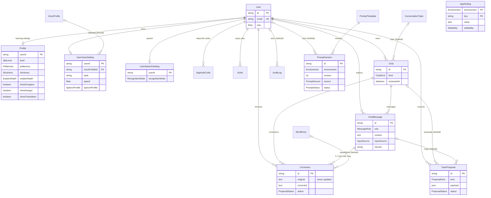
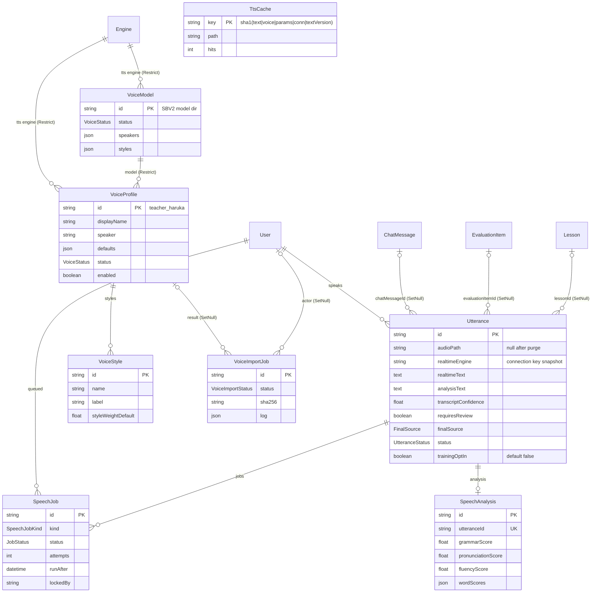
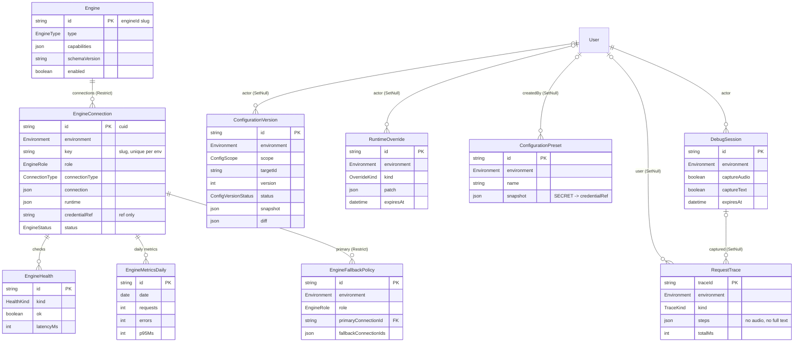

# TheKaiwa — 도메인 모델·DB 스키마 정본 (domain-model.md)

> 작성일 2026-09-26 · 상태: **설계 확정 대기** · 소유: leader(설계) / developer(task-002 에서 `prisma/schema.prisma` 로 실물화)

## 0. 문서 목적·정본 관계

- 이 문서는 TheKaiwa 의 **DB 엔티티 정본**이다. 엔티티명·필드명·enum 값·관계·삭제 정책은 여기서만 정의하고, 다른 문서는 인용한다.
  - `docs/design/api-contract.md` — 요청/응답 JSON 은 이 문서의 모델·enum 이름을 그대로 쓴다.
  - `docs/design/module-dependency.md` — 층별 소유 표(§1)를 "어느 모듈이 어느 테이블을 쓰는가"의 근거로 인용한다.
  - `docs/design/configuration-resolution.md` · `docs/design/role-permission.md` — 설정 엔티티(§3 L5/L0)와 `Role`/`AuditLog` 를 인용한다.
  - `docs/design/speech-platform/*` · `docs/design/admin-console/*` — Prisma 발췌는 이 문서의 블록에서 복사하고 재정의하지 않는다.
- 원문 근거: `docs/기획서-원본.md`(데이터 모델·삭제 정책), `docs/음성처리-기획안-원본.md` §8·§15·§17, `docs/음성처리-추가기획안-원본.md` §30~§37·§48~§61·§70~§74, `docs/관리자콘솔-기획안-원본.md` §79·§84·§87·§93~§96·§102~§107·§110·§113·§118~§120.
- 실물 `prisma/schema.prisma` 는 task-002 에서 §3 블록을 **그대로** 옮긴다. 차이가 생기면 이 문서를 먼저 고친다.

## 1. 층별 소유 표

6층 플랫폼(추가 기획안 §76) + app 층 조합 모듈(admin). **각 층은 `src/modules/infra/db` 를 통해서만 Prisma 에 접근하고, 자기 층이 소유한 테이블만 쓴다(INSERT/UPDATE/DELETE).** 다른 층의 테이블은 그 층의 `index.ts` 공개 함수로만 읽고 쓴다. 층 간 참조는 FK `SetNull` + `*Snap`/`refId` 로 느슨하게 연결한다.

| 층 | 소유 모듈 | 소유 테이블 | 비고 |
|---|---|---|---|
| L0 admin (app 층 조합) | `src/modules/admin` | `ConfigurationPreset` · `DebugSession` | 모든 층 import 가능. 설정 변경 자체는 L5 `engine/configuration` 을 호출해 기록 |
| L1 preferences | `src/modules/preferences` | `Profile` · `UserVoiceSetting` · `UserSpeechSetting` · `AppSetting` | `Profile` 은 **학습 설정만**. 음성 설정은 `UserVoiceSetting`/`UserSpeechSetting` |
| L2 conversation | `src/modules/conversation` | `Chat` · `ChatMessage` · `Correction` · `TutorProposal` · `PromptTemplate` · `PromptVersion` | AI 산출은 `PROPOSED` 상태로만 존재 |
| L3 learning | `src/modules/learning` | `WordEntry` · `VocabSession` · `VocabAttempt` · `ConversationTopic` · `TopicChunk` · `Scenario` · `ScenarioTopic` · `Lesson` · `ReviewSchedule` · `RepetitionItem` · `StudyLog` · `Attendance` · `Evaluation` · `EvaluationItem` · `StudyPlan` · `StatsSnapshot` · `LearnerErrorStat` · `LearningObservation` | 집계는 `StatsSnapshot` 에서만 읽는다. `Scenario`·`ScenarioTopic`·`LearningObservation` 은 2026-10-01 §9 에서 승격 |
| L4 speech | `src/modules/speech` (+ Python `speech/gateway`·`speech/worker` 는 `/api/internal/*` 콜백으로 같은 테이블에 기록) | `Utterance` · `SpeechAnalysis` · `SpeechJob` · `TtsCache` · `VoiceProfile` · `VoiceModel` · `VoiceStyle` · `VoiceImportJob` | 오디오 파일은 `DATA_ROOT`, DB 는 경로만 |
| L5 engine | `src/modules/engine` | `Engine` · `EngineConnection` · `EngineHealth` · `EngineFallbackPolicy` · `ConfigurationVersion` · `RuntimeOverride` · `RequestTrace` · `EngineMetricsDaily` | 설정 계열은 전부 `environment` 컬럼, 프로세스는 `APP_ENV` 행만 읽는다 |
| L6 infra | `src/modules/infra` | `User` · `AppAuthCode` · `AiJob` · `AppRelease` · `AuditLog` | `AuditLog` 는 append-only |

규칙(스키마에 주석으로도 반영):

1. **AI 제안 → 사용자 채택 후 저장** — `Correction.status`·`TutorProposal.status`·`StudyPlan.status` 의 `PROPOSED` 로만 존재. 채택 전에는 `WordEntry`·`StudyLog(origin=ACCEPTED)`·`Profile`·`ReviewSchedule` 등 어디에도 행이 생기지 않는다. 사용자가 **직접 수행**한 결과(세트 완료·평가 제출·레슨 완료)는 `StudyLog(origin=DIRECT)` 로 즉시 기록.
2. **삭제 정책** — `StatsSnapshot` 은 생성·증가만(삭제 경로에서 절대 쓰지 않음). 이력 행은 `*Snap` 컬럼으로 텍스트를 들고 있어 원본 `SetNull` 후에도 읽힌다.
3. **원문 보존** — `Correction.original` 은 어떤 경로로도 UPDATE 하지 않는다.
4. **환경 분리** — 설정 엔티티는 `environment Environment` 를 갖고, 프로세스는 자기 `APP_ENV` 행만 읽는다(같은 MariaDB 공존).
5. **시크릿 미저장** — DB·앱·Export·Trace 어디에도 값이 없다. `EngineConnection.credentialRef`(`env:NAME` | `file:<name>`)만 저장하고 서버 `SecretResolver` 가 해석.
6. **`Profile` 범위** — `level, politeness, goal*, dailyWordCount, dailyMinutes, strictness, correctionMode, explainLang, explainDepth`(+표시명·`teacherName`) + 일본어 표시 스위치 `showFurigana·showHangul·showTranslation`만. 음성은 `UserVoiceSetting`/`UserSpeechSetting`. `correctionMode` 는 결정 D6(2026-09-28, learning-personalization §8)으로 추가 — `strictness`(무엇을 오류로 볼지)와 독립인 빈도·표시 축(§2-8). 표시 스위치 3칸은 task-026(2026-10-04 사용자 승인 "백업 후 추가", 추가형·기본값 있음)으로 추가 — 앱 전체 하나(화면별 값 없음), 기본 후리가나·한글 켬·번역 끔. 옛 `localStorage kaiwa.chat.readingDefault` 는 화면이 첫 로드 때 1회 PUT 으로 옮긴다.
7. **`RequestTrace` 최소 수집** — 단계명·엔진/connection·모델·지연·상태·오류코드·크기만. 원음·전체 대화 텍스트 없음(§113). 필요 시 `DebugSession` 범위에서만.
8. 문자열 폭은 앱 검증 상한보다 넓게(TheMeal 실측: 좁으면 400 이 아니라 500). 일본어 본문은 `@db.Text`.

## 2. 엔티티 관계도

### 2-1. L6 infra · L1 preferences · L2 conversation



### 2-2. L3 learning

```mermaid
erDiagram
  User ||--o{ WordEntry : "owns"
  User ||--o{ VocabSession : "plays"
  User o|--o{ ConversationTopic : "user topics (null = seed)"
  User ||--o{ Lesson : "takes"
  User ||--o{ ReviewSchedule : "due"
  User ||--o{ StudyLog : "history"
  User ||--o{ Attendance : "check-in"
  User ||--o{ Evaluation : "evaluated"
  User ||--o{ StudyPlan : "plans"
  User ||--o{ StatsSnapshot : "aggregates (append-only)"
  User ||--o{ LearnerErrorStat : "error patterns"
  VocabSession ||--o{ VocabAttempt : "cards"
  WordEntry o|--o{ VocabAttempt : "word (SetNull, *Snap kept)"
  WordEntry o|--o{ EvaluationItem : "word (SetNull)"
  ConversationTopic ||--o{ TopicChunk : "chunks"
  ConversationTopic o|--o{ Lesson : "topic (SetNull)"
  ConversationTopic o|--o{ Evaluation : "topic (SetNull)"
  Lesson o|--o| ReviewSchedule : "review lesson (SetNull)"
  Evaluation ||--o{ EvaluationItem : "items"
  StudyLog o|--o| Evaluation : "studyLogId (SetNull, same txn on DONE)"
  User o|--o{ Scenario : "user scenarios (null = seed)"
  Scenario ||--o{ ScenarioTopic : "topics"
  ConversationTopic ||--o{ ScenarioTopic : "scenarios"
  Scenario o|--o{ Lesson : "scenario lesson (SetNull)"
  Scenario o|--o{ Chat : "role-play (SetNull)"
  Lesson o|--o{ Chat : "speaking-stage role-play (SetNull)"
  User ||--o{ RepetitionItem : "repetition"
  User ||--o{ LearningObservation : "append-only observations"

  WordEntry {
    string id PK
    string surface
    string meaning
    ChunkType chunkType
    WordSource source
    boolean archived
  }
  VocabSession {
    string id PK
    date date
    VocabMode mode
    VocabSessionStatus status
    datetime keptAt
  }
  VocabAttempt {
    string id PK
    string surfaceSnap
    string meaningSnap
    VocabAnswer answer
  }
  Lesson {
    string id PK
    LessonKind kind
    LessonStatus status
    json content
  }
  ReviewSchedule {
    string id PK
    date dueDate
    ReviewStatus status
  }
  StudyLog {
    string id PK
    StudyType type
    LogOrigin origin
    string refId "no FK"
  }
  Evaluation {
    string id PK
    EvalKind kind
    EvalStatus status
    int totalScore
  }
  StudyPlan {
    string id PK
    PlanStatus status
    json curriculum
  }
  StatsSnapshot {
    string id PK
    SnapshotKind kind
    string periodKey
    json data
  }
  LearnerErrorStat {
    string id PK
    ErrorType type
    string pattern
    int count "increase-only"
  }
  Scenario {
    string id PK
    JlptLevel level
    int difficulty
    json goal
    json keyExpressions
    boolean isSeed
  }
  LearningObservation {
    string id PK
    ObservationKind kind
    ObservationOutcome outcome
    SkillAxis skill
    string refId "no FK"
  }
```



### 2-3. L4 speech



### 2-4. L5 engine · L0 admin



## 3. Prisma 스키마 정본

```prisma
// TheKaiwa — DB 스키마 정본. 원본은 docs/design/domain-model.md §3 이며 실물 prisma/schema.prisma 는 이 블록을 그대로 옮긴다.
// 규칙: (1) AI 제안은 PROPOSED 로만 존재, 채택 시 저장 (2) StatsSnapshot 은 생성·증가만, *Snap 컬럼으로 이력 보존
//       (3) Correction.original 은 절대 UPDATE 금지 (4) 설정 엔티티는 environment 컬럼, 프로세스는 APP_ENV 행만 읽음
//       (5) 시크릿은 credentialRef 만 (6) Profile 은 학습 설정만 (7) RequestTrace 에 원음·전체 대화 텍스트 없음
// 2026-10-01 승격(사용자 "db추가 승인", 추가만): §9 Scenario·ScenarioTopic·LearningObservation(+enum 3종) · Profile.correctionMode · Lesson/Chat.scenarioId·Chat.lessonId · EvaluationItem.textRevealedAt
generator client {
  provider = "prisma-client-js"
}

datasource db {
  provider = "mysql"
  url      = env("DATABASE_URL")
}

// ═══════════════════════════════ Enums ═══════════════════════════════

/// 권한 검사는 role 이 아니라 capability 매트릭스(role-permission.md)로 한다. 누적 구조(SUPER_ADMIN ⊇ DEVELOPER ⊇ ADMIN ⊇ USER).
enum Role {
  USER
  ADMIN
  DEVELOPER
  SUPER_ADMIN
}

/// 설정 엔티티의 환경. 현 워크스페이스는 LOCAL(미러 dev)·PRODUCTION(pm2 blue/green)만 사용, 나머지는 슬롯.
enum Environment {
  LOCAL
  DEVELOPMENT
  STAGING
  PRODUCTION
}

enum JlptLevel {
  N5
  N4
  N3
  N2
  N1
}

/// 조각: 이름·액션·느낌·꾸밈 (레퍼런스1)
enum ChunkType {
  NAME
  ACTION
  FEELING
  MODIFIER
}

enum PartOfSpeech {
  NOUN
  VERB
  ADJ_I
  ADJ_NA
  ADVERB
  PARTICLE
  EXPRESSION
  OTHER
}

enum WordSource {
  MANUAL
  CORRECTION
  LESSON
  EVALUATION
  TUTOR
  SEED
}

/// AI 제안의 수명. PROPOSED 인 동안 다른 테이블에 행이 생기지 않는다.
enum ProposalStatus {
  PROPOSED
  ACCEPTED
  REJECTED
  EXPIRED
}

enum ProposalKind {
  ADD_WORD
  ADD_STUDY_LOG
  ADD_TOPIC
  SET_LEVEL
  SCHEDULE_REVIEW
}

enum ChatKind {
  TALK
  CHAT
  ASK
}

enum MessageRole {
  USER
  ASSISTANT
}

enum MessageStatus {
  PENDING
  DONE
  FAILED
}

/// REALTIME_STT = 온디바이스/gateway ReazonSpeech · SERVER_STT = 업로드 클립 whisper 전사(폴백) · TEXT = 타이핑
enum InputSource {
  REALTIME_STT
  SERVER_STT
  TEXT
}

/// PRONUNCIATION 은 LearnerErrorStat(SpeechAnalysis 유래)에서만 쓰고 Correction 에는 쓰지 않는다(발음 미채점 원칙).
enum ErrorType {
  GRAMMAR
  PARTICLE
  CONJUGATION
  VOCABULARY
  POLITENESS
  NATURALNESS
  WORD_ORDER
  PRONUNCIATION
  OTHER
}

enum Severity {
  MINOR
  MAJOR
}

enum StudyType {
  TALK
  CHAT
  WORDS
  LESSON
  REVIEW
  EVALUATION
  ASK
}

/// DIRECT = 사용자가 직접 수행(세트 완료·평가 제출·레슨 완료) 즉시 기록 · ACCEPTED = AI 제안(ADD_STUDY_LOG) 채택으로 생성
enum LogOrigin {
  DIRECT
  ACCEPTED
}

enum LessonKind {
  NEW
  REVIEW
}

enum LessonStatus {
  GENERATING
  READY
  IN_PROGRESS
  DONE
  FAILED
}

enum ReviewStatus {
  DUE
  DONE
  SKIPPED
  EXPIRED
}

/// 복습 판단 주체(R-1, 2026-09-26): TUTOR = A11 강사 판단 · FALLBACK = LLM 실패 시 코드 기본값(3일)
enum DecidedBy {
  TUTOR
  FALLBACK
}

/// 반복 학습 단위 종류
enum RepetitionItemType {
  EXPRESSION
  CHUNK
  GRAMMAR
  SCENARIO
  WORD
  LESSON
}

/// FOCUS = 많이 틀리거나 강사 피드백이 많은 항목(별도 기록, 간격 ≤3일)
enum RepetitionPriority {
  NORMAL
  FOCUS
}

/// 학습 관측 종류(learning-personalization §2-2). CORRECTION_REUSED = 채택 교정 표현 재사용 · EXPRESSION_REUSE = 레슨 표현 재사용
enum ObservationKind {
  VOCAB_RECOGNITION
  VOCAB_PRODUCTION
  GRAMMAR_USE
  LISTEN_RESPOND
  SENTENCE_PRODUCTION
  CONVERSATION_MAINTAIN
  SELF_CORRECTION
  CORRECTION_PROPOSED
  CORRECTION_ACCEPTED
  CORRECTION_IGNORED
  CORRECTION_REUSED
  EXPRESSION_REUSE
  SCENARIO_COMPLETED
}

/// 실패 = FAIL 또는 goalAchieved=false. ASR 저신뢰(requiresReview)는 실패로 세지 않는다
enum ObservationOutcome {
  SUCCESS
  PARTIAL
  FAIL
  SKIPPED
}

/// 능력 축 5개(learning-personalization §2-3). kind→skill 매핑은 코드 상수
enum SkillAxis {
  VOCAB_RECALL
  GRAMMAR_PARTICLE
  LISTEN_RESPOND
  SENTENCE_PRODUCTION
  CONVERSATION_MAINTAIN
}

enum EvalKind {
  WORDS
  TALK
}

enum EvalStatus {
  GENERATING
  READY
  IN_PROGRESS
  GRADING
  DONE
  FAILED
}

enum EvalItemKind {
  MEANING_CHOICE
  READING_INPUT
  USAGE_CHOICE
  CHUNK_CLASSIFY
  LISTEN_RESPOND
  ASSEMBLE
  SITUATION_RESPOND
  CORRECTION_SPOT
}

enum VocabMode {
  CHOICE
  FLIP
}

enum VocabAnswer {
  CORRECT
  WRONG
  SKIPPED
}

enum VocabSessionStatus {
  IN_PROGRESS
  DONE
  ABANDONED
}

enum PlanStatus {
  PROPOSED
  ACCEPTED
  REJECTED
  ARCHIVED
}

enum SnapshotKind {
  DAILY
  VOCAB_SESSION
  EVALUATION
  LESSON
}

/// AiJob(LLM 비동기 작업) 종류
enum JobKind {
  CHAT_REVIEW
  LESSON_GEN
  REVIEW_GEN
  EVAL_GEN
  EVAL_GRADE
  PLAN_ANALYSIS
  REVIEW_DECISION
}

/// AiJob·SpeechJob 공용
enum JobStatus {
  QUEUED
  RUNNING
  DONE
  FAILED
}

enum Strictness {
  GENTLE
  NORMAL
  STRICT
}

/// 회화 교정 방식(learning-personalization §2-7, 결정 D6 2026-09-28). FLUENCY = 흐름 우선, MAJOR 만 즉시·나머지 모아 두기 · COACH = 턴마다 힌트 먼저. strictness(무엇을 오류로 볼지)와 독립
enum CorrectionMode {
  FLUENCY
  COACH
}

enum Politeness {
  POLITE
  CASUAL
}

enum ExplainDepth {
  BRIEF
  NORMAL
  DETAILED
}

/// 학습용 TTS 모드(음성 기획안 §11). LEARNING 은 speed 0.6/0.8/1.0 비교 듣기
/// 교육용 Speech Profile(5차 TTS 보완 §138, 정본 speech-platform/16 §5). 종전 TtsMode{NATIVE,LEARNING} 교체. NATIVE=사용자 speed 그대로(기본, TALK/CHAT) · LEARNING_NORMAL=학습 표준 1.0 프리셋(레슨 낭독) · LEARNING_SLOW=learningSpeed(0.6·0.8), 모라 타이밍·악센트 유지 · PRONUNCIATION=0.8, 명확 발화, 、에서도 분할 · SHADOWING=0.9, 청크 뒤 gap=직전 청크 길이. 프로필은 정책(속도 배율·분할·간격)이고 수치는 User/VoiceProfile 층이 준다
enum SpeechProfile {
  NATIVE
  LEARNING_NORMAL
  LEARNING_SLOW
  PRONUNCIATION
  SHADOWING
}

/// 사용자 음성 인식 모드(추가 기획안 §26). Speech Mode Resolver 가 엔진 역할 조합으로 해석
enum RecognitionMode {
  AUTO
  FAST
  ACCURATE
  OFFLINE
}

enum UtteranceStatus {
  RECORDED
  QUEUED
  ANALYZED
  FAILED
}

/// Utterance.finalText 의 출처. USER = requiresReview 카드에서 학습자가 고른 안(제안→채택)
enum FinalSource {
  REALTIME
  ANALYSIS
  USER
}

enum SpeechJobKind {
  ANALYSIS_STT
  PRONUNCIATION
}

/// VoiceProfile·VoiceModel 공용 수명주기(추가 기획안 §37). 선택 가능 = AVAILABLE && enabled
enum VoiceStatus {
  IMPORTING
  VALIDATING
  AVAILABLE
  DISABLED
  ERROR
  DELETING
  ARCHIVED
}

enum VoiceImportStatus {
  UPLOADED
  VALIDATING
  IMPORTING
  TESTING
  REGISTERED
  FAILED
}

enum EngineType {
  STT
  TTS
  LLM
}

/// Router·FallbackPolicy 의 역할 키
enum EngineRole {
  REALTIME_STT
  ANALYSIS_STT
  TTS
  LLM
}

enum ConnectionType {
  LOCAL
  HTTP
  ONDEVICE
  CLI
}

/// Router 는 UNAVAILABLE·MISCONFIGURED·DISABLED 를 선택하지 않는다(§60)
enum EngineStatus {
  UNKNOWN
  HEALTHY
  DEGRADED
  UNAVAILABLE
  MISCONFIGURED
  DISABLED
}

enum HealthKind {
  HEALTH
  FUNCTIONAL
}

/// ConfigurationVersion·RuntimeOverride·AuditLog 의 대상 범위
enum ConfigScope {
  ENGINE_CONNECTION
  FALLBACK_POLICY
  PROMPT
  APP_SETTING
  VOICE_PROFILE
  PRESET
  /// 발음 사전(task-018 ②) — **AuditLog 전용**. 사전은 자체 버전 테이블(PronunciationLexiconVersion)이 정본이라 ConfigurationVersion·RuntimeOverride 는 이 값을 쓰지 않는다
  LEXICON
}

enum ConfigVersionStatus {
  ACTIVE
  SUPERSEDED
  ROLLED_BACK
}

/// 키별 편집 가능성(§87). ConfigurationSchema(코드)의 속성이며 DB 에서는 AppSetting.editability 컬럼과 Json 페이로드에서 쓴다.
enum Editability {
  READ_ONLY
  RUNTIME_EDITABLE
  RESTART_REQUIRED
  REDEPLOY_REQUIRED
  SECRET
}

/// Effective Configuration 의 값 출처(§83). 8층 우선순위(configuration-resolution.md). 컬럼이 아니라 Resolver 응답·ConfigurationVersion.diff 페이로드에서 쓴다.
enum ConfigSource {
  DEFAULT
  SOURCE_CODE
  APPLICATION_CONFIG
  ENVIRONMENT
  DATABASE
  CONNECTION_PROFILE
  USER_SETTING
  RUNTIME_OVERRIDE
}

enum OverrideKind {
  TEMPORARY
  SESSION
}

enum TraceKind {
  TURN
  PREVIEW
  PLAYGROUND
  E2E
  FUNCTIONAL_TEST
}

enum TraceStatus {
  OK
  ERROR
  PARTIAL
}

/// SOURCE_CODE = 파일(v0, prompts:sync 로 등록) · CONSOLE = Console 편집
enum PromptSource {
  SOURCE_CODE
  CONSOLE
}

enum PromptStatus {
  DRAFT
  ACTIVE
  ARCHIVED
}

// ═══════════════════════════════ L6 infra ═══════════════════════════════

/// OAuth 계정. OWNER_EMAIL 시드 계정은 SUPER_ADMIN. 권한은 role → capability 매트릭스로 환산(role-permission.md)
model User {
  id        String   @id @default(cuid())
  email     String   @unique
  name      String?
  provider  String
  oauthId   String
  role      Role     @default(USER)
  createdAt DateTime @default(now())

  profile          Profile?
  voiceSetting     UserVoiceSetting?
  speechSetting    UserSpeechSetting?
  appAuthCodes     AppAuthCode[]
  aiJobs           AiJob[]
  chats            Chat[]
  messages         ChatMessage[]
  corrections      Correction[]
  proposals        TutorProposal[]
  promptVersions   PromptVersion[]
  words            WordEntry[]
  vocabSessions    VocabSession[]
  topics           ConversationTopic[]
  scenarios        Scenario[]
  lessons          Lesson[]
  reviewSchedules  ReviewSchedule[]
  repetitionItems  RepetitionItem[]
  observations     LearningObservation[]
  studyLogs        StudyLog[]
  attendances      Attendance[]
  evaluations      Evaluation[]
  studyPlans       StudyPlan[]
  snapshots        StatsSnapshot[]
  errorStats       LearnerErrorStat[]
  utterances       Utterance[]
  speechJobs       SpeechJob[]
  voiceImportJobs  VoiceImportJob[]
  traces           RequestTrace[]
  configVersions   ConfigurationVersion[]
  overrides        RuntimeOverride[]
  presets          ConfigurationPreset[]
  debugSessions    DebugSession[]
  auditLogs        AuditLog[]

  @@unique([provider, oauthId])
}

/// 앱(Capacitor) 딥링크 코드 교환용 1회용 코드(TheMeal §5-2 그대로). 60초 TTL, 사용 즉시 소각
model AppAuthCode {
  code      String    @id
  userId    String
  expiresAt DateTime
  usedAt    DateTime?
  createdAt DateTime  @default(now())

  user User @relation(fields: [userId], references: [id], onDelete: Cascade)

  @@index([expiresAt])
}

/// 30초 넘는 LLM 작업의 폴링 잡. 기동 시 RUNNING(10분 초과) → FAILED 정리. refId 는 대상 행(Chat·Lesson·Evaluation·StudyPlan) id, FK 없음
model AiJob {
  id         String    @id @default(cuid())
  userId     String
  kind       JobKind
  status     JobStatus @default(QUEUED)
  refId      String?   @db.VarChar(40)
  progress   Int       @default(0)
  stage      String?   @db.VarChar(40)
  attempts   Int       @default(0)
  error      String?   @db.VarChar(500)
  /// enqueue 시점 입력 스냅샷 — {promptKey, promptVersion, inputMeta(ids·길이·해시)} 만. 프롬프트·대화 본문은 넣지 않는다(정합성 수정 #1, 2026-09-26)
  payload    Json?
  /// RequestTrace.traceId (FK 없음)
  traceId    String?   @db.VarChar(40)
  createdAt  DateTime  @default(now())
  startedAt  DateTime?
  finishedAt DateTime?

  user User @relation(fields: [userId], references: [id], onDelete: Cascade)

  @@index([userId, status])
  @@index([kind, status, createdAt])
}

/// APK 배포본 목록. GET /api/app/version 이 최신·minSupported 를 읽는다. deployer 가 네이티브 변경 배포 시 INSERT
model AppRelease {
  versionCode  Int      @id
  versionName  String   @db.VarChar(20)
  apkPath      String   @db.VarChar(300)
  sha256       String   @db.VarChar(64)
  notes        String?  @db.VarChar(1000)
  /// 이 값보다 낮은 versionCode 의 앱은 강제 업데이트 배너
  minSupported Int
  createdAt    DateTime @default(now())
}

/// 모든 관리자 행위의 감사 로그(§93·§125-10). append-only, 삭제 경로 없음. before/after 는 SECRET 키를 credentialRef 로 치환한 값
model AuditLog {
  id             String       @id @default(cuid())
  environment    Environment
  actorUserId    String?
  /// 계정 삭제(SetNull) 후에도 누가 했는지 읽히도록 스냅샷
  actorEmailSnap String?      @db.VarChar(120)
  actorRoleSnap  Role?
  /// capability 이름과 같은 규약: config.apply · voices.disable · override.create · prompts.activate …
  action         String       @db.VarChar(80)
  scope          ConfigScope?
  targetId       String?      @db.VarChar(120)
  before         Json?
  after          Json?
  reason         String?      @db.VarChar(500)
  ip             String?      @db.VarChar(64)
  traceId        String?      @db.VarChar(40)
  createdAt      DateTime     @default(now())

  actor User? @relation(fields: [actorUserId], references: [id], onDelete: SetNull)

  @@index([environment, createdAt])
  @@index([actorUserId, createdAt])
  @@index([scope, targetId, createdAt])
  @@index([action, createdAt])
}

// ═══════════════════════════════ L1 preferences ═══════════════════════════════

/// 학습 설정만(규칙 6). 화면 폼 1:1 이라 컬럼으로. 음성·엔진 항목은 절대 넣지 않는다 → UserVoiceSetting / UserSpeechSetting
model Profile {
  userId         String         @id
  displayName    String?        @db.VarChar(40)
  level          JlptLevel      @default(N5)
  politeness     Politeness     @default(POLITE)
  goalLevel      JlptLevel?
  goalTopics     Json?
  goalDeadline   DateTime?      @db.Date
  dailyWordCount Int            @default(10)
  dailyMinutes   Int            @default(15)
  /// 선생님 이름(사용자 지정, 2026-09-26 결정). null 이면 화면·프롬프트 헤더에서 '선생님'
  teacherName    String?        @db.VarChar(30)
  /// 교정 범위 — 무엇을 오류로 볼지(tutor.md §3-3 의 3단계, 빈도·표시는 correctionMode). 기본 STRICT = 사용자 확정 "교정에 철저"(2026-09-26)
  strictness     Strictness     @default(STRICT)
  /// 교정 빈도·표시 방식(TALK). 기본 FLUENCY(D6). 역할극은 이 값과 무관하게 COACH(task-010d)
  correctionMode CorrectionMode @default(FLUENCY)
  explainLang    String         @default("ko") @db.VarChar(5)
  explainDepth   ExplainDepth   @default(NORMAL)
  /// 일본어 표시 스위치(task-026, 앱 전체 하나 — 회화·채팅·오늘의 회화·단어장 공통). 후리가나(한자 위 읽기)·한글 발음 줄 기본 켬, 번역 기본 끔
  showFurigana    Boolean       @default(true)
  showHangul      Boolean       @default(true)
  showTranslation Boolean       @default(false)
  updatedAt      DateTime       @updatedAt

  user User @relation(fields: [userId], references: [id], onDelete: Cascade)
}

/// AI 선생님 목소리 설정(§39·§72). voiceProfileId null = AppSetting voice.default.profileId 로 해석. style "AUTO" = VoiceProfile.defaults.style
model UserVoiceSetting {
  userId         String   @id
  voiceProfileId String?  @db.VarChar(80)
  style          String   @default("AUTO") @db.VarChar(40)
  /// null(= voice 기본) 또는 0~4. 범위 정본 preferences VOICE_PARAM_RANGES(task-022 확대 2026-09-30, 옛 0~2·0.6~1.2·0.8~1.2 값은 그대로 유효)
  styleWeight    Float?
  /// 0.5~1.5 (앱 검증). TTS Parameter Resolver 1순위
  speed          Float    @default(1.0)
  /// 0.7~1.4
  pitch          Float    @default(1.0)
  /// 0.6~1.4
  intonation     Float    @default(1.0)
  speechProfile  SpeechProfile @default(NATIVE)   // 종전 ttsMode(5차 보완 §138). 설정 화면 선택지는 NATIVE·LEARNING_NORMAL·LEARNING_SLOW, PRONUNCIATION·SHADOWING 은 화면이 요청 단위로 지정
  /// LEARNING 모드 기본 배속(0.6|0.8|1.0)
  learningSpeed  Float    @default(0.8)
  updatedAt      DateTime @updatedAt

  user         User          @relation(fields: [userId], references: [id], onDelete: Cascade)
  voiceProfile VoiceProfile? @relation(fields: [voiceProfileId], references: [id], onDelete: SetNull)

  @@index([voiceProfileId])
}

/// 음성 인식 모드(§26). explainLang 은 Profile 소유(규칙 6)라 여기 두지 않는다
model UserSpeechSetting {
  userId          String          @id
  recognitionMode RecognitionMode @default(AUTO)
  /// 모델 미설치·저사양 기기에서 gateway 로 넘어간 횟수 등 라우터 힌트(엔진명 없음)
  routerHints     Json?
  updatedAt       DateTime        @updatedAt

  user User @relation(fields: [userId], references: [id], onDelete: Cascade)
}

/// 운영 설정 키-값(§43·§106). 환경별. 예: voice.preview.defaultText · voice.preview.textVersion · override.production.enabled · voice.default.profileId
model AppSetting {
  environment Environment
  key         String      @db.VarChar(120)
  value       Json
  description String?     @db.VarChar(300)
  editability Editability @default(RUNTIME_EDITABLE)
  updatedAt   DateTime    @updatedAt

  @@id([environment, key])
}

// ═══════════════════════════════ L2 conversation ═══════════════════════════════

/// 회화(TALK)·채팅(CHAT)·질문(ASK) 공용
model Chat {
  id            String    @id @default(cuid())
  userId        String
  kind          ChatKind
  title         String    @db.VarChar(100)
  topicId       String?
  /// 상황 역할극 세션(task-010d, learning-personalization §1-2)
  scenarioId    String?
  /// 레슨 "말하기" 단계에서 이어진 역할극(정합성 #11 — getLessonContext 근거)
  lessonId      String?
  level         JlptLevel?
  lastMessageAt DateTime?
  preview       String?   @db.VarChar(120)
  messageCount  Int       @default(0)
  /// 표현 점검(A3)은 채팅당 1회
  reviewedAt    DateTime?
  createdAt     DateTime  @default(now())
  updatedAt     DateTime  @updatedAt

  user     User               @relation(fields: [userId], references: [id], onDelete: Cascade)
  topic    ConversationTopic? @relation(fields: [topicId], references: [id], onDelete: SetNull)
  scenario Scenario?          @relation(fields: [scenarioId], references: [id], onDelete: SetNull)
  lesson   Lesson?            @relation(fields: [lessonId], references: [id], onDelete: SetNull)

  messages    ChatMessage[]
  corrections Correction[]
  proposals   TutorProposal[]
  utterances  Utterance[]

  @@index([userId, kind, lastMessageAt])
}

/// 사용자: STT 원문/타이핑 · 강사: 일본어 응답. toolLog 는 {traceId, model, connection(=EngineConnection.key), llmMs, promptChars, attempt, totalMs, sttMs(클라 보고), llmFirstSentenceMs, warm(HIT|MISS|FALLBACK|OFF), sceneCap(TALK만 1~4, 답변 문장 수 상한), sceneCapReason(TALK만, 판정 신호 코드), ttsStartMs, ttfaMs, audioCount, meta{learning, style, endOfTopic, warning}} 요약만 — 원문·응답 전문 없음(task-006 → task-007 구현 기준 2026-09-28. TTS 값은 합성이 저장과 병렬이라 모든 청크가 끝난 뒤 같은 객체로 한 번 더 쓴다).
/// task-010c(교정 방식, 2026-10-01): **교정이 달린 USER 메시지**의 toolLog 에는 `correction{id(Correction.id), mode(COACH|FLUENCY), deliver(NOW|LATER), hintKo(코치 힌트 한 줄|null), selfCheck(SELF|REPEAT|MISSED|null)}` 가 같은 저장 트랜잭션으로 함께 남는다(새로고침·시트·칩 수가 같은 값을 보게 하는 표시 메타 — 교정 행 자체는 모드와 무관하게 PROPOSED). `toolLog` 는 채팅 응답·Trace·Export 로 그대로 내보내지 않고(교정 목록 응답에 `deliver·hintKo·selfCheck` 필드로만 풀어 낸다) 발화 원문·교정 문장은 담지 않는다
model ChatMessage {
  id          String        @id @default(cuid())
  chatId      String
  userId      String
  role        MessageRole
  content     String        @db.Text
  translation String?       @db.Text
  reading     String?       @db.Text
  inputSource InputSource?
  status      MessageStatus @default(DONE)
  toolLog     Json?
  /// RequestTrace.traceId (FK 없음, L5 소유)
  traceId     String?       @db.VarChar(40)
  createdAt   DateTime      @default(now())

  chat Chat @relation(fields: [chatId], references: [id], onDelete: Cascade)
  user User @relation(fields: [userId], references: [id], onDelete: Cascade)

  corrections Correction[]
  proposals   TutorProposal[]
  /// 이 메시지로 보낸 발화(0~1 — Utterance.chatMessageId @unique, task-018 ①)
  utterance   Utterance?

  @@index([chatId, id])
  @@index([userId, createdAt])
  @@index([traceId])
}

/// 사용자 메시지 1건에 0~2건. **original 은 어떤 경로로도 UPDATE 하지 않는다(규칙 3).** PROPOSED 인 동안 WordEntry·StudyLog 에 행 없음(규칙 1)
model Correction {
  id          String         @id @default(cuid())
  userId      String
  chatId      String
  messageId   String
  original    String         @db.Text
  corrected   String         @db.Text
  explanation String         @db.Text
  /// task-039(IMP-0025, 2026-10-06 사용자 승인 — 이 컬럼 1개) — JLPT·교과서식 추가 설명 한 줄(TALK `correction.extraNoteKo`·A3 `extra_note_ko` 를
  /// `sanitizeExtraNoteKo` 로 정리한 값, ≤200자·개행 없음). **생성 시에만** 쓰고 수정 경로 없음(갱신 타입 `CorrectionUpdate` 에서 제외). 옛 행·없음 = NULL.
  /// additive nullable — 백필·환경 분리 없음(설정 엔티티가 아니라 학습 데이터). 복습·관측 입력에는 쓰지 않는다(`explanation` 만)
  extraNoteKo String?        @db.VarChar(400)
  errorType   ErrorType
  severity    Severity       @default(MINOR)
  chunkType   ChunkType?
  status      ProposalStatus @default(PROPOSED)
  /// accept 시 addWord 옵션으로 만든 WordEntry(source=CORRECTION)
  savedWordId String?
  createdAt   DateTime       @default(now())
  resolvedAt  DateTime?

  user      User        @relation(fields: [userId], references: [id], onDelete: Cascade)
  chat      Chat        @relation(fields: [chatId], references: [id], onDelete: Cascade)
  message   ChatMessage @relation(fields: [messageId], references: [id], onDelete: Cascade)
  savedWord WordEntry?  @relation(fields: [savedWordId], references: [id], onDelete: SetNull)

  @@index([userId, status, createdAt])
  @@index([chatId])
  @@index([messageId])
}

/// 강사 제안 카드(bjj master_actions 방식). 승인 전엔 다른 테이블에 행이 생기지 않는다(규칙 1). result = 채택 시 생성된 행 id 들
model TutorProposal {
  id         String         @id @default(cuid())
  userId     String
  chatId     String?
  messageId  String?
  kind       ProposalKind
  payload    Json
  status     ProposalStatus @default(PROPOSED)
  result     Json?
  /// 미처리 제안은 30일 후 EXPIRED
  expiresAt  DateTime?
  createdAt  DateTime       @default(now())
  resolvedAt DateTime?

  user    User         @relation(fields: [userId], references: [id], onDelete: Cascade)
  chat    Chat?        @relation(fields: [chatId], references: [id], onDelete: SetNull)
  message ChatMessage? @relation(fields: [messageId], references: [id], onDelete: SetNull)

  @@index([userId, status, createdAt])
  @@index([chatId, status])
}

/// Prompt Registry 키(§118). 파일 정본 = src/modules/conversation/prompts/<key>.ts 또는 .claude/agents/tutor.md(key teacher-persona)
model PromptTemplate {
  key         String   @id @db.VarChar(80)
  description String?  @db.VarChar(300)
  /// 파일 소유 역할(prompt-engineer). 정보용
  ownerRole   String?  @db.VarChar(40)
  filePath    String?  @db.VarChar(200)
  createdAt   DateTime @default(now())
  updatedAt   DateTime @updatedAt

  versions PromptVersion[]
}

/// Prompt 버전(§119). (environment,key) 당 ACTIVE 는 1개 — 앱 트랜잭션으로 보장(MySQL 부분 유니크 없음). 런타임은 ACTIVE 가 있으면 DB, 없으면 파일 v0
model PromptVersion {
  id          String       @id @default(cuid())
  key         String       @db.VarChar(80)
  environment Environment
  version     Int
  body        String       @db.Text
  source      PromptSource
  status      PromptStatus @default(DRAFT)
  /// {tier, model, maxChars, jsonSchemaRef}
  modelHints  Json?
  checksum    String       @db.VarChar(64)
  note        String?      @db.VarChar(300)
  actorUserId String?
  createdAt   DateTime     @default(now())
  activatedAt DateTime?
  archivedAt  DateTime?

  template PromptTemplate @relation(fields: [key], references: [key], onDelete: Cascade)
  actor    User?          @relation(fields: [actorUserId], references: [id], onDelete: SetNull)

  @@unique([environment, key, version])
  @@index([environment, key, status])
}

// ═══════════════════════════════ L3 learning ═══════════════════════════════

/// 채택된 단어만. AI 제안 단어는 TutorProposal(ADD_WORD) 에 머문다(규칙 1). 삭제 시 참조 행은 SetNull + *Snap 으로 읽힘(규칙 2)
model WordEntry {
  id           String        @id @default(cuid())
  userId       String
  surface      String        @db.VarChar(80)
  reading      String?       @db.VarChar(120)
  meaning      String        @db.VarChar(200)
  partOfSpeech PartOfSpeech  @default(OTHER)
  chunkType    ChunkType?
  jlpt         JlptLevel?
  example      String?       @db.Text
  exampleKo    String?       @db.Text
  note         String?       @db.VarChar(500)
  category     String?       @db.VarChar(40)
  source       WordSource    @default(MANUAL)
  /// 출처 행 id(Correction·Lesson·Evaluation·TutorProposal), FK 없음
  sourceRefId  String?       @db.VarChar(40)
  correctCount Int           @default(0)
  wrongCount   Int           @default(0)
  lastSeenAt   DateTime?
  lastResult   VocabAnswer?
  archived     Boolean       @default(false)
  archivedAt   DateTime?
  createdAt    DateTime      @default(now())
  updatedAt    DateTime      @updatedAt

  user        User             @relation(fields: [userId], references: [id], onDelete: Cascade)
  attempts    VocabAttempt[]
  corrections Correction[]
  evalItems   EvaluationItem[]

  @@index([userId, archived, wrongCount])
  @@index([userId, surface])
  @@index([userId, category])
  @@index([userId, createdAt])
}

/// 오늘의 단어 1세트. 집계는 finish 시점 확정 후 불변. keptAt = 세트 보관(다시 풀기)
model VocabSession {
  id             String             @id @default(cuid())
  userId         String
  date           DateTime           @db.Date
  mode           VocabMode
  requestedCount Int
  cardCount      Int
  correctCount   Int                @default(0)
  wrongCount     Int                @default(0)
  skippedCount   Int                @default(0)
  status         VocabSessionStatus @default(IN_PROGRESS)
  keptAt         DateTime?
  replayOfId     String?
  /// 가중 샘플링 시드(재현용). 첫 글자 = 요청 모드(C|F) — 강등(`downgraded`) 재계산용, 나머지가 PRNG 시드(task-008 구현 2026-09-27)
  seed           String             @db.VarChar(32)
  startedAt      DateTime           @default(now())
  finishedAt     DateTime?
  durationSec    Int?

  user     User           @relation(fields: [userId], references: [id], onDelete: Cascade)
  attempts VocabAttempt[]

  @@index([userId, date])
  @@index([userId, keptAt])
}

/// 카드 1장. surfaceSnap/readingSnap/meaningSnap = 삭제 정책 스냅샷(규칙 2). choices 는 보기 스냅샷, 정답은 응답에 미포함
model VocabAttempt {
  id          String       @id @default(cuid())
  sessionId   String
  wordId      String?
  order       Int
  surfaceSnap String       @db.VarChar(80)
  readingSnap String?      @db.VarChar(120)
  meaningSnap String       @db.VarChar(200)
  choices     Json?
  answer      VocabAnswer?
  chosenText  String?      @db.VarChar(200)
  responseMs  Int?
  /// 위 스와이프 = 다시 보기 표시
  flagged     Boolean      @default(false)
  answeredAt  DateTime?

  session VocabSession @relation(fields: [sessionId], references: [id], onDelete: Cascade)
  word    WordEntry?   @relation(fields: [wordId], references: [id], onDelete: SetNull)

  @@unique([sessionId, order])
  @@index([wordId])
}

/// userId null = 시드 주제(공용, 삭제 불가). tags 는 콘텐츠 소스 확장 슬롯(기획서 "확장 여지")
model ConversationTopic {
  id          String    @id @default(cuid())
  userId      String?
  title       String    @db.VarChar(80)
  titleJa     String?   @db.VarChar(80)
  level       JlptLevel
  description String?   @db.VarChar(300)
  tags        Json?
  isSeed      Boolean   @default(false)
  createdAt   DateTime  @default(now())
  updatedAt   DateTime  @updatedAt

  user User? @relation(fields: [userId], references: [id], onDelete: Cascade)

  chunks      TopicChunk[]
  scenarios   ScenarioTopic[]
  lessons     Lesson[]
  chats       Chat[]
  evaluations Evaluation[]

  @@index([userId, level])
  @@index([isSeed, level])
}

/// 주제의 조각(이름·액션·느낌·꾸밈)
model TopicChunk {
  id        String    @id @default(cuid())
  topicId   String
  chunkType ChunkType
  textJa    String    @db.VarChar(120)
  reading   String?   @db.VarChar(160)
  meaningKo String    @db.VarChar(160)
  order     Int       @default(0)
  note      String?   @db.VarChar(200)

  topic ConversationTopic @relation(fields: [topicId], references: [id], onDelete: Cascade)

  @@index([topicId, chunkType, order])
}

/// 상황(scenario): 역할·목표가 있는 의사소통 과제. 주제(ConversationTopic)와 N:M. userId null = 시드(삭제 불가). task-010d
model Scenario {
  id             String    @id @default(cuid())
  userId         String?
  title          String    @db.VarChar(100)
  titleJa        String?   @db.VarChar(100)
  description    String?   @db.VarChar(300)
  level          JlptLevel
  /// 1~5, 과제 선택 사다리
  difficulty     Int       @default(2)
  /// {learner:"손님", tutor:"역무원"}
  roles          Json
  /// {communicativeGoal_ko, successCriteria:[...]}
  goal           Json
  /// {conditions:[...], branches:[{trigger, expectedResponse}]}
  constraints    Json?
  /// TopicChunk 참조 우선: [{chunkId}] 또는 자체 [{ja, reading, ko, chunkType}]
  keyExpressions Json
  grammarPoints  Json?
  /// {requiredExpressions:N, requiredBranches:[...], tutorJudgement:true}
  completionRule Json
  isSeed         Boolean   @default(false)
  /// ACTIVE|ARCHIVED
  status         String    @default("ACTIVE") @db.VarChar(20)
  createdAt      DateTime  @default(now())
  updatedAt      DateTime  @updatedAt

  user User? @relation(fields: [userId], references: [id], onDelete: Cascade)

  topics  ScenarioTopic[]
  lessons Lesson[]
  chats   Chat[]

  @@index([userId, level])
  @@index([isSeed, level, difficulty])
}

model ScenarioTopic {
  scenarioId String
  topicId    String
  weight     Int    @default(1)

  scenario Scenario          @relation(fields: [scenarioId], references: [id], onDelete: Cascade)
  topic    ConversationTopic @relation(fields: [topicId], references: [id], onDelete: Cascade)

  @@id([scenarioId, topicId])
}

/// 오늘의 회화 1:1 수업(이해→문법→문제→응용→말하기). content = A4 스키마 JSON. sourceText = 사용자가 붙여넣은 자막 문장(레퍼런스3)
model Lesson {
  id              String       @id @default(cuid())
  userId          String
  topicId         String?
  /// 상황 레슨(A4 입력에 [상황] 블록, task-010d)
  scenarioId      String?
  date            DateTime     @db.Date
  kind            LessonKind
  title           String       @db.VarChar(120)
  level           JlptLevel
  content         Json?
  status          LessonStatus @default(GENERATING)
  stageDone       Int          @default(0)
  progress        Json?
  score           Int?
  /// REVIEW 레슨의 재료 레슨 id 목록(코드가 만든 mixSpec 근거), FK 없음
  sourceLessonIds Json?
  sourceText      String?      @db.Text
  model           String?      @db.VarChar(20)
  /// PromptVersion.version 태그 스냅샷(FK 없음)
  promptVersion   String?      @db.VarChar(20)
  error           String?      @db.VarChar(300)
  createdAt       DateTime     @default(now())
  updatedAt       DateTime     @updatedAt
  completedAt     DateTime?

  user     User               @relation(fields: [userId], references: [id], onDelete: Cascade)
  topic    ConversationTopic? @relation(fields: [topicId], references: [id], onDelete: SetNull)
  scenario Scenario?          @relation(fields: [scenarioId], references: [id], onDelete: SetNull)

  reviewSchedule ReviewSchedule?
  utterances     Utterance[]
  chats          Chat[]

  @@index([userId, date])
  @@index([userId, kind, status])
  @@index([userId, topicId])
}

/// 오늘의 복습 세션(due item 묶음). **주기(3~7일)·대상은 강사(A11)가 정하고 코드가 범위를 강제·기록**한다(사용자 결정 2026-09-26, 종전 "코드가 3일 고정" 교체). 학습은 사용자가 시작해야 기록된다(제안→채택)
model ReviewSchedule {
  id             String       @id @default(cuid())
  userId         String
  dueDate        DateTime     @db.Date
  /// RepetitionItem.id 배열(균등 랜덤 추출 결과, seed 저장). 종전 sourceLessonIds 를 대체
  itemIds        Json
  /// 추출 재현용
  seed           String?      @db.VarChar(32)
  status         ReviewStatus @default(DUE)
  lessonId       String?      @unique
  decidedBy      DecidedBy    @default(FALLBACK)
  /// A11 rationale_ko 요약(≤300자). 화면 "오늘의 복습" 카드에 표시
  tutorRationale String?      @db.VarChar(300)
  createdAt      DateTime     @default(now())
  resolvedAt     DateTime?

  user   User    @relation(fields: [userId], references: [id], onDelete: Cascade)
  lesson Lesson? @relation(fields: [lessonId], references: [id], onDelete: SetNull)

  @@unique([userId, dueDate])
  @@index([userId, status])
}

/// 반복 학습 항목(R-1). 레슨 완료·교정 채택·단어 세트 finish 가 등록/갱신. **학습 횟수·오답·강사 피드백 횟수를 기록**하고, 강사(A11)가 3~7일 간격을 정한다.
/// 스냅샷 컬럼(textJa·meaningKo)으로 원본 삭제 후에도 읽힌다(규칙 2). 카운터는 증가만
model RepetitionItem {
  id             String             @id @default(cuid())
  userId         String
  itemType       RepetitionItemType
  /// 원천 행(Lesson·TopicChunk·WordEntry·Scenario·Correction) 참조, FK 없음
  refType        String             @db.VarChar(30)
  refId          String             @db.VarChar(40)
  textJa         String             @db.VarChar(200)
  meaningKo      String?            @db.VarChar(200)
  studiedCount   Int                @default(0)
  lastStudiedAt  DateTime?
  correctCount   Int                @default(0)
  wrongCount     Int                @default(0)
  /// 교정 제안·오답·되묻기 등 강사 피드백 누적(별도 기록 요구사항)
  feedbackCount  Int                @default(0)
  lastFeedbackAt DateTime?
  /// 3~7 (코드가 클램프). FOCUS 면 ≤3
  intervalDays   Int                @default(3)
  nextDueAt      DateTime?          @db.Date
  priority       RepetitionPriority @default(NORMAL)
  decidedBy      DecidedBy          @default(FALLBACK)
  decisionReason String?            @db.VarChar(200)
  decidedAt      DateTime?
  createdAt      DateTime           @default(now())
  updatedAt      DateTime           @updatedAt

  user User @relation(fields: [userId], references: [id], onDelete: Cascade)

  @@unique([userId, refType, refId])
  @@index([userId, nextDueAt])
  @@index([userId, priority, studiedCount])
}

/// append-only 학습 관측 이벤트(learning-personalization §2-2, 결정 D5 — 기록만 Phase 2 task-010b). 원문·오디오는 복제하지 않고 refType/refId 만(FK 없음, 원본 삭제 후 dangling 허용).
/// 해당 학습 트랜잭션 안에서 쓰고 StatsSnapshot(DAILY).observations 를 증가시킨다. 능력 축 추정(LearnerSkillState)은 Phase 3. 삭제 경로 없음(계정 삭제 시에만 Cascade)
model LearningObservation {
  id         String             @id @default(cuid())
  userId     String
  occurredAt DateTime           @default(now())
  kind       ObservationKind
  outcome    ObservationOutcome
  skill      SkillAxis
  latencyMs  Int?
  /// 0~1. 텍스트 1.0 / STT transcriptConfidence / 리뷰 미확정 0.5. 낮으면 갱신 가중치 하향
  confidence Float              @default(1)
  /// 원천 행(VocabAttempt·Correction·ChatMessage·EvaluationItem·Lesson·Chat)
  refType    String             @db.VarChar(30)
  refId      String             @db.VarChar(40)
  wordId     String?
  scenarioId String?
  /// ≤1KB 요약, 원문 없음
  meta       Json?

  user User @relation(fields: [userId], references: [id], onDelete: Cascade)

  @@index([userId, occurredAt])
  @@index([userId, skill, occurredAt])
}

/// 달력·분석·성장기록 원천. 삭제 가능하나 StatsSnapshot 은 남는다(규칙 2). origin=DIRECT 는 사용자가 직접 수행, ACCEPTED 는 제안 채택
model StudyLog {
  id               String    @id @default(cuid())
  userId           String
  date             DateTime  @db.Date
  type             StudyType
  origin           LogOrigin
  /// 대상 행 id(Chat·VocabSession·Lesson·Evaluation), FK 없음
  refId            String?   @db.VarChar(40)
  summary          String    @db.VarChar(500)
  result           Json?
  correctionsCount Int       @default(0)
  durationSec      Int?
  createdAt        DateTime  @default(now())

  user       User        @relation(fields: [userId], references: [id], onDelete: Cascade)
  evaluation Evaluation?

  @@index([userId, date])
  @@index([userId, type, date])
}

/// 출석. (app)/layout 의 AttendancePing 이 하루 1회 멱등 체크인
model Attendance {
  id          String   @id @default(cuid())
  userId      String
  date        DateTime @db.Date
  checkedInAt DateTime @default(now())
  source      String   @default("APP_OPEN") @db.VarChar(20)

  user User @relation(fields: [userId], references: [id], onDelete: Cascade)

  @@unique([userId, date])
}

/// AI평가. DONE 전이는 StudyLog 생성·studyLogId·StatsSnapshot 과 같은 트랜잭션(기록률 100% 근거)
model Evaluation {
  id            String     @id @default(cuid())
  userId        String
  kind          EvalKind
  topicId       String?
  level         JlptLevel
  status        EvalStatus @default(GENERATING)
  totalScore    Int?
  /// 5차원 0~5 {accuracy, vocabulary, grammar, naturalness, assembly}
  rubric        Json?
  comment       String?    @db.Text
  nextFocus     Json?
  model         String?    @db.VarChar(20)
  promptVersion String?    @db.VarChar(20)
  studyLogId    String?    @unique
  error         String?    @db.VarChar(300)
  startedAt     DateTime   @default(now())
  submittedAt   DateTime?
  completedAt   DateTime?

  user     User               @relation(fields: [userId], references: [id], onDelete: Cascade)
  topic    ConversationTopic? @relation(fields: [topicId], references: [id], onDelete: SetNull)
  studyLog StudyLog?          @relation(fields: [studyLogId], references: [id], onDelete: SetNull)

  items EvaluationItem[]

  @@index([userId, completedAt])
  @@index([userId, status])
}

/// 평가 문항. 객관식은 코드 채점, 서술형만 LLM(A7). wordSurfaceSnap 은 단어 삭제 후에도 문항이 읽히게 하는 스냅샷
model EvaluationItem {
  id              String       @id @default(cuid())
  evaluationId    String
  order           Int
  kind            EvalItemKind
  prompt          Json
  expected        Json?
  wordId          String?
  wordSurfaceSnap String?      @db.VarChar(80)
  chunkType       ChunkType?
  answerText      String?      @db.Text
  inputSource     InputSource?
  score           Int?
  maxScore        Int          @default(10)
  feedback        String?      @db.Text
  dims            Json?
  answeredAt      DateTime?
  /// 듣기 문항(textHidden)에서 제출 전 글자를 연 시각 — 결과의 "글자로 봤어요" 표시(task-011). null = 안 봄
  textRevealedAt  DateTime?

  evaluation Evaluation @relation(fields: [evaluationId], references: [id], onDelete: Cascade)
  word       WordEntry? @relation(fields: [wordId], references: [id], onDelete: SetNull)

  utterances Utterance[]

  @@unique([evaluationId, order])
  @@index([wordId])
}

/// 강사 분석 = 공부계획서(A8). PROPOSED → 사용자 확인 → ACCEPTED(현재 1개), 이전 ACCEPTED 는 ARCHIVED(규칙 1)
model StudyPlan {
  id          String     @id @default(cuid())
  userId      String
  status      PlanStatus @default(PROPOSED)
  periodStart DateTime   @db.Date
  periodEnd   DateTime   @db.Date
  analysis    Json
  curriculum  Json
  /// {from, to, hash} — 같은 hash 면 재분석하지 않고 재사용
  sourceRange Json
  model       String?    @db.VarChar(20)
  createdAt   DateTime   @default(now())
  acceptedAt  DateTime?
  archivedAt  DateTime?

  user User @relation(fields: [userId], references: [id], onDelete: Cascade)

  @@index([userId, status, createdAt])
}

/// 삭제 정책 구현체(규칙 2). 생성·증가만. 삭제 경로(단어·기록·세션·채팅 삭제)에서 절대 쓰지 않는다. 성장기록·분석은 여기서만 읽는다
model StatsSnapshot {
  id        String       @id @default(cuid())
  userId    String
  kind      SnapshotKind
  /// DAILY=YYYY-MM-DD · VOCAB_SESSION=<sessionId> · EVALUATION=<evaluationId> · LESSON=<lessonId>
  periodKey String       @db.VarChar(40)
  data      Json
  createdAt DateTime     @default(now())
  updatedAt DateTime     @updatedAt

  user User @relation(fields: [userId], references: [id], onDelete: Cascade)

  @@unique([userId, kind, periodKey])
  @@index([userId, kind, createdAt])
}

/// Learning History 집계(§70). Correction ACCEPTED·SpeechAnalysis 완료 시 count 증가만. 원본 행 삭제에도 불변
model LearnerErrorStat {
  id        String    @id @default(cuid())
  userId    String
  type      ErrorType
  /// 예: "に/で" · "long-vowel" · "te-form"
  pattern   String    @db.VarChar(80)
  count     Int       @default(0)
  firstAt   DateTime  @default(now())
  lastAt    DateTime  @default(now())
  updatedAt DateTime  @updatedAt

  user User @relation(fields: [userId], references: [id], onDelete: Cascade)

  @@unique([userId, type, pattern])
  @@index([userId, count])
}

// ═══════════════════════════════ L4 speech ═══════════════════════════════

/// 발화 1건(음성 기획안 §15). 오디오는 DATA_ROOT/users/<userId>/utterances/YYYY-MM/<id>.wav, 보존 30일 → purge 후 audioPath null.
/// realtimeEngine/analysisEngine 은 실제 사용된 EngineConnection.key 스냅샷(FK 없음, 지표 비교용). trainingOptIn 기본 false(§71 운영≠학습)
model Utterance {
  id                   String          @id @default(cuid())
  userId               String
  /// 발화가 만들어진 대화방(task-018 ①). gateway 경로 = TURN 티켓의 chatId, 온디바이스(#21) = 요청 chatId — 둘 다 소유자 확인된 방만, 방 밖 녹음·옛 행은 null.
  /// #32 턴 연결 때 값이 있으면 턴의 방과 같아야 한다(다르면 409 UTTERANCE_OTHER_CHAT). 방 삭제 시 SetNull
  chatId               String?
  /// 발화 1개 = 메시지 1개(task-018 ①, §8 #17 해소) — 한 메시지에 발화 둘이 붙지 않게 DB 가 막는다(한 발화가 두 메시지에 붙지 않는 것은 칸이 하나 + 조건부 연결 WHERE chatMessageId IS NULL)
  chatMessageId        String?         @unique
  evaluationItemId     String?
  lessonId             String?
  audioPath            String?         @db.VarChar(300)
  audioBytes           Int?
  durationMs           Int
  sampleRate           Int             @default(16000)
  realtimeEngine       String          @db.VarChar(80)
  realtimeText         String          @db.Text
  analysisEngine       String?         @db.VarChar(80)
  analysisText         String?         @db.Text
  /// 정규화 후 편집거리 유사도(§8). < 0.85(ACCURATE 모드 0.9) 면 requiresReview
  transcriptConfidence Float?
  requiresReview       Boolean         @default(false)
  finalText            String?         @db.Text
  finalSource          FinalSource     @default(REALTIME)
  status               UtteranceStatus @default(RECORDED)
  /// {vadMs, sttMs, uploadMs, segments}
  timings              Json?
  traceId              String?         @db.VarChar(40)
  trainingOptIn        Boolean         @default(false)
  audioExpiresAt       DateTime?
  audioDeletedAt       DateTime?
  createdAt            DateTime        @default(now())

  user           User            @relation(fields: [userId], references: [id], onDelete: Cascade)
  chat           Chat?           @relation(fields: [chatId], references: [id], onDelete: SetNull)
  chatMessage    ChatMessage?    @relation(fields: [chatMessageId], references: [id], onDelete: SetNull)
  evaluationItem EvaluationItem? @relation(fields: [evaluationItemId], references: [id], onDelete: SetNull)
  lesson         Lesson?         @relation(fields: [lessonId], references: [id], onDelete: SetNull)

  analysis SpeechAnalysis?
  jobs     SpeechJob[]

  @@index([userId, createdAt])
  @@index([chatId])
  @@index([status, createdAt])
  @@index([audioExpiresAt])
}

/// 분석 결과(§15·§16). Phase 2 = grammar/transcript, Phase 3 = pronunciation/fluency/mora/pitch. 텍스트·점수는 영구(오디오와 별개)
model SpeechAnalysis {
  id                 String   @id @default(cuid())
  utteranceId        String   @unique
  grammarScore       Float?
  pronunciationScore Float?
  fluencyScore       Float?
  /// [{surface, score0to5, issues[]}]
  wordScores         Json?
  mora               Json?
  pitch              Json?
  feedbackKo         String?  @db.Text
  /// {analysisStt, comparator, pronunciation} 버전 스냅샷
  engineVersions     Json
  analyzedAt         DateTime @default(now())
  createdAt          DateTime @default(now())

  utterance Utterance @relation(fields: [utteranceId], references: [id], onDelete: Cascade)
}

/// MariaDB 큐(Redis 대체). worker 가 SELECT … FOR UPDATE SKIP LOCKED 로 폴링. 실패 시 attempts+1 · runAfter 백오프 후 QUEUED 복귀, maxAttempts 초과 → FAILED
model SpeechJob {
  id          String        @id @default(cuid())
  userId      String
  utteranceId String
  kind        SpeechJobKind
  status      JobStatus     @default(QUEUED)
  attempts    Int           @default(0)
  maxAttempts Int           @default(3)
  runAfter    DateTime      @default(now())
  lockedBy    String?       @db.VarChar(80)
  lockedAt    DateTime?
  error       String?       @db.VarChar(500)
  traceId     String?       @db.VarChar(40)
  createdAt   DateTime      @default(now())
  startedAt   DateTime?
  finishedAt  DateTime?

  user      User      @relation(fields: [userId], references: [id], onDelete: Cascade)
  utterance Utterance @relation(fields: [utteranceId], references: [id], onDelete: Cascade)

  @@unique([utteranceId, kind])
  @@index([status, runAfter])
  @@index([userId, status])
}

/// TTS 합성 캐시(§44). key = sha1(text|voiceProfileId|style|styleWeight|speed|pitch|intonation|engineConnectionKey|textVersion). 미리듣기도 같은 캐시. 파일은 DATA_ROOT/tts-cache/
model TtsCache {
  /// sha1(normalizedText|voiceProfileId|modelVersion|dictionaryVersion|speechProfile|style|styleWeight|speed|pitch|intonation|engineConnectionKey|textVersion) — 5차 보완 §155 로 normalizedText·modelVersion·dictionaryVersion·speechProfile 추가
  key                 String    @id @db.VarChar(64)
  voiceProfileId      String?   @db.VarChar(80)
  /// JapaneseTextNormalizer + PronunciationLexicon 적용 후 세그먼트 텍스트(캐시 판단 기준, 청크 단위 ≤200). 원문은 저장하지 않음. textHash = sha1(normalizedText)
  normalizedText      String    @db.VarChar(200)
  modelVersion        String    @db.VarChar(20)
  dictionaryVersion   Int       @default(0)
  speechProfile       SpeechProfile @default(NATIVE)
  /// TtsTimingMetadata {method:'FORCED_ALIGN'|'ENGINE', alignerVersion, words[{text,startMs,endMs,charStart,charEnd}], moras[{mora,startMs,endMs,wordIndex}], phonemes?[]} (P1, speech-platform/16 §8)
  timing              Json?
  /// task-012b-4(REV-136): `timing` JSON 안에 **`audioSha1`**(이 행이 가리키는 wav 바이트 전체의 sha1, 16진 40자)을 같은 쓰기 문장으로 함께 넣는다 — 읽는 쪽은 행 값을 믿지 않고 읽은 파일 지문과 맞대 같을 때만 timing 을 쓴다(오디오가 다시 만들어졌는데 옛 timing 이 남는 경우 차단). 컬럼 추가 없음(JSON 키). 지문이 없거나 다르면 timing=null 로 폴백(말풍선 단어 강조 없음, 재생 정상)
  /// aligner 버전(변경 시 timing 만 재계산, 오디오 유지)
  timingVersion       String?   @db.VarChar(40)
  style               String    @db.VarChar(40)
  styleWeight         Float
  speed               Float
  pitch               Float
  intonation          Float
  engineConnectionKey String    @db.VarChar(80)
  textVersion         Int       @default(1)
  textHash            String    @db.VarChar(64)
  path                String    @db.VarChar(300)
  bytes               Int
  durationMs          Int?
  hits                Int       @default(0)
  lastHitAt           DateTime?
  createdAt           DateTime  @default(now())

  @@index([voiceProfileId])
  @@index([lastHitAt])
}

/// 발음 사전 적용 범위(5차 §130). 우선순위 USER > VOICE > LESSON > COURSE > GLOBAL (좁은 범위가 이김)
enum LexiconScope {
  GLOBAL
  COURSE
  LESSON
  VOICE
  USER
}

/// Pronunciation Lexicon Service(5차 §130~§132, P0, 정본 speech-platform/16 §2). 엔진 내부 사전이 아니라 플랫폼 공통 데이터(설정 계열 → environment 컬럼). 적용은 TTS 파이프라인의 Lexicon 단계(플랫폼 치환 A 기본, SBV2 user_dict push B 는 어댑터 옵션)
model PronunciationLexiconEntry {
  id          String       @id @default(cuid())
  environment Environment
  surface     String       @db.VarChar(40)
  /// 읽기(가타카나·長音符 ー 만, L-5)
  reading     String       @db.VarChar(60)
  /// 악센트 핵 모라 위치(0=平板, ≤ 모라 수). pyopenjtalk user-dict accent_type 과 동일 의미
  accentType  Int          @default(0)
  /// PROPER_NOUN·PERSON·PLACE·COMMON·LOANWORD·ABBREVIATION
  wordType    String?      @db.VarChar(20)
  /// 같은 길이 최장 일치가 겹칠 때 큰 쪽 우선(L-3)
  priority    Int          @default(10)
  scope       LexiconScope @default(GLOBAL)
  /// scope 가 COURSE/LESSON/VOICE/USER 일 때 대상 id(topicId(Scenario 도입 시 scenarioId)·lessonId·voiceProfileId·userId). GLOBAL 은 null. FK 없음
  scopeRefId  String?      @db.VarChar(40)
  note        String?      @db.VarChar(200)
  /// false 는 매칭 제외, 스냅샷·Export 에는 남음(L-4). 물리 삭제 없음
  enabled     Boolean      @default(true)
  createdAt   DateTime     @default(now())
  updatedAt   DateTime     @updatedAt

  @@unique([environment, scope, scopeRefId, surface])
  @@index([environment, scope, scopeRefId, enabled])
  @@index([environment, surface])
}

/// 사전 버전(5차 §132, speech-platform/16 §2.3). 항목 쓰기(추가·수정·삭제·Import·enable 토글)는 한 트랜잭션에서 새 버전 + 직전 ACTIVE→SUPERSEDED, 환경당 ACTIVE 1행. Rollback = 대상 스냅샷을 복사한 새 버전, 밀려난 직전 ACTIVE 가 ROLLED_BACK(복원 대상 버전 상태는 그대로 — admin-console/09 §5 와 같은 뜻). dictionaryVersion(캐시 키·Trace·래퍼 헤더) = ACTIVE 행의 version, 비어 있으면 0. 별도 ConfigurationVersion 행은 만들지 않고 AuditLog 만(scope=LEXICON — task-018 ②, 그 전 행은 null · action lexicon.* · targetId lexicon:v<n>)
model PronunciationLexiconVersion {
  id            String   @id @default(cuid())
  environment   Environment
  /// 환경별 단조 증가 정수
  version       Int
  /// enabled 항목 정렬 후 sha256
  snapshotHash  String   @db.VarChar(64)
  /// 이 버전에 포함된 entry 스냅샷 [{surface, reading, accentType, wordType, priority, scope, scopeRefId, enabled}]
  snapshot      Json
  changeSummary String?  @db.VarChar(300)
  /// Rollback 으로 만든 버전이면 복원한 원본 버전 번호(task-018 ③). 그 밖·task-018 전 행은 null. changeSummary("v7 로 되돌림: {이유}")는 그대로 남긴다
  rollbackOf    Int?
  actorUserId   String?
  status        ConfigVersionStatus @default(ACTIVE)
  createdAt     DateTime @default(now())

  @@unique([environment, version])
  @@index([environment, status])
}

/// TTS 모델(SBV2 model_assets 디렉토리 단위, /models/info 동기화 결과). id = 모델 디렉토리명. 물리 파일은 tts-service(M4) 에 있다
model VoiceModel {
  id                     String      @id @db.VarChar(80)
  engineId               String      @db.VarChar(60)
  path                   String?     @db.VarChar(300)
  /// [{id, name}] — /models/info spk2id
  speakers               Json
  /// [name] — /models/info style2id
  styles                 Json
  version                String?     @db.VarChar(40)
  status                 VoiceStatus @default(IMPORTING)
  statusReason           String?     @db.VarChar(300)
  sha256                 String?     @db.VarChar(64)
  /// 마지막 동기화에 쓴 EngineConnection.key(FK 없음)
  syncedFromConnectionKey String?    @db.VarChar(80)
  importedAt             DateTime?
  lastSyncedAt           DateTime?
  createdAt              DateTime    @default(now())
  updatedAt              DateTime    @updatedAt

  engine   Engine         @relation(fields: [engineId], references: [id], onDelete: Restrict)
  profiles VoiceProfile[]

  @@index([engineId, status])
}

/// AI 선생님 목소리(§30). 코드 enum 이 아니라 데이터. 사용자에게는 displayName/description 만 노출(model·speaker 비노출).
/// defaults = {style, styleWeight, speed, pitch, intonation} (Resolver 2순위). 선택 가능 = status AVAILABLE && enabled
model VoiceProfile {
  id           String      @id @db.VarChar(80)
  displayName  String      @db.VarChar(60)
  description  String?     @db.VarChar(300)
  ttsEngineId  String      @db.VarChar(60)
  voiceModelId String      @db.VarChar(80)
  speaker      String      @db.VarChar(80)
  speakerId    Int?
  defaults     Json
  previewPath  String?     @db.VarChar(300)
  status       VoiceStatus @default(IMPORTING)
  statusReason String?     @db.VarChar(300)
  enabled      Boolean     @default(true)
  sortOrder    Int         @default(0)
  createdAt    DateTime    @default(now())
  updatedAt    DateTime    @updatedAt

  engine Engine     @relation(fields: [ttsEngineId], references: [id], onDelete: Restrict)
  model  VoiceModel @relation(fields: [voiceModelId], references: [id], onDelete: Restrict)

  styles       VoiceStyle[]
  userSettings UserVoiceSetting[]
  importJobs   VoiceImportJob[]

  @@index([status, enabled, sortOrder])
}

/// 프로필이 노출하는 스타일(§29). name = SBV2 style 이름, label = 사용자 표시명
model VoiceStyle {
  id                 String @id @default(cuid())
  voiceProfileId     String @db.VarChar(80)
  name               String @db.VarChar(40)
  label              String @db.VarChar(40)
  styleWeightDefault Float  @default(1.0)
  sortOrder          Int    @default(0)

  profile VoiceProfile @relation(fields: [voiceProfileId], references: [id], onDelete: Cascade)

  @@unique([voiceProfileId, name])
}

/// Voice Package 가져오기 작업(§33·§34). 패키지 zip 은 DATA_ROOT/voice-packages/, 검증→model_assets→refresh→테스트→등록. 음성 Phase 4
model VoiceImportJob {
  id             String            @id @default(cuid())
  packageName    String            @db.VarChar(120)
  packagePath    String?           @db.VarChar(300)
  sha256         String            @db.VarChar(64)
  manifest       Json?
  status         VoiceImportStatus @default(UPLOADED)
  stage          String?           @db.VarChar(40)
  log            Json?
  error          String?           @db.VarChar(500)
  voiceProfileId String?           @db.VarChar(80)
  voiceModelId   String?           @db.VarChar(80)
  actorUserId    String?
  createdAt      DateTime          @default(now())
  finishedAt     DateTime?

  voiceProfile VoiceProfile? @relation(fields: [voiceProfileId], references: [id], onDelete: SetNull)
  actor        User?         @relation(fields: [actorUserId], references: [id], onDelete: SetNull)

  @@index([status, createdAt])
}

// ═══════════════════════════════ L5 engine ═══════════════════════════════

/// Engine Descriptor 스냅샷(§48·§97). 정본은 코드(각 어댑터 descriptor()) — 기동 시 upsert. 환경 무관(같은 코드)
model Engine {
  id              String     @id @db.VarChar(60)
  displayName     String     @db.VarChar(80)
  type            EngineType
  /// [ConnectionType]
  connectionTypes Json
  /// ["TRANSCRIPTION","WORD_TIMESTAMP"] · ["MULTI_VOICE","STYLE","SPEED","PITCH","INTONATION"] · ["JSON_SCHEMA","STREAMING"]
  capabilities    Json
  schemaVersion   String     @db.VarChar(20)
  pluginVersion   String?    @db.VarChar(20)
  providerClass   String?    @db.VarChar(120)
  enabled         Boolean    @default(true)
  /// 마지막 기동 시 어댑터 로드 여부·초기화 오류(§99). 실시간 값은 GET /api/admin/v1/plugins
  loaded          Boolean    @default(false)
  initError       String?    @db.VarChar(500)
  lastSyncedAt    DateTime   @default(now())
  createdAt       DateTime   @default(now())
  updatedAt       DateTime   @updatedAt

  connections   EngineConnection[]
  voiceModels   VoiceModel[]
  voiceProfiles VoiceProfile[]
}

/// Engine Connection Profile(§49~§54). "그 기술을 어디서 어떤 설정으로". id 는 cuid, key 는 슬러그(환경별로 같은 key 의 행이 따로 있다).
/// connection = {baseUrl, wsPath, binPath, timeoutMs, retry, region…} · runtime = {model, device, computeType, numThreads, decodingMethod, modelVersion…}
/// credentialRef 만 저장(규칙 5). 변경은 반드시 ConfigurationVersion(ENGINE_CONNECTION) 경유
model EngineConnection {
  id               String         @id @default(cuid())
  environment      Environment
  key              String         @db.VarChar(80)
  engineId         String         @db.VarChar(60)
  name             String         @db.VarChar(80)
  role             EngineRole
  connectionType   ConnectionType
  enabled          Boolean        @default(true)
  connection       Json
  runtime          Json
  credentialRef    String?        @db.VarChar(120)
  /// RUNTIME_EDITABLE. PRODUCTION 에서 DEBUG 이상은 SUPER_ADMIN + TTL(role-permission.md §6)
  logLevel         String         @default("INFO") @db.VarChar(10)
  status           EngineStatus   @default(UNKNOWN)
  statusReason     String?        @db.VarChar(300)
  lastHealthAt     DateTime?
  lastFunctionalAt DateTime?
  createdAt        DateTime       @default(now())
  updatedAt        DateTime       @updatedAt

  engine Engine @relation(fields: [engineId], references: [id], onDelete: Restrict)

  healthChecks EngineHealth[]
  primaryOf    EngineFallbackPolicy[]
  metricsDaily EngineMetricsDaily[]

  @@unique([environment, key])
  @@index([environment, role, enabled, status])
  @@index([engineId])
}

/// Health(5분 주기·수동)·Functional(수동·배포 후) 결과(§58·§59). connection 당 최근 200건만 보존(앱이 prune)
model EngineHealth {
  id           String       @id @default(cuid())
  connectionId String
  kind         HealthKind
  ok           Boolean
  /// 이 결과로 판정된 상태
  status       EngineStatus
  latencyMs    Int?
  /// {models, memoryMb, version, transcript, audioBytes, errorCode, message} — 시크릿·원음 없음
  detail       Json?
  traceId      String?      @db.VarChar(40)
  checkedAt    DateTime     @default(now())

  connection EngineConnection @relation(fields: [connectionId], references: [id], onDelete: Cascade)

  @@index([connectionId, checkedAt])
  @@index([connectionId, kind, checkedAt])
}

/// 역할별 Fallback(§61). fallbackConnectionIds = 순서 있는 EngineConnection.id 배열(FK 없음, 검증은 앱). 변경은 ConfigurationVersion(FALLBACK_POLICY)
model EngineFallbackPolicy {
  id                    String      @id @default(cuid())
  environment           Environment
  role                  EngineRole
  primaryConnectionId   String
  fallbackConnectionIds Json
  /// 실패 시 다음 connection 으로 1회 재시도
  retryOnce             Boolean     @default(true)
  enabled               Boolean     @default(true)
  createdAt             DateTime    @default(now())
  updatedAt             DateTime    @updatedAt

  primary EngineConnection @relation(fields: [primaryConnectionId], references: [id], onDelete: Restrict)

  @@unique([environment, role])
}

/// 설정 변경 버전(§93·§94). 모든 관리자 변경은 새 버전, Rollback 도 새 버전(restoredFromVersion). 삭제 없음.
/// targetId = EngineConnection.id · EngineFallbackPolicy.id · PromptTemplate.key · AppSetting.key · VoiceProfile.id · ConfigurationPreset.id
model ConfigurationVersion {
  id                  String              @id @default(cuid())
  environment         Environment
  scope               ConfigScope
  targetId            String              @db.VarChar(120)
  version             Int
  /// 적용 후 전체 값(SECRET 키는 credentialRef)
  snapshot            Json
  /// [{key, before, after, source: ConfigSource}]
  diff                Json?
  status              ConfigVersionStatus @default(ACTIVE)
  actorUserId         String?
  reason              String?             @db.VarChar(500)
  /// Apply 직전 Functional Test 결과 요약(Production 필수)
  testResult          Json?
  restoredFromVersion Int?
  createdAt           DateTime            @default(now())
  supersededAt        DateTime?

  actor User? @relation(fields: [actorUserId], references: [id], onDelete: SetNull)

  @@unique([environment, scope, targetId, version])
  @@index([environment, scope, targetId, status])
  @@index([actorUserId, createdAt])
}

/// 임시(TEMPORARY, TTL)·세션(SESSION) 오버라이드(§106·§107). Resolver 8순위. expiresAt 경과·revokedAt 이면 무효. PRODUCTION 은 AppSetting override.production.enabled 게이트
model RuntimeOverride {
  id          String       @id @default(cuid())
  environment Environment
  scope       ConfigScope
  targetId    String       @db.VarChar(120)
  patch       Json
  kind        OverrideKind
  sessionId   String?      @db.VarChar(80)
  expiresAt   DateTime
  actorUserId String?
  reason      String?      @db.VarChar(300)
  createdAt   DateTime     @default(now())
  revokedAt   DateTime?

  actor User? @relation(fields: [actorUserId], references: [id], onDelete: SetNull)

  @@index([environment, scope, targetId, expiresAt])
  @@index([sessionId])
  @@index([expiresAt])
}

/// 요청 추적(§110). steps = [{name, engineId, connectionId, model, startedAt, latencyMs, status, errorCode?, sizes?}].
/// **원음·전체 대화 텍스트·시크릿 없음(규칙 7).** 텍스트가 필요하면 DebugSession(captureText) 범위에서 별도 저장. 보존 90일
model RequestTrace {
  traceId        String      @id @db.VarChar(40)
  environment    Environment
  userId         String?
  kind           TraceKind
  status         TraceStatus @default(OK)
  steps          Json
  totalMs        Int?
  errorCode      String?     @db.VarChar(40)
  /// 대상 종류·id(chatMessage·utterance·evaluationItem·healthCheck), FK 없음
  refType        String?     @db.VarChar(30)
  refId          String?     @db.VarChar(40)
  debugSessionId String?
  createdAt      DateTime    @default(now())

  user         User?         @relation(fields: [userId], references: [id], onDelete: SetNull)
  debugSession DebugSession? @relation(fields: [debugSessionId], references: [id], onDelete: SetNull)

  @@index([environment, kind, createdAt])
  @@index([userId, createdAt])
  @@index([refType, refId])
  @@index([debugSessionId])
}

/// RequestTrace 일별 집계(§111). 매일 03:00 KST 물화 + Diagnostics 화면 요청 시 당일분 재계산. Trace purge 전에 물화
model EngineMetricsDaily {
  id           String   @id @default(cuid())
  connectionId String
  date         DateTime @db.Date
  requests     Int      @default(0)
  errors       Int      @default(0)
  avgMs        Int?
  p50Ms        Int?
  p95Ms        Int?
  computedAt   DateTime @default(now())

  connection EngineConnection @relation(fields: [connectionId], references: [id], onDelete: Cascade)

  @@unique([connectionId, date])
  @@index([date])
}

// ═══════════════════════════════ L0 admin ═══════════════════════════════

/// 설정 조합 프리셋(§105). snapshot 은 Export 형식과 동일(SECRET → credentialRef). 적용은 Validate→Diff→Apply 로 ConfigurationVersion 생성
model ConfigurationPreset {
  id              String      @id @default(cuid())
  environment     Environment
  name            String      @db.VarChar(80)
  description     String?     @db.VarChar(300)
  snapshot        Json
  /// [{scope, targetId}] 요약
  scopeSummary    Json?
  createdByUserId String?
  createdAt       DateTime    @default(now())
  updatedAt       DateTime    @updatedAt

  createdBy User? @relation(fields: [createdByUserId], references: [id], onDelete: SetNull)

  @@unique([environment, name])
}

/// 명시적 디버그 세션(§113). 이 범위에서만 원음·전체 텍스트 수집 허용. TTL 필수(PRODUCTION ≤ 60분), 수집물은 expiresAt+7일 후 삭제
model DebugSession {
  id            String      @id @default(cuid())
  environment   Environment
  actorUserId   String
  purpose       String      @db.VarChar(300)
  captureAudio  Boolean     @default(false)
  captureText   Boolean     @default(false)
  /// 수집 대상 사용자(FK 없음). null = actor 본인
  targetUserId  String?     @db.VarChar(40)
  expiresAt     DateTime
  revokedAt     DateTime?
  createdAt     DateTime    @default(now())

  actor  User           @relation(fields: [actorUserId], references: [id], onDelete: Cascade)
  traces RequestTrace[]

  @@index([environment, expiresAt])
}
```

## 4. 엔티티별 설명표

### 4-1. L6 infra · L1 preferences

| 모델 | 목적 | 핵심 필드 | 소유 층 | 생성 시점 | 삭제/보존 정책 | Phase |
|---|---|---|---|---|---|---|
| `User` | OAuth 계정·역할 | `email`, `provider+oauthId`, `role` | L6 | OAuth 첫 로그인(초대코드) / 시드(OWNER_EMAIL=SUPER_ADMIN) | 계정 삭제 시 소유 행 Cascade, 감사·버전 행은 actor SetNull + `actorEmailSnap` | 0 |
| `AppAuthCode` | 앱 딥링크 1회용 코드 | `code`, `expiresAt`, `usedAt` | L6 | `GET /api/auth/google/callback?platform=app` | 만료 행 주기 purge | 0 |
| `AiJob` | 30초 초과 LLM 작업 폴링 | `kind`, `status`, `refId`, `progress`, `payload`(입력 메타만) | L6 | 점검·레슨·평가·분석 요청 | 기동 시 RUNNING(10분↑)→FAILED, 30일 후 purge | 1 |
| `AppRelease` | APK 배포본·최소 지원 버전 | `versionCode`, `sha256`, `minSupported` | L6 | deployer 네이티브 변경 배포 | 삭제 없음 | 1 |
| `AuditLog` | 관리자 행위 감사 | `action`, `scope`(발음 사전 = `LEXICON`, task-018), `targetId`, `before/after`, `actorEmailSnap` | L6 | 모든 admin 쓰기·민감 읽기(role-permission.md §7) | **append-only, 삭제 없음** | 1 |
| `Profile` | 학습 설정(기본정보·목표·학습) | `level`, `politeness`, `goal*`, `dailyWordCount`, `dailyMinutes`, `strictness`(기본 STRICT), `correctionMode`(기본 FLUENCY, task-010c), `explainLang`, `explainDepth`, `teacherName`, 표시 `showFurigana`·`showHangul`(기본 true)·`showTranslation`(기본 false, task-026) | L1 | 첫 로그인 시 기본값 upsert | User Cascade. `SET_LEVEL` 제안은 채택 시에만 반영 | 1 |
| `UserVoiceSetting` | AI 선생님 목소리 설정 | `voiceProfileId`, `style`, `speed`, `pitch`, `intonation`, `speechProfile` | L1 | 설정 화면 첫 저장(없으면 기본값으로 해석) | Voice DISABLED 시 앱이 `voiceProfileId=null`(기본 voice) 전환, hard delete 시 SetNull | 1 |
| `UserSpeechSetting` | 음성 인식 모드 | `recognitionMode` | L1 | 설정 화면 첫 저장 | User Cascade | 1 |
| `AppSetting` | 환경별 운영 설정 키-값 | `[environment,key]`, `value`, `editability` | L1 | 시드(§7) / Console 편집(ConfigurationVersion APP_SETTING) | 삭제 없음(키 폐기 시 값만 null) | 1 |

### 4-2. L2 conversation

| 모델 | 목적 | 핵심 필드 | 소유 층 | 생성 시점 | 삭제/보존 정책 | Phase |
|---|---|---|---|---|---|---|
| `Chat` | 회화·채팅·질문 세션 | `kind`, `topicId`, `scenarioId`·`lessonId`(역할극·레슨 말하기 연결, task-010d), `reviewedAt`, `messageCount` | L2 | `POST /api/v1/chats` | 사용자 삭제 가능 → Message·Correction Cascade, Proposal/Utterance SetNull, StatsSnapshot 불변. Scenario·Lesson 삭제 시 `scenarioId`·`lessonId` SetNull | 1 |
| `ChatMessage` | 턴 메시지 | `role`, `content`, `inputSource`, `toolLog`, `traceId` | L2 | 턴 시작(USER) / 턴 완료(ASSISTANT, PENDING→DONE) | Chat Cascade. 기동·조회 시 PENDING(180초↑, 메모리 락 없음)→FAILED(task-006) | 1 |
| `Correction` | AI 교정 제안 | `original`(불변), `corrected`, `explanation`, `extraNoteKo`(task-039 추가 설명, 생성 시에만·nullable), `errorType`, `status`, `savedWordId` | L2 | A1 턴 응답 / A3 점검 결과 (PROPOSED) | Message Cascade. ACCEPTED 시 WordEntry·LearnerErrorStat 생성/증가, 그 뒤 Correction 삭제돼도 유지 | 1 |
| `TutorProposal` | 강사 제안 카드 | `kind`, `payload`, `status`, `result` | L2 | A1/A9 응답의 `proposals[]` (PROPOSED) | 30일 미처리 EXPIRED, Chat 삭제 시 SetNull 로 남김 | 1 |
| `PromptTemplate` | Prompt Registry 키 | `key`, `filePath`, `ownerRole` | L2 | `npm run prompts:sync` 첫 실행 | 삭제 없음 | 2 |
| `PromptVersion` | 프롬프트 버전 | `[environment,key,version]`, `body`, `source`, `status`, `checksum` | L2 | sync(SOURCE_CODE) / Console 편집(CONSOLE) | 삭제 없음, ARCHIVED 만. activate 는 ConfigurationVersion(PROMPT)+AuditLog | 2 |

### 4-3. L3 learning

| 모델 | 목적 | 핵심 필드 | 소유 층 | 생성 시점 | 삭제/보존 정책 | Phase |
|---|---|---|---|---|---|---|
| `WordEntry` | 단어장(채택된 단어만) | `surface`, `meaning`, `chunkType`, `source`, `archived`, `correct/wrongCount` | L3 | 직접 추가 / 시드 팩 / Correction·Proposal 채택 | 사용자 삭제·보관 가능. 참조 행은 SetNull + `*Snap`, StatsSnapshot 불변 | 1 |
| `VocabSession` | 오늘의 단어 1세트 | `date`, `mode`, `cardCount`, 카운터, `status`, `keptAt`, `seed` | L3 | `POST /api/v1/vocab/sessions` | 삭제 시 Attempt Cascade, 스냅샷 불변. 24h 미완료 → ABANDONED | 1 |
| `VocabAttempt` | 카드 1장 결과 | `order`, `*Snap`, `choices`, `answer`, `flagged` | L3 | 세션 생성 시 일괄 | Session Cascade, Word SetNull | 1 |
| `ConversationTopic` | 회화·레슨 주제 | `title`, `level`, `isSeed`, `tags` | L3 | 시드 5개 / 사용자 추가 / `ADD_TOPIC` 채택 | 시드는 삭제 불가. 사용자 주제 삭제 시 Lesson/Chat/Evaluation SetNull, Chunk·ScenarioTopic Cascade | 1(시드)/2 |
| `TopicChunk` | 주제 조각 | `chunkType`, `textJa`, `meaningKo`, `order` | L3 | 주제와 함께 | Topic Cascade | 1(시드)/2 |
| `Scenario` | 상황 역할극 과제(역할·목표·핵심 표현·완료 규칙) | `level`, `difficulty`(1~5), `roles`, `goal`, `constraints`, `keyExpressions`(TopicChunk 참조 우선), `completionRule`, `isSeed`, `status` | L3 | 시드(주제 5 × 상황 2, `isSeed`) / 사용자 생성(제안→채택 또는 직접) | 시드 삭제 불가. `status=ARCHIVED` 로 숨김. 사용자 상황 삭제 시 ScenarioTopic Cascade, Lesson·Chat `scenarioId` SetNull. User Cascade(사용자 상황만) | 2(task-010d) |
| `ScenarioTopic` | 상황↔주제 N:M | `[scenarioId, topicId]`, `weight`(추천 정렬) | L3 | 상황과 함께(시드) | Scenario·Topic 어느 쪽 삭제든 Cascade | 2(task-010d) |
| `Lesson` | 오늘의 회화 수업 | `kind`, `status`, `content`, `scenarioId`(상황 레슨, task-010d), `sourceLessonIds`, `sourceText`, `score` | L3 | `POST /api/v1/lessons`(잡) / 복습 start | 삭제 시 ReviewSchedule·Utterance·Chat(`lessonId`) SetNull, StatsSnapshot 불변. Scenario 삭제 시 `scenarioId` SetNull | 2 |
| `ReviewSchedule` | 오늘의 복습 세션(강사 판단 3~7일) | `dueDate`, `itemIds`, `status`, `lessonId`, `decidedBy`, `tutorRationale` | L3 | A11 판단 잡(REVIEW_DECISION) 결과를 코드가 검증 후 upsert / 폴백 코드 | User Cascade, Lesson SetNull | 2 |
| `RepetitionItem` | 반복 학습 항목·횟수·피드백 기록 | `itemType`, `refType/refId`, `studiedCount`, `wrongCount`, `feedbackCount`, `intervalDays`(3~7), `nextDueAt`, `priority`(FOCUS) | L3 | 레슨 complete·교정 accept·세트 finish 트랜잭션에서 upsert | 원본 삭제 시 `textJa/meaningKo` 스냅샷으로 생존, 카운터 증가만 | 2 |
| `LearningObservation` | 학습 관측 이벤트(append-only) — A11 복습 판단 근거, Phase 3 능력 축 입력 | `kind`(13종), `outcome`, `skill`(5축), `confidence`(텍스트 1.0 / STT 신뢰도 / 리뷰 미확정 0.5), `refType/refId`(FK 없음), `meta`(≤1KB, 원문 없음) | L3 | 단어 세트 finish·교정 제안/채택/거절·레슨 complete·평가 채점·역할극 종료 트랜잭션 **안에서**(기록률) + `StatsSnapshot(DAILY).observations` 증가 | **삭제 경로 없음**, 원본 삭제 시 `refId` dangling 허용. 계정 삭제 시에만 User Cascade | 2(task-010b 기록만, 결정 D5) |
| `StudyLog` | 달력·분석 원천 | `date`, `type`, `origin`, `refId`, `summary` | L3 | DIRECT: 세트 finish·레슨 complete·평가 DONE 트랜잭션 / ACCEPTED: `ADD_STUDY_LOG` 채택 | 사용자 삭제 가능(`snapshotKept:true`), Evaluation.studyLogId SetNull | 1 |
| `Attendance` | 출석 | `[userId,date]`, `source` | L3 | 하루 1회 멱등 check-in | 삭제 없음 | 1 |
| `Evaluation` | AI평가 | `kind`, `level`, `status`, `totalScore`, `rubric`, `studyLogId` | L3 | `POST /api/v1/evaluations`(잡) | 삭제 시 Item Cascade, StudyLog·Snapshot 유지 | 2 |
| `EvaluationItem` | 평가 문항 | `kind`, `prompt`, `expected`, `answerText`, `score`, `wordSurfaceSnap`, `textRevealedAt`(듣기 문항 글자 공개 시각 — "글자로 봤어요", task-011) | L3 | 출제 잡 완료 | Evaluation Cascade, Word SetNull | 2 |
| `StudyPlan` | 분석→공부계획서 | `status`, `period*`, `analysis`, `curriculum`, `sourceRange.hash` | L3 | A8 잡 (PROPOSED) | ACCEPTED 1개 유지, 이전은 ARCHIVED. 삭제 없음 | 3 |
| `StatsSnapshot` | 집계 원장 | `[userId,kind,periodKey]`, `data` | L3 | finish/complete/DONE 트랜잭션에서 upsert(증가만) | **생성·증가만. 어떤 삭제 경로에서도 쓰지 않음** | 1 |
| `LearnerErrorStat` | 반복 오류 집계 | `[userId,type,pattern]`, `count`, `lastAt` | L3 | Correction ACCEPTED / SpeechAnalysis 완료 | 증가만. 원본 삭제에 불변 | 1(교정 채택 경로, 정합성 수정 #8) |

### 4-4. L4 speech

| 모델 | 목적 | 핵심 필드 | 소유 층 | 생성 시점 | 삭제/보존 정책 | Phase |
|---|---|---|---|---|---|---|
| `Utterance` | 발화 1건(오디오+두 전사) | `audioPath`, `chatId`(발화가 만들어진 방, task-018), `chatMessageId`(@unique — 메시지당 발화 ≤1), `realtimeEngine`, `realtimeText`, `analysisText`, `transcriptConfidence`, `requiresReview`, `finalText`, `status`, `trainingOptIn` | L4 | `POST /api/v1/speech/utterances`(온디바이스) / gateway `final` 콜백 | **오디오 30일** 후 purge(`audioDeletedAt`), 텍스트·분석 영구. 사용자 삭제 시 파일 즉시 삭제 | 1(기록)/2(분석) |
| `SpeechAnalysis` | 분석 결과 | `grammarScore`, `pronunciationScore`, `fluencyScore`, `wordScores`, `mora`, `pitch`, `feedbackKo` | L4 | worker `POST /api/internal/speech/utterances/:id/analysis` | Utterance Cascade | 2/3 |
| `SpeechJob` | 분석 큐(MariaDB) | `kind`, `status`, `attempts`, `runAfter`, `lockedBy` | L4 | Utterance 저장과 같은 트랜잭션에 enqueue(ANALYSIS_STT, 게이트 §5-9), 분석 후 PRONUNCIATION(Phase 3). 잠금·회수·백오프는 앱이 #139·#140 안에서(worker 는 HTTP 만 — task-012b D-B1) | Utterance Cascade. DONE/FAILED 30일 후 purge | 2 |
| `TtsCache` | 합성 캐시 | `key`, 파라미터 스냅샷, `path`, `hits`, `lastHitAt` | L4 | 첫 합성·미리듣기 | LRU(`lastHitAt`)·용량 상한 purge. Voice ARCHIVED 시 `voiceProfileId` 기준 purge | 1 |
| `PronunciationLexiconEntry` | 발음 사전 항목(표기·읽기·악센트·우선순위·범위, 환경별) | `environment`, `surface`, `reading`, `accentType`, `priority`, `scope`, `scopeRefId`, `enabled` | L4 | Admin Console Pronunciation Dictionary·Import·(Phase 2) 사용자 USER scope | 삭제 = `enabled=false` + 새 사전 버전(물리 삭제 없음) | 1(P0) |
| `PronunciationLexiconVersion` | 사전 스냅샷 버전(환경당 ACTIVE 1, Rollback) | `environment`, `version`, `snapshotHash`, `snapshot`, `status`, `rollbackOf`(되돌림 원본 번호, task-018) | L4 | 항목 변경·Import·Rollback 마다 | 삭제 없음 | 1(P0) |
| `VoiceModel` | TTS 모델(SBV2 디렉토리) | `id`(모델명), `speakers`, `styles`, `status`, `sha256` | L4 | 시드 / `POST /api/admin/v1/voices/sync` / Import | Engine Restrict. 물리 삭제는 tts-service 관리 작업, 행은 ARCHIVED 로 보존 | 1 |
| `VoiceProfile` | AI 선생님 목소리 | `displayName`, `voiceModelId`, `speaker`, `defaults`, `status`, `enabled`, `sortOrder` | L4 | 시드 2~3개 / Import REGISTERED | API 로 hard delete 없음(DISABLED→DELETING→ARCHIVED). UserVoiceSetting 은 disable 시 앱이 기본 voice 로 전환 | 1 |
| `VoiceStyle` | 프로필별 스타일 | `name`, `label`, `styleWeightDefault` | L4 | 프로필과 함께(모델 `styles` 부분집합) | Profile Cascade | 1 |
| `VoiceImportJob` | Voice Package 가져오기 | `packageName`, `sha256`, `status`, `stage`, `log` | L4 | `POST /api/admin/v1/voices` (zip) | 90일 후 purge, 패키지 zip 은 REGISTERED/FAILED 후 7일 | 4 |

### 4-5. L5 engine · L0 admin

| 모델 | 목적 | 핵심 필드 | 소유 층 | 생성 시점 | 삭제/보존 정책 | Phase |
|---|---|---|---|---|---|---|
| `Engine` | Descriptor 스냅샷 | `id`(engineId), `type`, `capabilities`, `schemaVersion`, `loaded`, `initError` | L5 | 기동 시 코드 디스크립터 upsert | Connection/Model/Profile 있으면 Restrict. 코드에서 사라진 엔진은 `enabled=false` | 1 |
| `EngineConnection` | Connection Profile | `[environment,key]`, `role`, `connectionType`, `connection`, `runtime`, `credentialRef`, `status`, `logLevel` | L5 | 시드 6종 × 환경 / Console 생성 | FallbackPolicy primary 참조 시 Restrict. Health·Metrics Cascade. ConfigurationVersion 은 targetId 문자열로 남음 | 1 |
| `EngineHealth` | Health/Functional 결과 | `kind`, `ok`, `status`, `latencyMs`, `detail` | L5 | 5분 스케줄·수동·배포 후 | connection 당 최근 200건 유지 | 1 |
| `EngineFallbackPolicy` | 역할별 폴백 순서 | `[environment,role]`, `primaryConnectionId`, `fallbackConnectionIds` | L5 | 시드 4역할 × 환경 | 삭제 없음(편집만, ConfigurationVersion) | 1 |
| `ConfigurationVersion` | 설정 변경 버전 | `[environment,scope,targetId,version]`, `snapshot`, `diff`, `status`, `testResult` | L5 | Apply / Rollback / Import / activate — **task-012c(2026-09-29, 스키마 0)**: 대상 첫 적용 때 같은 트랜잭션에 기준선 v1(`snapshot._meta.origin=BASELINE`)+적용 v2 · `snapshot._meta{schemaVersion, origin: BASELINE\|APPLY\|RAW_JSON\|ROLLBACK}` 는 물화·Diff 에서 빼는 예약 키 · `diff` 는 봉투 `{entries[], summary, candidateHash}`(Prisma 주석의 배열 표기는 옛 모양) · 되돌림 원본 = `restoredFromVersion`, `ROLLED_BACK` = 밀려난 직전 ACTIVE · 행위 구분은 `AuditLog.action` | **삭제 없음** | 2 |
| `RuntimeOverride` | 임시·세션 오버라이드 | `kind`, `patch`, `expiresAt`, `sessionId` | L5 | Console(DEVELOPER) | 만료·revoke 후 30일 purge | 4 |
| `RequestTrace` | 요청 추적 | `traceId`, `kind`, `steps`, `totalMs`, `status`, `refType/refId` | L5 | 모든 턴·미리듣기·플레이그라운드·테스트 | 90일 purge(물화 후). DebugSession 수집물은 expiresAt+7일 | 1 |
| `EngineMetricsDaily` | 일별 지표 물화 | `[connectionId,date]`, `requests`, `errors`, `p50/p95` | L5 | 매일 03:00 KST + 요청 시 당일 재계산 | Connection Cascade. 삭제 없음 | 3 |
| `ConfigurationPreset` | 설정 조합 프리셋 | `[environment,name]`, `snapshot` | L0 | Console(DEVELOPER) | 사용자 삭제 가능(AuditLog 기록) | 4 |
| `DebugSession` | 명시적 디버그 수집 범위 | `purpose`, `captureAudio`, `captureText`, `expiresAt` | L0 | Console(DEVELOPER, PRODUCTION 은 SUPER_ADMIN) | 만료 후 수집물 7일 내 삭제, 행은 보존 | 3 |

## 5. 상태 전이표

### 5-1. `VoiceStatus` — `VoiceProfile` / `VoiceModel`

| from | to | 트리거 | 부수 효과 |
|---|---|---|---|
| (없음) | `IMPORTING` | VoiceImportJob IMPORTING 단계에서 행 생성 / 시드는 바로 `AVAILABLE` | `enabled=false` 로 생성(목록 비노출) |
| `IMPORTING` | `VALIDATING` | model_assets 배치 + `/models/refresh` 완료 | `/models/info` 동기화로 `speakers/styles` 채움 |
| `VALIDATING` | `AVAILABLE` | Functional TTS 테스트 성공 | `previewPath` 생성, ImportJob REGISTERED, AuditLog `voices.import`, ConfigurationVersion(VOICE_PROFILE v1) |
| `VALIDATING` | `ERROR` | 검증·테스트 실패 | `statusReason`, ImportJob FAILED |
| `ERROR` | `VALIDATING` | 관리자 재시도(`voices.manage`) | — |
| `AVAILABLE` | `ERROR` | sync 에서 모델 미발견 / Functional 실패 2회 | Router 제외, Console 경고 |
| `AVAILABLE` | `DISABLED` | `POST …/voices/{id}/disable` | 해당 voice 의 `UserVoiceSetting.voiceProfileId=null`(기본 voice), TtsCache 유지, AuditLog, ConfigurationVersion |
| `DISABLED` | `AVAILABLE` | `POST …/voices/{id}/activate` | Functional 테스트 재실행 후 전이 |
| `DISABLED` | `DELETING` | `DELETE …/voices/{id}` | tts-service 물리 삭제 작업 enqueue, TtsCache purge |
| `DELETING` | `ARCHIVED` | 물리 삭제 완료 | 행·이력 보존, `enabled=false` |
| `DELETING` | `ERROR` | 물리 삭제 실패 | `statusReason` |

선택 가능 조건: `status=AVAILABLE AND enabled=true`. `AVAILABLE` 이 아닌 voice 를 참조하는 `UserVoiceSetting` 은 Resolver 가 기본 voice 로 대체한다.

### 5-2. `EngineStatus` — `EngineConnection`

| from | to | 트리거 | 부수 효과 |
|---|---|---|---|
| `UNKNOWN` | `HEALTHY` / `DEGRADED` / `UNAVAILABLE` | 첫 Health 결과 | `EngineHealth` 행, `lastHealthAt` |
| `HEALTHY` | `DEGRADED` | 지연 임계 초과(역할별, `runtime.slaMs`) / Functional 부분 실패 | Router 는 계속 선택하되 Console 경고 |
| `HEALTHY` / `DEGRADED` | `UNAVAILABLE` | Health 연속 2회 실패 / 요청 중 연결 오류 | Router 제외 → Fallback 순회, AuditLog 없음(시스템 전이) |
| `UNAVAILABLE` / `DEGRADED` | `HEALTHY` | Health 성공 | — |
| (모든 상태) | `MISCONFIGURED` | Schema 검증 실패 / `credentialRef` 해석 불가 / 필수 모델 파일 없음 | Router 제외, `statusReason`, Console 배너 |
| `MISCONFIGURED` | `UNKNOWN` | 새 ConfigurationVersion Apply | Health 즉시 재실행 |
| (모든 상태) | `DISABLED` | `enabled=false` (Console) | Router 제외, FallbackPolicy 재평가, AuditLog |
| `DISABLED` | `UNKNOWN` | `enabled=true` | Health 스케줄 |

### 5-3. `LessonStatus` — `Lesson`

| from | to | 트리거 | 부수 효과 |
|---|---|---|---|
| `GENERATING` | `READY` | AiJob LESSON_GEN/REVIEW_GEN DONE | `content` 저장, A5 는 `chunks ⊆ mixSpec` 후검증 통과 시에만 |
| `GENERATING` | `FAILED` | 잡 실패(재시도 1회 후) | `error`, "다시 만들기" CTA |
| `FAILED` | `GENERATING` | 다시 만들기 | 새 AiJob, 같은 행 재사용 |
| `READY` | `IN_PROGRESS` | 첫 `PATCH …/lessons/{id}/progress` | `stageDone` 증가 |
| `IN_PROGRESS` | `DONE` | `POST …/lessons/{id}/complete` (단일 트랜잭션) | `StudyLog(LESSON|REVIEW, DIRECT)`, `StatsSnapshot(LESSON+DAILY)`, NEW→ReviewSchedule 재계산 / REVIEW→ReviewSchedule DONE·사이클 리셋 |

### 5-4. `EvalStatus` — `Evaluation`

| from | to | 트리거 | 부수 효과 |
|---|---|---|---|
| `GENERATING` | `READY` | AiJob EVAL_GEN DONE | `EvaluationItem` 일괄 생성 |
| `GENERATING` | `FAILED` | 출제 실패 | `error` |
| `READY` | `IN_PROGRESS` | 첫 `POST …/items/{itemId}/answer` | 제한 10분 타이머 시작(`startedAt` 기준) |
| `IN_PROGRESS` | `GRADING` | `POST …/submit` | 객관식 코드 채점, 서술형 AiJob EVAL_GRADE |
| `GRADING` | `DONE` | 채점 잡 마지막 단계 **단일 트랜잭션** | `Evaluation DONE + StudyLog(EVALUATION, DIRECT) + studyLogId + StatsSnapshot(EVALUATION+DAILY)`, ≥90 2회 연속이면 `TutorProposal(SET_LEVEL)`. `LearnerErrorStat` 증가는 **하지 않는다**(task-011 — A7 이 오류 유형을 내지 않음, 도입 시 A7 계약에 `errorType` 추가가 선행) |
| `GRADING` | `GRADING` | 트랜잭션 실패·채점 잡 실패 | 잔류 + `error` 기록, 사용자가 다시 제출하면 새 채점 잡(QA: `count(DONE) == count(Snapshot EVALUATION)`). **`GRADING → FAILED` 전이는 두지 않는다**(task-011 구현 — 답은 보존되고 재제출로 복구) |

### 5-5. `ProposalStatus` — `Correction` / `TutorProposal`

| from | to | 트리거 | 부수 효과 |
|---|---|---|---|
| (없음) | `PROPOSED` | A1/A3/A9 응답 | **다른 테이블에 행 없음**(규칙 1) |
| `PROPOSED` | `ACCEPTED` | `POST …/corrections/{id}/accept` / `…/proposals/{id}/accept` | Correction: `addWord` 옵션 시 `WordEntry(source=CORRECTION)`+`savedWordId`, `LearnerErrorStat` 증가. Proposal(kind 별): ADD_WORD→WordEntry · ADD_STUDY_LOG→StudyLog(ACCEPTED) · ADD_TOPIC→ConversationTopic · SET_LEVEL→Profile.level · SCHEDULE_REVIEW→ReviewSchedule. 생성 id 는 `result` |
| `PROPOSED` | `REJECTED` | reject | 아무 행도 생기지 않음 |
| `PROPOSED` | `EXPIRED` | 30일 경과 배치 / Chat 삭제(Proposal 은 SetNull 로 남음) | — |
| `ACCEPTED` / `REJECTED` / `EXPIRED` | — | 종단. `Correction.original` 은 전 구간 불변 | — |

### 5-6. `ConfigVersionStatus` — `ConfigurationVersion`

| from | to | 트리거 | 부수 효과 |
|---|---|---|---|
| (없음) | `ACTIVE` (v=N+1) | Apply(Validate→Test→Diff→Apply) / Import / Prompt activate / Voice disable·activate | 같은 `[environment,scope,targetId]` 의 기존 ACTIVE → `SUPERSEDED`(`supersededAt`), 대상 엔티티 갱신, AuditLog, PRODUCTION 은 `testResult` 필수 + SUPER_ADMIN 확인 |
| `ACTIVE` | `SUPERSEDED` | 다음 버전 Apply | — |
| `ACTIVE` | `ROLLED_BACK` | `POST …/config/versions/{id}/rollback` | 새 버전(v=N+1, `restoredFromVersion=목표 v`, snapshot=목표 버전 snapshot)이 ACTIVE. 되돌려진 버전은 ROLLED_BACK, 목표 버전 행은 그대로(SUPERSEDED 유지) |
| `SUPERSEDED` / `ROLLED_BACK` | — | 종단. 삭제 없음 | — |

### 5-7. `VoiceImportStatus` — `VoiceImportJob`

| from | to | 트리거 | 부수 효과 |
|---|---|---|---|
| (없음) | `UPLOADED` | zip 업로드 완료(sha256 기록) | 패키지 `DATA_ROOT/voice-packages/<id>.zip` |
| `UPLOADED` | `VALIDATING` | worker/route 시작 | manifest·파일 구성·`voiceId` 중복 검사 |
| `VALIDATING` | `IMPORTING` | 검증 통과 | tts-service `/admin/voices/import` 전달, `VoiceModel`·`VoiceProfile(IMPORTING, enabled=false)` 생성 |
| `IMPORTING` | `TESTING` | `/models/refresh`→`/models/info` 동기화 완료 | Voice → `VALIDATING` |
| `TESTING` | `REGISTERED` | Functional TTS 성공 | Voice → `AVAILABLE`, `previewPath`, AuditLog |
| (모든 진행 상태) | `FAILED` | 어느 단계든 실패 | `error`·`log`, Voice → `ERROR`(행이 있으면), 패키지 7일 후 삭제 |

### 5-8. `JobStatus` — `SpeechJob` / `AiJob`

| from | to | 트리거 | 부수 효과 |
|---|---|---|---|
| (없음) | `QUEUED` | enqueue(`runAfter=now`). **SpeechJob(task-012b D-B8 수정, 2026-09-29)**: `runAfter = now + max(20초, FAST 모드 30초)` + **같은 사용자 `QUEUED` 분석 잡 디바운스** — `runAfter = max(runAfter, min(now+20초, createdAt+5분))`, 발화 저장과 같은 트랜잭션(`withTransaction` 인터랙티브 — READ COMMITTED·P2034 재시도, REV-033 L2)에서 **디바운스 UPDATE 를 발화 INSERT 보다 먼저**(진행 중 발화가 옛 잡 행을 먼저 잠가 claim 의 SKIP LOCKED 가 건너뜀 — Codex C2), `RUNNING`·다른 사용자 불변, 만든 지 5분 지난 잡은 더 밀지 않음. 시각은 앱 UTC 파라미터(DB `NOW()` 는 KST 라 섞지 않음) | — |
| `QUEUED` | `RUNNING` | SpeechJob: **앱이 #139 claim 안에서** `FOR UPDATE SKIP LOCKED` 획득(`lockedBy=workerId`·`lockedAt`·`attempts+1`, `runAfter <= now`) — worker 는 DB 에 접속하지 않는다(task-012b D-B1). 비운영 앱은 QA 계정 발화 잡만(D-B11). **단 그 사용자의 마지막 발화(커밋된 `Utterance.createdAt`) +20초 안이고 잡 생성 5분 안이면 올리지 않고 `runAfter = min(마지막 발화+20초, createdAt+5분)` 으로 미뤄 `QUEUED` 유지**(claim 재검사, task-012b Codex C2 — 디바운스와의 경합 방지, 사용자 행 전역 잠금 없음) / AiJob: 큐 레인 배정 | `startedAt` |
| `RUNNING` | `DONE` | 처리 완료 | SpeechJob: #138 한 트랜잭션에서 Utterance `ANALYZED`·SpeechAnalysis upsert·`finishedAt` / AiJob: 대상 엔티티 전이(§5-3·§5-4) |
| `RUNNING` | `QUEUED` | 실패 & `retryable` & `attempts < maxAttempts` (SpeechJob, #140 — `lockedBy` 가 보고한 워커이고 `attempt`(선택, claim 세대)가 있으면 `attempts` 와 같을 때만) | `runAfter = now + 30초·2분·10분`(attempts 1·2·3 — `attempts` 는 claim 때 이미 +1), 락 해제, `error` 코드값 |
| `RUNNING` | `FAILED` | 실패 & (재시도 소진 또는 재시도 불가 — 워커 `retryable:false`(분석 서비스 4xx 등) 또는 앱이 강제하는 4종 `AUDIO_MISSING`·`AUDIO_INVALID`·`EMPTY_TRANSCRIPTS`·`READING_UNAVAILABLE`) / SpeechJob 고아 회수 때 `attempts ≥ maxAttempts` → `ORPHANED` / 기동 정리(AiJob RUNNING 10분↑) | `error`, Utterance `FAILED`(SpeechJob, 같은 트랜잭션) |
| `RUNNING` | `QUEUED` | SpeechJob 고아 회수(claim 이 요청한 종류(kind)의 잡만 — Codex C2) — `lockedAt` 15분↑(워커가 죽은 잡) **또는 같은 인스턴스 id 워커의 재claim**(self-reclaim, 2026-09-29: `lockedBy` 가 claim 을 보낸 `workerId` 와 정확히 같은 `RUNNING` — 직렬 워커의 새 claim = 쥔 잡 없음, claim 응답 유실·앱 재기동 복구. `workerId` = 인스턴스 id `<SPEECH_WORKER_ID>-<부트 nonce 8hex>`(REV-033 M1) — **재기동한 워커는 새 인스턴스라 이전 잡은 15분 회수로만 돌아온다**. 앱은 self-reclaim 을 15분 회수와 따로 로그). 다음 #139 claim 이 트랜잭션 첫 단계로 수행(task-012b) | 락 해제(attempts 유지 — 3회 한도에 포함, 이미 3이면 위 `FAILED ORPHANED`) |
| `FAILED` | `QUEUED` | 수동 재시도(Console 또는 사용자 "다시 만들기") | AiJob: `attempts=0`. **SpeechJob 은 `attempts` 를 리셋하지 않는다**(task-012b REV-041 Low 4) — `attempts` 는 #140 `attempt` 세대 펜싱의 claim 세대 번호라 리셋하면 앞 세대의 늦은 실패 보고와 번호가 겹쳐 펜싱이 무력화된다. 대신 `maxAttempts` 를 올려 다시 돌린다(수동 재시도는 아직 미구현 — 구현 시 이 규칙) |

### 5-9. 기타(요약)

| 엔티티 | 전이 |
|---|---|
| `Utterance.status` | `RECORDED` →(SpeechJob enqueue)→ `QUEUED` →(분석 완료)→ `ANALYZED` / →(재시도 소진·재시도 불가)→ `FAILED`. 적재는 발화 저장과 같은 트랜잭션, 게이트 = 워커 claim 120초 안·`recognitionMode≠OFFLINE`·ANALYSIS_STT connection enabled·오디오 있음(task-012b D-B3) — 아니면 `RECORDED` 그대로. `QUEUED` 발화는 **대화가 멈춘 뒤**(마지막 발화 +20초, 첫 적재 +5분 상한 — §5-8 디바운스) 분석된다 |
| `Utterance.finalText/finalSource/requiresReview` (task-012b D-B5·D-B6, 2026-09-28 확정) | **분석 결과(#138)만으로는 `finalText`·`finalSource` 가 바뀌지 않는다**(기본 `REALTIME` = 실시간 텍스트 — 이미 보낸 턴·교정의 근거와 같게). #138 이 `requiresReview = similarity < 임계(0.85, ACCURATE 0.90) \|\| flags` 를 판정하고 적용 임계를 `SpeechAnalysis.engineVersions.reviewThreshold` 에 스냅샷. `requiresReview=true` = **학습자 확정 대기**. #21a `{choice}` 로 학습자가 고르면 한 번의 조건부 갱신(`status=ANALYZED AND requiresReview=true`)으로 `finalText` = 실시간/분석/직접 입력, `finalSource = REALTIME\|ANALYSIS\|USER`(고른 안의 출처 — 제안→채택), `requiresReview=false`. 바꾸는 것은 `Utterance` 뿐 — `ChatMessage.content`·`Correction.original`·평가 답은 불변. "원래 재확인 대상이었는가" = `transcriptConfidence < engineVersions.reviewThreshold` 또는 `engineVersions.flags` 가 있음(`engineVersions` 에 `reviewThreshold`·`flags`·`recognitionMode` 스냅샷). (task-007 의 "글자로 고치기" 턴 경로도 `finalSource=USER` 를 쓴다 — 그 경로는 턴 수락 전이라 별개. **#138 저장 시점에 이미 `finalSource=USER` 인 발화는 `requiresReview=false` 로 저장한다(#21a → 409 NOT_REVIEWABLE) — task-012b ⑫, 2026-09-29 Leader 확정(서버 차단)**) |
| `SpeechJob` 환경 구분 (task-012b D-B11) | 칸 없음(`environment` 없음) — 개발·운영이 같은 DB·같은 `DATA_ROOT` 를 쓰므로 **`APP_ENV ≠ PRODUCTION` 앱의 claim(#139)은 QA 계정(provider `test`) 발화의 잡만** 돌려준다(개발 코드가 실사용자 발화를 갱신하지 않게). 운영 앱은 필터 없음 — 운영 워커가 개발 QA 잡을 처리하는 것은 허용(QA 데이터). 한계: 운영 워커가 떠 있으면 개발 QA 잡을 운영 코드가 먼저 가져갈 수 있다. `SpeechJob.environment` 칸은 필요해질 때 별도 스키마 승인 |
| `PromptStatus` | `DRAFT` →(activate)→ `ACTIVE`(같은 environment·key 의 기존 ACTIVE → `ARCHIVED`) ; `DRAFT`/`ACTIVE` → `ARCHIVED` |
| `PlanStatus` | `PROPOSED` → `ACCEPTED`(기존 ACCEPTED → `ARCHIVED`) / `REJECTED` ; `ACCEPTED` → `ARCHIVED` |
| `ReviewStatus` | `DUE` → `DONE`(REVIEW 레슨 complete: 포함 `RepetitionItem.studiedCount+1`, A11 재판단 잡) / `SKIPPED`(당일 skip, 다음 학습일 재DUE) / `EXPIRED`(intervalDays 상한(7일) 이상 지연 — 항목은 `nextDueAt` 유지로 자동 승계) |
| `RepetitionItem` | 등록(레슨 complete·교정 accept·세트 finish) → 매 세션 `studiedCount/correct/wrong/feedbackCount` 증가 → A11(`REVIEW_DECISION` 잡) 이 `intervalDays 3~7`·`priority`·`decisionReason` 결정, 코드가 클램프(FOCUS ≤3)·`nextDueAt` 산출·`decidedBy` 기록 → LLM 실패 시 FALLBACK(기존 interval 유지, 초기 3) |
| `VocabSessionStatus` | `IN_PROGRESS` →(finish 트랜잭션)→ `DONE` / →(24h 미완료 배치)→ `ABANDONED`(집계 없음) |
| `Scenario.status` (task-010d) | `ACTIVE` ↔ `ARCHIVED`(목록·추천에서 숨김, 진행 중 역할극·과거 기록은 그대로). 시드(`isSeed`)는 삭제 없이 이 전이만 |
| `LearningObservation` (task-010b) | 전이 없음 — append-only(INSERT 만, UPDATE·DELETE 경로 없음) |
| `MessageStatus` | `PENDING`(ASSISTANT 자리) → `DONE` / `FAILED`(12s fail-fast·기동 정리) |
| `PronunciationLexiconVersion.status` | 항목 변경·Import 시 새 버전 `ACTIVE`(직전 → `SUPERSEDED`) / Rollback 은 과거 스냅샷을 새 버전으로 복제(`ROLLED_BACK` = 밀려난 직전 ACTIVE, 복원 대상은 상태 그대로 — task-003g) — TtsCache 는 `dictionaryVersion` 불일치로 자연 무효 |
| `VoiceModelVersion.deployStatus`(§10 제안) | `TRAINED` → `VALIDATED`(Golden 회귀 통과) → `STAGING` → `CANARY`(세션 % 배정) → `PRODUCTION`(SUPER_ADMIN 확인) → `DEPRECATED` |

## 6. 삭제·스냅샷 정책 매트릭스

| 삭제/만료 경로 | Cascade(같이 사라짐) | SetNull(참조만 끊김) | 살아남는 것(근거) | 파일 |
|---|---|---|---|---|
| 계정 삭제(`User`) | 소유 행 전부(Profile·설정·Chat·Word·Log·Snapshot·RepetitionItem·LearningObservation·사용자 Scenario·Utterance·Job·DebugSession…) | `AuditLog`·`ConfigurationVersion`·`RuntimeOverride`·`ConfigurationPreset`·`PromptVersion`·`VoiceImportJob`·`RequestTrace` 의 actor/user | 감사·버전 이력(`actorEmailSnap`·`actorRoleSnap` 으로 읽힘) | `DATA_ROOT/users/<id>/` 즉시 삭제 |
| `WordEntry` 삭제 | — | `VocabAttempt.wordId`, `Correction.savedWordId`, `EvaluationItem.wordId` | `VocabAttempt.*Snap`, `EvaluationItem.wordSurfaceSnap`, `StatsSnapshot`, `LearnerErrorStat` (규칙 2) | — |
| `WordEntry` 보관(`archived`) | — | — | 전부(세트 풀에서만 제외) | — |
| `StudyLog` 삭제 | — | `Evaluation.studyLogId` | `StatsSnapshot`(응답 `snapshotKept:true`), `Attendance` | — |
| `Chat` 삭제 | `ChatMessage`, `Correction` | `TutorProposal.chatId/messageId`, `Utterance.chatId/chatMessageId` | `StatsSnapshot`, `LearnerErrorStat`, 채택으로 생긴 `WordEntry`/`StudyLog(ACCEPTED)`, `RequestTrace`(refId 만 남음) | 오디오는 30일 만료까지 유지 |
| `VocabSession` 삭제 | `VocabAttempt` | — | `StatsSnapshot(VOCAB_SESSION·DAILY)`, `WordEntry` 카운터 | — |
| `Lesson` 삭제 | — | `ReviewSchedule.lessonId`, `Utterance.lessonId`, `Chat.lessonId` | `StatsSnapshot(LESSON)`, `StudyLog`(refId 만), `ReviewSchedule.itemIds`(id 문자열), `RepetitionItem`(`textJa` 스냅샷·카운터) | — |
| `RepetitionItem` | (사용자 삭제 없음 — 단어 보관/삭제·레슨 삭제와 무관하게 유지) | — | 전부(카운터·판단 이력). 계정 삭제 시에만 Cascade | — |
| `Evaluation` 삭제 | `EvaluationItem` | `Utterance.evaluationItemId` | `StudyLog`(Evaluation→StudyLog 방향은 삭제하지 않음), `StatsSnapshot(EVALUATION)` | — |
| 사용자 `ConversationTopic` 삭제 | `TopicChunk`, `ScenarioTopic` | `Lesson.topicId`, `Chat.topicId`, `Evaluation.topicId` | 시드 주제(삭제 API 거부), `Scenario` 자체(다른 주제 연결·단독으로 남음) | — |
| 사용자 `Scenario` 삭제 (task-010d) | `ScenarioTopic` | `Lesson.scenarioId`, `Chat.scenarioId` | 시드 상황(삭제 API 거부 — `status=ARCHIVED` 만), `RepetitionItem(SCENARIO)`(`textJa` 스냅샷), `LearningObservation.scenarioId`(FK 없음, dangling), `StudyLog.result.scenario`, `StatsSnapshot` | — |
| `Utterance` 오디오 만료(30일, `audioExpiresAt`) | — | — | 행·텍스트·`SpeechAnalysis`·`SpeechJob` 영구. `audioPath=null`, `audioDeletedAt` | wav 삭제 |
| `Utterance` 사용자 삭제 | `SpeechAnalysis`, `SpeechJob` | (ChatMessage 쪽 참조 없음) | `LearnerErrorStat`, `ChatMessage.content`(STT 텍스트는 메시지에 복제되어 있음) | wav 즉시 삭제 |
| `Utterance.trainingOptIn` | — | — | 기본 `false`. 운영 데이터 ≠ 학습 데이터(§71). true 라도 **자동 사용 없음** — 별도 허가·익명화·품질검증·Dataset 등록 절차 문서(`docs/design/speech-platform/`)를 거친다 | — |
| `VoiceProfile` disable/delete | (hard delete 없음) | 앱이 `UserVoiceSetting.voiceProfileId=null` 로 전환(DISABLED 시점) | 행(ARCHIVED), `ConfigurationVersion`, 과거 `TtsCache` 키(purge 대상) | tts-service 물리 삭제는 별도 작업 |
| `VoiceModel` | Engine Restrict | `VoiceModel.syncedFromConnectionKey` 는 문자열 | ARCHIVED 행 | — |
| `EngineConnection` 삭제 | `EngineHealth`, `EngineMetricsDaily` | — (FallbackPolicy primary 참조 시 **Restrict**, fallback 배열 포함 시 앱이 거부) | `ConfigurationVersion`·`AuditLog`(targetId 문자열), `Utterance.realtimeEngine`·`TtsCache.engineConnectionKey`·`toolLog.connection` 스냅샷 | — |
| `Engine` | Connection·Model·Profile 있으면 Restrict | — | 코드에서 제거된 엔진은 `enabled=false` 로 남김 | — |
| `ConfigurationVersion` · `AuditLog` · `StatsSnapshot` · `LearnerErrorStat` · `RepetitionItem` · `LearningObservation` · `Attendance` · `PromptVersion` · `AppRelease` | **삭제 경로 없음** | — | 전부 | — |
| `RequestTrace` 90일 purge | — | `ChatMessage.traceId` 등은 문자열이라 dangling 허용 | `EngineMetricsDaily`(purge 전 물화) | DebugSession 수집물은 `expiresAt+7일` |
| `RuntimeOverride` | 만료/revoke 후 30일 purge | — | `AuditLog(override.create/revoke)` | — |
| `TtsCache` | LRU·용량 상한·Voice ARCHIVED·`dictionaryVersion`/`modelVersion` 구버전 기준 purge | — | — | wav 삭제 |
| `PronunciationLexiconEntry` 삭제 | (물리 삭제 없음) `enabled=false` + 새 `PronunciationLexiconVersion` | — | 모든 과거 버전 스냅샷 | — |
| `AppAuthCode` · `AiJob`(30일) · `SpeechJob`(30일) · `VoiceImportJob`(90일) | 배치 purge | — | — | 패키지 zip 7일 |

## 7. 시드 데이터 (`prisma/seed.ts`, 첫 실행·멱등 upsert)

시드 원본 파일: `prisma/seed-data/{topics.json, words-n5.json, voices.json, engines.json}`. 모든 시드는 `key`/`id` 기준 upsert 라 재실행해도 사용자 변경(`ConfigurationVersion` 이 있는 행)은 덮어쓰지 않는다.

| 순서 | 대상 | 내용 |
|---|---|---|
| 1 | `User` | `OWNER_EMAIL` 계정을 `role=SUPER_ADMIN` 으로 upsert(provider `google`, oauthId 는 첫 로그인 시 채움 — 시드는 email 만 예약). `Profile`·`UserVoiceSetting`·`UserSpeechSetting` 기본 행 |
| 2 | `ConversationTopic` + `TopicChunk` | 시드 주제 5개(`isSeed=true, userId=null`): 자기소개(N5)·카페 주문(N5)·길 묻기(N5)·주말 계획(N4)·여행 이야기(N4). 주제당 조각 8~12개(NAME/ACTION/FEELING/MODIFIER 각 2~3) |
| 3 | `WordEntry` | OWNER 계정에 N5 단어 50개(`source=SEED`, `category="N5 기초"`, `jlpt=N5`, `chunkType` 채움). 다른 사용자는 가입 시 같은 팩을 "시드 팩 추가" CTA 로 복사 |
| 4 | `Engine` | 코드 디스크립터 스냅샷 5종: `claude-cli`(LLM, CLI) · `home-m4-api`(LLM, HTTP) · `sherpa-onnx-reazon`(STT, ONDEVICE+HTTP) · `faster-whisper`(STT, HTTP+LOCAL) · `style-bert-vits2`(TTS, HTTP). 기동 시 코드가 다시 upsert 하므로 시드는 최초 부트스트랩용 |
| 5 | `EngineConnection` | 아래 6종을 **LOCAL·PRODUCTION 두 환경에 각각**(`[environment,key]`). 값이 다른 필드는 `connection.baseUrl` 뿐 |
| 6 | `EngineFallbackPolicy` | 환경별 4역할 |
| 7 | `VoiceModel` + `VoiceProfile` + `VoiceStyle` | SBV2 기본 JP-Extra 모델 화자 3명(아래) |
| 8 | `AppSetting` | 환경별 키(아래) |
| 9 | `PromptTemplate` | `npm run prompts:sync` 가 만들므로 seed 는 키만 예약: `talk`, `chat`, `chatReview`, `lesson`, `reviewMix`, `evalGen`, `evalGrade`, `planAnalysis`, `ask`, `wordEnrich`, `teacher-persona` |

**5. `EngineConnection` 시드 6종**

| key | engineId | role | connectionType | connection (LOCAL / PRODUCTION) | runtime | credentialRef |
|---|---|---|---|---|---|---|
| `claude-cli-local` | `claude-cli` | LLM | CLI | `{binPath:"$CLAUDE_CLI_PATH", timeoutMs:120000}` | `{modelByTier:{fast:"haiku",balanced:"sonnet",deep:"opus"}, concurrency:1, interactiveLane:true, permissionMode:"dontAsk", tools:"", agentsFile:".claude/agents/tutor.md"}` | null(구독 로그인) |
| `home-m4-lan` | `home-m4-api` | LLM | HTTP | `{baseUrl:"http://192.168.219.100:8000", timeoutMs:180000, retry:0}` | `{model:"qwen2.5:14b-instruct", systemFirst:true, allowedTasks:["wordEnrich","distractorGen","chatReviewFallback"]}` | `env:HOME_M4_API_KEY` |
| `reazon-ondevice` | `sherpa-onnx-reazon` | REALTIME_STT | ONDEVICE | `{manifestUrl:"/models/reazonspeech-int8/manifest.json", modelBytes:160000000}` | `{provider:"cpu", numThreads:2, decodingMethod:"greedy_search", modelVersion:"zipformer-ja-reazonspeech-2024-08-01-int8", vad:{model:"silero", endpointSilenceMs:500}, partial:true}` | null |
| `reazon-gateway` | `sherpa-onnx-reazon` | REALTIME_STT | HTTP | `{baseUrl:"http://127.0.0.1:8100", wsPath:"/ws/speech", timeoutMs:15000}` | `{provider:"cpu", numThreads:4, decodingMethod:"greedy_search", modelVersion:"zipformer-ja-reazonspeech-2024-08-01-int8", vad:{model:"silero", endpointSilenceMs:500}}` | null |
| `whisper-voicevault` | `faster-whisper` | ANALYSIS_STT | HTTP | `{baseUrl:"http://127.0.0.1:8090", timeoutMs:120000, retry:1}` | `{model:"medium", computeType:"int8", device:"cpu", language:"ja"}` | null |
| `style-bert-m4` | `style-bert-vits2` | TTS | HTTP | `{baseUrl:"http://192.168.219.100:8200", timeoutMs:20000, retry:1}` | `{language:"JP", maxChars:100, defaultModel:"jvnv-F1-jp", sdpRatio:0.2, noise:0.6}` | null(LAN 내부) |

**2026-09-26 구현 시 변경**: LOCAL 도 우분투 미러(`~/.node-local/thekaiwa`)에서 돌기 때문에 두 환경의 connection 값이 같다(M4 는 LAN `192.168.219.100`, gateway·whisper 는 `127.0.0.1`). 그래서 시드는 환경별 분기 없이 같은 값을 넣고 `enabled=true` 로 둔다. 맥에서 LOCAL 을 돌리게 되면 그때 LOCAL 행만 콘솔에서 바꾼다(ConfigurationVersion 이 생기면 재시드가 덮어쓰지 않는다).

**6. `EngineFallbackPolicy` 시드(환경별)**

| role | primary | fallbackConnectionIds | 비고 |
|---|---|---|---|
| REALTIME_STT | `reazon-ondevice` | `[reazon-gateway]` | 플러그인 없음·모델 미설치·오류 2회 → gateway |
| ANALYSIS_STT | `whisper-voicevault` | `[]` | 전용 인스턴스는 Phase 2 결정 |
| TTS | `style-bert-m4` | `[]` | 폴백 없으면 텍스트만 표시 |
| LLM | `claude-cli-local` | `[]` | `home-m4-lan` 은 `runtime.allowedTasks` 작업에서만 후보(task-004 결정 후 편집) |

**7. Voice 시드** (SBV2 기본 JP-Extra 모델, 정확한 `speakerId`·style 목록은 §8 미결)

| VoiceProfile.id | displayName | description | voiceModelId | speaker | defaults | VoiceStyle |
|---|---|---|---|---|---|---|
| `teacher_haruka` | Haruka | 밝고 친절한 목소리 | `jvnv-F1-jp` | (모델 화자 0) | `{style:"Neutral", styleWeight:1.0, speed:1.0, pitch:1.0, intonation:1.0}` | Neutral(차분) · Happy(밝은) |
| `teacher_sakura` | Sakura | 차분하고 부드러운 목소리 | `jvnv-F2-jp` | (모델 화자 0) | 동일 | Neutral · Happy |
| `teacher_takumi` | Takumi | 낮고 안정적인 목소리 | `jvnv-M1-jp` | (모델 화자 0) | 동일 | Neutral · Happy |

`VoiceModel` 3행은 `status=AVAILABLE` 로 시드하되, 첫 `voices/sync` 가 `/models/info` 와 대조해 없는 모델은 `ERROR` 로 바꾼다. `sortOrder` = 위 순서, `enabled=true`, `previewPath` 는 첫 미리듣기 때 생성.

**8. `AppSetting` 시드(LOCAL·PRODUCTION 각각)**

| key | value | editability | 설명 |
|---|---|---|---|
| `voice.preview.defaultText` | `"こんにちは。今日も一緒に楽しく日本語を勉強しましょう。"` | RUNTIME_EDITABLE | 통합 미리듣기 문장(§43) |
| `voice.preview.textVersion` | `1` | RUNTIME_EDITABLE | 문장 변경 시 +1 → TtsCache 키 무효화(§44) |
| `voice.default.profileId` | `"teacher_haruka"` | RUNTIME_EDITABLE | `UserVoiceSetting.voiceProfileId` null/비가용 시 대체 |
| `override.production.enabled` | `false` | RUNTIME_EDITABLE(SUPER_ADMIN, `environment.policy`) | Production 임시 Override 게이트(§106) |
| `speech.audio.retentionDays` | `30` | RESTART_REQUIRED | Utterance 오디오 보존 |
| `trace.retentionDays` | `90` | RESTART_REQUIRED | RequestTrace 보존 |

## 8. 미결·검토 필요

| # | 항목 | 현재 가정 | 결정 시점 |
|---|---|---|---|
| 1 | SBV2 기본 모델(`jvnv-F1-jp`·`F2`·`M1`)의 정확한 `speakerId`·`styles` 목록과 이용 약관 | 화자 0, 스타일 Neutral/Happy 등 JVNV 감정 세트 | task-003 M4 `tts-service` 첫 `/models/info` 실측 후 `voices.json` 확정 |
| 2 | `EngineMetricsDaily` 물화 vs 뷰 | **물화 테이블**(Trace 90일 purge 뒤에도 지표 유지, MariaDB 에서 p95 는 앱 계산이 단순) | Phase 3 Diagnostics 착수 시. 뷰로 바꿔도 API 계약은 동일 |
| 3 | `EngineConnection.id`(cuid) vs `key`(슬러그) 중 admin API 경로 파라미터 | 경로는 `id`, 응답에 `key` 포함. Fallback 배열·Trace·Utterance 스냅샷은 사람이 읽는 `key` 를 쓰는 곳(Utterance·TtsCache)과 `id` 를 쓰는 곳(FallbackPolicy)이 갈린다 | api-contract 와 대조 후 한쪽으로 통일(제안: 스냅샷=key, 참조=id) |
| 4 | `PromptVersion` "환경·키당 ACTIVE 1개" 를 DB 로 강제할 방법 | 앱 트랜잭션(`SELECT … FOR UPDATE`) | 구현 시 `activeKey` 생성 컬럼(ACTIVE 일 때만 key, 아니면 null) + unique 로 강제하는 안 검토 |
| 5 | `Utterance` 와 `ChatMessage` 의 생성 순서(발화 → 메시지) 에서 `chatMessageId` 를 채우는 시점 | **확정(task-007, task-018 보강)**: #32 라우트가 수락 **전** speech 로 검사(소유자·`chatMessageId IS NULL`(아니면 409 `UTTERANCE_USED`)·`Utterance.chatId` 가 있으면 턴의 방과 같음(아니면 409 `UTTERANCE_OTHER_CHAT`)·생성 10분 이내(아니면 409 `UTTERANCE_EXPIRED`)), 수락 **직후** 조건부 `updateMany WHERE id AND userId AND chatMessageId IS NULL` 로 연결(+ 보낸 text ≠ finalText 면 `finalText=text, finalSource=USER`). count 0 이면 턴은 계속하고 Trace `UTTERANCE_LINK` 경고 `UTTERANCE_LINK_SKIPPED`, `chatMessageId @unique` 위반(P2002)도 턴은 계속하고 경고 `UTTERANCE_USED` | 확정 |
| 6 | `LearnerErrorStat.pattern` 어휘 통제(자유 문자열이면 집계가 갈라짐) | prompt-engineer 가 `errorType` 별 pattern 코드표를 tutor 프롬프트 스키마 enum 으로 고정 | task-004/006 |
| 7 | `ErrorType.PRONUNCIATION` 추가(계획 초안에 없음) | `LearnerErrorStat` 전용, `Correction` 에서는 검증으로 거부 | 코디네이터 확인 |
| 8 | `Profile.displayName` 유지 여부(규칙 6 목록 밖) | 기획서 "프로필 > 기본정보" 근거로 유지, 음성/엔진 무관 | 코디네이터 확인 |
| 9 | 온디바이스 STT 의 `runtime.numThreads`·모델 버전을 `GET /api/v1/speech/config` 로 내려줄 때 LOCAL/PRODUCTION 중 어느 환경 행을 쓰는가 | 앱이 붙은 서버의 `APP_ENV` 행 | 확정 |
| 10 | `SpeechJob` 큐가 처리량 한계에 닿을 때 Redis 전환 | MariaDB `SKIP LOCKED` 로 시작, worker 1개 | Phase 2 실측 |
| 11 | `DebugSession` 이 수집한 원음·텍스트의 저장 위치(테이블 vs 파일) | `DATA_ROOT/debug/<sessionId>/` 파일 + `RequestTrace.steps[].captureRef` 경로만 | Phase 3 |
| 12 | `AppSetting` 변경을 `ConfigurationVersion(APP_SETTING)` 로 남길 때 `override.production.enabled` 같은 정책 키의 Production 보호 적용 범위 | `environment.policy` capability 전용 키 목록을 코드 상수로 | role-permission.md §6 참조 |
| 13 | `RepetitionItem.feedbackCount` 임계(FOCUS 자동 지정) 3 의 근거 | 코드 상수, A11 이 재지정 가능 | Phase 2 실측 후 조정 |
| 14 | `Scenario`·`ScenarioTopic` 도입 Phase(§9 제안) | Phase 2 task-010 에 포함 권고 | **결정 2026-09-28: Phase 2 후반 별도 task(task-010d)** → **2026-10-01 §3 승격**(사용자 "db추가 승인", `Lesson/Chat.scenarioId`·`Chat.lessonId` 포함) |
| 15 | `LearnerSkillState`·`LearningObservation` 도입 여부(§9 제안) | Phase 3 task-013, 기존 테이블 파생으로 시작 가능 | **결정 2026-09-28: `LearningObservation` 기록만 Phase 2(task-010b), `LearnerSkillState` 는 Phase 3(task-013)** → `LearningObservation`+enum 3종 **2026-10-01 §3 승격**, `LearnerSkillState` 는 §9-2 제안 그대로 |
| 16 | `StudyLog.result`·`StatsSnapshot.data` JSON 형태(정합성 #12) | §9-3 에 정의 | 확정(문서화) |
| 17 | 발화 ↔ 채팅 결속과 1회 연결의 DB 강제(Codex task-007 C1-2 후속) | **해소(task-018, 2026-09-28 사용자 승인)**: `Utterance.chatId String?`(+`@@index`, `Chat` FK SetNull) — gateway 경로는 TURN 티켓 `chatId`, 온디바이스 #21 은 요청 `chatId`, 둘 다 라우트가 소유 확인한 방만 저장. `chatMessageId @unique`(메시지당 발화 ≤1, `ChatMessage.utterance` 1:1). 턴 연결은 위 #5(다른 방 발화 409 `UTTERANCE_OTHER_CHAT`, 방이 없는 발화는 예전 규칙). 공유 DB 의 옛 비고유 인덱스 `Utterance_chatMessageId_idx` 는 `db push` 가 지우지 않아 남는다(FK 보조, 무해) | 확정 |
| 20 | `Scenario.userId`·`LearningObservation.userId` 의 `User` FK(Cascade) — §9 제안 블록에는 관계 선언이 없었음 | **2026-10-01 승격 시 추가**: 규칙 §6 "계정 삭제 = 소유 행 전부 Cascade" + learning-personalization §2-2 "보존·삭제는 `StudyLog` 와 같다"(StudyLog = User Cascade) + `ConversationTopic.userId` 선례. 컬럼 추가 없음(FK 제약만) | Leader 확인(push 전) |
| 21 | `ScenarioTopic.weight` 형·키 | §9-1 대로 `Int @default(1)`·`@@id([scenarioId, topicId])` — learning-personalization §1-2 는 "0~1, `@@unique`" 로 적혀 있어 문서 간 불일치. 정본(이 문서)을 따름 | 010d 시드 작성 시 PE·Leader 가 정렬 규칙 확정 후 learning-personalization 정정 |
| 22 | `Scenario.completionRule`·`goal` JSON 키 이름 | §9-1 주석 `{requiredExpressions, requiredBranches, tutorJudgement}`·`{communicativeGoal_ko, successCriteria}` 유지 — learning-personalization §1-2 는 `{minKeyExpressions, requireBranchHandled, requireGoalAchieved}`·`communicativeGoal`. Json 칸이라 스키마 영향 없음 | 010d `seed-data/scenarios.json`(PE) 확정 때 한쪽으로 통일 |

## 9. 제안 엔티티 (3차 보완 2026-09-26 — 본문 §3 미변경, 사용자 결정 후 승격)

> **2026-10-01 승격 기록**: 사용자 "db추가 승인"(추가만 하는 변경)으로 §9-1 `Scenario`·`ScenarioTopic`(+`Lesson.scenarioId`·`Chat.scenarioId`·`Chat.lessonId`)과 §9-2 `LearningObservation`·`ObservationKind`(`EXPRESSION_REUSE` 포함 13종)·`ObservationOutcome`·`SkillAxis` 를 §3 본문으로 옮겼다. **정본은 §3** — 아래 블록은 제안 당시 원문으로 남긴다(승격 시 달라진 점: 두 모델에 `User` FK Cascade 추가 §8 #20, `ObservationKind` 에 `EXPRESSION_REUSE` 추가). `LearnerSkillState` 는 Phase 3(결정 D5) 까지 제안 상태.

정본 `learning-personalization-and-llm-data.md` §1·§2 와 짝. 아래는 §3 블록과 같은 규약(cuid·`*Snap`·FK 없는 refId·PROPOSED 규칙)을 따르며, 승격 시 §1 소유 표(L3 learning)·§4·§5·§6 행을 함께 옮긴다. `RepetitionItem`·`ReviewSchedule` 변경은 사용자 결정(R-1)이 끝나 **§3 본문에 이미 반영**했다.

### 9-1. 주제·상황 (§1) — ✅ 2026-10-01 §3 승격(task-010d)

```prisma
/// 상황(scenario): 역할·목표가 있는 의사소통 과제. 주제(ConversationTopic)와 N:M. userId null = 시드
model Scenario {
  id             String    @id @default(cuid())
  userId         String?
  title          String    @db.VarChar(100)
  titleJa        String?   @db.VarChar(100)
  description    String?   @db.VarChar(300)
  level          JlptLevel
  difficulty     Int       @default(2)          // 1~5, 과제 선택 사다리
  /// {learner:"손님", tutor:"역무원"}
  roles          Json
  /// {communicativeGoal_ko, successCriteria:[...]}
  goal           Json
  /// {conditions:[...], branches:[{trigger, expectedResponse}]}
  constraints    Json?
  /// TopicChunk 참조 우선: [{chunkId}] 또는 자체 [{ja, reading, ko, chunkType}]
  keyExpressions Json
  grammarPoints  Json?
  /// {requiredExpressions:N, requiredBranches:[...], tutorJudgement:true}
  completionRule Json
  isSeed         Boolean   @default(false)
  status         String    @default("ACTIVE") @db.VarChar(20)   // ACTIVE|ARCHIVED
  createdAt      DateTime  @default(now())
  updatedAt      DateTime  @updatedAt

  topics ScenarioTopic[]

  @@index([userId, level])
  @@index([isSeed, level, difficulty])
}

model ScenarioTopic {
  scenarioId String
  topicId    String
  weight     Int    @default(1)

  scenario Scenario          @relation(fields: [scenarioId], references: [id], onDelete: Cascade)
  topic    ConversationTopic @relation(fields: [topicId], references: [id], onDelete: Cascade)

  @@id([scenarioId, topicId])
}
```
기존 엔티티 확장(승격 시): `Lesson.scenarioId String?`(SetNull) · `Chat.scenarioId String?` · `Chat.lessonId String?`(정합성 #11 — 레슨 "말하기" 단계 역할극 세션 연결) · `RepetitionItemType.SCENARIO` 는 이미 존재 · `StudyLog.result.scenario` 아래 9-3.

### 9-2. 관측·능력 축 (§2) — `LearningObservation`·enum 3종 ✅ 2026-10-01 §3 승격(task-010b) · `LearnerSkillState` 제안 유지(Phase 3)

```prisma
enum ObservationKind { VOCAB_RECOGNITION VOCAB_PRODUCTION GRAMMAR_USE LISTEN_RESPOND SENTENCE_PRODUCTION CONVERSATION_MAINTAIN SELF_CORRECTION CORRECTION_PROPOSED CORRECTION_ACCEPTED CORRECTION_IGNORED CORRECTION_REUSED SCENARIO_COMPLETED }
enum ObservationOutcome { SUCCESS PARTIAL FAIL SKIPPED }
enum SkillAxis { VOCAB_RECALL GRAMMAR_PARTICLE LISTEN_RESPOND SENTENCE_PRODUCTION CONVERSATION_MAINTAIN }

/// append-only 관측 이벤트. 원문·오디오는 복제하지 않고 refId 만. 집계 후 StatsSnapshot·LearnerSkillState 갱신
model LearningObservation {
  id         String             @id @default(cuid())
  userId     String
  occurredAt DateTime           @default(now())
  kind       ObservationKind
  outcome    ObservationOutcome
  skill      SkillAxis
  latencyMs  Int?
  /// ASR 신뢰도 반영(0~1). 낮으면 갱신 가중치 하향
  confidence Float              @default(1)
  refType    String             @db.VarChar(30)
  refId      String             @db.VarChar(40)
  wordId     String?
  scenarioId String?
  meta       Json?

  @@index([userId, occurredAt])
  @@index([userId, skill, occurredAt])
}

/// 능력 축별 현재 추정. 갱신은 결정적 코드(learning/skills). 교정 채택만으로 상향하지 않음(REUSED 필요)
model LearnerSkillState {
  userId         String
  skill          SkillAxis
  level          Int       @default(0)       // 0~100
  band           JlptLevel @default(N5)
  confidence     Float     @default(0)       // 0~1 (관측 수·최근성·ASR 신뢰도)
  evidence       Json?                       // 최근 관측 refId ≤10
  trend          Int       @default(0)       // -1|0|1
  lastAssessedAt DateTime?
  reviewDueAt    DateTime? @db.Date
  updatedAt      DateTime  @updatedAt

  @@id([userId, skill])
}
```

### 9-3. 미문서화 JSON 형태 정의 (정합성 #12)

| 컬럼 | 형태 |
|---|---|
| `StudyLog.result` (WORDS) | `{correct, wrong, skipped, cardCount, durationSec}` |
| `StudyLog.result` (LESSON·REVIEW) | **task-010 구현 기준(2026-09-28, api-contract #62 가 정본)**: `{stageDone, score, quizCorrect, quizTotal, quizAnswered, applicationDone, usedExpressionIds[], missedExpressionIds[], itemIds[], listen:{segmentsDone, memoCount, proposedCount}, speakingDone, topicId, source}` — `itemIds`·`used/missedExpressionIds` 는 `RepetitionItem.id`. 역할극(task-010d)은 여기에 `scenario?:{scenarioId, goalAchieved, communicationSuccess, hintsUsed}` 를 additive 로 붙인다. 메모 단어 원문은 넣지 않는다(개수만) |
| `StudyLog.result` (TALK·CHAT) | `{turns, corrections:{proposed, accepted, ignored}, scenario?:{…위와 동일}, endOfTopic}` |
| `StudyLog.result` (EVALUATION) | `{total, grade, rubric:{accuracy,vocabulary,grammar,naturalness,assembly}}` |
| `StatsSnapshot.data` (DAILY) | `{attended, words:{sessions,correct,wrong}, talkTurns, chatTurns, corrections:{proposed,accepted}, lessons, reviews, evals, repetition:{studied, focus}}` — **턴 `done` 은 스냅샷을 바꾸지 않는다**(AI 산출은 채택 시에만 저장 — task-006 완료 기준 6). `chatTurns`/`talkTurns`·`corrections.proposed` 는 대화 종료 `ADD_STUDY_LOG` 제안 채택이, `corrections.accepted` 는 교정 accept 가 증가(정합성 #7, 2026-09-27 task-006 개정) · **task-010b(선택 칸, additive)**: `observations?:{total, bySkill:{<SkillAxis>:{success, partial, fail, skipped}}, selfCorrections, reuses}` — 관측(`LearningObservation`)을 쓰는 트랜잭션이 같은 tx 에서 증가(관측이 없는 날의 행에는 생기지 않는다). `selfCorrections` = `SELF_CORRECTION` 중 SUCCESS·PARTIAL, `reuses` = `CORRECTION_REUSED`·`EXPRESSION_REUSE` 의 SUCCESS. 단어 세트 관측은 세트 날짜(`VocabSession.date`) 행 |
| `StatsSnapshot.data` (VOCAB_SESSION) | `{cardCount, correct, wrong, skipped, durationSec, mode}` |
| `StatsSnapshot.data` (EVALUATION) | `{kind, level, total, rubric, date}` |
| `StatsSnapshot.data` (LESSON) | `{kind, topicId, score, stageDone, itemCount, quizCorrect, quizTotal, date}` (task-010, api-contract #62) · 역할극 도입 시 `scenarioId?` additive |
| `Lesson.content.dialogue[].segment` | 청취 구간 번호(2~3줄 단위), `Lesson.content.nextPreview` = `{kind:'segment'|'scenario', ref, teaser_ko}` (피드백 #11) |
| `RepetitionItem`(교정 재채택 갱신, task-010b) | 같은 교정문(`refType="Correction"`, `refId=sha1(정규화 교정문)`)을 다시 채택하면 같은 행의 `feedbackCount+1`(3회 → `FOCUS`)과 함께 **`nextDueAt = 오늘 + 간격`(기존 간격 3~7·FOCUS ≤3 클램프)·`decidedBy=FALLBACK` 으로 일정을 다시 정한다 — 의도된 동작**(같은 실수가 다시 나왔으니 더 빨리 복습, 다음 A11 이 다시 판단 — REV-061 L-1). `studiedCount`·`lastStudiedAt` 은 바꾸지 않는다(채택은 공부가 아님) |
| `Lesson.progress.reviewDecision` | **서버 전용**(task-010b): 완료 뒤 강사 복습 판단(A11) 결과 `{jobId, decidedBy:'TUTOR'|'FALLBACK', rationaleKo, decidedAt, groups:[{days, date, itemIds}]}` — #60 `nextReview` 의 근거(판단 직후 묶음 고정). 응답 `progress` 에서 빼고 #61 로 쓸 수 없다 |
| `Lesson.progress.listen` | task-010 구현(정본 api-contract #60·#61·#62a): `{segmentsDone:int[], played:{slow?:int[], normal?:int[]}, memo:[{segment, ja}], proposed:[…서버 칸]}` — `quiz.answers`(첫 답 고정)·`application.answers`·`speaking[]`(서버 칸)도 `progress` 아래 |
| 17 | 발음 사전 적용 방식: 플랫폼 치환(엔진 무관, 기본) vs SBV2 `text/user_dict`(LGPL) push — 둘 다 `dictionaryVersion` 키 | 기본 A(치환), B 는 어댑터 옵션 | task-003 SBV2 래퍼 실측 |
| 18 | TTS Timing Metadata 산출: A) 합성 wav 를 narabas 로 강제정렬 후 pyopenjtalk 모라 매핑 / B) VITS duration predictor 추출 | A 권고(P1), B 는 research | Phase 2 |
| 19 | `EngineMetricsDaily` 에 TTS 지표(ttfa p50/p95·rtf·cacheHitRate·byVoice) 컬럼 추가 vs 별도 `TtsMetricsDaily` | 컬럼 추가(§10 제안) | Phase 2 Observability |

## 10. TTS 플랫폼 제안 엔티티 (5차 보완 §129~§163, P1 — 도입 시 §3 승격)

P0(발음 사전·`SpeechProfile`·`TtsCache` 확장)는 §3 본문에 반영했다. 아래는 P1(품질·버전·배포·지표)·P2(온디바이스) 용이며 정본 `speech-platform/16-tts-productization-layer.md` 와 짝.

```prisma
enum VoiceDeployStatus { TRAINED VALIDATED STAGING CANARY PRODUCTION DEPRECATED }

/// Voice = VoiceProfile + Model Version(§152). VoiceProfile.voiceModelId 는 PRODUCTION 버전을 가리키고, CANARY 는 세션 % 배정
model VoiceModelVersion {
  id             String            @id @default(cuid())
  voiceModelId   String
  version        String            @db.VarChar(20)      // 1.0 · 1.1 · 2.0
  deployStatus   VoiceDeployStatus @default(TRAINED)
  canaryPercent  Int               @default(0)          // 0~100, CANARY 일 때만
  packageSha256  String            @db.VarChar(64)
  path           String            @db.VarChar(300)     // tts-service model_assets/<model>/<version>/
  validatedAt    DateTime?
  promotedAt     DateTime?
  deprecatedAt   DateTime?
  notes          String?           @db.VarChar(500)
  createdAt      DateTime          @default(now())

  @@unique([voiceModelId, version])
  @@index([deployStatus])
}

/// Golden Dataset(§149): 카테고리별 대표 문장 100~300
model TtsGoldenSentence {
  id              String   @id @default(cuid())
  category        String   @db.VarChar(40)      // GENERAL·LONG_VOWEL·SOKUON·PITCH_ACCENT·COUNTER·DATE·NUMBER·PROPER_NOUN·LOANWORD·QUESTION·EMOTION·LONG_SENTENCE
  text            String   @db.VarChar(300)
  expectedReading String?  @db.VarChar(400)     // 기대 읽기(카타카나), 정규화·사전 검증용
  tags            Json?
  enabled         Boolean  @default(true)
  createdAt       DateTime @default(now())
}

/// 회귀 실행(§150): 대상 버전 vs 기준 버전에 같은 Golden set 합성
model TtsQualityRun {
  id                  String   @id @default(cuid())
  voiceModelVersionId String
  baselineVersionId   String?
  status              String   @default("QUEUED") @db.VarChar(20)   // QUEUED|RUNNING|DONE|FAILED
  metrics             Json?    // {failureRate, avgLatencyMs, ttfaP50, rtf, durationDeltaPct, autoScores?}
  createdBy           String?
  createdAt           DateTime @default(now())
  finishedAt          DateTime?
}

model TtsQualityResult {
  id          String   @id @default(cuid())
  runId       String
  sentenceId  String
  audioPath   String   @db.VarChar(300)
  durationMs  Int?
  latencyMs   Int?
  failed      Boolean  @default(false)
  scores      Json?    // {pronunciation, naturalness, pitchAccent, speed} 수동/자동
  @@unique([runId, sentenceId])
}

/// A/B Blind Compare(§151)
model TtsAbCompare {
  id          String   @id @default(cuid())
  voiceA      String   @db.VarChar(120)   // VoiceModelVersion.id 또는 VoiceProfile.id
  voiceB      String   @db.VarChar(120)
  sentenceId  String
  raterUserId String?
  scores      Json     // {naturalness, pronunciation, teacherSuitability, clarity, preference: 'A'|'B'}
  createdAt   DateTime @default(now())
}
```
`EngineMetricsDaily` 확장 컬럼(제안, 별도 `TtsMetricsDaily` 대신): `p99Ms Int?`, `ttfaP50Ms Int?`, `ttfaP95Ms Int?`, `rtfAvg Float?`, `cacheHitRate Float?`, `queueDelayMs Int?`, `modelLoadMs Int?`, `byVoice Json?`(`{voiceId:{requests, errors, p50Ms}}`, TTS connection 행만). 추가 제안: `VoiceModel.currentVersionId String?`(PRODUCTION 버전 포인터), `JobKind.TTS_QUALITY_RUN`(회귀 실행 잡), `AppSetting` 키 `tts.styleMap`·`tts.normalizer.overrides`·`tts.cache.maxBytes`(2GB)·`tts.cache.warmupSentences`. Canary 세션 배정은 `RequestTrace.steps[].meta.modelVersion` 으로 추적.
