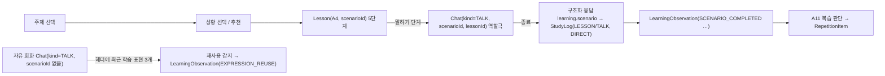
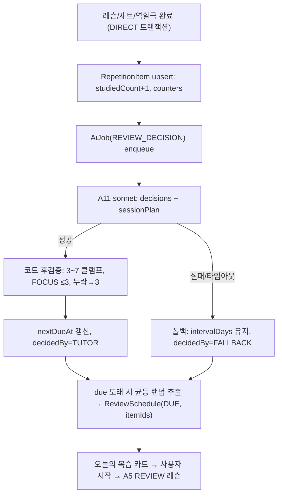
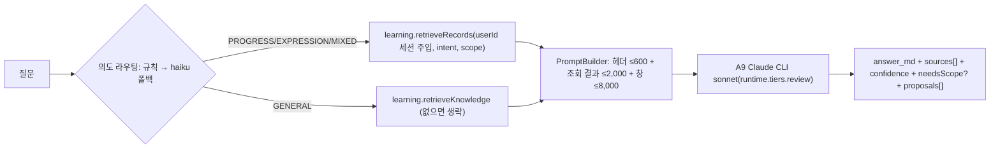

# TheKaiwa — 학습 개인화 · 학습 기록 조회 · LLM 데이터 활용 설계 (정본)

> 작성일 2026-09-26 · 상태: **설계(구현 코드 없음)** · 소유: leader(설계) / prompt-engineer(A11·ASK 프롬프트) / developer(도입 확정 후 실물화)
>
> **정본 관계.** 이 문서는 ① 학습자 상태 갱신·과제 선택·반복 학습(개인화), ② '무엇이든 물어보세요'의 본인 기록 조회, ③ M4 서버의 개인화/RAG/파인튜닝 구분과 모델 후보·벤치마크·데이터 정책의 **정본**이다. 여기서 제안하는 엔티티·엔드포인트·모듈은 각 정본 끝의 제안 절과 짝을 이룬다 — `domain-model.md §9`(엔티티) · `api-contract.md §6`(엔드포인트) · `module-dependency.md §10`(모듈). 통합 설계안 `design-spec.md` §7-3·§7-4·§7-6·§7-7·§8·§11·§15·§16·§18 은 이 문서를 링크하고 요약만 둔다. 원문 `docs/기획서-원본.md` 는 수정하지 않는다. 이름은 정본 실측 이름(플랜 "정본 실측으로 확정한 이름·형태")을 그대로 쓴다.

---

## 0. 용어 · 원칙 · 강사 에이전트 역할 대조

### 0-1. 용어 세 가지 — 서로 대체 관계가 아니다

| 용어 | 뜻 | LLM 에 가는 데이터 | 갱신·삭제 | 절 |
|---|---|---|---|---|
| **개인화(personalization)** | 학습자 상태(`Profile`·`LearnerErrorStat`·`LearnerSkillState`·`RepetitionItem`)를 프롬프트 헤더와 코드 후보 풀에 반영. 가중치는 바뀌지 않는다 | 헤더 ≤300자(A1 TALK) / ≤600자(A9 ASK·A8 PLAN) — 모드별 상한(정합 #6) | 즉시. 행 삭제 = 반영 종료 | §2 |
| **기록 검색(retrieval)** | 본인 정형 기록·채택 교정·레슨 표현·요약을 서버 화이트리스트 함수로 조회해 답변 근거로 사용 | 조회 결과 ≤2,000자(최소 필드·발췌) | 원본 삭제 = 조회 불가. 3c 인덱스가 있으면 인덱스 삭제 | §3 |
| **파인튜닝(fine-tuning)** | 검토된 예시로 **공통 강사 행동**(교정 빈도·JSON 준수·재발화 유도)을 어댑터 가중치에 학습 | 별도 opt-in 데이터셋만. 사용자 대화 자동 편입 없음 | 삭제 요청 = 데이터셋 제외 후 재학습 | §4 |

### 0-2. 원칙

1. 사용자 대화·음성은 모델 학습에 자동 사용하지 않는다(`design-spec.md §18`·`constraints.md`). `Utterance.trainingOptIn` 기본 `false` 유지, `true` 여도 자동 사용 없음.
2. 조회·개인화와 가중치 학습은 **별도 동의·별도 처리 경로**다(§6). 하나에 동의했다고 다른 하나가 열리지 않는다.
3. **코드 = 경계·기록·폴백·통계, 강사(LLM) = 판단·구성.** 강사 판단은 제안이며, 기록은 사용자 채택 또는 사용자의 직접 행위(`StudyLog.origin=DIRECT`)로만 생긴다(규칙 1).
4. 연구 인용은 주장/근거/한계 3요소를 붙인다. "최적 간격"·"보장"·"마스터" 류 단정을 쓰지 않는다. YouTube 영상은 아이디어 출처로만 둔다(§5-4).
5. 기존 확정 결정을 바꾸는 항목은 "사용자 결정 필요"로 §8 에 모은다. 단, 사용자가 이미 결정한 R-1(반복 설계)·R-3(#11)·강사 = 스케줄·커리큘럼 주체(코드 가드 안)는 **결정**으로 기술한다.

### 0-3. 강사 에이전트 역할 대조표 — 기획서(원문) 기준 대비 현재 설계 (15건)

기준 = `docs/기획서-원본.md` 의 방향성과 강사 에이전트 역할·기능. 현재 설계 = 1차(design-spec·tutor.md v0) + 2차 계획 D(페르소나 v1 결정) + 3차 계획(학습 설계 보완). 유형: ✅ 일치 · 🔎 해석(기획서 문구를 구체화) · ➕ 확장(기획서에 없음) · ⚠ 상충(기획서와 다름).

| # | 기획서의 강사 역할·기능 | 현재 설계 | 유형 | 검토 요청 |
|---|---|---|---|---|
| 1 | "서브에이전트 구성"에 강사 에이전트를 리더·개발자·QA·리뷰어·배포와 나란히 나열, "신규 에이전트이기에 추가 역할정의 필요" | 강사 = **앱 런타임 페르소나** `.claude/agents/tutor.md`(bjj 관장 방식, 앱이 `--agents` 로 로드) + Claude Code 세션에서는 사양 관점 자문(§9). 개발팀 7인에는 포함하지 않음 | ⚠ 상충 가능 | 기획서 의도가 "개발 시 커리큘럼·스케줄 로직을 설계하는 개발팀 서브에이전트"라면 tutor.md 를 개발팀 역할(예: 커리큘럼 설계·평가 기준 검토 담당)로도 확장해야 함. 현재는 런타임 전용 |
| 2 | 오늘의 회화: "진행에 대한 커리큘럼은 **강사 에이전트를 정의하여 스케쥴링 및 커리큘럼을 구성**", 리스크: "3일 반복 스케줄링… **강사 에이전트 로직에 최소 학습 로그 기준 명시**" | 스케줄(언제·무엇을 복습)은 **결정적 코드**(§7-4, 최소 기록 가드 포함), 강사는 복습 내용 혼합(A5)·`reviewEvery`·주제 순서만 제안. 3차 계획은 `LearnerSkillState` 갱신·과제 후보 선정도 코드 | ⚠ 주체 상충 | 기획서는 강사 로직, 현재는 코드 로직(재현성·테스트 가능성 이유). "강사 에이전트 = 페르소나 + 코드 모듈(learning/reviewSchedule·skills)" 로 정의하면 기획서 문구와 합치. 확인 필요 |
| 3 | AI 회화: "잘못된 표현은 AI가 교정" 실시간, 교정 응답 5초, 교정은 제안만·원문 나란히 / 채팅: 오류만 표시·원문 임의 수정 금지 | TALK 턴당 즉시 1건 + 나머지는 REVIEW(표현 점검)에서 전부, `original` 무수정, 제안→채택. 2차 결정: "교정에 철저"·strictness 기본 STRICT. 3차: 유창성/코치 모드, 힌트·재질문으로 자기수정 유도 | 🔎 해석 + ➕ 확장 | 기획서에 없는 것: 모드 2종, 힌트 우선, 턴당 1건 제한. "실시간 교정"을 "턴당 1건 즉시 + 나머지 점검" 으로 해석한 것이 맞는지 확인 |
| 4 | AI평가: 강사가 난이도별 평가·기록, 근거 제시. 채점 기준은 미결(질문 3) | JLPT 5단계·WORDS 10/TALK 6 문항·5차원 루브릭(발음 제외)·객관식은 코드 채점·기록률 100% 트랜잭션·≥90 두 번이면 `SET_LEVEL` 제안 | 🔎 미결을 채움 | 기획서 방향 유지. 발음 제외는 "범위 밖" 과 일치 |
| 5 | 분석: "강사 에이전트가 분석하여 공부계획서를 데이터화" | 코드 집계 → A8(opus) 분석·계획서 → `StudyPlan(PROPOSED)` → 사용자 확인. 3차: 능력 축 5개 `LearnerSkillState` 는 코드가 갱신, 강사는 후보 안에서 변형·힌트만 | 🔎 해석 + ➕ 확장 | "강사가 분석"을 "강사 LLM 이 코드 집계를 해석해 계획서 제안"으로 해석. 능력 축 추적(3차)은 기획서에 없음 |
| 6 | 무엇이든 물어보세요: 강사에게 자유 질의, 확신 없으면 불확실성 명시 | ASK 모드 + 제안 카드(ADD_WORD·ADD_STUDY_LOG·ADD_TOPIC·SET_LEVEL). 3차: 본인 학습 기록 조회 계층·출처 표시·`needsScope` 로 범위 질문 | ✅ + ➕ 확장 | 제안 카드·기록 조회는 기획서에 없음(주짓수일상 참고에서 옴) |
| 7 | 원칙: AI는 제안만, 기록·단어장 반영은 채택 후 | `PROPOSED` 전용 스키마, 사용자 직접 행위(세트 완료·평가 제출·레슨 완료)만 `DIRECT` 즉시 기록 | ✅ | "AI평가 결과 기록률 100%"는 제출을 사용자 행위로 보아 즉시 기록 — 해석 확인 |
| 8 | 강사 성격·언어·이름: 기획서 규정 없음 | 2차 결정: 단일 페르소나·일본인 원어민·교정 철저·한국어 설명+일본어 대화·사용자 지정 이름. 추가 기획안 §45 로 Voice 와 분리 | ➕ 확장 | 사용자 확정 사항, 기획서와 충돌 없음 |
| 9 | 프로필 "AI설정" | 학습 설정(`level·politeness·strictness·explainDepth·explainLang·teacherName`) + 음성 설정 분리 + Advanced(엔진)는 관리자 | 🔎 해석 | 기획서 "AI설정"이 엔진 선택까지 뜻했다면 사용자 화면에서 뺀 것(추가 기획안 §26)과 상충 |
| 10 | 레퍼런스 반영: 조각 분류·조립·저장, 조각 누적 라이브러리 | 조각 프레임(tutor §5)·`TopicChunk`·레슨 `chunks`·조립 quiz | ✅ | — |
| 11 | 레퍼런스 반영: 오늘의 회화에서 **짧은 청취 구간 반복 + 단어 메모 저장**, UI "조금 아쉬운 종료 지점", 리듬 인식 훈련 | 외부 흘려듣기 콘텐츠 제외(§16 권고 2), 대화문 TTS 반복 재생으로 대체. 단어 메모→단어장 추가는 교정 채택 경로만. "아쉬운 종료 지점"·리듬 훈련은 미설계 | ⚠ 일부 누락 | 생성 대화문으로 "청취 구간 반복 + 들린 단어 메모→단어장 제안" 을 레슨 1단계에 넣을지, 종료 지점 UI 원칙을 designer 가이드에 넣을지 확인 |
| 12 | 레퍼런스 반영: 통암기 방지 — 조각 조립·즉석 응용 필수 단계 | 레슨 5단계에 quiz(assemble)·application·speaking 필수 | ✅ | — |
| 13 | AI 연동 타임아웃: 회화·채팅·질문 5초, 커리큘럼·평가 10초 | 회화 haiku 12s fail-fast(목표 p50 4.5s), 점검·레슨·평가 sonnet 60~120s 잡, 분석 opus 300s batch | ⚠ 수치 상충 | 기획서 수치를 "사용자 체감 목표"로 두고 잡 상한은 별도로 둔 것 — 허용 여부 확인 |
| 14 | 강사 "기록" 주체(평가·달력·성장기록 저장) | 기록은 코드 트랜잭션, 강사는 내용만 생성 | 🔎 해석 | — |
| 15 | 3차 계획의 확장: 주제→상황 역할극(`Scenario`), 관측 이벤트·능력 축, 교정 모드, 기록 조회, M4 파인튜닝 옵션 | 기획서에 없음 | ➕ 확장 | 사용자 지시(3차)로 추가 중이나 기획서 기준 검토 필요 |

### 0-4. 사용자 결정 (2026-09-26, 대조표 검토 결과)

| 대상 | 결정 | 이 문서의 반영 |
|---|---|---|
| #2 | **되돌림** — 스케줄·커리큘럼 주체는 **강사**. 코드는 후보·통계·경계(min 3·max 7일, FOCUS 3일)·기록·랜덤 균등 추출·폴백만 | §2-5 (design-spec §7-4 전면 교체, 3차 §2 "간격 대안 A/B/C" 삭제) |
| #11 | **되돌림** — 레슨 1단계에 청취 구간 반복 + 들린 단어 메모→`TutorProposal(ADD_WORD)`, "조금 아쉬운 종료 지점" UI 원칙. 외부 콘텐츠 수급은 계속 제외 | §1-5 (design-spec §7-3·§11, designer 가이드 원칙) |
| #1 | **유지** — 강사는 런타임 페르소나. 개발팀 편입 없음 | §0-3 결론만 기록 |
| #13 | **유지** — 기획서 수치는 사용자 체감 목표, 잡 상한은 별도 | 변경 없음 |
| 반복 규칙 | **재정의** — 3일 고정이 아니라 **3~7일에서 강사가 판단**, 학습 횟수(`studiedCount`)를 DB 에 기록, 반복 대상은 **랜덤이되 균등**, 많이 틀리거나 피드백이 많은 항목은 별도 기록(FOCUS)해 **3일로 당기는 판단도 강사** | §2-5 |
| 나머지(#3~#10·#12·#14·#15) | 대조표의 해석·확장을 현재 설계대로 둔다(추가 검토는 §8) | — |

---

## 1. 주제·상황 기반 '오늘의 회화'

### 1-1. 개념과 흐름

| 구분 | 정의 | 예 | 현재 엔티티 |
|---|---|---|---|
| **주제(topic)** | 넓은 영역. 조각(`TopicChunk`)의 재료 창고 | 여행·음식·직장·취미 | `ConversationTopic` + `TopicChunk`(그대로 유지) |
| **상황(scenario)** | 역할·목표·조건·완료 기준이 있는 **의사소통 과제** | "역에서 환승 묻기 — 상대가 빨리 말하면 재확인 요청" | 신규 `Scenario` + 조인 `ScenarioTopic`(§1-2) |

흐름: **주제 선택 → 관련 상황 선택**이 기본. 익숙한 사용자는 "바로 상황 고르기"(최근·추천 상황 목록)로 진입. 둘 다 강제하지 않는다 — 주제만 고르면 코드가 `LearnerSkillState`·`RepetitionItem` 을 근거로 상황 후보를 추천하고(`GET /api/v1/scenarios?topicId=&level=&recommended=1`), 아무것도 고르지 않으면 기존대로 주제 레슨(A4)이 열린다.

### 1-2. 엔티티 최소 변경안 (→ `domain-model.md §9` 제안, 사용자 결정 필요: 도입 Phase)

**신규 `Scenario`** (L3 learning 소유, `userId` null = 시드·삭제 불가, 사용자 생성은 `ADD_TOPIC` 과 같은 제안→채택 경로 또는 직접 생성):

| 필드 | 형 | 뜻 |
|---|---|---|
| `id`·`userId?`·`isSeed`·`status`·`createdAt`·`updatedAt` | 공통 | `status ∈ ACTIVE·ARCHIVED` |
| `title`·`titleJa`·`description` | 문자열 | 목록·카드 표기 |
| `level` | `JlptLevel` | tutor.md §4 난이도 범위 |
| `difficulty` | 1~5 | 같은 level 안의 세부 난이도(과제 선택 규칙 §2-4 의 ±1 단위) |
| `roles` | Json `{learner, tutor}` | 학습자·강사 역할(예: 승객 / 역무원) |
| `goal` | Json `{communicativeGoal, successCriteria[]}` | 의사소통 목표와 성공 기준 문장 |
| `constraints` | Json `{conditions[], branches[]}` | 조건·제약·분기(예: 상대가 빨리 말함 → 재확인 요청) |
| `keyExpressions` | Json `[{chunkId?, ja, reading, ko, chunkType}]` | 핵심 표현·문형. **`TopicChunk` 참조(`chunkId`) 우선**, 없을 때만 자체 보유(중복 방지) |
| `grammarPoints` | Json | 문형 포인트 ≤3 |
| `completionRule` | Json `{minKeyExpressions, requireBranchHandled, requireGoalAchieved}` | 코드가 검증 가능한 완료 기준(§1-3) |

**조인 `ScenarioTopic`**: `scenarioId`·`topicId`·`weight`(0~1, 추천 정렬용), `@@unique([scenarioId, topicId])`. 상황은 여러 주제에 속할 수 있다.

**기존 엔티티 확장 필드**:

| 엔티티 | 추가 | 이유 |
|---|---|---|
| `Lesson.scenarioId?` | FK `SetNull` | 상황 레슨(A4 입력에 `[상황]` 블록) |
| `Chat.scenarioId?` · `Chat.lessonId?` | FK `SetNull` | 역할극 세션·레슨 말하기 단계 연결. **정합 #11**(현재 `Chat` 에 레슨 연결이 없어 `getLessonContext` 호출 근거가 없음) 해소 |
| `StudyLog.result` | `{scenarioId, goalAchieved, communicationSuccess, hintsUsed, usedExpressionIds[], missedExpressionIds[]}` | LESSON/TALK 결과 형태(§2-9) |

**기각 대안**: 신규 엔티티 없이 `ConversationTopic.tags` 로 상황을 표현 — 역할·목표·분기·완료 기준을 담을 수 없고 코드 검증이 불가능해 기각. `tags` 는 콘텐츠 소스 확장 슬롯(기획서 "확장 여지")으로 남긴다.

### 1-3. 상황 레코드가 채워야 할 항목과 완료 판정

| 항목 | 내용 | 판정 주체 |
|---|---|---|
| 역할 | 학습자 역할·강사 역할 | — (표시) |
| 의사소통 목표 | 한 문장 + 성공 기준 1~3개 | 강사 `goalAchieved`(구조화 응답) |
| 조건·제약·분기 | 예: 못 알아들으면 재확인 / 상대가 예약 없음을 알림 | 강사 `branchHandled[]` |
| 핵심 표현·문형·난이도 | `keyExpressions`·`grammarPoints`·`difficulty` | 코드: 사용자 발화 텍스트에 핵심 표현 ≥ `minKeyExpressions` 포함(정규화 후 부분 일치) |
| 완료 기준 | 목표 발화 산출 + 분기 대응 + 강사 판정 + 코드 검증 항목 | **코드가 최종 결합**: 강사 판정은 입력, 코드 규칙 통과 시 `SCENARIO_COMPLETED` 관측 |

### 1-4. 레슨 ↔ 역할극 ↔ 자유 회화 연결

- 오늘의 회화 레슨(A4) 5단계의 "말하기" 단계가 곧 **해당 상황 역할극 세션** 진입이다(`POST /api/v1/chats {kind:'TALK', scenarioId, lessonId}`).
- 역할극에서 강사는 `roles.tutor` 를 연기한다. A1 프롬프트 헤더에 `[상황]` 블록(역할·목표·분기·핵심 표현 ≤400자, A1 총 3,000자 상한 안)을 넣는다. `endOfTopic=true` 또는 사용자 종료 시 구조화 응답 확장 `learning.scenario{goalAchieved, communicationSuccess, usedExpressionIds[], missedExpressionIds[], hintsUsed}` 를 받아(§67 additive) 코드가 완료 판정(§1-3) 후 `StudyLog(LESSON|TALK, DIRECT)` 를 만든다.
- 자유 회화(상황 없음)는 기존대로. 다만 헤더에 "최근 학습 표현 3개(재사용 권장)"(`RepetitionItem` 최근 항목)를 넣어 재사용을 유도하고, 사용자 발화에 재사용이 감지되면 `LearningObservation(kind=EXPRESSION_REUSE)` 를 남긴다.

### 1-5. 청취 구간 반복 · 단어 메모 · "조금 아쉬운 종료 지점" (R-3, 대조표 #11 반영)

| 항목 | 설계 | 저장 |
|---|---|---|
| 청취 구간 반복 | 레슨 1단계 "이해"에서 생성 대화문(TTS)을 **2~3줄 구간**으로 나눠 반복 재생(0.8× → 1.0×, TTS Learning 모드). 구간 단위로 "다시 듣기·다음 구간" | `Lesson.content.dialogue[].segment`(구간 번호) · `Lesson.progress.listen{segmentsDone, memo[]}` |
| 들린 단어 메모 | 구간마다 "들린 단어 메모" 입력(≤5개). 코드가 단어장(`WordEntry`) 미등록 단어를 골라 `TutorProposal(ADD_WORD)` 카드로 제안(A10 보강 후). **채택 후에만 저장**(규칙 1) | `progress.listen.memo[]` → 제안 카드 |
| 조금 아쉬운 종료 지점 | 레슨·복습 세션은 **다음 구간·다음 상황 1개를 예고**하고 끝난다(완결감 대신 다음 진입 동기). designer 가이드 `docs/screens.md` 원칙 절 + design-spec §11 에 추가 | 종료 카드 `nextPreview{scenarioId | segment}` |
| 리듬 인식 훈련 | Phase 4 검토 항목으로만 기록 | — |
| 외부 콘텐츠 | 유튜브 흘려듣기 구간 수급은 계속 제외(§16 권고 2). 생성 대화문 + 사용자 붙여넣기 문장(`Lesson.sourceText`)으로 대체 | — |

### 1-6. 데이터 · API · 화면 변경 표

| 층 | 변경 | 비고 |
|---|---|---|
| 엔티티 | `Scenario`·`ScenarioTopic` 신규, `Lesson.scenarioId?`, `Chat.scenarioId?`·`Chat.lessonId?`, `StudyLog.result` 형태 | `domain-model.md §9` |
| API | `GET /api/v1/scenarios?topicId=&level=&recommended=1` · `GET /api/v1/scenarios/:id` · `POST /api/v1/lessons {topicId? \| scenarioId? \| sourceText?}` · `POST /api/v1/chats {kind:'TALK', scenarioId?, lessonId?}` · `GET /api/v1/lessons/today` 응답에 `recommendedScenarios[]`(정합 #2) | `api-contract.md §6` |
| 모듈 | `learning/scenarios`(공개 `listScenarios(userId, filter)`·`getScenario`·`recommendScenarios(userId, topicId?)`·`judgeScenarioCompletion(chatId, tutorVerdict)`) | `module-dependency.md §10`, 행렬 불변 |
| 화면 | 오늘 탭 "주제 → 상황" 2단 선택 + "바로 상황 고르기" / 역할극 화면 상단 목표·역할 카드 / 종료 카드에 목표 달성·사용 표현 체크·다음 예고 / 1단계 구간 재생·메모 | `docs/screens.md`(designer) |
| 시드 | 주제 5 × 상황 2~3(N5~N3), `isSeed=true` | `prisma/seed` |

---

## 2. 성장에 맞춘 과제 선택 — 가중치 학습이 아니라 상태 갱신 + 추천

### 2-1. 관측(observation) 분류표 — 기존 테이블로 충분한 것 / 부족한 것

| 관측 | 원천(기존) | 인지/산출 | 충분 여부 |
|---|---|---|---|
| 정답·오답·생략 | `VocabAttempt.answer`(`VocabAnswer`), `responseMs` | 인지(MEANING_CHOICE·FLIP) | 충분 — 단, "인지 vs 산출" 태그가 없음 |
| 산출형 정답 | `EvaluationItem.kind ∈ READING_INPUT·ASSEMBLE·SITUATION_RESPOND`, `score` | 산출 | 충분(평가 시점만) |
| 응답 시간 | `VocabAttempt.responseMs`, `EvaluationItem.answeredAt`, 턴 간격(`ChatMessage.createdAt`) | — | 충분 |
| 교정 제안·채택·무시 | `Correction.status`, `errorType`, `severity`, `chunkType` | 산출 | 충분 |
| 교정 표현 **재사용** | 없음(재사용 감지 결과를 둘 곳 없음) | 산출 | **부족** |
| **자기수정**(교정 전에 고쳐 말함) | 없음 | 산출 | **부족** |
| 상황 완료·의사 전달 성공 | 없음(§1 신설) | 산출 | **부족** |
| ASR 신뢰도 | `Utterance.transcriptConfidence`, `requiresReview` | — | 충분 — 관측 가중치 하향 입력으로 사용 |
| 오류 패턴 집계 | `LearnerErrorStat{type, pattern, count}` | — | 충분 — 유지(증가만) |

부족한 네 가지(재사용·자기수정·상황 완료·인지/산출 태그)를 위해 append-only 이벤트 `LearningObservation` 을 둔다. 원문·오디오는 복제하지 않고 `refType/refId` 만 가리킨다.

> task-039(IMP-0025): 교정의 **추가 설명** `Correction.extraNoteKo`(JLPT·교과서식 문형 한 줄, nullable)는 화면 표시 전용이다 — 관측(`observations/corrections`)·반복 학습 뜻 스냅샷(`repetition.correctionMeaningSnap`)은 지금처럼 메인 설명 `explanation` 만 쓴다(추가 설명을 복습 재료로 넣지 않는 것이 의도).

### 2-2. `LearningObservation` (L3 learning, append-only)

| 필드 | 형 | 뜻 |
|---|---|---|
| `id`·`userId`·`occurredAt` | 공통 | — |
| `kind` | enum `VOCAB_RECOGNITION · VOCAB_PRODUCTION · GRAMMAR_USE · LISTEN_RESPOND · SENTENCE_PRODUCTION · CONVERSATION_MAINTAIN · SELF_CORRECTION · CORRECTION_PROPOSED · CORRECTION_ACCEPTED · CORRECTION_IGNORED · CORRECTION_REUSED · EXPRESSION_REUSE · SCENARIO_COMPLETED` | `CORRECTION_REUSED` = 채택 교정 표현 재사용, `EXPRESSION_REUSE` = 레슨 표현 재사용 |
| `outcome` | enum `SUCCESS · PARTIAL · FAIL · SKIPPED` | 실패 정의: `outcome=FAIL` 또는 `goalAchieved=false`. **ASR 저신뢰(`requiresReview`)는 실패로 세지 않는다** |
| `latencyMs?` · `confidence` | Int · 0~1 | `confidence` 는 ASR 신뢰도·입력 경로 반영(텍스트 1.0 / STT `transcriptConfidence` / 리뷰 미확정 0.5) |
| `skill` | enum(§2-3) | kind→skill 매핑은 코드 상수 |
| `refType`·`refId` | 문자열 | 원천 행(`VocabAttempt`·`Correction`·`ChatMessage`·`EvaluationItem`·`Lesson`·`Chat`), FK 없음 |
| `wordId?`·`scenarioId?`·`meta` | — | `meta` 는 ≤1KB 요약(원문 없음) |

보존·삭제: `StudyLog` 와 같다. 원본 삭제 시 행은 남고(`refId` dangling 허용) 집계는 `StatsSnapshot` 에서만 읽는다(규칙 2). 관측이 쌓이면 코드가 `StatsSnapshot(DAILY).data.observations` 를 증가시킨다.

### 2-3. 능력 축 5개와 `LearnerSkillState`

| 축(`skill`) | 뜻 | 주요 관측 kind |
|---|---|---|
| `VOCAB_RECALL` | 어휘 회상(인지→산출) | VOCAB_RECOGNITION·VOCAB_PRODUCTION |
| `GRAMMAR_PARTICLE` | 문형·조사·활용 | GRAMMAR_USE·CORRECTION_*(errorType PARTICLE·CONJUGATION·GRAMMAR) |
| `LISTEN_RESPOND` | 듣고 응답 | LISTEN_RESPOND |
| `SENTENCE_PRODUCTION` | 문장 산출(조각 조립) | SENTENCE_PRODUCTION·EXPRESSION_REUSE |
| `CONVERSATION_MAINTAIN` | 대화 유지·자기수정·분기 대응 | CONVERSATION_MAINTAIN·SELF_CORRECTION·SCENARIO_COMPLETED |

`LearnerSkillState`(userId × skill 1행): `level`(0~100 추정) · `band`(N5~N1 매핑, 표시용 — JLPT 참조일 뿐 말하기 수준 판정이 아님 §5-2) · `confidence`(0~1: 관측 수·최근성·ASR 신뢰도) · `evidence`(Json, 최근 관측 `refId` ≤10) · `lastAssessedAt` · `reviewDueAt`(축 재평가 권장일 — 항목 복습은 `RepetitionItem.nextDueAt` 이 담당) · `trend`(UP·FLAT·DOWN).

갱신은 **결정적 코드**(`learning/skills`): 관측 kind→skill 매핑 → 지수이동평균 + 관측 `confidence` 가중. **교정 채택만으로는 올리지 않는다**(채택 ≠ 습득; `CORRECTION_REUSED` 가 있어야 상향). `LearnerErrorStat` 는 오류 패턴 집계로 유지하고 `evidence` 가 참조한다. 이 상태는 A1/A4/A5/A8/A9/A11 헤더의 "최근 약점" 재료(`getLearnerContext`)와 코드 후보 풀에 쓰이며 가중치 학습에 쓰이지 않는다.

> **개정(2026-10-20, task-080 Q4 B — 사용자 결정)**: 성장기록 «공부결과» 는 `LearnerSkillState` 표를 새로 만들지 않고 **DAILY `StatsSnapshot.data.skills` 칸**에서 단계를 계산한다(DB 스키마 변경 없음, 정본 «성장기록=스냅샷만» 유지, 과거분은 관측에서 1회 백필). 단계 = 판정된 관측(맞힘·일부×0.5·틀림)의 비율 4칸(<50·<70·<85·그 이상 %), 표시 최소 관측 20건·3일(역할극 축은 5번), 추세는 반기간 각 20건 이상일 때 ±5%p. **교정 채택만으로 올리지 않는다**는 위 규칙은 그대로이며 새 칸은 채택·무시·자기수정을 세지 않는다. 규칙·경계값 정본 `docs/screens.md` §36-6~§36-8. `LearnerSkillState`(`level`·`band`·`confidence`) 안은 분석(A8·A11 입력 근거)이 필요해질 때 다시 판단한다(후속).

### 2-4. 과제 선택 규칙 — 코드가 후보 풀, 강사는 그 안에서 변형·힌트·설명

| 상황 | 코드 규칙 |
|---|---|
| 실패(§2-2 정의) | 같은 축에서 `difficulty −1` 또는 단서 제공(힌트·모델 문장·TTS Learning 0.8×) |
| 2회 연속 성공이고 `confidence ≥ 0.6` | `difficulty +1` 또는 새 상황·도움 감소(힌트 제거·TTS Native) |
| 한 세션 | 축 2개 이상 섞기(같은 축 연속 3과제 금지) |
| 복습 대상 | `RepetitionItem.nextDueAt ≤ 오늘`(§2-5). 축 단위 재평가는 `LearnerSkillState.reviewDueAt` |
| LLM 역할 | 후보 풀 안에서 문장 변형·힌트·설명·역할 연기만. 후보 밖 항목 생성 시 후검증으로 폐기(A5 `chunks ⊆ mixSpec` 와 같은 방식) |

### 2-5. 반복 학습 설계 — **결정(R-1)**: 강사가 3~7일에서 판단, 코드가 경계·기록·추출·폴백

**주체 분담**

| 주체 | 맡는 것 |
|---|---|
| 강사(LLM, A11) | "무엇을 언제(3~7일) 다시 볼지" 판단 + 복습 내용 구성(A5 mix). 근거(횟수·오답·피드백)를 한 줄로 남김 |
| 코드(`learning/repetition`) | 후보·통계 제공, **경계 강제**(min 3·max 7일, FOCUS 상한 3일), 기록(`studiedCount` 등), 균등 랜덤 추출, LLM 실패 시 결정적 폴백, 최소 기록 가드(학습일 2일·재료 2건 미만이면 복습을 열지 않음 — 기획서 "최소 학습 로그 기준"을 강사 판단 프롬프트의 입력 조건으로 유지) |
| 사용자 | "오늘의 복습" 카드를 **시작해야 학습**(기록은 `DIRECT`). 제안→채택 원칙 유지 |

**단위 = `RepetitionItem`** (레슨 전체가 아니라 표현·조각·문법 포인트·상황·단어 단위. 레슨 완료·교정 채택·단어 세트 finish 가 item 을 등록/갱신)

| 필드 | 형 | 뜻 |
|---|---|---|
| `id`·`userId`·`createdAt`·`updatedAt` | 공통 | `@@unique([userId, refType, refId])` |
| `itemType` | enum `EXPRESSION · CHUNK · GRAMMAR · SCENARIO · WORD · LESSON` | — |
| `refType`·`refId` | 문자열 | 원천 행, FK 없음 |
| `textJa`·`meaningKo` | 스냅샷 | 원본 삭제 후에도 생존(삭제 정책) |
| `studiedCount`·`lastStudiedAt` | Int·시각 | 세션 완료 시 +1 — **사용자 요구 "학습한 횟수를 DB 에 기록"** |
| `correctCount`·`wrongCount` | Int | 세션 결과 |
| `feedbackCount`·`lastFeedbackAt` | Int·시각 | 교정 제안·오답·재질문 횟수 |
| `intervalDays` | 3~7 | 코드 클램프 |
| `nextDueAt` | 날짜 | `lastStudiedAt + intervalDays` |
| `priority` | enum `NORMAL · FOCUS` | FOCUS = "피드백 많은 내용 별도 기록": `feedbackCount ≥ 3`(코드 임계) 또는 강사 지정 → `intervalDays ≤ 3` 강제 |
| `decidedBy`·`decisionReason`·`decidedAt` | enum `TUTOR · FALLBACK`·VarChar(200)·시각 | 판단 주체와 한 줄 근거 |

**강사 판단 지점 A11 "복습 판단"** (신규 AI 지점, design-spec §8 표에 추가)

| 항목 | 내용 |
|---|---|
| 모델·상한·방식 | sonnet · 60s · 잡(batch 레인), `JobKind.REVIEW_DECISION` |
| 입력 | due·후보 item 목록(각 `studiedCount`·`wrongCount`·`feedbackCount`·`lastStudiedAt`·현재 `intervalDays`·`priority`, ≤40건·≤4,000자) + 학습자 헤더 ≤600자 + 최근 약점(`LearnerSkillState`·`LearnerErrorStat` top) |
| 출력 | `{decisions:[{itemId, nextIntervalDays 3~7, priority, reason_ko}], sessionPlan:{itemIds[], mixNote_ko}, rationale_ko}` |
| 코드 후검증 | 범위 밖 값 클램프(3~7), 누락 item 은 폴백(3일), FOCUS 는 ≤3 강제, 입력에 없던 `itemId` 는 폐기 |
| 실행 시점 | 레슨·단어 세트·역할극 완료 트랜잭션 **뒤** 비동기 잡 + 하루 첫 진입 시 due 재판단(같은 날 2회 이상 재판단 안 함) |
| 결과 표시 | "오늘의 복습" 카드(`ReviewSchedule(DUE)`) — 사용자가 시작(`POST /api/v1/reviews/:id/start`)하면 A5 REVIEW 레슨 |

**균등 랜덤 추출(코드)**: due item 중 `weight = 1/(1+studiedCount) × (priority==FOCUS ? 2 : 1)` 가중 비복원 샘플링(seed 저장 → 재현 가능). 세션 크기 = `Profile.dailyMinutes` 기준(15분 → item 6~8). 최근 3세션에 나온 item 은 감쇠(×0.5). `studiedCount` 는 세션 완료 시 +1 — 횟수가 적은 항목이 고르게 섞인다.

**복습 세션 형식**: 기존 A5 REVIEW 레슨 유지, `mixSpec` = 추출된 item 들. "어떻게 섞을지"는 그대로 강사, 후검증 `chunks ⊆ mixSpec`.

**폴백**: A11 실패·타임아웃 → 코드가 `intervalDays` 유지(초기 3, FOCUS 3), `decidedBy=FALLBACK`. "언제" 의 세션 사이클 폴백은 기존 §7-4 규칙(R = `StudyPlan.curriculum.reviewEvery ?? 3`, 범위 2~4 — 정합 #14·15)을 쓴다.

**`ReviewSchedule` 변경**: "오늘의 복습 세션"(due item 묶음) 단위로 유지하되 `sourceLessonIds` → `itemIds`, `decidedBy`·`tutorRationale` 추가. `POST /api/v1/reviews/:id/skip` 후 재판단은 다음 학습일.

**`SCHEDULE_REVIEW` 제안(정합 #3·#16 재해소)**: A11 이 강사 판단의 정식 경로가 되므로 `ProposalKind.SCHEDULE_REVIEW` 는 유지한다. ASK(A9) 에서도 "오늘 복습 당기기" 요청으로 낼 수 있으나, 채택 시 코드 경계(3~7일·FOCUS 3·최소 기록 가드)를 통과할 때만 `ReviewSchedule(DUE)` 가 생기고 사용자가 시작해야 학습이다.

`LearnerSkillState`·`LearningObservation`(§2-2·§2-3)은 A11 입력 근거로 유지된다. 근거 인용(Kim & Webb 2022 등)은 "분산 학습이 집중 학습보다 낫다는 방향과 3~7일 범위를 뒷받침하는 정도"로만 쓴다(§5-2).

### 2-6. 15분 학습 흐름 예시 (`dailyMinutes=15`)

| 순서 | 시간 | 내용 | 관측 |
|---|---|---|---|
| 1 | 3분 | 복습 회상 — due `RepetitionItem(WORD·EXPRESSION)` CHOICE → 산출(READING_INPUT 형) | VOCAB_RECOGNITION → VOCAB_PRODUCTION |
| 2 | 2분 | 짧은 듣기 — 레슨 dialogue TTS 구간 반복(§1-5) + 요지 질문 | LISTEN_RESPOND |
| 3 | 3분 | 표현 산출 — 핵심 표현 조립 quiz(assemble) | SENTENCE_PRODUCTION |
| 4 | 5분 | 목표 상황 역할극 — `Chat(kind=TALK, scenarioId)` | CONVERSATION_MAINTAIN·SCENARIO_COMPLETED |
| 5 | 2분 | 교정 표현 재발화 — 세션 교정 카드 재발화 → 재사용 감지 | CORRECTION_REUSED |

### 2-7. 회화 교정 방식

| 항목 | 설계 |
|---|---|
| 모드 2종 | **유창성 모드**: 즉시 교정 0~1건(MAJOR 우선), 나머지는 종료 카드(REVIEW) / **코치 모드**: 턴마다 1건 + 힌트 우선. 기본은 유창성, 역할극·레슨 말하기는 코치 |
| 우선순위 | 의미 전달 실패(MAJOR) > 반복 오류(`LearnerErrorStat` top) > 이번 레슨·상황 목표 표현 > 기타 |
| 자기수정 유도 | 정답 전에 힌트·재질문(elicitation) 1회 → 사용자가 고치면 `SELF_CORRECTION`, 실패 시 교정문 제시 → **재발화 요청** → 이후 다른 상황에서 재사용 유도 |
| 근거(요약, 상세 §5-2) | Lyster & Saito 2010: 교실 구두 교정 피드백은 유의하고 지속적이며 prompts 가 recasts 보다 큼 — 교실·영어권 중심이라 앱·일본어에 그대로 일반화 불가. Hou & Min 2025: 대화형 CALL 이 말하기에 g=.61, 목표지향 시스템·멀티모달이 유리, 교정 피드백 유무는 유의하지 않음, 표본 작음 |
| 계약 | tutor.md §3(턴당 최대 1건·원문 무수정·조각 단위) 유지. 모드는 `[모드] TALK` 헤더의 부가 플래그(`coach=true`)로 전달 |

### 2-8. tutor.md §3·§7 · `Profile.strictness` 와의 관계 — 충돌 없음

- `strictness`(GENTLE·NORMAL·STRICT, 2차 결정 기본 STRICT)는 **무엇을 오류로 볼지의 범위**(tutor.md §3-3)다. "철저"의 의미는 **놓치지 않고 기록**(REVIEW·관측)이며, 즉시 끊는 **빈도**는 §2-7 의 모드가 정한다. 두 축은 독립이다.
- tutor.md §7 은 R-2 로 교체된다: "복습 주기는 당신이 3~7일 사이에서 정합니다(코드가 범위를 강제합니다). 학습 횟수가 적은 것을 고르게 섞고, 많이 틀리거나 당신이 교정·피드백을 많이 한 항목(FOCUS)은 3일로 당깁니다. 근거를 한 줄로 남깁니다. 기록이 2일·2건 미만이면 복습을 열지 않습니다." + §6 모드 표에 `REVIEW_DECISION` 행.

### 2-9. `StudyLog.result` · `StatsSnapshot.data` 형태 정의 (정합 #12 — `domain-model.md §3` 주석이 이 절을 링크)

| `StudyLog.type` | `result` 형태 |
|---|---|
| WORDS | `{correct, wrong, skipped, cardCount, mode}` |
| LESSON / REVIEW | 정본은 `domain-model.md` §9-3·api-contract #62(task-010 구현, 2026-09-28): `{stageDone, score, quizCorrect, quizTotal, …, usedExpressionIds[], missedExpressionIds[], itemIds[], listen{…}}` + 역할극 도입 시 `scenario?{scenarioId, goalAchieved, communicationSuccess, hintsUsed}` |
| TALK / CHAT | `{turns, correctionsProposed, correctionsAccepted, scenarioId?, goalAchieved?, selfCorrections}` |
| EVALUATION | `{totalScore, grade, rubric{5}}` |
| ASK | 생성하지 않음(제안 채택 시 ADD_STUDY_LOG 만) |

| `StatsSnapshot.kind` | `data` 형태 |
|---|---|
| DAILY | `{attended, words{sessions, correct, wrong}, lessons, reviews, talkTurns, chatTurns, correctionsAccepted, observations{bySkill{…}, selfCorrections, reuses}, minutes}` — `talkTurns`·`chatTurns` 는 대화 종료 `ADD_STUDY_LOG` 제안 채택이, `correctionsAccepted`(= `corrections.accepted`) 는 교정 accept 가 증가한다 — **턴 `done` 은 스냅샷을 바꾸지 않는다**(task-006 개정, domain-model §9) |
| VOCAB_SESSION | `{cardCount, correct, wrong, skipped, durationSec}` |
| LESSON | `{kind, topicId, score, stageDone, itemCount, quizCorrect, quizTotal, date}`(task-010) + 역할극 도입 시 `scenarioId?·goalAchieved?` |
| EVALUATION | `{kind, level, totalScore, rubric{5}}` |

---

## 3. '무엇이든 물어보세요'의 학습 기록 활용

### 3-1. 의도 라우팅 (코드)

| 의도 | 예 | 근거 원천 |
|---|---|---|
| `PROGRESS` | "이번 주 얼마나 했어?", "복습 뭐 남았어?" | 정형 조회(`getProgressSummary`·`getDueReviews`·`getSkillState`) |
| `EXPRESSION` | "저번에 고쳐 준 に/で 뭐였지?", "역에서 쓰던 표현" | 채택 교정·레슨 표현·`RepetitionItem`·관련 대화 요약 |
| `GENERAL` | "〜ている 와 〜てある 차이" | 승인 지식 자료(`learning/knowledge`, 초기엔 없음 → 일반 LLM 답변) |
| `MIXED` | "내가 자주 틀리는 조사 설명해 줘" | 근거별 출처 구분(기록 + 일반) |

분류는 **규칙 우선**(키워드·시간 표현·"내/나/저번" 등 1인칭 지시) → 애매하면 LLM 1회 `intent` 스키마(haiku, 입력은 질문 텍스트 ≤1,000자만, 기록 없음). 분류 결과는 `RequestTrace` step 에 남긴다.

### 3-2. 조회 계층 `learning/recordRetrieval` (서버, L3)

| 원칙 | 내용 |
|---|---|
| 화이트리스트 함수만 | `getProgressSummary(userId, range)` · `getDueReviews(userId)` · `getRecentCorrections(userId, filter)` · `findExpressions(userId, query, range)` · `getLessonsByTopic(userId, topicId)` · `getSkillState(userId)`. 공개 진입점 `retrieveRecords(userId, intent, scope)` 가 의도별로 조합 |
| **LLM 은 SQL 을 만들거나 실행하지 않는다** | 자유 질의 → 함수 인자(enum·기간·키워드)로만 변환. 인자 검증 실패는 `needsScope` 응답 |
| `userId` 는 세션에서 주입 | 프롬프트·LLM 출력에서 온 id 는 무시. 타 사용자 행 0건(§5-1 격리 지표) |
| 결과 상한 | 건수 ≤20, 총 ≤2,000자. 원문 대화는 **요약/발췌 ≤300자**만 |
| 최소 필드 | 각 항목 `{sourceRef{type, id, date, label}, text}`. 이메일·내부 id·엔진명·`toolLog` 없음 |
| 경로 | conversation→learning 허용 읽기에 `retrieveRecords` 추가(4종 → 5종, 행렬 불변). 쓰기는 여전히 라우트 위임 |

### 3-3. A9 응답 계약 확장 (additive)

`{answer_md, sources:[{type, id, date, label}], confidence:'HIGH|MEDIUM|LOW', needsScope?:string, proposals[]}` — 출처는 화면에 카드로 표시(레슨·교정·상황 상세로 이동). 결과 없음·불확실 시 `needsScope` 로 범위를 되묻는다("어느 기간의 교정을 말씀하시나요?"). `proposals[]` 허용 종류는 정합 #3 대로 `ADD_WORD·ADD_STUDY_LOG·ADD_TOPIC·SET_LEVEL`(+ `SCHEDULE_REVIEW` 는 §2-5 조건부). 제안→채택 흐름·`StudyLog(ASK)` 미생성 유지.

### 3-4. 단계안

| 단계 | 내용 | 조건 |
|---|---|---|
| **3a** | 정형 DB 조회만(§3-2 함수) + 출처 카드 | Phase 3 기본 |
| **3b** | MCP `propose_*` + 조회 함수를 도구화(같은 화이트리스트, 같은 계약) | 3a 안정 후 |
| **3c**(필요 시) | 과거 자유 대화 **의미 검색** — 로컬 임베딩(home-m4 `bge-m3` + Qdrant 컬렉션 `thekaiwa_<userId>`). 임베딩 대상 = 채택 교정·레슨 표현·대화 **요약**(원문 전문 아님) | 정형 조회로 못 푸는 질문 비율 실측 **≥20%** (사용자 결정 필요 §8) |

### 3-5. 데이터 흐름 표 — 무엇이 어디로 가는가

| 데이터 | 범위·상한 | Claude CLI(외부: Anthropic 구독 경로) | home-m4(LAN, M4) | 최소화 |
|---|---|---|---|---|
| 페르소나·`[모드] ASK` | 전체 | ✓ | ✗ (`runtime.allowedTasks` 로 회화·채팅·ASK 금지) | — |
| 학습자 헤더 | ≤600자 | ✓ | ✗ | 표시명만, 이메일·id 없음 |
| 최근 12개 창 | ≤8,000자 | ✓ | ✗ | 기존 결정 |
| 조회 결과(3a/3b) | ≤2,000자 | ✓ — **외부 전송 범위 D2=(b) 확정**(2026-10-12, §8): 정형 요약·채택 교정(원래 문장·고친 문장)·수업에서 배운 표현만 | ✗ | 항목 텍스트 ≤300자·임시 키 `S#` 만(내부 id·대화 원문·`PROPOSED`/`REJECTED` 교정 없음) |
| 의도 분류 입력 | 질문 ≤1,000자 | ✓(haiku) | ✗ | 기록 없음 |
| 임베딩(3c) | 요약·교정·표현 | ✗ | ✓ `bge-m3` → Qdrant(127.0.0.1:6333) | 원문 전문 미색인 |
| 원음·`toolLog`·`RequestTrace` | — | ✗ | ✗ | 금기 §8-5 |

기존 결정과의 충돌 표기: Claude CLI 는 **외부 전송이 전제**다(1차 확정). 조회 결과를 헤더에 싣는 순간 개인 학습 기록 일부가 외부로 간다 → 범위는 §8 D2 에서 (b) 로 결정됐다(2026-10-12). home-m4 보조 LLM 은 로컬이지만 ASK 품질 미검증이고 정책상 금지 상태 — 허용하려면 `allowedTasks` 변경(사용자 결정)과 §4-4 벤치마크 통과가 선행.

### 3-6. 권한 강제

조회 계층은 `userId` 를 인자로만 받고 라우트가 세션에서 넣는다. 함수마다 `WHERE userId=` 를 코드 리뷰 체크리스트에 고정하고, QA 는 "타 사용자 기록 노출 0건" 을 자동 테스트로 둔다(§5-1). `sources[].id` 를 클릭해 여는 상세 API 도 소유자 검사(타인 404)를 그대로 탄다.

---

## 4. 모델 학습 · M4 서버 방안

### 4-1. 3안 비교

| 안 | 목적 | 장점 | 단점 | 개인정보 영향 | 운영 부담 | 업데이트·삭제 | M4 24GB 적합성 |
|---|---|---|---|---|---|---|---|
| ① 프로필·숙련 상태를 프롬프트/조회로 반영(**기본**) | 개인화 | 즉시 반영·삭제, 구현 단순, Claude 품질 그대로 | 프롬프트 상한(300/600자) 안에서만 | 프롬프트 범위만 외부 전송 | 낮음 | 행 갱신·삭제 즉시 | 무관(Claude CLI) |
| ② RAG(본인 기록·승인 자료 검색) | 근거 있는 답변 | 출처 표시, 원문 비복제, 로컬 임베딩 | 인덱스 운영, 임베딩 품질 검증 필요 | 임베딩은 LAN, 검색 결과는 Claude 로 감 | 중간(Qdrant·재색인) | 인덱스 삭제 = 즉시 | 임베딩 모델 소형(bge-m3) — 여유 있음 |
| ③ LoRA/QLoRA(검토된 예시로 **공통 강사 행동** 개선) | 보조 LLM 품질 | 로컬 완결, JSON 준수·교정 스타일 개선 가능성 | 데이터 구축·검토 비용, 벤치마크 없이는 효과 불명, 메모리 경합 | opt-in 데이터셋만, 사용자 대화 자동 편입 없음 | 높음(학습·평가·버전·재학습) | 삭제 = 데이터셋 제외 후 **재학습** | 별도 시간대 실험만(§4-3) |

사용자별 파인튜닝은 기각(§4-6). ③ 은 ①·② 를 대체하지 않으며, ASK·TALK 의 기본 경로는 계속 Claude CLI 다.

### 4-2. 모델 후보표 (확정 아님 — 벤치마크 대상)

| 후보 | 체크포인트 | 라이선스 | 갱신일 | 프레임워크 지원 | 예상 메모리(4-bit 추론) | 제약·확인 항목 | 출처 |
|---|---|---|---|---|---|---|---|
| Claude CLI(품질 기준선) | 구독(haiku/sonnet/opus) | 구독 약관 | — | `--print --json-schema` | 0(외부) | 외부 전송 전제, 6개 프로젝트 공유 rate limit | design-spec §0 |
| Qwen2.5-14B-Instruct(현 home-m4) | Ollama `qwen2.5:14b-instruct` | Apache-2.0 | — | Ollama | ≈9~10GB 로드 시(프로젝트 문서) | 비교 대상. 파인튜닝 대상은 아님(14B 는 24GB 에서 QLoRA 여유 없음) | home-m4 문서 |
| Qwen3-8B / Qwen3-4B | `Qwen/Qwen3-8B` 등 | Apache-2.0 | 2025-04-29 | MLX-LM(지원 목록에 Qwen2 명시, **Qwen3 은 현 mlx-lm 버전으로 확인 필요**) | 8B ≈5~6GB / 4B ≈3GB (추정, 실측 필요) | 119개 언어에 일본어·한국어 명시, thinking/non-thinking 모드, 32K(≤1.7B)/128K 컨텍스트 | [S7]·[S8] |
| Qwen3-Swallow-8B-RL-v0.2 | `tokyotech-llm/Qwen3-Swallow-8B-RL-v0.2` (8B/30B-A3B/32B) | Apache-2.0(가중치) | 2026-02-20 | HF Transformers. AWQ-INT4 변형 있음. **MLX 변환·LoRA 지원은 수작업 검증 필요** | 8B ≈5~6GB(추정, 실측 필요) | Institute of Science Tokyo(Okazaki/Yokota 연구실)+AIST, Qwen3 기반 CPT+SFT+RLVR 일본어·영어 이중언어 — 한국어 설명 품질은 미검증 | [S9]·[S10] |
| Qwen3.5-9B / 4B | `mlx-community/Qwen3.5-9B-MLX-4bit`, `…-4B-MLX-4bit` | 대부분 Apache-2.0 | 2026-03-02(소형) | mlx-vlm 로 변환된 멀티모달 체크포인트 — **`mlx_lm.lora` 로 학습 가능한지 미검증** | 9B 4-bit ≈6.6GB(2차 출처 블로그, 실측 필요) | 201개 언어, 네이티브 멀티모달. 라인업 0.8B/2B/4B/9B·27B·35B-A3B·122B-A10B·397B-A17B | [S11]·[S12] |

체크포인트 검증은 실행 시 HF 모델 카드로 다시 한다. 벤치마크(§4-4) 없이 어떤 후보도 채택하지 않는다.

### 4-3. 24GB 통합 메모리 위험 — 2시나리오

M4 상주: tts-service Style-Bert-VITS2(:8200, ≈1~2GB 추정·미실측) · home-m4-api + Ollama `qwen2.5:14b-instruct`(≈9~10GB 로드 시) · Qdrant(Docker) · Redis · OS. 우분투는 GPU 없음 → 학습은 M4 만 후보.

| 시나리오 | 상주 사용량(추정) | 남는 여유 | QLoRA 8~9B 4-bit(batch 1, `--num-layers 4~8`, `--grad-checkpoint`, seq ≤1,024) 추정 | 판단 |
|---|---|---|---|---|
| A. TTS 가동 + Ollama 로드 | OS·Qdrant·Redis ≈3GB + Ollama 9~10GB + SBV2 1~2GB ≈ **13~15GB** | ≈9~11GB | 가중치 ≈5~6GB + 어댑터·활성화·옵티마이저 ≈2~6GB ≈ **7~12GB**(실측 필요) | **여유 불확실** — 스왑·TTS 지연으로 5초 예산 훼손 위험. 동시 운용을 보장하지 않는다 |
| B. TTS·Ollama 중지(별도 시간대) | ≈3GB | ≈21GB | 위와 같음 | 추정 범위 안에서 실험 가능. 그래도 **실측 필요** |

결론: 학습은 **별도 시간 창(TTS·Ollama 중지)** 실험으로만 제안한다. 메모리 절감 옵션은 MLX-LM 문서의 `--grad-checkpoint`, batch 1~2, `--num-layers 4/8`, 짧은 시퀀스를 그대로 따른다(문서 예시 "M1 Max 32GB ≈250 tok/s" 는 소형 설정 참고치일 뿐 M4 24GB 수치가 아니다). 실험 착수 조건·시간대는 §8.

### 4-4. 벤치마크 기준

| 항목 | 내용 |
|---|---|
| 테스트셋(고정, 버전 관리) | 교정 40문장(조사·활용·존댓말·자연스러움·정답 문장 포함) / 상황 응답 10 / 한국어 설명 10 — AI 생성 예시만으로 구성 금지, 실제 오류 사례 포함 |
| 지표 | 일본어 교정 정확도·자연스러움(원어민 검토 또는 Claude 기준선 대비) / 한국어 설명 품질 / JSON 계약 준수율(§67 스키마) / 응답 지연 p50·p95 / 메모리 피크 |
| 합격선 | JSON 위반 ≤5% · 교정 정확도 기준선 대비 **−10%p 이내** · p50 ≤ 기준선(해당 용도) |
| 비교 대상 | Claude CLI(기준선) vs 현 qwen2.5:14b vs 후보(베이스) vs 후보+어댑터 |
| 결과 기록 | `agent-vault/30-Knowledge/decisions/`(모델·어댑터·데이터셋 버전·해시) |

### 4-5. 파인튜닝 데이터 정책 · 파이프라인 · 버전/삭제

**범위**: 강사 행동(교정 빈도·상황별 응답·재발화 유도·JSON 준수)만. 사전·문법 사실·학습자 상태는 가중치에 넣지 않는다(검색·데이터에서 온다).

| 단계 | 내용 |
|---|---|
| 1 출처·라이선스 | 공개 데이터는 라이선스 확인. **YouTube 자막·영상 재사용은 권리 확인 필요**(불명확하면 제외) |
| 2 동의 | 사용자 대화는 **별도 opt-in 데이터셋**만. `Utterance.trainingOptIn=true` 여도 자동 편입 없음 — 사용자가 항목을 골라 내보내는 별도 절차(현 단계 미구현) |
| 3 익명화 | 표시명·이메일·id·날짜 제거, 고유명사 치환 |
| 4 품질 검토 | 원어민/교사 검토(교정문 정답성), 스키마 준수 |
| 5 중복 제거 · 분리 | train/val/test, 테스트셋(§4-4)과 겹치지 않게 |
| 6 버전 | 데이터셋 v · 어댑터 v · 해시 · 출처 목록 · 학습 설정(`--fine-tune-type lora\|dora`, iters, layers) |
| 7 삭제 정책 | 삭제 요청 항목을 데이터셋에서 제외하고 **재학습**한 어댑터로 교체, 이전 어댑터 폐기 |
| 8 실행 | `mlx_lm.lora --train` → `--test` → `mlx_lm.generate --adapter-path` 로 §4-4 → 필요 시 `mlx_lm.fuse`. QLoRA 는 양자화 모델 지정 시 자동. JSONL 형식은 chat |

### 4-6. 사용자별 파인튜닝 기각 사유

| 사유 | 설명 |
|---|---|
| 삭제·갱신 불가 | 가중치에 들어간 개인 기록은 행 삭제로 지워지지 않는다(§18 삭제 정책과 충돌) |
| 데이터 부족 | 1인 학습자의 대화량으로는 검토된 예시 수를 채울 수 없고, 소량 학습은 과적합·행동 붕괴 위험 |
| 개인정보 | 원문 대화가 학습 데이터가 되며 익명화가 의미 없다(본인 데이터) |
| 대체 수단 존재 | 개인화는 ①(상태 반영)·②(기록 조회)로 즉시·가역적으로 달성된다 |

---

## 5. 평가 지표와 연구 근거

### 5-1. 지표표

| 지표 | 정의 | 원천 | 목표(초기 가설, 실측 후 조정) |
|---|---|---|---|
| 지연 회상 | 익일·7일 후 단어·표현 **산출** 정답률 | `RepetitionItem`·`LearningObservation(VOCAB_PRODUCTION)` | 7일 후 ≥60% |
| 처음 보는 상황에서 표현 사용 비율 | 새 `Scenario` 에서 과거 학습 표현 재사용 | `EXPRESSION_REUSE`·`usedExpressionIds` | 상승 추세 |
| 반복 오류 감소 | `LearnerErrorStat` top 패턴의 주별 count | `StatsSnapshot`·`errorTrend` | 하락 추세 |
| 자기수정률 · 교정 재사용률 | `SELF_CORRECTION` / 교정 제안, `CORRECTION_REUSED` / 채택 | 관측 | 상승 추세 |
| 상황 과제 목표 달성률 | `goalAchieved=true` / 완료 역할극 | `StudyLog.result` | ≥70%(난이도 조정 지표) |
| LLM 응답 근거성 | `sources[]` 가 실제 행과 일치하는 비율(자동 대조) | ASK 로그·`RequestTrace` | ≥95% |
| 기록 검색 정확도 | 질문셋 30개의 조회 함수·인자 정확도 | 테스트 | ≥90% |
| 타 사용자 격리 | 조회·출처 상세에서 타인 행 노출 | 자동 테스트 | **0건** |
| 교사 검토 vs 자동 평가 일치도 | A7·A11 판단과 사람 검토 일치 | 첫 20건 라운드(§16 미결 3) | 기록·조정 |
| 운영 지표(분리) | 출석률·응답 속도 p50/p95·잡 실패율 | 기존 §1 성공 기준 | 학습 효과 지표와 섞지 않음 |

### 5-2. 근거표 — 주장 / 근거 / 한계

| 출처 | 주장(이 문서에서 쓰는 범위) | 근거(확인된 사실) | 한계·주의 |
|---|---|---|---|
| Kim & Webb (2022), *Language Learning*, DOI 10.1111/lang.12479 [S1] | 분산 학습(spaced)이 집중 학습(massed)보다 낫다는 **일반 방향**만 — 3~7일 범위를 "뒷받침하는 정도" | 메타분석: 48 실험·98 효과크기·N=3,411. spaced vs massed·longer vs shorter spacing·equal vs expanding spacing 을 즉시·지연 사후검사로 비교, 조절변수 9개 | **전문 미확보(HTTP 403)**. longer-vs-shorter·expanding 비교의 **방향·크기는 원문 확인 전까지 규칙으로 쓰지 않는다**. 최적 간격을 정하지 않는다 |
| Kang, Gollan & Pashler (2013), *Psychonomic Bulletin & Review* 20(6):1259–1265, PMID 23681928 [S2] | 복습은 "따라 말하기"보다 **먼저 산출 시도(retrieval practice)** 로 — §2-6 의 CHOICE→산출 순서·재발화 설계 근거 | 그림+이름 듣기 과제에서 retrieval practice 가 imitation 보다 이해·산출 모두 즉시·2일 후 우세, 발음 품질 손실 없음 | 실험실·소규모·그림-단어 과제. 문장·회화로의 일반화는 가설 |
| Lyster & Saito (2010), *SSLA* [S3] | 구두 교정 피드백은 효과가 있고, **prompts(자기수정 유도) > recasts(고쳐 말해 주기)** — §2-7 힌트·재질문 우선 근거 | 교실 연구 15편·N=827 메타분석. 효과 유의·지속, 자유 산출 측정에서 뚜렷, 처치 길수록 큼, 어린 학습자에게 더 큼 | **교실 전용 데이터셋**, 영어권 중심. 앱·1인·일본어에 그대로 일반화 불가 |
| Hou & Min (2025), *ReCALL*, three-level meta-analysis [S4] | 대화형 CALL 이 L2 말하기에 중간 이상 효과, **목표지향(goal-oriented) 시스템**·의미 제약 산출·멀티모달이 유리 — §1 상황 역할극 근거 | 16편·89 효과크기, g=.61 [0.34, 0.89]. 교정 피드백 유무·숙련도·기간·교육 단계는 유의한 조절변수 아님 | 94% 가 60명 미만, 신생 분야. 교정 피드백이 "무효"라는 뜻이 아니라 유의 차이가 없었다는 것 |
| JLPT 공식 [S5]·[S6] | 앱의 N5~N1 라벨은 **어휘·문법 범위 참조**일 뿐 말하기 능력을 뜻하지 않는다 | 급별 구성: N1 언어지식(어휘·문법)·독해 110분+청해 55 / N2 105+50 / N3 어휘 30+문법·독해 70+청해 40 / N4 25+55+35 / N5 20+40+30. 말하기·쓰기를 직접 측정하는 섹션이 없음 | `LearnerSkillState.band`·`Profile.level` 은 참조 라벨. "N3 회화 가능" 같은 표현 금지 |
| Qwen3 블로그·모델 카드 [S7]·[S8] | 후보 모델 사실 | dense 0.6B~32B·MoE 30B-A3B/235B-A22B, Apache-2.0, 119개 언어(일본어·한국어 명시), thinking 모드, 32K/128K | 벤치마크 수치는 자체 보고 — 이 문서 합격선의 근거로 쓰지 않음 |
| MLX-LM LoRA 문서 [S13] | 학습 절차·메모리 옵션 | `mlx_lm.lora --train/--test`, `--fine-tune-type lora\|dora\|full`, 양자화 모델이면 QLoRA 자동, `--grad-checkpoint`·batch 1~2·`--num-layers 4/8`·짧은 시퀀스, JSONL chat/tools/completions/text | 지원 목록에 Qwen2 는 있으나 Qwen3 는 현 버전으로 확인. 속도 예시는 M1 Max 32GB |

### 5-3. 일반화 한계 (모든 인용에 공통)

- 위 연구는 대부분 **영어 L2·교실·어휘 과제**다. 일본어 회화 앱·1인 학습자·음성 입력(ASR 오류 포함)에 그대로 옮길 수 없다. 이 문서의 규칙(3~7일, 힌트 1회, 목표지향 상황)은 **연구가 배제하지 않는 범위 안의 설계 선택**이지 연구가 "정한" 값이 아니다.
- 효과크기는 사후검사 기준이며 앱의 §5-1 지표(지연 회상·재사용률)로 **자체 실측**해 조정한다.

### 5-4. 원 기획서 YouTube 3편의 처리

| 레퍼런스 | 처리 |
|---|---|
| 1 — 조각 학습·5단계 로드맵(`https://www.youtube.com/watch?v=uWxo4vu2siQ`) | **아이디어 출처**로만. "60일" 문구는 근거로 채택하지 않음 |
| 2 — 흘려듣기·조각 결합(`https://www.youtube.com/watch?v=7L48Tzb3lsk`) | 아이디어 출처로만(§1-5 청취 구간 반복·종료 지점). 외부 콘텐츠 수급은 제외 |
| 3 — 자막 문장 AI 과외 | `기획서-원본.md` 에 URL 이 적혀 있으나 **검증하지 못함 → "출처 미확인"** 으로 기록. "3개월 마스터" 문구는 근거로 채택하지 않음 |
| 공통 | 홍보 문구·개인 경험담은 근거가 아니다. 자막·영상을 데이터셋으로 재사용하려면 권리 확인 필요(§4-5) |

---

## 6. 데이터 정책 정합 (design-spec §18 과의 관계)

| 항목 | §18 현행 | 이 문서의 보완 |
|---|---|---|
| 운영 데이터 ≠ 학습 데이터(§71) | 사용자 대화·음성은 모델 학습에 자동 사용 없음, `Utterance.trainingOptIn` 기본 false | 유지. **조회·개인화(§2·§3)는 학습이 아니다** — 상태 갱신·프롬프트 반영·기록 검색은 별도 동의 경로 A(앱 이용 동의 범위), 가중치 학습은 별도 동의 경로 B(항목 단위 opt-in·익명화·검토·Dataset 등록). A 가 B 를 열지 않는다 |
| 외부 전송 | Claude CLI 전제(1차 확정) | 개인 기록의 외부 전송 **범위**를 §8 결정으로 명시. 전송 전 가명화(표시명만·이메일·id 제거) |
| 보존 | 오디오 30일, 텍스트·분석 영구, `RequestTrace` 90일 | `LearningObservation`·`RepetitionItem`·`LearnerSkillState` 는 `StudyLog` 와 동일(사용자 삭제 가능, 집계는 `StatsSnapshot` 에 남음). 3c 인덱스는 원본 삭제 시 즉시 삭제 |
| 삭제 | `users/<id>/` 파일 트리 정리 | + Qdrant `thekaiwa_<userId>` 컬렉션 삭제(3c 도입 시), 어댑터 데이터셋 포함 항목은 재학습(§4-5) |
| 로그 | 원음·전체 대화·키 금지 | + 조회 결과·프롬프트 본문은 `RequestTrace` 에 저장하지 않음(크기·step 만). `DebugSession` 에서만 |

---

## 7. 문서 정합성 수정 기록 (실제 수정은 코디네이터가 각 문서에 반영)

| # | 충돌 | 수정 방향 | 반영 문서 |
|---|---|---|---|
| 1 | `AiJob.payload` 없음 vs module-dependency §4-4 가 `AiJob.payload` 스냅샷 사용 | `AiJob.payload Json?` 추가 — 프롬프트 스냅샷은 `PromptVersion` 태그 + 입력 요약만, 본문 미저장 | domain-model §9 |
| 2 | `lessons/today` 응답 3곳 상이 | api-contract #58 을 정본으로 총람·`getTodayLesson` 반환형 통일 + `recommendedScenarios[]` 추가 | api-contract·module-dependency |
| 3 | ASK 제안 종류 불일치(design-spec/tutor: ADD_WORD·ADD_STUDY_LOG·ADD_TOPIC·SET_LEVEL vs api: ADD_WORD/ADD_TOPIC/SCHEDULE_REVIEW) | ASK 허용 = `ADD_WORD·ADD_STUDY_LOG·ADD_TOPIC·SET_LEVEL`. `SCHEDULE_REVIEW` 는 §2-5 조건부(코드 경계 통과 시만 DUE, 사용자 시작) | api-contract 2-18·design-spec §7-7·tutor §6 |
| 4 | A9 모델 셀 훼손·`profile.tutorModel` 미존재 | A9 = `runtime.tiers.review`(sonnet)로 통일, design-spec §8 표 셀 복구 | design-spec·api-contract 2-18 |
| 5 | plan/analysis 요청 `{from,to}` vs `{weeks}` | `{weeks}` 로 통일(범위는 코드 산출) | design-spec §7-6 |
| 6 | 학습자 헤더 300 vs 600 | 충돌 아님: A1(TALK) ≤300 / A9(ASK)·A8(PLAN)·A11 ≤600 — "모드별 상한" 명시 | design-spec §8·module-dependency L3 |
| 7 | growth 의 `talkTurns`·`correctionsAccepted` 기록 경로 없음 | 대화 종료 `ADD_STUDY_LOG` 채택(`talkTurns|chatTurns`)·교정 accept(`corrections.accepted`)가 `StatsSnapshot(DAILY)` 증가(§2-9 형태, task-006 개정 — 턴 `done` 은 불변) | design-spec §7-6·api #32/#35·domain-model §5 |
| 8 | `LearnerErrorStat` Phase 2 vs task-006 에서 이미 증가 | §4 Phase 를 1 로 수정 | domain-model §4 |
| 9 | `RequestTrace` 상태·보존(domain 90일/OK·ERROR·PARTIAL vs admin-console/13 30일/FAILED) | domain-model·§18(90일) 정본, admin-console/13 을 맞춤 | admin-console/13 |
| 10 | home-m4 `allowedTasks`·엔진 id 표기(seed vs configuration-resolution) | domain-model seed 를 정본으로 configuration-resolution 예시 수정 | configuration-resolution |
| 11 | `Chat` 에 레슨 연결 없음(`getLessonContext` 호출 근거 없음) | `Chat.lessonId?`·`Chat.scenarioId?` 추가(§1-2) + `POST /api/v1/chats` 파라미터 확장 | domain-model §9·api-contract §6 |
| 12 | `StudyLog.result`·`StatsSnapshot.data` 형태 미문서화 | §2-9 에 유형별 형태 정의, domain-model §3 주석에 링크 | domain-model §3 |
| 13 | §67 스키마에 `proposals` 없음 | design-spec §8 스키마에 `proposals[]` 추가(additive). §1-4 의 `learning.scenario` 도 같은 방식 | design-spec §8 |
| 14·15 | `reviewEvery` 범위·기본 | 2~4, 기본 3 — R-1 이후 **폴백 사이클 파라미터**로 의미 재정의, §7-4·api #75·tutor §7 모두 명시 | design-spec·api-contract·tutor |
| 16 | `SCHEDULE_REVIEW` vs 코드 소유 스케줄 | #3 과 함께 해소 — A11 이 정식 경로, 코드 경계·사용자 시작 규칙 | 위와 같음 |
| + | `POST /api/v1/speech/utterances` 에 `lessonId/evaluationItemId` 없음(`Utterance` 에는 있음) | api #21 에 선택 필드 `lessonId?`·`evaluationItemId?` 추가(소유자 검사) | api-contract #21 |

---

## 8. 사용자 결정 필요 목록 · 미결

| # | 결정 항목 | 선택지 | 영향 | 권고 |
|---|---|---|---|---|
| D1 | `Scenario`·`ScenarioTopic` 도입 Phase | (a) Phase 2 task-010 에 포함 / (b) Phase 2 후반 별도 task / (c) Phase 3 | (a) 는 레슨·역할극·A11 이 처음부터 item 단위로 맞물림, 시드 작성 부담 ↑ | (a) — 시드는 주제 5 × 상황 2 로 최소 → **결정(2026-09-28): (b) Phase 2 후반 별도 task(task-010d)**. task-010 레슨의 "말하기"는 상황 없이 A4 `speaking[3]` 과제로 먼저 연다 |
| D2 | 개인 학습 기록의 Claude CLI(외부) 전송 범위 | (a) 정형 요약만(횟수·점수·due 목록) / (b) + 채택 교정 원문·레슨 표현 / (c) + 대화 발췌 ≤300자 | 범위가 넓을수록 ASK 답변이 구체적, 외부 전송 데이터 ↑. §3-5 표의 "조회 결과" 행 | (b) 를 기본, (c) 는 `needsScope` 로 사용자가 요청한 질문에만 → **결정(2026-10-12, task-064 데모 v2 승인 「D1~D13은 권고대로」): (b)** — 승인된 동의 문구 그대로: 정형 요약 + 채택(ACCEPTED) 교정의 원래 문장·고친 문장 + 수업에서 배운 표현(+ 이 질문 방의 최근 대화 12개·학습자 정보). 교정 설명 문구·역할극 표현·단어장 단어는 보내지 않는다. **(c) 대화 발췌는 3a 에서 허용하지 않는다**(대화·발화 원문은 어떤 경우에도 외부로 안 나간다). 정본 구현 기준: api-contract §2-18-A 5항 |
| D3 | LoRA/QLoRA 실험 착수 조건·시간대 | 조건: §4-4 테스트셋 완성 + 현 qwen2.5:14b 기준 측정 완료 + 검토된 예시 ≥300건 / 시간대: TTS·Ollama 중지 가능한 야간 창(예: 02~05시, 크론 와치독 일시 정지) | 실험 중 TTS 불가 → 회화 사용 불가 시간대 발생 | 조건 3개 충족 전 착수하지 않음. Phase 4 |
| D4 | RAG(3c 의미 검색) 도입 조건 | 정형 조회로 못 푸는 ASK 질문 비율 실측 ≥20%(4주 관측) / 또는 도입 안 함 | Qdrant 컬렉션·재색인 운영, 삭제 경로 추가(§6) | 실측 후 결정. 3a→3b 먼저 |
| D5 | 능력 축(`LearnerSkillState`·`LearningObservation`) 도입 Phase | (a) Phase 2 task-013 / (b) Phase 3 분석과 함께 | (a) 면 A11 입력 근거가 초기부터 있음, 관측 기록 코드 ↑ | (a) 관측 기록만 Phase 2, 축 갱신·표시는 Phase 3 → **결정(2026-09-28): 권고대로** — `LearningObservation` 기록은 task-010b(반복 학습)에서, `LearnerSkillState` 갱신·표시는 Phase 3(task-013) |
| D6 | 교정 모드 기본값·전환 UI | 유창성 기본 + 역할극은 코치 (§2-7) / 사용자 설정 항목 추가(`Profile.correctionMode`) | 설정 항목 추가 시 규칙 6(`Profile` 범위) 갱신 | 설정 항목 추가, 기본 유창성 → **결정(2026-09-28): 권고대로** — `Profile.correctionMode`(FLUENCY 기본·COACH) 추가, task-010c |
| D7 | home-m4 보조 LLM 의 ASK/의도 분류 허용 여부 | 현행 금지 유지 / 벤치마크 통과 시 의도 분류만 허용 | `runtime.allowedTasks` 변경·정합 #10 | 현행 유지, §4-4 통과 후 재검토 |
| D8 | 대조표 #1 — 강사의 개발팀 역할 확장 여부 | 유지(런타임 전용) 로 결정됨. 커리큘럼 설계 검토가 필요하면 Claude Code 세션의 §9 자문으로 | — | 결정 완료, 기록만 |

미결(결정 아님, 실측·검토 후 확정): `LearnerSkillState.reviewDueAt` 유지 여부(항목 due 와 이중이면 제거) · `feedbackCount` FOCUS 임계 3 의 적정성(첫 4주 실측) · 세션 크기 6~8 의 `dailyMinutes` 환산식 · `learning.scenario` 응답이 A1 12s 예산에 주는 영향(역할극 종료 턴만 20s 허용 검토) · Qwen3 계열의 mlx-lm 지원 실측 · SBV2 메모리 실측(P0) · `EvalItemKind.SITUATION_RESPOND` 와 `Scenario` 의 연결(평가 문항이 상황을 참조할지).

---

## 9. 출처 목록

| ID | 출처 | URL |
|---|---|---|
| S1 | Kim & Webb (2022), "The Effects of Spaced Practice on Second Language Learning: A Meta-Analysis", *Language Learning*, DOI 10.1111/lang.12479 — 전문 미확보(403) | https://onlinelibrary.wiley.com/doi/10.1111/lang.12479 |
| S2 | Kang, Gollan & Pashler (2013), "Don't just repeat after me: Retrieval practice is better than imitation for foreign vocabulary learning", *Psychonomic Bulletin & Review* 20(6):1259–1265, PMID 23681928 | https://pubmed.ncbi.nlm.nih.gov/23681928/ |
| S3 | Lyster & Saito (2010), "Oral Feedback in Classroom SLA: A Meta-Analysis", *SSLA* | https://www.cambridge.org/core/journals/studies-in-second-language-acquisition/article/abs/oral-feedback-in-classroom-sla/4999EE1C8379B2BF026B148EAF373CA1 |
| S4 | Hou & Min (2025), "Dialogue-based CALL systems for L2 speaking development: a three-level meta-analysis", *ReCALL* | https://www.cambridge.org/core/journals/recall/article/dialoguebased-computerassisted-language-learning-systems-for-second-language-speaking-development-a-threelevel-metaanalysis/31847710516602398819C5E594038E7B |
| S5 | JLPT 공식 — 급별 시험 구성 | https://www.jlpt.jp/e/guideline/testsections.html |
| S6 | JLPT 공식 — 시험의 특징(말하기·쓰기 직접 측정 없음) | https://www.jlpt.jp/sp/e/about/points.html |
| S7 | Qwen3 블로그(2025-04-29) | https://qwenlm.github.io/blog/qwen3/ |
| S8 | Qwen3-8B 모델 카드 | https://huggingface.co/Qwen/Qwen3-8B |
| S9 | Qwen3-Swallow-8B-RL-v0.2 모델 카드(2026-02-20) | https://huggingface.co/tokyotech-llm/Qwen3-Swallow-8B-RL-v0.2 |
| S10 | Swallow LLM 프로젝트 — Qwen3-Swallow 소개 | https://swallow-llm.github.io/qwen3-swallow.en.html |
| S11 | mlx-community/Qwen3.5-9B-MLX-4bit(mlx-vlm 변환) | https://huggingface.co/mlx-community/Qwen3.5-9B-MLX-4bit |
| S12 | mlx-community/Qwen3.5-4B-MLX-4bit | https://huggingface.co/mlx-community/Qwen3.5-4B-MLX-4bit |
| S13 | MLX-LM LoRA 문서 | https://github.com/ml-explore/mlx-lm/blob/main/mlx_lm/LORA.md |
| S14 | 원 기획서 레퍼런스 1(아이디어 출처) | https://www.youtube.com/watch?v=uWxo4vu2siQ |
| S15 | 원 기획서 레퍼런스 2(아이디어 출처) | https://www.youtube.com/watch?v=7L48Tzb3lsk |
| S16 | 원 기획서 레퍼런스 3 | 출처 미확인(원본 기재 URL 검증 불가) |
| 내부 | `docs/design-spec.md` §7·§8·§15·§16·§18 · `docs/design/domain-model.md` §1·§3·§6 · `docs/design/api-contract.md` #21·#28·#32·#35·#38·#58~#64·#65~#68·#74~#78·2-18 · `docs/design/module-dependency.md` §2·§3·§4-4·§8 · `.claude/agents/tutor.md` · `agent-vault/00-Context/constraints.md` · `docs/기획서-원본.md` · home-m4-api 문서(Ollama qwen2.5:14b 메모리) | — |
