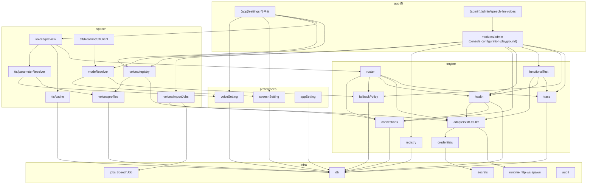

# 00. 충돌 검토 · 도메인 모델 매핑 · 모듈 의존 그래프

> 정본: 엔티티 전체·Prisma 블록은 [`../domain-model.md`](../domain-model.md), API 전체는 [`../api-contract.md`](../api-contract.md), 층·모듈 규칙은 [`../module-dependency.md`](../module-dependency.md), 설정 해석은 [`../configuration-resolution.md`](../configuration-resolution.md), 권한은 [`../role-permission.md`](../role-permission.md). 이 문서는 추가 기획안 §25~§77([`../../음성처리-추가기획안-원본.md`](../../음성처리-추가기획안-원본.md))이 기존 §8·§9 설계([`../../음성처리-기획안-원본.md`](../../음성처리-기획안-원본.md))와 충돌하는 지점의 해소 결정과, 도메인 객체의 모듈·테이블 배치를 고정한다. 문서 01~15 는 이 결정을 전제로 한다.

## 1. 목적

- §77 이 요구한 "기존 아키텍처와의 충돌 여부 검토" 결과를 8건 표로 확정한다.
- §73 도메인 객체 14종이 6층 플랫폼(§76) 중 어느 층·모듈·테이블에 놓이는지 한 곳에서 본다.
- speech-platform 모듈 사이의 import 방향을 그래프로 고정해 §4 의존 규칙(`app → {preferences, conversation, learning, speech} → engine → infra`)을 위반하지 않도록 한다.

## 2. 범위

- 포함: 충돌 8건의 해소, 객체→모듈·테이블 매핑, 모듈 의존 그래프, 문서 01~15 공통 규약(오류 코드 접두·HTTP 매핑·environment·엔진명 비노출).
- 제외: 각 엔티티의 필드 정의(01·05·06·13), API 상세(02~04·09·10), Admin Console 전반(`../admin-console/`).

## 3. 충돌 검토표 (8건)

| # | 기존 설계(§8·§9) | 추가 기획안 요구 | 해소 결정 | 상세 문서 |
|---|---|---|---|---|
| 1 | `speech.config.yml` 파일이 엔진 선택의 진실 | Engine Registry + Connection Profile 을 데이터로 관리, 관리자 UI·연결 테스트(§46~§62) | **Engine Descriptor·Configuration Schema = 코드**(어댑터의 `descriptor()`/`configurationSchema()`), **Connection·Fallback·Health = DB**. yaml 은 Resolver 의 `APPLICATION_CONFIG` 층이자 첫 기동 seed. DB 불가 시 seed 로 degraded 부팅 | 05 · 06 · 07 |
| 2 | `Profile.{tutorModel,ttsVoiceId,ttsStyle,ttsRate,sttMode,…}` 한 테이블 | 사용자 설정 = AI 선생님 / 음성 인식 / 학습 / Advanced 4분면(§26·§62·§72) | `Profile` 에서 음성 컬럼 제거 → `UserVoiceSetting`·`UserSpeechSetting` 신설, 학습 설정만 `Profile` 유지. Advanced 는 capability(`engine.read`) 보유자만 | 13 · 14 |
| 3 | A1 출력 `{reply_ja, reply_reading, reply_ko, correction, end_of_topic}` | §67 구조화 응답 + §68 "LLM 은 의미적 스타일만" + §69 우선순위 | 응답 스키마를 §67 형태로 통일. `speech.style(NEUTRAL·ENCOURAGING·CALM·CHEERFUL)` 은 TTS Parameter Resolver 의 **5순위 입력**일 뿐 `speaker/model/pitch/styleWeight` 를 정하지 못함 | 13 |
| 4 | SBV2 기본 보이스 1개 + `Profile.ttsVoiceId` 문자열 | Voice Registry·다중 Voice Profile·Package Import·Preview·상태 수명주기(§27~§45) | Phase 1 부터 `VoiceProfile` 테이블 + 시드 2~3개 + 통합 미리듣기. Package Import·삭제 수명주기·외부 학습 보이스는 음성 Phase 4 | 01 · 02 · 03 · 04 · 15 |
| 5 | `src/lib/tutor/turn.ts` 가 턴 오케스트레이션 | §66 Conversation Orchestrator, §76 6층 플랫폼 | 디렉토리를 `src/modules/{preferences,conversation,learning,speech,engine,infra}` 6층으로 재편. 음성 관련은 `speech/*`·`engine/*` 에만 | 00 §5 · `../module-dependency.md` |
| 6 | `AI_PROVIDER_<TASK>` env 로 LLM 라우팅 | Advanced 에 LLM Engine/Connection/Test 포함(§26·§72) | LLM 도 Engine Registry 에 `type=LLM`(`claude-cli`·`home-m4`, 확장 슬롯)으로 편입. task→tier(haiku/sonnet/opus) 표는 코드 유지, connection 만 DB | 05 · 06 · 11 · 12 |
| 7 | `TtsCache` 키 = `sha1(text\|voice\|style\|rate)` | Preview 캐시 키 + `previewTextVersion`(§44), pitch·intonation 추가(§39) | 키 = `sha1(text\|voiceId\|style\|styleWeight\|speed\|pitch\|intonation\|engineConnectionId\|textVersion)`. 미리듣기·대화 TTS 가 같은 캐시 사용 | 04 |
| 8 | 온디바이스 플러그인 설정은 앱 내 상수 | §53 sherpa-onnx 런타임 설정도 Connection Profile 로 관리 | 온디바이스 엔진 = `connectionType=ONDEVICE` 인 `EngineConnection`(`reazon-ondevice`). 앱은 기동 시 `GET /api/v1/speech/config` 로 받아 플러그인에 적용. 저사양·오류 시 gateway 로 폴백(Fallback Policy 의 한 사례) | 06 · 11 · 12 |

## 4. 도메인 객체(§73) → 층 · 모듈 · 테이블

| 객체 | 층 | 모듈(TS) / Python | 저장 | 문서 |
|---|---|---|---|---|
| EngineDescriptor · EngineConfigurationSchema · EngineProvider | L5 | `src/modules/engine/registry/{descriptors,schemas,plugins}` / `speech/common/engine/{descriptor,schema}` | 코드 | 05 · 07 |
| EngineRegistry | L5 | `src/modules/engine/registry/index.ts` | `Engine`(디스크립터 스냅샷) | 05 |
| EngineConnectionProfile | L5 | `src/modules/engine/connections` | `EngineConnection` | 06 |
| EngineCredentialReference · SecretResolver | L5 참조 / L6 해석 | `src/modules/engine/credentials` → `src/modules/infra/secrets.ts` / `speech/common/secrets` | 서버 파일·env 만 | 08 |
| EngineHealthStatus | L5 | `src/modules/engine/health` / `speech/common/health` | `EngineHealth`, `EngineConnection.status` | 09 · 10 |
| EngineRouter | L5 | `src/modules/engine/router` / `speech/common/router` | — (결정은 `RequestTrace.steps`) | 11 |
| EngineFallbackPolicy | L5 | `src/modules/engine/fallbackPolicy` | `EngineFallbackPolicy` | 12 |
| VoiceProfile · VoiceRegistry | L4 | `src/modules/speech/voices/{registry,profiles}` | `VoiceProfile` · `VoiceModel` · `VoiceStyle` | 01 · 02 |
| VoicePackage · VoiceImportJob | L4 + M4 | `src/modules/speech/voices/importJobs` / `speech/tts-service` admin | `VoiceImportJob` | 03 |
| VoicePreviewRequest | L4 | `src/modules/speech/voices/preview` + `speech/tts/cache` | `TtsCache` | 04 |
| TTSParameterResolver | L4 | `src/modules/speech/tts/parameterResolver.ts` | — | 13 |
| SpeechModeResolver | L4 | `src/modules/speech/modeResolver.ts` | — | 11 |
| UserVoiceSetting · UserSpeechSetting · AppSetting | L1 | `src/modules/preferences/*` | 동명 테이블 | 13 · 04 |
| RequestTrace · AuditLog | L5 / L6 | `src/modules/engine/trace` · `src/modules/infra/audit` | 동명 테이블 | 10 · [`../admin-console/13-request-trace-model.md`](../admin-console/13-request-trace-model.md) |

## 5. 모듈 의존 그래프

규칙: 화살표 방향으로만 import 한다. `speech/*` 는 `engine/*` 의 공개 API(`index.ts`)만 쓰고 `engine/adapters` 내부 파일을 직접 import 하지 않는다. `engine/*` 는 `speech/*`·`preferences/*` 의 타입을 모른다(파라미터는 plain object). Python `speech/common/{engine,router,secrets,health}` 는 같은 규칙을 Python 으로 옮긴 것이며 gateway·worker·tts-service 가 공유한다.

## 6. 문서 01~15 공통 규약

| 항목 | 규약 |
|---|---|
| 오류 코드 | `E_<영역>_<원인>` 대문자 스네이크. 영역 = `VOICE`·`IMPORT`·`PREVIEW`·`ENGINE`·`CONN`·`SECRET`·`HEALTH`·`TEST`·`ROUTE`·`FALLBACK`·`SETTING`. 응답 본문 `{error:{code, message, details?}}` |
| HTTP 매핑 | 400 입력 검증 · 401 미인증 · 403 capability 없음 · 404 없음(IDOR 포함) · 409 상태 충돌 · 413 업로드 상한 · 422 의미 검증(스키마·범위) · 429 rate limit · 502 상류 엔진 실패 · 503 사용 가능한 connection 없음 · 504 상류 타임아웃 |
| `environment` | 설정 계열 엔티티(`EngineConnection`·`EngineFallbackPolicy`·`AppSetting`·`VoiceProfile`·`VoiceModel`·`RuntimeOverride`·`ConfigurationVersion`)는 `environment` 컬럼을 갖고 프로세스는 `APP_ENV` 행만 읽는다. 값은 `LOCAL`·`PRODUCTION`(STAGING 슬롯). `Engine`(코드 스냅샷)은 환경 무관(05 §3.4). 상세: [`../admin-console/16-environment-configuration-policy.md`](../admin-console/16-environment-configuration-policy.md) |
| 엔진명 비노출 | `/api/v1/*` 응답·일반 사용자 화면에 `engineId`·`connectionId`·`model`·`speaker` 를 넣지 않는다. 라우트·화면·L1~L4 어디에도 엔진명 분기 없음(엔진명은 `engine/adapters`·seed 에만) |
| 권한 | 관리자 API 는 role 이 아니라 capability 로 검사(`can(user, 'voices.manage')`). 매트릭스는 `../role-permission.md` |
| 감사 | 관리자 쓰기 API 는 전부 `AuditLog` 1행 + 설정 스코프면 `ConfigurationVersion` 1행 |
| 시크릿 | 값은 DB·앱·Export·Trace·Log 어디에도 없음. `credentialRef` 문자열만(08) |

## 7. Phase

- 앱 Phase 1: 충돌 해소 1·2·3·6·8 반영(디스크립터·seed connection 6종·Router·Fallback(온디바이스→gateway)·VoiceProfile 시드·UserVoiceSetting/UserSpeechSetting·통합 미리듣기·`/api/v1/speech/config`·Advanced 읽기+연결 테스트).
- 앱 Phase 2: Advanced 편집·Health 스케줄·Fallback 정책 편집.
- 음성 Phase 4: 충돌 4 의 나머지(Voice Package Import·수명주기·다중 학습 보이스·Voice 관리 UI).

## 8. 미결

1. `EngineFallbackPolicy` 의 키를 `role @id` 로 둘지 `@@id([environment, role])` 로 둘지 — `environment` 컬럼 규약상 후자를 권고, `../domain-model.md` 에서 확정.
2. Python 서비스가 DB 를 직접 읽을지(Prisma 없이 SQL) 앱의 `/api/internal/speech/config` 를 통해 받을지 — 06 §5 에서 후자를 기본으로 두되 gateway 기동 시 앱이 내려가 있으면 seed 로 degraded 부팅.
3. `Engine.capabilities`(엔진 기능) 와 권한 capability(`voices.manage` 등)의 용어 충돌 — 05 에서 전자를 `EngineCapability` 로 부른다.
