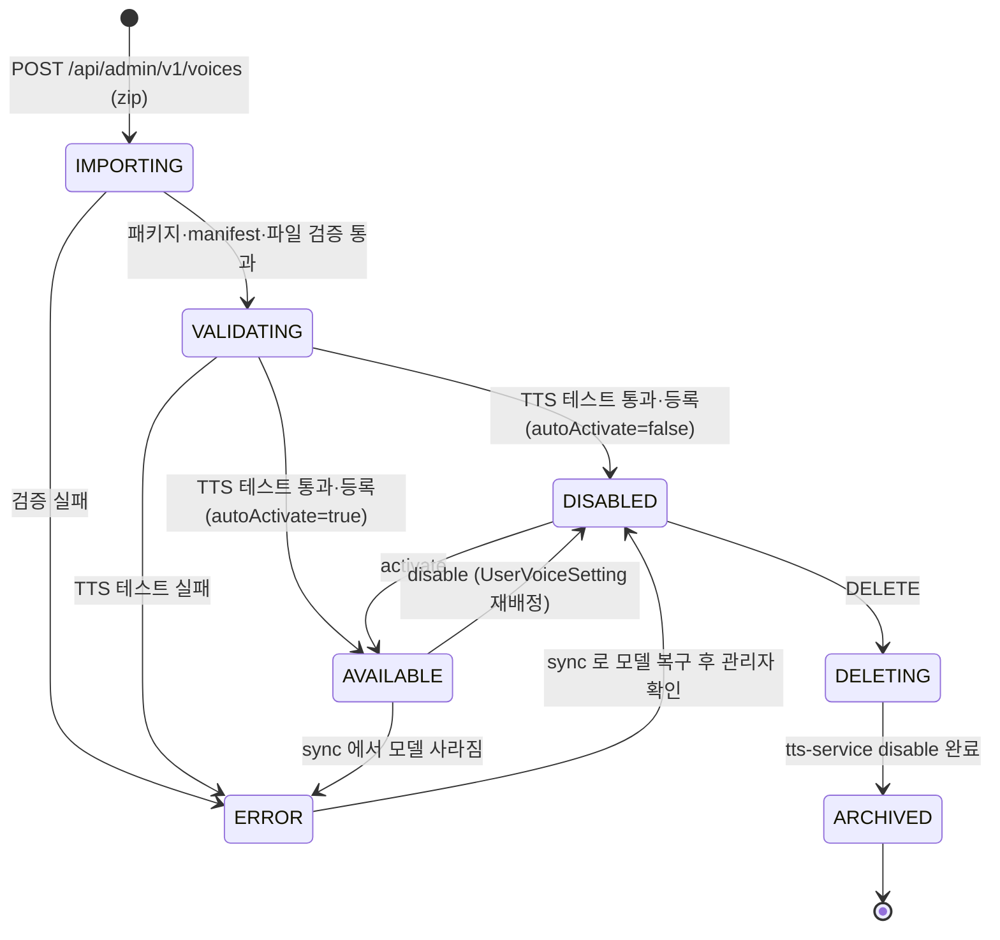
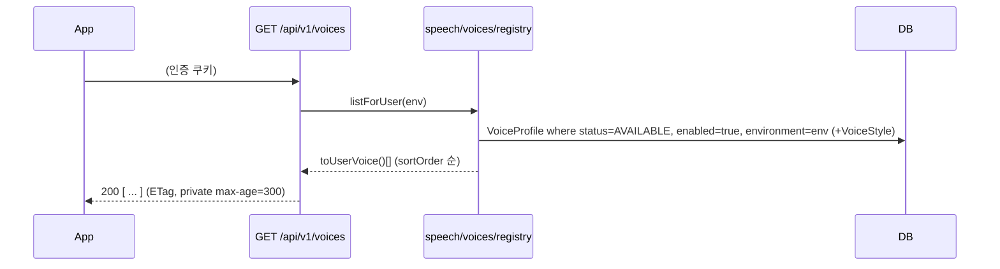

# 01. VoiceProfile · VoiceModel · VoiceStyle Entity 설계

> 정본: 필드 전체·Prisma 블록·인덱스는 [`../domain-model.md`](../domain-model.md) 의 L4 speech 절. 이 문서는 세 엔티티의 역할 분담, Model→Speaker→Style 추상화, `defaults` JSON 규격, 상태 수명주기, 사용자용 투영(projection)만 정의한다. 원문: 추가 기획안 §27~§31·§37·§45.

## 1. 목적

AI 선생님 목소리를 코드 상수가 아니라 **데이터**로 관리한다(§75-1). Style-Bert-VITS2 의 `model_id / speaker_id / style / style_weight` 조합을 사용자에게는 `VoiceProfile` 하나로 단순화하고(§29·§75-6), 모델 파일의 실체(`VoiceModel`)와 표시 단위(`VoiceProfile`)를 분리해 Import·재동기화·비활성화가 사용자 설정을 깨뜨리지 않게 한다.

## 2. 범위

- 포함: `VoiceProfile`·`VoiceModel`·`VoiceStyle` 의 필드 발췌와 의미, 관계, `defaults` JSON, `VoiceStatus` 전이, 사용자 투영, 시드.
- 제외: Registry API(02), Import/삭제 절차(03), 미리듣기(04), 사용자 설정 우선순위(13).

## 3. 설계

### 3.1 세 엔티티의 역할

```
VoiceModel (모델 파일 1개 = SBV2 model_assets/<modelName>/)
   └─ VoiceProfile (표시 단위: 모델 + speaker 1명 + 기본값)   ← 사용자가 고르는 것
         └─ VoiceStyle (그 profile 에서 노출할 style 목록·라벨)
```

- 한 `VoiceModel` 에 speaker 가 여럿이면 `VoiceProfile` 도 여럿(예: 시드 모델 `jvnv` 의 화자 F1·M1 → Haruka·Takumi).
- `VoiceStyle` 은 `VoiceModel.styles`(SBV2 `/models/info` 의 style→id 맵) 중 **관리자가 노출하기로 한 부분집합**에 표시 라벨을 붙인 것. 모델에 있어도 `VoiceStyle` 행이 없으면 사용자에게 보이지 않는다.

### 3.2 필드 발췌

| 엔티티 | 필드 | 의미 · 제약 |
|---|---|---|
| `VoiceModel` | `id`(= `modelName`, `^[a-z0-9_]{3,40}$`) | SBV2 `model_assets/<modelName>` 디렉토리명과 동일 |
| | `engineConnectionId` | 이 모델이 놓인 TTS connection(`style-bert-m4`). 다른 호스트로 옮기면 새 행 |
| | `path`, `sha256`, `version`(semver) | tts-service 가 보고한 경로·safetensors 해시·manifest 버전 |
| | `speakers Json {name: id}`, `styles Json {name: id}` | `/models/info` 정규화 결과. 동기화(02 §3.4)로만 갱신 |
| | `status VoiceStatus`, `importedAt`, `updatedAt` | |
| `VoiceProfile` | `id`(= 기획안 `voiceId`, `^[a-z0-9_]{3,40}$`) | 사용자 설정·캐시 키·Utterance 가 참조하는 안정 식별자. **변경 불가** |
| | `displayName`(≤40)·`description`(≤120)·`sortOrder`·`enabled` | 사용자 화면 표기. `enabled=false` 는 관리자가 잠시 감춘 상태(status 와 별개) |
| | `ttsEngineId`(= `Engine.id`, Phase 1 은 `style-bert` 고정) | 향후 외부 TTS 프로파일 확장 슬롯 |
| | `voiceModelId`, `speaker` | `speaker` 는 `VoiceModel.speakers` 의 키여야 함(검증 V-3) |
| | `defaults Json` | §3.3 규격 |
| | `previewPath` | Import 시 동봉된 `preview/preview.wav` 또는 첫 미리듣기 결과 경로(DATA_ROOT 상대) |
| | `status VoiceStatus`, `environment` | §3.4 |
| `VoiceStyle` | `voiceProfileId`, `name`, `label`, `styleWeightDefault`, `sortOrder` | `name` 은 `VoiceModel.styles` 의 키(검증 V-4). `label` 은 사용자 표기(예: `Happy`→"밝게") |

### 3.3 `defaults` JSON 규격

```json
{ "style": "Neutral", "styleWeight": 1.0, "speed": 1.0, "pitch": 1.0, "intonation": 1.0 }
```

| 키 | 범위 | SBV2 매핑 | 비고 |
|---|---|---|---|
| `style` | `VoiceStyle.name` 중 하나 | `style` | 사용자 `style='AUTO'` 일 때의 기본 |
| `styleWeight` | 0.0 ~ 2.0 | `style_weight` | |
| `speed` | 0.6 ~ 1.2 | `length = 1 / speed` | Learning 모드 프리셋 0.6·0.8·1.0 |
| `pitch` | 0.8 ~ 1.2 | `pitch_scale` | |
| `intonation` | 0.8 ~ 1.2 | `intonation_scale` | |

범위는 `UserVoiceSetting`(13) 과 동일하며 `src/modules/speech/voices/profiles.ts` 의 상수 하나를 두 곳이 공유한다. 우선순위(User > Profile defaults > Persona > Context > LLM)는 13 §3.4.

### 3.4 상태 수명주기 (`VoiceStatus`)



| 상태 | 사용자 목록 | 관리자 목록 | TTS Router 선택 | 비고 |
|---|---|---|---|---|
| `IMPORTING`·`VALIDATING` | 숨김 | 진행률 표시 | 불가 | `VoiceImportJob` 과 동행 |
| `AVAILABLE` | 표시(`enabled=true` 일 때) | 표시 | 가능 | 유일하게 사용자 선택 가능 |
| `DISABLED` | 숨김 | 표시 | 불가(기존 캐시 재생은 가능) | 재활성 가능 |
| `ERROR` | 숨김 | 경고 | 불가 | `VoiceModel.status` 도 ERROR |
| `DELETING`·`ARCHIVED` | 숨김 | ARCHIVED 필터로만 | 불가 | 행은 남김(Utterance·TtsCache 참조 보존) |

`VoiceModel.status` 는 profile 과 같은 enum 이지만 모델 단위이며, 모델이 `ERROR`/`ARCHIVED` 면 그 모델의 모든 profile 이 같은 상태로 내려간다(역방향은 아님).

### 3.5 사용자용 투영 (`/api/v1/voices` 항목)

```json
{ "id": "teacher_haruka", "name": "Haruka", "description": "밝고 친절한 목소리", "available": true,
  "defaults": { "style": "Friendly", "styleWeight": 1.0, "speed": 1.0, "pitch": 1.0, "intonation": 1.0 },
  "styles": [ { "name": "Neutral", "label": "기본" }, { "name": "Friendly", "label": "친근하게" } ],
  "previewUrl": "/api/v1/voices/teacher_haruka/preview-sample" }
```

투영에 **넣지 않는 것**: `ttsEngineId`·`voiceModelId`·`speaker`·`environment`·`status`(→ `available` boolean 으로만)·경로·해시. 투영 함수는 `src/modules/speech/voices/profiles.ts#toUserVoice()` 하나뿐이며 관리자 응답(02 §3.3)은 별도 함수.

### 3.6 시드 (Phase 1, `prisma/seed-data/voices.json`)

SBV2 기본 배포 모델(jvnv 계열, 약관 확인 후)의 화자에 표시명을 부여한다. 예: `teacher_haruka`(F1, Friendly 기본) · `teacher_sakura`(F2, Neutral) · `teacher_takumi`(M1, Neutral). `VoiceModel` 시드 행은 `status=AVAILABLE` 이지만 `sha256`·`speakers`·`styles` 는 첫 `POST /api/admin/v1/voices/sync` 로 채워지며, 동기화 전에는 `defaults.style` 검증(V-4)을 건너뛴다.

## 4. 시퀀스 — 사용자 목록 조회



## 5. 검증 규칙 · 오류 코드

| 규칙 | 내용 | 오류 |
|---|---|---|
| V-1 | `VoiceProfile.id`·`VoiceModel.id` 는 `^[a-z0-9_]{3,40}$`, 생성 후 불변 | `E_VOICE_ID_INVALID` (400) / `E_VOICE_ID_IMMUTABLE` (409) |
| V-2 | `voiceModelId` 가 존재하고 `status ∉ {ERROR, DELETING, ARCHIVED}` | `E_VOICE_MODEL_UNAVAILABLE` (422) |
| V-3 | `speaker ∈ keys(VoiceModel.speakers)` | `E_VOICE_SPEAKER_UNKNOWN` (422) |
| V-4 | `defaults.style` 과 모든 `VoiceStyle.name` ∈ `keys(VoiceModel.styles)` | `E_VOICE_STYLE_UNKNOWN` (422) |
| V-5 | `defaults` 수치 범위(§3.3) | `E_VOICE_DEFAULTS_RANGE` (422) |
| V-6 | 같은 환경에 `AVAILABLE` profile 이 0개가 되는 disable/delete 금지 | `E_VOICE_LAST_AVAILABLE` (409) |
| V-7 | `AppSetting voice.defaultProfileId` 가 가리키는 profile 은 disable 전에 기본값을 바꿔야 함 | `E_VOICE_DEFAULT_PROTECTED` (409) |
| V-8 | 상태 전이는 §3.4 그래프의 간선만 허용 | `E_VOICE_STATE_TRANSITION` (409) |

## 6. Phase

- Phase 1: 세 테이블 + 시드 + 투영 + V-1~V-7. 상태는 `AVAILABLE`/`DISABLED`/`ERROR` 만 실제로 발생.
- 음성 Phase 4: `IMPORTING`·`VALIDATING`·`DELETING`·`ARCHIVED` 전이(03).

## 7. 미결

1. `styleWeight` 상한 — SBV2 최신 버전의 `style_weight` 권장 범위를 실측(task-003 게이트)해 2.0 을 조정.
2. `previewPath` 를 `TtsCache` 행으로 대체할지(캐시 만료 시 자동 재생성) — 04 와 함께 결정.
3. 외부 TTS(ElevenLabs 등) 프로파일이 생기면 `VoiceModel` 이 파일이 아닌 원격 voice id 를 가리켜야 하므로 `path` 를 nullable 로 둘지.
