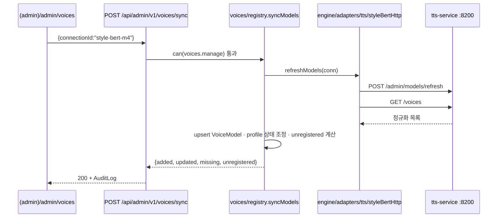

# 02. Voice Registry API 명세

> 정본: 엔드포인트·요청/응답 스키마 전체는 [`../api-contract.md`](../api-contract.md) 의 `/api/v1/voices*`·`/api/admin/v1/voices*` 절, 엔티티는 [`../domain-model.md`](../domain-model.md), capability 는 [`../role-permission.md`](../role-permission.md). 이 문서는 Registry 의 책임, 각 API 의 의미·상태 규칙, tts-service `/voices` 동기화, 캐싱만 정의한다. 원문: 추가 기획안 §31·§35·§38.

## 1. 목적

Voice 를 Enum 이 아니라 Registry 에서 동적으로 조회·등록·수정·비활성화·삭제·동기화한다(§31). 사용자 API 는 `AVAILABLE` 만, 관리자 API 는 전체를 다루며 두 API 의 응답 형태를 분리해 엔진·모델 정보가 사용자 쪽으로 새지 않게 한다.

## 2. 범위

- 포함: Registry 책임 표, `GET /api/v1/voices`, 관리자 CRUD·activate·disable·sync·import-jobs 의 의미와 상태 규칙, tts-service `GET /voices` 정규화·동기화 알고리즘, 캐싱·무효화.
- 제외: Import 파이프라인·삭제 정책 상세(03), 미리듣기(04), 화면(15).

## 3. 설계

### 3.1 Registry 책임(§31) → 구현 위치

| 책임 | 함수(`src/modules/speech/voices/registry.ts`) | API |
|---|---|---|
| Voice 조회 | `listForUser(env)` · `listForAdmin(env, filter)` · `get(id)` | `GET /api/v1/voices` · `GET /api/admin/v1/voices[?status=]` · `GET /api/admin/v1/voices/{id}` |
| Voice 등록 | `register(input)` (zip import 또는 기존 모델에서 생성) | `POST /api/admin/v1/voices` |
| Voice 수정 | `update(id, patch)` | `PUT /api/admin/v1/voices/{id}` |
| Voice 비활성화 / 활성화 | `disable(id, reason)` · `activate(id)` | `POST …/{id}/disable` · `POST …/{id}/activate` |
| Voice 삭제 | `archive(id)` | `DELETE /api/admin/v1/voices/{id}` |
| Voice Model 연결 · Speaker 연결 | `register`/`update` 의 `voiceModelId`·`speaker` 검증(01 V-2·V-3) | 위와 동일 |
| Style 조회 | `VoiceStyle` 포함 조회 | `GET` 응답에 포함 |
| Preview 생성 | `voices/preview.ts` 로 위임 | 04 |
| Voice 상태 관리 | `transition(id, to)` (01 §3.4 간선 검증) | 각 API 내부 |
| Model 재동기화 | `syncModels(connectionId)` | `POST /api/admin/v1/voices/sync` |

### 3.2 사용자 API — `GET /api/v1/voices`

- 인증 필요, capability `settings.read`(모든 role 보유).
- 조건: `environment = APP_ENV`, `status = AVAILABLE`, `enabled = true`. 정렬 `sortOrder, displayName`.
- 응답: 01 §3.5 투영 배열. 빈 배열이면 앱은 "목소리를 준비 중이에요" 상태(15 가 아닌 사용자 설정 화면 규칙).
- 헤더: `ETag`(목록 `updatedAt` 최대값 + 개수의 해시), `Cache-Control: private, max-age=300`. `If-None-Match` 일치 시 304.

### 3.3 관리자 API

capability: 조회 `voices.read`, 나머지 `voices.manage`. 모든 쓰기 = `AuditLog`(scope `VOICE_PROFILE`) + `ConfigurationVersion`(scope `VOICE_PROFILE`, snapshot = profile+styles).

| API | 입력 | 규칙 | 결과 |
|---|---|---|---|
| `GET /api/admin/v1/voices?status=&includeArchived=` | 필터 | 기본은 `ARCHIVED` 제외 | 관리자 투영: 사용자 투영 + `status, enabled, ttsEngineId, voiceModelId, speaker, model:{version, sha256, status, connectionId}, lastPreviewAt, usedByUsers(count)` |
| `GET /api/admin/v1/voices/{id}` | | | 위 + `styles(전체 모델 style 과 노출 여부)`, 최근 `EngineHealth(FUNCTIONAL)` 1건, 진행 중 `VoiceImportJob` |
| `POST /api/admin/v1/voices` (JSON) | `{id, displayName, description?, voiceModelId, speaker, defaults?, styles?:[{name,label,styleWeightDefault?}], autoActivate?:false}` | 01 V-1~V-5. `VoiceModel.status=AVAILABLE` 이어야 함 | 201, status = `DISABLED`(또는 `AVAILABLE`) |
| `POST /api/admin/v1/voices` (multipart zip) | Voice Package | 03 파이프라인으로 위임 | 202 `{importJobId}` |
| `PUT /api/admin/v1/voices/{id}` | `{displayName?, description?, defaults?, styles?, sortOrder?, enabled?}` | `id·voiceModelId·speaker` 는 변경 불가(→ 새 profile). `defaults` 변경 시 해당 voice 의 `TtsCache` 는 유지(키에 값 포함) | 200 |
| `POST …/{id}/activate` | | `DISABLED → AVAILABLE` 만. 모델 `AVAILABLE` 확인, 직전 FUNCTIONAL 테스트가 24h 이내 ok 가 아니면 즉시 1회 실행(10) 후 실패 시 거부 | 200 |
| `POST …/{id}/disable` | `{reason?}` | `AVAILABLE → DISABLED`. 01 V-6·V-7. 이 voice 를 쓰는 `UserVoiceSetting` 을 `AppSetting voice.defaultProfileId` 로 재배정(03 §3.5) | 200 `{reassignedUsers}` |
| `DELETE …/{id}` | | `DISABLED → DELETING → ARCHIVED`(03) | 202 |
| `POST /api/admin/v1/voices/sync` | `{connectionId?}` (기본: role TTS primary) | §3.4 | 200 `{added[], updated[], missing[], unregistered[]}` |
| `GET /api/admin/v1/voices/import-jobs/{id}` | | | `VoiceImportJob` 전체(03 §3.3) |

### 3.4 tts-service `GET /voices` 정규화와 동기화

tts-service(M4)는 SBV2 `/models/info` 를 아래 형태로 정규화해서 돌려준다(앱·모바일은 SBV2 원 API 를 직접 호출하지 않음, §35).

```json
[ { "modelName": "teacher_haruka", "modelId": 0, "path": "model_assets/teacher_haruka",
    "speakers": { "Haruka": 0 }, "styles": { "Neutral": 0, "Friendly": 1, "Cheerful": 2 },
    "version": "1.0.0", "sha256": "…", "loaded": true } ]
```

`version`·`sha256` 은 모델 디렉토리의 `kaiwa-manifest.json`(Import 시 생성, 03) 에서 읽고 없으면 null.

동기화 알고리즘(`syncModels`):
1. `POST /admin/models/refresh` → `GET /voices` (둘 다 tts-service, adapter `engine/adapters/tts/styleBertHttp`).
2. 응답의 각 `modelName` 을 `VoiceModel.id` 로 upsert: `speakers`·`styles`·`path`·`version`·`sha256` 갱신, `status` 가 `ERROR` 였으면 `DISABLED` 로 복구(관리자가 activate).
3. DB 에 있으나 응답에 없는 모델 → `VoiceModel.status=ERROR`, 그 모델의 `VoiceProfile` 중 `AVAILABLE`/`DISABLED` → `ERROR`(사용자 `UserVoiceSetting` 재배정은 disable 과 동일 절차, 03 §3.5). `ARCHIVED` 는 건드리지 않음.
4. 응답에 있으나 `VoiceProfile` 이 하나도 없는 모델 → `unregistered[]` 로 반환(화면에서 "프로파일 만들기" 진입).
5. 기존 profile 의 `speaker`/`defaults.style`/`VoiceStyle.name` 이 새 맵에 없으면 profile → `ERROR` + `detail`.
6. `AuditLog(action='voices.sync')` + 결과 요약. 동시 실행 방지: `AppSetting voice.sync.lock`(TTL 5분).

### 3.5 캐싱 · 무효화

| 계층 | 내용 | 무효화 |
|---|---|---|
| 서버 메모리 | `listForUser` 결과 60초(환경별) | 관리자 쓰기 API·sync 성공 시 즉시 |
| HTTP | ETag + `private, max-age=300` | ETag 변화 |
| 앱 | 설정 화면 진입 시 재조회, `UserVoiceSetting.voiceProfileId` 가 목록에 없으면 기본 voice 로 표시하고 저장 시 서버가 재배정 | — |

## 4. 시퀀스 — 재동기화



## 5. 검증 규칙 · 오류 코드

| 코드 | HTTP | 상황 |
|---|---|---|
| `E_VOICE_NOT_FOUND` | 404 | id 없음 또는 다른 환경 |
| `E_VOICE_STATE_TRANSITION` | 409 | activate/disable/delete 가 01 §3.4 간선 밖 |
| `E_VOICE_MODEL_UNAVAILABLE` · `E_VOICE_SPEAKER_UNKNOWN` · `E_VOICE_STYLE_UNKNOWN` · `E_VOICE_DEFAULTS_RANGE` | 422 | 01 V-2~V-5 |
| `E_VOICE_LAST_AVAILABLE` · `E_VOICE_DEFAULT_PROTECTED` | 409 | 01 V-6·V-7 |
| `E_VOICE_ACTIVATE_TEST_FAILED` | 422 | activate 직전 기능 테스트 실패(`details.healthId`) |
| `E_VOICE_SYNC_IN_PROGRESS` | 409 | lock 보유 중 |
| `E_VOICE_SYNC_UPSTREAM` | 502/504 | tts-service 응답 실패·타임아웃 |
| `E_VOICE_IMMUTABLE_FIELD` | 400 | PUT 에 `id·voiceModelId·speaker` 포함 |

## 6. Phase

- Phase 1: `GET /api/v1/voices`, 관리자 `GET`·`PUT`·`activate`·`disable`·`sync`, JSON `POST`(기존 모델에서 profile 생성). 시드 모델 동기화가 Phase 1 배포 체크리스트에 들어간다.
- 음성 Phase 4: multipart `POST`(Import)·`DELETE`·`import-jobs`.

## 7. 미결

1. `usedByUsers` 집계를 매 목록 조회마다 계산할지(1인 앱이라 비용 무시 가능) 상세 조회에서만 계산할지.
2. `GET /voices` 의 `loaded` 플래그를 Health(09) 의 DEGRADED 판정에 쓸지.
3. tts-service 가 여러 대(LOCAL/PRODUCTION 다른 M4)가 되면 `sync` 를 connection 마다 돌리고 `VoiceModel` 을 `(engineConnectionId, modelName)` 복합키로 바꿔야 함 — `../domain-model.md` 미결로 이관.
