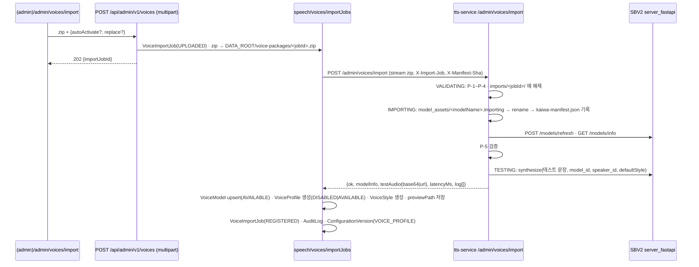
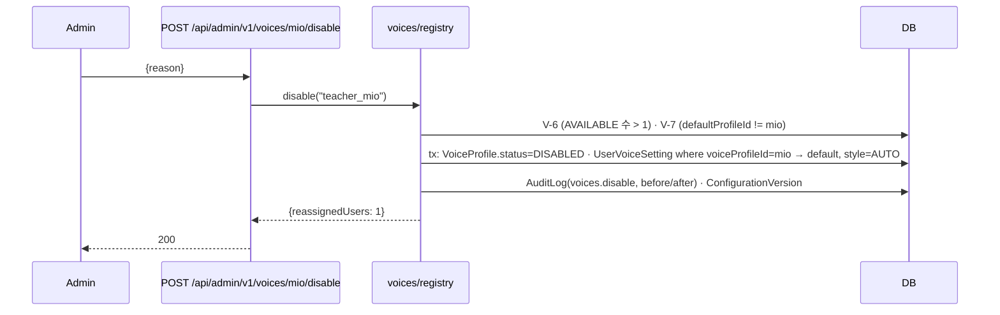

# 03. Voice Import / Delete API 명세

> 정본: API 스키마는 [`../api-contract.md`](../api-contract.md)(`POST /api/admin/v1/voices`, `DELETE /api/admin/v1/voices/{id}`, `GET /api/admin/v1/voices/import-jobs/{id}`, M4 tts-service `/admin/voices/*`), 엔티티는 [`../domain-model.md`](../domain-model.md)(`VoiceImportJob`·`VoiceModel`·`VoiceProfile`). 이 문서는 Voice Package zip 규격, Import 파이프라인, `VoiceImportJob` 상태, disable→archive→delete 정책, M4 파일 처리만 정의한다. 원문: 추가 기획안 §32~§37·§64.

## 1. 목적

외부 학습 환경에서 만든 Style-Bert-VITS2 모델을 **표준 패키지**로 받아 검증→배치→refresh→테스트→등록까지 자동화하고(§32~§34), 제거는 즉시 파일 삭제가 아니라 `DISABLED → ARCHIVED → (별도 작업) 물리 삭제` 단계로 처리해 사용자 설정과 이력을 보존한다(§36·§75-4).

## 2. 범위

- 포함: 패키지 zip 규격·`manifest.json` 스키마, 업로드~활성화 파이프라인, `VoiceImportJob` 상태·로그, 실패 처리·재시도, disable/delete 정책과 `UserVoiceSetting` 재배정, M4 디스크·디렉토리 규칙.
- 제외: 학습 파이프라인 자체(범위 밖), Registry 일반 CRUD(02), 화면(15).

## 3. 설계

### 3.1 Voice Package 규격

```
teacher_mio.zip
├─ manifest.json
├─ model/
│   ├─ config.json            (필수, SBV2 config)
│   ├─ <name>.safetensors     (필수, 정확히 1개, ≤ 500MB)
│   └─ style_vectors.npy      (필수)
└─ preview/
    └─ preview.wav            (선택, 16k/22k/44.1k mono ≤ 15s)
```

`manifest.json`:

```json
{ "voiceId": "teacher_mio", "name": "Mio", "description": "밝고 자연스러운 회화형 목소리",
  "engine": "STYLE_BERT", "modelName": "teacher_mio", "speaker": "Mio",
  "defaultStyle": "Neutral", "styles": [ { "name": "Neutral", "label": "기본" }, { "name": "Happy", "label": "밝게" } ],
  "defaults": { "styleWeight": 1.0, "speed": 1.0, "pitch": 1.0, "intonation": 1.0 },
  "version": "1.0.0",
  "sha256": { "model/config.json": "…", "model/mio.safetensors": "…", "model/style_vectors.npy": "…" },
  "license": { "name": "CC-BY-NC-4.0", "url": "…", "allowService": true } }
```

| 규칙 | 내용 |
|---|---|
| P-1 | zip ≤ 600MB, 항목 ≤ 20개, 경로에 `..`·절대경로·심볼릭링크·중첩 zip 금지, 파일명 ASCII |
| P-2 | `voiceId`·`modelName` 은 `^[a-z0-9_]{3,40}$`, `engine` 은 `STYLE_BERT`(→ `Engine.id = style-bert`) 만(확장 슬롯) |
| P-3 | `version` semver. 같은 `modelName` 이 이미 있으면 `version` 이 더 커야 하고 `replace=true` 쿼리가 필요 |
| P-4 | `sha256` 맵의 모든 파일이 존재하고 해시 일치. 맵에 없는 `model/` 파일은 거부 |
| P-5 | `speaker`·`defaultStyle`·`styles[].name` 은 refresh 후 `/models/info` 결과에 실제로 존재해야 함 |
| P-6 | `license.allowService=false` 면 거부(개인용 앱이라도 약관 위반 모델은 등록하지 않음) |

### 3.2 Import 파이프라인



- 앱은 zip 을 **파싱하지 않고** 크기·확장자·`manifest.json` 존재만 확인해 M4 로 스트리밍한다(AGPL 경계와 무관하게 파일 처리를 한 곳에 둠). M4 응답이 오기 전까지 job 은 `IMPORTING` 이며 앱은 `GET …/import-jobs/{id}` 폴링(3초)로 M4 의 진행 로그를 중계한다(M4 `GET /admin/voices/import/{jobId}`).
- `autoActivate=true` 면 등록 직후 profile `AVAILABLE`, 아니면 `DISABLED`(02 activate 로 노출).
- `replace=true` 재가져오기: 기존 `VoiceProfile` 은 유지(id·설정 보존), `VoiceModel.version/sha256/speakers/styles` 갱신, 해당 voice 의 `TtsCache` 행 삭제(04 §3.5), 기존 `VoiceStyle` 중 새 모델에 없는 style 은 삭제하고 `defaults.style` 이 사라졌으면 `defaultStyle` 로 교체.

### 3.3 `VoiceImportJob`

| 필드 | 값 |
|---|---|
| `status` | `UPLOADED → VALIDATING → IMPORTING → TESTING → REGISTERED` / 어느 단계든 `FAILED` |
| `log Json[]` | `[{at, step, level(INFO|WARN|ERROR), message, code?}]` — M4 로그를 그대로 누적(값에 경로는 `model_assets/` 상대만) |
| `packageName`, `sha256`(zip 전체), `voiceProfileId?`, `createdAt`, `finishedAt` | |
| `error?` | `{code, message, step}` |

실패 시 M4 는 `imports/<jobId>/` 와 `.importing` 디렉토리를 삭제하고 `model_assets` 를 건드리지 않는다(TESTING 실패는 예외: 이미 배치된 디렉토리를 `model_assets/_failed/<modelName>-<jobId>` 로 이동 후 refresh). 앱 쪽 zip 은 `FAILED`/`REGISTERED` 24h 후 삭제. 재시도는 새 업로드(새 job).

동시성: 환경당 진행 중 job 1개(`AppSetting voice.import.lock`, TTL 30분). 같은 `modelName` 의 job 이 진행 중이면 `E_IMPORT_IN_PROGRESS`.

### 3.4 삭제 정책

```
AVAILABLE ──disable──▶ DISABLED ──DELETE──▶ DELETING ──M4 disable 완료──▶ ARCHIVED ──(runbook)──▶ 물리 삭제
```

| 단계 | API | 서버 동작 | 사용자 영향 |
|---|---|---|---|
| disable | `POST /api/admin/v1/voices/{id}/disable` | 01 V-6·V-7 검사 → status `DISABLED` → §3.5 재배정 → 캐시는 유지 | 목록에서 사라짐, 진행 중 대화의 남은 문장은 캐시 히트만 재생, 미스면 재배정된 voice 로 합성 |
| delete | `DELETE /api/admin/v1/voices/{id}` | `DISABLED` 만 허용 → `DELETING` → M4 `POST /admin/voices/{model}/disable`(디렉토리를 `model_assets_archived/<modelName>-<ts>` 로 이동 + refresh; 같은 모델의 다른 profile 이 `DISABLED`/`AVAILABLE` 로 남아 있으면 이동하지 않음) → `ARCHIVED` → 해당 voice 의 `TtsCache` 삭제 | 없음(이미 DISABLED) |
| purge | API 없음. runbook `agent-vault/30-Knowledge/runbooks/voice-purge.md` 가 M4 `POST /admin/voices/{model}/delete` 실행 | `ARCHIVED` 이고 30일 경과한 모델만. `VoiceModel.path=null`, `status` 유지 | 없음 |

`ARCHIVED` profile 행은 삭제하지 않는다(`Utterance`·`ChatMessage.toolLog`·`RequestTrace` 의 voice 참조 보존).

### 3.5 `UserVoiceSetting` 재배정

`disable`/sync-ERROR 시 `voiceProfileId = X` 인 모든 `UserVoiceSetting` 을 트랜잭션 하나에서 `AppSetting voice.defaultProfileId` 로 바꾸고 `style='AUTO'` 로 초기화한다(다른 voice 의 style 이름은 유효하지 않으므로). `speed·pitch·intonation·styleWeight·speechProfile` 는 유지. 각 사용자에게는 다음 앱 기동 시 `GET /api/v1/settings/voice` 응답의 `notice: {code:'VOICE_REASSIGNED', from:'Mio', to:'Haruka'}` 로 1회 안내(13 §3.6). 기본 voice 자체가 대상이면 V-7 로 거부 → 관리자가 `AppSetting` 을 먼저 바꿔야 한다.

### 3.6 M4 파일 처리

| 경로(M4 `~/kaiwa-tts-run/`) | 용도 | 규칙 |
|---|---|---|
| `imports/<jobId>/` | 업로드 해제 스테이징 | job 종료 시 삭제. 시작 전 여유 디스크 ≥ zip×3 확인(`E_IMPORT_DISK_FULL`) |
| `model_assets/<modelName>/` | 서비스 모델 | `kaiwa-manifest.json`(manifest + importedAt + jobId) 동봉. 디렉토리 교체는 `.importing` → rename 원자적. **5차 보완(P1)**: 버전 도입 시 `model_assets/<modelName>@<version>/` 로 두고 `replace=true` 는 새 `VoiceModelVersion` 을 만든다(`16` §10); 참여자 "SBV2 server_fastapi" 는 래퍼 내부 모델 홀더로 읽는다 |
| `model_assets/_failed/`, `model_assets_archived/` | 실패·보관 | SBV2 스캔 대상 밖. purge runbook 이 정리 |
| `secrets/` | tts-service 자체 토큰 | 08 |

tts-service 는 SBV2 를 import 하는 유일한 프로세스(AGPL 격리). 앱 서버(우분투)는 모델 파일을 갖지 않는다.

## 4. 시퀀스 — disable 과 재배정



## 5. 검증 규칙 · 오류 코드

| 코드 | HTTP | 상황 |
|---|---|---|
| `E_IMPORT_PACKAGE_INVALID` | 400 | P-1 위반, zip 손상, `manifest.json` 없음 |
| `E_IMPORT_MANIFEST_INVALID` | 422 | P-2·P-6, 필수 키 누락, `details.field` |
| `E_IMPORT_VERSION_CONFLICT` | 409 | P-3 |
| `E_IMPORT_CHECKSUM_MISMATCH` | 422 | P-4 |
| `E_IMPORT_MODEL_NOT_VISIBLE` | 422 | P-5: refresh 후 `/models/info` 에 speaker/style 없음 |
| `E_IMPORT_TTS_TEST_FAILED` | 422 | TESTING 실패(`details.latencyMs, stderrTail`) |
| `E_IMPORT_IN_PROGRESS` | 409 | lock 보유 |
| `E_IMPORT_DISK_FULL` | 507 | M4 여유 공간 부족 |
| `E_IMPORT_UPSTREAM` | 502/504 | tts-service 무응답 |
| `E_VOICE_STATE_TRANSITION` · `E_VOICE_LAST_AVAILABLE` · `E_VOICE_DEFAULT_PROTECTED` | 409 | 01 V-6~V-8 |
| `E_VOICE_DELETE_MODEL_SHARED` | 409 | 같은 모델을 쓰는 다른 profile 이 활성 — profile 만 ARCHIVED, 모델 이동 생략됨을 `details` 로 안내(오류 아님, 경고 응답 200 `warnings[]`) |

## 6. Phase

- Phase 1: 없음(시드 모델만). `disable` + 재배정(§3.5)은 Phase 1 에 포함(운영 중 voice 를 잠시 내릴 수 있어야 함).
- 음성 Phase 4: 패키지 규격·Import 파이프라인·`DELETE`·M4 admin 엔드포인트·purge runbook.

## 7. 미결

1. 업로드 경로: 브라우저 → Next.js(:3010) → M4 스트리밍은 600MB 에 Next.js 라우트 바디 한도·nginx `client_max_body_size` 조정이 필요. 대안으로 관리자가 M4 에 직접 scp 후 `POST /api/admin/v1/voices` JSON `{fromPackagePath}` 로 등록하는 경로를 둘지.
2. 학습 서버가 별도일 때 패키지 서명(minisign) 을 요구할지 — 1인 운영이라 sha256 만으로 시작.
3. `replace=true` 시 기존 사용자 캐시를 즉시 지울지 lazy 재생성할지 — 즉시 삭제로 시작(음성이 바뀌는 것이 목적이므로).
