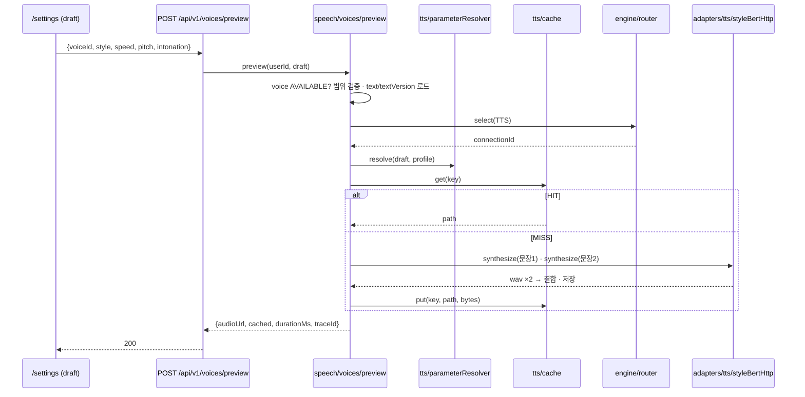

# 04. Voice Preview API 명세

> 정본: 요청/응답 스키마는 [`../api-contract.md`](../api-contract.md) 의 `POST /api/v1/voices/preview`·`POST /api/admin/v1/voices/{id}/preview`·`GET /api/v1/speech/tts/{key}`, 엔티티는 [`../domain-model.md`](../domain-model.md)(`TtsCache`·`AppSetting`·`RequestTrace`). 이 문서는 통합 미리듣기의 의미, draft 처리, 미리듣기 문장·버전, 캐시 키, 관리자 Playground 와의 차이만 정의한다. 원문: 추가 기획안 §40~§44, 관리자 콘솔 §116.

## 1. 목적

옵션마다 버튼을 두지 않고 **현재 화면의 모든 임시 설정을 합친 최종 결과 하나**를 들려준다(§40·§75-7). 저장 전 draft 로도 가능해야 하고(§75-8), 문장은 모든 voice 에 동일한 운영 설정 값을 쓰며 LLM 을 호출하지 않는다(§43). 같은 설정은 캐시로 재사용한다(§44).

## 2. 범위

- 포함: 사용자 미리듣기 API, draft → 파라미터 해석, 미리듣기 문장·`textVersion`, 캐시 키·저장·무효화, 응답 형식, rate limit, 관리자 Playground 미리듣기.
- 제외: 대화 턴의 TTS 프록시(`POST /api/v1/speech/tts`, 같은 캐시를 쓰지만 문장 분할·프리페치는 `speech/tts/TtsPlayer` 설계), 파라미터 우선순위 전체(13).

## 3. 설계

### 3.1 사용자 API — `POST /api/v1/voices/preview`

요청(draft, 전부 선택; 없는 키는 저장된 `UserVoiceSetting` → `VoiceProfile.defaults` 순으로 채움):

```json
{ "voiceId": "teacher_haruka", "style": "Friendly", "styleWeight": 1.0, "speed": 0.9, "pitch": 1.0, "intonation": 1.1 }
```

응답: `Accept: audio/wav` 면 `200 audio/wav`(본문 스트림, `X-Tts-Cache: HIT|MISS`, `X-Trace-Id`), 그 외 `200 { "audioUrl": "/api/v1/speech/tts/<key>", "cached": true, "durationMs": 4120, "traceId": "…" }`. `audioUrl` 은 인증 쿠키가 필요한 같은 도메인 경로이며 앱 `<audio>` 가 그대로 재생한다.

규칙:
- capability `settings.read`. `voiceId` 는 `status=AVAILABLE`·`enabled=true` 여야 한다(사용자는 다른 상태를 볼 수 없으므로 404 로 응답).
- `style` 이 `'AUTO'` 이거나 없으면 `VoiceProfile.defaults.style`. 값 범위는 13 §3.2 와 동일 상수.
- 텍스트 = `AppSetting voice.preview.defaultText`(환경별), 기본값 `こんにちは。今日も一緒に楽しく日本語を勉強しましょう。`. 버전 = `AppSetting voice.preview.textVersion`(정수, 문장을 바꿀 때 관리자가 +1; 관리자 API 가 `defaultText` 를 갱신하면 자동 증가).
- rate limit: 사용자당 10회/분(`E_PREVIEW_RATE_LIMIT`), 동시 진행 1건(`E_PREVIEW_IN_FLIGHT`, 앱은 버튼 비활성).
- `RequestTrace(kind=PREVIEW)` 1행: step `tts`(connectionId·latency·cache 여부). 오디오·텍스트는 trace 에 저장하지 않는다.

### 3.2 파라미터 해석

`speech/tts/parameterResolver.resolve({ user: draft, profile, persona: null, context: {mode:'PREVIEW'}, llmStyle: null })` → 미리듣기에는 Persona·Context·LLM 층이 없으므로 결과는 `draft > profile.defaults`. 출력(SBV2 파라미터)은 13 §3.5 의 형태(`model_id, speaker_id, style, style_weight, length=1/speed, pitch_scale, intonation_scale, language=JP`). `model_id`/`speaker_id` 는 `VoiceModel.speakers` 와 tts-service `/voices` 의 `modelId` 에서 나오며 요청 본문에 절대 오지 않는다.

### 3.3 캐시 키

```
key = sha1( text | voiceId | style | styleWeight | speed | pitch | intonation | engineConnectionId | textVersion )
```

| 구성 | 정규화 |
|---|---|
| `text` | NFKC, 앞뒤 공백 제거, 개행 → 공백 |
| `style` | 해석 후의 실제 style 이름(`AUTO` 는 키에 들어가지 않음) |
| 수치 4개 | 소수점 2자리 고정 문자열(`0.90`) |
| `engineConnectionId` | Router 가 실제로 고른 TTS connection(11). 같은 voice 라도 호스트가 바뀌면 다른 키 |
| `textVersion` | 미리듣기는 `voice.preview.textVersion`, 대화 TTS 는 `0` 고정 |

`TtsCache{key @id, voice(=voiceId), style, rate(=speed), path, bytes, hits, createdAt, lastHitAt}` — `path` 는 `DATA_ROOT/tts-cache/<key[0:2]>/<key>.wav`. 대화 TTS(`POST /api/v1/speech/tts`)도 같은 함수·테이블을 쓴다.

### 3.4 합성 경로 (MISS)

1. Router `select(role=TTS)`(11) → connection·adapter.
2. 문장 분할(`speech/tts/sentenceSplit`, `runtime.maxChars`=100 기준 `。！？` 우선) → 문장별 `synthesize` 순차 호출 → wav 결합(같은 sample rate 확인) → 파일 저장 → `TtsCache` insert(경쟁 시 `key` 중복은 기존 행 사용, 임시 파일 삭제).
3. 실패 시 Fallback(12) 순회 후에도 실패면 `E_PREVIEW_UPSTREAM`(502/504) — 캐시 행은 만들지 않는다.

### 3.5 캐시 무효화 · 용량

| 사건 | 처리 |
|---|---|
| `voice.preview.textVersion` 증가 | 이전 키는 자연 소멸(LRU) |
| `VoiceProfile` `replace` 재가져오기(03) / `DELETE`(ARCHIVED) | `TtsCache where voice = voiceId` 행·파일 삭제 |
| `EngineConnection` 삭제 | 키에 포함되므로 자연 소멸 |
| 용량 | `AppSetting tts.cache.maxBytes`(기본 2GB) 초과 시 `lastHitAt` 오래된 순 삭제(일 1회 잡, `infra/jobs`) |
| `defaults` 수정 | 키에 값이 들어가므로 무효화 불필요 |

### 3.6 관리자 Playground — `POST /api/admin/v1/voices/{id}/preview`

| 항목 | 사용자 미리듣기 | 관리자 Playground |
|---|---|---|
| capability | `settings.read` | `voices.manage` |
| 텍스트 | 운영 설정 고정 | 자유 입력 `text`(≤300자, 문장 분할 후 각 ≤100자) — 없으면 운영 설정 문장 |
| voice 상태 | `AVAILABLE` 만 | `AVAILABLE`·`DISABLED`(ERROR·DELETING·ARCHIVED 는 409) |
| 파라미터 | style·styleWeight·speed·pitch·intonation | + `engineConnectionId`(TTS role 의 connection 중 하나, Router 우회) + `bypassCache` |
| trace kind | `PREVIEW` | `PLAYGROUND`(단계별 latency 반환) |
| 캐시 | 사용 | 사용(`bypassCache=true` 면 저장은 하되 조회 생략) |
| 응답 | §3.1 | §3.1 + `{ "resolved": {SBV2 파라미터}, "steps": [ … ] }` |
| 화면 | `/settings` AI 선생님 탭의 ▶ 버튼 | `/admin/voices/{id}` Preview Playground(15) |

일반 사용자에게는 Playground 수준의 파라미터(모델·speaker·connection)를 노출하지 않는다(§116).

## 4. 시퀀스



## 5. 검증 규칙 · 오류 코드

| 코드 | HTTP | 상황 |
|---|---|---|
| `E_PREVIEW_VOICE_NOT_FOUND` | 404 | voice 없음/비공개 상태 |
| `E_PREVIEW_PARAM_RANGE` | 422 | 수치 범위 밖(`details.field`) |
| `E_PREVIEW_STYLE_UNKNOWN` | 422 | 해당 voice 에 없는 style |
| `E_PREVIEW_TEXT_TOO_LONG` | 422 | Playground `text` > 300자 또는 분할 후 문장 > `maxChars` |
| `E_PREVIEW_RATE_LIMIT` | 429 | 10회/분 초과(`Retry-After`) |
| `E_PREVIEW_IN_FLIGHT` | 409 | 같은 사용자 진행 중 |
| `E_PREVIEW_NO_CONNECTION` | 503 | TTS role 에 선택 가능한 connection 없음 |
| `E_PREVIEW_UPSTREAM` | 502/504 | 합성 실패·타임아웃(fallback 포함) |
| `E_PREVIEW_CONNECTION_INVALID` | 422 | Playground 의 `engineConnectionId` 가 TTS role 이 아니거나 DISABLED |

## 6. Phase

- Phase 1: 사용자 미리듣기 전체(§3.1~§3.5), `voice.preview.defaultText/textVersion` 시드, `/api/v1/speech/tts/{key}`.
- Phase 2: `AppSetting` 편집 UI 에서 문장 변경(관리자 콘솔 Configuration).
- 음성 Phase 4: Playground(§3.6), `bypassCache`, `engineConnectionId` 지정.

## 7. 미결

1. 미리듣기 결과를 앱이 로컬에 캐시할지(설정 화면 재진입 시 재요청 회피) — 서버 캐시 HIT 가 충분히 빠르면 생략.
2. 문장 결합 시 문장 사이 무음(예: 250ms)을 넣을지 — task-003 실측 청취로 결정.
3. `textVersion` 을 `AppSetting` 두 키로 둘지 `{text, version}` 한 JSON 값으로 합칠지 — `../domain-model.md` `AppSetting` 시드 목록에서 확정.
