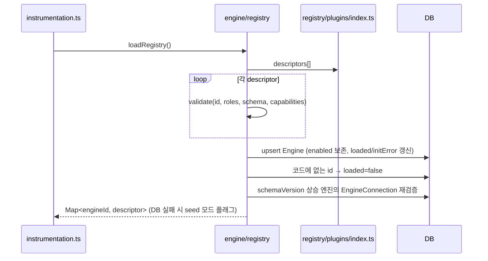

# 05. Engine Registry Entity 설계

> 정본: `Engine` 테이블·enum 은 [`../domain-model.md`](../domain-model.md), `GET /api/admin/v1/engines`·`GET /api/admin/v1/plugins*` 는 [`../api-contract.md`](../api-contract.md), 모듈 경계는 [`../module-dependency.md`](../module-dependency.md), 플러그인 상세 화면은 [`../admin-console/03-engine-configuration-schema.md`](../admin-console/03-engine-configuration-schema.md). 이 문서는 코드 디스크립터와 DB 스냅샷의 관계, `EngineCapability` 목록, 로딩 절차만 정의한다. 원문: 추가 기획안 §47·§48·§57, 관리자 콘솔 §97~§99.

## 1. 목적

"어떤 기술을 쓰는가"(Engine)와 "어디서 어떤 설정으로 쓰는가"(Connection, 06)를 분리한다(§47). Engine 의 정체성·기능·설정 스키마·헬스/테스트 로직은 **코드**(어댑터 옆의 디스크립터)가 소유하고, DB `Engine` 행은 관리 화면·조인·`enabled` 토글을 위한 **스냅샷**일 뿐이다(00 충돌 1).

## 2. 범위

- 포함: `EngineDescriptor` 인터페이스, 5개 기본 엔진의 디스크립터 값, `EngineCapability` enum, `Engine` 테이블 발췌, 기동 시 로딩·upsert·고아 처리, Python 쪽 대응.
- 제외: Configuration Schema 본문(07), Connection(06), Health/Test 로직(09·10).

## 3. 설계

### 3.1 `EngineDescriptor` (코드, `src/modules/engine/registry/descriptors/<engineId>.ts`)

```ts
interface EngineDescriptor {
  id: string;                       // 'reazon-sherpa' | 'faster-whisper' | 'style-bert' | 'claude-cli' | 'home-m4'
  displayName: string;
  type: EngineType;                 // STT | TTS | LLM
  roles: EngineRole[];              // 맡을 수 있는 역할(REALTIME_STT | ANALYSIS_STT | TTS | LLM)
  connectionTypes: ConnectionType[];// LOCAL | HTTP | ONDEVICE | CLI
  capabilities: EngineCapability[];
  schemaVersion: number;            // configurationSchema 가 바뀔 때 +1
  configurationSchema(): ConfigurationSchema;                          // 07
  healthCheck(conn: EngineConnection, ctx: EngineContext): Promise<HealthResult>;         // 09
  functionalTest(conn: EngineConnection, ctx: EngineContext): Promise<FunctionalTestResult>; // 10
  createAdapter(conn: EngineConnection, ctx: EngineContext): SttAdapter | TtsAdapter | LlmAdapter;
}
```

`EngineContext` = `{ environment, secrets: SecretResolver, http, spawn, logger, traceId }` — `infra` 가 제공하며 디스크립터는 상위 층 타입을 모른다.

### 3.2 기본 디스크립터 5종

| id | type | roles | connectionTypes | capabilities | 어댑터 |
|---|---|---|---|---|---|
| `sherpa-onnx-reazon` | STT | REALTIME_STT | ONDEVICE, HTTP | TRANSCRIPTION, VAD, SEGMENT_PARTIAL, LANGUAGE_JA, ONDEVICE, STREAMING_WS | `adapters/stt/{reazonOnDevice,reazonGateway}` |
| `faster-whisper` | STT | ANALYSIS_STT | HTTP, LOCAL | TRANSCRIPTION, WORD_TIMESTAMP, LANGUAGE_JA, LANGUAGE_DETECT | `adapters/stt/whisperHttp`(LOCAL 은 Python worker 전용) |
| `style-bert-vits2` | TTS | TTS | HTTP | MULTI_VOICE, STYLE, SPEED, PITCH, INTONATION, MODEL_REFRESH, VOICE_IMPORT | `adapters/tts/styleBertHttp` |
| `claude-cli` | LLM | LLM | CLI | JSON_SCHEMA, STREAMING, PERSONA_AGENTS, MODEL_TIERS | `adapters/llm/claudeCli` |
| `home-m4-api` | LLM | LLM | HTTP | JSON_SCHEMA | `adapters/llm/homeM4` |

확장 슬롯(디스크립터 파일만 추가하면 됨): `openai-stt`·`azure-stt`·`google-stt`(ANALYSIS_STT), `elevenlabs-tts`·`openai-tts`(TTS), `anthropic-api`·`openai-chat`(LLM). Phase 계획에는 없으며 seed 에도 넣지 않는다.

### 3.3 `EngineCapability` (엔진 기능 — 권한 capability 와 다른 enum)

| 그룹 | 값 | 의미 · 사용처 |
|---|---|---|
| STT | `TRANSCRIPTION` | 오디오→텍스트. 모든 STT 필수 |
| | `VAD` | 엔진이 발화 구간을 스스로 나눔(sherpa silero). 없으면 gateway 가 VAD 를 앞단에 붙임 |
| | `SEGMENT_PARTIAL` | 세그먼트 단위 partial 이벤트. 실시간 자막 UI 활성 조건 |
| | `WORD_TIMESTAMP` | 단어 타임스탬프. Pronunciation(Phase 3) 정렬 입력 |
| | `LANGUAGE_JA` · `LANGUAGE_DETECT` | 일본어 지원 / 언어 자동 감지 |
| TTS(5차 보완, `16` §4.4) | `SUPPORTS_STYLE` · `SUPPORTS_INTONATION` · `SUPPORTS_PITCH` · `SUPPORTS_USER_DICT` · `SUPPORTS_TIMING` | Rendering Plan 의 축을 어댑터가 지원하는지. 없는 축은 조용히 버리고(13 §3.5) 사용자 설정 UI 도 숨김. `SUPPORTS_PITCH`·`SUPPORTS_INTONATION` 은 task-003 에서 SBV2 `TTSModel.infer` 인자 실측 후 확정 |
| | `ONDEVICE` · `STREAMING_WS` | 온디바이스 실행 가능 / WebSocket 스트리밍 프로토콜(§9 gateway) |
| TTS | `MULTI_VOICE` · `STYLE` · `SPEED` · `PITCH` · `INTONATION` | 파라미터 지원 여부. Parameter Resolver(13)가 미지원 키를 **버림**(오류 아님) |
| | `MODEL_REFRESH` · `VOICE_IMPORT` | `POST /admin/models/refresh` / Voice Package Import(03) 가능. 없으면 Voice 관리 화면의 Import·Sync 버튼 숨김 |
| LLM | `JSON_SCHEMA` | 구조화 응답 강제(`--json-schema` 또는 후처리 `extractJson`+`schemaValidate`) |
| | `STREAMING` · `PERSONA_AGENTS` · `MODEL_TIERS` | partial 스트리밍 / `--agents` 페르소나 주입 / haiku·sonnet·opus 티어 선택 |

Router·Resolver·화면은 엔진 id 가 아니라 이 capability 로 분기한다(엔진명 분기 금지 규칙의 실현 수단).

### 3.4 `Engine` 테이블 (스냅샷)

| 필드 | 값 | 비고 |
|---|---|---|
| `id @id` | descriptor.id | |
| `displayName`, `type`, `roles Json`, `connectionTypes Json`, `capabilities Json`, `schemaVersion` | 기동 시 코드에서 복사 | 관리자가 편집하지 않음(READ_ONLY) |
| `enabled Boolean` | 관리자 토글. `false` 면 이 엔진의 모든 connection 이 Router 에서 제외되고 status 표시는 `DISABLED` | 유일한 편집 가능 컬럼 |
| `loaded Boolean`, `initError String?` | 마지막 기동에서 디스크립터가 존재·검증 통과했는지 | 코드에서 사라진 엔진(고아) 표시 |
| `updatedAt` | | |

`environment` 컬럼은 두지 않는다 — 코드는 환경마다 같고, 환경별 차이는 Connection(06)에서 만든다. `enabled` 는 전 환경 공통.

### 3.5 로딩 절차 (`src/modules/engine/registry/index.ts#loadRegistry`, `instrumentation.ts` 에서 1회)

1. `plugins/index.ts` 의 **정적 import 목록**(Next.js 번들이라 파일시스템 동적 로딩 없음)에서 디스크립터 배열을 얻는다.
2. 검증: `id` 유일·형식(`^[a-z0-9-]{3,30}$`), `roles ⊆ type 의 허용 역할`(STT→REALTIME_STT/ANALYSIS_STT, TTS→TTS, LLM→LLM), `configurationSchema()` 가 07 규격, `capabilities` 가 §3.3 값. 실패한 디스크립터는 `loaded=false, initError` 로 기록하고 나머지는 계속 로드(전체 기동 실패 없음).
3. `Engine` upsert(스냅샷 갱신, `enabled` 는 보존). DB 에 있으나 코드에 없는 id → `loaded=false, initError='descriptor missing'`, `enabled` 는 그대로 두되 Router 는 `loaded=false` 를 DISABLED 로 취급.
4. `schemaVersion` 이 올라간 엔진의 `EngineConnection` 은 07 §3.5 마이그레이션 규칙으로 `connection/runtime` JSON 을 재검증하고 실패 시 `status=MISCONFIGURED`.
5. 메모리 레지스트리 `Map<engineId, EngineDescriptor>` 를 만들고 `get(engineId)`·`listByRole(role)` 를 공개. DB 불가 시에도 메모리 레지스트리는 만들어지며 connection 은 `speech.config.yml` seed 에서 읽는다(degraded).

### 3.6 Python 대응 (`speech/common/engine/`)

같은 5개 id 를 `registry.py` 상수로 두고 `descriptor.py` 가 `EngineDescriptor` dataclass(`id, type, roles, connection_types, capabilities, schema()`), `adapters/{stt,tts}` 가 `ReazonSherpaEngine`(gateway 실시간 폴백)·`WhisperEngine`(HTTP 및 LOCAL faster-whisper)·`StyleBertVitsEngine`(tts-service 내부만) 를 구현한다. LLM 어댑터는 Python 에 없다. 두 언어의 `capabilities`·`schema` 가 어긋나지 않도록 `speech/common/engine/schemas/*.json` 을 **TS 디스크립터가 빌드 시 내보낸 JSON** 으로 두고 Python 은 읽기만 한다.

### 3.7 API 발췌

`GET /api/admin/v1/engines[?includeSchema=true]` (capability `engine.read`) → `[{ id, displayName, type, roles, connectionTypes, capabilities, schemaVersion, enabled, loaded, initError, connections:[{id, name, role, status, environment}] , schema? }]`. `PUT /api/admin/v1/engines/{id}` 는 `{enabled}` 만 받는다(`engine.connections.manage`, AuditLog).

## 4. 시퀀스 — 기동 로딩



## 5. 검증 규칙 · 오류 코드

| 코드 | 상황 |
|---|---|
| `E_ENGINE_DESCRIPTOR_INVALID` | §3.5-2 검증 실패(로그 + `initError`, API 는 `loaded=false` 로 노출) |
| `E_ENGINE_NOT_FOUND` (404) | 없는 engineId |
| `E_ENGINE_NOT_LOADED` (409) | `loaded=false` 엔진에 connection 생성/활성 시도 |
| `E_ENGINE_ROLE_MISMATCH` (422) | connection.role ∉ descriptor.roles |
| `E_ENGINE_CONNECTION_TYPE_UNSUPPORTED` (422) | connection.connectionType ∉ descriptor.connectionTypes |

## 6. Phase

- Phase 1: 디스크립터 5종·`EngineCapability`·`Engine` 스냅샷·로딩·`GET /api/admin/v1/engines`.
- Phase 2: `PUT /engines/{id}` enabled 토글·schemaVersion 마이그레이션.
- 이후: 확장 슬롯 디스크립터(외부 API)는 실제 필요 시.

## 7. 미결

1. `roles` 를 `Engine` 테이블에도 둘지(현재 포함) — `../domain-model.md` 의 `Engine` 블록에 `roles Json` 이 없으면 이 문서를 따라 추가.
2. `ConfigurationSchema` JSON 을 Python 으로 내보내는 빌드 단계(`npm run engine:export-schemas`)를 task-002 에 포함할지 task-003 에 둘지.
3. `EngineCapability` 를 Prisma enum 으로 둘지 문자열 배열(Json)로 둘지 — 확장성 때문에 Json 권고.
