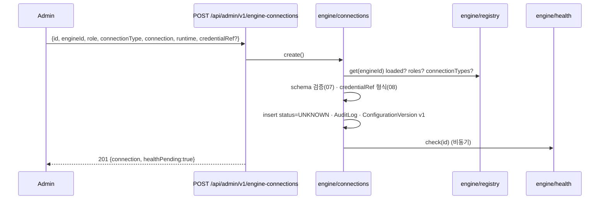

# 06. Engine Connection Profile Entity 설계

> 정본: `EngineConnection` 테이블·enum 은 [`../domain-model.md`](../domain-model.md), `/api/admin/v1/engine-connections*` 는 [`../api-contract.md`](../api-contract.md), 값의 해석 순서(8층 Source)는 [`../configuration-resolution.md`](../configuration-resolution.md), 편집 절차(Validate→Test→Diff→Apply)는 [`../admin-console/08-configuration-diff-api.md`](../admin-console/08-configuration-diff-api.md). 이 문서는 필드 의미, `connection`/`runtime` JSON 의 구분, `connectionType` 4종의 의미(특히 ONDEVICE), seed 6종, `environment`, Python 서비스로의 전달만 정의한다. 원문: 추가 기획안 §49~§54, §9 서비스 구성.

## 1. 목적

하나의 Engine 을 여러 장소·설정으로 쓸 수 있게 "연결 프로파일"을 DB 데이터로 둔다(§47·§75-10). Local 엔진의 모델·디바이스·스레드 설정도, 온디바이스 플러그인의 런타임 설정도, 원격 API 의 URL·타임아웃·credentialRef 도 **같은 엔티티**로 관리한다(§75-11·12).

## 2. 범위

- 포함: 필드 발췌, JSON 두 덩어리의 역할, `connectionType` 의미, `status` 소유자, seed 6종 값, `environment`, CRUD API 규칙, Python 서비스·앱으로의 전달 경로.
- 제외: 키별 스키마(07), 시크릿 해석(08), 상태 판정(09), 라우팅(11).

## 3. 설계

### 3.1 필드 발췌

| 필드 | 의미 · 제약 |
|---|---|
| `id @id` | `^[a-z0-9-]{3,40}$`, 생성 후 불변. 앱·Utterance·Trace·캐시 키가 참조 |
| `engineId` → `Engine.id` | 디스크립터가 `loaded=true` 여야 생성·활성 가능(05) |
| `name`(≤60), `description?` | 관리자 표기("Mac Mini TTS") |
| `role EngineRole` | `REALTIME_STT / ANALYSIS_STT / TTS / LLM`. 한 connection = 한 역할(05 `E_ENGINE_ROLE_MISMATCH`) |
| `connectionType ConnectionType` | §3.3 |
| `enabled Boolean` | `false` → `status=DISABLED`, Router 제외, Health 스킵 |
| `connection Json` | **어디에 어떻게 닿는가**: `baseUrl, wsPath, path, timeoutMs, retry, bin, cwd, modelManifestUrl, modelVersion, region …`(07 의 `group="connection"` 키만) |
| `runtime Json` | **무엇으로 돌리는가**: `model, device, computeType, numThreads, decodingMethod, vad.*, language, maxChars, tiers.*, logLevel …`(07 의 `group="runtime"` 키만) |
| `credentialRef String?` | `env:NAME` 또는 `file:<name>`(08). 값은 절대 저장하지 않음. 변경은 capability `credentials.manage` |
| `status EngineStatus` | `UNKNOWN / HEALTHY / DEGRADED / UNAVAILABLE / MISCONFIGURED / DISABLED`. 쓰는 주체: Health(09)·검증(07)·`enabled` 토글. 관리자가 직접 편집 불가 |
| `lastHealthAt`, `lastHealthId?` | 09 |
| `environment` | `LOCAL / PRODUCTION`. `@@unique([id, environment])` 가 아니라 **id 가 환경마다 다른 행**을 가리키도록 `@@id([id, environment])` 권고(00 미결 1 과 동일 논점) |
| `createdAt`, `updatedAt` | |

`connection`/`runtime` 의 실제 값은 Resolver(`../configuration-resolution.md`)의 `CONNECTION_PROFILE` 층이다. 스키마 `default` → `speech.config.yml`(APPLICATION_CONFIG) → env → DB(ConfigurationVersion ACTIVE) → 이 행 → RuntimeOverride 순으로 덮인 **effective 값**을 어댑터가 받는다. 행에 없는 키는 하위 층 값이 그대로 쓰인다.

### 3.2 `connection` 과 `runtime` 을 나누는 이유

| | `connection` | `runtime` |
|---|---|---|
| 바뀌면 | 대개 재연결만(RUNTIME_EDITABLE 다수) | 모델 재로드·프로세스 재시작(RESTART_REQUIRED 다수) |
| 누가 읽나 | 앱 어댑터(HTTP/CLI), gateway·worker 의 클라이언트 | Python 서비스 자체, 온디바이스 플러그인 |
| Export | 포함(시크릿은 ref) | 포함 |
| `GET /api/v1/speech/config` 노출 | ONDEVICE 의 `modelManifestUrl`·`modelVersion` 만 | ONDEVICE 의 `numThreads`·`decodingMethod`·`vad.*` 만 |

### 3.3 `connectionType` 의미

| 값 | 실행 위치 | 앱 서버가 하는 일 | Health 주체 | 예 |
|---|---|---|---|---|
| `HTTP` | 다른 프로세스/호스트, REST 또는 WS | `baseUrl` 로 호출, `credentialRef` 를 헤더로 | 앱 서버 `GET /health` | `style-bert-m4`, `whisper-voicevault`, `reazon-gateway`, `home-m4-lan` |
| `CLI` | 앱 서버와 같은 호스트, 자식 프로세스 | `bin` spawn, stdin 프롬프트, `cleanEnv` | 앱 서버 `bin --version` | `claude-cli-local` |
| `LOCAL` | Python 서비스 프로세스 안에서 모델을 직접 로드 | 없음(worker 가 `runtime` 을 읽어 로드) | worker 가 `/health` 로 보고 | (Phase 2 옵션) `whisper-local-worker` |
| `ONDEVICE` | 사용자 휴대폰의 Capacitor 플러그인 | `runtime` 을 `GET /api/v1/speech/config` 로 내려주고 모델 manifest 를 서빙 | 서버는 manifest·모델 파일 존재만 확인, 기기별 가용성은 앱이 세션마다 판단해 `Utterance.realtimeEngine`·trace 로 보고 | `reazon-ondevice` |

ONDEVICE 특칙: 서버가 이 connection 을 **호출하는 일은 없다**. Router(11)는 클라이언트가 보고한 `deviceCapability` 로 이 connection 의 선택 가능 여부를 정하고, 앱은 같은 규칙을 로컬에서 미러링한다. `status` 는 manifest 서빙 상태만 반영한다(`MISCONFIGURED` = manifest/sha256 파일 없음).

### 3.4 Seed 6종 (`speech/speech.config.yml` → 첫 기동 upsert, `prisma/seed-data/engines.json` 과 동일 값)

| id | engineId | role | type | `connection` (요지) | `runtime` (요지) | credentialRef |
|---|---|---|---|---|---|---|
| `claude-cli-local` | `claude-cli` | LLM | CLI | `bin:"claude", timeoutMs:60000, lanes:2, cwd:<release root>` | `tiers:{talk:"haiku", review:"sonnet", analysis:"opus"}, streamJson:true, agentsFile:".claude/agents/tutor.md"` | 없음(서버 구독 로그인) |
| `home-m4-lan` | `home-m4` | LLM | HTTP | `baseUrl:"http://<m4-lan>:<port>/v1", timeoutMs:120000, retry:0` | `model:"qwen2.5:14b", systemFirst:true, maxTokens:1024, allowedTasks:["wordEnrich","distractors","fallbackTalk"]` | `file:home-m4-api-key` |
| `reazon-ondevice` | `reazon-sherpa` | REALTIME_STT | ONDEVICE | `modelManifestUrl:"https://kaiwa.…/models/reazonspeech-int8/manifest.json", modelVersion:"2024-08-01-int8"` | `provider:"cpu", numThreads:2, decodingMethod:"greedy_search", vad:{threshold:0.5, minSilenceMs:500, minSpeechMs:250, maxSpeechSec:20}, partialEmit:true` | 없음 |
| `reazon-gateway` | `reazon-sherpa` | REALTIME_STT | HTTP | `baseUrl:"http://127.0.0.1:8100", wsPath:"/ws/speech", timeoutMs:15000` | `provider:"cpu", numThreads:4, decodingMethod:"greedy_search", modelVersion:"2024-08-01-int8", vad:{…동일}` | 없음(WS 는 60초 ticket JWT) |
| `whisper-voicevault` | `faster-whisper` | ANALYSIS_STT | HTTP | `baseUrl:"http://127.0.0.1:8090", path:"/transcribe-chunk", timeoutMs:60000, retry:1` | `model:"medium", device:"cpu", computeType:"int8", language:"ja", beamSize:5, vadFilter:true` (READ_ONLY — VoiceVault 소유) | 없음 |
| `style-bert-m4` | `style-bert` | TTS | HTTP | `baseUrl:"http://<m4-lan>:8200", timeoutMs:20000, retry:1` | `language:"JP", maxChars:100, device:"mps", sdpRatio:0.2, noise:0.6, noiseW:0.8, concurrency:1` | `file:tts-service-token`(선택) |

`<m4-lan>`·`<port>` 는 yaml 에 `${M4_HOST}` 형태 env 치환으로 두고 저장소에 실제 주소를 커밋하지 않는다. seed 는 `LOCAL`·`PRODUCTION` 두 환경에 같은 6행을 만들며, 이후 환경별로 갈라진다(예: LOCAL 의 `claude-cli-local.tiers.talk` 를 `haiku` 고정, PRODUCTION 만 편집 보호).

### 3.5 API 규칙 (`/api/admin/v1/engine-connections`)

| API | capability | 규칙 |
|---|---|---|
| `GET` · `GET /{id}` | `engine.read` | `credentialRef` 는 ref 문자열 그대로(값 아님). `?role=&engineId=&status=` |
| `POST` | `engine.connections.manage` | 05 §5 검증 + 07 스키마 검증 → `status=UNKNOWN` → 즉시 Health 1회(09). `credentialRef` 지정은 `credentials.manage` 도 필요 |
| `PUT /{id}` | 위와 동일 | Phase 1 은 `enabled`·`name`·`description` 만. Phase 2 부터 `connection`/`runtime` 편집은 Validate→Test→Diff→Apply 를 거치고 `ConfigurationVersion(scope=ENGINE_CONNECTION)` 을 만든다. RESTART_REQUIRED 키 변경은 응답 `restartRequired:true` + 대상 서비스 목록 |
| `DELETE /{id}` | `engine.connections.manage` | `EngineFallbackPolicy` 어느 role 의 primary/fallback 에도 없고, `VoiceModel.engineConnectionId` 가 참조하지 않을 때만. 아니면 409 → disable 안내. seed 6종은 삭제 불가(disable 만) |
| `POST /{id}/health` · `/test` | `health.run` · `functional_test.run` | 09 · 10 |
| `GET/PUT /{id}/log-level` | `engine.read` / `engine.connections.manage` | `runtime.logLevel` 단축 API, Python 서비스 `POST /admin/log-level` 로 전파 |

### 3.6 전달 경로

- **앱(모바일/웹)**: `GET /api/v1/speech/config` → `{ realtimeStt: { chain:[{connectionId, connectionType, runtime(공개 키만), modelManifest?}], reviewThreshold }, tts: { cacheBaseUrl }, version }`. 시크릿·baseUrl(내부 주소)은 없음. 앱은 `version` 이 바뀌면 플러그인 설정을 재적용한다.
- **gateway/worker(우분투)**: 기동 시 `GET /api/internal/speech/config?role=` (공유 시크릿 `INTERNAL_TOKEN`) 로 effective 값을 받고 60초마다 재조회; 앱이 `POST /admin/config/apply` 로 RUNTIME_EDITABLE 변경을 푸시. 앱이 내려가 있으면 `speech.config.yml` 로 degraded 기동하고 로그에 `CONFIG_SOURCE=seed`.
- **tts-service(M4)**: 자기 `runtime`(device·concurrency·maxChars)만 `speech.config.yml` 사본에서 읽는다(M4→우분투 역방향 호출 불가). 앱이 바꾸면 `POST /admin/config/apply` 로 푸시.

## 4. 시퀀스 — connection 생성

## 5. 검증 규칙 · 오류 코드

| 코드 | HTTP | 상황 |
|---|---|---|
| `E_CONN_ID_INVALID` · `E_CONN_ID_IMMUTABLE` | 400 / 409 | id 형식·변경 |
| `E_CONN_SCHEMA_INVALID` | 422 | 07 검증 실패(`details:[{key, reason}]`) |
| `E_CONN_UNKNOWN_KEY` | 422 | 스키마에 없는 키(오타 방지, 무시하지 않음) |
| `E_CONN_CREDENTIAL_REQUIRED` | 422 | 스키마가 `credentialRef` 필수인데 없음 → 저장은 되나 `MISCONFIGURED` |
| `E_CONN_REFERENCED` | 409 | DELETE 대상이 정책·VoiceModel 에서 참조됨 |
| `E_CONN_SEED_PROTECTED` | 409 | seed 삭제 시도 |
| `E_CONN_RESTART_REQUIRED` | 200(경고) | 적용은 됐지만 서비스 재시작 필요(`details.services`) |
| `E_ENGINE_*` | 05 §5 | |

## 6. Phase

- Phase 1: 테이블·seed 6종·`GET`·`enabled` 토글·`/health`·`/test`·`/api/v1/speech/config`·internal config 전달.
- Phase 2: `POST`/`PUT` 전체 편집·`DELETE`·log-level·ConfigurationVersion 연동.
- 음성 Phase 4: 외부 API connection(확장 슬롯), 다중 TTS host.

## 7. 미결

1. `home-m4-lan`·`style-bert-m4` 의 실제 LAN 주소·포트 실측(`ss -ltnp`)과 `${M4_HOST}` env 이름 확정.
2. internal config 를 폴링(60초)으로 시작하되 gateway 세션이 많아지면 push-only 로 바꿀지.
3. `whisper-voicevault` 의 READ_ONLY `runtime` 이 VoiceVault 쪽 변경과 어긋날 때 감지 수단(health 응답의 model 필드 비교) — 09 미결로 이관.
