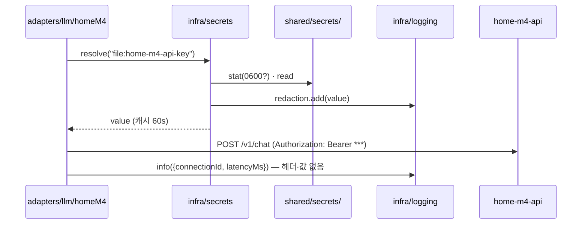

# 08. Credential / Secret 관리 방식 설계

> 정본: `EngineConnection.credentialRef` 컬럼은 [`../domain-model.md`](../domain-model.md), `GET /api/admin/v1/secrets` 는 [`../api-contract.md`](../api-contract.md), capability(`credentials.manage`·`secrets.read_ref`)는 [`../role-permission.md`](../role-permission.md), Export 에서의 시크릿 제외는 [`../admin-console/05-configuration-source-priority.md`](../admin-console/05-configuration-source-priority.md). 이 문서는 ref 문법, `SecretResolver`, 금지 위치, 관리자 UI 노출 범위, 회전 절차만 정의한다. 원문: 추가 기획안 §50·§51·§74, 관리자 콘솔 §103·§113.

## 1. 목적

API Key·토큰은 모바일 앱·DB·응답·Export·Trace·로그 어디에도 두지 않고, 서버 파일/환경변수에만 둔다(§51·§75-12). 앱과 DB 는 **참조 이름**(`credentialRef`)만 알고 값은 요청 시점에 서버의 `SecretResolver` 가 푼다.

## 2. 범위

- 포함: `credentialRef` 문법, 저장 위치·권한, `SecretResolver` 계약(TS·Python), 값이 있어서는 안 되는 위치와 그 강제 수단, 관리자 API/UI 노출 범위, 회전·롤백 절차.
- 제외: OAuth 사용자 인증(`infra/auth`), Claude 구독 로그인(서버 1회 수동, `claude-cli` 는 credentialRef 없음).

## 3. 설계

### 3.1 `credentialRef` 문법

> **허용 범위(task-012c Codex C1 CX-1, 2026-09-29)**: 문법이 맞아도 아무 ref 나 연결할 수 없다 — 어댑터 descriptor 가 그 연결의 SECRET_REF 키에 **정확한 허용 목록**(`allowedRefs`, `env:`·`file:` 정확 일치)을 선언하고, 그보다 먼저 **전역 거부 분류**(부팅·내부 시크릿)를 검사한다. 위반은 `422 E_REF_NOT_ALLOWED`. 정본 `../configuration-resolution.md` §10 (b), 계약 `../api-contract.md` #93b·#101(`allowedFor`).

| 형식 | 정규식 | 해석 | 용도 |
|---|---|---|---|
| `env:NAME` | `^env:[A-Z][A-Z0-9_]{2,63}$` | 프로세스 환경변수 `NAME` | 배포 파이프라인이 주입하는 값, 회전이 드문 값(`INTERNAL_TOKEN`) |
| `file:name` | `^file:[a-z0-9][a-z0-9.-]{2,63}$` | `<SECRETS_DIR>/<name>` 파일의 내용(끝 개행 제거) | 회전 가능한 값(`home-m4-api-key`, `tts-service-token`) — **기본 권장** |

`SECRETS_DIR`: 우분투 앱·gateway·worker = `/home/brownjeon/apps/thekaiwa/shared/secrets/`(릴리스 루트의 `shared/` 는 blue/green 슬롯 교체와 무관하게 유지), M4 tts-service = `~/kaiwa-tts-run/secrets/`. env `KAIWA_SECRETS_DIR` 로 덮어쓸 수 있다(LOCAL 미러 개발 서버). 디렉토리 `0700`, 파일 `0600`, 소유자 `brownjeon`(sudo 불필요). 권한이 더 넓으면 Resolver 가 **읽기를 거부**한다(§5 `E_SECRET_PERMISSION`).

### 3.2 `SecretResolver` (`src/modules/infra/secrets.ts` · `speech/common/secrets.py`)

```ts
interface SecretResolver {
  resolve(ref: string): Promise<string>;              // 값. 캐시 60s. 없으면 E_SECRET_NOT_FOUND
  exists(ref: string): Promise<boolean>;
  describe(ref: string): Promise<{ ref; source: 'env'|'file'; exists; mtime?: Date; lastUsedAt?: Date }>; // 값 없음
  invalidate(ref?: string): void;                     // 회전 후 캐시 비움
}
```

- 어댑터는 요청 직전 `ctx.secrets.resolve(conn.credentialRef)` 로 값을 받아 헤더(`Authorization: Bearer`)에만 넣고, 반환 객체·로그·trace 에 남기지 않는다. `EngineConnection` 객체에는 값이 실리는 필드가 없다(타입 차원에서 불가).
- `resolve` 성공 시 값을 `infra/logging` 의 **redaction set** 에 등록해 어떤 로그 문자열에서도 `***` 로 치환한다(길이 ≥ 8 인 값만, 부분 일치 포함). `Authorization`·`X-Api-Key` 헤더는 값과 무관하게 항상 마스킹.
- `lastUsedAt` 은 프로세스 메모리(재기동 시 초기화). 영속화하지 않는다.
- Python 측은 캐시 없이 요청마다 파일을 읽는다(회전 즉시 반영, 파일 읽기 비용 무시 가능).

### 3.3 값이 있어서는 안 되는 위치와 강제 수단

| 위치 | 규칙 | 강제 |
|---|---|---|
| DB(`EngineConnection.connection/runtime`, `AppSetting`, `ConfigurationVersion.snapshot`, `RuntimeOverride.patch`) | `SECRET_REF` 키는 ref 문법만 | 07 `E_CONN_SECRET_VALUE`: 문법 불일치 거부 + 휴리스틱(`^sk-`, `^ey[JA]`, `-----BEGIN`, 길이 ≥ 32 의 base64 유사 문자열)이 어떤 JSON 값에든 나오면 저장 거부 |
| `/api/v1/*` 응답 | `credentialRef` 자체를 포함하지 않음 | 사용자 투영 함수에 필드 없음 |
| `/api/admin/v1/*` 응답 | ref 문자열만 | 직렬화 타입에 값 필드 없음 |
| Export JSON | ref 문자열 그대로(§103), Import 시 존재 여부만 검사 | `admin/configuration` export 가 스키마의 `SECRET` 키를 ref 로 치환 |
| `RequestTrace.steps` · `EngineHealth.detail` | `connectionId`·`credential:{ref, present}` 까지만 | 기록 함수가 허용 키 화이트리스트 |
| `AuditLog.before/after` | ref 문자열 | 위와 동일 |
| 로그 | redaction set + 헤더 마스킹 | `infra/logging` 단일 출구, `console.*` 직접 호출 ESLint 금지 |
| 모바일 앱 | `connectionId` 조차 `/api/v1/speech/config` 의 공개 키만 | 06 §3.6 |
| 저장소 | `.env.example` 에 이름만, `shared/secrets/` 는 릴리스 루트 밖 | `.gitignore` |

### 3.4 관리자 API · UI

- `GET /api/admin/v1/secrets` (capability `secrets.read_ref`) → `[{ ref, source, exists, mtime, usedBy: [connectionId…], lastUsedAt }]`. 목록 원천 = 모든 환경의 `EngineConnection.credentialRef` ∪ 스키마 `SECRET_REF` 기본값 ∪ `env:INTERNAL_TOKEN`. **값을 만들거나 바꾸는 API 는 없다** — 운영자가 서버 파일로만 넣는다.
- Connection 의 `credentialRef` 를 설정·변경·해제하는 것은 `credentials.manage`(SUPER_ADMIN). `engine.connections.manage` 만 있으면 그 필드는 읽기 전용으로 렌더(14).
- UI 표시: ref 이름 · 존재 배지(있음/없음) · 마지막 사용 · 사용 중인 connection 목록. 값·길이·앞 몇 글자도 표시하지 않는다.
- Health(09) 는 `credentialRef` 가 있는데 `exists=false` 면 `MISCONFIGURED` + `detail.credential.present=false`.

### 3.5 회전 절차 (`file:` 기준, runbook `agent-vault/30-Knowledge/runbooks/secret-rotation.md` 로 승격)

```
1. 새 값 발급(외부 서비스)
2. 서버: umask 077; printf '%s' "<new>" > $SECRETS_DIR/<name>.new
3. mv -f $SECRETS_DIR/<name> $SECRETS_DIR/<name>.prev && mv $SECRETS_DIR/<name>.new $SECRETS_DIR/<name>
4. 앱: POST /api/admin/v1/engine-connections/{id}/health  (Resolver invalidate(ref) 포함) → HEALTHY 확인
5. 앱: POST /api/admin/v1/engine-connections/{id}/test → ok 확인
6. 외부 서비스에서 옛 값 폐기
7. 24h 후 <name>.prev 삭제. 롤백 = 3 의 역순 mv + 4·5
```

`env:` 는 `pm2 restart thekaiwa --update-env`(blue/green 두 슬롯) 가 필요하므로 회전 대상 값에는 쓰지 않는다. M4 tts-service 토큰은 M4 파일과 우분투 `file:tts-service-token` 을 **둘 다** 바꾼 뒤 4·5 를 수행한다. 모든 회전은 `AuditLog(action='secret.rotated', targetId=ref)` 1행(값 없음)을 남긴다(4 단계 health 호출이 `reason` 필드로 기록).

## 4. 시퀀스 — 어댑터의 시크릿 사용



## 5. 검증 규칙 · 오류 코드

| 코드 | HTTP / 효과 | 상황 |
|---|---|---|
| `E_SECRET_REF_INVALID` | 400 | 문법 불일치(저장 거부) |
| `E_SECRET_NOT_FOUND` | 어댑터 실패 → connection `MISCONFIGURED` | env 없음 / 파일 없음 / 빈 파일 |
| `E_SECRET_PERMISSION` | 위와 동일 | 파일 권한이 `0600` 보다 넓거나 소유자 불일치, 디렉토리 `0700` 아님 |
| `E_SECRET_FORBIDDEN` | 403 | `secrets.read_ref`/`credentials.manage` 없음 |
| `E_CONN_SECRET_VALUE` | 400 | 07: JSON 값에 평문 시크릿 의심 |

## 6. Phase

- Phase 1: 문법·Resolver(TS·Python)·redaction·`file:home-m4-api-key`·`env:INTERNAL_TOKEN`·Health 의 존재 검사.
- Phase 2: `GET /api/admin/v1/secrets`·UI·`credentials.manage` 게이트·회전 runbook.
- 이후: 외부 API 엔진 도입 시 ref 추가(문법 변경 없음).

## 7. 미결

1. 워크스페이스 메모리에 `settings.local.json` 평문 시크릿 이슈가 있음 — TheKaiwa 는 처음부터 `shared/secrets/` 만 쓰고 `.claude/settings*.json` 에 값을 넣지 않는다는 규칙을 `CLAUDE.md` 금기에 추가할지.
2. `file:` 값의 형식 검증(예: 최소 길이)을 Resolver 가 할지 — 하지 않음(형식은 외부 서비스가 정함).
3. Debug Session(`../admin-console/15-developer-diagnostic-api.md`)에서도 시크릿은 예외 없이 마스킹 — 확인만.
