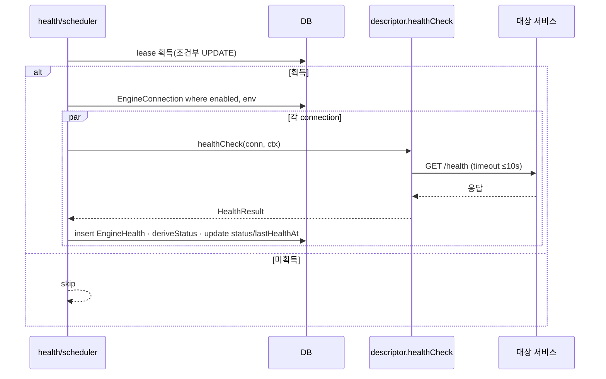

# 09. Engine Health Check API 설계

> 정본: `EngineHealth` 테이블·`EngineStatus` enum 은 [`../domain-model.md`](../domain-model.md), `POST/GET /api/admin/v1/engine-connections/{id}/health` 는 [`../api-contract.md`](../api-contract.md), 메트릭·진단 화면은 [`../admin-console/15-developer-diagnostic-api.md`](../admin-console/15-developer-diagnostic-api.md). 이 문서는 엔진별 프로브 의미, 스케줄, `EngineHealth` 행, `status` 파생 규칙, API 만 정의한다. 원문: 추가 기획안 §58~§60, 관리자 콘솔 §111.

## 1. 목적

"서버가 살아 있는가"(Health)를 "실제 요청이 성공하는가"(Functional, 10)와 분리해(§59) 5분 주기로 자동 확인하고, 그 결과로 `EngineConnection.status` 를 파생시켜 Router(11)가 `UNAVAILABLE` 을 고르지 않게 한다(§60).

## 2. 범위

- 포함: `HealthResult` 계약, connection 타입·엔진별 프로브, 스케줄러와 lease, `EngineHealth` 보존, `status` 파생 상태기계, 실행 중 오류의 반영, API, Python 서비스 `/health` 응답 계약.
- 제외: Functional Test(10), 지연·건수 집계(`EngineMetricsDaily`, admin-console 15).

## 3. 설계

### 3.1 `HealthResult` (디스크립터 `healthCheck()` 반환, 05)

```ts
interface HealthResult {
  ok: boolean; latencyMs: number;
  status: 'HEALTHY' | 'DEGRADED' | 'UNAVAILABLE' | 'MISCONFIGURED';   // 프로브 1회의 판정(최종 status 는 §3.4)
  detail: { service?: string; version?: string; modelLoaded?: boolean; models?: number; memoryMb?: number;
            uptimeSec?: number; queueDepth?: number; credential?: { ref: string; present: boolean }; message?: string };
  errorCode?: string;   // E_HEALTH_*
}
```

### 3.2 프로브 (엔진 × connectionType)

| connection | 프로브 | HEALTHY | DEGRADED | UNAVAILABLE | MISCONFIGURED |
|---|---|---|---|---|---|
| `style-bert-m4` (HTTP) | `GET {baseUrl}/health` (tts-service, §3.6 계약) | 200·`modelLoaded=true`·latency ≤ 2000ms | latency 초과 또는 `modelLoaded=false`·`models=0` | 연결 거부·타임아웃·5xx | 401/403(토큰)·404(경로)·credentialRef 없음 |
| `whisper-voicevault` (HTTP) | `GET {baseUrl}/health` — 없으면 `OPTIONS {path}` 로 대체(미결 1) | 200·latency ≤ 3000ms | latency 초과 | 위와 동일 | 404 |
| `reazon-gateway` (HTTP) | `GET {baseUrl}/health` (gateway) | 200·`modelLoaded`·`vadLoaded`·latency ≤ 1000ms | 모델 미로드·`activeSessions ≥ max` | 위와 동일 | manifest 버전이 connection `modelVersion` 과 불일치 |
| `reazon-ondevice` (ONDEVICE) | 서버 자기 검사: `public/models/reazonspeech-int8/manifest.json` 존재·`modelVersion` 일치·나열 파일의 sha256 인덱스 존재 | 모두 충족 | — | — | 하나라도 누락 |
| `claude-cli-local` (CLI) | `spawn(bin, ['--version'])` exit 0, 5s 타임아웃 | exit 0·latency ≤ 5000ms | latency 초과 | spawn 실패·타임아웃 | `bin` 없음(ENOENT)·`cwd` 없음 |
| `home-m4-lan` (HTTP) | `GET {baseUrl}/health` 또는 `/v1/models`(home-m4-api 실측 후 확정) | 200·latency ≤ 5000ms | latency 초과·모델 미로드 | 연결 거부·타임아웃 | 401·credentialRef 없음 |
| `LOCAL`(Phase 2 worker) | worker 가 `POST /api/internal/speech/health` 로 5분마다 자기 보고 | 보고 ok | 보고 degraded | 보고 15분 이상 없음 | 보고 `configError` |

프로브는 시크릿을 헤더에 넣되(08) 응답 본문은 `detail` 화이트리스트 키만 저장한다. 지연 임계값은 스키마 밖 상수(`engine/health/thresholds.ts`)이며 Phase 2 에 `AppSetting health.thresholds` 로 이동.

### 3.3 스케줄

- 주기 5분(`AppSetting health.intervalSec`, 기본 300, 최소 60). 시작점은 `instrumentation.ts` → `engine/health/scheduler.start()`.
- pm2 blue/green 두 프로세스가 동시에 돌지 않도록 `AppSetting health.scheduler.lease = {owner, until}` 를 조건부 UPDATE 로 획득(TTL = 주기 × 1.5). 획득 실패 프로세스는 건너뜀.
- 대상 = 현재 `APP_ENV` 의 `EngineConnection where enabled=true` (Engine `enabled·loaded` 도 true). 한 주기 안에서 connection 별 병렬, 개당 타임아웃 = `connection.timeoutMs` 와 10s 중 작은 값.
- 수동: `POST /api/admin/v1/engine-connections/{id}/health` 는 lease 와 무관하게 즉시 1회 실행하고 결과 행을 반환한다. 같은 connection 에 실행 중이면 그 결과를 기다려 반환(중복 프로브 없음).
- 배포 직후: deployer 절차서가 `npm run engine:health -- --all` 을 호출(같은 모듈, CLI 진입점).

### 3.4 `status` 파생 (`engine/health/deriveStatus.ts`)

입력 = 직전 `status`, 이번 `HealthResult`, `consecutiveFailures`(connection 행 컬럼, 정본 확인 필요 — 미결 2).

```
enabled=false 또는 Engine.enabled=false/loaded=false        → DISABLED (프로브 생략)
result.status=MISCONFIGURED                                 → MISCONFIGURED, failures=0   (설정 변경 또는 수동 health ok 까지 유지)
result.ok && result.status=HEALTHY                          → HEALTHY, failures=0
result.ok && result.status=DEGRADED                         → DEGRADED, failures=0
!result.ok:
   직전 UNKNOWN                                             → UNAVAILABLE, failures=1
   failures+1 < 3                                           → DEGRADED
   failures+1 ≥ 3                                           → UNAVAILABLE
```

- 실제 요청 실패도 같은 카운터에 들어간다: 어댑터 실행 래퍼(11 §3.5)가 재시도 가능 오류(타임아웃·연결 거부·5xx)마다 `health.recordFailure(connectionId)` 를 호출해 `failures+1`, 3회면 즉시 `UNAVAILABLE`(다음 프로브를 기다리지 않음). 성공은 `recordSuccess` 로 `failures=0` 하되 `status` 는 올리지 않는다(승격은 프로브만).
- `UNAVAILABLE`/`MISCONFIGURED` 로의 전이는 `infra/logging` WARN + 대시보드 배지 + `AuditLog(action='engine.statusChanged', actor=system)`. `HEALTHY` 복귀도 INFO 로 남긴다.
- `EngineConnection.lastHealthAt`·`lastHealthId` 갱신.

### 3.5 `EngineHealth` 행과 보존

`{ id, connectionId, environment, kind: HEALTH, ok, latencyMs, statusBefore, statusAfter, detail Json, errorCode?, checkedAt, trigger: SCHEDULE|MANUAL|DEPLOY|RUNTIME }`. 보존: connection 당 최근 200행 또는 7일 중 큰 쪽(일 1회 정리 잡). 장기 추세는 `EngineMetricsDaily`(trace 집계)로 본다.

### 3.6 Python 서비스 `/health` 응답 계약 (`speech/common/health.py`)

```json
{ "ok": true, "service": "gateway|worker|tts-service", "version": "git-sha", "modelLoaded": true, "vadLoaded": true,
  "models": 3, "memoryMb": 512, "uptimeSec": 86400, "activeSessions": 1, "queueDepth": 0, "configSource": "app|seed",
  "degraded": false, "message": null }
```

`configSource=seed`(앱 internal config 미수신) 는 `DEGRADED` 판정 입력이다.

### 3.7 API

| API | capability | 응답 |
|---|---|---|
| `POST /api/admin/v1/engine-connections/{id}/health` | `health.run` | `200 { health: EngineHealth, connection: { id, status, lastHealthAt } }` |
| `GET /api/admin/v1/engine-connections/{id}/health?limit=20&kind=HEALTH\|FUNCTIONAL` | `engine.read` | `EngineHealth[]` 최신순 |
| `GET /api/admin/v1/engine-connections?status=` | `engine.read` | 06 |

## 4. 시퀀스 — 스케줄 1주기



## 5. 검증 규칙 · 오류 코드

| 코드 | 상황 |
|---|---|
| `E_HEALTH_TIMEOUT` | 프로브 타임아웃(`detail.timeoutMs`) |
| `E_HEALTH_CONNECTION_REFUSED` | TCP 연결 실패 |
| `E_HEALTH_HTTP_STATUS` | 4xx/5xx(`detail.httpStatus`) |
| `E_HEALTH_AUTH` | 401/403 → MISCONFIGURED |
| `E_HEALTH_CREDENTIAL_MISSING` | `credentialRef` 해석 실패(08) → MISCONFIGURED |
| `E_HEALTH_MODEL_NOT_LOADED` | 서비스가 `modelLoaded=false` |
| `E_HEALTH_MANIFEST_MISSING` · `E_HEALTH_MANIFEST_VERSION` | ONDEVICE 자기 검사 실패 |
| `E_HEALTH_NOT_ENABLED` (409) | 수동 실행 대상이 `enabled=false` |
| `E_HEALTH_LEASE_BUSY` | 내부(로그만) |

## 6. Phase

- Phase 1: 프로브 6종·수동 API·`status` 파생·`EngineHealth` 저장·런타임 실패 카운터.
- Phase 2: 5분 스케줄러·lease·보존 정리·임계값 `AppSetting` 화·LOCAL worker 자기 보고.
- Phase 3: Diagnostics 메트릭 결합.

## 7. 미결

1. VoiceVault whisper-service 와 home-m4-api 의 실제 health 엔드포인트 유무 — task-003 에서 실측 후 §3.2 행 확정.
2. `consecutiveFailures` 를 `EngineConnection` 컬럼으로 둘지 `EngineHealth` 최근 행에서 계산할지 — 컬럼 권고(런타임 실패 반영이 빠름). `../domain-model.md` 에 반영 요청.
3. `UNAVAILABLE` 전이 시 외부 알림(Telegram 등) 채널 — 12 §3.6 과 함께 결정.
