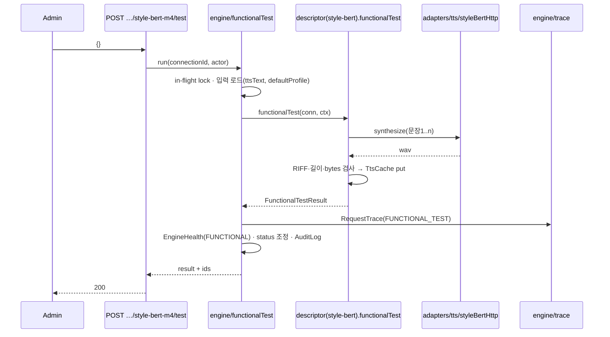

# 10. Engine Functional Test API 설계

> 정본: `POST /api/admin/v1/engine-connections/{id}/test` 는 [`../api-contract.md`](../api-contract.md), `EngineHealth(kind=FUNCTIONAL)`·`RequestTrace(kind=FUNCTIONAL_TEST)` 는 [`../domain-model.md`](../domain-model.md) 와 [`../admin-console/13-request-trace-model.md`](../admin-console/13-request-trace-model.md), Playground(자유 입력 테스트)는 [`../admin-console/11-engine-playground-api.md`](../admin-console/11-engine-playground-api.md). 이 문서는 역할별 고정 입력, 통과 기준, 결과 저장, ONDEVICE 특칙, 실행 시점만 정의한다. 원문: 추가 기획안 §58·§59.

## 1. 목적

Health(09) 가 "살아 있음" 을 보는 반면 Functional Test 는 **고정 입력으로 실제 STT/TTS/LLM 요청을 1회 수행**해 성공·지연·산출물을 확인한다(§59). 입력이 고정이므로 결과를 시간·connection 간에 비교할 수 있다.

## 2. 범위

- 포함: 역할별 고정 입력과 통과 기준, `FunctionalTestResult`, 저장(EngineHealth·RequestTrace), `status` 에 미치는 영향, ONDEVICE 의 기기 실행, 실행 시점(수동·배포 후·activate 전), 동시성·타임아웃, API.
- 제외: 자유 입력 Playground, E2E(STT→LLM→TTS 연결 테스트, admin-console 12).

## 3. 설계

### 3.1 역할별 고정 입력 · 통과 기준

| role | 입력 | 실행 | 통과 기준 | 산출물 |
|---|---|---|---|---|
| `TTS` | `AppSetting engine.functionalTest.ttsText`(기본 = `voice.preview.defaultText`), voice = `AppSetting voice.defaultProfileId`(profile 의 defaults) | 문장 분할 → `synthesize` → 결합 | `audio/wav` RIFF 헤더·sample rate = 서비스 보고값·길이 1~15s·bytes > 10KB·latency ≤ 30s | `TtsCache` 에 저장(키에 `engineConnectionId` 포함, 04) → `audioUrl` |
| `ANALYSIS_STT` | `speech/test-assets/ja-sample.wav`(16kHz mono ≈4s) + `ja-sample.txt`(정답 전사) | `transcribe` | 텍스트 비어 있지 않음·정규화(NFKC·구두점 제거·かな 통일) 후 CER ≤ 0.30·latency ≤ 60s | `{ text, cer, latencyMs }` |
| `REALTIME_STT` (HTTP=gateway) | 같은 wav 를 40ms PCM16 프레임으로 WS 전송(`start`→frames→`stop`) | gateway 세션 1회 | `final` 이벤트 수신·CER ≤ 0.30·`partial` ≥ 1건(capability `SEGMENT_PARTIAL`)·latency ≤ 15s | `{ text, cer, partials, latencyMs }` |
| `REALTIME_STT` (ONDEVICE) | 앱 번들의 같은 wav(`assets/test/ja-sample.wav`) | §3.4: 기기에서 실행 | 앱이 보고한 `ok`·CER ≤ 0.30 | 기기 정보 포함 |
| `LLM` | 고정 프롬프트 `"Return JSON only."` + user `"ping <nonce>"` + `--json-schema {ok:boolean, echo:string}`; claude-cli 는 `tiers.talk` 모델, home-m4 는 `runtime.model` | 1회 호출(스트리밍 없음) | 스키마 통과·`echo === nonce`·latency ≤ 60s | `{ model, latencyMs, tokens? }` |

정답 전사·CER 계산은 `speech/common/normalize`(Python) 와 `src/modules/engine/functionalTest/cer.ts`(TS) 가 같은 규칙(Transcript Comparator 와 동일 정규화)을 쓴다. `ja-sample.txt` 예: `こんにちは、今日はいい天気ですね。`(실제 녹음은 task-003 에서 제작, 저작권 없는 자체 녹음).

### 3.2 `FunctionalTestResult` (디스크립터 `functionalTest()` 반환, 05)

```ts
interface FunctionalTestResult {
  ok: boolean; role: EngineRole; latencyMs: number;
  detail: Record<string, unknown>;      // 위 표의 산출물 + input:{kind, ref} (원문 텍스트·오디오는 넣지 않음)
  artifact?: { type: 'audio'|'text'; url?: string; text?: string };   // TTS 오디오 URL, STT/LLM 짧은 텍스트(≤200자)
  errorCode?: string;
}
```

### 3.3 저장 · 상태 반영

- `EngineHealth{kind: FUNCTIONAL, ok, latencyMs, detail, errorCode, trigger: MANUAL|DEPLOY|ACTIVATE|DEVICE}` 1행.
- `RequestTrace{kind: FUNCTIONAL_TEST, userId: actor, steps: [{ name: 'functional_test', engineId, connectionId, model, startedAt, latencyMs, status, errorCode? }], totalMs}` 1행. `steps` 에 입력·출력 본문은 없다(§113).
- `AuditLog(action='engine.functionalTest', targetId=connectionId, after={ok, healthId, traceId})`.
- `status` 영향: 실패 시 `HEALTHY → DEGRADED`(`detail.reason='functional_test_failed'`), 인증 오류면 `MISCONFIGURED`. **성공해도 `UNAVAILABLE`/`MISCONFIGURED` 를 올리지 않는다**(승격은 Health 프로브만, 09 §3.4). 09 의 `consecutiveFailures` 에는 넣지 않는다(수동 실행이 카운터를 왜곡하지 않도록).

### 3.4 ONDEVICE 특칙

서버는 `reazon-ondevice` 에 대해 `200 { ok: null, status: 'NOT_APPLICABLE', hint: '앱 Advanced 화면에서 기기 테스트를 실행하세요' }` 를 반환한다. 앱(14 Advanced 화면, capability 보유 사용자)이 플러그인으로 번들 wav 를 인식한 뒤 같은 엔드포인트에 `{ source: 'DEVICE', result: { ok, latencyMs, text, modelVersion, device: { model, androidSdk, ramMb, appVersion } } }` 를 보내면 서버가 CER 을 계산해 §3.3 과 동일하게 저장한다(`trigger=DEVICE`, `detail.device`). 이 보고는 서버 `status` 를 바꾸지 않는다(기기별 결과이므로) — Utterance 통계와 함께 관리자 화면에서 "기기 테스트 이력" 으로만 본다.

### 3.5 실행 시점 · 동시성

| 시점 | 호출자 | trigger |
|---|---|---|
| 관리자 버튼(14·15) | `POST …/test` | MANUAL |
| 배포 직후 | deployer 절차서 `npm run engine:test -- --all --env=PRODUCTION` | DEPLOY |
| Voice activate 직전(02) | registry 내부 호출(TTS role, 해당 voice 로) | ACTIVATE |
| Connection 편집 Apply 전(Phase 2, Validate→Test→Diff→Apply) | `POST /api/admin/v1/config/test` 가 이 모듈 호출 | MANUAL |

connection 당 동시 1건(`E_TEST_IN_FLIGHT`), 사용자당 분당 6회. 타임아웃은 §3.1 의 역할별 상한과 `connection.timeoutMs` 중 작은 값.

### 3.6 API

`POST /api/admin/v1/engine-connections/{id}/test` (capability `functional_test.run`)

요청: `{}` 또는 `{ source: 'DEVICE', result: {…} }`(§3.4). 선택 `{ voiceProfileId }`(TTS 만, 기본 voice 대신).

응답 `200`:

```json
{ "ok": true, "role": "TTS", "latencyMs": 812, "healthId": "…", "traceId": "…",
  "detail": { "durationMs": 4100, "sampleRate": 44100, "bytes": 361644, "cached": false },
  "artifact": { "type": "audio", "url": "/api/v1/speech/tts/3f1a…" },
  "connection": { "id": "style-bert-m4", "status": "HEALTHY" } }
```

실패도 `200` 에 `ok:false, errorCode, detail.message` 로 돌려준다(테스트 실패는 API 오류가 아님). API 오류(4xx/5xx)는 §5.

`GET /api/admin/v1/engine-connections/{id}/health?kind=FUNCTIONAL` 로 이력 조회(09 §3.7).

## 4. 시퀀스 — TTS Functional Test



## 5. 검증 규칙 · 오류 코드

| 코드 | HTTP / `ok:false` | 상황 |
|---|---|---|
| `E_TEST_IN_FLIGHT` | 409 | 같은 connection 실행 중 |
| `E_TEST_RATE_LIMIT` | 429 | 분당 6회 초과 |
| `E_TEST_NOT_ENABLED` | 409 | `enabled=false` 또는 Engine 미로드 |
| `E_TEST_NOT_APPLICABLE` | 200(`status`) | ONDEVICE 서버 실행 |
| `E_TEST_DEVICE_RESULT_INVALID` | 422 | `source:'DEVICE'` 본문 스키마 위반 |
| `E_TEST_INPUT_MISSING` | 500 | `ja-sample.wav`/`ttsText`/기본 voice 없음(배포 결함) |
| `E_TEST_TIMEOUT` · `E_TEST_UPSTREAM` · `E_TEST_AUTH` | `ok:false` | 타임아웃 / 5xx·연결 실패 / 401·403(→ MISCONFIGURED) |
| `E_TEST_OUTPUT_INVALID` | `ok:false` | wav 헤더·길이·bytes 기준 미달, STT 빈 텍스트, LLM 스키마 실패 |
| `E_TEST_ACCURACY` | `ok:false` | CER > 0.30 또는 `echo != nonce`(`detail.cer`/`detail.echo`) |

## 6. Phase

- Phase 1: TTS·ANALYSIS_STT(HTTP)·REALTIME_STT(gateway WS)·LLM 테스트, `ja-sample.wav` 제작, 저장·trace, 관리자 버튼(Advanced 읽기 화면에서 실행 가능).
- Phase 2: 배포 후 자동 실행(deployer), Apply 전 테스트 연동, `voiceProfileId` 옵션.
- 음성 Phase 4: ONDEVICE 기기 보고(§3.4) — 플러그인에 테스트 진입점 추가가 필요하므로 APK 변경 task.

## 7. 미결

1. CER 임계 0.30 은 4초 짧은 문장 기준의 가정 — task-003 실측(20문장 인식률 게이트)에서 조정.
2. LLM 테스트가 Claude 구독 사용량을 소비하므로 배포 후 자동 실행에 LLM 을 포함할지(기본 포함, haiku 1회).
3. `ja-sample.wav` 를 앱 번들에도 넣으면 APK 크기 +130KB — 허용.
