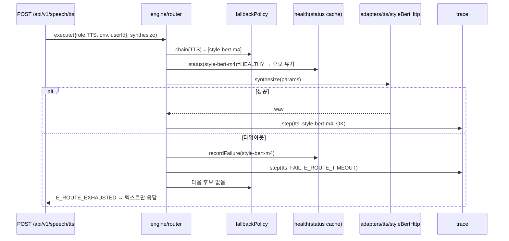

# 11. Speech Engine Router 설계

> 정본: 모듈 위치·경계는 [`../module-dependency.md`](../module-dependency.md)(`src/modules/engine/router`, `src/modules/speech/modeResolver.ts`, Python `speech/common/router`), `RecognitionMode`·`EngineRole`·`Utterance.realtimeEngine` 은 [`../domain-model.md`](../domain-model.md), `GET /api/v1/speech/config` 는 [`../api-contract.md`](../api-contract.md), Trace 는 [`../admin-console/13-request-trace-model.md`](../admin-console/13-request-trace-model.md). 이 문서는 역할 기반 선택 알고리즘, Speech Mode Resolver, device capability 라우팅, 상태 제외, 선택 결과 기록만 정의한다. 원문: 기획안 §14, 추가 기획안 §60·§62.

## 1. 목적

호출자는 "역할"(REALTIME_STT / ANALYSIS_STT / TTS / LLM)만 말하고 Router 가 정책(12)·상태(09)·모드(사용자 설정)·기기 능력으로 **실제 connection 과 어댑터**를 고른다. 라우트·화면·L1~L4 에 엔진명이 나오지 않게 하는 유일한 진입점이다.

## 2. 범위

- 포함: `RouteRequest/RouteDecision`, 선택 알고리즘, Speech Mode Resolver(AUTO/FAST/ACCURATE/OFFLINE), `DeviceCapability` 와 온디바이스→gateway, 상태 제외, 실행 래퍼(재시도는 12 규칙 적용), 실행 위치 3곳(서버·앱·Python), 선택 결과 기록.
- 제외: 정책 편집·재시도 상세·알림(12), Health 판정(09), 기획안 §14 의 network/latency/cost/subscription 조건(슬롯만, Phase 4).

## 3. 설계

### 3.1 계약 (`src/modules/engine/router/index.ts`)

```ts
interface RouteRequest {
  role: EngineRole; environment: Environment;
  userId?: string; recognitionMode?: RecognitionMode;      // REALTIME_STT·ANALYSIS_STT 에만 의미
  deviceCapability?: DeviceCapability;                     // REALTIME_STT
  task?: 'talk'|'chat'|'chatReview'|'lesson'|'eval'|'analysis'|'wordEnrich'|'distractors'; // LLM
  exclude?: string[];                                      // 이미 실패한 connectionId
}
interface DeviceCapability { platform: 'android'|'web'; pluginAvailable: boolean; modelInstalled: boolean;
  modelVersion?: string; pluginErrorCount: number; ramMb?: number; appVersion: string }
interface RouteDecision { connectionId: string; engineId: string; connectionType: ConnectionType;
  chain: string[]; position: number;
  reason: 'PRIMARY'|'FALLBACK'|'MODE_FORCED'|'DEVICE_INCAPABLE'|'STATUS_EXCLUDED';
  model?: string;  /* LLM tier 등 어댑터 힌트 */ }
```

### 3.2 선택 알고리즘 (`select(req) → RouteDecision`)

1. **정책 로드**: `EngineFallbackPolicy(environment, role)` → `chain = [primary, ...fallbacks]`(12). 정책이 없으면 seed 기본 chain.
2. **정적 제외**: `Engine.enabled=false` 또는 `loaded=false`, `EngineConnection.enabled=false`, `status ∈ {UNAVAILABLE, DISABLED, MISCONFIGURED}`, `req.exclude` 포함, `environment` 불일치 → 제외(`STATUS_EXCLUDED`). `DEGRADED` 는 남긴다(순서상 뒤로 밀지 않음 — 정책 순서가 우선).
3. **모드 제약**(REALTIME_STT·ANALYSIS_STT): §3.3 표의 chain 필터를 적용(`MODE_FORCED`).
4. **기기 능력**(REALTIME_STT): `connectionType=ONDEVICE` 는 `deviceCapability.platform='android' && pluginAvailable && modelInstalled && modelVersion == connection.modelVersion && pluginErrorCount < 2` 일 때만 남긴다(`DEVICE_INCAPABLE`). `deviceCapability` 가 없으면(서버 내부 호출) ONDEVICE 는 항상 제외.
5. **LLM 작업 제약**: `home-m4` 계열은 `runtime.allowedTasks ∋ task`; `claude-cli` 는 `task → tiers` 매핑으로 `model` 힌트 결정(`talk/chat → tiers.talk`, `chatReview/lesson/eval → tiers.review`, `analysis → tiers.analysis`).
6. **Capability 검사**: 호출자가 요구한 `EngineCapability`(예: 미리듣기는 `STYLE`)가 없으면 제외. 파라미터 미지원은 Resolver 가 버리므로 여기서는 필수 기능만 본다.
7. 남은 chain 의 **첫 번째**를 선택. `position=0` 이면 `PRIMARY`, 아니면 `FALLBACK`. 없으면 `E_ROUTE_NO_CONNECTION`(REALTIME_STT 의 OFFLINE 은 §3.3 의 텍스트 폴백 신호로 대체).

선택은 순수 함수(입력 → 결정)이며 DB 읽기는 정책·connection 스냅샷을 60초 메모리 캐시로 받는다(관리자 쓰기 시 즉시 무효화).

### 3.3 Speech Mode Resolver (`src/modules/speech/modeResolver.ts`)

`UserSpeechSetting.recognitionMode` 를 Router 제약과 파이프라인 옵션으로 바꾼다. 결과 `SpeechPlan`:

| mode | REALTIME_STT chain 제약 | ANALYSIS_STT 잡 | `requiresReview` 임계 | 서버 불가 시 | TTS |
|---|---|---|---|---|---|
| `AUTO` | 정책 순서 그대로(온디바이스 → gateway) | 큐잉(우선순위 NORMAL) | 0.85 | gateway 만 불가면 온디바이스 계속, 앱 서버 불가면 텍스트 입력 안내 | 정책 |
| `FAST` | ONDEVICE 만; 기기가 불가하면 gateway 로 내려가며 화면에 "빠른 응답 불가" 1회 배지 | 큐잉(LOW) | 0.85 | AUTO 와 동일 | 정책 |
| `ACCURATE` | gateway(HTTP) 우선, 온디바이스는 폴백 | 큐잉(HIGH), 결과로 교정 카드 재확인 | **0.90** | gateway 불가 → 온디바이스 + "정확도 모드 일시 불가" | 정책 |
| `OFFLINE` | ONDEVICE 만, 폴백 없음 | **큐잉 안 함** | — | 서버 불가 = 정상 상태. 턴은 서버 필요하므로 "오프라인에서는 인식만 가능, 텍스트로 보내기" 안내 | 캐시 HIT 만, MISS 는 텍스트만 |

웹(`platform='web'`)에서 `FAST`/`OFFLINE` 은 저장은 되지만 실행 시 `AUTO` 로 강등하고 `E_ROUTE_MODE_UNSUPPORTED` 를 배지로만 표시한다(설정 저장 API 는 거부하지 않음 — 같은 계정이 폰에서도 쓰므로).

### 3.4 실행 위치 3곳

| 위치 | 담당 역할 | 입력 원천 |
|---|---|---|
| 서버 `engine/router` | TTS(턴·미리듣기), LLM, ANALYSIS_STT(잡 enqueue 시 `preferredConnectionId` 힌트) | DB 정책·상태 |
| 앱 `speech/modeResolver` + `RealtimeSttClient` 선택 | REALTIME_STT 실행 자체(온디바이스 vs WebSocket) | `GET /api/v1/speech/config` 의 `realtimeStt.chain`(정책 순서·connectionType·공개 runtime·status) + 로컬 `DeviceCapability`. 앱은 §3.2 의 2·3·4 를 그대로 미러링(같은 규칙을 `modeResolver.ts` 가 서버·클라이언트 공용으로 구현) |
| Python `speech/common/router` | gateway: WS 폴백 세션의 STT 엔진(현재 reazon-sherpa 하나) / worker: ANALYSIS_STT connection 선택(dequeue 시점) | `GET /api/internal/speech/config` effective 값, 미수신 시 seed |

앱 쪽 선택은 서버가 검증하지 않지만, 앱이 `POST /api/v1/speech/utterances` 에 `realtimeEngine=connectionId` 를 보고하면 서버는 그 id 가 REALTIME_STT role 의 connection 인지만 검사한다(`E_ROUTE_CONNECTION_INVALID`).

### 3.5 실행 래퍼 (`execute(req, fn)`)

```
decision = select(req)
loop:
  try  fn(adapter(decision))  → health.recordSuccess(connectionId); trace.step(status=OK); return
  catch e:
     trace.step(status=FAIL, errorCode)
     if !retryable(e) → throw                       // 400/422/콘텐츠 오류: 폴백해도 같음
     health.recordFailure(connectionId)             // 09 §3.4 카운터
     req.exclude.push(connectionId)
     decision = select(req)  (12 의 재시도 규칙: connection 당 1회, chain 끝까지)
     없으면 throw E_ROUTE_EXHAUSTED(details.attempts[])
```

`retryable` = 타임아웃·연결 거부·5xx·어댑터 `ENGINE_ERROR`. 401/403 은 `MISCONFIGURED` 로 표시하고 다음 connection 으로 넘어간다(재시도 가능으로 취급하되 카운터 대신 상태를 바꿈).

### 3.6 선택 결과 기록

| 대상 | 필드 | 값 |
|---|---|---|
| `Utterance` | `realtimeEngine` | 실제 사용한 REALTIME_STT `connectionId`(`reazon-ondevice` / `reazon-gateway`), `fallbackReason?`(`DEVICE_INCAPABLE`·`PLUGIN_ERROR`·`MODE_FORCED`) |
| `Utterance` | `analysisEngine` | worker 가 dequeue 시 고른 ANALYSIS_STT `connectionId` |
| `SpeechJob` | `connectionId`, `attempts` | dequeue 시 기록(enqueue 시는 힌트만) |
| `RequestTrace.steps[]` | `engineId, connectionId, model, latencyMs, status, errorCode, position, reason` | 턴의 stt/llm/tts 단계, 미리듣기, 기능 테스트 |
| `ChatMessage.toolLog` | `{ traceId, sttMs, llmMs, ttsMs, model }` 요약 | 상세는 trace |
| `TtsCache.key` | `engineConnectionId` 포함 | 04 |

지표 비교(온디바이스 vs gateway 지연·인식률)는 이 기록만으로 가능해야 한다(§9 실측 게이트 조건).

## 4. 시퀀스 — 회화 턴의 TTS 선택



## 5. 검증 규칙 · 오류 코드

| 코드 | HTTP | 상황 |
|---|---|---|
| `E_ROUTE_ROLE_INVALID` | 400 | 알 수 없는 role |
| `E_ROUTE_NO_CONNECTION` | 503 | 제외 후 후보 0(`details.excluded:[{id, reason}]`) |
| `E_ROUTE_EXHAUSTED` | 502 | chain 전부 실패(`details.attempts`) |
| `E_ROUTE_MODE_UNSUPPORTED` | 200 배지 | 웹에서 FAST/OFFLINE |
| `E_ROUTE_CONNECTION_INVALID` | 422 | 앱이 보고한 `realtimeEngine` 이 REALTIME_STT connection 이 아님 |
| `E_ROUTE_CAPABILITY_MISSING` | 503 | 요구 capability 를 가진 후보 없음 |

## 6. Phase

- Phase 1: §3.1~§3.6 전체(REALTIME_STT 앱 미러링 포함, 조건은 device capability 만), `AUTO`·`FAST`·`OFFLINE` 의 실시간 부분.
- Phase 2: `ACCURATE` 의 분석 STT 재확인(worker 도입), ANALYSIS_STT 라우팅.
- 음성 Phase 4: network/latency/cost/subscription 조건 슬롯, 다중 TTS host.

## 7. 미결

1. `DEGRADED` 를 chain 순서에서 뒤로 미룰지(현재는 정책 순서 우선) — 실측 후 결정.
2. 앱 미러링 코드를 서버와 같은 파일로 공유(`modeResolver.ts` isomorphic)할지 별도 경량 구현으로 둘지 — 공유 권고(규칙 불일치 방지).
3. `DeviceCapability.ramMb` 로 저사양 기기를 자동으로 gateway 로 보낼 임계값(예: < 6GB) — S25+ 외 기기가 생길 때.
