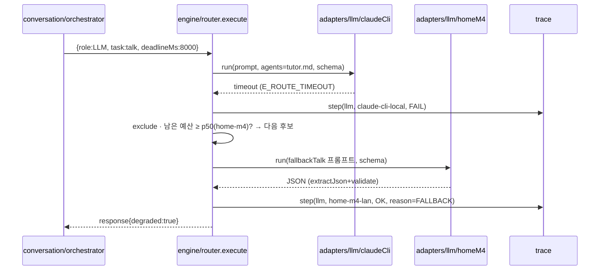

# 12. Engine Fallback Policy 설계

> 정본: `EngineFallbackPolicy` 테이블은 [`../domain-model.md`](../domain-model.md), `GET/PUT /api/admin/v1/fallback-policies/{role}` 는 [`../api-contract.md`](../api-contract.md), 버전·Production 보호는 [`../admin-console/06-configuration-version-entity.md`](../admin-console/06-configuration-version-entity.md)·[`../admin-console/16-environment-configuration-policy.md`](../admin-console/16-environment-configuration-policy.md). 이 문서는 역할별 정책 값, 재시도 의미, 온디바이스→gateway 사례, TTS/LLM/분석 STT 의 폴백과 소진 시 동작, 알림만 정의한다. 원문: 추가 기획안 §61, §9 라우터.

## 1. 목적

connection 장애 시 같은 역할의 다음 connection 으로 넘어가되(§61·§75-15), 회화 지연 예산(턴 5초·fail-fast 12초)을 넘기지 않고, 폴백 사용을 기록·알림해 원인이 묻히지 않게 한다. 온디바이스 STT → gateway 전환도 이 정책의 한 사례로 통일한다(00 충돌 8).

## 2. 범위

- 포함: 엔티티 발췌, seed 정책 4종, 재시도·시간 예산 규칙, 역할별 폴백 동작과 소진 시 사용자 경험, 클라이언트 측 사례, 알림, API·검증.
- 제외: 선택 알고리즘(11), 상태 판정(09).

## 3. 설계

### 3.1 엔티티 발췌

| 필드 | 의미 |
|---|---|
| `environment`, `role` (`@@id([environment, role])`) | 환경·역할당 1행 |
| `primaryConnectionId` | 1순위 |
| `fallbackConnectionIds Json[]` | 순서 있는 후보, 최대 3 |
| `retry Json` | `{ adapterRetry?: number, deadlineMs?: number }` — 생략 시 §3.3 기본 |
| `alertOnFallback Boolean` | 폴백 사용 시 알림 여부(기본 true) |
| `updatedAt` | |

### 3.2 Seed 정책 (Phase 1, `speech/speech.config.yml` `router.fallback`)

| role | primary | fallbacks | 비고 |
|---|---|---|---|
| `REALTIME_STT` | `reazon-ondevice` | `[reazon-gateway]` | 앱이 미러링(§3.5) |
| `ANALYSIS_STT` | `whisper-voicevault` | `[]` | Phase 2 에 `whisper-local-worker`(LOCAL) 추가 옵션 |
| `TTS` | `style-bert-m4` | `[]` | 음성 Phase 4 에 2차 TTS(§3.4) |
| `LLM` | `claude-cli-local` | `[home-m4-lan]` | `runtime.allowedTasks` 에 있는 작업만 넘어감 |

### 3.3 재시도 의미 · 시간 예산

```
[어댑터 층]  connection.retry (07): 같은 connection 에 즉시 재시도. 요청 바이트를 보내기 전 실패(DNS·연결 거부)와
             멱등 호출(GET /health, synthesize, transcribe)에만 적용. LLM 턴은 retry=0 고정(중복 생성 방지)
[라우터 층]  connection 당 시도 1회 → 실패 시 exclude 후 다음 connection (11 §3.5). chain 끝까지 = 최대 1+|fallbacks| 회
[예산]       RouteRequest.deadlineMs (턴 TTS 3000·LLM 8000·미리듣기 15000·기능테스트 역할별 상한).
             다음 후보로 넘어가기 전 남은 시간 < 후보의 최근 p50 지연(EngineMetricsDaily, 없으면 1000ms) 이면 폴백을 건너뛰고 소진 처리
```

재시도 가능 오류: 타임아웃·연결 거부·5xx·`ENGINE_ERROR`. 불가: 400/422(입력)·콘텐츠 오류(문장 길이 등, 폴백해도 같음)·429(rate limit 은 대기 후 같은 connection). 401/403 은 `MISCONFIGURED` 로 표시하고 다음 후보로.

### 3.4 역할별 폴백 동작

| role | 폴백 시 | 전부 실패(소진) 시 | 사용자 화면 |
|---|---|---|---|
| `REALTIME_STT` | 온디바이스 → gateway(§3.5). gateway → 온디바이스 역방향은 ACCURATE 모드에서만 | 텍스트 입력 폴백(항상 노출되어 있는 텍스트 필드로 유도) | "음성 인식을 사용할 수 없어 텍스트로 입력해 주세요" 1회 |
| `ANALYSIS_STT` | worker 가 chain 순회 | `SpeechJob.attempts` 1→2→3, 백오프 1분·5분·30분(dequeue 조건 `nextAttemptAt`). 3회 후 `SpeechJob.FAILED`·`Utterance.status=FAILED`, `transcriptConfidence=null`, 실시간 텍스트가 최종(`finalSource=REALTIME`) | 없음(비동기). 교정 카드에 "정밀 분석 생략" 작은 표시 |
| `TTS` | Phase 1 후보 없음. `UNAVAILABLE` 이어도 `TtsCache` HIT 는 계속 서빙(캐시 우선). 5차 §158 Hybrid 라우터: 후보 순서 SERVER → ON_DEVICE(P2, 현재 없음) → TEXT_ONLY, 선택 결과를 `GET /api/v1/speech/tts/status.executionMode` 로 노출 | 텍스트만 응답 + `speech.audio=null`, `executionMode=TEXT_ONLY`·`fallbackReason=SERVER_ERROR|SERVER_TIMEOUT|NO_CONNECTION|OFFLINE`. 턴은 실패가 아님 | 말풍선에 스피커 아이콘 비활성 + "음성을 준비하지 못했어요 · 다시 시도" + **강사 프로필 옆 상태 표시등 🔴 "자막만"**(TEXT_ONLY, 전환 시 토스트 1회, 복귀는 health 1회 성공 후 🟡 전환 중 → 🟢 온라인; `16` §12) |
| `LLM` (talk/chat) | `claude-cli-local` → `home-m4-lan` `fallbackTalk`: 페르소나 `--agents` 없이 축약 프롬프트·창 6턴·`extractJson`+`schemaValidate`. 응답에 `degraded:true` | 턴 `FAILED`, 사용자 메시지는 보존, "다시 보내기" | "지금은 간단 모드로 답해요" 배지(폴백) / 오류 토스트(소진) |
| `LLM` (chatReview/lesson/eval/analysis) | **폴백 없음**(품질·스키마 크기 때문) | `AiJob` 백오프 재시도(기존 규칙) | 잡 화면 "다시 만들기" |

### 3.5 사례 — 온디바이스 → gateway (클라이언트 측 실행)

앱은 `GET /api/v1/speech/config` 의 `realtimeStt.chain` 을 정책 순서 그대로 받는다. 세션 시작 시 11 §3.2 규칙으로 `OnDeviceSherpaClient` 를 고르고, 아래 사건이 나면 **그 세션 안에서** `WebSocketSttClient` 로 전환한다(사용자 조작 없음).

| 사건 | `fallbackReason` | 복귀 |
|---|---|---|
| 플러그인 없음(웹) / `checkModel().installed=false`(다운로드 중) | `DEVICE_INCAPABLE` | 모델 설치 완료 후 다음 세션 |
| `start()` 실패 또는 세션 내 플러그인 오류 2회 | `PLUGIN_ERROR` | 앱 재시작 시 카운터 초기화 |
| `recognitionMode=ACCURATE` | `MODE_FORCED` | 모드 변경 |
| gateway 도 불가(WS 연결 실패·ticket 만료) | — | 텍스트 폴백(§3.4) |

`OFFLINE` 모드는 chain 을 `[reazon-ondevice]` 로 잘라 폴백하지 않는다. 전환 결과는 `Utterance.realtimeEngine`·`fallbackReason` 으로 서버에 보고되어 관리자 대시보드 "폴백 비율" 에 집계된다.

> **각주 — task-003f 구현(2026-09-28, Leader ⑦ 판정)**: 위 표의 "세션" 단위를 다음처럼 바꿔 구현했다(`src/modules/speech/stt/client/router.ts`).
> - 경로는 **누를 때마다**(녹음 중이 아닐 때) 고른다 — 모델 받기가 끝나면 **다음 누름부터** 휴대폰, 지우면 다음 누름부터 서버(앱 재시작·세션 재시작 불필요). 표 1행의 "모델 설치 완료 후 다음 세션" → "다음 누름".
> - 전환 카운터는 **앱 실행 단위**(모듈 변수 — 화면을 오가도 이어지고 앱을 다시 켜면 0). 셈 = `AUDIO_INIT_FAILED`·`BUSY`·`MODEL_CORRUPT`·`OOM`·`DECODE_FAILED`, 세지 않음 = `PERMISSION_DENIED`·`INTERRUPTED`·`ALREADY_STARTED`·`INVALID_ARGUMENT`·`MODEL_MISSING`(모델 없음은 스토어가 다시 확인해 다음 누름부터 서버). 임계는 #19 `fallback.onDeviceFailureThreshold`(2).
> - `start()` 거부는 **이번 누름을 서버로 이어 간다**(말을 잃지 않음 — 전환이면 토스트 1회), 세션 중 오류는 말을 잃는다(전환이면 오류 띠 2줄). `PERMISSION_DENIED` 는 이어 가지 않고 권한 안내.
> - 강제 업데이트 상태(#8 `updateRequired`)에서는 휴대폰 경로를 쓰지 않는다(Leader ④). 클라이언트는 `chain`(connection key 목록)을 받지 않는다 — #19 는 엔진명 없는 `onDevice`/`gateway` 블록만 준다(task-003e).
> - 이유는 화면에 `SttRoute{kind, reason}`(WEB·READY·MODEL_ABSENT·MODEL_DOWNLOADING·MODE_ACCURATE·MODE_OFFLINE·ONDEVICE_FAILED·SERVER_DISABLED·UPDATE_REQUIRED)로만 간다(screens §11-3 C). 서버 보고용 `fallbackReason` 필드는 #21 에 아직 없다(후속).

### 3.6 알림

| 사건 | 기록 | 알림 |
|---|---|---|
| 폴백으로 성공 | `RequestTrace.steps[].reason=FALLBACK` | `alertOnFallback=true` 면 `infra/logging` WARN 1줄(`role, from, to, traceId`) + 대시보드 배지 "최근 24h 폴백 N건"(trace 집계) |
| 소진 | `RequestTrace` 마지막 step `status=FAIL`, `AuditLog(action='engine.fallbackExhausted', actor=system, targetId=role)` | WARN + 배지 빨강. 5분 내 3건 이상이면 ERROR 로 승격 |
| 상태 전이(UNAVAILABLE·MISCONFIGURED) | 09 §3.4 | 09 |

외부 채널(Telegram 등)은 없다(미결 1). 알림은 사용자 대화 내용을 포함하지 않는다.

### 3.7 API · 검증

`GET /api/admin/v1/fallback-policies/{role}` (`engine.read`) → 행 + 각 connection 의 `{id, name, engineId, connectionType, status}`.
`PUT /api/admin/v1/fallback-policies/{role}` (`engine.connections.manage`) 본문 `{ primaryConnectionId, fallbackConnectionIds, retry?, alertOnFallback? }` → `ConfigurationVersion(scope=FALLBACK_POLICY, targetId=role)` + `AuditLog` + Router 캐시 무효화. PRODUCTION 은 Validate→Test(primary 의 Functional Test 통과)→확인 후 Apply.

| 규칙 | 오류 |
|---|---|
| 모든 id 가 존재하고 같은 `environment`·같은 `role` | `E_FALLBACK_CONNECTION_INVALID` (422) |
| primary ∉ fallbacks, fallbacks 중복 없음, 길이 ≤ 3 | `E_FALLBACK_CHAIN_INVALID` (422) |
| `ONDEVICE` connection 은 `REALTIME_STT` 에만 | `E_FALLBACK_ONDEVICE_ROLE` (422) |
| primary 가 `DISABLED`/`MISCONFIGURED` 면 경고(저장은 허용) | `warnings[]` (200) |
| LLM fallback 이 `allowedTasks` 에 `fallbackTalk` 를 갖지 않으면 경고 | `warnings[]` |
| chain 의 모든 connection 이 선택 불가 상태 | 저장은 허용, Router 가 `E_ROUTE_NO_CONNECTION` |

## 4. 시퀀스 — LLM 턴 폴백



## 5. 검증 규칙 · 오류 코드

| 코드 | HTTP | 상황 |
|---|---|---|
| `E_FALLBACK_NOT_FOUND` | 404 | 역할 정책 없음(seed 누락) |
| `E_FALLBACK_CONNECTION_INVALID` · `E_FALLBACK_CHAIN_INVALID` · `E_FALLBACK_ONDEVICE_ROLE` | 422 | §3.7 |
| `E_FALLBACK_PRODUCTION_CONFIRM` | 409 | PRODUCTION 변경에 확인 토큰 없음 |
| `E_ROUTE_EXHAUSTED` · `E_ROUTE_NO_CONNECTION` | 11 | 실행 시 |

## 6. Phase

- Phase 1: seed 4종·재시도 규칙·REALTIME_STT 클라이언트 사례·TTS 캐시 우선·LLM `fallbackTalk`·로그 알림·`GET`.
- Phase 2: `PUT` 편집·ConfigurationVersion·ANALYSIS_STT 백오프(worker)·대시보드 집계.
- 음성 Phase 4: 2차 TTS connection(다른 host 에 같은 모델 또는 외부 TTS + `VoiceProfile` 대응 voice 매핑), 조건 라우팅 확장.

## 7. 미결

1. 외부 알림 채널 — 홈서버에 공용 알림기가 없다면 Phase 3 Diagnostics 와 함께 Telegram 봇을 검토.
2. `fallbackTalk` 의 축약 프롬프트를 Prompt Registry key(`talk.fallback`) 로 둘지 — prompt-engineer 소유, 14-prompt-registry 문서와 조율.
3. 2차 TTS 가 다른 모델이면 `VoiceProfile` 이 두 connection 의 모델을 모두 가리켜야 함(`VoiceModel` 을 connection 별로 복수) — 02 미결 3 과 동일.
