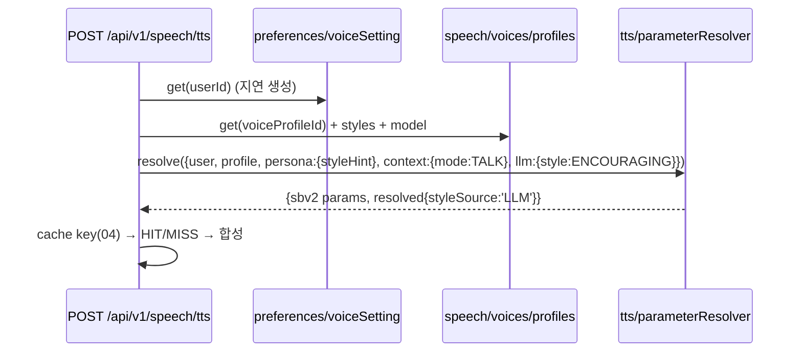

# 13. 사용자 Speech Setting Entity 설계

> 정본: `UserVoiceSetting`·`UserSpeechSetting`·`Profile` 은 [`../domain-model.md`](../domain-model.md)(L1 preferences), `GET/PUT /api/v1/settings/voice|speech` 는 [`../api-contract.md`](../api-contract.md), USER_SETTING 층의 해석 위치는 [`../configuration-resolution.md`](../configuration-resolution.md). 이 문서는 두 테이블의 필드·범위·기본값, `AUTO` 의 의미, TTS Parameter Resolver 의 우선순위와 출력, `Profile` 정리만 정의한다. 원문: 추가 기획안 §26·§39·§62·§68·§69·§72.

## 1. 목적

일반 사용자는 목적 중심 설정(목소리·스타일·속도·Pitch·Intonation / 인식 모드)만 만지고(§26), 그 값이 엔진 설정과 섞이지 않게 별도 테이블로 둔다(§62). LLM 은 의미적 스타일만 제안하고 speaker/model/pitch/styleWeight 를 정하지 못한다(§68).

## 2. 범위

- 포함: 필드·범위·기본값, 지연 생성, `style='AUTO'`·`styleWeight=null` 의미, `speechProfile`(종전 `ttsMode`), `recognitionMode` 요약, Parameter Resolver 입력·우선순위·출력, `Profile` 에서 제거되는 컬럼, API 규칙.
- 제외: 학습 설정(`Profile.level·explainLang·strictness·explainDepth`, L3 문서), 라우팅(11), 미리듣기(04).

## 3. 설계

### 3.1 `UserVoiceSetting`

| 필드 | 타입 · 범위 | 기본(행 생성 시) | 비고 |
|---|---|---|---|
| `userId @id` | | | `User` Cascade |
| `voiceProfileId` | `VoiceProfile.id`, `status=AVAILABLE` | `AppSetting voice.defaultProfileId` | 비활성화되면 재배정(03 §3.5) |
| `style` | `'AUTO'` 또는 그 profile 의 `VoiceStyle.name` | `'AUTO'` | §3.3 |
| `styleWeight` | `null` 또는 0.0~4.0 | `null`(= profile 기본) | |
| `speed` | 0.5~1.5, step 0.05 | 1.0 | Learning 프리셋 0.6·0.8·1.0 은 UI 스냅 |
| `pitch` | 0.7~1.4, step 0.05 | 1.0 | |
| `intonation` | 0.6~1.4, step 0.05 | 1.0 | |
| `speechProfile` | `NATIVE|LEARNING_NORMAL|LEARNING_SLOW|PRONUNCIATION|SHADOWING` | `NATIVE` | §3.4 (5차 보완 §138, 종전 `ttsMode NATIVE/LEARNING` 교체) |
| `updatedAt` | | | |

범위 상수는 `src/modules/preferences/voiceRanges.ts` `VOICE_PARAM_RANGES` 하나이고 speech(`tts/parameterResolver` `RANGES`)가 그것을 import 한다(01 §3.3 과 단일 출처 — L1 은 L4 를 import 할 수 없어 방향을 바꿨다). task-022(2026-09-30)에서 옛 범위(styleWeight 0~2·speed 0.6~1.2·pitch·intonation 0.8~1.2)를 위 값으로 넓혔고 옛 저장값은 그대로 유효하다. 화면 슬라이더 폭은 데모 승인 뒤 따로 맞춘다.

### 3.2 `UserSpeechSetting`

| 필드 | 값 | 기본 | 비고 |
|---|---|---|---|
| `userId @id` | | | |
| `recognitionMode` | `AUTO / FAST / ACCURATE / OFFLINE` | `AUTO` | 의미는 11 §3.3 |
| `partialSubtitle` (제안) | Boolean | true | 실시간 partial 자막 표시 — 정본에서 채택 여부 확정 |
| `autoSendOnFinal` (제안) | Boolean | true | `final` 수신 시 자동 전송 vs 확인 후 전송 |
| `updatedAt` | | | |

`explainLang` 은 계획서에 `Profile`(학습 설정)과 이 테이블 양쪽에 적혀 있다. **`Profile` 에만 둔다**(§72 에서 "설명 언어"는 학습 항목) — 정본 반영 요청(00 미결과 함께).

두 행 모두 **지연 생성**: `GET /api/v1/settings/*` 또는 첫 턴에서 없으면 기본값으로 만든다. 사용자 삭제 시 Cascade.

### 3.3 `AUTO` 의 의미

- `style='AUTO'` = "사용자는 스타일에 의견이 없다". Resolver 에서 사용자 층이 `style` 값을 주지 않으므로 아래 층(§3.5)이 정한다. 사용자가 특정 style 을 고르면 LLM·페르소나·맥락이 바꿀 수 없다.
- `styleWeight=null` = profile 기본값 사용. 사용자가 값을 주면 그 값.
- `recognitionMode='AUTO'` = Router 판단(온디바이스 우선, 11 §3.3).
- `voiceProfileId` 에는 AUTO 가 없다(항상 구체 voice). 페르소나·LLM 은 voice 를 바꿀 수 없다(§69 "Haruka 를 Takumi 로 못 바꿈").

### 3.4 `speechProfile` (5차 TTS 보완 §138 — 종전 `ttsMode` 교체, 2026-09-26)

| 값 | 의미 | speed | 세그먼트·간격 | style 편향 | 기본 문맥 |
|---|---|---|---|---|---|
| `NATIVE`(기본) | 실제 회화에 가까운 발음·속도 | 사용자 `speed` 그대로(기본 1.0) | 문장 단위, gap 0 | 없음(LLM 라벨 허용) | TALK/CHAT, "자연 속도로 듣기"(요청 단위 COMPARE) |
| `LEARNING_NORMAL` | 학습용 표준 속도 | 1.0 프리셋 | 문장 단위, gap 200ms | 없음 | 레슨 대화문 낭독 |
| `LEARNING_SLOW` | 느리되 **모라 타이밍·악센트 유지** | 사용자 `learningSpeed`(0.6·0.8), 엔진 `length` 배율만, 음소별 늘림 금지 | 문장 단위, gap 300ms | `EXPLANATION` 우선 | 회화 복습·"천천히 듣기" |
| `PRONUNCIATION` | 발음 비교가 쉽게 명확히 | 0.8 프리셋 | `、` 에서도 분할, `pauseBeforeMs` 300 | `EXPLANATION`, LLM 라벨 무시 | 발음 연습·LISTEN_RESPOND 재청취 |
| `SHADOWING` | 따라 말하기 | 0.9(0.8·1.0 스냅) | gap = 직전 청크 `durationMs` | `CALM` | 섀도잉·청취 구간 반복 |

프로필은 **정책**(속도 배율·스냅·분할·간격)이고 수치는 여전히 User/VoiceProfile 층이 준다. 설정 화면 선택지는 NATIVE·LEARNING_NORMAL·LEARNING_SLOW 세 개(라벨은 `GET /api/v1/speech/config.tts.speechProfiles`), PRONUNCIATION·SHADOWING 은 화면(문맥)이 요청 단위로 지정. 우선순위: 요청 `speechProfile`(Context 층) > 사용자 설정, LLM 은 정하지 않는다. 결과는 엔진 독립 `RenderingPlan` 으로 나가고 SBV2 파라미터 변환은 어댑터가 한다(정본 `16-tts-productization-layer.md` §4·§5, `../module-dependency.md` §11).

### 3.5 TTS Parameter Resolver (`src/modules/speech/tts/parameterResolver.ts`)

입력: `{ user: UserVoiceSetting | draft, profile: VoiceProfile(+styles, model), persona?: { styleHint? }, context: { mode: 'TALK'|'CHAT'|'LESSON'|'REVIEW'|'EVAL'|'PREVIEW'|'COMPARE' }, llm?: { style: 'NEUTRAL'|'ENCOURAGING'|'CALM'|'CHEERFUL' } }`

키별로 **값을 주는 가장 높은 층**이 이긴다. 각 층이 줄 수 있는 키:

| 순위 | 층 | `style` | `styleWeight` | `speed` | `pitch` | `intonation` | voice/model/speaker |
|---|---|---|---|---|---|---|---|
| 1 | User Setting(AUTO·null 아닌 값) | ✓ | ✓ | ✓(`speechProfile` 적용, COMPARE 면 NATIVE) | ✓ | ✓ | `voiceProfileId` ✓ |
| 2 | `VoiceProfile.defaults`(`style` 은 `'AUTO'` 허용) | ✓ | ✓ | ✓ | ✓ | ✓ | `model_id`·`speaker_id` **고정** |
| 3 | Persona 힌트(`tutor.md` 말투 절 → `styleHint`) | 힌트만 | — | — | — | — | — |
| 4 | Conversation Context(`EVAL`·`LESSON` → 또박또박 `Neutral` 계열) | 힌트만 | — | — | — | — | — |
| 5 | LLM `speech.style` → `AppSetting voice.styleMap` | 힌트만 | — | — | — | — | — |
| 최종 | 기본값 | `VoiceStyle` 첫 항목 | 1.0 | 1.0 | 1.0 | 1.0 | — |

- 수치 4개는 사용자 행이 항상 구체값이므로 사실상 **User > Profile** 이며 3~5 층은 손댈 수 없다(§68).
- `style` 은 User=`AUTO` 이고 Profile `defaults.style='AUTO'` 일 때만 3→4→5 순으로 힌트를 본다. 힌트는 `styleMap`(예: `ENCOURAGING → ["Happy","Friendly"]`, `CALM → ["Neutral","Calm"]`, `CHEERFUL → ["Cheerful","Happy"]`, `NEUTRAL → []`)의 첫 항목 중 그 profile 의 `VoiceStyle` 에 실제로 있는 것. 없으면 다음 층. 시드 voice 는 `defaults.style='AUTO'` 로 두어 LLM 스타일이 살아나게 한다.
- 엔진 capability(05 §3.3)에 없는 파라미터(예: 외부 TTS 가 `INTONATION` 미지원)는 조용히 버린다.

출력(SBV2, adapter 가 그대로 전송):

```json
{ "model_id": 0, "speaker_id": 0, "style": "Friendly", "style_weight": 1.0,
  "length": 1.1111, "pitch_scale": 1.0, "intonation_scale": 1.1, "language": "JP",
  "sdp_ratio": 0.2, "noise": 0.6, "noise_w": 0.8 }
```

`length = 1 / speed`(소수 4자리), `sdp_ratio·noise·noise_w` 는 connection `runtime`(07) 에서 온다. 응답에는 `resolved: { voiceId, style, styleWeight, speed, pitch, intonation, styleSource: 'USER'|'PROFILE'|'PERSONA'|'CONTEXT'|'LLM'|'DEFAULT' }` 를 trace 용으로 함께 돌려준다(관리자 Playground 가 표시, 04 §3.6).

### 3.6 API 규칙

| API | 규칙 |
|---|---|
| `GET /api/v1/settings/voice` | 지연 생성 → 행 + `notice?: { code: 'VOICE_REASSIGNED', from, to }`(03 §3.5, 1회 후 소거). 저장된 voice 가 더 이상 `AVAILABLE` 이 아니면 여기서 재배정하고 notice |
| `PUT /api/v1/settings/voice` | 전체 치환. `voiceProfileId` AVAILABLE 검사, `style` 이 그 profile 의 style 또는 `AUTO`, 수치 범위. 저장 후 진행 중 턴에는 다음 문장부터 적용 |
| `GET/PUT /api/v1/settings/speech` | 전체 치환. 웹에서 `FAST`/`OFFLINE` 저장 허용(실행 시 강등, 11 §3.3) |
| capability | `settings.read` / `settings.write`(본인 행만, 관리자도 타인 행 편집 불가) |

### 3.7 `Profile` 정리

제거: `tutorModel`(→ connection `runtime.tiers`), `ttsRate`·`ttsVoiceId`·`ttsStyle`·`ttsMode`(→ `UserVoiceSetting.speechProfile` 등), `sttMode`(→ `UserSpeechSetting.recognitionMode`). 유지: `level·politeness·goal*·daily*·strictness·explainLang` + 추가 `explainDepth(BRIEF|NORMAL|DETAILED)`. `vocabMode` 의 거취(학습 설정 잔류 vs 제거)는 정본 `../domain-model.md` 를 따른다. 신규 프로젝트라 데이터 마이그레이션은 없고 seed 만 바뀐다.

## 4. 시퀀스 — 턴의 파라미터 해석



## 5. 검증 규칙 · 오류 코드

| 코드 | HTTP | 상황 |
|---|---|---|
| `E_SETTING_VOICE_UNAVAILABLE` | 422 | `voiceProfileId` 가 AVAILABLE 아님 |
| `E_SETTING_STYLE_UNKNOWN` | 422 | `style` 이 AUTO 도 아니고 그 profile 의 style 도 아님 |
| `E_SETTING_RANGE` | 422 | 수치 범위·step 위반(`details.field`) |
| `E_SETTING_MODE_INVALID` | 422 | `recognitionMode`·`speechProfile` enum 밖 |
| `E_SETTING_FORBIDDEN` | 403 | 타인 행 |

## 6. Phase

- Phase 1: 두 테이블·지연 생성·API·Resolver(층 1·2·5 — 페르소나 힌트는 tutor.md v1 에 절이 있으면 포함)·`speechProfile` 3종(NATIVE·LEARNING_NORMAL·LEARNING_SLOW)·`styleMap` 시드. PRONUNCIATION·SHADOWING 은 Phase 3.
- Phase 2: Context 힌트(레슨·평가 화면), `ACCURATE` 모드 실효.
- 음성 Phase 4: `partialSubtitle`·`autoSendOnFinal`(채택 시), 스타일·감정 확장에 따른 `styleMap` 갱신.

## 7. 미결

1. 제안 필드 2개(`partialSubtitle`·`autoSendOnFinal`)의 채택 — 정본 `../domain-model.md`.
2. `explainLang` 위치 — `Profile` 단일 권고(§3.2).
3. Persona 힌트를 `tutor.md` 의 어느 절에서 읽을지(prompt-engineer 와 합의, `speech.hints` 프론트매터 제안).
