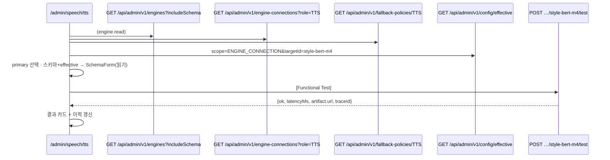

# 14. 관리자 Speech Setting UI 설계

> 정본: 콘솔 정보구조 전체는 [`../admin-console/01-console-information-architecture.md`](../admin-console/01-console-information-architecture.md), 편집 절차(Form/JSON·Validate→Test→Diff→Apply)는 [`../admin-console/08-configuration-diff-api.md`](../admin-console/08-configuration-diff-api.md)·[`../admin-console/10-raw-json-configuration-api.md`](../admin-console/10-raw-json-configuration-api.md), capability 는 [`../role-permission.md`](../role-permission.md). 이 문서는 **역할별 Engine·Connection 설정 화면**(§55·§72 Advanced)의 구조, 스키마 기반 동적 폼, 연결 테스트 결과 표시, 상태 배지, 사용자/관리자 분리 규칙만 정의한다. 원문: 추가 기획안 §46·§55·§56·§58·§72, 관리자 콘솔 §80·§124.

## 1. 목적

Advanced 설정에서 역할(Realtime STT / Analysis STT / TTS / LLM)마다 **Engine 과 Connection 을 분리해 고르고**(§46), 엔진별로 다른 설정 항목은 스키마(07)로 렌더하며(§56), 연결 테스트 결과를 그 자리에서 본다(§58). 일반 사용자 화면과는 라우트·컴포넌트·API 를 완전히 분리한다(§124).

## 2. 범위

- 포함: 진입 경로, 역할 페이지 레이아웃, Engine/Connection 선택 규칙, 동적 폼 렌더링 규칙(타입·editability·source), 테스트 결과 카드, 상태 배지, 화면 상태·오류, 사용자/관리자 분리, 모바일 폭.
- 제외: Voice 관리(15), Effective Configuration 전체 뷰·Diff·History·Playground(admin-console 문서).

## 3. 설계

### 3.1 진입 · 라우트

| 위치 | 조건 | 내용 |
|---|---|---|
| `/settings` 하단 "Advanced" 행 | `can(user,'engine.read')` | 4역할의 현재 primary connection 이름·상태 배지 요약 + "관리 콘솔 열기" |
| `(admin)/admin/speech/realtime` · `/analysis` · `/tts` · `/admin/llm` | `engine.read`, 없으면 404 | 역할 페이지(§3.2). 별도 레이아웃(상단 Environment 배지, PRODUCTION 은 경고색) |

Advanced 행이 없는 사용자(`USER`)의 `/settings` 에는 이 행 자체가 렌더되지 않는다(숨김이 아니라 미포함). 서버 컴포넌트에서 capability 검사 후 마크업을 만든다.

### 3.2 역할 페이지 레이아웃 (412px 기준 1열, ≥768px 2열)

```
┌ Realtime STT                                   [PRODUCTION] ┐
│ Engine       [ ReazonSpeech (sherpa-onnx)        ▼ ]        │  ← Engine.enabled·loaded 만 선택 가능
│ Connection   [ reazon-ondevice · 온디바이스       ▼ ] ●HEALTHY│  ← 같은 engine·role·env 의 connection
│ Fallback     reazon-ondevice → reazon-gateway  [정책 편집]   │  ← 12, Phase 2 편집
├ 연결 설정  (connection | runtime)  [Form | JSON]             │
│  baseUrl        http://127.0.0.1:8100     RUNTIME_EDITABLE  source: CONNECTION_PROFILE │
│  numThreads     2                         RESTART_REQUIRED ⚠ source: DEFAULT           │
│  credentialRef  file:home-m4-api-key ●있음  SECRET 🔒        source: CONNECTION_PROFILE │
│  ...                                                          │
│  [ 검증 ] [ 테스트 ] [ 변경 내용 보기 ] [ 적용 ]  (Phase 2)   │
├ 연결 테스트                                                   │
│  [ Health Check ]  [ Functional Test ]  [ 기기 테스트 ](ONDEVICE, 앱만) │
│  ✓ 연결 성공 · 42 ms · Style-Bert-VITS2 · Models 5 · HEALTHY  │
│  ✕ 연결 실패 · Connection refused · http://…:8200 · 12:03    │
├ 최근 이력 (EngineHealth 20건: 시각 · 종류 · ok · 지연)          │
└─────────────────────────────────────────────────────────────┘
```

- **Engine 선택**은 그 역할의 primary 를 바꾸는 행위이므로 실제 저장은 `PUT /api/admin/v1/fallback-policies/{role}`(12)로 간다. Phase 1 은 읽기 전용(현재 primary 표시), Phase 2 부터 변경 가능.
- **Connection 선택**은 선택한 Engine 의 connection 목록(`GET /api/admin/v1/engine-connections?engineId=&role=&environment=`)에서 고르며, 새 connection 은 "+ 새 연결" 로 06 `POST` 폼(같은 동적 폼)을 연다.
- 페이지 데이터: `GET /api/admin/v1/engines?includeSchema=true` + `GET /api/admin/v1/config/effective?scope=ENGINE_CONNECTION&targetId=`(키별 `value·source·sourceRef`).

### 3.3 동적 폼 렌더링 규칙 (`components/admin/configEditor/SchemaForm`)

| 스키마 | 위젯 | 비고 |
|---|---|---|
| `STRING`·`URL`·`PATH` | 텍스트 입력(URL 은 형식 검증) | |
| `INTEGER`·`NUMBER` | 숫자 입력 + `min/max` 힌트, step(INTEGER 1 / NUMBER 0.05) | 범위 밖은 즉시 빨간 테두리 |
| `BOOLEAN` | 토글 | |
| `ENUM` | 셀렉트 | `enum` 1개면 읽기 전용 표시 |
| `JSON` | 코드 블록(DEVELOPER 만 편집, 그 외 읽기) | |
| `SECRET_REF` | ref 이름 텍스트 + 존재 배지(08). `credentials.manage` 없으면 읽기 전용, 값은 어디에도 표시 없음 | |
| `group` | `connection` / `runtime` 탭 | 06 §3.2 |
| `appliesTo` 밖 키 | 렌더하지 않음 | |

키 행 공통: 라벨(`description` 툴팁) · 값 · **editability 배지**(`READ_ONLY` 회색 잠금 / `RUNTIME_EDITABLE` 초록 / `RESTART_REQUIRED` 주황 ⚠ / `REDEPLOY_REQUIRED` 빨강 / `SECRET` 자물쇠) · **source 라벨**(`DEFAULT`·`APPLICATION_CONFIG`·`ENVIRONMENT`·`DATABASE`·`CONNECTION_PROFILE`·`RUNTIME_OVERRIDE` — Effective Config 의 8 값 중 해당) · `impact` 가 있으면 ⓘ. `ENVIRONMENT` 로 덮인 키는 폼에서 편집 불가하고 "env 가 우선" 안내. `editabilityBy` 로 READ_ONLY 가 된 키는 "이 연결 유형에서는 외부 소유" 안내(예: `whisper-voicevault` 의 `runtime.model`).

편집 흐름(Phase 2): 값 변경 → `[검증]`(`POST /api/admin/v1/config/validate`) → `[테스트]`(변경값으로 임시 Functional Test) → `[변경 내용 보기]`(Diff) → `[적용]`(`ConfigurationVersion`). PRODUCTION 은 적용 전 `SUPER_ADMIN` 확인 모달. RESTART_REQUIRED 키가 포함되면 적용 후 "재시작 필요: gateway" 배너와 `restartRequired` 서비스 목록.

### 3.4 연결 테스트 카드

| 결과 | 카드 |
|---|---|
| Health ok | ✓ 초록 · `latencyMs` · `detail.service/version/models/memoryMb` · 판정 status |
| Health 실패 | ✕ 빨강 · `errorCode` 사람 말(§5) · 대상(`baseUrl`/`bin`) · 시각 · [다시] |
| Functional ok | ✓ · 지연 · 역할별 산출물: TTS `<audio>` 플레이어 / STT 인식 텍스트 + CER / LLM 모델·echo 일치 · [Trace 보기] |
| Functional 실패 | ✕ · `errorCode` · `detail.message`(≤200자) · [Trace 보기] |
| ONDEVICE | 서버 카드는 "기기에서 실행" 안내. 앱에서 열었을 때만 [기기 테스트] 활성(10 §3.4), 결과에 기기 모델·앱 버전 |
| 진행 중 | 버튼 스피너·중복 클릭 차단(`E_TEST_IN_FLIGHT` 무시) |

### 3.5 상태 배지 (`EngineStatus`)

| status | 색 | 라벨 | 부가 |
|---|---|---|---|
| `HEALTHY` | 초록 | 정상 | `lastHealthAt` 상대시각 |
| `DEGRADED` | 주황 | 저하 | `detail.reason`(지연·모델 미로드·기능테스트 실패) |
| `UNAVAILABLE` | 빨강 | 불가 | Router 제외 표시 "라우팅 제외" |
| `MISCONFIGURED` | 보라 | 설정 오류 | 검증 오류 목록·시크릿 누락 링크(08) |
| `DISABLED` | 회색 | 비활성 | `enabled=false` 또는 Engine 비활성 |
| `UNKNOWN` | 회색 점선 | 미확인 | [Health Check] 유도 |

### 3.6 사용자 / 관리자 분리 규칙

| 항목 | 사용자 `/settings` | 관리자 `(admin)` |
|---|---|---|
| 노출 어휘 | 목소리·스타일·속도·인식 모드(자동/빠른 응답/높은 정확도/오프라인) | Engine·Connection·model·baseUrl·status |
| 엔진명 | 없음(`ReazonSpeech`·`faster-whisper`·`Style-Bert-VITS2` 문자열이 번들에 포함되지 않도록 사용자 화면 컴포넌트는 `/api/v1` 응답만 사용) | 있음 |
| API | `/api/v1/*` | `/api/admin/v1/*` |
| 컴포넌트 | `components/settings/*` | `components/admin/*` (서로 import 금지) |
| 접근 실패 | — | capability 없음 = 404(존재 자체 비노출) |
| 폰 | 412px 1열, 터치 44px | 같은 폭에서 동작하되 표는 가로 스크롤 허용 |

QA 체크(task-005): 사용자 화면 번들·DOM 에 엔진명 문자열 0건, USER 계정 `/admin/*` 404.

### 3.7 화면 상태 · 오류

| 상태 | 표시 |
|---|---|
| 로딩 | 스켈레톤(Engine·Connection 셀렉트·폼 5행) |
| 역할에 connection 없음 | "이 역할에 연결이 없습니다" + [+ 새 연결] |
| Engine 미로드(`loaded=false`) | 셀렉트에 취소선 + `initError` 툴팁, 선택 불가 |
| Effective Config 조회 실패 | 폼 대신 오류 카드 + 값은 connection 행 원본으로 대체 표시(source 라벨 "미확인") |
| PRODUCTION 편집 | 상단 경고 배너 상시, 적용 버튼 색 경고 |
| 시크릿 누락 | `credentialRef` 행 빨간 배지 "파일 없음" + 회전 runbook 링크 |

## 4. 시퀀스 — 페이지 로드와 테스트



## 5. 오류 코드 → 화면 문구

| 코드 | 문구 |
|---|---|
| `E_HEALTH_CONNECTION_REFUSED` | "서비스에 연결할 수 없습니다 (연결 거부)" |
| `E_HEALTH_TIMEOUT` · `E_TEST_TIMEOUT` | "응답이 없습니다 (시간 초과 N초)" |
| `E_HEALTH_AUTH` · `E_TEST_AUTH` | "인증에 실패했습니다 — 시크릿 확인" |
| `E_HEALTH_CREDENTIAL_MISSING` | "시크릿 파일이 없습니다: file:…" |
| `E_TEST_ACCURACY` | "인식 결과가 기준에 못 미칩니다 (CER 0.42)" |
| `E_TEST_OUTPUT_INVALID` | "출력 형식이 올바르지 않습니다" |
| `E_CONN_SCHEMA_INVALID` | 키별 인라인 오류 |
| `E_CONN_RESTART_REQUIRED` | 배너 "적용됨 · 재시작 필요: …" |
| `E_FALLBACK_PRODUCTION_CONFIRM` | 확인 모달 재표시 |

## 6. Phase

- Phase 1: 진입 행·역할 페이지 읽기·동적 폼 읽기(editability·source 표시)·Health/Functional 버튼·결과 카드·이력·배지.
- Phase 2: Engine/Connection 변경(정책 PUT)·폼 편집·Validate/Test/Diff/Apply·JSON 뷰·새 연결 생성·log-level.
- 음성 Phase 4: ONDEVICE 기기 테스트 버튼(앱), 외부 API connection 폼.

## 7. 미결

1. Advanced 요약 행을 `/settings` 에 둘지 아예 콘솔 링크만 둘지 — 1인 앱이라 요약 행이 편리, designer 확인.
2. 폼의 source 라벨을 항상 보일지 DEVELOPER 이상에서만 보일지 — 항상(ADMIN 도 "왜 이 값인가"를 알아야 함).
3. 콘솔 페이지의 모바일 폭 지원 수준 — 읽기·테스트는 폰에서, 편집은 데스크톱 권장 문구.
