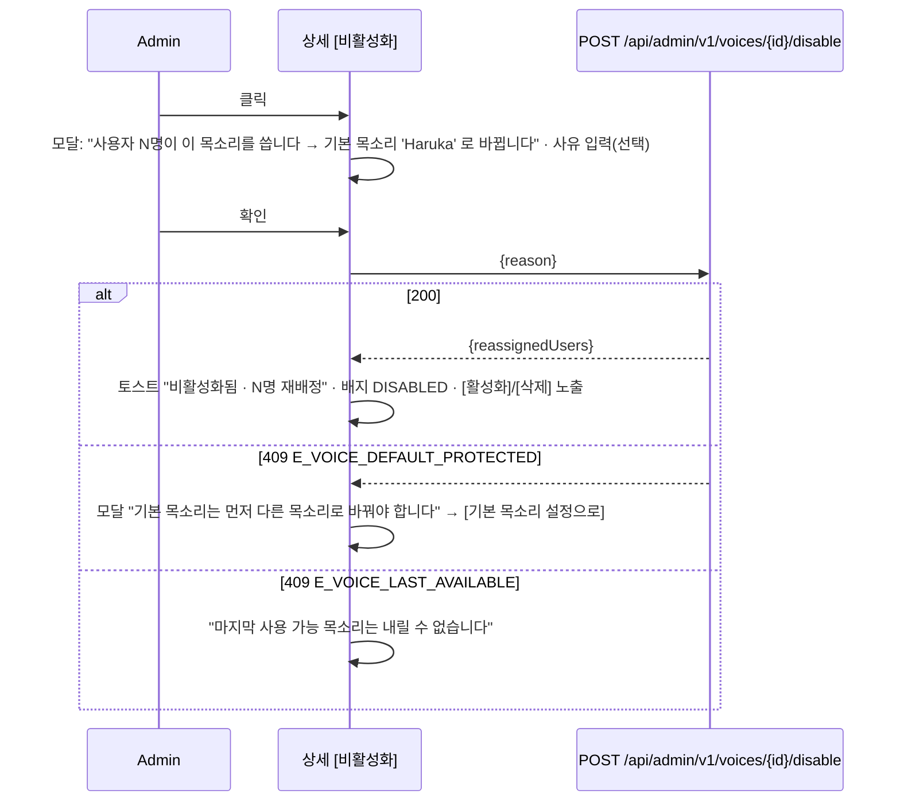

# 15. Voice Management Admin UI 설계

> 정본: 콘솔 정보구조는 [`../admin-console/01-console-information-architecture.md`](../admin-console/01-console-information-architecture.md), API 는 [`../api-contract.md`](../api-contract.md)(`/api/admin/v1/voices*`), capability 는 [`../role-permission.md`](../role-permission.md). 이 문서는 Voice 목록·상세·Preview Playground·Import·비활성/삭제 화면의 구조, 상태 표시, 오류 상태만 정의한다. 데이터·규칙은 01~04 를 따른다. 원문: 추가 기획안 §36~§38, 관리자 콘솔 §114~§116.

## 1. 목적

관리자가 Voice 를 데이터로 운영한다: 목록에서 상태를 보고, 상세에서 기본값·노출 스타일을 고치고, Playground 로 임의 문장을 들어보고, 패키지를 가져오고, 안전하게 내리고(재배정 확인) 보관한다.

## 2. 범위

- 포함: 라우트, 목록·상세·Playground·Import·비활성/삭제 흐름, 상태별 표시, 화면 상태, 오류 문구, 모바일 폭.
- 제외: 사용자 설정 화면(designer `docs/screens.md`), 패키지 규격·파이프라인 규칙(03), 캐시(04).

## 3. 설계

### 3.1 라우트 · 권한

| 라우트 | capability | Phase |
|---|---|---|
| `/admin/voices` | `voices.read`(보기) / `voices.manage`(버튼) | 1 |
| `/admin/voices/[id]` | 동일 | 1 |
| `/admin/voices/[id]` 내 Preview Playground 패널 | `voices.manage` | 4(Phase 1 은 기본 문장 미리듣기만) |
| `/admin/voices/import` | `voices.manage` + Engine `VOICE_IMPORT` capability | 4 |
| `/admin/voices/new`(기존 모델에서 profile 생성) | `voices.manage` | 1 |

### 3.2 목록 `/admin/voices`

```
Voices                                     [PRODUCTION]   [재동기화] [Import ↑]
필터: 상태 [전체 ▼]  보관 포함 □          동기화 결과: 추가 1 · 갱신 3 · 사라짐 0 · 미등록 모델 1 → [프로파일 만들기]
┌ Haruka  ●AVAILABLE  enabled                          사용자 1 · 마지막 테스트 ✓ 2h 전 ┐
│ teacher_haruka · Style-Bert · jvnv v1.0.0 · 화자 F1 · 스타일 Neutral / Friendly / Cheerful│
│ [▶ 미리듣기] [편집] [비활성화]                                                        │
├ Sakura  ●DISABLED                                                                  │
│ … [▶ 미리듣기] [편집] [활성화] [삭제]                                                 │
├ Mio     ◐IMPORTING  (job 3/5 TESTING)  → [진행 보기]                                 │
└ Old     ●ERROR  모델이 /models/info 에 없음  [재동기화] [상세]                          ┘
```

- 카드 1장 = `VoiceProfile` 1행(관리자 투영, 02 §3.3). 정렬 `sortOrder`, 드래그로 순서 변경(`PUT sortOrder`).
- `[▶ 미리듣기]` = 기본 문장 + profile defaults 로 `POST /api/admin/v1/voices/{id}/preview`(04 §3.6) — 카드 안 인라인 플레이어.
- `[재동기화]` = `POST /api/admin/v1/voices/sync` → 결과 배너(§3.2 두 번째 줄), `unregistered[]` 가 있으면 [프로파일 만들기] → `/admin/voices/new?model=`.
- `[Import ↑]` 는 TTS primary connection 의 Engine 에 `VOICE_IMPORT` 가 있을 때만.

### 3.3 상세 `/admin/voices/[id]`

| 섹션 | 내용 | 편집 |
|---|---|---|
| 헤더 | displayName · status 배지 · enabled 토글 · `[Functional Test]` `[비활성화|활성화]` | `enabled`(`voices.manage`) |
| 기본 정보 | `id`(복사) · displayName · description · sortOrder | `PUT` |
| 모델 정보 | Engine 표시명 · Connection(`style-bert-m4`) · model(`teacher_haruka` v1.0.0, sha256 앞 8자) · speaker · 모델 상태 · importedAt | 읽기 |
| 기본값 | style 셀렉트(`AUTO` 포함) · styleWeight/speed/pitch/intonation 슬라이더(01 §3.3 범위, 44px) | `PUT defaults` → 저장 시 "이 voice 의 사용자 N명에게 기본값만 바뀜(사용자 값은 유지)" 안내 |
| 스타일 노출 | 모델 style 전체 목록(체크 = `VoiceStyle` 행) + 라벨 입력 + 기본 weight | `PUT styles` |
| Preview Playground(§3.4) | | |
| 이력 | `ConfigurationVersion(VOICE_PROFILE)` 목록(누가·언제·diff 요약·[롤백] Phase 2) · `EngineHealth(FUNCTIONAL)` 최근 5건 · `VoiceImportJob` 링크 | 읽기 |
| 위험 구역 | `[비활성화]`(AVAILABLE) / `[삭제]`(DISABLED) — §3.6 | |

### 3.3b Versions 탭 `/admin/voices/[id]/versions` (5차 보완 §152~§154, P1 — 사용자 결정)

`VoiceModelVersion` 목록(version·deployStatus·canaryPercent·validatedAt·promotedAt·Golden 회귀 결과 링크)과 전이 버튼 validate → stage → canary{percent} → promote → deprecate(`voices.manage`, PRODUCTION promote/canary 는 SUPER_ADMIN 확인). 정본 `16-tts-productization-layer.md` §10, API `../api-contract.md` §7-2.

### 3.4 Preview Playground (상세 안 패널, 음성 Phase 4; Phase 1 은 기본 문장 버튼만)

```
텍스트   [ 任意の文章を入力 … ]  (≤300자, 문장별 ≤100자 경고)
Style    [ Friendly ▼ ]   Style Weight [====●====] 1.0
Speed    [===●=====] 0.9  Pitch [====●====] 1.0   Intonation [=====●===] 1.1
Connection [ style-bert-m4 ▼ ] (DEVELOPER)      □ 캐시 우회
[ ▶ Preview ]      ▶ ──────●──── 0:04 / 0:06   캐시 HIT · 812 ms · trace 3f1a…
해석된 파라미터: model_id 0 · speaker_id 0 · style Friendly(source USER) · length 1.1111 · pitch 1.0 · intonation 1.1
```

- 요청 = `POST /api/admin/v1/voices/{id}/preview`(04 §3.6). 응답의 `resolved`·`steps` 를 아래 표시.
- 슬라이더 값은 사용자 설정과 무관한 **임시값**(저장 버튼 없음). "이 값을 기본값으로" 링크가 기본값 섹션에 복사.
- 텍스트는 서버에 저장되지 않는다(캐시 키의 해시로만 남음).

### 3.5 Import `/admin/voices/import`

```
1 업로드   [ zip 드롭 (≤600MB) ]  옵션: □ 등록 후 바로 활성화   □ 같은 모델 교체(replace)
2 진행     UPLOADED ✓ → VALIDATING ✓ → IMPORTING ● → TESTING ○ → REGISTERED ○
           로그: 12:01:03 INFO  manifest ok (teacher_mio 1.0.0)
                 12:01:08 INFO  sha256 verified 3 files
                 12:01:20 INFO  refresh: 4 models
3 결과     ✓ 등록됨 · Mio(teacher_mio) · 테스트 합성 812ms  ▶ 재생   [활성화] [상세로]
      또는 ✕ 실패 E_IMPORT_TTS_TEST_FAILED · 로그 마지막 20줄 · [다시 업로드]
```

- 업로드 중 페이지 이탈 경고. 202 수신 후 `GET /api/admin/v1/voices/import-jobs/{id}` 3초 폴링, 브라우저를 닫아도 job 은 서버에서 계속되고 목록의 `IMPORTING` 카드에서 재진입.
- `replace` 체크 시 "기존 사용자 캐시가 삭제되고 다음 재생부터 새 모델" 경고.
- 동시 진행 1건: 진행 중이면 업로드 영역 비활성 + 진행 카드로 연결.

### 3.6 비활성화 · 삭제 흐름



삭제(`DELETE`, DISABLED 만): 모달에 voice id 를 직접 입력해야 활성화되는 확인 버튼, 같은 모델을 다른 profile 이 쓰면 "모델 파일은 유지됩니다" 경고(`warnings[]`). 완료 후 `ARCHIVED` 는 "보관 포함" 필터로만 보이고 어떤 버튼도 없다(purge 는 runbook, 03 §3.4).

### 3.7 상태 표시

| status | 배지 | 카드 부가 | 가능한 버튼 |
|---|---|---|---|
| `AVAILABLE` | 초록 | 사용자 수 · 마지막 테스트 | 미리듣기 · 편집 · 비활성화 · 테스트 |
| `DISABLED` | 회색 | 사유·시각 | 미리듣기 · 편집 · 활성화 · 삭제 |
| `IMPORTING`·`VALIDATING` | 파랑 스피너 | job 단계 n/5 | 진행 보기 |
| `ERROR` | 빨강 | `detail`(모델 없음 / speaker 없음) | 재동기화 · 상세 |
| `DELETING` | 회색 스피너 | | 없음 |
| `ARCHIVED` | 회색 취소선 | | 없음 |
| `enabled=false`(status 무관) | "숨김" 태그 | | 토글 |

### 3.8 화면 상태 · 오류

| 상태 | 표시 |
|---|---|
| 로딩 | 카드 스켈레톤 3장 |
| voice 0개 | "등록된 목소리가 없습니다" + [재동기화] [Import] |
| 동기화 upstream 실패 | 배너 "TTS 서비스에 연결할 수 없습니다(E_VOICE_SYNC_UPSTREAM)" + TTS 연결 페이지 링크(14) |
| 미리듣기 실패 | 카드 안 "합성 실패 · E_PREVIEW_UPSTREAM" + [다시] |
| activate 테스트 실패 | 모달 "기능 테스트 실패로 활성화하지 않았습니다" + [Trace 보기] |
| PRODUCTION | 상단 배너, 비활성화/삭제/Import 버튼 경고색 |

| 코드 | 문구 |
|---|---|
| `E_VOICE_STATE_TRANSITION` | "현재 상태에서는 할 수 없는 작업입니다" |
| `E_VOICE_STYLE_UNKNOWN` · `E_VOICE_SPEAKER_UNKNOWN` | 해당 필드 인라인 "모델에 없는 값" |
| `E_VOICE_DEFAULTS_RANGE` | 슬라이더 범위 표시 |
| `E_IMPORT_*` | 03 §5 코드를 단계 옆에 그대로 + 사람 말 1줄 |
| `E_VOICE_SYNC_IN_PROGRESS` | "다른 동기화가 진행 중입니다" |

모바일(412px): 카드 1열, 상세 섹션 아코디언, 슬라이더 44px, Import 는 "데스크톱에서 권장" 안내(업로드는 동작).

## 4. Phase

- Phase 1: 목록·상세(기본 정보·모델 정보·기본값·스타일 노출·이력)·기본 문장 미리듣기·재동기화·활성/비활성·`/new`.
- Phase 2: 이력 롤백·ConfigurationVersion diff 표시.
- 음성 Phase 4: Playground 패널·Import 화면·삭제·`ARCHIVED` 필터.

## 5. 미결

1. 목록을 카드로 할지 표로 할지 — voice 수가 10개 미만이므로 카드, designer 확인.
2. 사용자 수(`usedByUsers`)를 목록에서 보일지 상세만 — 02 미결 1.
3. Playground 의 텍스트 입력에 최근 입력 5개 로컬 저장(브라우저)을 둘지 — 서버 저장 없음 원칙은 유지.
