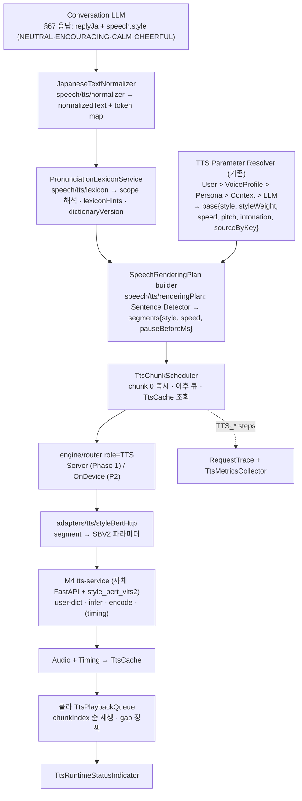
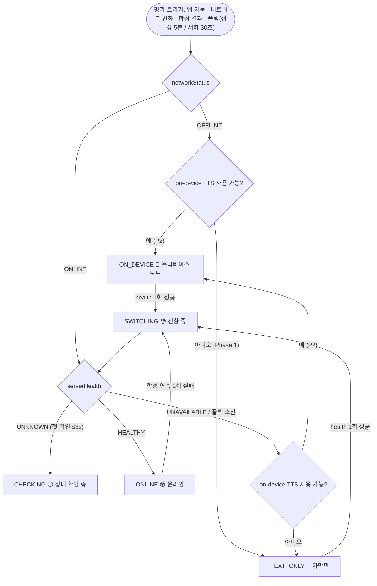

# 16. TTS Productization Layer 설계 — Lexicon · Normalizer · Rendering Plan · Chunked Delivery · Observability · Quality · Versioning · Runtime Status

> 정본: 엔티티·enum 은 [`../domain-model.md`](../domain-model.md) §3·§10, API 는 [`../api-contract.md`](../api-contract.md) §2-4·§2-30·§7(추가분), 모듈 배치는 [`../module-dependency.md`](../module-dependency.md) L4 `speech/tts`·L5 `engine/adapters/tts`, 요약·결정은 [`../../design-spec.md`](../../design-spec.md) §9-D. 이 문서는 5차 보완 기획안([`../../tts-보완-기획안-원본.md`](../../tts-보완-기획안-원본.md) §129~§163)을 기존 음성 플랫폼 설계(01~15, admin-console/13) 위에 **어떻게 얹는지** — 계층·의미·규칙·매핑·Phase — 만 정의한다. 구현 코드 없음. 작성 2026-09-26.

## 0. 목적 · 범위 · 정본 관계

**목적(§129·§163)**: SELVAS 벤치마크 결과 부족한 것은 엔진 능력이 아니라 **Productization Layer** 다. Style-Bert-VITS2(이하 SBV2)를 유지한 채 앱이 엔진을 직접 쓰지 않도록 `App → TTS Platform → Engine Adapter → Engine` 계층을 세우고, 발음 관리·정규화·Speech Control·저지연 전달·모니터링·품질 보증·모델 수명주기·Hybrid Routing·실행 상태 표시를 그 계층에 둔다. **범위**: 포함 — §160 의 14개 컴포넌트 + 장기 후보 2개의 의미·규칙·정본 매핑. 제외 — Voice Registry/Preview/Import 자체(01~04 유지), 8층 설정 해석(configuration-resolution), Prompt·LLM 계약(§8, `tutor.md` 불변), 아바타·립싱크(P2 비목표).

**§159 유지 항목(재설계하지 않음)**

| 항목 | 유지되는 기존 설계 | 이 문서가 덧붙이는 것 |
|---|---|---|
| Multi Voice | Voice Registry·`VoiceProfile/VoiceModel/VoiceStyle`(01·02) | `VoiceModelVersion` 을 `VoiceModel` 아래에 추가(§10) |
| Voice Preview | 통합 미리듣기·draft·같은 `TtsCache`(04) | 캐시 키 확장(§11)·Lexicon Preview 재사용(§2) |
| Engine Monitoring | Health/Functional Test·`EngineHealth`(09·10)·Diagnostics(admin-console/13·15) | TTS 전용 지표·대시보드·Trace sub-step(§7) |
| Engine Configuration | Engine Registry + Connection Profile + Schema(05~07) | descriptor `capabilities` 플래그 5종(§4.4) |
| Model Add / Remove | Voice Package + Import Service(03) | Import 결과가 "새 버전" 이 됨(§10.2) |
| Runtime Status | Engine Health Check(09) | **사용자용** `TtsRuntimeStatusIndicator`(§12) — 관리자용 Health 와 별개 |

## 1. 계층 구조

### 1.1 네 계층과 소유 모듈

| 계층 | 위치 | 책임 | 아는 것 / 모르는 것 |
|---|---|---|---|
| Japanese Learning App | 라우트(`/api/v1/speech/tts*`, 턴 SSE)·화면 | `speechProfile`·문맥을 넘기고 오디오·자막·상태등을 그린다 | 엔진명·모델·speaker 를 **모른다** |
| TTS Platform (L4) | `src/modules/speech/tts/{normalizer, lexicon, renderingPlan, chunkScheduler, cache, metrics, timing, status}` + 클라 `TtsPlaybackQueue`·`TtsRuntimeStatusIndicator` | 파이프라인·플랜·청크·캐시·지표·상태 판단. 엔진 역할 `TTS` 와 `connectionKey` 만 안다 | LLM 을 모른다(persona 힌트는 인자) |
| Engine Adapter (L5) | `src/modules/engine/adapters/tts/styleBertHttp`(+ 향후 `styleBertOnDevice`, 외부 TTS) | plan segment → 엔진 파라미터 변환, descriptor `capabilities` 선언, 헤더 계측값 수집 | 엔진명이 문자열로 등장하는 **유일한** TS 위치(기존 규칙 유지) |
| Engine | 맥 M4 `speech/tts-service`(:8200) = **`style_bert_vits2` 라이브러리 위의 자체 FastAPI 래퍼**, 향후 OnDevice 런타임 | g2p(user-dict 적용)·infer·encode·(timing) | AGPL 경계, `speech/common` 을 import 하지 않음(기존 규칙 9) |

### 1.2 확인된 사실(2026-09-26 `server_fastapi.py` 조회)과 그 귀결

SBV2 동봉 서버의 라우트는 `GET/POST /voice`(text, model_id/model_name, speaker_id/speaker_name, sdp_ratio, noise, noisew, length, language, auto_split, split_interval, assist_text(+weight), style, style_weight, reference_audio_path) · `POST /g2p` · `GET /models/info` · `POST /models/refresh` · `GET /status` · `GET /tools/get_audio` 뿐이다. **User Dictionary 라우트 없음 · 음소/타이밍 출력 없음 · 스트리밍 없음(WAV 전체) · 서버 라우트에 `pitch_scale`/`intonation_scale` 없음**(라이브러리 `TTSModel.infer` 는 최신 버전에서 두 인자를 노출 — task-003 에서 설치 버전으로 확인). 따라서 M4 `tts-service` 는 `server_fastapi.py` 를 프록시하지 않고 **라이브러리를 직접 감싸는 자체 FastAPI** 여야 한다 — 그래야 (a) pitch/intonation 노출, (b) 요청 단위 사전 적용, (c) 청크 단위 합성·큐·계측 헤더, (d) timing 메타데이터를 우리가 제어한다. 기존 03 §3.2 시퀀스의 `SBV2 server_fastapi` 참여자는 래퍼 내부의 모델 홀더(라이브러리)로 바뀌고 `/models/refresh` 는 래퍼 내부 재스캔이 된다(§14).

### 1.3 파이프라인(§133) 과 기존 Resolver 의 관계

- 기존 5순위(User > VoiceProfile > Persona > Context > LLM, 13 §3.5·configuration-resolution §4)는 그대로 **값**을 정한다. `renderingPlan.build()` 가 내부에서 `parameterResolver.resolve()` 를 불러 `base` 를 채우므로 §133 의 "Rendering Plan → Parameter Resolver" 순서는 "세그먼트 라벨링 → 값 해석" 두 단계이고, 산출물은 **하나의 plan**(엔진 독립)이다.
- LLM 은 `speech.style` 만 낸다(`tutor.md` §1·§6). plan·세그먼트·엔진 파라미터를 LLM 이 만들지 않으며, 클라이언트가 보낸 `renderingPlan` 의 수치도 서버가 무시하고 재계산한다(§4.4).

## 2. Pronunciation Lexicon Service (`speech/tts/lexicon`, §130~§132)

### 2.1 엔티티(정본 domain-model §3, 이름 고정)

| 엔티티 | 필드 | 의미 |
|---|---|---|
| `PronunciationLexiconEntry` | `surface`(표기, ≤40) · `reading`(가타카나, ≤60) · `accentType`(정수, 0=平板, n=핵 모라 위치) · `priority`(정수, 기본 10) · `scope LexiconScope` · `scopeRefId?` · `wordType?`(PROPER_NOUN·PERSON·PLACE·COMMON·LOANWORD·ABBREVIATION) · `note?` · `enabled` · `environment` · `updatedAt` | 단어 1건. `@@unique([environment, scope, scopeRefId, surface])` |
| `LexiconScope` | `GLOBAL · COURSE · LESSON · VOICE · USER` | `scopeRefId` = COURSE→`Topic.id`(Scenario 도입 시 `Scenario.id`), LESSON→`Lesson.id`, VOICE→`VoiceProfile.id`, USER→`User.id`; GLOBAL 은 null |
| `PronunciationLexiconVersion` | `version`(환경별 단조 증가 정수) · `environment` · `snapshotHash`(enabled 항목 정렬 후 sha256) · `changeSummary` · `actorUserId` · `status ACTIVE\|SUPERSEDED\|ROLLED_BACK` · `createdAt` | 사전 스냅샷 1개. 환경당 ACTIVE 1행 |

`dictionaryVersion`(캐시 키·Trace·래퍼 헤더에 쓰는 값) = ACTIVE 행의 `version`. 사전이 비어 있으면 0.

### 2.2 범위 우선순위와 충돌 규칙

우선순위는 **좁은 범위가 이긴다**: `USER > VOICE > LESSON > COURSE > GLOBAL`(기획안 표기 GLOBAL<COURSE<LESSON<VOICE<USER 와 동일). 요청 문맥 `{userId, voiceId, lessonId?, topicId?}` 로 후보를 모은 뒤:

| 규칙 | 내용 |
|---|---|
| L-1 | 같은 `surface` 가 여러 scope 에 있으면 가장 좁은 scope 1건만 적용. 같은 scope 안에서는 unique 라 충돌 없음(문맥은 ref 를 하나씩만 가진다) |
| L-2 | 문장 안에서는 **최장 일치 우선**(`日本橋駅` 항목이 있으면 `日本橋` 보다 먼저), 같은 길이면 `priority` 큰 쪽. **복합어 경계 가드(task-034, 2026-10-05)**: 한자만으로 된 표기가 더 긴 한자열의 일부(바로 앞·뒤 글자가 한자이고 다른 사전 일치에 속하지 않음 — 예: `明日` 항목이 `明日香` 안)에 걸리면 그 일치를 버려 엔진 기본 읽기에 맡긴다(`tts/lexicon.guardCompoundMatches`, 어댑터가 표기를 위치 없이 다시 찾는 점은 `prepareSegments` 가 반복 정규화로 같이 막는다). 가나·영숫자가 섞인 표기는 대상 아님 |
| L-3 | `enabled=false` 는 매칭에서 제외되지만 스냅샷·Export 에는 남는다 |
| L-4 | `reading` 은 가타카나·長音符 만(≤60), `accentType ≤ 모라 수`, `priority` 0~1000; 위반 시 422 `UNPROCESSABLE` + `details.reason=E_LEXICON_ENTRY_INVALID`(칸 코드 `E_READING`·`E_ACCENT`… — api-contract §7-2a). 표기는 가나·한자 1자 이상·공백/제어 문자 없음(`E_SURFACE_NOT_JA`·`E_SURFACE_CHARS`, task-003g) |
| L-5 | USER scope 는 학습자 이름·선생님 이름(`Profile.teacherName`) 등 개인 고유명사 전용. Phase 2 설정 화면에서 학습자가 자기 읽기를 등록(관리자 API 와 같은 검증) |

### 2.3 버전 · 롤백(§132)

- 항목 쓰기(추가·수정·삭제·Import·enable 토글)는 모두 **한 트랜잭션에서 새 `PronunciationLexiconVersion`** 을 만들고 직전 ACTIVE 를 SUPERSEDED 로 내린다. "변경 묶어서 게시"(draft 항목 `versionId=null`)는 엔티티에 칸이 없어 task-003g 에서는 **저장 1번 = 버전 1개**(묶음 게시는 스키마 변경 = 사용자 승인 사항).
- Rollback 은 삭제가 아니라 **대상 버전 스냅샷을 복사한 새 버전**(기존 ConfigurationVersion 원칙과 동일). **밀려난 직전 ACTIVE 가 ROLLED_BACK**, 복원 대상 버전의 상태는 그대로(admin-console/09 §5 와 같은 뜻 — task-003g 정리). `AuditLog` 필수(`scope=null` + `action='lexicon.*'` + `targetId='lexicon:v<n>'` — `ConfigScope` 에 LEXICON 이 없고 enum 추가는 db push 라 task-003g 에서 하지 않음), PRODUCTION 은 `config.apply.production`(SUPER_ADMIN) + 확인 문구 `confirm:"PRODUCTION"`. 별도 `ConfigurationVersion` 행은 만들지 않는다(스냅샷이 수천 행이라 자체 버전 테이블이 정본). 되돌려도 항목 표가 같으면 409 `NO_CHANGE`.
- 게시 직후 앱은 래퍼에 `POST /admin/lexicon/apply {dictionaryVersion, snapshotHash, entries[]}` 로 컴파일을 미리 시킨다(실패해도 게시는 유효 — 요청 시 lazy 컴파일). 래퍼는 최근 3개 버전의 산출물을 보관해 캐시 미스 재합성·회귀 실행이 옛 버전을 요구해도 응답한다.

### 2.4 적용 방식 — A(기본) / B(보조), 둘 다 `dictionaryVersion` 으로 키 지정

| | A. 플랫폼 치환(기본) | B. 엔진 사용자 사전(보조·선택) |
|---|---|---|
| 어디서 | 앱(L4)이 scope 해석·최장 일치로 `lexiconHints[{surface, reading, accentType, wordType}]` 를 만들어 `/synthesize` 에 동봉. 래퍼가 `dictionaryVersion` 의 **pyopenjtalk user-dict**(MeCab CSV → 컴파일)를 g2p 전에 적용 | 어댑터가 SBV2 `text/user_dict` 모듈(LGPL)에 항목을 push |
| 엔진 독립성 | 높음 — user-dict 를 못 쓰는 엔진에는 표기→가타카나 치환 텍스트로 강등(악센트는 잃고 읽기는 보존) | 없음(SBV2 전용) |
| 채택 조건 | 기본. task-003 에서 "SBV2 내부 g2p 가 전역 pyopenjtalk user-dict 를 실제로 따르는지" 실측 | A 가 SBV2 내부 g2p 경로와 충돌할 때만 |
| Trace | `matches`(건수)·`dictionaryVersion` 만 기록, 표기·읽기 본문 없음(§113) | 동일 |

### 2.4a 화면 읽기 줄 반영 (task-032, 2026-10-05)

같은 사전이 화면의 후리가나·한글 줄(api-contract #24r)에도 적용된다. 위치는 gateway user-dict 가 아니라 **앱 L4 후처리**(`speech/reading/lexiconOverlay` — 분석기 결과 위 최장 일치, 5분기: 같음 유지·교체·복합어 유지·일치 유지·활용형 충돌 숨김). 범위는 **GLOBAL + 본인 USER** 만(VOICE 는 목소리별 소리 보정, LESSON·COURSE 는 요청에 맥락 없음 — 사용자 결정). 조회는 `tts/lexicon.loadLexiconForDisplay(environment)`(쓰기 0, 환경별 30초 캐시·1초 제한·직전 사전 사용). gateway user-dict 안(B)은 비용값에 따라 `明日香`→明日+香 오독·青か 미교정이 갈려 기각. 사전 캐시는 세대 번호로 보호한다 — 저장 직후 `clearLexiconCache()` 가 세대를 올리고 진행 중 조회를 버려, 옛 조회가 늦게 끝나도 캐시를 다시 채우지 못한다(REV-103 L-1 해소, task-034). 화면(분석기 판정)과 TTS(한자 이웃 규칙)의 복합어 판정식은 달라 경계 사례에서 표시와 소리가 갈릴 수 있다(수용).

### 2.5 Import / Export · Preview · 화면(§131)

- **형식**: CSV(UTF-8, 헤더 `surface,reading,accentType,priority,scope,scopeRefId,wordType,note,enabled`) 와 같은 키의 JSON 배열. Export 머리에 `dictionaryVersion`·`environment`·`exportedAt`. Import 는 `mode=MERGE|REPLACE_SCOPE` + `dryRun=true` 로 diff(추가·수정·삭제 건수, 오류 행)를 먼저 보여 준 뒤 게시 → 새 버전.
- **Preview**: `POST /api/admin/v1/lexicon/preview {text(≤200), voiceId?, draftEntries?[], compare?, side?}` → 래퍼 `/g2p` 읽기·악센트 문자열(`before` = 지금 사전, `after` = 초안 적용)·적용 항목, 소리는 같은 경로 `Accept: audio/wav` + `side`(`bypassCache`, `RequestTrace(PLAYGROUND)`, 캐시 저장 안 함 — task-003g, api-contract §7-2a). 저장 전 항목의 효과를 듣는 용도(§131 "발음 미리듣기").
- **Admin 페이지 Pronunciation Dictionary**(`(admin)/admin/speech/tts/lexicon`, `voices.manage`; 읽기 `voices.read`): 검색(표기·읽기·scope) · 추가 · 수정 · 삭제 · Import · Export · Preview · Version History(버전 목록·diff·`changeSummary`) · Rollback. **API**(api-contract §7): `GET/POST /api/admin/v1/lexicon`, `PUT/DELETE …/lexicon/:id`, `POST …/lexicon/import`, `GET …/lexicon/export`, `POST …/lexicon/preview`, `GET …/lexicon/versions`, `POST …/lexicon/versions/:version/rollback`.

## 3. Japanese Text Normalizer (`speech/tts/normalizer`, §134)

### 3.1 원칙 — 엔진 정규화 비의존

정규화 결과 `normalizedText` 는 **어느 엔진을 쓰든 동일**해야 한다(캐시 키·사전 매칭·회귀 비교의 기준). "읽기를 우리가 정할 항목" 은 앱(TS, L4)에서 결정해 엔진에 결정된 형태를 보내고, 나머지는 엔진 g2p(래퍼 안의 pyopenjtalk)에 맡기되 Golden Set 으로 그 결과를 기록한다. SBV2 `text/japanese` 의 normalize 는 AGPL 경계 안(래퍼)에서만 실행되며 앱은 그 결과에 의존하지 않는다.

### 3.2 처리 대상과 정책

| 대상 | 예 | 정책(초안, task-003 골든셋으로 확정) |
|---|---|---|
| 숫자 | `3個`, `120円` | 아라비아 → 한자 숫자(`三個`·`百二十円`). 4자리 이상은 万·億 단위 삽입 |
| 날짜 | `2026年9月26日` | `二千二十六年九月二十六日`. `1日` 은 날짜 문맥이면 `ついたち` 로 읽기 지정(가나) |
| 시간 | `9:30`, `午後3時` | `九時三十分`·`午後三時`. 콜론 표기는 時·分 삽입 |
| 단위 | `5km`, `30%`, `2kg` | 단위표(`km→キロメートル`, `%→パーセント`) 로 가타카나 치환 |
| Counter | `一人・二人・一本・一匹・一日` | 조수사표: `一人→ひとり`, `二人→ふたり`, `一本→いっぽん`, `一匹→いっぴき`, `一日→いちにち`(기간)/`ついたち`(날짜, 앞에 月 이 있을 때). 음편(促音·半濁音) 표로 처리 |
| 기호 | `〜`, `…`, `!?`, 괄호, 이모지 | 문장 부호는 `。！？、` 로 정규화, 이모지·장식 기호 제거, `〜` 는 長音 처리, 괄호 안 읽기 표기 `（よみ）` 는 유지 |
| 영문 | `OK`, `Netflix` | 약어표·외래어표 우선, 없으면 유지(엔진 g2p 에 맡김) 후 골든셋 기록 |
| 외래어 | `コンビニ` | 가타카나는 그대로. 로마자 브랜드는 외래어표 |
| 고유명사 | `日本橋`, `新宿` | 정규화기가 손대지 않고 Lexicon 에 맡긴다(아래 규칙 ① 보호 구간) |
| 약어 | `JR`, `ATM` | 약어표(`JR→ジェイアール`) |

규칙 우선순위: ① Lexicon 매칭 구간 보호 → ② 명시 패턴(날짜 > 시간 > 단위 > Counter > 일반 숫자) → ③ 기호표 → ④ 약어·외래어·영문표 → ⑤ 통과. 읽기 형태는 **한자 숫자·한자 표기를 우선**(pyopenjtalk 악센트 사전을 살림)하고, 골든셋에서 오독이 확인된 항목만 가나로 지정한다.

### 3.3 출력 · 표시 · 테스트

- 출력 `NormalizationResult{normalizedText, tokens[{srcStart, srcEnd, surface, replaced, rule}]}`. 화면 자막은 원문 `replyJa` 를 그대로 쓰고, timing(§8) 은 token map 으로 원문 좌표에 되돌린다.
- 규칙 변경은 `normalizedText` 를 바꾸므로 캐시 키가 자연히 갈린다(별도 버전 불필요). 규칙표(단위·조수사·약어·외래어)는 코드 상수 + `AppSetting tts.normalizer.overrides`(운영 중 소량 추가).
- 테스트 대상: 위 10종 + Counter 5개. 라이브러리 후보 — pyopenjtalk 내장 정규화 · SBV2 `text/japanese` normalize(래퍼 안에서만) · 자체 규칙 — 를 task-003 에서 골든셋 100~300문장(§9 카테고리)으로 비교하되 **결과를 미리 단정하지 않는다**.

## 4. Speech Rendering Plan & Engine-independent Controls (`speech/tts/renderingPlan`, §135~§137)

### 4.1 스키마

`SpeechRenderingPlan{ planVersion:1, voiceId, speechProfile, base{style, styleWeight, speed, pitch, intonation, sourceByKey}, segments[{index, text, normalizedText, style?, speed?, pauseBeforeMs}] }` — 예: `segments[0] = {"text":"そうですね。","style":"FRIENDLY","speed":"NORMAL"}`, `segments[1] = {"text":"もう一度言ってみましょう。","style":"ENCOURAGING","speed":"SLOW","pauseBeforeMs":300}`.

| 필드 | 값 | 비고 |
|---|---|---|
| `segments[].style` | `FRIENDLY · CALM · ENCOURAGING · EXPLANATION · EMPHASIS` | 없으면 `base.style` 그대로 |
| `segments[].speed` | `NORMAL · SLOW · VERY_SLOW` | `base.speed` 에 대한 상대값 |
| `segments[].pauseBeforeMs` | 0~2000 | §136 `PAUSE`. 오디오에 넣지 않고 **클라 큐의 재생 간격**으로 처리(§11 캐시 단순화) |
| `base` | Resolver 출력(13 §3.5) | 서버가 항상 재계산. 요청 본문의 `base` 는 무시 |

### 4.2 세그먼트가 만들어지는 곳

| 원천 | 세그먼트 규칙 | Phase |
|---|---|---|
| Sentence Detector(§6.1) | 문장 1 = 세그먼트 1 이 기본 | P0 |
| LLM `speech.style`(§67) | 문장 전체 라벨: `ENCOURAGING→ENCOURAGING`, `CALM→CALM`, `CHEERFUL→FRIENDLY`, `NEUTRAL→(라벨 없음, base)` | P0 |
| `speechProfile`(§5) | `PRONUNCIATION`·`SHADOWING` 은 `、` 에서도 분할 + `pauseBeforeMs` | P0 |
| 문맥(코드 규칙) | 교정 카드 "다시 말해 보기" 는 `corrected` 구간 `EMPHASIS`, 오늘의 단어 낭독은 표제어 `EMPHASIS`, 레슨 대화문·평가 문항은 `EXPLANATION`; 관리자 Playground 는 세그먼트 직접 편집. LLM 이 세그먼트를 지정하는 경로는 없다(§68 유지) | P1 |

### 4.3 SBV2 매핑표(어댑터 `styleBertHttp`)

| 라벨 | SBV2 style | `style_weight` | `intonation_scale` | `length`(=1/speed) | 비고 |
|---|---|---|---|---|---|
| (없음) | `base.style` | base | base | base | |
| `FRIENDLY` | `Friendly`(없으면 `Happy`, 없으면 base) | base×1.0 | base×1.0 | base | |
| `CALM` | `Neutral`(또는 `Calm`) | base×0.8 | base×0.95 | base | |
| `ENCOURAGING` | `Friendly` | base×0.8 → **0.8**(base 1.0) | base×1.1 → **1.1** | base | §136 예시 재현 |
| `EXPLANATION` | `Neutral` | base | base×1.0 | speed×0.9 | 또박또박 |
| `EMPHASIS` | base.style | base×1.1 | base×1.15 | speed×0.9 | `pauseBeforeMs` 최소 150 |
| `speed=SLOW` | — | — | — | speed×0.8 후 프리셋 스냅(0.6·0.8·1.0), base 보다 빠르면 base | |
| `speed=VERY_SLOW` | — | — | — | speed×0.6 → 하한 0.6(base 가 더 느리면 base) | |

- 배율은 Resolver 의 `base` 에 곱하므로 **사용자 설정이 여전히 이긴다**(사용자가 styleWeight 1.5 를 두면 ENCOURAGING 은 1.2). 결과는 범위(styleWeight 0~4, speed 0.5~1.5, pitch 0.7~1.4, intonation 0.6~1.4 — task-022 2026-09-30 확대, 정본 `preferences` `VOICE_PARAM_RANGES`)로 clamp. 단 **속도를 내리는 배율(프로필·라벨·SLOW·VERY_SLOW)의 하한은 옛 하한 0.6** 이고, base 가 0.6 보다 느릴 때만 base 까지 내려간다 — 기본 속도(1.0)의 학습 프로필 결과(예: LEARNING_SLOW 0.6 × EXPLANATION 0.9 → 0.6)가 범위 확대로 바뀌지 않게 하고, 배율이 사용자가 고른 속도보다 빠르게 만들지 않는다.
- style 이름 매핑은 `AppSetting tts.styleMap`(`voice.styleMap` 을 라벨 5종으로 확장) + 그 voice 의 `VoiceStyle` 존재 여부로 결정(없으면 base.style). 세그먼트별 **유효값**(style, styleWeight, speed, pitch, intonation)은 L4 가 이 표의 배율(엔진 독립 수치)로 먼저 계산해 캐시 키에 쓰고, 어댑터는 이름 변환·단위 변환(`length`)·엔진 고유 튜닝(`sdp_ratio` 등 connection `runtime`)만 한다.

### 4.4 다른 엔진 확장 · 요청 경로

- `EngineDescriptor.capabilities` 에 `SUPPORTS_STYLE · SUPPORTS_INTONATION · SUPPORTS_PITCH · SUPPORTS_USER_DICT · SUPPORTS_TIMING`(`EngineCapability` enum, 05 §3.3) 을 추가한다(05 §3.3). 어댑터는 plan 을 받아 지원하지 않는 축을 조용히 버리고(13 §3.5 원칙), SSML 엔진이면 `speed→<prosody rate>`, `pauseBeforeMs→<break>` 로 옮긴다. 플랫폼·캐시 키·화면은 바뀌지 않는다.
- `POST /api/v1/speech/tts {text, voiceId?, speechProfile?, renderingPlan?, chatMessageId?}` — `renderingPlan` 은 세그먼트 라벨·`pauseBeforeMs` 만 신뢰하고(enum·범위 검증), `base`·수치는 서버가 Resolver 로 재계산한다. speaker/model/pitch/styleWeight 를 직접 지정하는 키는 기존대로 `400`.

## 5. Speech Profiles (`SpeechProfile`, §138)

`TtsMode { NATIVE LEARNING }` 를 `SpeechProfile { NATIVE LEARNING_NORMAL LEARNING_SLOW PRONUNCIATION SHADOWING }` 로 교체한다. profile 은 **정책**(속도 배율·스냅·분할·간격)이고 수치 자체는 여전히 User/VoiceProfile 층이 준다.

| Profile | 의미 | speed | 세그먼트·간격 | style 편향 | 기본 문맥 |
|---|---|---|---|---|---|
| `NATIVE` | 실제 회화에 가까운 발음·속도 | 사용자 `speed` 그대로(기본 1.0) | 문장 단위, gap 0 | 없음(LLM 라벨 허용) | TALK/CHAT 기본, "자연 속도로 듣기" 버튼(요청 단위 COMPARE) |
| `LEARNING_NORMAL` | 학습용 표준 속도 | 1.0 프리셋 | 문장 단위, gap 200ms | 없음 | 레슨 대화문 낭독 |
| `LEARNING_SLOW` | 느리되 모라 타이밍·악센트 유지 | 사용자 `learningSpeed`(0.6·0.8) — 엔진 `length` 배율만 사용, 음소별 늘림 금지 | 문장 단위, gap 300ms | `EXPLANATION` 우선 | 회화 복습·"천천히 듣기" |
| `PRONUNCIATION` | 발음 비교가 쉽게 명확히 | 0.8 프리셋 | `、` 에서도 분할, `pauseBeforeMs` 300 | `EXPLANATION`, LLM 라벨 무시, intonation base 고정 | 발음 연습·평가 LISTEN_RESPOND 재청취 |
| `SHADOWING` | 따라 말하기 | 0.9 (0.8·1.0 스냅) | 문장 단위, **gap = 직전 청크 `durationMs`**(따라 말할 시간) | `CALM` | 섀도잉 화면 |

- `UserVoiceSetting.ttsMode TtsMode` → `UserVoiceSetting.speechProfile SpeechProfile @default(NATIVE)`(신규 프로젝트, seed 만). `learningSpeed` 유지(LEARNING_SLOW 입력). 설정 화면 선택지는 NATIVE·LEARNING_NORMAL·LEARNING_SLOW, PRONUNCIATION·SHADOWING 은 화면(문맥)이 요청 단위로 지정한다.
- 우선순위: 요청 `speechProfile`(화면 문맥, Context 층) > 사용자 설정. LLM 은 정하지 않는다. `GET /api/v1/speech/config.tts` 에 `speechProfiles[]`·`learningSpeeds` 를 내려 화면 라벨을 서버가 관리한다. 캐시 키에 `speechProfile` 포함(§11).

## 6. Chunked / Low-latency Delivery (§139~§141)

> **task-007 구현 반영(2026-09-28, REV-014 M1)**: 턴(#32) 경로의 Sentence Detector·청크 스케줄링은 `speech/tts/chunkScheduler` 가 아니라 **`conversation/orchestrator/{sentences,turnAudio}.ts`(L2)** 에 있다 — LLM 스트림(`--include-partial-messages`)에서 `conversation.replyJa` 경로를 증분 추출(`engine/json/jsonPathStream`)해 문장을 자르는 일은 LLM 응답 구조를 아는 conversation 만 할 수 있고, conversation 은 speech 를 import 하지 않으므로 라우트가 주입한 speaker 콜백(`speech/tts/turnSpeaker`)으로 **문장 1개씩** 합성을 맡긴다. speech 는 문장 단위 합성·캐시·서명 URL(`speech/tts/audioUrl`)만 소유한다. 아래 §6.1·§6.2 의 규칙(분할 기준·청크 0 우선·동시 1~2·캐시 우선·실패는 그 청크만)은 그대로 적용되며, "LLM 스트리밍은 후속 최적화"는 task-007 에서 **적용됨**(조기 첫 문장 합성 + 안전 필터, `runtime.earlySentenceTts`). SSE `audio.runtime` 에는 `connectionKey` 를 싣지 않는다(task-003d U5). `POST /api/v1/speech/tts/chunks`(독립 경로)는 레슨(Phase 2)에서 `speech/tts` 쪽에 만든다.
> **SHADOWING 과 청크 동시성(Codex C2-1, 2026-09-28)**: SHADOWING 의 `gapMs:"PREVIOUS_DURATION"` 은 직전 청크 길이를 알아야 하는데 턴 청크는 동시 2개로 합성되어 청크 1 시작 시점에 청크 0 길이가 없다. task-007 은 TALK 턴에서 저장값 SHADOWING·PRONUNCIATION 을 NATIVE 로 낮추고(`speech/tts/profiles.resolveSpeechProfile`), 사용자 저장값을 Phase 1 3종으로 제한했다(#14·#18). **Phase 3 섀도잉 화면이 요청 단위로 SHADOWING 을 쓸 때는** 그 경로에서 청크를 순차 합성(동시 1)하거나 `pauseBeforeMs` 를 직전 청크 duration 수신 후 확정해야 한다.

### 6.1 Sentence Detector (`speech/tts/chunkScheduler/sentenceDetector`)

`。！？` 와 `…`·닫는 괄호 뒤에서 분할, 세그먼트 ≤ `runtime.maxChars`(100)를 넘으면 `、` 에서 2차 분할, 4자 미만 조각은 앞 문장에 합침. 입력은 정규화 **전** 원문이며 분할 좌표를 token map 과 함께 유지한다(TALK 는 상황별 1~4문장 — task-024 talk@v4).

### 6.2 TtsChunkScheduler (서버, `speech/tts/chunkScheduler`)

| 규칙 | 내용 |
|---|---|
| 시작 시점 | Phase 1 은 LLM 응답이 한 번에 오므로 `PARSE` 완료 직후. 청크 0 은 즉시(우선), 1 이후는 큐(동시 1~2, M4 `runtime.concurrency` 이내) |
| 캐시 우선 | 청크마다 `TtsCache` 조회 → HIT 면 합성 없이 즉시 `audio` 이벤트(순서 무관하게 먼저 도착 가능) |
| 이벤트 | SSE `audio {chunkIndex, text, url, cacheKey, durationMs, last, ttfaMs?(첫 청크), timing?, runtime{executionMode, connectionKey}, status: OK\|FAILED}` — 기존 `idx` 를 `chunkIndex` 로 통일(코드 0줄 단계라 additive 규칙 이전) |
| 실패·취소 | 청크 실패는 그 청크만 `FAILED`, 턴은 정상 `done`(`audioCount` 감소, 기존 규칙). Fallback 소진 시 나머지 청크를 건너뛰고 상태등 `TEXT_ONLY`. 클라 SSE 종료·새 턴 시작 시 대기 청크 취소(진행 중 합성은 완료 후 캐시에만 저장) |
| 독립 경로 | `POST /api/v1/speech/tts/chunks {text, voiceId?, speechProfile?, chatMessageId?}` → 같은 `audio` 이벤트 SSE(레슨 대화문·긴 본문·비교 듣기). `POST /api/v1/speech/tts` 는 단일 청크·동기 응답 유지 |
| LLM 스트리밍 | `--include-partial-messages` 로 `replyJa` 앞부분을 Sentence Detector 에 흘리는 것은 **후속 최적화**(design-spec §8 완화 ④). `--json-schema` 출력의 부분 JSON 파싱 위험은 §16 |

### 6.3 클라 TtsPlaybackQueue (`speech/tts/TtsPlaybackQueue`, 기존 `TtsPlayer` 대체)

`chunkIndex` 순으로만 재생하고(먼저 온 캐시 HIT 는 버퍼), 다음 청크 URL 을 프리페치하며, 재생 간격은 `speechProfile` 의 gap 정책(§5) + 세그먼트 `pauseBeforeMs`. 새 턴·화면 이탈·모드 전환 시 큐를 비운다. `Playback Start Delay`(URL 수신 → 실제 재생 시작)와 첫 재생 시각을 계측해 다음 턴 요청의 `clientTimings{prevMessageId, playbackStartDelayMs, firstAudioAtMs}` 로 서버에 보고한다(§7).

### 6.4 TTFA 예산

| 구간 | 목표(p50 / p95) | 근거 |
|---|---|---|
| `ttfaServerMs` = TTS 파이프라인 시작(PARSE 후) → 첫 청크 오디오 준비 | ≤ 600 / 1,000 ms(MISS), ≤ 50 / 120 ms(HIT) | design-spec §8 "첫 문장 TTS 0.4~1.0" 을 TTFA 로 재정의, task-003 게이트 ③(20자 ≤1.0s) 승계 |
| `Playback Start Delay` | ≤ 150 / 300 ms | 클라 계측 |
| `ttfaUserMs` = STT final → 첫 재생 | 5초 예산 안에서 LLM 2.0~3.5 + 위 두 값 | task-007 실기기 30턴 p50 ≤5s 게이트에 포함 |

## 7. Metrics · Trace · Observability (§142~§144)

### 7.1 지표 정의(`TtsMetricsCollector` = `speech/tts/metrics`)

| 지표 | 정의 | 원천 |
|---|---|---|
| TTFA | §6.4 의 `ttfaServerMs`(서버)·`ttfaUserMs`(클라) | Trace `TTS` 부모 step meta · `clientTimings` |
| Total Synthesis Latency | 요청 → 마지막 청크 완료 | Trace |
| Audio Duration · Real Time Factor | 청크 wav 길이 합 · `synthMs / audioMs` | 래퍼 헤더 `X-Audio-Ms` · `X-Synth-Ms` |
| Queue Delay | 앱 스케줄러 대기 + 래퍼 큐 대기 | `TTS_QUEUE` meta · `X-Queue-Ms` |
| Model Loading Time | 콜드 로드 시간 | `X-Model-Load-Ms`, `X-Model-Loaded: hit\|cold` |
| Playback Start Delay | §6.3 | `clientTimings` |
| Error Rate · Cache Hit Rate · Voice/Engine 별 요청 수 · Requests/min | step 상태·`cacheHit`·`voiceId`·`connectionKey` 집계 | Trace |

### 7.2 RequestTrace TTS sub-steps(admin-console/13 §4 화이트리스트 확장)

| step `name` | `meta` 허용 키 |
|---|---|
| `TTS`(부모) | `{sentences, chunks, ttfaMs, speechProfile, cacheHits, resolvedParams, modelVersion, dictionaryVersion}` |
| `TTS_NORMALIZE` | `{inputChars, outputChars, rulesApplied}` |
| `TTS_LEXICON` | `{dictionaryVersion, matches}` |
| `TTS_PLAN` | `{segments, styleSource, speechProfile}` |
| `TTS_QUEUE` | `{waitMs, position}` |
| `TTS_SYNTH[i]`(기존 `TTS_SENTENCE` 대체) | `{chunkIndex, synthMs, audioMs, rtf, modelLoaded, modelVersion, cacheHit, connectionKey}` |
| `TTS_ENCODE` | `{bytes, format}` |
| `TTS_TIMING` | `{words, moras, method, alignMs}` |
| `PLAYBACK`(클라 `clientTimings` 로 지연 추가) | `{playbackStartDelayMs, firstAudioAtMs}` |

본문·표기·읽기·오디오는 어느 step 에도 없다(§113). `ChatMessage.toolLog` 에 `ttfaMs`·`modelVersion` 을 추가한다. 래퍼는 `X-Trace-Id` echo 와 함께 헤더 5종(`X-Synth-Ms, X-Queue-Ms, X-Model-Load-Ms, X-Encode-Ms, X-Audio-Ms`)을 돌려준다.

### 7.3 `EngineMetricsDaily` 확장과 대시보드

- **권고: 새 테이블 대신 `EngineMetricsDaily` 확장** — `p99Ms`, `ttfaP50Ms`, `ttfaP95Ms`, `rtfAvg`, `cacheHitRate`, `byVoice Json{voiceId:{requests, errors, p50Ms}}` (TTS connection 행만 채움, 나머지 null). 별도 `TtsMetricsDaily` 는 지표가 TTS 에만 계속 늘어날 때의 대안(§16).
- **TTS Observability 대시보드**(`(admin)/admin/diagnostics/tts`, `engine.read`; Trace 드릴다운 `trace.read`): Requests/min · Avg/p50/p95/p99 · TTFA · Error Rate · Cache Hit Rate · Voice 별/Engine 별 요청 수 · Model Load Time · 폴백 건수. 당일은 `RequestTrace` 즉석 집계(60초 캐시), 과거는 `EngineMetricsDaily`. `GET /api/admin/v1/tts/metrics?range=&connectionId=&voiceId=`.
- 경보는 12 §3.6 방식 재사용: 15분 창 TTFA p95 > 2s 또는 Error Rate > 5% → WARN 로그 + 배지. 외부 채널 없음.

## 8. Timing Metadata (`speech/tts/timing`, §145~§147)

### 8.1 응답 모델

`{ audioUrl, cacheKey, durationMs, ttfaMs?, timing?: { method: FORCED_ALIGN|ENGINE_DURATION, alignerVersion, words[{text, startMs, endMs, charStart, charEnd}], moras?[{mora, startMs, endMs, wordIndex}] }, runtime{executionMode, connectionKey} }` — 예: `words[0] = {"text":"昨日","startMs":0,"endMs":420,"charStart":0,"charEnd":2}`.

`charStart/charEnd` 는 정규화 token map 으로 되돌린 **원문 `replyJa` 좌표**다. `phonemes[]` 는 사용자 API 에 싣지 않고 분석·관리자 용도로 `TtsCache.timing` 에만 둔다. `GET /api/v1/speech/tts/:cacheKey` 는 `Accept: application/json` 이면 `{audioUrl, durationMs, timing}` 을 돌려준다(오디오 재요청 없이 timing 만 가져오는 경로, 신규 라우트 없음).

### 8.2 산출 방식

| | A. 사후 강제정렬(권고, P1) | B. VITS duration predictor 추출(연구) |
|---|---|---|
| 방법 | 합성 wav + 알려진 텍스트를 **narabas**(MIT, wav2vec2 일본어 음소 정렬; Phase 3 발음 분석과 같은 모델) 로 정렬 → pyopenjtalk 모라 매핑 → 단어(token map)·모라·음소 시각 | 래퍼 안에서 `TTSModel.infer` 내부의 duration 출력을 가로채 음소 길이를 얻음 |
| 실행 위치 | M4 래퍼의 선택 후처리(`timing=true`). 오디오는 먼저 돌려주고 timing 은 완료 후 `TtsCache.timing` 에 붙인다(첫 청취는 자막 강조 없이, 캐시 HIT 부터 강조) | 래퍼 |
| 위험 | 정렬 실패 시 `timing=null`(오디오는 정상). MPS 미지원이면 CPU | 라이브러리 내부 API 의존 → 버전 업 시 깨짐. 지연 0 이 장점 |
| 결정 | 기본 | task-012b-4 에서 스파이크 1회, A 와 오차 비교 후 채택 여부 |

### 8.3 활용(§147, 립싱크·아바타는 P2 비목표)

Karaoke Subtitle(말풍선 단어 강조) · Shadowing Highlight(SHADOWING gap 동안 다음 문장 미리 강조) · 현재 단어 강조 · **모라 단위 발음 비교**(Phase 3 PronunciationAnalyzer 가 학습자 정렬 결과와 선생님 timing 을 같은 축에서 비교) · Pronunciation Practice(단어 탭 → 그 구간만 재생).

## 9. Quality Evaluation Platform (§148~§151)

### 9.1 Golden Dataset — `TtsGoldenSentence{category, text, expectedReading?, tags}`

카테고리: `GENERAL · LONG_VOWEL · SOKUON · PITCH_ACCENT · COUNTER · DATE · NUMBER · PROPER_NOUN · LOANWORD · QUESTION · EMOTION · LONG_SENTENCE` + 정규화 대상 `TIME · UNIT · SYMBOL · ENGLISH · ABBREVIATION`. 초기 100~300문장을 `speech/test-assets/golden/tts-golden.json` 으로 관리하고 seed 로 적재, Admin 에서 CRUD(`/api/admin/v1/tts/golden*`, `voices.manage`). `expectedReading` 은 가타카나(+악센트 기호 선택).

### 9.2 Regression Run — `TtsQualityRun` · `TtsQualityResult`

`POST /api/admin/v1/tts/quality-runs {voiceModelVersionId, baselineVersionId?, categories?}` → `AiJob(TTS_QUALITY_RUN)` 이 골든셋 전부를 고정 조건(style Neutral, speed 1.0, ACTIVE `dictionaryVersion`, `bypassCache`)으로 합성해 `DATA_ROOT/tts-quality/<runId>/` 에 저장하고 `TtsQualityResult{runId, sentenceId, audioPath, durationMs, latencyMs, failed, scores}` 를 남긴다.

| 비교 항목(§150) | 자동 산출 | 수동 |
|---|---|---|
| Failure Rate · Latency(p50/p95) · RTF · Audio Duration(기준 대비 Δ%) | `TtsQualityRun.metrics` | — |
| Pronunciation(읽기) | 래퍼 `/g2p` 읽기 vs `expectedReading` 모라 일치율; (선택) worker whisper 왕복 CER | 청취 1~5 |
| Naturalness · Pitch Accent · Speed | — | 청취 1~5(샘플 20문장) |

### 9.3 A/B Blind Compare — `TtsAbCompare{voiceA, voiceB, sentenceId, rater, scores}`

Admin 페이지 TTS Quality 의 Blind 탭: 같은 문장을 두 voice(또는 같은 voice 의 두 버전)로 재생하되 **A/B 라벨을 시행마다 무작위 배치**하고 제출 후에만 실체를 공개한다. `scores{naturalness, pronunciation, teacherSuitability, clarity, preference: A|B|TIE}`(1~5). `/api/admin/v1/tts/ab-compare*`(세션 생성·제출·집계).

### 9.4 합격 기준(초안 — 사용자 결정)

Failure 0% · Latency p95 ≤ 기준×1.2 · 읽기 일치 ≥ 98%(고유명사 제외) · Duration Δ ±15% 이내 95% · 청취 Naturalness ≥ 기준−0.2 · Teacher Suitability ≥ 3.5 · Blind preference ≥ 45%(비열등). PASS 가 `VoiceModelVersion` VALIDATED 전이의 전제(§10).

## 10. Voice Model Versioning & Deployment (§152~§154)

### 10.1 엔티티 — `VoiceModelVersion{voiceModelId, version, deployStatus, canaryPercent, packageSha256, validatedAt, promotedAt}`

`VoiceModel` 1 — n `VoiceModelVersion`, `@@unique([voiceModelId, environment, version])`. `VoiceModel.currentVersionId`(PRODUCTION 포인터)를 추가하고 `VoiceModel.version` 은 그 값의 비정규화 사본으로 유지. M4 디렉토리는 `model_assets/<modelName>@<version>/`, 래퍼 `GET /voices` 가 `versions[{version, loaded, sha256}]` 를 보고한다. Phase 1 seed 는 `1.0.0` PRODUCTION 1건.

### 10.2 상태 전이(`deployStatus`)

| 전이 | 조건 | 기록 |
|---|---|---|
| Import(03) → `TRAINED` | 패키지 검증·배치 완료. `replace=true` 대신 **새 버전 행**(기존 버전 유지) | `VoiceImportJob` |
| `TRAINED → VALIDATED` | §9 Regression Run PASS(`validatedAt`) | run id |
| `VALIDATED → STAGING` | LOCAL/STAGING 환경 connection 에 로드·Functional Test OK | `EngineHealth` |
| `STAGING → CANARY` | `canaryPercent` 1~50. PRODUCTION 환경은 SUPER_ADMIN 확인(`config.apply.production`) | `AuditLog` + `ConfigurationVersion(scope=VOICE_MODEL_VERSION)` |
| `CANARY → PRODUCTION` | promote. 직전 PRODUCTION → `DEPRECATED`, `promotedAt` | 동일 |
| `CANARY → STAGING\|DEPRECATED` · `DEPRECATED → PRODUCTION` | 롤백(지표·A/B 불리) · 긴급 롤백(직전 버전 재승격, `rollback` 액션만 허용) | 동일 |
| `DEPRECATED → (ARCHIVED)` | 03 §3.4 삭제 정책으로 이관. 캐시·Trace 참조 보존 | |

불변식: `VoiceModel`·환경당 PRODUCTION 1개, CANARY ≤1개. API: `GET/POST /api/admin/v1/voices/:id/versions`, `POST …/versions/:ver/{validate, stage, canary, promote, deprecate, rollback}` (`voices.manage`).

### 10.3 Canary 세션 배정

`bucket = hash(chatId | canaryVersionId) mod 100 < canaryPercent` → **대화(chat) 단위 고정**(한 대화 안에서 목소리가 바뀌지 않음; 1인 앱에서도 백분율이 의미를 가짐). 적용 범위는 TALK/CHAT 턴만(레슨·평가·발음 연습은 PRODUCTION 고정 — 기준 오디오 안정성). 배정 결과는 `TTS_SYNTH.meta.modelVersion`·`toolLog.modelVersion` 에 남고, 캐시 키에 `modelVersion` 이 있어 섞이지 않는다. Voice Versions 페이지(`(admin)/admin/voices/[id]/versions`)가 canary vs production 의 Latency·Error·품질(A/B) 을 나란히 보여 준다.

### 10.4 기존 `VoiceStatus` 와의 관계

`VoiceStatus`(01 §3.4)는 **프로필/모델 디렉토리의 가용성**, `deployStatus` 는 **버전의 수명주기**로 직교한다. `VoiceProfile` 이 `AVAILABLE` 이려면 그 `VoiceModel` 에 환경별 PRODUCTION(LOCAL 은 STAGING 이상) 버전이 1개 이상 있어야 한다(V-2 확장). 버전이 전부 DEPRECATED 가 되면 모델 → `ERROR(statusReason=NO_DEPLOYED_VERSION)`.

## 11. TTS Audio Cache (`speech/tts/cache`, §155)

### 11.1 키 확장

`key = sha1(normalizedText | voiceId | modelVersion | style | styleWeight | speed | pitch | intonation | dictionaryVersion | speechProfile | engineConnectionKey | textVersion)` — 기존 9요소(04 §3.3; `engineConnectionKey` 는 domain-model 컬럼명, design-spec §9 의 `engineConnectionId` 와 같은 값)에 **`normalizedText`(원문 대신)·`modelVersion`·`dictionaryVersion`·`speechProfile`** 을 더한다. 키는 **청크(세그먼트) 단위**이며 style·speed 등은 §4.3 배율을 적용한 세그먼트 유효값이다. `pauseBeforeMs` 는 오디오에 없으므로 키에 넣지 않는다. Phase 1 부터 이 형식을 쓴다(`modelVersion=1.0.0`, `dictionaryVersion=0|1`) — 나중에 재키잉하지 않는다.

`TtsCache` 추가 컬럼: `normalizedText`(≤200) · `modelVersion` · `dictionaryVersion` · `speechProfile` · `timing Json?` · `timingVersion?`. `textHash = sha1(normalizedText)` 유지.

### 11.2 무효화 · 용량 · 예열

| 사건 | 처리 |
|---|---|
| `dictionaryVersion` 게시 | 옛 키는 LRU 자연 소멸. 관리자 "이전 사전 캐시 정리" 잡(선택)으로 즉시 회수 가능 |
| 버전 promote / deprecate | DEPRECATED 버전 키는 유지(재생·A/B), ARCHIVED 때 `modelVersion` 기준 삭제 |
| 정규화 규칙 변경 · aligner 버전 변경 | 전자는 `normalizedText` 가 바뀌어 자연 분리, 후자는 `timing` 만 재계산(`timingVersion` 비교, 오디오 유지) |
| `VoiceProfile` ARCHIVED · `replace` | 04 §3.5 그대로(`voiceId` 기준 삭제) |
| 용량 | `AppSetting tts.cache.maxBytes`(기본 2GB) LRU. 레슨 오디오·골든셋 고정(pinned) 여부는 §16 |
| 예열 | `AppSetting tts.cache.warmupSentences`(§155 예: もう一度言ってみましょう。/ おはようございます。/ ありがとうございます。)를 배포·promote 직후 AVAILABLE voice × {NATIVE, LEARNING_SLOW} 로 합성 |

## 12. Runtime Status Indicator (`speech/tts/status` + `TtsRuntimeStatusIndicator`, §158)

### 12.1 상태 5종

| 상태 | 표시등 | 라벨(텍스트 + `aria-label`) | 의미 |
|---|---|---|---|
| `ONLINE` | 🟢 초록 | 온라인 | Server TTS 사용 중 |
| `ON_DEVICE` | 🔴 빨강 | 온디바이스 모드 | 오프라인/서버 장애로 On-Device TTS 사용 중(P2, Phase 1 에는 나타나지 않음) |
| `TEXT_ONLY` | 🔴 빨강 | 자막만 | 서버 TTS 불가 + 온디바이스 엔진 없음 → 자막만 표시(**Phase 1 의 유일한 빨간불**) |
| `SWITCHING` | 🟡 노랑 | 전환 중 | 폴백·복귀 진행 중(≤2s 또는 재시도 in-flight) |
| `CHECKING` | ⚪ 회색 | 상태 확인 중 | 앱 기동·네트워크 변화 직후 서버 확인 전(≤3s) |

빨간불의 뜻은 "**서버 TTS 미사용**" 이며 온디바이스/자막만 구분은 라벨이 한다. 색만으로 뜻을 전하지 않는다(§158): 라벨 상시 표시, `role="status"`, 터치 44px 시트에 `executionMode·networkStatus·serverHealth·fallbackReason·lastUpdatedAt` 를 한국어로(엔진명·호스트 비노출). 배치: AI 강사 프로필 옆 — 회화 화면 상단 아바타·설정 "AI 선생님" 탭.

### 12.2 판단 규칙 — 네트워크가 아니라 **TTS Router 의 실제 선택 결과** 기준

- 히스테리시스: UNAVAILABLE 판정은 합성 연속 2회 실패 또는 health 실패, 복귀는 health 1회 성공. 대화 중에는 합성 결과(`runtime.executionMode`)가 곧 신호이므로 추가 폴링이 없다. 캐시 HIT 재생은 상태를 바꾸지 않는다(상태는 "새 문장을 합성할 수 있는가").
- 안내 메시지(전환 시 1회, ≤4s 토스트, CHECKING 에는 없음): 서버→온디바이스 "서버 연결이 원활하지 않아 온디바이스 모드로 전환했습니다."(§158 원문) · 서버→자막만 "서버 연결이 원활하지 않아 지금은 자막만 표시합니다. 음성은 복구되면 다시 재생돼요." · 복귀 "서버 음성으로 다시 연결되었습니다."

### 12.3 API

`GET /api/v1/speech/tts/status` → `{executionMode: SERVER|ON_DEVICE|TEXT_ONLY, networkStatus, serverHealth: HEALTHY|DEGRADED|UNAVAILABLE|UNKNOWN, fallbackReason?: SERVER_ERROR|SERVER_TIMEOUT|NO_CONNECTION|OFFLINE, lastUpdatedAt}` — 서버 관점(TTS role connection 의 최근 `EngineHealth` + 최근 N분 폴백 소진). 클라이언트가 자기 `networkStatus` 를 합쳐 §12.1 상태로 변환한다. 요청 단위 진실은 `POST /api/v1/speech/tts` 응답·SSE `audio` 의 `runtime{executionMode, connectionKey}`.

## 13. On-Device TTS Research Track (§156~§157, P2)

현재 온디바이스 TTS 는 존재하지 않는다(Phase 1 경로는 M4 :8200 뿐). SBV2 ONNX 변환은 있으나 모바일 SDK 가 아니다. 트랙: Server TTS(현재) → ONNX Optimization(일본어 BERT 인코더 포함 전체 파이프라인 export 가능 여부가 첫 관문) → Quantization(int8) → Mobile Runtime(sherpa-onnx `OfflineTts` 호환 또는 자체 onnxruntime; 기기 내 g2p 사전 크기 포함) → Android Prototype(Capacitor 플러그인, `adapters/tts/styleBertOnDevice`) → iOS(프로젝트 범위 밖) → Production Evaluation.

| §157 기준 | 통과 조건(초안 — 사용자 결정) |
|---|---|
| Model Size | 다운로드 ≤150MB(사전 포함), STT 모델(≈160MB)과 별도 매니페스트 |
| RAM | 추가 ≤400MB, STT 동시 상주 시 합계가 S25+ 한도 내(task-003 RSS 게이트 승계) |
| Startup Time | 웜 ≤3s · 콜드 ≤8s |
| TTS Latency / RTF | 20자 TTFA ≤1.0s · RTF ≤0.5 |
| Battery / Thermal | 10분 회화 세션 기준 측정치로 결정, 스로틀링 없음 |
| Voice Quality | Blind A/B 서버 대비 preference ≥40% · 청취 ≥3.5 |
| Crash Rate | 200회 합성 무크래시 |

Hybrid TTS Router: `EngineConnection(style-bert-ondevice, connectionType=ONDEVICE)` 을 TTS role Fallback chain 에 넣고 12 §3.5 의 STT 패턴 그대로 `GET /api/v1/speech/config` 로 chain 을 내려 앱이 실행한다. 기본 정책 = 네트워크 정상→Server, 오프라인→On-Device, 서버 장애→On-Device. Normalizer·Lexicon·Plan·Cache 는 플랫폼에 그대로 남고 온디바이스 voice 는 `VoiceModelVersion`(모바일 패키지 `packageSha256`)으로 배포된다. Lip Sync/Avatar 는 목표가 아니다.

## 14. 기존 설계 변경 요약(정본별, 코디네이터 반영)

| 정본 | 변경 |
|---|---|
| `domain-model.md` §3·§10 | enum `LexiconScope`, `SpeechProfile`(`TtsMode` 교체), `VoiceDeployStatus`; 모델 `PronunciationLexiconEntry`, `PronunciationLexiconVersion`, `VoiceModelVersion`, `TtsGoldenSentence`, `TtsQualityRun`, `TtsQualityResult`, `TtsAbCompare`; `TtsCache` + `normalizedText·modelVersion·dictionaryVersion·speechProfile·timing·timingVersion`; `UserVoiceSetting.ttsMode → speechProfile`; `EngineMetricsDaily` + `p99Ms·ttfaP50Ms·ttfaP95Ms·rtfAvg·cacheHitRate·byVoice`; `VoiceModel.currentVersionId`; `JobKind + TTS_QUALITY_RUN`; §4-4·§5·§6·§7(골든셋·사전 seed·`AppSetting tts.*` 키) 갱신 |
| `api-contract.md` | #23 요청 `{text, voiceId?, speechProfile?, renderingPlan?, chatMessageId?}`·응답 `{audioUrl, cacheKey, durationMs, ttfaMs?, timing?, runtime}`; 신규 `POST /api/v1/speech/tts/chunks`, `GET /api/v1/speech/tts/status`; #24 JSON 협상(timing); SSE `audio` 필드(`idx→chunkIndex`, `ttfaMs`, `timing`, `runtime`, `status`); #32 요청 `clientTimings`; #19 `tts.speechProfiles`; 관리자 `/lexicon*`, `/tts/golden*`, `/tts/quality-runs*`, `/tts/ab-compare*`, `/voices/:id/versions*`, `/tts/metrics`; tts-service #147 요청 `lexiconHints·dictionaryVersion·modelVersion·timing`·응답 헤더 5종, 신규 `POST /g2p`, `POST /admin/lexicon/apply`, #148 `versions[]`, #152 `dictionaryVersion·aligner` |
| `module-dependency.md` | L4 `speech/tts/{normalizer, lexicon, renderingPlan, chunkScheduler, cache, metrics, timing, status}`, 클라 `TtsPlaybackQueue`(`TtsPlayer` 대체)·`TtsRuntimeStatusIndicator`; L5 `adapters/tts/styleBertHttp` plan 매핑 + descriptor `capabilities`; L0 `admin/{voices/versions, speech/lexicon, speech/quality}`; §5 `speech/tts-service` = 라이브러리 직접 래핑(+narabas·pyopenjtalk 직접 import, `speech/common` 금지 유지) |
| `design-spec.md` | §8 5초 예산의 TTS 구간을 TTFA 로; §9 "TTS 모드" → Speech Profile, 캐시 키 12요소; §9-B Resolver → Plan 관계; §9-C Console 메뉴 4종; §15 task 매핑; 신규 **§9-D** 요약 |
| `speech-platform/03` §3.2·§3.6 · `04` §3.3·§3.5 | `SBV2 server_fastapi` 참여자 → 래퍼 내부 모델 홀더, `replace=true` → 새 `VoiceModelVersion`, 디렉토리 `model_assets/<modelName>@<version>/`; 캐시 키 12요소·무효화 표(§11) |
| `speech-platform/05` §3.3 · `09` · `15` | descriptor `capabilities` 5종; tts-service `/health` 필드 추가; Voice 관리 UI 에 Versions 탭 |
| `speech-platform/12` §3.4 · `13` §3.4 | TTS 행: 소진 시 상태등 `TEXT_ONLY` + 안내 토스트, P2 `style-bert-ondevice` 슬롯; `ttsMode` 절 → `speechProfile`(§5) |
| `admin-console/01` §3 · `11` · `13` §4·§10 | 메뉴: Speech › TTS › Pronunciation Dictionary · TTS Quality, Voices › Versions, Diagnostics › TTS Observability; Playground TTS 입력에 `renderingPlan`·`speechProfile`; step 화이트리스트·meta 키(§7.2), `EngineMetricsDaily` 확장·TTS 집계 |
| `role-permission.md` · `.claude/agents/tutor.md` | 새 capability 없음 — `voices.read` = lexicon·golden·versions 읽기, `voices.manage` = lexicon·golden·quality·versions 쓰기, `engine.read` = 대시보드; canary/promote PRODUCTION 은 P(SUPER_ADMIN) 명시. `tutor.md` 는 **변경 없음**(`speech.style` 4종만) |

## 15. Phase 배치(§162 → 앱 Phase)

| 우선순위 | 항목 | 앱 task | 완료 기준 |
|---|---|---|---|
| **P0** | M4 래퍼(자체 FastAPI, pitch/intonation 확인, `/synthesize` 헤더 5종, `/g2p`, `/admin/lexicon/apply`) | Phase 1 **task-003** | 20자 1문장 TTFA ≤1.0s(게이트 ③ 승계), user-dict 적용 실측(A/B 결정) |
| P0 | Normalizer 1차 규칙 + 골든셋 100문장 픽스처(테스트로만); Lexicon 서비스·seed 사전 v1·scope 해석(관리 UI 없이 seed/CSV) | task-003 / 005b(읽기 목록) | 10종 대상·Counter 5개 결과표 → `decisions/speech-p0-measurements.md`; `日本橋` 류 5건이 사전대로 읽힘 |
| P0 | Rendering Plan + Speech Profile(`speechProfile` 설정·NATIVE/LEARNING 3종 UI) | task-005 / 007 | 사용자 화면 엔진명 0, LLM 라벨→plan 매핑 테스트 |
| P0 | Chunk Scheduler·`TtsPlaybackQueue`·SSE `chunkIndex`·TTFA 계측·Trace sub-step | **task-007** | 실기기 30턴 p50 ≤5s, TTFA 기록, `toolLog.ttfaMs` |
| P0 | Runtime Status Indicator(ONLINE·TEXT_ONLY·CHECKING·SWITCHING) + `tts/status` | task-007 | M4 중단 시 빨간불·자막만·복구 시 초록 |
| **P1** | `EngineMetricsDaily` 물화 잡·TTS 컬럼 확장·`GET /api/admin/v1/tts/metrics`; Audio Cache 확장(키는 P0 부터 12요소; 예열·정리 잡·timing 컬럼) | Phase 2 **task-012b-3**(지표·스키마 — 사용자 승인) / 대시보드 화면 **012c-3** | 대시보드 지표 10종, 히트율 표시, 예열 후 첫 청크 HIT |
| P1 | Golden Dataset 관리·Regression Run·A/B Blind | **task-012c-3**(2026-09-29 task-012c 분할 — DB 추가 사용자 승인 U-C3·012b-3 뒤) | 기준 버전 run 1회 저장 |
| P1 | Model Versioning·Canary·Voice Versions 페이지 | **Phase 4(016) 이관 확정**(task-012c U-C1, 2026-10-03 사용자 결정 — Voice Package Import 와 함께. 012c-3 범위 밖) | seed 1.0.0 PRODUCTION, canary 배정 chat 고정 검증 |
| P1 | Timing Metadata(A: narabas 를 M4 에 배치) · Karaoke 자막; Fallback 안내 토스트 | **task-012b-4**(M4 설치·배포 승인 + 화면 데모) | `timing.words` 좌표가 원문과 일치; 전환 1회 1토스트 |

> **2026-09-28 task-012b C1(D-B12)**: design-spec §15 012c 행(사용자 결정 ③)을 기준으로 위 표를 정리했다 — 종전 표기(Golden·Versioning·Canary 가 "012b")는 012c 로 옮기고, 012b 는 1단계(분석 STT 파이프라인) · 012b-2(분석 결과 화면) · 012b-3(TTS 관측 지표·스키마) · 012b-4(TTS 타이밍) 로 나눴다(task-012b 이력서 "범위 분할").
| **P2** | On-Device TTS 연구·양자화·Hybrid Router·(Lip Sync 비목표) | Phase 4 task-016 | §13 기준표 통과 여부 보고 |

## 16. 미결 · 사용자 결정 필요

| # | 항목 | 현재 가정 | 결정 시점 |
|---|---|---|---|
| 1 | 설치될 SBV2 라이브러리 버전의 `TTSModel.infer` 에 `pitch_scale`/`intonation_scale` 존재 여부 | 있음(없으면 pitch/intonation 축을 descriptor 에서 끄고 사용자 설정 UI 도 숨김) | task-003 |
| 2 | Lexicon 적용 A vs B 최종; Normalizer 라이브러리(pyopenjtalk 내장 / SBV2 normalize / 자체 규칙) | A(내부 g2p 가 user-dict 를 따르지 않으면 B 병행); 자체 규칙 + 엔진 g2p 위임, 골든셋으로 판정 | task-003 |
| 3 | `EngineMetricsDaily` 확장 vs `TtsMetricsDaily` 신설 | 확장 | task-012b-3(사용자 — 스키마 push 승인과 함께) |
| 4 | §9.4 합격 기준 수치 · §13 온디바이스 기준 수치 | 초안 값 — task-012c U-C2(2026-09-29): Versions 가 Phase 4 로 가면 012c-3 에서는 **회귀 경보 기준**으로만 쓴다 | ✅ 초안 값 확정(U-C2, 2026-10-03 사용자 결정 — 012c-3 회귀 경보 기준) |
| 5 | 1인 앱에서 Canary 의 실효성 — chat 단위 배정 유지 vs A/B Blind 만 운영 | chat 단위 유지(설계 완결성) — task-012c D-C13 권고: Versions·Canary 를 Phase 4(016)로, Phase 2 는 Golden·회귀·A/B 를 "합성 조건 묶음"(voiceProfile·모델 버전 문자열·dictionaryVersion·정규화기 버전·speechProfile) 단위로 | ✅ Versions·Canary Phase 4 이관 확정(U-C1, 2026-10-03 사용자 결정) |
| 6 | Timing 계산 위치·동기 여부, narabas 의 M4(MPS) 실행 가능성 | M4 비동기 후처리, 불가 시 우분투 worker 로 이전(캐시에 늦게 붙임) | task-012b-4 |
| 7 | 클라 재생 계측 보고 경로(`#32 clientTimings` vs 별도 엔드포인트) | `clientTimings` 동봉 | task-007 |
| 8 | 레슨 오디오·골든셋 캐시 `pinned` 컬럼·예열 문장 목록; 어댑터 엔진 고유 튜닝 변경 시 connection 단위 캐시 정리 액션 | 미도입(`warmupSentences` 만); 관리자 "connection 캐시 정리" 액션 | Phase 2 |
| 9 | LLM 스트리밍(`--include-partial-messages`)에서 `--json-schema` 부분 JSON 으로 `replyJa` 를 조기 추출할 수 있는지 | 후속 최적화, 실측 전 미채택 | task-007 이후 |
| 10 | USER scope 사전 등록 UI(설정 화면) 도입 Phase | Phase 2 설정 허브 | **사용자** |
| 11 | Speech Profile 사용자 라벨(designer, `docs/screens.md`) · 관리자 신규 페이지 4종의 IA 위치 | Speech › TTS 하위 + Voices 탭 + Diagnostics 탭 | task-005 · admin-console/01 갱신 시 |

## 17. 출처

- 사용자 5차 보완 기획안 원문: [`../../tts-보완-기획안-원본.md`](../../tts-보완-기획안-원본.md) §129~§163 (2026-09-26).
- Style-Bert-VITS2 `server_fastapi.py` 라우트 목록(litagin02/Style-Bert-VITS2, 2026-09-26 조회): `/voice`·`/g2p`·`/models/info`·`/models/refresh`·`/status`·`/tools/get_audio`; `text/user_dict` 모듈(LGPL); 라이브러리 `TTSModel.infer` 의 `pitch_scale`/`intonation_scale`(최신 버전, task-003 검증).
- narabas(MIT, wav2vec2 일본어 음소 강제정렬) · pyopenjtalk(g2p·모라·악센트·user-dict) — design-spec §9 라이선스 표와 동일.
- 기존 설계: `design-spec.md` §8·§9·§9-B·§9-C·§11·§15, `domain-model.md` §3, `api-contract.md` §2-4·§2-6·§2-30·§5, `module-dependency.md` L4·L5·§4-1·§9, `configuration-resolution.md` §4, `role-permission.md` §3·§4, `speech-platform/01·02·03·04·05·12·13`, `admin-console/01·11·13`, `.claude/agents/tutor.md` §1·§6.
